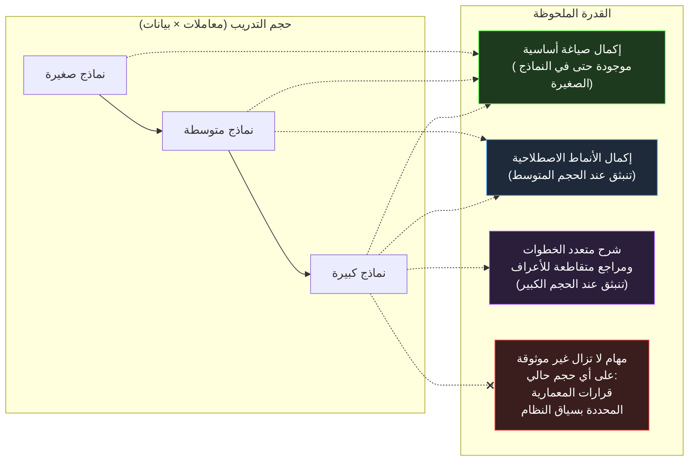
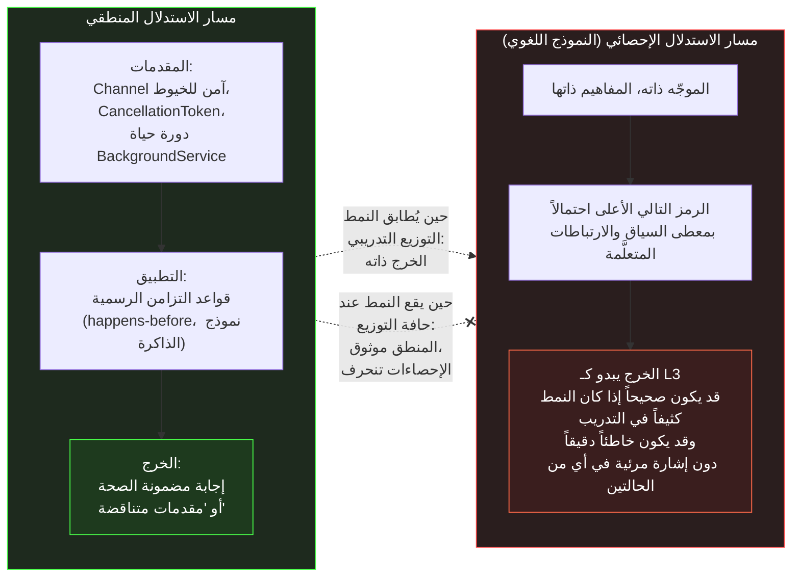
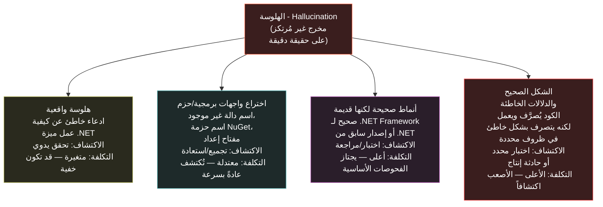
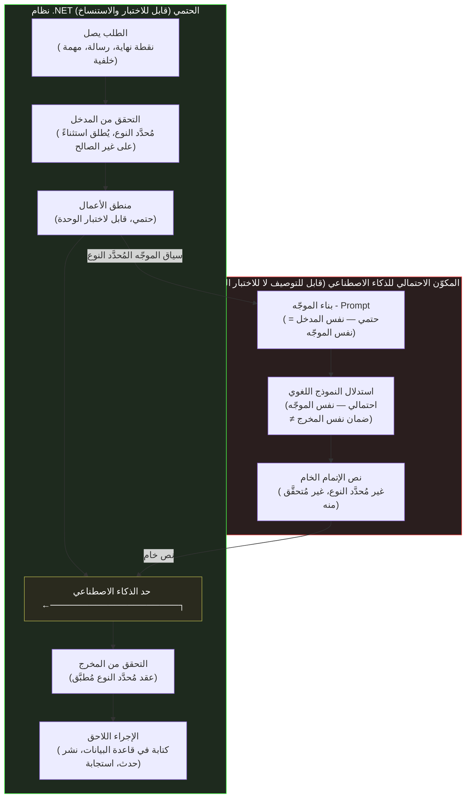
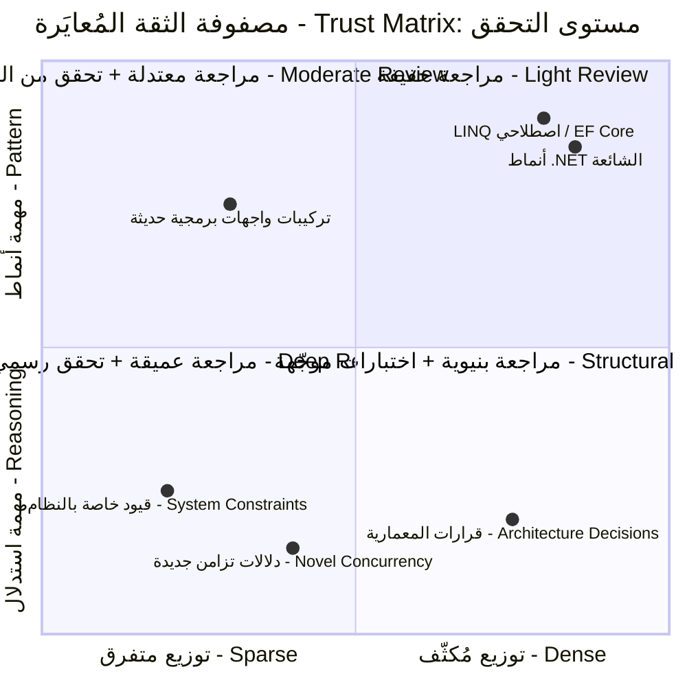

<div dir="rtl">

# القسم الأول — ما الذي يفعله النموذج اللغوي الكبير فعلاً: الرموز والتضمينات والسياق والاستدلال

## الآلية خلف الواجهة

النموذج اللغوي الكبير - Large Language Model يُنتج كل رمز من خرجه عبر عملية تنبؤ واحدة مُكرَّرة: معطيات تمثّل النص حتى اللحظة الراهنة، وتوزيع احتمالي على الرمز التالي، وأخذ عينة من ذلك التوزيع، وإلحاق الرمز المُنتَج بالمتتالية ثم الإعادة. هذه هي آلية التوليد بأكملها — لا توجد خطوة تخطيط مستقلة، ولا تمثيل داخلي للمشكلة، ولا عملية تشبه الاسترجاع من قاعدة بيانات. كل شيء آخر — مظهر الاستدلال، ومظهر الطلاقة، ومفردات المعمارية، والكود الذي يبدو صحيحاً — هو ما تُنتجه هذه الآلية حين تكون الأرقام تمثيلاً للغة وحين يكون النموذج قد دُرِّب على مجموعة ضخمة من النصوص البشرية.

يصطدم مهندس .NET للمرة الأولى بهذا النموذج بشيء مألوف في مظهره ومُربك في جوهره: يُرسل طلباً فيعود إليه رد، والرد نص — كود C# صحيح نحوياً في أغلب الأحيان، أو تحليل معماري سليم البنية، أو صياغة تحمل نفس مستوى الدقة التقنية التي يتوقعها من زميل أول في جلسة مراجعة تصميم. كل الحدس المبني على سنوات من العمل مع أنظمة حتمية - Deterministic Systems يوحي بأن ثمة شيئاً تحت السطح يُنتج هذا الخرج بطريقة تشبه طريقة الخدمة حين تُنتج استجابةً: تمثيل داخلي للمشكلة، واسترجاع للحقائق ذات الصلة، وعملية تشبه التفكير. لكن الآلية الحقيقية مختلفة جوهرياً — وهي موضوع هذا القسم.

يبني هذا القسم تلك الآلية من الأساس، مستخدماً مفردات وأطراً تنسجم مع المفاهيم التي يملك مهندس .NET حدساً عملياً بشأنها: التسلسل والبحث في القواميس - Dictionary Lookup والمخازن المؤقتة ذات الحجم الثابت - Fixed-Size Buffers واستدعاءات الدوال. الهدف ليس الاكتمال الرياضي — بل نموذج ذهني دقيق بما يكفي لجعل السلوكيات التي يفحصها بقية هذا الفصل تبدو نتائج طبيعية متوقعة، لا مجرد مفاجآت عشوائية.

## الرموز - Tokens: وحدة كل شيء

قبل أن يتمكن النموذج اللغوي من فعل أي شيء بالنص، يجب تحويل ذلك النص إلى متتالية من الأعداد الصحيحة. يُجري هذه التحويل مُرمِّز - Tokenizer، والأعداد التي ينتجها تُسمى رموزاً - Tokens. الرمز ليس بالضرورة كلمة. الكلمات الشائعة غالباً ما تكون رمزاً واحداً. الكلمات الأقل شيوعاً تُقسَّم إلى رموز متعددة — لواحق وسوابق وأجزاء كلمات تتكرر بما يكفي عبر مجموعة التدريب لتستحق مدخلاً خاصاً بها في قاموس المُرمِّز. علامات الترقيم والمسافات البيضاء وحتى أجزاء من أنماط الكود الشائعة لها هويات رمزية خاصة بها.

بالنسبة لمهندس .NET، أقرب حدس متاح هو مخطط ضغط قائم على قاموس: يحتفظ المُرمِّز بمفردات ثابتة الحجم — عادةً ما بين 50,000 و200,000 مدخل حسب عائلة النموذج — وكل نص مُدخل يُشفَّر كمتتالية من المؤشرات إلى تلك المفردات. الكلمة "CancellationToken" قد تكون رمزاً واحداً في مفردات تدرّبت على كميات كبيرة من الكود، لأن تسلسل المحارف "CancellationToken" يظهر بما يكفي من التكرار في بيانات التدريب لتدمجه عملية بناء المُرمِّز — المعروفة عادةً بترميز أزواج البايت - Byte-Pair Encoding — في وحدة واحدة. معرّف أقل شيوعاً مثل "IIdempotencyKeyGenerator" يُرجَّح تقسيمه إلى رموز عدة: ربما "I" و"Idem" و"potency" و"Key" و"Generator"، كل منها شريحة تتكرر كثيراً في قاموس النموذج حتى وإن لم يكن المعرّف الكامل كذلك.

لهذا انعكاس مباشر وملموس يواجهه المهندسون الذين يبنون أنظمة .NET مدمجة بالذكاء الاصطناعي فوراً: التكلفة واستهلاك السياق تُقاس بالرموز لا بالكلمات أو المحارف، والعلاقة بين النص المصدري وعدد الرموز غير منتظمة. فقرة من النثر الإنجليزي الشائع قد تتوسط نحو أربعة محارف لكل رمز. كتلة من كود C# مليئة بمعرّفات خاصة بالمشروع أو معرّفات GUID أو أسلوب تسمية غير معتاد قد تستهلك رموزاً أكثر بكثير لنفس عدد المحارف. حين تُنشئ خدمة .NET موجّهاً - Prompt يتضمن Stack Trace أو ملف إعداد أو كتلة كود قديمة ذات تسمية غريبة، لا يمكن تقدير تكلفة الرموز لذلك السياق بقسمة عدد المحارف على ثابت، لأن التكلفة تعتمد على مدى تطابق مفردات المُرمِّز — التي شكّلتها مجموعة تدريبه — مع مفردات النص المُرمَّز.

```mermaid id="diagram-02-01"
flowchart LR
    A["نص الإدخال:
'var token = await
GetTokenAsync(ct);'"]
    B["المُرمِّز - Tokenizer
(بحث في مفردات ثابتة)"]
    C["معرّفات الرموز - Token IDs:
[1924, 6816, 284, 13, ...]"]
    D["طبقة التضمين - Embedding layer
(تحويل المعرّف إلى متجه)"]
    E["متجهات التضمين
(واحدة لكل رمز،
أبعاد ثابتة)"]
    F["طبقات المحوّل - Transformer
(انتباه + تغذية أمامية،
تُكرَّر N مرة)"]
    G["طبقة الخرج:
توزيع احتمالي
على الرمز التالي"]
    H["أخذ العينات - Sampling
(اختيار معرّف الرمز التالي)"]
    I["إضافة للمتتالية،
تكرار من F"]

    A --> B --> C --> D --> E --> F --> G --> H --> I
    I -.->|حلقة حتى
شرط التوقف| F

    style A fill:#1e2a3a,stroke:#4a9eff,color:#fff
    style C fill:#1e3a2a,stroke:#4aff6a,color:#fff
    style E fill:#1e3a2a,stroke:#4aff6a,color:#fff
    style G fill:#3a2a1e,stroke:#ffaa4a,color:#fff
    style H fill:#3a2a1e,stroke:#ffaa4a,color:#fff
```



المخطط يمثّل الحلقة التوليدية الكاملة. كل مربع مهم للقرارات الهندسية التي يتناولها هذا الفصل، لكن الحلقة ذاتها — ولا سيما سهم التغذية الراجعة من أخذ العينات - Sampling إلى طبقات المحوّل - Transformer Layers — هي الحقيقة البنيوية الأهم المتعلقة بكيفية عمل هذه الأنظمة. النموذج لا يُنتج استجابة ثم يتوقف ليقيّمها. إنه يُنتج رمزاً واحداً، يُضيف ذلك الرمز إلى مدخلاته الخاصة، ويُعيد تشغيل التمرير الأمامي - Forward Pass بأكمله مرة أخرى. نموذج يُولّد استجابة من خمسمئة رمز لسؤال معماري يُنفّذ خمسمئة تمرير أمامي كاملاً، كل منها مشروط بكل ما جاء قبله — بما في ذلك رموزه الأولى السابقة، صحيحةً كانت أم لا.

## التضمينات - Embeddings: أين يسكن المعنى كهندسة

معرّفات الرموز - Token IDs أعداد صحيحة اعتباطية — الرقم المحدد المخصص لـ "CancellationToken" لا يحمل في ذاته معنى متأصلاً يتجاوز دوره كمفتاح بحث. أول عملية جوهرية يُجريها النموذج هي تحويل كل معرّف رمز إلى متجه - Vector: قائمة من الأعداد العشرية، عادةً ما بين عدة مئات وعدة آلاف عنصراً حسب حجم النموذج. هذا المتجه هو تضمين الرمز - Token Embedding، ويُستخرج من جدول بحث متعلَّم — مفاهيمياً مشابه لـ Dictionary<int, float[]> حيث القاموس نفسه كان ناتج التدريب لا الإعداد.

هندسة فضاء المتجهات هذا هو المكان الذي تسكن فيه "معرفة" النموذج للغة. خلال التدريب، يُعدَّل تضمين الرمز بحيث تنتهي الرموز التي تميل إلى الظهور في سياقات متشابهة بمتجهات متشابهة — قريبة بعضها من بعض في الفضاء عالي الأبعاد الذي تشغله التضمينات. هذه ليست خاصية مُصمَّمة؛ إنها تنبثق من هدف التدريب. نموذج مدرَّب على التنبؤ بالرمز التالي، مع كميات كافية من النص، يكتشف أن "IRepository" و"IService" و"IPaymentGateway" تميل جميعها إلى الظهور في مواضع نحوية متشابهة — بعد <code dir="ltr">private readonly</code>، وقبل معامل نوع جنيسي أو اسم معامل في مُنشئ — وتضميناتها تتجه نحو بعضها في فضاء المتجهات كتأثير جانبي لتحسين ذلك الإطراد التوزيعي المشترك. ولا يتلقى النموذج تعليماً صريحاً بأن هذه كلها "أنواع واجهات تمثل تبعيات محقونة" — بل يكتشف إطراداً هندسياً يتوافق مع ذلك المفهوم البشري، لأن المفهوم ذاته هو ما أنتج الإطراد في بيانات التدريب أصلاً.

هذا مهم لسبب هندسي يصبح ملموساً في الأقسام اللاحقة: حين يُولّد النموذج اقتراحاً يتضمن معرّفاً غير مألوف — اسم دالة، أو اسم حزمة، أو مفتاح إعداد لم يره تحديداً — فهو لا يسترجعه من شيء يشبه قاعدة بيانات بحث في واجهات برمجية حقيقية. إنه يُموضَع، بفعل هندسة فضاء التضمين والأنماط المتعلَّمة عليه، قريباً من المعرّفات التي تبدو مشابهة، فيُولّد شيئاً يشغل موقعاً مماثلاً في فضاء "المعرّفات المعقولة في هذا السياق". في بعض الأحيان يتوافق ذلك الموقع مع واجهة برمجية حقيقية. وفي أحيان أخرى يتوافق مع واجهة برمجية منطقية نظراً لأعراف النظام البيئي، لكنها غير موجودة. الآلية التي تُنتج كلا النتيجتين متطابقة. لا شيء في عملية التوليد يُميّز "هذا المعرّف حقيقي" عن "هذا المعرّف يبدو فحسب كالمعرّفات القريبة منه في فضاء التضمين."

## نافذة السياق - Context Window: مجموعة عمل ذات حجم ثابت

لكل نموذج حد أقصى من الرموز التي يستطيع معالجتها في تمرير أمامي واحد — نافذة السياق - Context Window. تتراوح نوافذ السياق في النماذج الحديثة بين عشرات الآلاف وأكثر من مليون رمز، لكن الرقم دائماً منتهٍ، وهو مشترك بين كل ما يحتاج النموذج لأخذه في الحسبان: موجّه النظام - System Prompt، وتاريخ المحادثة، وأي وثائق أو كود مُقدَّم كسياق، والاستجابة الجارية حتى الآن.

أقرب تشبيه في .NET هو مخزن مؤقت ذو حجم ثابت - Fixed-Size Buffer أو Memory<T> محدودة تُخصَّص مرة واحدة لكل طلب. على خلاف List<T> التي تنمو حسب الحاجة، نافذة السياق لا تتوسع لاستيعاب المزيد من المعلومات — إذا تجاوز مجموع عدد رموز كل ما يحتاج أن يكون في السياق نافذةً، يجب اقتطاع شيء ما أو تلخيصه أو حذفه قبل إرسال الطلب. والأهم من ذلك أن كل رمز داخل تلك النافذة يُعالَج من جديد في كل تمرير أمامي أثناء التوليد. تعمل طبقات المحوّل المبيَّنة في المخطط أعلاه على المتتالية كاملةً — الإدخال وكل ما جرى توليده حتى الآن — في كل خطوة. وتتغير الكلفة الحسابية لكل عملية انتباه مع طول السياق، لأن الانتباه يُحسَب بين كل زوج من الرموز في المتتالية — فمضاعفة السياق لا تُضاعف البيانات المقروءة فحسب.

تُعامل نافذة السياق في الخدمة التي تُركّب الموجّهات برمجياً — موجّه نظام، ووثائق مسترجعة، وأدوار محادثة أخيرة، واستعلام مستخدم مُجمَّعة في طلب واحد — قيدَ مورد صلباً له تبعات الكلفة والكمون، لا إرشاداً مرناً. فخدمة تُلحق "كل ما قد يكون ذا صلة" بالموجّه تتخذ قرار تخصيص من الفئة ذاتها التي تتخذها خدمة تُخصّص مخزناً غير محدود لكل طلب: تعمل بكفاءة حتى تكبر المدخلات، ثم إما أن تفشل صراحةً (تجاوز حد السياق) أو تتدهور بطرق أصعب تشخيصاً — وهو موضوع فحص القسم الثاني لآثار "الضياع في المنتصف" - Lost in the Middle.

## أخذ العينات - Sampling: مصدر التباين غير الحتمي

تُؤدي طبقات المحوّل ما يُسمى الاستدلال - Inference: سلسلة عمليات رياضية — أساسها الانتباه، الذي يحسب مدى تأثر تمثيل كل رمز بتمثيلات الرموز الأخرى، وتحويلات تغذية أمامية - Feed-Forward تُطبَّق على كل موضع بصورة مستقلة.

يُنتج المحوّل في طبقته الأخيرة متجهاً من الدرجات الخام يُسمى اللوجيتات - Logits، درجة واحدة لكل مدخل في المفردات. تتحول هذه اللوجيتات إلى توزيع احتمالي عبر عملية Softmax، ويُختار الرمز التالي بأخذ عينة من ذلك التوزيع.

معامل يُسمى درجة الحرارة - Sampling Temperature يتحكم في كيفية تحويل التوزيع الاحتمالي إلى اختيار: عند درجة حرارة صفر يُختار دائماً الرمز الأعلى احتمالاً (حتمي، أو قريب من ذلك بقدر ما تسمح به دقة الفاصلة العشرية عبر الأجهزة)؛ وعند درجات حرارة أعلى يكون لرموز ذات احتمال أقل فرصة حقيقية غير صفرية للاختيار، مما يُنتج خرجاً أكثر تنوعاً — ومخرجات صالحة بمعيار النموذج الداخلي على قدم المساواة. فلا فرق نوعي بين الاستمرار الأعلى احتمالاً والاستمرار الخامس من حيث الاحتمال — كلاهما نقطة على التوزيع ذاته. ولا يختار النموذج افتراضياً "الرمز الأعلى احتمالاً" كقاعدة حتمية — وإن أمكن ضبطه ليفعل ذلك.

<div dir="ltr">

```csharp id="code-02-01"
// Target Framework: .NET 8.0
// Chapter: 02 | Section: 01
// book/chapters/chapter-02/sections/section-01.ar.md
//
// تطبيق Console بسيط في .NET يستدعي نقطة نهاية إكمال دردشة متدفقة
// ويطبع الاستجابة رمزاً بعد رمز فور وصولها، إلى جانب عدد رموز المحادثة.
//
// الهدف: إظهار الطبيعة المتتالية لكل رمز على حدة في عملية التوليد.
// كل سطر مطبوع يتوافق مع تمرير أمامي واحد عبر النموذج —
// لا مع "خطوة تفكير" واحدة أنتجت الإجابة كاملة.

using System.ClientModel;
using OpenAI.Chat;

var client = new ChatClient(
    model: "gpt-4o-mini",
    credential: new ApiKeyCredential(
        Environment.GetEnvironmentVariable("OPENAI_API_KEY")
            ?? throw new InvalidOperationException("OPENAI_API_KEY not set")));

var messages = new ChatMessage[]
{
    new SystemChatMessage(
        "You are a senior .NET engineer. Answer in one short paragraph."),
    new UserChatMessage(
        "What does the CancellationToken parameter do in an async method?"),
};

Console.WriteLine("--- استجابة متدفقة، كتلة واحدة لكل تمرير أمامي ---");

var tokenCount = 0;
await foreach (var update in client.CompleteChatStreamingAsync(messages))
{
    foreach (var part in update.ContentUpdate)
    {
        // كل part.Text هنا يتوافق عادةً مع رمز واحد أو عدد قليل من الرموز —
        // أصغر وحدة يمكن للنموذج إصدارها في كل تمرير أمامي.
        // الطباعة الفورية دون تخزين مؤقت تكشف عملية التوليد التسلسلية
        // في الوقت الفعلي بأوضح صورة ممكنة.
        Console.Write(part.Text);
        tokenCount++;
    }
}

Console.WriteLine();
Console.WriteLine($"--- الكتل التقريبية الملحوظة في الخرج: {tokenCount} ---");

// ملاحظة معمارية (S01 → S02):
// كل كتلة مطبوعة أعلاه نتاج إعادة تشغيل طبقات المحوّل بأكملها
// على الموجّه بالكامل بالإضافة إلى كل كتلة جرى توليدها حتى الآن.
// لا توجد "خطوة تخطيط" مستقلة سبقت هذه الحلقة.
// أي بنية في الإجابة النهائية — إن وُجد لها بداية ووسط ونهاية واضحة —
// نشأت رمزاً رمزاً، اختير كل منها بناءً على المتتالية حتى تلك اللحظة،
// لا بناءً على مخطط مُعَد مسبقاً.
```

</div>

تشغيل الكود أعلاه ضد الموجّه ذاته عدة مرات — حتى عند درجة حرارة منخفضة ثابتة — قد يُنتج متتاليات رموز مختلفة بفروق دقيقة: فخطوة أخذ العينات تُدخل مصدر تباين حقيقياً لا نظير له في استدعاء دالة .NET معتادة. ومهندس اعتاد كتابة اختبارات وحدة تُؤكّد المساواة النصية الدقيقة لقيمة مُرجَعة سيجد أن هذا الافتراض لا ينتقل إلى المخرجات المُولَّدة بالذكاء الاصطناعي دون قرار معماري صريح حول مقدار التباين المقبول وكيفية اكتشافه — وهو ما يعود إليه هذا الفصل مباشرةً في معالجة القسم الخامس للأنظمة الحتمية مقابل الاحتمالية.

## ما لا تحتويه هذه الآلية

من المفيد أن نكون صريحين بشأن ما هو غائب، لأن الغياب بالتحديد هو ما يُضلّ الحدس المُكتسَب من العمل مع الأنظمة الحتمية.

لا توجد ذاكرة مستمرة بين الطلبات فيما يتجاوز ما أُدرج صراحةً في نافذة السياق - Context Window. النموذج لا "يتذكر" محادثة سابقة ما لم تُعَد إرسال رموز تلك المحادثة كجزء من السياق الحالي. لا توجد قاعدة بيانات مستقلة من الحقائق يُراجعها النموذج — كل ما "يعرفه" مُشفَّر ضمنياً وبشكل لا يمكن الفصل فيه في أوزان جداول التضمين وطبقات المحوّل، أُثبتت خلال التدريب ولا يُحدِّثها شيء يحدث خلال الاستدلال - Inference. ولا يوجد تمثيل صريح لـ "المهمة الحالية" أو "خطة هذه الاستجابة" مستقل عن متتالية الرموز ذاتها — فإذا بدا المخرج وكأنه اتبع خطة، فتلك البنية ليست إلا نمطاً في الرموز المُولَّدة، لا يتميز من منظور النموذج عن أي متتالية رموز أخرى كان يمكن إنتاجها.

وهذا ليس قيداً يمكن لهندسة الموجّه - Prompt Engineering أن تتجاوزه بالكامل، وليس قيداً ستُزيله النماذج الأكبر بالضرورة — إنه البنية ذاتها. كل ما يُستكشَف في بقية هذا الفصل — لماذا تبدو النماذج وكأنها تستدل، وأين ينهار ذلك الاستدلال الظاهري، ولماذا الهلوسة - Hallucination بنيوية وليست عَرَضية، وما يبدو عليه التعامل المُعايَر والحذر مع المخرجات — يتبع مباشرةً من الآلية الموصوفة في هذا القسم.

## التمييز بين الأنواع المختلفة من "الخطأ" في النموذج اللغوي الكبير

من أكثر سوء الفهم شيوعاً لدى مهندسي .NET الذين يتعاملون مع نماذج لغوية كبيرة لأول مرة هو تصوّر أن أخطاء النموذج تشبه استثناءات وقت التشغيل - Runtime Exceptions أو أخطاء التحقق من النوع - Type Errors: أحداث مميزة يمكن اكتشافها وإدارتها بشكل موثوق. الآلية الموصوفة في هذا القسم تكشف لماذا هذا التصوّر مُضلِّل بنيوياً.

في نظام .NET حتمي، يفشل مسار الكود الخاطئ بطريقة واحدة من ثلاث: إما أن يرفض المُصرِّف - Compiler تصريفه لأنه يخرق نظام الأنواع، أو أن يتعطل وقت التشغيل ويُطلق استثناءً عند نقطة الفشل، أو أن يُنتج خرجاً خاطئاً يمكن اكتشافه باختبار تُوجد له مدخلات تعرض الفشل. في الحالات الثلاث، الفشل مميز وحدوده قابلة للتحديد.

في النموذج اللغوي الكبير، لا توجد آلية مكافئة لهذا التمييز. الرمز التالي هو ببساطة الرمز الأعلى احتمالاً وفق التوزيع المتعلَّم، بصرف النظر عمّا إذا كان ذلك الرمز جزءاً من إجابة صحيحة أو جزءاً من معلومة مُخترَعة. النموذج ليس لديه حالة داخلية تُمثّل "أنا واثق" أو "أنا أُخمّن" — إنه يُنتج توزيعاً احتمالياً في كلتا الحالتين، والفرق بين الحالتين هو في الأرجحيات النسبية للرموز المختلفة، لا في أي علم صريح يمكن استفساره. هذا هو السبب الجوهري وراء كون الثقة المُعبَّر عنها في مخرجات النموذج — النبرة القاطعة، والجمل الحاسمة غير المُتحفِّظة — مُولَّدةً كأرجح الرموز في سياق تتضمن نصوصاً تقنية واثقة النبرة، لا مشتقةً من أي تقييم داخلي لصحة المحتوى المتاخم. القسمان الثالث والرابع يعودان إلى هذا مباشرةً بتحليل تفصيلي للأنماط التي ينهار فيها الاستدلال الإحصائي وما يبدو عليه ذلك الانهيار من وجهة نظر مهندس .NET يُقيّم مخرجات النموذج.

## الأهمية العملية لفهم الآلية

ربما يتساءل المهندس بحق: لماذا يستحق هذا المستوى من التفصيل المعماري الدراسة حين يمكنني ببساطة اختبار مخرجات النموذج والتعامل مع ما لا يعمل؟ الجواب يظهر في ثلاثة مواضع.

الأول هو أن فهم الآلية يُمكّن من التنبؤ بالفشل بدلاً من مجرد رصده. مهندس يعرف أن مهارة النموذج دالة في كثافة البيانات التدريبية يستطيع إجراء تقييم استباقي للمخاطر قبل دمج نموذج في خدمة إنتاجية: هل هذه المهمة تعتمد على أنماط موثقة جيداً؟ أم تعتمد على تفاعلات نادرة بين ميزات .NET متعددة لا توجد لها أمثلة كافية في بيانات التدريب؟ الإجابة تُحدد مستوى التحقق الذي يتطلبه دمج الذكاء الاصطناعي في المسار الحرج.

الثاني هو أن فهم نافذة السياق - Context Window يُحسّن جودة مخرجات النموذج بشكل مباشر. المهندس الذي يعرف أن النموذج يُعالج كل رمز في نافذته في كل تمرير أمامي — وأن الرموز في منتصف السياق الطويل تحظى باهتمام أقل بفعل ما أشارت إليه الأبحاث بظاهرة "الضياع في المنتصف" - Lost in the Middle — سيُصمّم بنية الموجّهات بشكل مختلف: سيضع المعلومات الأكثر أهمية في البداية والنهاية، وسيُدار حجم السياق بوعي بدلاً من الإضافة غير المحدودة لكل ما قد يكون ذا صلة.

الثالث هو أن فهم التوليد التسلسلي يُوضّح لماذا التعليمات المتأخرة في الموجّه لها أثر مختلف عن التعليمات المبكرة فيه. الرموز السابقة تُؤثر في توزيعات الاحتمال للرموز اللاحقة. السياق الذي يُقدّمه النظام في بداية الموجّه يُشكّل التوزيع الإجمالي لكل ما يأتي بعده. تعليمات تُعطى متأخرة في المحادثة الطويلة قد تُخفَّف تأثيراتها إذا كانت الرموز المُولَّدة مسبقاً قد رسّخت بالفعل نمطاً إحصائياً قوياً يسير في اتجاه مختلف.

هذه الاعتبارات الثلاثة لا تُضاف إلى القائمة من باب الاستيفاء النظري — هي التطبيق المباشر للآلية المشروحة في هذا القسم على قرارات تصميم خدمات .NET مدمجة بالذكاء الاصطناعي. القسم التالي يبني عليها بطرح السؤال المكمّل: إذا كانت الآلية مجرد تنبؤ بالرمز التالي عبر متتالية، فمن أين يأتي الإيهام الإقناعي بالفهم والاستدلال الذي يُشاهده المهندس في كثير من مخرجاته؟

# القسم الثاني — لماذا تبدو النماذج اللغوية ذكيةً

## آلية دون مكوّن "فهم"، تُنتج مخرجات تبدو كالفهم

أرسى القسم الأول الآلية كاملةً: الرموز - Tokens والتضمينات - Embeddings ونافذة السياق - Context Window الثابتة وحلقة أخذ العينات - Sampling التي تُنتج رمزاً واحداً في كل مرة. لا شيء في ذلك الوصف يمثّل مكوناً يحتفظ بـ "معمارية هذا النظام في .NET"، أو "القصد وراء هذا التعليق في مراجعة الكود"، أو "الطريقة الصحيحة لتنفيذ معالجة الرسائل أحادية التنفيذ - Idempotent Message Handling". ومع ذلك، النموذج المبني من تلك الآلية بالضبط يمكنه إجراء مراجعة لطلب سحب - Pull Request، وتحديد إغفال توزيع CancellationToken، وشرح أهمية ذلك للإيقاف الرشيق - Graceful Shutdown، واقتراح إصلاح يستخدم نمط الرمز المرتبط الصحيح - Linked-Token-Source Pattern — وكل ذلك بطلاقة وتخصيص يصعب تمييزهما، في قراءة منفصلة، عن استجابة مهندس أول.

يُعالج هذا القسم الفجوة بين الآلية والمخرج مباشرةً، لأن الفجوة ليست لغزاً يُمرَّر بتأمله بكلمة "انبثاق - Emergence" — وإن كان ذلك هو المصطلح المستخدم لها — وليست دليلاً على وقوع شيء يتجاوز التنبؤ بالرمز التالي. إنها دليل على ما يصبح قادراً عليه التنبؤ بالرمز التالي حين تكون مجموعة التدريب واسعةً بما يكفي والأنماط فيها كثيفةً ومتسقةً إلى الحد الكافي. فهم سبب صحة ذلك هو ما يُتيح للمهندس التنبؤ بالمكان الذي يكون فيه هذا الذكاء الظاهري موثوقاً وبالمكان الذي لا يكون فيه كذلك.

## مجموعة التدريب ليست نصاً. إنها سلوك مضغوط.

تتضمن مجموعة التدريب لنموذج لغوي كبير حجماً هائلاً من الكود المصدري، والتوثيق التقني، ومراجع واجهات برمجة التطبيقات - API References، وخيوط Stack Overflow، ومناقشات مشكلات GitHub، ومراجعات طلبات السحب - Pull Request Reviews، ومنشورات المدوّنات المعمارية، والكتب المدرسية. وهذا الأمر بالغ الأهمية: ليس هذا موسوعة ثابتة من الحقائق — إنه سجل لكيفية تصرّف البشر حين يكتبون ويُراجعون ويشرحون ويتجادلون حول البرمجيات. خيط Stack Overflow لا يحتوي مجرد "الإجابة" على سؤال عن IAsyncEnumerable<T>؛ بل يحتوي السؤال بصياغته كما يُعبّر عنها المهندسون حين يشعرون بالحيرة، والإجابة بصياغتها كما يشرح بها المهندسون المفاهيم، والتعليقات المتابعة التي تُثير الحالات الحدية - Edge Cases، وأحياناً تصحيحاً للإجابة الأصلية حين يُشير أحدهم إلى أنها لا تعالج الإلغاء - Cancellation بشكل صحيح.

حين يُدرَّب نموذج على التنبؤ بالرمز التالي عبر ملايين الوثائق من هذا القبيل، فإنه — كتأثير جانبي لذلك الهدف الواحد — يُضطَر لاستيعاب البنية الإحصائية للتفكير التقني ذاته. للتنبؤ بالرمز التالي في "المشكلة هنا أن await foreach على هذا IAsyncEnumerable لن يحترم الإلغاء ما لم..." بدقة كافية، يجب على النموذج أن يكون قد تعلّم شيئاً عن العلاقة التوزيعية بين IAsyncEnumerable والإلغاء و await foreach وأنواع العبارات التي تُكمل الجمل المتعلقة بتفاعلها. ولم يتعلّم هذا كقاعدة قيلت مرة واحدة وخُزّنت — بل كإطراد إحصائي تعزّز عبر كل شرح وتصحيح وتعليق مراجعة كود مماثل ظهر في بيانات التدريب، يدفع كل منها معاملات النموذج خطوةً نحو إنتاج نص بالبنية ذاتها حين يتكرر سياق مشابه.



يُلخّص المخطط نمطاً تجريبياً يُلاحَظ عبر أجيال النماذج: بعض القدرات لا تتحسن بصورة سلسة مع الحجم — بل تكون غائبة إلى حد بعيد دون عتبة معينة من حجم النموذج وبيانات التدريب، ثم تظهر بشكل مفاجئ نسبياً فوق تلك العتبة. هذا ما يُشير إليه مصطلح "السلوك الانبثاقي - Emergent Behaviour" في هذا السياق. ليس أمراً غامضاً. إنه يعكس حقيقة أن بعض الأنماط — الشروح التقنية متعددة الخطوات التي تُشير بشكل صحيح إلى عدة مفاهيم متفاعلة — تتطلب من النموذج تعلّم تمثيل مشترك غني بما يكفي لتلك المفاهيم معاً. ودون تلك العتبة، يستطيع النموذج إكمال أنماط قصيرة محلية التوقع — إنهاء توقيع دالة شائع، وإغلاق قوس — لكنه لا يستطيع الحفاظ على الاتساق بعيد المدى الذي يتطلبه شرح تقني متعدد الفقرات.

## لماذا يُنتج هذا مخرجات مفيدة فعلاً لهندسة .NET

لا شيء مما سبق نقدٌ للقدرة الناتجة — بل تفسير لسبب حقيقتها ضمن فئات المهام التي تُغطيها. فنظام البيئة في .NET ممثَّل في بيانات التدريب تمثيلاً استثنائياً بمعايير مدونات البرمجيات: عقود من توثيق Microsoft، وحضور ضخم على Stack Overflow، ومدونة مفتوحة المصدر واسعة على GitHub تمتد من أمثلة Minimal API المبسّطة إلى قواعد كود المؤسسات الكبيرة، وتاريخ طويل من منشورات المدوّنات التي تشرح أنماط المعمارية وخصائص الأداء وإرشادات الترحيل عبر الإصدارات.

والكثافة ليست منتظمة عبر النظام — فدورة حياة العرض في Blazor، وإعداد البث في gRPC، ودلالات إتمام <code dir="ltr">System.Threading.Channels</code> ممثَّلة تمثيلاً أقل من حقن التبعيات السائد أو استعلامات Entity Framework — لكن الفئات المركزية لعمل .NET اليومي تُعَد من بين الأكثف في أي نظام تقني موجود. وهذه ميزة جوهرية يجدر بمهندسي .NET فهمها وإدخالها في استراتيجية التبني.

وتعني هذه الكثافة أن طيفاً واسعاً من المهام — شرح ما تفعله ميزة لغوية، وتوليد تنفيذ لنمط معروف، وتحديد نمط مضاد شائع في مراجعة كود، والترجمة بين واجهات برمجية مكافئة تقريباً عبر الإصدارات — يمتلك البنية الإحصائية اللازمة مُعزَّزةً بعدد هائل من المرات ومن زوايا متعددة، تشتمل غالباً على التصحيحات والتحفظات التي ترافق الإجابة "الواضحة". فحين يُولّد النموذج إجابةً عن "كيفية تنفيذ نمط Repository مع EF Core"، فهو لا يسترجع إجابةً معياريةً واحدة — بل يُنتج مخرجاً تُشكّله حصيلة عدد هائل من الشروح، بما فيها الأخطاء الشائعة وكيفية تصحيح المهندسين المتمرسين لها، لأن تلك التصحيحات جزء من بيانات التدريب وتُشكّل البنية الإحصائية المُعاد إنتاجها.

وهذه هي الآلية وراء خاصية مفيدة حقيقية: كثيراً ما تُبرز مساعدة الذكاء الاصطناعي ليس "تنفيذاً ما" فحسب، بل تنفيذاً يعكس ضمنياً التصحيح التراكمي للمجتمع — لأن تصحيحات المجتمع مدمجة في الإحصاءات التي تعلّمها النموذج. فمهندس يطلب تنفيذ عملية بث واعياً بـ CancellationToken يُرجَّح أن يحصل على تنفيذ يتعامل مع الإلغاء بصورة صحيحة، لا لأن النموذج "يعلم أن الإلغاء مهم" بأي معنى صريح، بل لأن النص الذي يصف عمليات البث دون معالجة صحيحة للإلغاء يتبعه تصحيح في مدونة التدريب بنسبة غير متناسبة — وتلك العلاقة الإحصائية هي بالضبط ما تعلّم النموذج إعادة إنتاجه.

## لماذا يشبه المخرج الفهم دون أن يحتويه

تعبير "مخرج على هيئة الفهم" من عنوان هذا القسم يصف شيئاً دقيقاً. فالنموذج لا يحتوي تمثيلاً داخلياً لما هو <code dir="ltr">IAsyncEnumerable<T></code>، وكيف يختلف عن <code dir="ltr">IEnumerable<T></code> في خصائص التخصيص والجدولة، أو لماذا يهم انتشار الإلغاء لسيناريوهات البث. ما يحتويه هو نموذج إحصائي عالي الأبعاد لمتتاليات الرموز التي أنتجها المهندسون البشر حين ناقشوا هذه المواضيع — التعريفات، والتفسيرات السببية، وأمثلة الكود، وتنبيهات الحالات الحدية، والتصحيحات التي تُشكّل هيئة الشرح التقني. وحين يُولّد النموذج مخرجاً يُقرأ كشرح مهندس أول، فهو لا يسترجع فهماً ويترجمه إلى كلمات — بل يُنتج متتاليات رموز متسقة إحصائياً مع الحصيلة الكلية لكل شرح صادفه لذلك المفهوم أثناء التدريب. لقد استوعب النموذج *بنية الاستدلال التقني كشكل نصي* — تعريفات تليها آليات تليها أمثلة تليها تحفظات — دون امتلاك أي نموذج سببي للنطاق الذي تصفه تلك الأشكال النصية. ولهذا بالتحديد يكون المخرج موثوقاً في مناطق التدريب الكثيفة (حيث الهيئة الكلية متسقة ومعزَّزة جيداً) وغير موثوق في المناطق المتفرقة (حيث الهيئة الكلية غير متسقة أو ناقصة العينات)، لأن إخلاص المخرج خاصية الكثافة الإحصائية لمادة المصدر، لا خاصية فهم داخلي قد يتعمم خارجها.

## الآلية ذاتها مُطبَّقة على منطقة أخف كثافةً

الصياغة الصادقة لـ "لماذا تبدو النماذج اللغوية ذكيةً" تستلزم النظر مباشرةً فيما يحدث حين تُطبَّق الآلية ذاتها على منطقة من فضاء المشكلة حيث مجموعة التدريب متفرقة أو غير متسقة أو أصغر — لأن الآلية لا تتغير. تتغير الإحصاءات فحسب.

<div dir="ltr">

```csharp id="code-02-02"
// Target Framework: .NET 8.0
// Chapter: 02 | Section: 02
// book/chapters/chapter-02/sections/section-02.ar.md
//
// طلبان متماثلا البنية يُرسَلان إلى النموذج ذاته.
// أحدهما يستهدف نمط .NET موثقاً بكثافة؛ والآخر يستهدف تفاعلاً
// أقل شيوعاً في النظام البيئي.
// الآلية المُنتجة للاستجابتين متطابقة (حلقة القسم الأول) —
// وحده التباين الإحصائي لكثافة الأنماط في بيانات التدريب يختلف.
//
// الهدف: إثبات أن القدرة ليست خاصية النموذج بمعزل — إنها خاصية
// النموذج مُطبَّقاً على منطقة محددة من التوزيع التدريبي.

using System.ClientModel;
using OpenAI.Chat;

var client = new ChatClient(
    model: "gpt-4o-mini",
    credential: new ApiKeyCredential(
        Environment.GetEnvironmentVariable("OPENAI_API_KEY")
            ?? throw new InvalidOperationException("OPENAI_API_KEY not set")));

var systemPrompt = new SystemChatMessage(
    "You are a senior .NET engineer. Provide a concrete code example " +
    "with a brief explanation. If you are not confident an API exists " +
    "exactly as described, say so explicitly.");

// ── الطلب A: نمط موثق بكثافة ───────────────────────────────────────────
// نقطة نهاية Minimal API مع حقن التبعيات — أحد أكثر الأنماط شيوعاً
// في توثيق .NET الحديث والشروحات والأمثلة منذ .NET 6.
// كثافة بيانات التدريب: عالية جداً.
var promptA = new UserChatMessage(
    "Show a minimal API endpoint in ASP.NET Core that injects a scoped " +
    "service and returns a 404 if a resource is not found.");

// ── الطلب B: نمط أخف تمثيلاً ──────────────────────────────────────────
// تفاعل محدد أقل شيوعاً: دمج IAsyncEnumerable مع JsonSerializerOptions
// مخصصة لكل نقطة نهاية (لا على مستوى الإعداد العام) مع ضمان عدم
// تخزين الاستجابة من قِبل Middleware الضغط. تركيبة أقل توثيقاً معاً
// مقارنةً بكل مكوّن بمعزل. كثافة بيانات التدريب: منخفضة.
var promptB = new UserChatMessage(
    "Show a minimal API endpoint that streams an IAsyncEnumerable<T> " +
    "as JSON using endpoint-specific JsonSerializerOptions, while also " +
    "ensuring response compression middleware does not buffer the " +
    "entire stream before sending.");

foreach (var (label, prompt) in new[] { ("A (كثيف)", (ChatMessage)promptA),
                                          ("B (متفرق)", promptB) })
{
    Console.WriteLine($"\n=== الطلب {label} ===");
    var response = await client.CompleteChatAsync([systemPrompt, prompt]);
    Console.WriteLine(response.Value.Content[0].Text);
}

// الملاحظة المتوقعة عند تشغيل هذا:
//
// الطلب A يُنتج عادةً تنفيذاً صحيحاً اصطلاحياً جاهزاً للاستخدام مباشرةً —
// لأن هذا الشكل من الكود كُتب ووُثّق وصُحّح آلاف المرات في بيانات التدريب.
//
// الطلب B يُنتج عادةً مخرجاً يبدو مماثلاً بنيوياً — النبرة الواثقة ذاتها،
// وتنسيق بلوك الكود ذاته، والأسلوب التوضيحي ذاته — لكنه أكثر عرضةً
// لاحتواء معلومة غير دقيقة: حمل زائد لـ JsonSerializerOptions لا ينطبق
// على مستوى نقطة النهاية بالصورة الموصوفة، أو تفاعل ضغط/تدفق لا يصمد
// عملياً. ثقة النبرة في الاستجابة لا تتبع هذا الفرق — وهو موضوع القسم السادس.
```

</div>

تشغيل الطلبين على النموذج ذاته يُنتج استجابتين بنفس المظهر السطحي: نبرة واثقة، وتنسيق بلوك كود، وشرح موجز. مهندس يقرأ النبرة والبنية فقط — دون التحقق المستقل — لا يجد في الاستجابة ذاتها إشارةً تُنبئه بأن إحداهما مبنية على أساس إحصائي أرسخ بكثير من الأخرى. وهذا ليس خللاً يظهر في الحالات الحدية فحسب — بل نتيجة مباشرة متوقعة لآلية القسم الأول مُطبَّقة على منطقتين من توزيع تدريب تتفاوت كثافته تفاوتاً هائلاً ولا يُرى من الخارج.

## إعادة الصياغة العملية: القدرة خريطة لتوزيع التدريب

أكثر إعادة صياغة مفيدة يقدمها هذا القسم هي التالية: حين تُقيّم مدى الثقة في مخرجات الذكاء الاصطناعي لمهمة هندسية محددة في .NET، السؤال الوجيه ليس "هل هذا النموذج ذكي بما يكفي لهذا؟" — وهو توصيف يفترض قدرةً قياسيةً واحدة إما أن تُعبر العتبة أو لا. السؤال الوجيه هو "كم يُمثَّل هذا النوع المحدد من المهام، في هذا التركيب المحدد من التقنيات، في النصوص التي دُرِّب عليها هذا النموذج؟"

المهام التي تتضمن أنماط .NET المستخدمة على نطاق واسع والمُؤسَّسة منذ فترة طويلة تقع في مناطق كثيفة وموثوقة من توزيع التدريب. المهام التي تتضمن تفاعل عدة ميزات أقل شيوعاً، أو واجهات برمجية حديثة محدودة التوثيق عند تاريخ التدريب، أو قرارات معمارية تعتمد على حقائق محددة بنظام معين لا يمكن لأي مجموعة تدريب احتواؤها — هذه تقع في مناطق متفرقة، حيث الآلية الإحصائية ذاتها تُنتج مخرجاً بنفس ثقة السطح ولكن بمعدل هلوسة - Hallucination أعلى واحتمال أعلى لوقوع نمط الفشل "الشكل الصحيح والدلالات الخاطئة" الذي سيُعالجه القسم الثالث.

هذه الخريطة ليست ثابتة. تتغير مع كل جيل جديد من النماذج مع توسّع مجموعات التدريب. لكن شكلها — كثيف قرب الأنماط الشائعة والموثقة جيداً والمُؤسَّسة منذ فترة طويلة؛ متفرق قرب الجديدة والخاصة بالمشروع أو المُقدَّمة حديثاً — بنيوي لا عَرَضي. يتناول القسم الثالث ما يحدث عند الحدود بين هاتين المنطقتين بمزيد من التفصيل، مع تركيز خاص على الفرق بين مطابقة الأنماط الإحصائية ونوع الاستدلال المنطقي الذي تتطلبه القرارات المعمارية فعلاً — ولماذا يهم ذلك الفرق حتى داخل المناطق الكثيفة الموثوقة التي وصفها هذا القسم.

## تكرار الرموز وهندسة التضمينات وشكل الموثوقية

خريطة الكثافة الموصوفة أعلاه ليست تجريداً — بل لها مقابل ميكانيكي ملموس في فضاء التضمين وفي توزيع تكرار رموز التدريب. فحين يظهر مفهوم مثل <code dir="ltr">IHttpClientFactory</code> عشرات آلاف المرات عبر التوثيق والشروح والمدوّنات والكود المصدري في مدونة التدريب، يُطوّر النموذج منطقةً عالية الأبعاد في فضاء معاملاته تكون فيها الرموز المرتبطة بذلك المفهوم متجمعةً بإحكام: اسم المفهوم، وسياقات استخدامه الشائعة، ومعاملات مُنشئه، ودوال التوسعة الخاصة به، وأنماط أخطائه، والنثر التوضيحي الذي يرافق كلاً منها عادةً. وحين يظهر مفهوم مثل <code dir="ltr">System.Threading.Channels.Channel<T></code> بإعداد محدود محدد مرات أقل بكثير — ربما بضع مئات عبر المدونة، وغالباً في أمثلة مبسّطة لا في الصورة المكتملة للإنتاج — تكون المنطقة المقابلة أقل تحديداً: يعرف النموذج الرموز التي تتزامن معه، لكن التوزيع المشترك لتفاعله مع المفاهيم الأخرى (الإيقاف الرشيق، والضغط الخلفي، وإدارة دورة حياة المنتِج/المستهلك) مُستنتَج من أمثلة أقل عدداً وبالتالي بتباين أوسع.

ويُحدّد هذا التباين موثوقية النموذج مباشرةً. فموجّه يقع في منطقة متجمعة بإحكام من فضاء التضمين يُطلق سلسلة تنبؤات بالرمز التالي يكون فيها التوزيع الاحتمالي حاداً مُركَّزاً في كل خطوة — رمز أو رمزان يهيمنان، ويشكّلان جزءاً من نمط صحيح راسخ. وموجّه يقع في منطقة متجمعة بتراخٍ يُطلق تنبؤات يكون فيها التوزيع مسطحاً — عدة رموز متساوية الاحتمال تقريباً، وقد يأتي الرمز المختار من نمط مختلف غير متطابق صادف أنه يشارك المفردات السطحية. ولا يستطيع النموذج التمييز بين الحالتين من داخل عملية الاستدلال ذاتها — فهو يختار من التوزيع دائماً كما لو كان التوزيع حاداً حتى حين لا يكون كذلك. وهذا هو الأساس الميكانيكي لدعوى القسم الثالث بأن الاستدلال الإحصائي يفشل بصمت.

ولهذا على مهندسي .NET تبعة عملية لا تتضح من الخارج: فموثوقية مخرجات الذكاء الاصطناعي لمهمة مُعطاة ليست منتظمة عبر كل أجزاء المهمة ذاتها. فموجّه يطلب نقطة نهاية Minimal API كاملة في ASP.NET Core مع حقن التبعيات سيُنتج مخرجات موثوقة لبنية نقطة النهاية وتسجيل الحقن ومعالجة الطلب الأساسية — وكلها ممثلة بكثافة. لكن إذا طلب الموجّه ذاته إعداد تخزين مؤقت محدداً باستخدام <code dir="ltr">IMemoryCache</code> مع سياسة انتهاء مخصصة وإبطال عبر <code dir="ltr">IChangeToken</code>، فالنموذج يعمل في منطقة أقل كثافةً لتلك التركيبة المحددة، حتى وإن كان كل مكوّن بمعزله ممثلاً جيداً. فالمركّب أكثر تفرقاً من أجزائه، وموثوقية المخرج المركّب يحكمها أشد المناطق التي يعبرها تفرقاً لا أكثفها. ويجدر بالمهندسين بناءً عليه تقييم مخرجات الذكاء الاصطناعي لا بألفة المفاهيم المفردة التي يذكرها بل بكثافة *التركيبة* المحددة المطلوبة — وهو تمييز يصبح حرجاً كلما نمت التعقيدات التركيبية للمهام.

## اللامتماثل بين التوليد والتحقق

من خصائص خريطة توزيع التدريب وثيقة الصلة بسير العمل الهندسي اللامتماثل بين كلفة توليد المخرج من منطقة متفرقة وكلفة التحقق منه. فتوليد مخرج مقنع الصياغة من منطقة متفرقة شبه مجاني — يُجري النموذج الحساب ذاته تماماً سواء كان النمط الكامن كثيفاً أم متفرقاً، والصفات السطحية للمخرج (النبرة الواثقة، والمفردات الصحيحة، والبنية المناسبة) متطابقة. أما التحقق فأعلى كلفةً بصورة درامية في المناطق المتفرقة: في المناطق الكثيفة يكفي غالباً فحص تجميع سريع وقراءة مرور، لأن المخرج يُعيد إنتاج نمط راسخ تحققت صحته آلاف المرات في بيانات التدريب. وفي المناطق المتفرقة يستلزم التحقق من المهندس تقييم التفاعل المحدد للمفاهيم مستقلاً، وتتبع مسار التنفيذ تحت شروط محددة، وربما بناء اختبارات موجّهة — وهو عمل قد يستغرق أضعافاً مضاعفة لزمن التوليد ذاته.

وهذا اللامتماثل هو الحجة الاقتصادية الجوهرية لفهم خريطة توزيع التدريب: دونها لا يستطيع المهندس تخصيص جهد التحقق تناسبياً مع المخاطر، فينتهي إما إلى الإفراط في التحقق من مخرجات المناطق الكثيفة (إضاعة وقت على مخرج شبه مؤكد الصحة) أو التفريط في التحقق من مخرجات المناطق المتفرقة (قبول مخرج أعلى احتمالاً للخطأ الخفي احتمالاً جوهرياً). وتُوفّر الخريطة أساس تخصيص منهجي: مهام الأنماط في المناطق الكثيفة تنال تحققاً بمستوى التجميع؛ والمهام المتفرقة أو التركيبية تنال المراجعة البنيوية الأعمق التي يتطلبها ملف مخاطرها. ويُصوغ القسم الثالث هذا التخصيص رسمياً بالتمييز بين مهام الأنماط ومهام الاستدلال وتثبيت التداعيات التحققية لكل منهما.

## التوزيع التدريبي ونظام البيئة في .NET: اعتبارات خاصة

يمتاز نظام البيئة في .NET بوجود هائل في مجموعات التدريب مقارنةً بكثير من الأطر والمنصات الأخرى: عقود من توثيق Microsoft الشامل، وحضور ضخم على Stack Overflow يمتد من .NET Framework حتى .NET الحديث، ومجموعة مصادر مفتوحة ضخمة على GitHub تتراوح بين أمثلة Minimal API المبسّطة وقواعد كود المؤسسات الكبيرة، وتاريخ طويل من منشورات المدوّنات التي تشرح أنماط المعمارية وخصائص الأداء وإرشادات الترحيل عبر إصدارات .NET المختلفة.

هذه الكثافة تعني أنه لطيف واسع من المهام — شرح ما تفعله ميزة لغوية، وتوليد تنفيذ لنمط معروف، وتحديد نمط مضاد - Anti-Pattern شائع في مراجعة الكود، والترجمة بين واجهات برمجية مكافئة تقريباً عبر إصدارات .NET — يمتلك النموذج البنية الإحصائية اللازمة مُعزَّزةً بعدد هائل من المرات، من زوايا متعددة، غالباً ما تشتمل على التصحيحات والتحفظات التي ترافق الإجابة "الواضحة". وهذه هي الآلية التي تقف وراء خاصية مفيدة حقيقية: كثيراً ما تُلقي مساعدة الذكاء الاصطناعي الضوء ليس فقط على "تنفيذ ما"، بل على تنفيذ يعكس ضمنياً التصحيح التراكمي للمجتمع — لأن تصحيحات المجتمع مُضمَّنة في الإحصاءات التي تعلّمها النموذج.

غير أن ثمة منطقتين محددتين تجدر الإشارة إليهما في سياق .NET وحدها بوصفهما مصدَرَي توزيع متناثر متكرر الظهور.

**الأولى** هي التقاطعات بين ميزات جديدة مُدخَلة في إصدارات حديثة نسبياً وأنماط مُؤسَّسة. ميزات C# 14 والأنماط المقدَّمة في .NET 8 وما تلاه ممثَّلة تمثيلاً أفضل في النماذج الحديثة مما كانت عليه في النماذج المدرَّبة قبل طرح تلك الإصدارات؛ لكن التقاطع المحدد بين ميزة حديثة وواجهة برمجية كبيرة ومعقدة كـ Entity Framework Core أو Polly قد يكون أقل توثيقاً بكثير من أجزاء تلك المكتبات الأقدم والأكثر استخداماً. هذا لا يعني تجنب الذكاء الاصطناعي في هذه التقاطعات؛ يعني اعتبار التحقق فيها ضرورة وليس خياراً.

**الثانية** هي سيناريوهات الترحيل من .NET Framework إلى .NET الحديث. إن مجموعات التدريب تحتوي على كميات ضخمة من كود .NET Framework إلى جانب .NET الحديث، وليس من المضمون أن النموذج قد حلَّ التناقض بين الأنماط القديمة والحديثة دائماً في صالح المنهج الحديث. مهندس يطلب من النموذج مساعدةً في ترحيل خدمة تعتمد على SqlConnection و SqlCommand إلى Dapper أو EF Core قد يحصل على مقترحات صحيحة تقنياً لكنها تحمل أثراً من عادات .NET Framework — مثل التعامل المتزامن مع الاتصالات بدلاً من نمط async/await الكامل — لا لأن النموذج "لا يعرف" النمط الأحدث، بل لأن كلا النمطين موجودان في توزيع التدريب وقد لا تكون الإشارات السياقية في الموجّه كافية للتمييز.

## المعرفة الإجرائية مقابل المعرفة التعريفية في مخرجات النموذج

تمييز دقيق آخر يُساعد في فهم لماذا تبدو النماذج ذكيةً في بعض السياقات دون غيرها هو الفرق بين نوعين من المعرفة: التعريفية - Declarative وهي "أعلم أن X صحيح"، والإجرائية - Procedural وهي "أعلم كيف أفعل X".

تُبلي النماذج اللغوية الكبيرة أداءً جيداً في المهام التي تتطلب معرفةً إجرائية مُحكَمة التمثيل في مجموعة التدريب: كيفية كتابة استعلام LINQ، وكيفية تسجيل الخدمات في حاوية الحقن، وكيفية تنفيذ نمط Repository مع Entity Framework Core. هذه المعرفة الإجرائية مُرمَّزة كآلاف أمثلة الكود والشروح التي تُظهر كيفية إنجاز تلك المهام فعلياً.

في المقابل، المعرفة التعريفية الخاصة بالسياق — "ما هو الاختيار المعماري الصحيح لهذا النظام بالذات مع قيوده المحددة وتاريخه الخاص" — لا يمكن لأي مجموعة تدريب ترميزها لأنها تعتمد على معرفة النظام التي لا تظهر في أي نص خارجي. هذا هو الفصل الأساسي بين ما يمكن للنموذج تقديمه بموثوقية وما لا يمكنه ذلك — وهو الفصل الذي يُحدد مكان وضع حدود المسؤولية بين مساعدة الذكاء الاصطناعي والحكم الهندسي البشري.

يُعمّق القسم الثالث هذا الفصل بالتركيز على الحالة التي ينهار فيها الاستدلال الإحصائي - Statistical Reasoning بشكل صامت — وما الذي يتركه من آثار يمكن التعرف عليها في مخرجات النموذج.

## الكثافة التدريبية وتوقعات التحقق: إطار عملي

يُترجَم الإطار النظري المُقدَّم في هذا القسم إلى نمط تفكير عملي يمكن لفريق .NET تبنّيه باستمرار. قبل قبول مخرجات الذكاء الاصطناعي لأي مهمة هندسية، يُقيَّم تلقائياً موضع تلك المهمة على محورين: مدى تمثيلها في بيانات التدريب، ومدى اعتماد الإجابة الصحيحة على أنماط عامة مقابل سياق النظام المحدد.

**المحور الأول — كثافة التمثيل:** هل هذه المهمة تتضمن أنماطاً استُخدمت على نطاق واسع وموثَّقة منذ فترة طويلة في نظام البيئة .NET؟ أم أنها تتضمن تقاطعاً نادراً بين ميزات، أو واجهة برمجية جديدة العهد، أو سيناريو لم تجرِ الكتابة عنه بشكل مستفيض؟ المهام التي تتضمن Dependency Injection و EF Core و Minimal APIs و Polly و Semantic Kernel في استخداماتها الشائعة تقع في المنطقة الكثيفة. المهام التي تتضمن دمج مكتبات أقل استخداماً مع بعضها، أو الاعتماد على سلوك حافّة موثَّق بشكل غير كامل، تقع في المنطقة الأخف.

**المحور الثاني — استقلالية الإجابة عن السياق:** هل الإجابة الصحيحة مستقلة عن الخصائص الفريدة لهذا النظام — بمعنى أن أي نظام .NET آخر بنفس المتطلبات سيحصل على الإجابة ذاتها؟ أم أنها تعتمد على تاريخ قرارات هذا النظام بالذات، وقيوده الموروثة، واتفاقيات الفريق؟ الأولى تقبل استدلالاً إحصائياً موثوقاً. الثانية تتطلب حكماً هندسياً بشرياً بصرف النظر عن كثافة بيانات التدريب.

هذا الإطار الثنائي المحاور — الكثافة التدريبية × استقلالية السياق — هو ما سيُوظَّف في القسم السادس بشكل مكثَّف حين تُبنى مصفوفة الثقة المُعايَرة - Calibrated Trust Matrix التي تُحدد مستوى التحقق المناسب لكل نوع من المهام. يُمهّد القسم الثالث الطريق لذلك بفحص ما يحدث حين يعمل النموذج في المنطقة الحدية بين هذين الوضعين — حيث الاستدلال الإحصائي يفشل بصمت دون إصدار أي إشارة تحذير مميزة.

## كيف يختلف هذا الإطار عن التعامل مع أدوات الإنجاز الأخرى

قد يبدو هذا التمييز مُرهقاً مقارنةً بكيفية التعامل مع أدوات التطوير الأخرى مثل IntelliSense أو مُحلّلات Roslyn. ينبثق الفرق من طبيعة الخطأ في كل منها. IntelliSense يقترح من تمثيل دقيق لواجهة برمجية حقيقية مُحدَّدة: إما أن المدخل صحيح — تُصرَّف — أو غلط — خطأ تجميع. القرار ثنائي التفرّع ومُقرَّر بسرعة.

النموذج اللغوي الكبير يقترح من فضاء واسع من الأنماط المُحتمَلة التي تعلّمها إحصائياً. لا يوجد ما يكافئ "خطأ التجميع" كضمانة للصحة الدلالية. والأهم: الاقتراح الصحيح والاقتراح الخاطئ قد يبدوان متطابقَين من حيث الثقة والطلاقة. هذا ليس نقصاً في الأداة يجب تجنّبها، بل خاصية بنيوية لكيفية عملها تُحدد كيفية دمجها بأمان في سير عمل هندسية احترافية.

الممارسة الاحترافية لا تعني التخلي عن الأداة حين يكون الخطأ ممكناً — هذا معيار سيُلغي جميع الأدوات. تعني بناء وعي دقيق بالمكان الذي تكون فيه احتمالية الخطأ أعلى وتوجيه جهد التحقق نحو تلك المناطق بدلاً من توزيعه بصورة موحّدة على كل ما يُولّده النموذج. هذا الوعي الدقيق هو الهدف من هذه الأقسام الستة معاً، والقسم الثالث يُضيف إليه البُعد الأهم: لماذا يفشل الاستدلال الإحصائي عند الحدود بطريقة لا تُطلق إشارة إنذار بل تبدو كإجابة واثقة كاملة؟


الجدير بالإشارة أن هذا الإطار لا يُقيَّم مرة واحدة عند بداية دمج الذكاء الاصطناعي في الفريق ثم يُنسى: فشفرة .NET 8 وتوثيق C# 14 ممثلان في النماذج الحديثة تمثيلاً أفضل بكثير مما كانا عليه في النماذج المدرَّبة قبل طرح تلك الإصدارات. إتقان هذا التقييم الديناميكي — لا استيعابه مرة واحدة وتطبيقه كقاعدة جامدة — هو ما يُميز الاستخدام الاحترافي المتطور لأدوات الذكاء الاصطناعي عن الاستخدام الساذج الذي يُعامل النموذج إما كمرجع معصوم أو كأداة عديمة الجدوى. ويظل هذا النوع من الوعي الدقيق الديناميكي بتوزيع قدرات النموذج هو الرأسمال الحقيقي الذي يُبنى ويتراكم مع الخبرة العملية في استخدام أدوات الذكاء الاصطناعي لهندسة برمجيات .NET الاحترافية على المدى البعيد وعبر سياقات العمل المختلفة والمتنوعة التي تواجه فرق .NET في بيئات الإنتاج الحقيقية.

# القسم الثالث — حدود الاستدلال الإحصائي

## نوعان من "الوصول إلى الإجابة الصحيحة"

أرسى القسم الثاني أن النماذج اللغوية الكبيرة تُنتج مخرجات مفيدة فعلاً لأن التنبؤ بالرمز التالي - Next-Token Prediction عبر مجموعة كبيرة وكثيفة من النصوص التقنية يتعلم البنية الإحصائية للتفكير التقني ذاته. يعمل هذا للأنماط الممثَّلة تمثيلاً جيداً بموثوقية كافية لأن يكون ذا قيمة حقيقية. لكن هذا القسم يتناول بالتحديد أين ينهار هذا النهج — والأهم، كيف ينهار، لأن طريقة فشل الاستدلال الإحصائي - Statistical Reasoning تختلف نوعياً عن طريقة فشل الاستدلال المنطقي - Logical Reasoning، وهذا الفرق له تداعيات هندسية مباشرة: فالأدوات المبنية على المنطق الصوري تفشل عند حدود معلومة يمكن اختبارها وحراستها، بينما تفشل أدوات الاستدلال الإحصائي عند حدود مجهولة متفاوتة التوزيع يجب فهمها بنيوياً قبل استخدام الأداة بأمان في الإنتاج.

يفشل الاستدلال المنطقي من مقدمات مُحدَّدة جيداً بطريقة مميزة. إذا طُلب من نظام يُطبّق قواعد الاستدلال الرسمية اشتقاق نتيجة من مقدمات متناقضة، فإنه إما يُنتج تناقضاً منطقياً يمكن التحقق منه، أو يُبلّغ بأنه لا يوجد مسار استدلال صالح. نمط الفشل صريح: النظام يُعلمك بأنه لا يستطيع الإجابة، أو يُنتج شيئاً يمكن التحقق منه مقابل المقدمات. يفشل الاستدلال الإحصائي بصمت. نموذج ليس لديه نمط إحصائي موثوق للحالة المحددة التي سُئل عنها لا يقول "لا أملك نمطاً لهذا" — بل يقول الرمز الأعلى احتمالاً التالي بمعطى كل شيء في السياق، وقد يكون ذلك بداية إجابة واثقة النبرة مُشتقة من نمط مشابه لكنه غير متطابق، وقد تكون تلك الإجابة خاطئة بطرق غير مرئية من سطح النص.

## ما الذي يتكسر عند حافة التوزيع

يُوفّر إطار "خريطة كثافة التوزيع التدريبي" من القسم الثاني المفردات اللازمة: في المركز الكثيف للتوزيع — أنماط .NET الشائعة، والواجهات البرمجية الموثقة توثيقاً واسعاً، ومتتاليات الشرح المُتمرَّس عليها — يُنتج الاستدلال الإحصائي مخرجات موثوقة لأنه يُعيد إنتاج إجابة راسخة بدلاً من بناء إجابة جديدة.

لكن تأمّل ما الذي يعنيه "الرمز التالي الأعلى احتمالاً" بالنسبة لموجّه - Prompt يجمع عدة مفاهيم معتدلة الشيوع في تركيبة غير شائعة — مثل السؤال عن دلالات القفل - Locking Semantics الصحيحة لتحديث Channel<T> مشترك من مسارات مرتبطة بالمعالج - CPU-bound وأخرى مرتبطة بالإدخال/الإخراج - I/O-bound داخل BackgroundService مع احترام CancellationToken الملاحظ من معالج الإيقاف الرشيق - Graceful Shutdown. كل مفهوم من هذه المفاهيم بمعزله ممثَّل تمثيلاً جيداً. التركيبة المحددة، بتفاعلها الدقيق عبر نموذج جدولة .NET غير المتزامن وبروتوكول منتِج/مستهلك Channel<T>، قد لا تكون كذلك — أو قد تكون ممثَّلة بشكل متضارب، مع مصادر مختلفة تُقدم افتراضات متباينة دقيقة لم يُبرزها النموذج بالضرورة في رؤية متسقة.

في هذه الحالة، لا يمتلك النموذج وصولاً إلى "إجابة صحيحة" بالمعنى الذي وصفه القسم الثاني للمناطق الكثيفة. يمتلك وصولاً إلى الرمز الأعلى احتمالاً بمعطى ما يسبقه، مستخلَصاً من تمثيلات متعلَّمة من نقاشات كثيرة ذات صلة لكنها غير متطابقة. وتلك التمثيلات، حين تُجمَّع، تُنتج شيئاً يبدو كالإجابة على السؤال المحدد لأنه يستخدم المفردات الصحيحة وبنية الكود الصحيحة والنبرة التوضيحية الصحيحة — لكنه مُشيَّد من أنماط متجاورة لا من ترميز موثوق للحالة المحددة.



يجسّد المخطط الفارق البنيوي بين المسارين. بالنسبة لمهندس يُقرّر خياراً معمارياً في نظام .NET تحت قيود حقيقية — إعداد Thread Pool محدد، وسلوك إلغاء فعلي للبدائل غير المتزامنة المحددة، وحالات حدية موثَّقة لتتبع التغييرات - Change Tracking في EF Core تحت التزامن — يهم هذا التمييز جداً. ينتج الاستدلال المنطقي من مقدمات إجابةً إما صحيحة أو خاطئة بصورة واضحة قابلة للإثبات. ينتج الاستدلال الإحصائي إجابةً تبدو صحيحة وقد تكون كذلك، لكن لا يوجد أي آلية داخلية لمعرفة ما إذا كانت أم لا، لأن صحة المخرج خاصية توزيع التدريب، لا خاصية أي اشتقاق صوري يحدث وقت الاستدلال.

## الاستدلال متعدد الخطوات ولماذا لا يُغيّر الصورة

رد شائع على هذا الإطار هو الإشارة إلى توجيه سلسلة الأفكار - Chain-of-Thought Prompting: إذا طُلب من النموذج ليس مجرد إجابة بل "التفكير خطوة بخطوة"، تتحسن جودة مخرجاته على المسائل متعددة الخطوات بشكل ملحوظ. هذا صحيح، ويستحق شرحاً مباشراً، لأنه أحياناً يُفسَّر كدليل على أن النموذج يكتسب قدرة استدلال منطقي حين يُطلَب منه ذلك — وهو ما سيُغيّر الصورة تغييراً جوهرياً.

لكنه لا يفعل ذلك. يعمل توجيه سلسلة الأفكار - Chain-of-Thought لسبب مختلف: بإنتاج رموز وسيطة تتوافق مع بنية تسلسل التفكير قبل إنتاج الإجابة النهائية، يشترط النموذج كل رمز لاحق على سياق أغنى بكثير يتضمن تلك الخطوات الوسيطة. ولأن النموذج رأى عدداً هائلاً من أمثلة تسلسلات تفكير صحيحة في بيانات التدريب — مسائل محلولة في التوثيق، وإرشادات كود مُعلَّقة، وشروح تقنية مُهيكَلة — فإن التوزيع الاحتمالي على الرموز اللاحقة بمعطى تسلسل تفكير جزئي أكثر دقةً بكثير من التوزيع الاحتمالي على الإجابة النهائية بمعطى السؤال الخام وحده. فالرموز الوسيطة ليست خطةً يُنفّذها النموذج — بل رموز تُؤثر في توزيعات الاحتمال اللاحقة بطريقة ترتبط بالصحة.

هذا يعني أن توجيه سلسلة الأفكار يُساعد تحديداً في المناطق التي يمتلك فيها الاستدلال الإحصائي بعض المرتكزات أصلاً — حيث توجد تسلسلات تفكير صحيحة كافية في بيانات التدريب كي يكون النموذج قد تعلّم بنية الاشتقاق الجيد. عند الحواف الفعلية للتوزيع — القيود الجديدة الخاصة بالنظام، والواجهات البرمجية الصادرة حديثاً، والتركيبات التي لا يوجد ما يعادلها في بيانات التدريب — يُنتج توجيه سلسلة الأفكار تسلسل تفكير طليق ومُهيكَل قد يكون مع ذلك خاطئاً، لأن الرموز الوسيطة هي نفسها الاستمرارات الأعلى احتمالاً بمعطى السياق، لا اشتقاقات منطقية من مقدمات موثَّقة.

<div dir="ltr">

```csharp id="code-02-03"
// Target Framework: .NET 8.0
// Chapter: 02 | Section: 03
// book/chapters/chapter-02/sections/section-03.ar.md
//
// نمط تزامن معقول إحصائياً — يتسق مع مفردات وبنية كثير من
// تطبيقات .NET المتزامنة الصحيحة — لكنه يحتوي على خلل دقيق
// خاص بكيفية تفاعل Thread Pool في .NET مع هذا النمط تحت الحمل.
// قد يُولّد النموذج اللغوي هذا بثقة. مهندس .NET يُطبّق
// معرفة رسمية بوقت التشغيل يكتشفه.

using System.Threading.Channels;

public sealed class WorkCoordinator : IDisposable
{
    private readonly Channel<WorkItem> _channel =
        Channel.CreateBounded<WorkItem>(new BoundedChannelOptions(128)
        {
            SingleWriter = false,
            SingleReader = true,
            FullMode     = BoundedChannelFullMode.Wait,
        });

    private readonly CancellationTokenSource _shutdown = new();
    private readonly Task _worker;

    public WorkCoordinator()
    {
        _worker = ConsumeAsync(_shutdown.Token);
    }

    public async ValueTask EnqueueAsync(WorkItem item, CancellationToken ct)
    {
        // نمط إحصائي — يظهر في أمثلة صحيحة كثيرة:
        // انتظر الكتابة مع رمز الإلغاء الخارجي.
        await _channel.Writer.WriteAsync(item, ct);
    }

    private async Task ConsumeAsync(CancellationToken ct)
    {
        await foreach (var item in _channel.Reader.ReadAllAsync(ct))
        {
            await ProcessAsync(item, ct);
        }
    }

    // الخلل (يكشفه الاستدلال المنطقي؛ قد يُفوّته الإحصائي):
    // حين يُستدعى Dispose()، يُلغى _shutdown.
    // ستخرج ConsumeAsync عبر OperationCanceledException من ReadAllAsync —
    // لكن _channel.Writer لا يُكتمَل. أي مستدعٍ محجوز داخل WriteAsync
    // برمز مرتبط سيتجمّد حتى انتهاء صلاحية رمزه الخارجي،
    // بدلاً من استقبال ChannelClosedException أو إشارة إتمام نظيفة.
    //
    // النمط الصحيح:
    //   public void Dispose()
    //   {
    //       _channel.Writer.TryComplete();   // ← هذا السطر قبل الإلغاء
    //       _shutdown.Cancel();
    //       _worker.GetAwaiter().GetResult();
    //   }
    //
    // هذا التمييز يتطلب معرفة دلالات إتمام Channel<T> تحديداً،
    // لا الأنماط العامة للـ async. نموذج تعلّم "ألغِ الرمز لإيقاف
    // خدمة الخلفية" من أمثلة BackgroundService كثيرة قد يُولّد
    // النسخة غير المكتملة بثقة لأن شكل الإيقاف القائم على الرمز
    // هو الأكثر هيمنةً إحصائياً.

    private static Task ProcessAsync(WorkItem item, CancellationToken ct)
        => Task.CompletedTask;

    public void Dispose()
    {
        _channel.Writer.TryComplete();
        _shutdown.Cancel();
        _worker.Wait();
        _shutdown.Dispose();
    }
}

public sealed record WorkItem(string Id, string Payload);
```

</div>

يُجسّد الكود أعلاه موقفاً يظهر بانتظام حين يُستخدَم الذكاء الاصطناعي في هندسة .NET: الكود المُولَّد اصطلاحي بنيوياً، يُطابق مفردات وشكل كود .NET المتزامن الصحيح، ويجتاز مراجعة كود مباشرة. الخلل قابل للاكتشاف فقط إذا طبّق المُراجِع معرفةً محددة بدلالات إتمام Channel<T> وتفاعلها مع انتشار CancellationToken — معرفة تتطلب فهم كيفية تصرف هذه البدائل المحددة، لا مجرد النمط العام لمعالجة الخلفية في .NET.

## لماذا تقاوم المعرفة الخاصة بوقت التشغيل الالتقاط الإحصائي

يُجسّد مثال <code dir="ltr">Channel<T></code> في هذا القسم قيداً بنيوياً أوسع. فسلوك وقت التشغيل في .NET يتضمن خصائص *خاصة بتنفيذ وقت التشغيل ذاته* ولا تُشتق من سطح الواجهة وحده: كيف يتعامل جامع القمامة مع الأجيال تحت ضغط التخصيص، وكيف يُعيد المُصرِّف الفوري ترجمة الدوال الساخنة، وكيف يدير تجمع الخيوط معدلات حقن المهام تحت الحمل المستمر، وكيف يتفاعل تجميع <code dir="ltr">ValueTask</code> مع أنماط الاستمرار المحددة، وكيف تختلف الدلالات الداخلية لـ <code dir="ltr">Channel<T></code> بين الإعدادين المحدود وغير المحدود من حيث ضغط الذاكرة وانتشار الضغط الخلفي. هذه الخصائص موثقة — أحياناً بإسهاب وأحياناً باقتضاب — لكن التوثيق ذاته شحيح مقارنةً بحجم مادة async/await وحقن التبعيات العامة في مدونة التدريب. فنموذج يُعيد إنتاج أنماط إحصائية من توثيق async العام لن يُنتج افتراضياً، بموثوقية، التفصيل المحدد عن دلالات إتمام <code dir="ltr">Channel<T></code> الذي يتوقف عليه عمل الإيقاف الرشيق، لأن ذلك التفصيل لم يكن الشكل الإحصائي المهيمن لسؤال "كيفية إيقاف خدمة خلفية" في بيانات التدريب. فالشكل المهيمن كان "ألغِ الرمز وانتظر المهمة" — وهو نمط صحيح لأغلبية تنفيذات <code dir="ltr">BackgroundService</code> لكنه ناقص بمهارة لهذه الحالة المحددة. وهذا هو السبب البنيوي لبقاء الاستدلال على سلوك نظام محدد تحت شروط وقت تشغيل محددة مهمةً هندسيةً تدعمها مطابقة الأنماط ولا تستبدلها: فالصحة تعتمد على التفاعل الدقيق لخصائص خاصة بالتنفيذ، لا على الشكل العام لفئة من الحلول.

## التداعية الهندسية: مهام الاستدلال مقابل مهام الأنماط

التمييز العملي الذي يُرسيه هذا القسم هو بين فئتين من المساعدة بالذكاء الاصطناعي تبدوان متشابهتين على السطح لكن لهما متطلبات تحقق مختلفة جوهرياً:

**مهام الأنماط - Pattern Tasks** هي تلك التي يكون خرجها في جوهره إعادة تعبير عن نمط راسخ من توزيع التدريب. تنفيذ نمط تصميم معروف في .NET، والترجمة بين واجهات برمجية مكافئة تقريباً، وتوليد تعابير LINQ اصطلاحية لتحويل قياسي، وشرح ما تفعله ميزة لغوية. لهذه المهام يكون الاستدلال الإحصائي فعالاً ويكفي مراجعة خفيفة للمخرجات مع التحقق من ملاءمتها للسياق. فمهمة الأنماط — كتوليد تنفيذ نمط المُزيِّن - Decorator لخدمة <code dir="ltr">IEmailSender</code> — يفيدها مراجعة بنيوية سريعة: هل يُصرَّف؟ وهل يطابق عقد الواجهة المتوقع؟ وهل توجد أنماط مضادة واضحة كالحجب المتزامن في خط أنابيب غير متزامن؟ أما مهمة الاستدلال — كتقييم حفاظ استراتيجية تخزين مؤقت موزعة على ضمانات الاتساق تحت نموذج التقسيم والفشل الخاص ببنية الإنتاج — فتستلزم من المُراجِع الإمساك بقيود متعددة خاصة بالنظام في الذهن معاً وتقييم استيفاء الحل المقترح لها جميعاً تحت الشروط التشغيلية المحددة.

**مهام الاستدلال - Reasoning Tasks** هي تلك التي يستلزم الوصول إلى الإجابة الصحيحة فيها تركيب حقائق محددة عن النظام المعني — حقائق قد لا يمتلكها النموذج بشكل موثوق أو متسق — بطريقة تعتمد على تفاعلها الدقيق. القرارات المعمارية المتعلقة بنظام محدد، وتحليل الأداء لاختناق محدد، وتحليل صحة تفاعل تزامن محدد، وتحليل أمان حد ثقة - Trust Boundary محدد — هذه مهام استدلال. قد يُنتج الاستدلال الإحصائي مخرجاً يبدو كنتيجة استدلال من هذا القبيل، لكن المخرج يُعامَل على أنه نقطة بداية تُظهر الاعتبارات ذات الصلة لا نتيجة مُشتقة، لأن الاشتقاق يحدث إحصائياً لا منطقياً.

## تحديد الحد عملياً: إطار تشخيصي

التمييز بين الأنماط والاستدلال الموصوف أعلاه واضح مفاهيمياً لكنه غامض عملياً عند الحد — والحد هو بالضبط حيث يحتاج المهندس التمييز أكثر. فإطار تشخيصي ملموس يساعد على حسم الغموض. فلكل مخرج مُولَّد بالذكاء الاصطناعي يجب على المهندس تقييمه، ثلاثة أسئلة تُحدد فئته:

**السؤال الأول: هل تعتمد الإجابة الصحيحة على حقائق خاصة بهذا النظام؟** إذا كان الجواب نعم — السلوك يعتمد على إعداد تجمع الخيوط الخاص بهذه الخدمة، ومُزوِّد EF Core المحدد ونموذج تزامنه، والتسلسل الدقيق للأحداث أثناء مسار إيقاف هذا التطبيق — فالمهمة مهمة استدلال بصرف النظر عن مدى ألفة المفاهيم المفردة. فقد يمتلك النموذج تأسيساً إحصائياً قوياً لكل مفهوم بمعزله، لكن *تفاعل* تلك المفاهيم تحت شروط هذا النظام المحددة غير ممثل في أي مدونة تدريب. فعلى سبيل المثال: توليد تنفيذ <code dir="ltr">IHostedService</code> يُدير حلقة استطلاع خلفية مهمة أنماط؛ أما تقييم ما إذا كانت حلقة الاستطلاع *المحددة هذه* ستُسبب تجويع تجمع الخيوط تحت ملف الحمل *المحدد هذا* مع مجموعة التبعيات اللاحقة *المحددة هذه* فمهمة استدلال.

**السؤال الثاني: هل تتغير الإجابة الصحيحة إذا تغيّر معامل واحد في النظام؟** إذا كان الجواب نعم، فالمهمة تستلزم استدلالاً حول حساسية المعاملات، وهي خاصية السلوك الفعلي للنظام لا خاصية الشكل العام لفئة من الحلول. فمهام الأنماط تُنتج الإجابة ذاتها عبر التباينات المعقولة للمعاملات؛ ومهام الاستدلال تُنتج إجابات مشروطة بقيم محددة. فعلى سبيل المثال: تنفيذ نمط منتِج/مستهلك قائم على <code dir="ltr">Channel<T></code> مهمة أنماط — فالبنية واحدة بصرف النظر عن حجم المخزن. لكن الاختيار بين <code dir="ltr">BoundedChannelFullMode.Wait</code> و<code dir="ltr">BoundedChannelFullMode.DropWrite</code> لمتطلب إنتاجية محدد تحت ملف حمل محدد مهمة استدلال — فالاختيار الصحيح يعتمد على ميزانية الكمون الفعلية للنظام ومتطلبات تحمله للأخطاء.

**السؤال الثالث: هل يمكن التحقق من صحة المخرج بالتجميع والاختبارات القياسية وحدها؟** إذا كان التحقق الوحيد المطلوب هو "هل يُصرَّف ويجتاز حزمة الاختبار القائمة"، فالمخرج مهمة أنماط على الأرجح. أما إذا اعتمدت الصحة على سلوك تحت شروط تزامن محددة، أو متتاليات فشل محددة، أو حالات تشغيلية محددة لا تُمارسها حزمة الاختبار القياسية، فالمخرج مهمة استدلال تستلزم تحققاً موجَّهاً يتجاوز التجميع. وهذا السؤال الثالث مفيد بصورة خاصة لأنه يُسقط مباشرةً على البنية التحققية القائمة للفريق: فإذا غطّت حزمة الاختبار الحالية أنماط الفشل المعنية، أمكن التحقق حتى من مهمة استدلال آلياً؛ وإذا لم تُغطِّها، وجب على المهندس بناء التحقق صراحةً.

ولا تُنتج هذه الأسئلة الثلاثة تصنيفاً ثنائياً — بل تدرجاً. فبعض المهام مهام أنماط بوضوح (توليد إسقاط LINQ قياسي)، وبعضها مهام استدلال بوضوح (تقييم اتساق ذاكرة موزعة تحت تجزئة الشبكة)، وكثير منها بين بين (توليد <code dir="ltr">BackgroundService</code> يتعامل مع الإيقاف بصورة صحيحة — بنية بمستوى الأنماط، لكن صحة مسار الإيقاف تعتمد على توقيت خاص بالنظام). وبالنسبة لمهام التدرج، يجب أن يتناسب جهد التحقق مع عدد التبعيات الخاصة بالنظام التي يحملها المخرج: كلما زادت التبعيات تعمّق التحقق.

## السبب الجذري: لا وجود لـ "أعلم أنني لا أعلم"

يستحق الأمر وقفةً صريحة عند السبب العميق الذي يجعل الاستدلال الإحصائي يفشل بهذه الطريقة بالتحديد — بصمت وبثقة، لا بصخب واعتراف. النموذج اللغوي الكبير لا يمتلك حالةً داخلية تُمثّل "أنا غير متأكد". في كل خطوة من الحلقة التوليدية، ينتج توزيعاً احتمالياً على المفردات. قيمة هذا التوزيع هي دالة في الأوزان المتعلَّمة والسياق الوارد — وليست دالة في أي إشارة "ثقة معرفية" مُستقلة عن المحتوى المُولَّد. ما يُنتجه النموذج حين يكون في منطقة كثيفة وما يُنتجه حين يكون في منطقة متفرقة من التوزيع التدريبي يمران بالآلية التوليدية ذاتها تماماً — الفارق الوحيد هو في الأرجحيات النسبية للرموز المختلفة عند كل خطوة، لا في أي حالة موجودة تُخبر النموذج بأنه "يعرف" أو "يُخمّن".

هذا الغياب البنيوي للمعرفة الفوقية - Meta-Knowledge هو ما يجعل تعليمات من قبيل "إذا لم تكن متأكداً قل ذلك" ذات أثر محدود وغير موثوق. حين يمتثل النموذج لمثل هذه التعليمات ويُولّد نصاً يُعبّر عن عدم اليقين — "لست متأكداً تماماً من هذا، لكن..."، أو "هذا يعتمد على..." — فإن ذلك النص هو في حد ذاته رموز يتنبأ بها بناءً على كثافة تعابير عدم اليقين في نصوص مشابهة في مجموعة التدريب. تعبير عدم اليقين مُرتبط إحصائياً بموضوعات يميل الكتّاب إلى التحفظ بشأنها في النصوص التقنية — وقد يتطابق ذلك مع الحالات التي ينبغي فيها عدم الثقة فعلاً، أو قد لا يتطابق. العلاقة ليست منعدمة، لكنها بعيدة عن الموثوقية التي تُبرر الاعتماد عليها كإشارة رئيسية.

## الفرق بين التنبيه والتحقق كاستراتيجية هندسية

التداعية العملية من هذا التشخيص هي التالية: التنبيه الذاتي من النموذج — طلبه من التحفظ حين لا يكون واثقاً — هو آلية للتوعية لا آلية للضمان. يمكنها تحسين تجربة القراءة وتقليل بعض حالات القبول المتسرع من المهندسين. لكنها لا تُحل محل التحقق الهندسي الذي يعتمد على معرفة مستقلة للموضوع، لا على إشارة مُشتقة من النموذج ذاته.

الاستراتيجية الهندسية الصحيحة لا تُعادل "اطلب من النموذج أن يتحفظ" بـ "تحقق من مخرجات النموذج بشكل مستقل". الأولى تحسين لمخرجات النموذج؛ الثانية ضمان هندسي خارجي. لبعض المهام — مهام الأنماط في مناطق التوزيع الكثيفة — قد يكفي التنبيه لتوجيه الانتباه. لمهام الاستدلال ومهام المناطق المتفرقة، لا غنى عن التحقق المستقل من المخرجات.

## أثر هذا على تصميم مراجعة الكود المُولَّد بالذكاء الاصطناعي

يُفضي الفهم الدقيق للاستدلال الإحصائي وحدوده إلى تعديل في كيفية تصميم عملية مراجعة الكود - Code Review للكود المُولَّد بالذكاء الاصطناعي في فريق .NET. مراجعة الكود التقليدية مُصمَّمة للتحقق من صحة التنفيذ مقابل القصد المُعلَن، والملاءمة المعمارية، والأسلوب الاصطلاحي — وهي مهارة يتمتع بها المُراجِعون لأنهم يُحدّدون الأنماط المألوفة بسرعة.

أكثر أنماط فشل الذكاء الاصطناعي خطورةً — "الشكل الصحيح والدلالات الخاطئة" كما مثّله كود Channel<T> — هي بالتحديد تلك التي تُطابق الأنماط المألوفة. مُراجِع يقرأ بحثاً عن أنماط يعرفها سيتعامل مع الكود على أنه صحيح، لأنه يبدو صحيحاً. التحقق الفعّال من هذه الفئة يتطلب فحصاً استباقياً لحالات الفشل المحتملة المحددة — "ما الذي يحدث عند مسار الإيقاف؟" — لا مجرد القراءة بحثاً عن المألوف.

هذا يعني أن مراجعة الكود المُولَّد بالذكاء الاصطناعي تُعطي أفضل نتائجها حين يتبنى المُراجِعون منهجية "ابحث عن السيناريو الذي يفشل فيه هذا" بدلاً من "هل يبدو هذا صحيحاً؟" ليس لأن الكود المُولَّد أسوأ جودةً من الكود المكتوب يدوياً في المتوسط، بل لأن نمط فشله المميز — الشكل الصحيح مع خلل دلالي في حالة حافة - Edge Case مستهدفة — لا يُكشَف جيداً بمراجعة الكود التقليدية القائمة على التعرف على الأنماط. بناء هذه المنهجية الاستباقية في ممارسات الفريق هو ما يُحدث الفارق بين استخدام الذكاء الاصطناعي باحترافية وبين استخدامه بطريقة تنقل المخاطر إلى الإنتاج دون اكتشافها.

## ما يعنيه هذا للمهندس الفرد والفريق معاً

القيمة العملية الأبرز لهذا القسم ليست تقليص استخدام الذكاء الاصطناعي في مراجعة الكود أو توليده — بل إعادة معايرة التوقعات منه بصورة أدق. المهندس الذي يفهم أن الاستدلال الإحصائي يعمل بموثوقية عالية في المناطق الكثيفة من التوزيع التدريبي ويتراجع عند حوافها يمتلك نموذجاً ذهنياً يُمكّنه من توجيه الذكاء الاصطناعي نحو المهام التي يبلي فيها جيداً، وتوجيه جهوده التحقيقية نحو السيناريوهات التي يكون فيها خطر الفشل الصامت أعلى. هذا أكثر فاعلية من إما الثقة الكاملة أو الشك العام الذي يُلغي قيمة الأداة. الفريق الذي يُوصّل هذا الفهم ويُحوّله إلى ممارسات مُلزِمة — معايير للتحقق، ومراجعة موجَّهة نحو سيناريوهات الفشل، وتوثيق لحوادث الإنتاج ذات الصلة بالذكاء الاصطناعي — يبني قدرةً مؤسسيةً على الاستخدام الاحترافي الفعّال تتراكم وتتعمق مع الوقت. القسم الرابع يُكمل هذه الصورة بتناول النوع الأكثر تكلفةً من الفشل الصامت في الممارسة: الهلوسة - Hallucination بما تعنيه بدقة وكيف تُصنَّف وما الأثر الذي تتركه على قرارات التحقق اليومية في بيئات .NET الإنتاجية، بما يُغلق الحلقة المفاهيمية التي بدأها هذا القسم: من الاستدلال الإحصائي وحدوده البنيوية، إلى الهلوسة بوصفها نتيجةً مباشرة لتلك الحدود، إلى التصنيف العملي للأنواع المختلفة من الهلوسة وما تستلزمه من استجابات هندسية متباينة تتناسب مع تكلفة كل نوع ودرجة قابليته للاكتشاف في كل مرحلة من مراحل دورة تطوير البرمجيات في سياق الأنظمة الموزعة الحديثة المبنية على .NET. هذا الإطار التراتبي المتسلسل — من الآلية إلى حدودها إلى أنماط فشلها إلى استراتيجيات التعامل معها — هو ما يُميز المهندس الذي يستخدم الذكاء الاصطناعي بوصفه أداةً مفهومة الحدود عن المهندس الذي يتعامل معها كصندوق أسود يقبل ما يُخرجه أو يرفضه على التوالي دون فهم حقيقي للأسباب التي تجعل الأول مقبولاً والثاني محل شك هندسي موضوعي ومُبرَّر بناءً على فهم الآلية التي تقف وراء تلك المخرجات وليس بناءً على انطباعات سطحية أو تحيزات ثقافية سابقة تجاه الأدوات الرقمية بشكل عام.

الفائدة المعرفية لهذا الإطار تتجلى بوضوح في موقف يومي شائع: مهندس .NET يسأل النموذج عن دلالات سلوك <code dir="ltr">ValueTask<T></code> تحت الازدحام في بيئة الإنتاج. النموذج يُولّد شرحاً مقنعاً يُشير إلى أن <code dir="ltr">ValueTask<T></code> لا ينبغي إعادة تأكيدها أكثر من مرة واحدة وأن <code dir="ltr">IsCompletedSuccessfully</code> هو الفحص الصحيح — وهذه كلها أنماط راسخة في التدريب. لكن حين يسأل المهندس عن سلوك محدد: ماذا يحدث إذا أُعيد تأكيد <code dir="ltr">ValueTask<int></code> اثني عشر مرة من خيوط متزامنة أثناء قيام <code dir="ltr">IAsyncValueTaskSource<int></code> لإدارة الحالة بأسلوب <code dir="ltr">Pool</code> خاص بمكتبة أداء عالية؟ هنا ينتقل السؤال من منطقة كثيفة إلى منطقة متفرقة، والنموذج يُولّد إجابةً تُعيد صياغة القواعد العامة بصورة مُقنعة لكنها قد لا تُعالج دلالات أمان الخيوط (Thread-Safety) الدقيقة لهذا التركيب المحدد. الإطار الذي رسمه هذا القسم يُمكّن المهندس من التعرف على هذا الانتقال وتحجيم جهد التحقق تبعاً له بدلاً من قبول الإجابة أو رفضها بشكل مطلق.

# القسم الرابع — الهلوسة وأنماط الفشل

## لماذا الهلوسة - Hallucination بنيوية لا عَرَضية

أرسى القسم الثالث أن الاستدلال الإحصائي يفشل بصمت — أنه حين يعمل النموذج قريباً من حافة توزيعه التدريبي أو خارجها، يُنتج مخرجات بنفس الثقة السطحية التي تميّز المخرجات المبنية على نمط كثيف وراسخ. يفحص هذا القسم نمط الفشل المحدد الذي ينتج عن ذلك الفشل الصامت: الهلوسة - Hallucination.

المصطلح مُستعار من علم النفس وأحياناً يُستخدَم وكأنه يصف النموذج "يخترع أشياء" بطريقة متعمدة أو قابلة للتجنب. لا التعمد ولا القابلية للتجنب صحيحان. النموذج اللغوي يُنتج الرمز التالي الأعلى احتمالاً بمعطى السياق. حين يتوافق ذلك السياق مع سؤال لا يوجد له نمط موثوق في توزيع التدريب — أو حيث توجد أنماط لكنها تُشير في اتجاهات متضاربة — يكون الرمز الأعلى احتمالاً مع ذلك رمزاً ما، مُستخلَصاً من أي أدلة توزيعية موجودة. لا يوجد لدى النموذج آلية تُميّز "أنا على وشك توليد اسم واجهة برمجية صحيح" من "أنا على وشك توليد تسلسل رموز يبدو كاسم واجهة برمجية لأن أسماء الواجهات البرمجية تظهر في هذا الموضع النحوي." غياب تلك الآلية ليس خللاً سيُعالَج في الإصدار التالي. إنه ما يبدو عليه التنبؤ بالرمز التالي بلا مرجع حقيقي - Oracle للصواب والخطأ.

الهلوسة بناءً عليه بنيوية: إنها النتيجة المتوقعة والمباشرة لآلية توليد يجب أن تُنتج دائماً رمزاً تالياً، مُطبَّقة في سياق يكون فيه الرمز التالي الصحيح غير محدد بالكافي أو غائب من التوزيع التدريبي. فهمها بوصفها بنيوية لا عَرَضية يُغيّر ما يفعله المهندس حيالها — لا "حسّن الموجّه لتتجنب الهلوسة" (وإن كانت الموجّهات الأفضل تُقلّص التكرار أحياناً) بل "صمّم أنظمة تفترض وقوع الهلوسة وتتحقق قبل التصرف بناءً على المخرج".

## تصنيف أنماط الفشل في بيئة .NET

ليست جميع الهلوسات متكافئة في التكلفة أو قابلية الاكتشاف. يُنظّم التصنيف التالي أنماطها وفق أثرها العملي على فريق .NET:



**الهلوسة الواقعية** هي الفئة الأكثر شيوعاً: يصف النموذج كيفية عمل ميزة .NET بطريقة خاطئة ببساطة. التكلفة تعتمد كلياً على ما إذا كان المهندس يكتشفها قبل التصرف بناءً عليها. الخاصية المقلقة للهلوسة الواقعية في السياق التقني هي أنها غالباً ما تحتوي على حقائق صحيحة مجاورة بما يكفي لتمر في قراءة سريعة دون إثارة شك. ولهذا يساعد بناء نموذج ذهني لمواضع تفرق توزيع التدريب (خريطة القسم الثاني)، لأن المناطق المتفرقة أعلى معدلات هلوسة واقعية من المناطق الكثيفة.

**اختراع الواجهات البرمجية والحزم** ربما هو نمط الفشل الأكثر شيوعاً في الممارسة اليومية بمساعدة الذكاء الاصطناعي: يُولّد النموذج اسم دالة مُحمَّلة، أو اسم حزمة NuGet، أو مسار فضاء اسم - Namespace Path، أو مفتاح إعداد غير موجود. هذه الفئة حميدة نسبياً من حيث تكلفة دورة الحياة — أسماء الحزم المُخترَعة تفشل عند <code dir="ltr">dotnet restore</code> وأسماء الواجهات البرمجية المُخترَعة تفشل عند التجميع — لكنها متكررة بشكل مفاجئ، ولا سيما لواجهات مكتبات أقل شيوعاً ممثلة تمثيلاً متفرقاً أو غير متسق في بيانات التدريب.

**الأنماط الصحيحة لكن القديمة** تُمثّل نمط فشل أعلى تكلفةً ويسهل التغافل عنه. استبدل .NET الحديث وأهمل أنماطاً عديدة من .NET Framework و.NET Core المبكر: فئة <code dir="ltr">WebClient</code> المُستبدَلة بـ <code dir="ltr">HttpClient</code>؛ وعمليات قاعدة البيانات المتزامنة المُستبدَلة بمكافئاتها غير المتزامنة؛ ونموذج بدء التشغيل القديم المُستبدَل بالمضيف العام - Generic Host والـ Minimal APIs. نموذج تحتوي بيانات تدريبه على كميات واسعة من مادة .NET Framework إلى جانب .NET الحديث قد يُولّد نمطاً كان صحيحاً تماماً للإصدار القديم ويُجمَّع مع تحذيرات أو يُجمَّع بنظافة لكنه يحمل الخصائص التشغيلية للنهج القديم — ولا سيما حول السلوك غير المتزامن، حيث تُفهَم الآن أغلفة المزامنة-فوق-غيرالمتزامن من حقبة Framework على أنها خطرة في قواعد كود async/await.

**الشكل الصحيح والدلالات الخاطئة** هو نمط الفشل الأعلى تكلفةً والأصعب اكتشافاً بلا تغطية اختبار محددة أو مراجعة منهجية لدلالات التزامن والموارد. مثال Channel<T> من القسم الثالث يقع هنا: الكود يُجمَّع ويعمل ويعالج المسار السعيد بشكل صحيح، ويفشل فقط تحت تسلسل إيقاف محدد قد لا يكون مُختبَراً جيداً في بيئة التطوير. ولهذه الفئة بالتحديد يُعَد التعامل مع الكود المُولَّد بالذكاء الاصطناعي بوصفه "متحققاً بالتجميع" ناقصاً معمارياً لأي شيء يتجاوز أبسط الشفرات المساعدة.

## الاختراع في الممارسة: حزم NuGet والواجهات البرمجية

فئة اختراع الواجهات البرمجية والحزم تستحق مثالاً ملموساً لأنها شائعة وكثيراً ما يُقلَّل من خطورتها من قِبل مهندسين يواجهونها للمرة الأولى ويتعاملون معها على أنها مجرد إزعاج. إطار الإزعاج يُغفل الخطر حين تكون الواجهة البرمجية المُخترَعة معقولةً بما يكفي — فضاء اسم صحيح، واسم دالة واقعي، وأنواع معاملات صالحة — لأن مهندساً غير مألوف بالمكتبة المحددة قد يقبلها دون تحقق، لا سيما تحت ضغط الوقت.

<div dir="ltr">

```csharp id="code-02-04"
// Target Framework: .NET 8.0
// Chapter: 02 | Section: 04
// book/chapters/chapter-02/sections/section-04.ar.md
//
// طبقة تحقق من اقتراحات الذكاء الاصطناعي لكود .NET.
// تتحقق من فضاءات الأسماء المقترحة وأسماء الحزم والتوقيعات
// مقابل بيان موثوق قبل قبولها في البناء.
//
// ليس حلاً كاملاً للهلوسة — بل نمط معماري يجعل الحد الحتمي صريحاً
// (سيُصوغه القسم الخامس رسمياً). الفحوصات هنا تستهدف فئتي
// اختراع الواجهات والأنماط القديمة من التصنيف.

namespace AiAwareEngineeringToolkit.Infrastructure.AI;

/// <summary>
/// يتحقق من اقتراحات كود .NET المُولَّدة بالذكاء الاصطناعي قبل قبولها
/// في قاعدة الكود. يمسك فضاءات الأسماء المُخترَعة وأسماء الحزم
/// غير الموجودة وتوقيعات الأنماط القديمة الشائعة.
/// </summary>
public sealed class AiSuggestionValidator
{
    // بوادئ فضاءات أسماء معروفة السوء تظهر في اقتراحات الذكاء الاصطناعي
    // ولا تقابل واجهات .NET الحالية.
    private static readonly FrozenSet<string> KnownFabricatedNamespaces =
        FrozenSet.Create(StringComparer.Ordinal,
        [
            "Microsoft.AspNetCore.Http.Extensions", // نُقل — استخدم Microsoft.AspNetCore.Http
            "System.Web.Http", // فضاء اسم WebAPI، لا ASP.NET Core
            "Microsoft.Extensions.Logging.Console.Internal", // داخلي، ليس واجهة عامة
        ]);

    // توقيعات دوال منطقية لكنها قديمة:
    // موجودة في .NET الأقدم ومُستبدَلة في .NET الحديث.
    private static readonly FrozenSet<string> OutdatedPatternSignatures =
        FrozenSet.Create(StringComparer.Ordinal,
        [
            ".Download(", // WebClient.DownloadString ونحوها — استخدم HttpClient
            ".Result", // التزامن فوق غير المتزامن؛ يمسك استخدامات Task.Result
            "Thread.Sleep(", // استخدم Task.Delay في السياقات غير المتزامنة
            "HttpWebRequest", // استُبدل بـ HttpClient
            "ServiceStack", // اختراع شائع: يقترح النموذج ServiceStack لسيناريوهات ASP.NET Core
        ]);

    public ValidationResult Validate(string suggestedCode)
    {
        var issues = new List<ValidationIssue>();

        foreach (var ns in KnownFabricatedNamespaces)
        {
            if (suggestedCode.Contains(ns, StringComparison.Ordinal))
            {
                issues.Add(new ValidationIssue(
                    Severity.Error,
                    "AI001",
                    $"فضاء اسم مُخترَع أو مُنقَل: '{ns}'. تحقق من فضاء الاسم الصحيح الحالي."));
            }
        }

        foreach (var pattern in OutdatedPatternSignatures)
        {
            if (suggestedCode.Contains(pattern, StringComparison.Ordinal))
            {
                issues.Add(new ValidationIssue(
                    Severity.Warning,
                    "AI002",
                    $"نمط قديم أو غير آمن: '{pattern}'. راجع مكافئات .NET الحديثة."));
            }
        }

        return issues.Count == 0
            ? ValidationResult.Valid
            : new ValidationResult(false, issues);
    }
}

public enum Severity { Warning, Error }

public sealed record ValidationIssue(Severity Severity, string Code, string Message);

public sealed record ValidationResult(bool IsValid, IReadOnlyList<ValidationIssue>? Issues = null)
{
    public static readonly ValidationResult Valid = new(true);
}
```

</div>

المُحقِّق أعلاه بسيط بتعمد — تطبيق الإنتاج سيستند إلى بيان يتحدث باستمرار من أسماء الحزم الحقيقية وأسطح الواجهة البرمجية الحالية بدلاً من سلاسل مُرمَّزة بصلابة — لكنه يُجسّد الموضع المعماري: كود الذكاء الاصطناعي المُولَّد يدخل حداً حتمياً - Deterministic Boundary قبل التصرف بناءً عليه، وذلك الحد يُجري فحوصات صريحة لا يستطيع الذكاء الاصطناعي إجراءها بنفسه. يمكن توسيع الفحوصات المحددة وأتمتتها؛ الخاصية المهمة هي وجود الحد ذاته وتطبيقه بشكل منهجي بدلاً من الاعتماد على يقظة كل مهندس في كل مراجعة كود.

## الطبيعة التراكمية لفئات الفشل

الفئات الأربع في التصنيف ليست مستقلة عملياً — بل تتزامن غالباً في قطعة مُولَّدة واحدة. فاستجابة تخترع اسم حزمة NuGet (الفئة الثانية) قد تحتوي معاً نمطاً قديماً لكيفية إعداد تلك الحزمة (الفئة الثالثة)، وشرحاً لسلوك الحزمة خاطئاً واقعياً (الفئة الأولى). والأخطر أن كود "الشكل الصحيح والدلالات الخاطئة" (الفئة الرابعة) يجتاز غالباً بوابات الفئات الثلاث الأخرى دون اكتشاف: فالكود يُصرَّف (مستبعداً الاختراع)، والشرح يبدو حديثاً (مستبعداً القدم الواضح)، والادعاءات الواقعية عن سلوكيات الواجهات المفردة صحيحة — فالفشل في *التفاعل*، وهو ما يستلزم النوع ذاته من الاستدلال على مستوى النظام الذي حدّده القسم الثالث خارج النطاق الموثوق للاستدلال الإحصائي. ولهذه الخاصية التراكمية تكون الفحوصات المعزولة لكل فئة فشل غير كافية، ويجب أن تتناول بنية التحقق الموصوفة لاحقاً في هذا الفصل المخرج ككل بدلاً من فحص كل فئة باستقلال.

## مشكلة إشارة الثقة - Confidence Signal

تشترك جميع أنماط الفشل الأربعة الموصوفة في هذا القسم في خاصية واحدة تجعلها صعبة الاكتشاف فعلاً: مخرجات النموذج لا تتباين في الثقة المُعبَّر عنها أو النبرة بين الحالات التي يكون فيها صحيحاً والحالات التي يُهلوس فيها. توقيع دالة مُخترَع يُوصَف بنفس أسلوب التوقيع الحقيقي. نمط قديم يُقدَّم بنفس الإطار الذي يُقدَّم به النمط الحالي. تنفيذ صحيح الشكل وخاطئ الدلالات يُشرَح بنفس عمق التفكير الظاهري الذي يُشرَح به التنفيذ الصحيح.

هذه ليست ميزة يمكن لهندسة الموجّه - Prompt Engineering تجاوزها بشكل موثوق. تعليمات مثل "أخبرني فقط بما أنت متأكد منه" أو "قل 'لا أعلم' حين تكون غير متأكد" تُنتج أحياناً تحفظاً مفيداً، لكن التحفظ ذاته نص مُولَّد — الرموز الأعلى احتمالاً في سياق يتضمن تعليمة التحفظ — ولا تتبع بموثوقية الصحة الفعلية للمحتوى المتاخم. مهندس تعلّم قراءة مخرجات الذكاء الاصطناعي ويُعايِر ضمنياً على النبرة والثقة — مهارة تعمل جيداً حين تقرأ خبراء بشريين — مُعايَر تحديداً بشكل خاطئ لقراءة مخرجات الذكاء الاصطناعي، لأن الإشارة التي يقرؤها مُولَّدة باستقلالية عن ارتباطها بالصحة. يُعالج القسم السادس هذا مباشرةً حين يتناول الثقة المُعايَرة - Calibrated Trust وما الإشارة الصحيحة للتحقق.

## التصميم ضد الهلوسة: مبادئ لفرق .NET

بما أن الهلوسة بنيوية وإشارة الثقة غير موثوقة، فالاستجابة الهندسية الصحيحة ليست التعويل على موجّهات أفضل أو نماذج أكثر قدرةً — وإن كانت تلك العوامل تُقلص التكرار — بل التصميم ضدها بصورة منهجية، بمعاملة مخرجات الذكاء الاصطناعي بنفس فئة التدقيق المُطبَّق على أي مدخل من مصدر غير موثوق. أربعة مبادئ تُرشد هذا في سياق فرق .NET.

**أولاً — التحقق عند حد نظام الأنواع.** المُصرِّف - Compiler وعملية استعادة حزم NuGet تُمسكان بفئة اختراع الواجهات البرمجية تلقائياً وبلا جهد هندسي إضافي، شرط أن يعمل خط أنابيب البناء - Build Pipeline ولا يتجاوزه أحد. الفشل في الاستفادة منه — بنسخ الكود المُولَّد بالذكاء الاصطناعي ولصقه في مشروع دون تجميع — يُزيل طبقة تحقق موجودة بالفعل وتكلفتها صفر. هذا الحد الأول هو الأسهل تطبيقاً والأكثر كفاءةً لما يُغطيه.

**ثانياً — التصنيف قبل المراجعة.** أنماط فشل مختلفة تتطلب استراتيجيات تحقق مختلفة. الهلوسات الواقعية المتعلقة بكيفية عمل ميزة .NET تتطلب قراءة إنسانية من شخص يفهم تلك الميزة. الاختراعات في الواجهات البرمجية تُمسكها أدوات التحليل الساكن - Static Analysis والتجميع. الأنماط القديمة يمكن اكتشافها بتحليل ساكن مهيأ لتوصيات .NET الحالية. "الشكل الصحيح والدلالات الخاطئة" يتطلب تغطية اختبار محددة تُمارس شرط الفشل. معاملة جميع مخرجات الذكاء الاصطناعي كفئة واحدة غير مُمايَزة تستوجب "مراجعة دقيقة" أقل فاعليةً من توجيه أجزاء مختلفة من المخرج إلى آلية التحقق المناسبة لنمط فشلها.

**ثالثاً — عدم توجيه مخرجات الذكاء الاصطناعي عبر مراجعة الكود كبوابة تحقق أساسية.** صُمِّمت مراجعة الكود - Code Review كفحص نظيري لصحة التنفيذ مقابل القصد المُعلَن، والملاءمة المعمارية، والأسلوب الاصطلاحي — لا كفحص منهجي للشكل الصحيح مقابل التمييز بين الدلالات الصحيحة والخاطئة. المُراجِعون يقرؤون بحثاً عن أنماط يعرفونها؛ أكثر أنماط فشل الذكاء الاصطناعي خطورةً هي تحديداً تلك التي تُطابق الأنماط المألوفة. التحقق البنيوي — اختبارات محددة لدلالات التزامن، واختبارات تكامل - Integration Tests تُمارس مسار الإيقاف، واختبارات معمارية - Architecture Tests تتحقق من اتجاه الاعتماد — بوابة أكثر موثوقية لتلك الفئات من مراجعة الكود وحدها.

**رابعاً — توقّع تباين معدلات الهلوسة بتغيّر المجال التقني عبر الزمن.** يتحول متن التدريب مع كل جيل جديد من النماذج — فالواجهات الصادرة بعد حد القطع ممثَّلة تمثيلاً ناقصاً منهجياً، بينما الواجهات الموثقة والمُناقَشة منذ سنوات معزَّزة جيداً. وهذا يعني أن ملف مخاطر الكود المُولَّد بالذكاء الاصطناعي ليس ثابتاً: فمكتبة كانت متفرقة في توزيع التدريب حين دُرِّب النموذج الحالي قد تُصبح كثيفة في الجيل التالي، ومكتبة كانت ممثلة جيداً قد تنشأ فيها فجوات إذا تغيّرت أنماط استخدامها ولم يتراكم بعد توثيق جديد كافٍ. ويجدر بالفرق إعادة تقييم المجالات التقنية الأعلى مخاطر هلوسةً دورياً وتعديل استراتيجيات التحقق تبعاً لذلك، بدلاً من افتراض ملف مخاطر ثابت عبر عمر المشروع.

## الاكتشاف الآلي: ما يمكن للأدوات اصطياده وما لا يمكنها

المبادئ الأربعة أعلاه تصف ما يجدر بالمهندسين فعله؛ وسؤال مدى إمكانية أتمتة ذلك سؤال منفصل ومهم. وتتفاوت الإجابة بحسب فئة الفشل، وفهم التفاوت أساسي لتصميم خطوط تحقق تُوجّه الأدوات نحو ما يمكن للأدوات اكتشافه فعلاً.

فاختراع الواجهات والحزم هو الفئة الأعلى قابلية للأتمتة. إذ يمكن لخط تحقق استخراج كل فضاء اسم واسم نوع وتوقيع دالة ومرجع حزمة من الكود المُولَّد ومقارنتها ببيان الأسطح الصحيحة المعروفة. ويمكن صيانة هذا البيان بتحليل سطح الواجهة العامة لتبعيات NuGet الفعلية للمشروع — وهي عملية حتمية تُنتج قائمة مرجعية لما هو موجود في إطار العمل المستهدف وإصدارات الحزم الحالية. وهذا سهل التنفيذ كمحلِّل Roslyn أو خطوة بناء مسبقة، ويمسك فئة الاختراع بإيجابيات كاذبة شبه معدومة: فإذا قال البيان إن الواجهة موجودة فهي موجودة، وإذا لم يقل فسيفشل الكود عند التجميع على أي حال. وكلفة صيانة البيان متواضعة — إذ يتحدث بتغيّر إصدارات الحزم، وهو حدث يتتبعه المشروع أصلاً.

والأنماط القديمة قابلة للأتمتة جزئياً. فقواعد التحليل الساكن تكتشف الواجهات المهملة المعروفة المحددة (ومجموعة <code dir="ltr">OutdatedPatternSignatures</code> في كود هذا القسم نقطة بداية) وتُعلّمها بتحذيرات مُصرِّف أو تشخيصات محلِّل. أما الاكتشاف الأكثر تطوراً — تحديد أنماط المزامنة-فوق-غيرالمتزامن التي تُصرَّف لكنها تحمل مخاطر تشغيلية، أو اكتشاف مناهج إعداد كانت صالحة في إصدارات أقدم — فيستلزم قواعد محلِّل مخصصة تُرمِّز معرفة الترحيل. وهي جديرة بالبناء للأنماط المتكررة في مخرجات الذكاء الاصطناعي للفريق، لأن كلفة قاعدة المحلِّل المخصصة استثمار لمرة واحدة يؤتي ثماره عبر كل اقتراح مُولَّد لاحق يتضمن النمط.

والهلوسات الواقعية هي الفئة الأقل قابلية للأتمتة. فشرح غير صحيح لعمل تجميع <code dir="ltr">ValueTask</code> أو ادعاء خاطئ عن سلوك الضغط الخلفي لـ <code dir="ltr">Channel<T></code> لا يكشفه التجميع ولا التحليل الساكن — فالشرح نثر لا كود، وصحته تعتمد على سلوك وقت التشغيل الفعلي، وهو ما يستلزم إما خبرة نطاق للتقييم أو اختبار تكامل موجَّهاً يُمارس السلوك الموصوف تحديداً. وبالنسبة للفرق كثيرة الشروح المُولَّدة بالذكاء الاصطناعي (في التوثيق أو تعليقات الكود أو رسائل الالتزام)، تبقى المراجعة الدورية من خبير نطاق آلية الاكتشاف الأولى. أما الفرق التي تُولّد الكود بالذكاء الاصطناعي مع تعليقات توضيحية مضمّنة، فيمكن اختبار الكود ذاته — لكن الشرح المحيط به لا يمكن التحقق منه آلياً مقابل مرجع حقيقي.

وكود "الشكل الصحيح والدلالات الخاطئة" يقع بين الفئتين. فالكود يُصرَّف ويجتاز التحليل الساكن، فلا تمسكه فحوصات التجميع. لكن إذا كتب الفريق اختبارات تُمارس سيناريوهات التزامن والإيقاف والتكامل المحددة التي يُفترَض بالكود معالجتها، أمسكت تلك الاختبارات الفشل. والتداعية على الاستثمار في الأدوات واضحة: فأعلى استثمار تحقق آلي قيمةً للكود المُولَّد بالذكاء الاصطناعي ليس قواعد تنميط أفضل (وإن أفادت للاختراع والأنماط القديمة) — بل حزمة اختبار شاملة تُمارس أنماط الفشل التي يهتم بها الفريق. فالكود المُولَّد الذي يجتاز حزمة اختبار دقيقة متحقق الدلالات بطريقة لا يُضاهيها أي قدر من التحليل الساكن.

## الاستراتيجية التراكمية: بناء مكتبة أنماط فشل الفريق

لأن الهلوسة لها تكاليف تختلف باختلاف النمط ومستوى اكتشافه، وبما أن فرق .NET المختلفة تعمل في نطاقات مختلفة وتستخدم مجموعات مختلفة من المكتبات، فإن الاستثمار ذا القيمة الأعلى على المدى المتوسط هو بناء مكتبة أنماط الفشل الخاصة بالفريق.

في كل مرة يكتشف فيها مهندس هلوسةً في الإنتاج أو في مراجعة الكود — واجهة برمجية مُخترَعة في مكتبة معينة، أو نمط قديم ظهر في سياق معين، أو خلل دلالي في تعامل مُعين مع التزامن — يُوثَّق ذلك الاكتشاف بشكل منظم: النمط الذي ظهر، والمكتبة أو الميزة المعنية، والشرط الذي كشف الخلل، والتحقق الذي كان يجب إجراؤه ولم يُجرَ. يُصبح هذا التوثيق قاعدة معرفة تتراكم بمرور الوقت، ومدخلاً لتوسيع القائمة البيضاء للـ AiSuggestionValidator لتشمل فضاءات الأسماء المُخترَعة والأنماط القديمة الخاصة بمكتبات المنظومة البيئية للفريق.

هذه الاستراتيجية التراكمية لها ثلاث فوائد مستقلة. أولها تحسين جودة اكتشاف الهلوسة بمرور الوقت — قائمة فحص تنمو مع خبرة الفريق أفضل من قائمة ثابتة تعتمد على السيناريوهات العامة. ثانيها تكوين قاعدة أدلة ملموسة تُستخدَم لتوجيه استثمار الفريق في تحقق الذكاء الاصطناعي — ما الفئات الأعلى تكراراً؟ ما المكتبات الأكثر إنتاجاً للهلوسات في سياقنا؟ ثالثها تحويل حوادث الإنتاج المتعلقة بالذكاء الاصطناعي من مجرد أخطاء مكلفة إلى مدخلات لتحسين المنهجية — وهو ما يُميز الفرق التي تتحسن من الذكاء الاصطناعي بمرور الوقت عن تلك التي تعيد إنتاج نفس الأخطاء دون تعلم منهجي.

## التكامل مع ثقافة مراجعة الكود في الفريق

يستحق التمييز بين مستويات الهلوسة المختلفة أثراً ملموساً في ثقافة مراجعة الكود اليومية، لا فحسب في الأدوات الآلية. حين يُرسَل طلب سحب - Pull Request يتضمن كوداً مُولَّداً بالذكاء الاصطناعي للمراجعة، يُعطي وصف الطلب الذي يُصنّف المخرجات بوضوح — "هذه الكتلة من كود التحقق من الأنواع استُخرجت من اقتراح الذكاء الاصطناعي وتحققت من صحتها بمقارنة توقيعات الدوال مع توثيق الـ API الرسمي" مقابل "هذا المنطق الجديد للتزامن مُولَّد جزئياً وتحقق منه بإضافة اختبارات تُغطي مسار الإيقاف" — يُعطي المُراجِع معلومةً أساسية تُمكّنه من توجيه انتباهه بدقة أعلى وفاعلية أكبر.

هذا النوع من الإفصاح ليس شكلاً من أشكال الشفافية لذاتها. إنه إعادة توزيع فعّالة لجهد التحقق: المُراجِع الذي يعرف أي أجزاء مراجعتها تحققاً معيارياً للأنماط وأيها يتطلب قراءةً معمّقة لحالات الفشل الدلالي المحتملة يمكنه أداء كلا النوعين بجودة أعلى من المُراجِع الذي يعامل الكود المُولَّد بالذكاء الاصطناعي كتلةً متجانسة غير مُصنَّفة. بمرور الوقت، تبني هذه الممارسة قاموساً مشتركاً في الفريق لمستويات الثقة بمخرجات الذكاء الاصطناعي في سياقات مختلفة، مما يجعل قرارات التحقق أكثر اتساقاً وقابليةً للتوقع عبر أعضاء الفريق المختلفين.

وتجدر الإشارة إلى أن معظم الفرق طوّرت حدوس مراجعة مُعايَرة للكود البشري: يبحث المُراجِعون عن أخطاء المنطق، ومخالفات الأسلوب، وسوء المواءمة المعمارية، والتنفيذات الناقصة — وهي حدوس تنجح لأن إخفاقات الكود البشري تتبع أنماطاً مألوفة: خطأ off-by-one، وفحص null مفقود، واستخدام غير مناسب لحالة مشتركة قابلة للتغيير. أما إخفاقات الكود المُولَّد بالذكاء الاصطناعي فمختلفة بنيوياً: تميل إلى الصحة على مستوى العبارات المفردة — فكل سطر استمرار معقول إحصائياً للسطور قبله — لكنها قد تخطئ على مستوى التفاعل الدلالي بين العبارات. وحدوس المراجعة التي تمسك الأخطاء البشرية أقل فاعليةً ضد إخفاقات الذكاء الاصطناعي، لأن إخفاقات الذكاء الاصطناعي هي تحديداً الحالات التي تبدو فيها العبارات المفردة صحيحة بينما أثرها المُجمَّع خاطئ. فالمُراجِعون الذين يُطبّقون حدوس الكود البشري المعيارية على الكود المُولَّد سيمسكون بعض المشكلات (الواجهات المخترعة، والأنماط القديمة الواضحة) لكنهم سيُفوّتون منهجياً فئة "الشكل الصحيح والدلالات الخاطئة" — وهي تحديداً الفئة الأعلى كلفةً هندسيةً.

الأثر التراكمي لاتساق مثل هذه الممارسة عبر مئات من طلبات السحب ولأشهر متتالية هو ما يُميز فريق .NET ينمو في قدرته على الاستخدام الاحترافي الذكي للذكاء الاصطناعي عن فريق يُكرر نفس أخطاء التحقق دون منهجية تراكمية تُصحح المسار وتُحسّن العملية في ضوء الخبرة الميدانية المتراكمة.

## الأثر على قرارات البنية التحتية لبيئة التطوير

نمط الفشل الأعلى تكلفةً — "الشكل الصحيح والدلالات الخاطئة" — له تداعية واحدة على قرارات البنية التحتية لبيئة التطوير تستحق التصريح: اختبارات الوحدة - Unit Tests وحدها لا تكفي للتحقق من صحة الكود المُولَّد بالذكاء الاصطناعي الذي يتعامل مع التزامن أو دورات حياة الموارد أو دلالات بروتوكولات الاتصال. اختبارات الوحدة تُمارس التنفيذ بمدخلات معروفة في بيئة مُتحكَّم فيها. الأخطاء الدلالية من قبيل خلل إتمام Channel<T> تتجلى فقط تحت ظروف تشغيل محددة — تسلسلات زمنية محددة، وتزامن حقيقي، وتسلسلات إيقاف تشغيل حقيقية — وهي ظروف لا تُصمَّم اختبارات الوحدة عادةً لمحاكاتها. اختبارات التكامل - Integration Tests التي تُشغّل الكود في بيئة أقرب للإنتاج، واختبارات الحمل - Load Tests التي تُمارس الكود تحت تزامن حقيقي، هي الأدوات المناسبة لاكتشاف هذه الفئة قبل أن تصل إلى الإنتاج. الفريق الذي يُنشئ هذه البنية التحتية للاختبار ويُثبّتها كجزء من عملية تسليم الميزات التي تتضمن كوداً مُولَّداً بالذكاء الاصطناعي يُقلص بشكل ملموس التكلفة الفعلية لنمط الفشل الأعلى خطورةً الذي يُقدّمه هذا القسم.
وهذا الاستثمار في البنية التحتية للاختبار يُقلّص أيضاً تكلفة كل جولة تطوير مستقبلية تستخدم الذكاء الاصطناعي في المساهمة بكود ذي طبيعة تزامنية أو تعتمد على دلالات بروتوكولات اتصال دقيقة أو تُدير دورات حياة موارد معقدة، مما يجعله استثماراً ذا عائد متراكم يتصاعد قيمةً مع كل دورة تطوير بدلاً من كونه تكلفةً ثابتة تُدفَع مرةً واحدة لمشروع واحد. وتبقى هذه البنية تُوظَّف وتُحسَّن ويُبنى عليها في كل مشروع جديد يستفيد من الذكاء الاصطناعي في توليد أجزاء من كوده الحرج في بيئات الإنتاج الحقيقية ذات المتطلبات العالية من الموثوقية والأداء والتوافر المستمر.

## ملخص: الهلوسة كقيد هندسي وليس خللاً برمجياً

التوصيف الأكثر دقةً للهلوسة في سياق هندسة .NET المحترفة هو اعتبارها قيداً هندسياً - Engineering Constraint مُعطىً يجب التصميم في ضوئه، لا خللاً برمجياً يُنتظَر إصلاحه في إصدار مستقبلي. وجود حد نظام الأنواع الذي يُمسك الاختراعات، وطبقة التحقق التي تُرشّح الأنماط القديمة، وتغطية الاختبار التي تُمارس الحالات الحدية الدلالية — هذه ليست تحوطات مؤقتة ريثما تتحسن النماذج. إنها العناصر المعمارية الدائمة لأي نظام .NET يتضمن مكوناً يعمل بالاستدلال الإحصائي، بصرف النظر عن جيل النموذج أو مستوى قدراته. القسم الخامس يُعمّق هذا المنظور بإطار معماري أكثر اكتمالاً لرسم الحد بين الأنظمة الحتمية والمكونات الاحتمالية في تطبيقات .NET المدمجة بالذكاء الاصطناعي.

# القسم الخامس — الأنظمة الحتمية والأنظمة الاحتمالية

## اللاتماثل الجوهري

يبني مهندسو .NET أنظمةً حتمية - Deterministic Systems بحكم الافتراض. "الحتمي" هنا له معنى دقيق: بمعطيات ومدخلات وحالة نظام متطابقة، يُنتَج نفس الخرج في كل مرة. يجب أن تُنتج دالة <code dir="ltr">PaymentProcessor.ProcessAsync</code> التي تقبل <code dir="ltr">ProcessPaymentRequest</code> و<code dir="ltr">CancellationToken</code> النتيجة ذاتها لأي طلب مُعطى، سواء استُدعيت في العاشرة صباحاً أم الحادية عشرة مساءً، في الاستدعاء الأول أم الألف، في الإنتاج أم في اختبار وحدة يعمل محلياً على جهاز المطوّر. هذه الخاصية ليست عَرَضية — إنها ما يجعل أنظمة .NET قابلةً للاختبار وللتصحيح وللنشر وللتشغيل الموثوق. الحتمية هي الأساس الذي تستند إليه كل خاصية هندسية مفيدة في نظام إنتاجي.

استدعاء نموذج لغوي كبير - Large Language Model غير حتمي بحكم البنية. ضبط درجة الحرارة - Sampling Temperature على الصفر يُقلص التباين — فعند الصفر يُختار الرمز الأعلى احتمالاً في كل خطوة بدلاً من أخذ عينة من التوزيع — لكنه لا يُلغيه: اللاحتمية على مستوى البنية التحتية في حسابات الفاصلة العائمة عبر الأجهزة، والتغييرات التي تُطبّقها الجهة المزوِّدة على أوزان النموذج بشكل غير مُعلَن، تعني أن استدعاءً بدرجة حرارة صفر إلى نفس نقطة النهاية بنفس المدخل قد يُنتج مخرجاً مختلفاً في أوقات مختلفة. والأهم أن حتمية درجة الحرارة صفر — حتى ضمن نسخة بعينها من النموذج — ليست خاصية يمكن الاعتماد عليها دون تثبيت نسخة محددة — والنسخ تُتقاعَد وتُستبدَل في نهاية المطاف.

هذان العنصران — خدمة .NET الحتمية ومُجاوِب الذكاء الاصطناعي الاحتمالي — يجب أن يتعايشا في أنظمة تستخدم مساعدة الذكاء الاصطناعي. السؤال الهندسي هو: أين يقع الحد بينهما، وكيف يبدو الجانب الحتمي من ذلك الحد؟

## الحدّ الاحتمالي كقرار معماري - Architectural Decision

معاملة المكوّن الاحتمالي في نظام .NET مدمج بالذكاء الاصطناعي كتفصيل تنفيذي — "استدعاء الذكاء الاصطناعي مجرد استدعاء API خارجي آخر، يُعامَل كما يُعامَل استدعاء REST أو قاعدة بيانات" — يُفوّت فارقاً نوعياً أرسته الأقسام السابقة من هذا الفصل. استدعاء REST API حتمي: الطلب ذاته يُنتج الاستجابة ذاتها لحالة خادم مُعطاة، والاختلافات في محتوى الاستجابة تعكس تغيرات في حالة الخادم أو معاملات الطلب — حالة قابلة للفحص. استدعاء إتمام الذكاء الاصطناعي يُنتج مخرجاً يعكس تباينه عملية أخذ العينات الاحتمالية الموصوفة في القسم الأول — إنه ليس نتيجة تغير حالة يمكن فحصه، ولا يمكن استنساخه بإعادة إرسال المدخلات ذاتها، وفضاء مخرجاته لا يمكن توصيفه بمجموعة منتهية من مدخلات الاختبار بالطريقة التي يمكن بها توصيف مخرج دالة حتمية.

هذا يعني أن الحدّ المعماري بين نظام .NET الحتمي والمكوّن الاحتمالي للذكاء الاصطناعي ليس مجرد مسألة إدارة اعتماديات — إنه حد صحة. كل ما على الجانب الحتمي يمكن اختباره بمناهج .NET القياسية: اختبارات وحدة بمدخلات معروفة وتأكيدات على مخرجات دقيقة، واختبارات تكامل بتبعيات مسجّلة أو مُقلَّدة، واختبارات معمارية تتحقق من الخصائص البنيوية. المكوّن الاحتمالي في المقابل لا يمكن إلا "توصيفه" لا "اختباره بالكامل" — يمكن أخذ عينات من توزيع مخرجاته وتقييمها مقابل معايير، لكن لا توجد مجموعة اختبار منتهية يمكنها استيعاب سلوكه بالطريقة التي يمكن بها لمجموعة اختبار لدالة حتمية ذلك.



يُوضّح المخطط صراحةً أن حد الذكاء الاصطناعي له جانبان: على اليسار، استدعاء حتمي لبناء الموجّه (المدخل إلى استدعاء الذكاء الاصطناعي حتمي — نفس المدخل يُنتج دائماً نفس الموجّه)؛ وعلى اليمين، التحقق من نص الإتمام الخام قبل قبوله في النظام الحتمي مجدداً. العنصر الاحتمالي هو استدعاء الاستدلال بين تلك النقطتين. مخرجه نص خام غير مُحدَّد النوع يجب تحليله والتحقق منه مقابل عقد مُحدَّد النوع وربما إعادة المحاولة قبل أن يقبله النظام الحتمي.

## ما يجب أن يُطبّقه الحد الحتمي

تُؤدي طبقة التحقق وإعادة المحاولة عند الحد عدة عمليات مستقلة، كل منها تُعالج نمط فشل مختلفاً تحدده الأقسام السابقة.

**التحقق البنيوي** يتحقق من أن المخرج قابل للتحليل بالبنية المتوقعة. إذا توقع التطبيق كائن JSON بحقول بعينها، يتحقق الحد من بنية JSON قبل إجراء إزالة التسلسل - Deserialization. وإذا توقع التطبيق كتلة كود تتضمن نوعاً محدداً من التصريح، يتحقق الحد من تلك البنية قبل تمرير المحتوى لاحقاً. يلتقط التحقق البنيوي نسبةً كبيرة من المخرجات غير القابلة للاستخدام كلياً — أخطاء التنسيق، والاستجابات المقتطعة، والاستجابات التي أجابت على سؤال مختلف — دون الحاجة إلى معرفة مجال ما تبدو عليه الإجابة الصحيحة.

**التحقق الدلالي** يتحقق من أن المخرج المُحلَّل يُرضي قيود المجال: النطاقات، والكيانات المُشار إليها التي يجب أن توجد، وخصائص الاتساق المنطقي القابلة للتحقق. وهنا يقع <code dir="ltr">AiSuggestionValidator</code> من القسم الرابع — فهو يُجري تحققاً دلالياً لمحتوى الكود المُولَّد بالذكاء الاصطناعي مقابل بيان أسطح الواجهات الصحيحة المعروفة.

**إعادة المحاولة مع تعديل الموجّه** تُعالج حالات فشل التحقق التي يُوفّر فيها سبب الفشل معلومةً يمكن تضمينها في موجّه مُعدَّل. فإذا فشل مخرج مُهيكَل في التحقق لغياب حقل مطلوب، أمكن أن تتضمن إعادة المحاولة تعليماً صريحاً بإدراج ذلك الحقل. عدد إعادات المحاولات محدود — تُضاعف التكلفة والكمون — لكن عدداً قليلاً من إعادات المحاولات المستهدفة مع تغذية راجعة من نتائج التحقق يُحسّن بشكل ملحوظ موثوقية نقاط نهاية مدمجة بالذكاء الاصطناعي لأنماط الفشل الجيدة التوصيف.

<div dir="ltr">

```csharp id="code-02-05"
// Target Framework: .NET 8.0
// Chapter: 02 | Section: 05
// book/chapters/chapter-02/sections/section-05.ar.md
//
// DeterministicAiBoundary: يُغلّف استدعاء احتمالي للذكاء الاصطناعي
// في عقد .NET حتمي. ينفّذ: تحقق → إعادة محاولة مع تغذية راجعة → نتيجة مُحدَّدة النوع.
// استدعاء الذكاء الاصطناعي بالداخل احتمالي؛ كل شيء خارج هذه الفئة حتمي.

using Microsoft.Extensions.AI;
using Microsoft.Extensions.Logging;

namespace AiAwareEngineeringToolkit.Infrastructure.AI;

/// <summary>
/// يُطبّق حداً حتمياً مُحدَّد النوع حول استدعاء احتمالي للذكاء الاصطناعي.
/// يتلقى المستدعون إما نتيجةً مُحقَّقة مُحدَّدة النوع أو فشلاً مُحدَّد النوع —
/// لا نص ذكاء اصطناعي خاماً أبداً. ومنطق إعادة المحاولة الداخلي خفي عن المستدعين.
/// </summary>
public sealed class DeterministicAiBoundary<TResult>(
    IChatClient chatClient,
    IAiOutputParser<TResult> parser,
    ILogger<DeterministicAiBoundary<TResult>> logger)
{
    private const int MaxAttempts = 3;

    public async Task<BoundaryResult<TResult>> ExecuteAsync(
        string systemPrompt, string userPrompt, CancellationToken ct)
    {
        string? lastValidationError = null;

        for (int attempt = 1; attempt <= MaxAttempts; attempt++)
        {
            // عند إعادة المحاولة، تُغذَّى نتيجة التحقق مرة أخرى في الموجّه.
            // الموجّه ذاته حتمي (نفس المدخل = نفس الموجّه)؛ الاستجابة وحدها احتمالية.
            var effectiveUser = lastValidationError is null
                ? userPrompt
                : $"{userPrompt}\n\nمشكلة في استجابتك السابقة: {lastValidationError}. يُرجى تصحيحها.";

            var response = await chatClient.CompleteAsync(
                [new ChatMessage(ChatRole.System, systemPrompt),
                 new ChatMessage(ChatRole.User, effectiveUser)],
                cancellationToken: ct);

            var raw = response.Message.Text ?? string.Empty;
            var parseResult = parser.Parse(raw);

            if (parseResult.IsSuccess)
            {
                logger.LogInformation("حد الذكاء الاصطناعي: نجاح في المحاولة {Attempt}", attempt);
                return BoundaryResult<TResult>.Success(parseResult.Value!);
            }

            lastValidationError = parseResult.Error;
            logger.LogWarning("حد الذكاء الاصطناعي: المحاولة {Attempt} فشلت — {Error}",
                attempt, lastValidationError);
        }

        // استُنفدت جميع المحاولات: يُعاد فشل مُحدَّد النوع.
        // ويقرر المستدعي التراجع أو إظهار خطأ أو الإدراج في قائمة مراجعة بشرية.
        logger.LogError("حد الذكاء الاصطناعي: جميع {Max} محاولات فشلت. آخر خطأ: {Error}",
            MaxAttempts, lastValidationError);

        return BoundaryResult<TResult>.Failure(lastValidationError!);
    }
}

public sealed record BoundaryResult<T>
{
    public bool IsSuccess { get; private init; }
    public T? Value { get; private init; }
    public string? Error { get; private init; }

    public static BoundaryResult<T> Success(T value) => new() { IsSuccess = true, Value = value };
    public static BoundaryResult<T> Failure(string error) => new() { IsSuccess = false, Error = error };
}

public interface IAiOutputParser<T>
{
    ParseResult<T> Parse(string raw);
}

public sealed record ParseResult<T>
{
    public bool IsSuccess { get; private init; }
    public T? Value { get; private init; }
    public string? Error { get; private init; }

    public static ParseResult<T> Success(T value) => new() { IsSuccess = true, Value = value };
    public static ParseResult<T> Failure(string error) => new() { IsSuccess = false, Error = error };
}
```

</div>

فئة <code dir="ltr">DeterministicAiBoundary<TResult></code> هي التنفيذ المعماري للحد المبيَّن في المخطط. فكل ما خارجها — منطق الأعمال الذي يبني موجّهي النظام والمستخدم، والمنطق اللاحق الذي يستهلك <code dir="ltr">BoundaryResult<T></code> المُحدَّد النوع — حتمي بالكامل وقابل لاختبار الوحدة بحقن بديل <code dir="ltr">IChatClient</code>. والعنصر الاحتمالي محصور داخل دالة <code dir="ltr">ExecuteAsync</code> في الفئة. فالمستدعون لا يتلقون نص ذكاء اصطناعي خاماً أبداً — بل نتيجةً مُحلَّلة صالحة بنوع معلوم أو فشلاً مُحدَّد النوع يمكن معالجته صراحةً.

## الحد كدرز قابل للاختبار - Testable Seam

من النتائج المباشرة لعزل المكوّن الاحتمالي داخل فئة حد مُحدَّدة النوع أن الجانب الحتمي يُصبح قابلاً للاختبار الكامل بحقن البدائل. ففئة <code dir="ltr">DeterministicAiBoundary<TResult></code> تقبل <code dir="ltr">IChatClient</code> — تجريد .NET لإتمام الدردشة — ويحقن المستدعون إما عميلاً حقيقياً لاختبار التكامل أو بديلاً يُعيد <code dir="ltr">ChatCompletion</code> مضبوطاً لاختبار الوحدة. وهذا يعني أن كل قطعة من منطق الأعمال المعتمد على مخرجات الذكاء الاصطناعي يمكن اختبارها حتمياً بتقديم استجابة معلومة عبر البديل، والتحقق من تصرف منطق التحليل وإعادة المحاولة وتطبيق العقد المُحدَّد النوع بصورة صحيحة للاستجابات الصحيحة المعروفة والسيئة المعروفة والحالات الحدية. أما العنصر الاحتمالي فلا يُمارَس إلا في اختبارات تكامل تصل إلى نقطة نهاية النموذج الفعلية، حيث تتحول التأكيدات من مقارنات القيم الدقيقة إلى فحوصات بنيوية: يجب أن يُحلَّل المخرج بنجاح، ويجب أن يطابق العقد المُحدَّد النوع، ويجب أن تكون إعادات المحاولة محدودة. وهذا الفصل بين استراتيجيات الاختبار — اختبارات وحدة حتمية على تطبيق العقد في الحد، واختبارات تكامل احتمالية على المسار الكامل — هو العائد المعماري للحد: يستطيع الفريق التحقق من أجزاء النظام القابلة للتحقق الحتمي دون أن يعطّله الجزء الذي لا يمكن.

## درجة الحرارة الصفر ليست حتمية

ملاحظة موجزة لكن مهمة حول سوء فهم شائع: ضبط درجة الحرارة على الصفر يُوصَف أحياناً بـ "جعل الاستدعاء حتمياً". في الممارسة، هذا لا ينطبق بصورة موثوقة عبر البنية التحتية للمزوّد، وإصدارات النماذج، وتحديثات الأجهزة. الفهم الصحيح هو أن درجة الحرارة معامل يتحكم في المستوى المقصود من العشوائية في عملية أخذ عينات التوليد. عند الصفر، القصد هو اختيار الرمز الأقصى احتمالاً في كل خطوة بدلاً من أخذ عينة من التوزيع. لكن الرمز الأقصى احتمالاً في أي خطوة بعينها يعتمد على حسابات الفاصلة العشرية عبر أجهزة GPU — وهي أجهزة قد تختلف بين طلبات مُوجَّهة إلى أجهزة مختلفة في بنية المزوّد، أو تتغير حين يُحدّث المزوّد أوزان النموذج أو بنية التقديم بصمت — وقد يتباين بين استدعاءات متعددة لأسباب تتعلق بالبنية التحتية. التداعية المعمارية هي أن درجة الحرارة صفر تُقلص التباين بشكل مفيد — ولا سيما لمهام المخرجات المُهيكَلة حيث "الإجابة الصحيحة" لها مسار أقصى احتمالاً واضح — لكن لا يمكن الاعتماد عليها بديلاً عن الحد الحتمي الموصوف في هذا القسم. فالحد موجود لمعالجة التباين المتبقي الذي لا تستطيع درجة الحرارة وحدها إزالته، ولمعالجة تغييرات إصدارات النماذج والبنية التحتية التي تقع كلياً خارج نطاق معامل درجة الحرارة.

## قابلية الرصد عند الحد الاحتمالي - Observability

الحد الحتمي الموصوف في هذا القسم ليس آلية صحة فحسب — بل الموضع الطبيعي لأدوات قابلية الرصد - Observability. فلأن كل مخرج مُولَّد بالذكاء الاصطناعي يجب أن يعبر منطق التحقق وإعادة المحاولة في الحد قبل دخول النظام الحتمي، يمتلك الحد رؤيةً لخاصية لا يراها أي مكوّن آخر في النظام: نسبة المخرجات الناجحة إلى الفاشلة، وتوزيع أسباب فشل التحقق، وتكرار إعادة المحاولة، وخصائص كمون الاستدعاء الاحتمالي ذاته.

ولهذه البيانات قيمة هندسية مباشرة. فزيادة مفاجئة في تكرار إعادة المحاولة عند الحد تُشير إما إلى تدهور جودة مخرجات النموذج لنوع المهمة المحدد، أو تغيّر في توزيع المدخلات لم تُصمَّم قواعد التحقق في الحد له، أو مشكلة بنية تحتية في جهة تقديم النموذج. وتحوّل أسباب فشل التحقق — من إخفاقات تحليل بنيوية إلى انتهاكات قيود دلالية — يُشير إلى انحراف من نوع مختلف قد يستلزم تحديث قواعد التحقق لا تعديل الموجّه. وهذه الإشارات لا تُرى إلا إذا كان الحد مُجهَّزاً بالأدوات، ولا يُنتفَع بها إلا إذا ظهرت لأنظمة مراقبة تستطيع ربطها بأحداث النشر أو تغييرات إصدارات النماذج أو تحولات توزيع المدخلات.

وفي خدمة ASP.NET Core يجدر بفئة الحد إصدار أحداث سجل مُهيكَلة لكل نتيجة تحقق — نجاح، وفشل بنيوي، وفشل دلالي، وإعادة محاولة — بمعرّفات ارتباط تربطها بالطلب الذي أطلق استدعاء الذكاء الاصطناعي. وهذا يُتيح للتحقيق في الحوادث تتبع مشكلة الإنتاج عبر الحد إلى مخرج الذكاء الاصطناعي المحدد المقبول (أو المرفوض)، ومستوى التحقق المُطبَّق، وعدد إعادات المحاولة المطلوبة. ودون هذا التجهيز، يبقى الحد آلية صحة لا تستطيع تفسير سلوكها حين يخطئ شيء ما — وهي فجوة رصد مكلفة بصورة خاصة حين تتضمن حالة الفشل مخرج "الشكل الصحيح والدلالات الخاطئة" الذي اجتاز تحقق الحد ومع ذلك أنتج سلوكاً لاحقاً غير صحيح.

ويجدر بالحد أيضاً إظهار percentiles الكمون لاستدعاء الذكاء الاصطناعي الاحتمالي. فاستدعاءات نماذج الذكاء الاصطناعي تُظهر ملامح كمون مختلفة جوهرياً عن استعلامات قواعد البيانات أو إصابات المخبأ — فهي تُقاس عادةً بمئات الميلي ثوانٍ إلى الثواني لا بالميكروثوانٍ إلى الميلي ثوانٍ المنخفضة، وتُظهر توزيعات كمون ثقيلة الذيل لا تعالجها سياسات المهلة القياسية جيداً. فمراقبة p50 وp95 وp99 عند الحد، بمعزل عن الكمون الكلي للطلب الخارجي، تُتيح للفريق معايرة المهلات، وضبط ميزانيات إعادة المحاولة المناسبة، وتحديد متى يكون تدهور الكمون ناشئاً عن بنية الذكاء الاصطناعي التحتية لا عن منطق الخدمة الحتمية ذاتها.

## التخزين المؤقت والحفظ عند الحد - Caching

من المزايا البنيوية للحد الحتمي أنه يُنشئ نقطة تخزين مؤقت طبيعية. فلأن مدخل الحد حتمي — فموجّها النظام والمستخدم ذاتهما يُنتجان دائماً نص الموجّه ذاته — يمكن تخزين المخرج، وإن كان احتمالياً، بمفتاح تلبيد الموجّه باحتمال إصابة معلوم. وبالنسبة للمهام التي يتكرر فيها توليد الموجّه ذاته (مراجعة الكود للنمط المضاد ذاته عبر ملفات متعددة، وتوليد القالب الجاهز ذاته لنقاط نهاية متعددة)، يُلغي التخزين المؤقت عند الحد استدعاءات الذكاء الاصطناعي الزائدة دون تعديل منطق المستدعي الحتمي.

لكن تنفيذ المخبأ يجدر به إدراك الطبيعة الاحتمالية للمحتوى المخزَّن. فبخلاف مخبأ نتائج الدوال الحتمية، حيث الإصابة صحيحة دائماً، لا تكون إصابة مخبأ مخرج احتمالي صحيحة إلا إذا كان المخرج المخزَّن مما كان النموذج سيُولّده للموجّه الحالي. فعند درجة حرارة صفر مع تثبيت إصدار النموذج يصدق ذلك تقريباً. أما مع درجة حرارة غير صفرية أو عبر تحديثات إصدارات النماذج، فقد يُقدّم المخبأ مخرجاً ما كان النموذج الحالي سيُنتجه — وهو مقبول لبعض الاستخدامات (توليد القوالب الجاهزة حيث تكفي أي إجابة صحيحة) وغير مقبول لغيرها (ملاحظات مراجعة الكود حيث تهم المشكلات المحددة المُكتشَفة). ويجدر بالحد كشف سياسة تخزين مؤقت يستطيع المستدعون ضبطها بحسب تحمّلهم لتقديم مخرج احتمالي قديم نسبياً، ويجب إبطال المخبأ عند تغيير إصدار النموذج.

وهذا النمط قيّم بصورة خاصة في خطوط CI/CD حيث يعمل التحليل نفسه بمساعدة الذكاء الاصطناعي (مراجعة كود، وتوليد توثيق، واقتراح اختبارات) ضد ملفات كثيرة في حزمة تغيير واحدة. فدون التخزين المؤقت على مستوى الحد، يُولّد تحليل كل ملف استدعاء ذكاء اصطناعي مستقلاً بكلفة وكمون مستقلين. ومع التخزين المؤقت، تتشارك الملفات التي تُطلق موجّهات متطابقة أو شبه متطابقة استدعاء ذكاء اصطناعي واحداً، مما يُقلّص الكمون والكلفة تناسبياً مع معدل تداخل الموجّهات.

## اعتبارات عملية في تصميم الخدمات

للحد الاحتمالي تداعيات ملموسة على كيفية هيكلة خدمات .NET المدمجة بالذكاء الاصطناعي. ثلاثة قرارات تتبع مباشرةً من الحدّ الموصوف في هذا القسم.

**تسجيل فئة الحد في الحقن، لا عميل الدردشة الخام.** حين تُسجَّل قدرات الذكاء الاصطناعي في حاوية الحقن في ASP.NET Core، يجب أن تكون <code dir="ltr">DeterministicAiBoundary<TResult></code> — أو أي غلاف مُحدَّد النوع يُطبّق العقد — هي الاعتمادية التي تستقبلها الطبقات العليا، لا <code dir="ltr">IChatClient</code> مباشرةً. حقن <code dir="ltr">IChatClient</code> مباشرةً في منطق الأعمال يمحو الحد: الكود المستهلك يرى نصاً خاماً ويجب إجراء تحققه الخاص، وهو بالضبط ما تهدف هذه البنية إلى استبداله بحد منهجي يختبر مرة واحدة. ويعني حقن الحد المُحدَّد النوع أن التحقق وإعادة المحاولة وتحويل النوع تحدث في موضع واحد، وتُختبر مرة واحدة، وأن منطق الأعمال المعتمد على مخرجات الذكاء الاصطناعي يكتب كود .NET مُحدَّد النوع عادياً ضد واجهة مُحدَّدة النوع عادية.

**سياسات المهلة - Timeout مستقلة للمكوّن الاحتمالي والطلب الخارجي.** لاستدعاء الذكاء الاصطناعي الاحتمالي توزيع كمون - Latency Distribution يختلف جوهرياً عن استعلام قاعدة البيانات أو ضربة Redis Cache: يستغرق ثوانٍ لا ميلي ثوانٍ ويُظهر ذيلاً طويلاً - High Tail Latency تحت الحمل. يجب ضبط Timeout الطلب الكلي للخدمة بصورة مستقلة عن Timeout استدعاء مكوّن الذكاء الاصطناعي المنفرد، بمعايرة مهلة مكوّن الذكاء الاصطناعي استناداً إلى توزيع الكمون المتوقع للنموذج والمهمة المحددين. فإن ضبط مهلة عامة واحدة تنطبق على استدعاء الذكاء الاصطناعي وبقية خط المعالجة معاً خطأ معماري شائع: تُسبب إما إخفاقات استدعاء ذكاء اصطناعي غير ضرورية (إذا كانت المهلة العامة قصيرة) أو تسمح لاستدعاء الذكاء الاصطناعي بتعطيل الطلب كله إلى أجل غير مسمى (إذا لم تُضبط مهلة ذكاء اصطناعي محددة).

**فصل فحص الصحة - Health Check.** صحة مكوّن الذكاء الاصطناعي — قابليته للوصول، وإعادته استجابات صالحة، وكمون استجابته ضمن الحدود — مقياس مستقل عن صحة الخدمة الحتمية المحيطة. فحص صحة ASP.NET Core الذي يخلط بين الاثنين سيُبلّغ بأن الخدمة بأكملها سليمة حين تعمل المسارات الحتمية لكن مكوّن الذكاء الاصطناعي متدهور، أو سيُبلّغ بعدم سلامة الخدمة بأكملها حين تكون لمكوّن الذكاء الاصطناعي مشكلة عابرة بينما جميع المسارات غير المرتبطة بالذكاء الاصطناعي تعمل بشكل طبيعي. وتسمح فحوصات الصحة المنفصلة للخدمة الحتمية والمكوّن المدمج بالذكاء الاصطناعي لموازنات الحمل وأنظمة المراقبة بالاستجابة المناسبة لكل منهما.

## ما يعنيه هذا للاختبار والمراقبة في الإنتاج

الحد بين الحتمي والاحتمالي لا يُعيد تشكيل تصميم الخدمة فحسب؛ بل يُعيد تشكيل نهج الاختبار والمراقبة أيضاً بطريقتين يستحقان التفصيل.

من حيث الاختبار، الجانب الحتمي من الحد قابل للاختبار بأدوات وأساليب .NET القياسية. <code dir="ltr">DeterministicAiBoundary<TResult></code> يمكن اختباره بالكامل باستخدام <code dir="ltr">IChatClient</code> مُقلَّد يُعيد نصاً خاماً مُحدَّداً مسبقاً، مما يُتيح اختبار منطق التحقق وإعادة المحاولة وتحويل النوع بصورة حتمية تماماً. المنطق التجاري الذي يستهلك <code dir="ltr">BoundaryResult<TResult></code> يمكن اختباره كذلك بشكل كامل بحقن نتائج حتمية معروفة. المكوّن الاحتمالي الوحيد — استدعاء <code dir="ltr">IChatClient</code> الفعلي — مُعزول تماماً، ويمكن تقييم توصيفه بمجموعات اختبار منفصلة تُقيّم جودة المخرج بمعايير إحصائية لا اختبارات صواب/خطأ حتمية.

هذا الفصل لا يُبسّط الاختبار فحسب؛ بل يُجعل ما كان صعب الاختبار أو مستحيلاً قابلاً للاختبار. قبل إدخال حد صريح، كان منطق الأعمال مُقرناً باستدعاء الذكاء الاصطناعي غير الحتمي — لا يمكن اختباره بتأكيدات صارمة على المخرجات ويُفضي إلى اختبارات هشّة تفشل بشكل عشوائي. بعد إدخال الحد، يُصبح الاختبار الحتمي للمنطق التجاري مفصولاً بشكل واضح عن تقييم جودة مخرجات نموذج الذكاء الاصطناعي.

من حيث قابلية الرصد - Observability، يُخلق الحد نقطة قياس طبيعية ذات ثلاثة مؤشرات مستقلة تستحق التتبع المنفصل في لوحة القياسات: **معدل نجاح التحقق** — نسبة المخرجات الخام التي تجتاز التحقق في المحاولة الأولى، وهو مقياس لجودة الإخراج الفعلية للنموذج وملاءمة إعداد الموجّه. **معدل نجاح إعادة المحاولة** — نسبة الحالات التي تنجح فيها إعادات المحاولة بعد فشل التحقق الأول، وهو مقياس لفاعلية آلية التغذية الراجعة في الموجّه عند الإعادة. **كمون الحد** — مجموع وقت جميع استدعاءات الذكاء الاصطناعي وخطوات التحقق لكل طلب، وهو ما يجب مقارنته بميزانية الكمون الإجمالية للطلب. التنبيه على انحراف أي من هذه المؤشرات الثلاثة عن قيمها الطبيعية يوفر اكتشافاً مبكراً لتغير سلوك النموذج — تحديث للنموذج على الجانب المزوّد غيّر توزيع مخرجاته — قبل أن يصل التأثير إلى الكود التجاري.

## تطبيق الحتمية على مستوى الفريق: معايرة الانضباط

الفائدة الأعمق من نمط الحد الحتمي ليست تقنية فحسب؛ إنها تنظيمية. الفرق التي تعمل بدون حد صريح تميل إلى الانزلاق تدريجياً نحو نمط تُختلط فيه افتراضات حول موثوقية الذكاء الاصطناعي مع افتراضات حول موثوقية الكود الحتمي، حتى يُصبح من الصعب تمييز أين ينهي أحدهما ويبدأ الآخر. حين تقع حادثة إنتاج، يُصبح السؤال "هل هذا فشل في منطق الأعمال الحتمي أم في مخرجات الذكاء الاصطناعي الاحتمالية؟" صعب الإجابة بسرعة، مما يُطيل وقت الحل.

الفرق التي تُطبّق الحد الصريح تكتسب في المقابل فهماً تنظيمياً مشتركاً حول أين تسكن اللاحتمية في نظامها وكيف تُعامَل. هذا الفهم يصبح جزءاً من لغة الفريق المشتركة: "هذا على الجانب الحتمي من الحد" و"هذا يعتمد على جودة مخرجات الذكاء الاصطناعي" تُصبحان عبارتين واضحتين لا تستلزمان كل مرة شرحاً وتوضيحاً من كل مهندس للآخر. بمرور الوقت، تُتيح هذه اللغة المشتركة اتخاذ قرارات هندسية أسرع وأكثر اتساقاً حول متى يُدخَل الذكاء الاصطناعي في مسار معالجة وكيف يُدمَج وما مستوى التحقق المطلوب وأين يجب أن تقع نقاط الرقابة.

## التطبيق على سيناريوهات .NET الشائعة

ثلاثة سيناريوهات متكررة في بيئات .NET الإنتاجية تُجسّد الحد عملياً بطرق مختلفة تستحق الذكر صريحاً.

**تحليل البيانات المُهيكَلة من نص حر:** نظام يتلقى وثائق من العملاء بتنسيقات مختلفة ويستخدم الذكاء الاصطناعي لاستخراج حقول مُهيكَلة منها. الجانب الحتمي: التحقق من صحة الوثيقة الواردة، وبناء الموجّه، والتحقق من الحقول المُستخرَجة مقابل مخطط مُحدَّد النوع، وكتابتها في قاعدة البيانات. المكوّن الاحتمالي: استدعاء نموذج الاستخراج. الحد يضمن أن أي حقل يصل إلى قاعدة البيانات قد اجتاز التحقق البنيوي والدلالي الصريح.

**توليد محتوى استجابة:** نظام يستخدم الذكاء الاصطناعي لتوليد نص استجابة مُخصَّص بناءً على بيانات المستخدم. الجانب الحتمي: جلب بيانات المستخدم وتقييم قواعد التخصيص وبناء الموجّه والتحقق من الاستجابة المُولَّدة (طول، محتوى مُقيَّد، متغيرات مطلوبة)، والتسليم. المكوّن الاحتمالي: استدعاء نموذج التوليد.

**المساعدة التفاعلية في سير العمل:** نظام يقترح الخطوة التالية لمستخدم في سير عمل متعدد الخطوات. الجانب الحتمي: تحديد حالة سير العمل وبناء الموجّه بالسياق الصحيح والتحقق من أن الاقتراح المُولَّد إجراء صالح في الحالة الحالية ورسمه إلى إجراء مُحدَّد النوع. المكوّن الاحتمالي: اقتراح الإجراء. في الحالات الثلاث، البنية الأساسية متطابقة: الحتمي يُحيط الاحتمالي ولا يسمح لأي مخرج باختراق الحد إلا بعد التحقق.


## الأنظمة الهجينة: تصميم الحدود في أنماط شائعة

تُجسّد ثلاثة أنماط تصميم شائعة في تطبيقات .NET المدمجة بالذكاء الاصطناعي كيف يُطبَّق الحد الحتمي على شكل مختلف بحسب طبيعة المهمة.

**النمط الأول — الإثراء بالذكاء الاصطناعي - AI-Enriched Response.** طلب المستخدم يصل إلى نقطة نهاية Minimal API، تُجري الخدمة عمليات حتمية (استعلام قاعدة بيانات، تحقق من التفويض)، ثم تستدعي مكوّن الذكاء الاصطناعي لإثراء الاستجابة بتحليل أو تفسير. الحد هنا يقع بين نتيجة العمليات الحتمية وإثراء الذكاء الاصطناعي: البيانات الأساسية مُنتَجة حتمياً وتُسلَّم للمستخدم بصرف النظر عما يُعيده الذكاء الاصطناعي، وإثراء الذكاء الاصطناعي اختياري - Optional يُضاف إن نجح التحقق منه أو يُحذف إن فشل — لا يُوقف الاستجابة كلها.

**النمط الثاني — التوليد بالذكاء الاصطناعي والحفظ.** مهمة خلفية - Background Task تستدعي النموذج لتوليد محتوى (تلخيص، تصنيف، توصية) ثم تحفظه في قاعدة البيانات. الحد هنا يقع بين مخرج الذكاء الاصطناعي وعملية الحفظ: لا شيء يُحفَظ إلا بعد اجتياز التحقق البنيوي والدلالي. إعادة المحاولة ممكنة لأن المهمة غير متزامنة ولا يوجد مستخدم ينتظر. في حال فشل جميع المحاولات، يُسجَّل الفشل ويُحال إلى قائمة المراجعة البشرية - Human Review Queue لا يُمرَّر إلى مرحلة الحفظ.

**النمط الثالث — الذكاء الاصطناعي في حلقة الاستدلال.** نظام وكيل - Agentic System يستخدم الذكاء الاصطناعي لتحديد الإجراء التالي في سير عمل متعدد الخطوات. الحد هنا أكثر تعقيداً: كل إجراء يُقترَح من الذكاء الاصطناعي يجب التحقق من صحته ليس فقط بنيوياً ودلالياً بل أيضاً مقابل قيود السياسة التي تُحدد الإجراءات المسموح بها في الحالة الراهنة. الإجراءات المُقترَحة التي تتجاوز الحدود المسموح بها تُرفَض حتمياً بصرف النظر عن مدى ثقة النموذج في توليدها.

## قابلية الاختبار كمقياس لصحة الحد

اختبار قابلية فئة <code dir="ltr">DeterministicAiBoundary<TResult></code> للاختبار الكامل بمقلِّد - Stub لـ <code dir="ltr">IChatClient</code> هو مقياس عملي لصحة الحد نفسه. إذا كان اختبار طبقة منطق الأعمال التي تستهلك <code dir="ltr">BoundaryResult<T></code> يتطلب مقلِّداً للنموذج الفعلي - Actual Model — أي إذا كان المنطق يعالج نصاً خاماً لا نتيجةً مُحدَّدة النوع — فذلك يُشير إلى أن الحد رُسم بشكل خاطئ: المنطق الاحتمالي تسرّب إلى طبقة يجب أن تكون حتمية.

اختبار الوحدة الصحيح للمنطق الذي يستهلك مخرج الذكاء الاصطناعي يبدو كما يلي: يُهيئ الاختبار <code dir="ltr">BoundaryResult<T>.Success(typedValue)</code> أو <code dir="ltr">BoundaryResult<T>.Failure("error")</code> مباشرةً ويُمرّرها إلى المنطق المُختبَر. لا نماذج مقلَّدة، لا مُحاكاة لاستجابات نموذج لغوي، لا إعدادات خاصة بالذكاء الاصطناعي. المنطق الذي يستهلك مخرج الذكاء الاصطناعي يجب أن يكون قابلاً للاختبار بنفس البساطة التي يُختبر بها أي منطق أعمال .NET آخر.

إذا تحقق هذا، فالحد رُسم بشكل صحيح: المكوّن الاحتمالي معزول ومُغلَّف، وكل ما يعتمد عليه يعمل ضمن الضمانات الحتمية التي تُتيح الاختبار القابل للاستنساخ والنشر المتوقع والتصحيح المنهجي.

## الموثوقية كخاصية نظام، لا خاصية نموذج

يُطرح أحياناً السؤال: حين تتحسن النماذج وتُصبح أكثر موثوقيةً وأقل هلوسةً، هل تظل الحاجة للحد الحتمي قائمة؟ الإجابة تنبثق مباشرةً من الإطار الذي رسمه هذا القسم: نعم، لأن الحد لا يُعالج فقط معدل هلوسة النموذج — يُعالج خاصية أعمق وهي اللاحتمية البنيوية لعملية أخذ العينات ذاتها، والتي تبقى قائمةً حتى مع نماذج أكثر قدرةً. نموذج أفضل يُقلص تكرار حالات الفشل التي يُمسكها الحد — يُجعل الحد أقل استعمالاً — لكنه لا يُلغي الحاجة إليه. الموثوقية الكلية للنظام ليست خاصية النموذج بمعزل — إنها خاصية النظام الكامل: النموذج ذو الموثوقية المُحسَّنة مُغلَّف بحد مُصمَّم للتعامل مع الاستثناءات التي لا يزال النموذج يُنتجها، ضمن سياق خدمة .NET مصممة للمرونة في مواجهة هذه الاستثناءات تحديداً.


## تطبيق نمط الحد في سياقات .NET المختلفة

نمط الحد الحتمي - Deterministic Boundary ليس معطوفاً على نوع خاص من تطبيقات .NET — إنه ينطبق بصورة منسجمة عبر السياقات المختلفة التي تُدمَج فيها قدرات الذكاء الاصطناعي. ما يتغير بين السياقات هو التفاصيل التنفيذية للحد، لا الضرورة المعمارية لوجوده.

في سياق **نقاط نهاية Minimal API في ASP.NET Core**، يتخذ الحد شكل حلقة تحقق وإعادة محاولة مُغلَّفة قبل أن يلمس الكود الحتمي مخرج الذكاء الاصطناعي. نقطة النهاية تُطبّق من منظور المستدعي عقداً محدداً بوضوح — تُعيد 200 مع نتيجة مُهيكَلة في حالة النجاح، أو 503 في حالة استنفاد المحاولات — وهو بالضبط العقد الحتمي الذي يتوقعه المستدعون ويصممون بناءً عليه.

في سياق **BackgroundService** — العامل المستمر الذي يعالج رسائل أو يُولّد محتوىً بشكل دوري — يتخذ الحد شكل نمط تحقق بعد الإنتاج: يُولّد المكوّن الاحتمالي، ثم يُطبَّق الحد بصورة منهجية قبل حفظ أي مخرج في قاعدة البيانات أو نشره كحدث. المُعالج في الخلفية الذي يُكتب بحيث يصل مخرج الذكاء الاصطناعي مباشرةً إلى طبقة التخزين الدائم - Persistence Layer بلا حد يُدخل خاماً في كيانات النطاق - Domain Entities التي تفترض أن مدخلاتها صحيحة بنيوياً ودلالياً.

في سياق **تكامل Semantic Kernel**، يُوفّر Kernel نفسه طبقة من التجريد، لكنه لا يُلغي الحاجة إلى حد. وظائف Kernel التي تُحلّل مخرجات النموذج اللغوي وتُحوّلها إلى قيم مُحدَّدة الأنواع هي تنفيذات لنمط الحد — لكن المهندس الذي يقبل مخرجات الوظيفة دون تحقق يفترض ضمنياً أن طبقة التجريد تُطبّق الحد بشكل كافٍ، وهو افتراض يستحق التحقق لا الأخذ به مُسلَّماً لأن طبيعة التحقق في وظائف Kernel تعتمد على كيفية كتابتها وما أنواع الفشل التي صُمِّمت لمعالجتها.

## التداعيات على اختبار الأنظمة المدمجة بالذكاء الاصطناعي

الحد الحتمي له تداعية مباشرة تجعل اختبار الأنظمة المدمجة بالذكاء الاصطناعي أكثر قابلية للإدارة مما قد يبدو في البداية: المكوّن الاحتمالي، كونه محتجزاً خلف حده، يمكن استبداله بـ Stub في اختبارات الوحدة بالطريقة المعتادة التي يُستبدَل بها أي اعتمادية - Dependency في نظام .NET.

اختبار <code dir="ltr">ProcessOrderAsync</code> الذي يعتمد على <code dir="ltr">DeterministicAiBoundary<OrderSummary></code> يُقدِّم للنظام قيد الاختبار Stub يُعيد نتيجة نجاح محددة أو فشلاً محدداً بصرف النظر عما يُولّده النموذج اللغوي فعلاً. اختبار الوحدة لا يُقيَّم عليه أن "الذكاء الاصطناعي يُنتج ملخصاً جيداً" — يُقيَّم عليه أن منطق أعمال الطلب يتصرف بشكل صحيح استجابةً لناتج ملخص صالح أو لفشل الملخص. هذا يُبقي وحدات النطاق - Domain Units قابلةً للاختبار بالكامل وبشكل حتمي، مما يتيح تغطية اختبار عالية لمنطق الأعمال الذي يُشكّل الجزء الأكثر حرجاً من النظام.

في المقابل، الاختبارات التي تُمارس المكوّن الاحتمالي بالفعل — التي تستدعي النموذج اللغوي الحقيقي — تُعامَل بوصفها اختبارات توصيف - Characterization Tests لا اختبارات صحة: تُوثّق التوزيع الملحوظ لمخرجات النموذج وتُطلق تنبيهاً حين ينحرف ذلك التوزيع بشكل ملحوظ — مما قد يشير إلى تحديث نموذج غيّر سلوكه — لكنها لا تُوجد لإثبات الصحة الحتمية بنتيجة بعينها.

## قياس تغيّر النموذج وإدارته

مشكلة تحديثات النموذج الشفافة - Transparent Model Updates تستحق التناول المباشر، لأنها أحد أكثر مصادر المفاجأة إزعاجاً للفرق التي بدأت بتثبيت سلوك النموذج عبر اختبارات آلية. المزوّدون يُحدّثون النماذج بانتظام، وأحياناً دون إشعار صريح — تحسينات في الجودة، أو تصحيحات للسلامة، أو تغييرات في دلالات التوليد التي تُؤثر على بنية المخرجات المُفضَّلة للنموذج حتى بدرجة حرارة صفر.

الاستجابة الهندسية المناسبة هي التمييز بين نوعين من التحقق: التحقق الحتمي الذي يُجريه الحد — ويجب أن يصمد بصرف النظر عن تحديثات النموذج لأنه يتحقق من خصائص المخرج لا من محتواه الدقيق — والاختبارات التوصيفية التي تُلاحظ بشكل دوري توزيع المخرجات الحقيقية ويُتوقَّع أن تتطلب مراجعة دورية مع تطور النماذج. هذا الفصل يُمكّن الفريق من استيعاب تحديثات النموذج بشكل منظم — الحد الحتمي يُبقي النظام يعمل، والاختبارات التوصيفية تُشير إلى أن التحديث أثّر على السلوك وتستدعي مراجعة — بدلاً من الاكتشاف المتأخر في الإنتاج حين يبدأ المستخدمون بالإبلاغ عن نتائج غير متوقعة.

يُكمل القسم السادس هذا الفصل بمعالجة ما تبدو عليه الثقة المُعايَرة من منظور المهندس — كيف يُقرَّر، لأي استخدام لمكوّن ذكاء اصطناعي داخل نظام .NET حتمي، ما التحقق المناسب وما مستوى الثقة المبرر في ضوء الآليات المستكشفة في الأقسام من الأول إلى الخامس.

# القسم السادس — الثقة المُعايَرة - Calibrated Trust: متى لا تثق بمخرجات الذكاء الاصطناعي

## مشكلة المعايرة - Calibration Problem

الثقة المُعبَّر عنها في مخرجات النموذج اللغوي الكبير ليست مؤشراً موثوقاً لصحة تلك المخرجات. الرموز التي تُعبّر عن الثقة — عبارات مثل "هذا هو النهج الصحيح"، "يجب عليك استخدام X لأن Y"، تأكيدات حاسمة غير مُتحفِّظة — مُولَّدة بنفس حلقة التنبؤ بالرمز التالي - Next-Token Prediction التي تُولّد كل الرموز الأخرى، وحدوثها تحدده ما تبدو عليه الكتابة التقنية الواثقة في مجموعة التدريب، لا بأي تقييم داخلي لصحة المحتوى المجاور.

مهندس اكتسب خبرة واسعة في التعامل مع الخبراء البشريين يُطوّر قراءةً معايَرةً للثقة المُعبَّر عنها. مهندس أول يقول "أنا متأكد إلى حد معقول أن هذا النهج يُعالج حالة الـ Failover" يُعبّر عن عدم يقين حقيقي — الوصف يُشير إلى أن التحقق مطلوب. مهندس مختلف يقول "هذا بالتأكيد النمط الصحيح لمستوى العزل هذا" يُعبّر عن ثقة عالية حقيقية، وتلك الإشارة مفيدة لأنها ترتبط، بمرور الوقت، بالصواب الفعلي في أغلب الأحيان حين يُؤكّد وبالخطأ حين يُتحفّظ. الخبراء البشريون ليسوا معايَرين بشكل مثالي في تقييمهم لعدم يقينهم الخاص، لكن الارتباط بين الثقة المُعبَّر عنها والصحة الفعلية موجب بصورة ذات مغزى — إنها إشارة حقيقية.

هذه المعايرة لا تنتقل إلى مخرجات الذكاء الاصطناعي. نموذج يُعبّر عن ثقة عالية — "هذا هو النهج الصحيح"، "يجب عليك استخدام X لأن Y"، تأكيدات حاسمة غير مُتحفِّظة — يُولّد الرموز الأعلى احتمالاً بمعطى السياق، بما في ذلك سياق ما تبدو عليه الإجابات التقنية الواثقة في الكتابة التقنية. الآلية وراء هذا أرستها الأقسام الأولى إلى الخامسة. مهندس يُعايِر جهد التحقق بناءً على ثقة النموذج المُعبَّر عنها يُعايِر بشكل خاطئ منهجياً — يُقلّل التحقق تحديداً في الحالات التي يبدو فيها النموذج واثقاً لكنه مُخطئ — وهي تحديداً أنماط الفشل الأعلى كلفةً هندسيةً كما أثبتت الأقسام الثالث والرابع.

لمشكلة المعايرة حل مباشر، لكنه يستلزم استبدال الإشارة الخاطئة — ثقة النموذج — بالإشارة الصحيحة، وبناء ذلك الاستبدال في سير عمل التحقق بصورة منهجية لا الاعتماد على حكم كل مهندس في كل مراجعة كود.

## الإشارة الصحيحة - The Right Signal: نوع المهمة وموضعها في التوزيع

إذا لم تكن ثقة النموذج المُعبَّر عنها الإشارة الصحيحة لجهد التحقق، فما هي؟ عاملان مُجتمِعان يُوفّران أساساً موثوقاً لمعايرة كثافة التحقق لمخرجات الذكاء الاصطناعي في سياق هندسة .NET.

**نوع المهمة** يُميّز بين ما أسماه القسم الثالث "مهام الأنماط" و"مهام الاستدلال". مهام الأنماط — توليد تنفيذ لنمط تصميم راسخ، والترجمة بين واجهات برمجية .NET المكافئة، وإنتاج تعابير LINQ اصطلاحية لتحويل قياسي — تقع في مناطق كثيفة من توزيع التدريب (القسم الثاني) وتُنتَج عبر استرجاع إحصائي عالي الجودة لا بناء جديد. ومع ذلك تُراجَع: تُفحَص الملاءمة للسياق، وتُفحَص أنماط الفشل المميزة لنوع المهمة، وتُؤكَّد بالتجميع والاختبارات الموجَّهة. مهام الاستدلال — القرارات المعمارية الخاصة بالنظام المعني، وتحليل الصحة لتفاعل تزامن جديد، وتحليل أمان حد ثقة محدد — تستلزم تحققاً مستقلاً من السلسلة المنطقية، لأن النموذج يُركّب من التجاور الإحصائي لا أن يسترجع إجابةً معزَّزة جيداً.

**موضع التوزيع** يسأل أين يقع هذا الطلب المحدد مقارنةً بمجموعة التدريب لهذا التركيب التقني تحديداً. مهمة تتضمن أنماط .NET المُستخدَمة على نطاق واسع والموثقة منذ فترة طويلة تقع في منطقة كثيفة وموثوقة. مهمة تتضمن مكتبةً أقل شيوعاً، أو واجهة برمجية أضيفت مؤخراً، أو تركيبةً من ميزات لا توثيق جيد لتفاعلها، أو قيوداً خاصة بمشروع لا يمكن لأي مجموعة تدريب احتواؤها — تقع في منطقة متفرقة حيث الآلية الإحصائية ذاتها تُنتج مخرجاً بنفس ثقة السطح ولكن بمعدل هلوسة - Hallucination أعلى وباحتمال أعلى لنمط الفشل "الشكل الصحيح والدلالات الخاطئة".



يُسقط المخطط الرباعي العاملين على أربعة أنظمة تحقق. **الكثافة العالية + مهمة الأنماط** (أعلى يمين): المخرج على الأرجح صحيح وقابل للتحقق بالتجميع والاختبارات القياسية. مراجعة خفيفة كافية: تفحّص الملاءمة للسياق، وصرّف، وشغّل الاختبارات القائمة. **الكثافة العالية + مهمة الاستدلال** (أسفل يمين): المخرج يستخدم الإطار الصحيح للمشكلة لكن الاستنتاجات المحددة تتطلب تحققاً مستقلاً — فتأطير النموذج للمشكلة مفيد، لكن الاستنتاجات يجب التحقق منها مقابل المبادئ الأولى أو اختبارات محددة للحالة المعنية. **التوزيع المتفرق + مهمة الأنماط** (أعلى يسار): الشكل العام للمخرج صحيح لكن التفاصيل المحددة كأسماء الواجهات البرمجية وأنواع المعاملات في خطر مرتفع للاختراع — فتحقق من أسطح الواجهات صراحةً، وشغّل الكود ضد تبعية حقيقية لا بديل، قبل القبول. **التوزيع المتفرق + مهمة الاستدلال** (أسفل يسار): أعلى متطلبات التحقق — إذ يصلح المخرج نقطة بداية تُبرز الاعتبارات والأشكال ذات الصلة لا استنتاجاً مُشتقاً، ويستلزم الاستدلال المستقل من المبادئ الأولى أو التوثيق الموثوق.

<div dir="ltr">

```csharp id="code-02-06"
// Target Framework: .NET 8.0
// Chapter: 02 | Section: 06
// book/chapters/chapter-02/sections/section-06.ar.md
//
// نظام تعليق قائم على الخصائص لتوثيق مستوى التحقق المُطبَّق
// على الكود المُولَّد بالذكاء الاصطناعي.

namespace AiAwareEngineeringToolkit.Infrastructure.AI;

public enum VerificationLevel
{
    /// التجميع وحزمة الاختبارات القياسية فقط.
    /// مناسب لـ: مهام الأنماط ذات التوزيع الكثيف.
    Light = 1,

    /// التجميع والاختبارات القياسية + تحقق صريح من سطح الواجهة
    /// + اختبارات موجّهة لأنماط الفشل المعروفة.
    /// مناسب لـ: مهام الأنماط ذات التوزيع المتفرق
    /// أو مهام الاستدلال ذات التوزيع الكثيف.
    Moderate = 2,

    /// تحقق منطقي مستقل + اختبارات محددة لخاصية الصحة المعنية
    /// + مراجعة معمارية.
    /// مناسب لـ: مهام الاستدلال في أي منطقة توزيع.
    Deep = 3,

    /// تحقق رسمي أو مراجعة متقاطعة مع التوثيق الموثوق مطلوبة.
    /// مطلوب لـ: مهام الاستدلال ذات التوزيع المتفرق
    /// (أمان، دلالات التزامن، الامتثال التنظيمي).
    Formal = 4,
}

[AttributeUsage(AttributeTargets.Class | AttributeTargets.Method |
                AttributeTargets.Property, AllowMultiple = false)]
/// يُطبَّق على أصغر حبيبية مُولَّدة بالذكاء الاصطناعي —
/// يُفضَّل مستوى الدالة على مستوى الفئة حين يكون جزء فقط من الفئة مُولَّداً.
public sealed class AiGeneratedAttribute(
    VerificationLevel verificationLevel,
    string notes = "") : Attribute
{
    public VerificationLevel VerificationLevel { get; } = verificationLevel;

/// وصف نصي حر لما جرى التحقق منه. مرئي في مراجعة الكود.
    /// مثال: "تحققت من دلالات إتمام Channel<T> مقابل التوثيق.
    ///        اختُبر مسار الإيقاف في ShutdownTests.cs."
    public string Notes { get; } = notes;
}

/// <summary>
/// سجل مُهيكَل لقبول الكود المُولَّد بالذكاء الاصطناعي.
/// يُحفَظ للسماح بتحليل ما بعد الحوادث للمكوّنات المُولَّدة المتورطة ومستوى تحققها.
/// </summary>
public sealed record AiAuditEntry(
    string ComponentId,
    VerificationLevel VerificationLevel,
    string Notes,
    DateTimeOffset AcceptedAt,
    string AcceptedBy);

public sealed class AiAuditLog(ILogger<AiAuditLog> logger)
{
    private readonly List<AiAuditEntry> _entries = [];

    public void Record(AiAuditEntry entry)
    {
        _entries.Add(entry);
        logger.LogInformation(
            "مكوّن مُولَّد بالذكاء الاصطناعي مقبول: {ComponentId} " +
            "بمستوى تحقق {Level} من قِبَل {AcceptedBy}. ملاحظات: {Notes}",
            entry.ComponentId, entry.VerificationLevel,
            entry.AcceptedBy, entry.Notes);
    }

    public IReadOnlyList<AiAuditEntry> Entries => _entries.AsReadOnly();
}

// مثال: InMemoryPaymentRepository من الفصل الأول مُولَّد بالذكاء الاصطناعي
// وتحقّق منه بمستوى Moderate — توزيع مُكثّف (نمط شائع للذاكرة) + مهمة أنماط،
// مع التحقق الصريح من سلامة خيوط ConcurrentDictionary ومفتاح تكرار التنفيذ الآمن - Idempotency Key
// والكتابة الذرية المؤكَّدة في اختبار التكامل.
[AiGenerated(
    verificationLevel: VerificationLevel.Moderate,
    notes: "سلامة خيوط ConcurrentDictionary.GetOrAdd تحققت من التوثيق. " +
           "مفتاح تكرار التنفيذ الآمن + الكتابة الذرية مؤكَّدة باختبار التكامل " +
           "'AtomicWrite_IdempotencyKeyAndPaymentBothPersisted'.")]
public sealed class AnnotatedInMemoryPaymentRepository
    : Repositories.InMemoryPaymentRepository { }
```

</div>

## الثقة المُعايَرة كمعيار فريق لا مهارة فردية

الثقة المُعايَرة خاصية على مستوى الفريق، لا مجرد مهارة فردية. المهندسون الأفراد قد يُطوّرون حدوساً جيدة بمرور الوقت، لكن تلك الحدوس خاصة وغير متسقة عبر الفريق، ولا تُنشئ سجلاً قابلاً للتدقيق لما جرى التحقق منه وكيف. التنفيذ الصحيح هو سياسة تحقق صريحة ومُقنَّنة مدعومة بأدوات تجعل مستوى التحقق مرئياً في القطعة ذاتها.

السمة <code dir="ltr">[AiGenerated]</code> وسجل التدقيق - Audit Log معاً يُنشئان شيئين: إعلاناً لكل قطعة بما جرى التحقق منه، مرئياً في مراجعة الكود؛ وسجلاً قابلاً للاستعلام في وقت التشغيل يمكن استخدامه خلال التحقيق في الحوادث لتحديد أي المكوّنات المُولَّدة بالذكاء الاصطناعي كانت طرفاً في الفشل وبأي مستوى تحقق قُبلت. هذا الأخير ذو قيمة خاصة حين يظهر نمط الفشل "الشكل الصحيح والدلالات الخاطئة" في الإنتاج — معرفة أن المكوّن قُبل بمستوى <code dir="ltr">Light</code> لما كان يستوجب مستوى <code dir="ltr">Moderate</code> أو <code dir="ltr">Deep</code> يُضيّق نطاق التحقيق ويُتيح تحسيناً محدداً للعملية: إعادة تصنيف تلك الفئة من المهام في سياسة التحقق الجماعية للفريق.

## الثقة المُعايَرة ليست إعداداً ثابتاً

الملاحظة الأخيرة التي يتركها هذا الفصل هي التالية: الثقة المُعايَرة تقييم ديناميكي يتطوّر مع تطوّر أدوات الذكاء الاصطناعي، ومع نمو خبرة الفريق بها، ومع تطور النطاق المحدد الذي يعمل فيه الفريق. مهمة تقع في منطقة متفرقة من التوزيع التدريبي اليوم قد تُصبح مهمة ذات كثافة عالية حين يُدرَّب جيل جديد من النماذج على مواد أكثر تغطيةً لذلك النطاق. قدرة الفريق على التعرف بسرعة على الاختراع في واجهة برمجية لمكتبة بعينها تتحسن بالتعرض، مما يُحرّك بعض المهام نحو أنظمة تحقق أخف دون تغيير الموثوقية الفعلية لمخرجات الذكاء الاصطناعي.

وتعني الطبيعة الديناميكية للثقة المُعايَرة أيضاً أن تصنيفات <code dir="ltr">VerificationLevel</code> في قاعدة الكود يجدر مراجعتها دورياً — فصلياً مثلاً — لتعكس التغيرات في قدرات النماذج وخبرة الفريق وتغطية توزيع التدريب لحزمة الفريق التقنية المحددة. فمهمة صُنّفت <code dir="ltr">Deep</code> قبل ثلاثة أشهر قد تستحق <code dir="ltr">Moderate</code> الآن لأن الفريق بنى أطر اختبار محددة لنمط الفشل المعني، أو لأن جيل نماذج أحدث حسّن كثيراً تغطيته الإحصائية لذلك النمط. وهذه المراجعة الدورية ممارسة هندسية خفيفة بذاتها — لا عملية ثقيلة، بل محادثة منهجية تُشير إلى مدخلات سجل التدقيق الفعلية من الربع السابق لتحديد أنماط إخفاقات التحقق وضبط جدول التصنيف. فالهدف ليس تقليص جهد التحقق عبر الزمن — بل تركيز جهد التحقق حيث المخاطر أعلى، مسترشَداً بالخبرة الفعلية لا بالافتراضات الأولية.

ما تُوفره المصفوفة والأدوات ليس تصنيفاً دائماً لكل مهمة ممكنة، بل إطاراً يجعل قرار التحقق صريحاً وقابلاً للتواصل والتدقيق بدلاً من أن يكون خاصاً وغير متسق وغير مرئي. الهدف هو أن كل مكوّن مُولَّد بالذكاء الاصطناعي يدخل قاعدة الكود يحمل سجلاً واضحاً وقابلاً للمراجعة لما جرى التحقق منه — لا لأن النموذج طالب بذلك، بل لأن الفريق الهندسي قرر أن هذا ما يبدو عليه الاستخدام الاحترافي لمساعدة الذكاء الاصطناعي.

## التحقق كأولية في خط الأنابيب لا كطقس بشري - Pipeline Primitive

أشيع نمط فشل لسياسات التحقق على مستوى الفريق هو انحراف التبني: فالسياسة موجودة في التوثيق، والمهندسون ينوون اتباعها، وتحت ضغط الوقت تُتخطى خطوة التعليق لانعدام آلية إنفاذها. والاستجابة المعمارية هي جعل التحقق أولية خط أنابيب — خطوة تُفرَض بالأدوات لا يُعوَّل عليها كعرف. وفي فريق .NET يتخذ ذلك صورتين ملموستين. أولاهما محلِّل Roslyn يفحص قطع الكود المُولَّدة بالذكاء الاصطناعي ويُصدِر تحذير بناء (أو خطأ، بحسب سياسة الفريق) حين تغيب السمة <code dir="ltr">[AiGenerated]</code> ولا توجد سمة مضادة <code dir="ltr">[HumanAuthored]</code>. وهذا يجعل الحالة الافتراضية لخط البناء حالةً *تتطلب* إعلاناً عن التأليف ومستوى التحقق، عاكساً العبء من "تذكّر التعليق" إلى "برّر لماذا لم تُعلّق". وثانيتهما خطوة CI تقرأ مدخلات <code dir="ltr">AiAuditLog</code> لحزمة التغيير وتتحقق من اتساق مستوى التحقق المُعلَن مع جدول تصنيف يصونه الفريق — كرفض حزمة تُعلن <code dir="ltr">VerificationLevel.Light</code> لملف يتضمن منطق تزامن <code dir="ltr">Channel<T></code> يُسقطه جدول التصنيف على <code dir="ltr">Deep</code> أو <code dir="ltr">Formal</code>. وهاتان الآليتان — إنفاذ التحليل الساكن والتحقق التصنيفي على مستوى الخط — تُحوّلان سياسة التحقق من طموح إلى قيد يعمل في الموضع ذاته من سير العمل الذي يعمل فيه التجميع وتنفيذ الاختبارات. والنتيجة أن كل مكوّن مُولَّد بالذكاء الاصطناعي يدخل قاعدة الكود يحمل سجلاً متحققاً قابلاً للتدقيق لتأليفه ومستوى تحققه، لا لأن مهندسين أفراداً تذكّروا إضافته، بل لأن نظام البناء اشترطه.

## من الممارسة الفردية إلى المعيار الجماعي - Team Standard

السمة <code dir="ltr">[AiGenerated]</code> وسجل <code dir="ltr">AiAuditLog</code> مفيدان كممارستين فرديتين، لكن قيمتهما الكاملة تتحقق باعتمادهما معيارين جماعيين يُنفَّذان باتساق. فآليتان تجعلان التبني دائماً لا طموحاً.

**اختبارات معمارية تُفرض التعليق.** باستخدام NetArchTest أو محلِّل Roslyn مخصص، يستطيع الفريق كتابة اختبار معماري يُفشل البناء إذا افتقدت أي دالة عامة في فضاءات أسماء محددة تعليق <code dir="ltr">[AiGenerated]</code> أو تعليقاً مقابلاً يشرح سبب التأليف البشري. وهذا يعكس الافتراض: فبدلاً من مطالبة المطورين بتذكّر تعليق الكود المُولَّد بالذكاء الاصطناعي، يُطالَبون بالإعلان الصريح عن الكود البشري، مما يجعل وجود التعليق أو غيابه ذا معنى وقابلاً للإنفاذ لا اختيارياً. ويعمل الاختبار في CI ويفشل سريعاً، جاعلاً التعليق متطلب بناء لا عرف مراجعة كود قد يُفوَّت تحت ضغط الوقت.

**دمج مراجعة الحوادث.** حين تتضمن حادثة إنتاج مكوّناً يحمل تعليق <code dir="ltr">[AiGenerated]</code>، يجدر بمراجعة ما بعد الحادثة أن تتضمن فحصاً صريحاً: هل كان مستوى التحقق المُطبَّق مناسباً لنوع المهمة وموضع التوزيع؟ فإذا طُبّق تحقق <code dir="ltr">Light</code> على ما كان بأثر رجعي مهمة استدلال بمستوى <code dir="ltr">Deep</code>، كان التحسين العملي ملموساً ومحدداً — لا "توخَّ مزيداً من الحذر مع مخرجات الذكاء الاصطناعي" بل "أعِد تصنيف هذه الفئة من المهام إلى <code dir="ltr">Moderate</code> أو <code dir="ltr">Deep</code> في سياسة التحقق الجماعية وحدّث مصفوفة الثقة المُعايَرة تبعاً لذلك". وهذه الحلقة الراجعة هي ما يُتيح لسياسة التحقق الجماعية التحسن بناءً على خبرة الفشل الفعلية لا على تقييم المخاطر النظري وحده.

## فاعلية التحقق كخاصية قابلة للقياس - Measurable Property

السمة وسجل التدقيق الموصوفان أعلاه يُنتجان بيانات خاماً؛ والسؤال الهندسي هو ما يُفعَل بها. فالفريق الذي يُسجّل مستويات التحقق لكل مكوّن مُولَّد بالذكاء الاصطناعي يمتلك عبر الزمن مجموعة بيانات يمكن تحليلها للإجابة عن أسئلة لا يجيب عنها تقييم المخاطر النظري وحده: أي مستويات التحقق تمسك المشكلات فعلاً، وأيها يُطبَّق بإفراط أو تفريط، وأين يُساء تخصيص جهد التحقق الجماعي مقارنةً بمعدلات الفشل الفعلية.

وأباشر المقاييس هو ارتباط إخفاقات التحقق: فلكل مدخل <code dir="ltr">AiAuditEntry</code> تورّط لاحقاً في حادثة إنتاج أو تصحيح كود جوهري، ما مستوى <code dir="ltr">VerificationLevel</code> المُعلَن عند القبول؟ فإذا تجمّعت الحوادث عند <code dir="ltr">VerificationLevel.Light</code>، كانت السياسة ناقصة التحقق لفئات المهام المتأثرة. أما إذا توزعت الحوادث بالتساوي عبر المستويات، فقد تكون معايير التحقق ذاتها سيئة المعايرة — إذ ربما يُطبّق الفريق تحقق <code dir="ltr">Deep</code> على مهام لا تستلزمه فعلاً بينما يُقلّل الاستثمار في الفئات المُنتجة للإخفاقات. وهذا التحليل مباشر التنفيذ: ضمّ مدخلات سجل التدقيق إلى تقارير الحوادث برقم المكوّن، ورشّح بالنافذة الزمنية، وافحص توزيع مستويات التحقق لمجموعة الإخفاقات مقابل عموم المكوّنات المُولَّدة.

والمقياس الثاني هو توزيع نجاح إعادة المحاولة عند الحد الحتمي. فإذا استلزم نوع مهمة محدد ثلاث إعادات محاولة باستمرار (الحد الأقصى) قبل إنتاج مخرج صالح، فقد يحتاج قالب الموجّه لذلك النوع إعادة هيكلة — فالموجّه لا يُقيّد فضاء مخرجات النموذج بإحكام كافٍ، ومنطق إعادة المحاولة في الحد يُعوّض مشكلة تصميم موجّه. أما إذا نجح نوع مهمة من المحاولة الأولى باستمرار، فقد يكون مستوى التحقق المُطبَّق عليه أعلى من اللازم — فالموجّه يُنتج مخرجات موثوقة وقد يدرس الفريق تقليص جهد التحقق لتلك الفئة. وهذه المقاييس لا تتاح إلا بوجود الحد وسجل التدقيق كمكوّنين معماريين؛ ودونهما يتخذ الفريق قرارات التحقق بالحدس لا بالبيانات.

والمقياس الثالث هو نسبة كلفة التحقق: زمن التحقق من المخرجات المُولَّدة بالذكاء الاصطناعي مقسوماً على زمن توليدها. وبالنسبة للمهام التي ترتفع فيها هذه النسبة (التحقق أطول بكثير من التوليد)، يجدر بالفريق فحص ما إذا كانت المهمة تُعالَج بصورة صحيحة — فلعل الذكاء الاصطناعي يُولّد مخرجات لمهمة استدلال يجدر بدلاً منها تفكيكها إلى مهام أنماط أصغر، أو لعل البنية التحققية لتلك الفئة متخلفة ويمكن تحسينها بأطر اختبار موجّهة. والنسبة ليست مقياساً يُقلَّل دون قيد — فبعض المهام تستلزم تحققاً مكلفاً بحق — لكنها مقياس يُراقَب، لأن التغيرات غير المتوقعة فيه تُشير غالباً إلى تغيرات في سلوك نموذج الذكاء الاصطناعي أو تصنيف الفريق للمهام تستحق التحقيق.

## العلاقة بين الثقة المُعايَرة والدين التقني - Technical Debt

اعتبار أخير يربط الثقة المُعايَرة بالسياق الهندسي الأوسع: فالكود المُولَّد بالذكاء الاصطناعي المقبول بمستوى تحقق غير صارم بما يكفي يُصبح ديناً تقنياً بخاصية مميزة وغير معتادة — فالدين خفي عن التحليل الساكن القياسي وحدوس مراجعة الكود. فالدين التقني العادي (توثيق مفقود، ومنطق مكرر، وكود مفرط التعقيد) مرئي عند قراءة الكود؛ أما دين "الشكل الصحيح والدلالات الخاطئة" المُولَّد بالذكاء الاصطناعي فخفي عند القراءة لأن الكود يبدو صحيحاً. ولا يظهر إلا عند إثارة شرط الفشل المحدد — وهو ما قد لا يحدث في التطوير، وقد لا يحدث في حزمة الاختبار القياسية، وقد لا يحدث حتى تنشأ ظروف تشغيلية محددة في الإنتاج.

وهذا يعني أن سوء معايرة التحقق لا يُنتج ديناً تقنياً سيكتشفه الفريق طبيعياً ويُسدّده أثناء إعادة الهيكلة العادية — بل يُنتج ديناً يبقى حتى يقع شرط الفشل المحدد، وحينها تكون الكلفة حادثة إنتاج لا مهمة إعادة هيكلة مخططة. والتداعية العملية أن أخطاء معايرة التحقق متفاوتة الكلفة بشدة: فالنقص في التحقق من مهمة استدلال أعلى كلفةً بكثير من الإفراط في التحقق من مهمة أنماط، لأن كلفة الإفراط في التحقق وقت ضائع (كلفة معلومة محدودة) بينما كلفة النقص في التحقق حادثة إنتاج غير محدودة قد يصعب تحديد جذرها لأن الكود يبدو صحيحاً.

ويُرجّح هذا التفاوت افتراضاً محافظاً: فعند الشك في تصنيف مهمة، تحقق بالمستوى الأعلى. فكلفة تحقق <code dir="ltr">Deep</code> غير الضروري لما يتبين أنه مهمة أنماط ساعات مراجعة إضافية. أما كلفة تحقق <code dir="ltr">Light</code> لما يتبين أنه مهمة استدلال ففشل إنتاج محتمل سيستهلك تحقيقه ومعالجته وقتاً أطول بكثير مما كان سيستهلكه التحقق الإضافي. ومع تراكم بيانات سجل التدقيق وبيانات ارتباط الحوادث عبر الزمن يمكن تنقية التصنيف — لكن موضع البداية يجدر أن يكون محافظاً، والتخفيف يُبرَّر بالأدلة لا يُفترَض افتراضياً.

## الفرق بين التحفظ اللفظي والتحقق الهندسي

من المهم التمييز بين شيئين قد يبدوان متشابهين لكنهما مختلفان جوهرياً: التحفظ اللفظي الذي قد يُظهره النموذج حين يُطلب منه ذلك، والتحقق الهندسي الذي يُطبّقه المهندس بصورة مستقلة. حين يُولّد النموذج عبارات تحفظية مثل "هذا قد يحتاج إلى مراجعة إضافية" أو "تأكد من اختبار هذا في بيئتك المحددة"، فإن هذه العبارات نفسها رموز مُولَّدة بنفس الآلية الإحصائية التي تُولّد كل رمز آخر — قد تظهر في سياقات تستحق الحذر فعلاً، وقد تظهر كجزء من النمط العام للكتابة التقنية الحذرة بصرف النظر عن صحة المحتوى المجاور.

هذا لا يعني أن التحفظ اللفظي عديم الفائدة كلياً — قد يُوجّه انتباه المهندس نحو مناطق تستحق فحصاً إضافياً. لكنه يعني أن غياب التحفظ اللفظي لا يُبرر تقليل جهد التحقق، وأن وجوده لا يُغني عن التحقق المستقل المبني على فهم نوع المهمة وموضعها في توزيع التدريب كما أوضحته مصفوفة الثقة المُعايَرة أعلاه. الفرق بين الاثنين هو الفرق بين الاعتماد على إشارة مُولَّدة من نفس الآلية التي قد تكون مصدر الخطأ، والاعتماد على إطار تحقق مستقل بُني على فهم هندسي لكيفية عمل تلك الآلية أصلاً.

## دمج مصفوفة الثقة في دورة حياة التطوير

التطبيق العملي الأكثر فاعلية لمصفوفة الثقة المُعايَرة ليس كمرجع نظري يُستشار عرضياً، بل كجزء مُدمَج في دورة حياة التطوير اليومية. ثلاث نقاط تكامل محددة تجعل هذا الدمج عملياً ومستداماً.

**عند تخطيط المهمة:** قبل البدء بمهمة تتضمن مساعدة الذكاء الاصطناعي، يُصنَّف نوعها (نمط أم استدلال) وموضعها التقريبي في توزيع التدريب (كثيف أم متفرق)، ويُحدَّد مستوى التحقق المتوقع مسبقاً. هذا يحول التحقق من قرار يُتَّخذ بعد ظهور المخرج إلى توقع مُخطَّط له مسبقاً يُوجّه كيفية تخصيص الوقت والجهد منذ البداية.

**أثناء مراجعة الكود:** يُتحقَّق من أن مستوى التحقق المُسجَّل في السمة <code dir="ltr">[AiGenerated]</code> يتطابق مع تصنيف المهمة الفعلي. مُراجِع يرى مكوناً مُصنَّفاً بمستوى <code dir="ltr">Light</code> لكنه يتعامل في الواقع مع منطق تزامن معقد أو قرار معماري خاص بالنظام يُمكنه أن يطلب إعادة تصنيف ورفع مستوى التحقق قبل الموافقة على الدمج.

**بعد الحوادث:** كما أُشير سابقاً، يُربَط أي حادث إنتاج بمكوّن مُولَّد بالذكاء الاصطناعي بسجل التدقيق - Audit Log الخاص به، ويُقيَّم ما إذا كان مستوى التحقق المُطبَّق مناسباً بأثر رجعي. هذا التقييم يُغذّي تحديثات على سياسة التحقق ذاتها — توسيع تعريف "مهمة استدلال" ليشمل فئة جديدة من السيناريوهات، أو رفع المستوى الافتراضي لمكتبة بعينها ثبت أنها مصدر متكرر للهلوسة.

## الخلاصة الجامعة لهذا الفصل

الأقسام الستة لهذا الفصل، مُجتمِعةً، تُؤسس نموذجاً ذهنياً كاملاً لمهندس .NET يعمل مع نماذج لغوية كبيرة: آلية تنبؤ بالرمز التالي تُنتج خرجاً يبدو كالفهم لأنها تعلّمت البنية الإحصائية للتفكير التقني من مجموعة تدريب ضخمة؛ تلك البنية تنهار بصمت عند حواف التوزيع التدريبي حيث الأنماط متفرقة أو متناقضة؛ الانهيار يتجلى كهلوسة بأنواع متعددة تتفاوت في كلفتها وقابليتها للاكتشاف؛ الاستجابة المعمارية الصحيحة هي رسم حد حتمي صريح حول كل مكوّن احتمالي؛ والاستجابة الهندسية للفريق هي بناء سياسة تحقق مُعايَرة صراحةً وقابلة للتدقيق بدلاً من الاعتماد على حدس فردي غير متسق.

هذا النموذج الذهني ليس معرفةً أكاديمية تُكتسب مرةً واحدةً ثم تُنسى. إنه الأساس العملي الذي تُبنى عليه كل مهارة لاحقة في هذا الكتاب: كيفية صياغة الموجّهات بدقة هندسية، وكيفية دمج الذكاء الاصطناعي في معمارية .NET الإنتاجية، وكيفية اختبار الأنظمة التي تتضمنه، وكيفية إدارة المخاطر الأمنية والتشغيلية الخاصة به. كل تلك المهارات اللاحقة تفترض الفهم الذي أرساه هذا الفصل: أن النموذج اللغوي الكبير أداة قوية، احتمالية بطبيعتها، تستحق الاستخدام الواثق ضمن حدود مفهومة بدقة لا الثقة العمياء ولا الرفض المُطلَق.

## مثال تطبيقي: تتبع قرار تحقق عبر دورة حياة كاملة

يُساعد مثال ملموس على تجسيد كيفية عمل هذا الإطار في الممارسة اليومية. تأمّل فريق .NET يطلب من الذكاء الاصطناعي توليد منطق لمعالجة استرداد الدفعات - Payment Refunds في خدمة قائمة على نمط Outbox من الفصل الأول. عند التخطيط، يُصنَّف هذا كمهمة استدلال — يعتمد التنفيذ الصحيح على قيود خاصة بالنظام: كيفية تفاعل الاسترداد مع حالة الدفعة الأصلية، وما إذا كانت عمليات الاسترداد الجزئية مدعومة، وكيف تتفاعل مع نمط Outbox الموجود لضمان النشر الموثوق لحدث الاسترداد. هذا يضعها في الربع السفلي الأيسر من مصفوفة الثقة — أعلى متطلبات التحقق.

المهندس الذي يطلب التنفيذ من الذكاء الاصطناعي يحصل على كود يبدو صحيحاً بنيوياً: يتحقق من حالة الدفعة، ويُنشئ سجل استرداد، ويُضيف رسالة Outbox. لكن التحقق المطلوب لمهمة بهذا التصنيف يستلزم فحصاً صريحاً لعدة أسئلة لا يُجيب عليها الكود تلقائياً: ماذا يحدث إذا طُلب استرداد جزئي ثم استرداد جزئي آخر يتجاوز مجموعهما المبلغ الأصلي؟ هل يُمنَع ذلك على مستوى قاعدة البيانات أم منطق التطبيق فقط؟ هل رسالة Outbox الخاصة بالاسترداد مكررة التنفيذ بأمان - Idempotent بنفس الطريقة التي وثّقها الفصل الأول لرسائل الدفع الأصلية؟

التحقق من هذه الأسئلة الثلاثة تحديداً — لا مجرد قراءة الكود والتأكد من أنه "يبدو صحيحاً" — هو ما يُميّز تطبيق مستوى <code dir="ltr">Deep</code> الفعلي عن تطبيقه الاسمي فقط. يُسجَّل في السمة <code dir="ltr">[AiGenerated]</code> ليس فقط "Deep" بل الملاحظات المحددة: "تحقق من منع تجاوز مجموع الاسترداد الجزئي للمبلغ الأصلي عبر قيد على مستوى قاعدة البيانات؛ تحقق من تكرار التنفيذ الآمن لرسالة Outbox للاسترداد عبر اختبار تكامل مخصص." هذا السجل، حين يُراجَع لاحقاً — سواء في مراجعة كود روتينية أو في تحقيق حادثة — يُقدّم دليلاً ملموساً على ما جرى التحقق منه فعلاً، لا مجرد تصنيف عام غير محدد المحتوى.

هذا المثال يُجسّد لماذا الإطار الموصوف في هذا القسم أكثر من مجرد تصنيف نظري: إنه أداة عملية تُترجم فهم آليات النموذج اللغوي وحدوده — كما أرسته الأقسام من الأول إلى الخامس — إلى ممارسة تحقق ملموسة، قابلة للتطبيق على أي مهمة هندسية حقيقية في سياق .NET الإنتاجي، وقابلة للمراجعة والتحسين بمرور الوقت بناءً على الخبرة الفعلية للفريق.
هذه القدرة على ترجمة الفهم النظري الدقيق إلى ممارسة يومية قابلة للقياس والتحسين هي ما يفصل بين فريق يستخدم الذكاء الاصطناعي استخداماً سطحياً يعتمد على الحظ في تجنب الأخطاء، وفريق يستخدمه استخداماً احترافياً ناضجاً يتحسن باستمرار بناءً على بيانات حقيقية من تجربته الخاصة في بيئة إنتاجه المحددة. وهذا بالضبط ما يهدف هذا الفصل إلى تأسيسه: ليس قائمةً من القواعد الجامدة، بل نموذجاً ذهنياً مرناً وقابلاً للتطور يستوعب التغيرات المستمرة في قدرات النماذج اللغوية مع الحفاظ على الانضباط الهندسي الذي يضمن جودة وموثوقية الأنظمة المبنية بمساعدتها. الفصل الثالث يحمل هذا النموذج الذهني إلى الخطوة العملية التالية مباشرةً: كيفية صياغة التواصل مع هذه الأنظمة بدقة هندسية متعمدة بدلاً من الصياغة الحدسية غير المنهجية التي تترك جودة المخرجات للحظ بدلاً من الهندسة المتعمدة المدروسة.

## امتداد المصفوفة إلى خطوط البناء الآلية - CI/CD Pipelines

التطبيق الميكانيكي للثقة المُعايَرة لا يكفي أن يبقى بمستوى مراجعة الكود اليدوية. في بيئة إنتاج حقيقية، ينبغي أن تُنفَّذ فئات التحقق الآلية عبر خطوط البناء. مكوّن يحمل السمة <code dir="ltr">[AiGenerated(VerificationLevel.Light)]</code> يجتاز pipelines البناء دون قيود إضافية. لكن المكوّن المُصنَّف بمستوى <code dir="ltr">Deep</code> أو <code dir="ltr">Formal</code> يستوجب شروطاً إلزامية: اختبارات تكامل موجَّهة لسيناريوهات الفشل المحددة، وتحليلات سكونية تتحقق من مثيلات <code dir="ltr">ValueTask<T></code> و<code dir="ltr">Channel<T></code> المستخدمة، وتنبيهات على تجاوز عتبة تغطية الاختبارات المحددة مسبقاً. هذا الامتداد يُحوّل الثقة المُعايَرة من ممارسة معرفية فردية إلى سياسة مؤسسية مُنفَّذة آلياً، ويضمن أن الفارق بين <code dir="ltr">Light</code> و<code dir="ltr">Formal</code> لا يعتمد على إشراف مُراجِع واحد في لحظة محددة بل على بنية تحتية تحمي نفسها بغض النظر عن من يُراجع.

</div>
