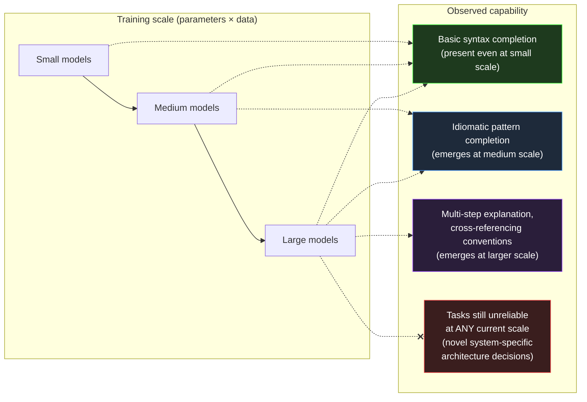
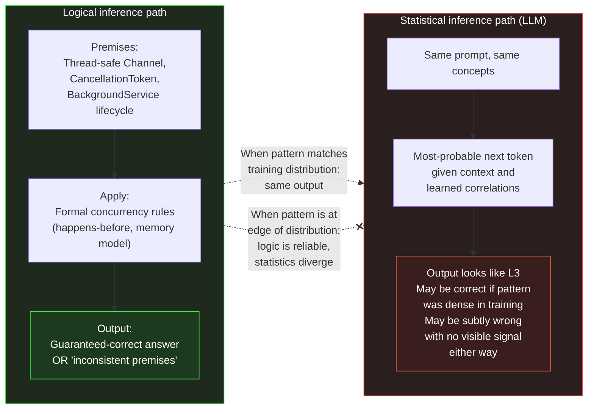
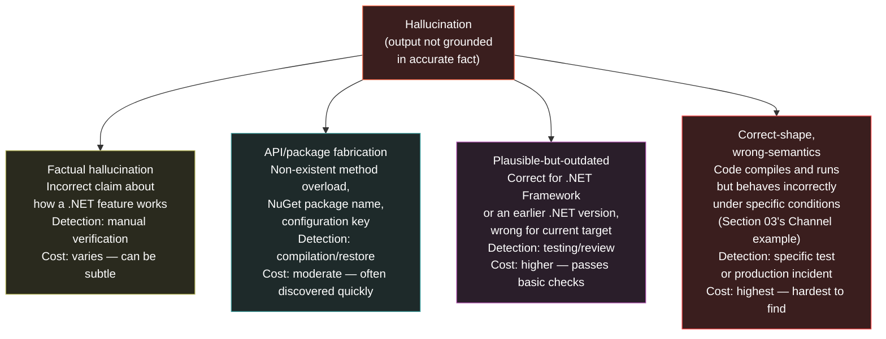
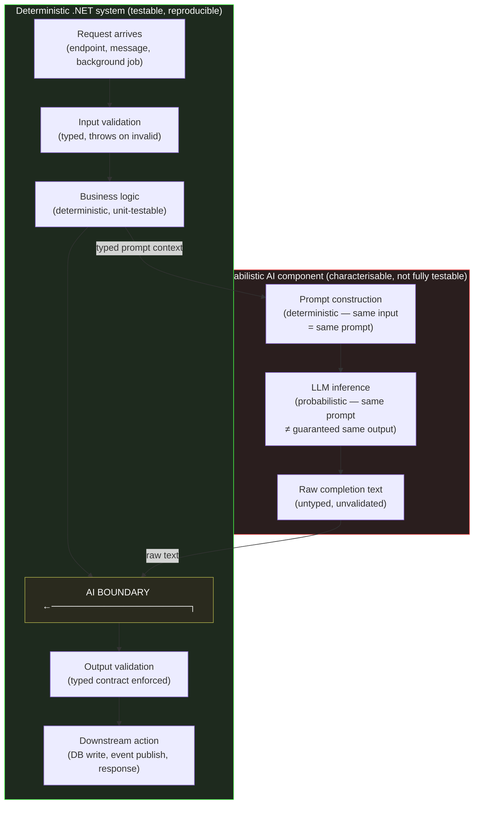
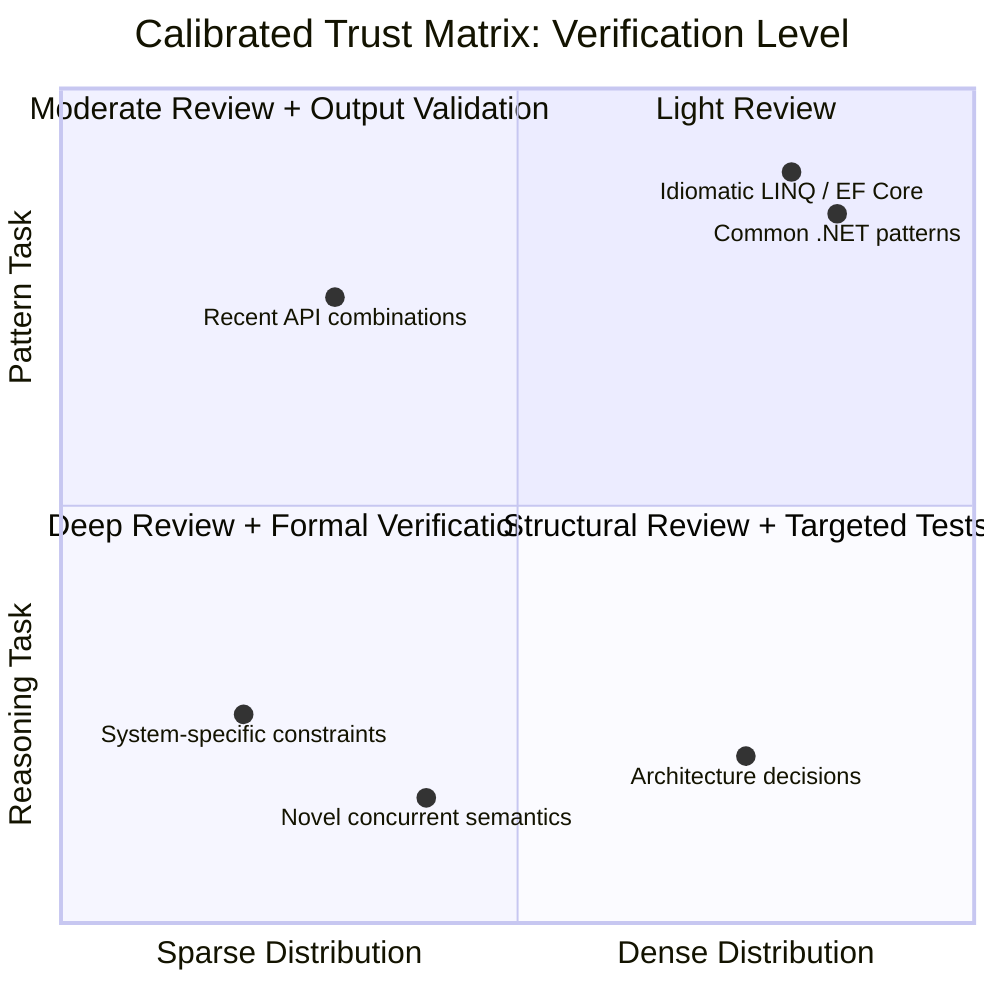

# Section 01 — What an LLM Actually Does: Tokens, Embeddings, Context, and Inference

## The Mechanism Behind the Interface

A large language model produces every token in its output through a single repeated operation: given a sequence of numbers representing the text so far, produce a probability distribution over what number is most likely to come next, sample one number from that distribution, append it to the sequence, and repeat. This is the entire generative process — there is no separate planning step, no internal representation of the problem, no retrieval from a knowledge base. Everything else — the appearance of reasoning, the fluency, the architectural vocabulary, the code that compiles — is what this process produces when the numbers represent language and the model producing the distribution has been trained on an enormous corpus of human text.

A .NET engineer interacting with this system for the first time encounters something deceptively familiar: a request goes out, a response comes back, and the response is text — often syntactically valid C#, often structurally sound architectural reasoning, often phrased with the same register a senior colleague would use in a design review. Every instinct built over a career of working with deterministic systems suggests that there must be something underneath producing this output in a way that parallels how a service produces a response: some internal representation of the problem, some retrieval of relevant facts, some process that resembles thinking. But the actual mechanism is fundamentally different — and understanding it precisely is the subject of this section.

This section builds that mechanism from the ground up, using vocabulary and framing that maps onto concepts a .NET engineer already has working intuitions for: serialization, lookup tables, fixed-size buffers, and function calls. The goal is not mathematical completeness — it is a mental model precise enough that the behaviours described in the rest of this chapter stop looking like quirks and start looking like direct, predictable consequences of how the system works.

## Tokens: The Unit of Everything

Before a language model can do anything with text, the text must be converted into a sequence of integers. This conversion is performed by a tokenizer, and the integers it produces are called tokens. A token is not necessarily a word. Common words are often a single token. Less common words are split into multiple tokens — prefixes, suffixes, and word fragments that recur often enough across the training corpus to have earned their own entry in the tokenizer's vocabulary. Punctuation, whitespace, and even parts of common code patterns each have their own token identities.

For a .NET engineer, the closest intuition is a dictionary-based compression scheme: the tokenizer maintains a fixed vocabulary — typically on the order of 50,000 to 200,000 entries depending on the model family — and every piece of input text is encoded as a sequence of indices into that vocabulary. The word `"CancellationToken"` might be a single token in a vocabulary trained heavily on code, because the sequence of characters `CancellationToken` appears often enough in the training data that the tokenizer's construction process — typically a variant of byte-pair encoding — merged it into one unit. A less common identifier, say `"IIdempotencyKeyGenerator"`, is more likely to be split into several tokens: perhaps `I`, `Idem`, `potency`, `Key`, `Generator`, each a fragment that recurred often enough on its own to warrant a vocabulary entry, even though the full identifier did not.

This has a direct, measurable consequence that engineers building AI-integrated .NET systems encounter immediately: cost and context consumption are measured in tokens, not words or characters, and the relationship between source text and token count is uneven. A block of common English prose might average around four characters per token. A block of C# code dense with project-specific identifiers, GUIDs, or unusual naming conventions can consume substantially more tokens for the same character count, because the tokenizer is forced to fall back to shorter fragments more often. When a .NET service constructs a prompt that embeds a stack trace, a configuration file, or a chunk of legacy code with idiosyncratic naming, the token cost of that context is not something that can be estimated by counting characters and dividing by a constant — it depends on how well the tokenizer's vocabulary, shaped by its training corpus, happens to match the vocabulary of the text being encoded.

```mermaid id="diagram-02-01"
flowchart LR
    A["Input text:\n'var token = await\nGetTokenAsync(ct);'"]
    B["Tokenizer\n(fixed vocabulary lookup)"]
    C["Token IDs:\n[1924, 6816, 284, 13, ...]"]
    D["Embedding layer\n(ID → vector lookup)"]
    E["Embedding vectors\n(one per token,\nfixed dimensionality)"]
    F["Transformer layers\n(attention + feed-forward,\nrepeated N times)"]
    G["Output layer:\nprobability distribution\nover next token"]
    H["Sampling\n(pick next token ID)"]
    I["Append to sequence,\nrepeat from F"]

    A --> B --> C --> D --> E --> F --> G --> H --> I
    I -.->|loop until\nstop condition| F

    style A fill:#1e2a3a,stroke:#4a9eff,color:#fff
    style C fill:#1e3a2a,stroke:#4aff6a,color:#fff
    style E fill:#1e3a2a,stroke:#4aff6a,color:#fff
    style G fill:#3a2a1e,stroke:#ffaa4a,color:#fff
    style H fill:#3a2a1e,stroke:#ffaa4a,color:#fff
```



The diagram above is the complete generative loop. Every box matters for the engineering decisions that follow in this chapter, but the loop itself — particularly the feedback arrow from sampling back into the transformer layers — is the single most important structural fact about how these systems operate. The model does not produce a response and then stop to evaluate it. It produces one token, appends that token to its own input, and runs the entire forward pass again. A model generating a five-hundred-token response to an architectural question performs five hundred complete forward passes, each one conditioned on everything generated so far, including its own earlier tokens — whether or not those earlier tokens were correct.

## Embeddings: Where Meaning Lives as Geometry

Token IDs are arbitrary integers — the specific number assigned to `CancellationToken` carries no inherent meaning beyond its role as a lookup key. The first substantive operation the model performs is to convert each token ID into a vector: a list of floating-point numbers, typically somewhere between several hundred and several thousand elements long depending on the model's size. This vector is called the token's embedding, and it is retrieved from a learned lookup table — conceptually similar to a `Dictionary<int, float[]>` where the dictionary itself was produced by training, not configuration.

The geometry of this vector space is where the model's "knowledge" of language lives. During training, the embedding for a token is adjusted so that tokens which tend to appear in similar contexts end up with similar vectors — close together in the high-dimensional space the embeddings occupy. This is not a designed property; it falls out of the training objective. A model trained to predict the next token, given enough text, discovers that `IRepository` and `IService` and `IPaymentGateway` all tend to appear in similar syntactic positions — after `private readonly`, before a generic type parameter or a constructor parameter name — and their embeddings drift toward each other in the vector space as a side effect of optimizing for that shared distributional behaviour. The model never receives an explicit instruction that these are all "interface types representing injected dependencies." It discovers a geometric regularity that happens to correlate with that human concept, because the concept is what produced the regularity in the training data in the first place.

This matters for an engineering reason that becomes concrete in later sections: when a model generates a suggestion involving an unfamiliar identifier — a method name, a package name, a configuration key it has never specifically seen — it is not retrieving that identifier from anything resembling a database lookup of real APIs. It is positioned, by the geometry of the embedding space and the patterns learned over it, near identifiers that look like that one, and it generates something that occupies a similar position in the space of "plausible identifiers in this context." Sometimes that position corresponds to a real API. Sometimes it corresponds to an API that would make sense, given the conventions of the ecosystem, but does not exist. The mechanism that produces both outcomes is identical. Nothing in the generative process distinguishes "this identifier is real" from "this identifier merely looks like the identifiers near it in embedding space."

## The Context Window: A Fixed-Size Working Set

Every model has a maximum number of tokens it can process in a single forward pass — the context window. Modern models offer context windows ranging from tens of thousands to over a million tokens, but the number is always finite, and it is shared between everything the model needs to consider: the system prompt, the conversation history, any documents or code provided as context, and the response being generated so far.

The closest .NET analogy is a fixed-size buffer or a bounded `Memory<T>` allocated once per request. Unlike a `List<T>`, which grows as needed, the context window does not expand to accommodate more information — if the combined token count of everything that needs to be in context exceeds the window, something must be truncated, summarized, or omitted before the request is even sent. And critically, every token inside that window is re-processed on every forward pass during generation. The transformer layers in the diagram above operate over the entire sequence — input plus everything generated so far — at every step. This is why response latency for long contexts grows non-linearly with context length for many model architectures: doubling the context does not merely double the data being read, it changes the computational cost of every attention operation across every layer, because attention is computed between every pair of tokens in the sequence.

For an engineer designing a .NET service that constructs prompts programmatically — assembling a system prompt, retrieved documentation, recent conversation turns, and a user query into a single request — the context window is a hard resource constraint with cost and latency consequences, not a soft guideline. A service that naively concatenates "everything that might be relevant" into the prompt is making a resource allocation decision with the same category of consequences as a service that allocates an unbounded buffer per request: it works fine until the inputs grow, and then it either fails outright (context limit exceeded) or degrades in ways that are much harder to diagnose, which is the subject of Section 02's examination of "lost in the middle" effects.

## Inference: One Forward Pass, One Token

With tokens converted to embeddings and the context window established, the transformer layers perform what is called inference: a sequence of mathematical operations — primarily attention, which computes how much each token's representation should be influenced by every other token's representation, and feed-forward transformations applied independently to each position — that produce, at the final layer, a vector of raw scores called logits, one score per entry in the vocabulary. These logits are converted into a probability distribution via a softmax operation, and the next token is chosen by sampling from that distribution.

The word "sampling" is doing real work in that sentence and deserves to be unpacked, because it is the source of behaviour that engineers used to deterministic systems often find disorienting. The model does not select "the most likely next token" as a deterministic rule by default — though it can be configured to do so. Instead, a parameter called temperature controls how the probability distribution is converted into a selection: at temperature zero, the highest-probability token is always chosen (deterministic, or as close to it as floating-point reproducibility allows across hardware); at higher temperatures, tokens with lower probability have a real, non-zero chance of being selected, which produces more varied — and, from the model's internal perspective, equally "valid" — output. From the model's perspective, there is no difference in kind between the highest-probability continuation and the fifth-highest-probability continuation. Both are points on the same distribution. The only thing that differs is how likely each one is to have been selected.

```csharp id="code-02-01"
// Target Framework: .NET 8.0
// Chapter: 02 | Section: 01
// book/chapters/chapter-02/sections/section-01.en.md
//
// Minimal .NET console application that calls a streaming chat
// completion endpoint and prints the response token-by-token as it
// arrives, alongside the token count of the prompt and response.
//
// Purpose: make the per-token, sequential nature of generation visible.
// Each line printed below corresponds to ONE forward pass through the
// model — not a single "thinking" step that produced the whole answer.

using System.ClientModel;
using OpenAI.Chat;

var client = new ChatClient(
    model: "gpt-4o-mini",
    credential: new ApiKeyCredential(
        Environment.GetEnvironmentVariable("OPENAI_API_KEY")
            ?? throw new InvalidOperationException("OPENAI_API_KEY not set")));

var messages = new ChatMessage[]
{
    new SystemChatMessage(
        "You are a senior .NET engineer. Answer in one short paragraph."),
    new UserChatMessage(
        "What does the CancellationToken parameter do in an async method?"),
};

Console.WriteLine("--- Streaming response, one chunk per forward pass ---");

var tokenCount = 0;
await foreach (var update in client.CompleteChatStreamingAsync(messages))
{
    foreach (var part in update.ContentUpdate)
    {
        // Each `part.Text` here typically corresponds to one or a small
        // number of tokens — the smallest unit the model can emit per
        // forward pass. Printing immediately, without buffering, shows
        // the sequential generation process in real time.
        Console.Write(part.Text);
        tokenCount++;
    }
}

Console.WriteLine();
Console.WriteLine($"\n--- Approximate output chunks observed: {tokenCount} ---");

// Architecture note (S01→S02 handoff):
// Every chunk printed above was produced by re-running the ENTIRE
// transformer stack over the prompt PLUS every chunk generated so far.
// There is no separate "planning" pass that ran before this loop began.
// Whatever structure the final answer has — if it has a clear beginning,
// middle, and conclusion — emerged token-by-token, with each token chosen
// based only on the sequence so far, not on a pre-computed outline.
```

The code above is deliberately minimal, but the behaviour it surfaces is not. Running it against the same prompt multiple times — even at a fixed, low temperature — can produce subtly different token sequences, because the sampling step introduces a genuine source of variation that does not exist in a typical .NET method call. A .NET engineer accustomed to writing unit tests that assert exact string equality on a method's return value will find that this assumption does not transfer to AI-generated output without an explicit architectural decision about how much variation is acceptable and how it will be detected — a concern this chapter returns to directly in Section 05's treatment of deterministic versus probabilistic systems.

## What This Mechanism Does Not Contain

It is worth being explicit about absences, because the absences are exactly where engineering intuitions trained on deterministic systems lead engineers astray.

There is no persistent memory between requests beyond what is explicitly included in the context window. A model does not "remember" a previous conversation unless that conversation's tokens are re-sent as part of the current context. There is no separate database of facts that the model consults — everything it "knows" is encoded, implicitly and inseparably, in the weights of the embedding tables and transformer layers, set during training and not updated by anything that happens during inference. There is no explicit representation of "the current task" or "the plan for this response" that exists independently of the token sequence itself — if the model's output reads as though it followed a plan, that structure exists only as a pattern in the generated tokens, indistinguishable, from the model's perspective, from any other sequence of tokens it might have produced.

This is not a limitation that better prompting fully overcomes, and it is not a limitation that will necessarily be removed by larger models — it is the architecture. Everything explored in the remainder of this chapter — why models seem to reason, where that apparent reasoning breaks down, why hallucination is structural rather than incidental, and what calibrated trust looks like in practice — follows directly from the mechanism described in this section.

## Distinguishing the Different Kinds of "Error" in a Large Language Model

One of the most common misunderstandings among .NET engineers encountering large language models for the first time is to imagine that a model's errors resemble runtime exceptions or type errors: discrete events that can be detected and managed reliably. The mechanism described in this section shows why that picture is structurally misleading.

In a deterministic .NET system, an incorrect code path fails in exactly one of three ways: either the compiler refuses to compile it because it violates the type system, or the runtime crashes and throws an exception at the point of failure, or it produces incorrect output that a test with exposing inputs can detect. In all three cases, the failure is discrete and its bounds can be determined.

A large language model has no equivalent discriminator. The next token is simply the most probable token under the learned distribution, whether it is part of a correct answer or part of a fabricated claim. The model has no internal state representing "I am confident" or "I am guessing" — it produces a probability distribution in both cases, and the difference between the two cases lies in the relative likelihoods of different tokens, not in any explicit flag that can be queried. This is the underlying reason why the confidence expressed in a model's output — the categorical tone, the decisive unhedged sentences — is generated as the most likely tokens in a context of confident-sounding technical prose, not derived from any internal assessment of the neighbouring content. Sections 03 and 04 return to this directly with a detailed analysis of the patterns in which statistical inference collapses.

## Why Understanding the Mechanism Matters in Practice

An engineer might reasonably ask: why does this level of architectural detail deserve study when the model's outputs can simply be tested and whatever does not work handled? The answer appears in three places.

The first is that understanding the mechanism enables predicting failure instead of merely observing it. An engineer who knows that the model's skill is a function of training-data density can perform a proactive risk assessment before integrating a model into a production service: does this task depend on well-documented patterns, or on rare interactions between multiple .NET features with insufficient examples in the training data? The answer determines the level of verification that AI integration into the critical path requires.

The second is that understanding the context window directly improves the quality of model output. An engineer who knows that the model re-processes every token in its window on every forward pass — and that tokens in the middle of a long context receive less attention through what research has called the "lost in the middle" effect — will design prompt structure differently: placing the most important information first and last, and managing context size deliberately instead of unboundedly appending everything that might be relevant.

The third is that understanding sequential generation clarifies why late instructions in a prompt have a different effect from early ones. Earlier tokens shape the probability distributions of later tokens. The system context provided at the start of a prompt shapes the overall distribution of everything that follows. Instructions given late in a long conversation may be diluted if previously generated tokens have already entrenched a strong statistical pattern heading in a different direction.

These three considerations are not added for theoretical completeness — they are the direct application of the mechanism described in this section to the design decisions of AI-integrated .NET services. The next section builds on them by posing the complementary question: if the mechanism is only next-token prediction over a sequence, where does the persuasive impression of comprehension and reasoning that engineers observe in so much of its output come from?

# Section 02 — Why LLMs Appear Intelligent

## A Mechanism With No "Understanding" Component, Producing Understanding-Shaped Output

Section 01 established the mechanism in full: tokens, embeddings, a fixed context window, and a sampling loop that produces one token at a time, each conditioned on everything before it. Nowhere in that description is there a component that represents "the architecture of this .NET system," "the intent behind this code review comment," or "the correct way to implement idempotent message handling." And yet a model built from exactly that mechanism can be asked to review a pull request, identify a missing `CancellationToken` propagation, explain why it matters for graceful shutdown, and suggest a fix using the correct linked-token-source pattern — and it can do this with a fluency and specificity that, read in isolation, is difficult to distinguish from a senior engineer's response.

This section addresses the gap between mechanism and output directly, because the gap is not a mystery to be waved away with the word "emergence" — though that is the term used for it — and it is not evidence that something beyond next-token prediction is happening. It is evidence about what next-token prediction becomes capable of when the training corpus is large enough and the patterns within it are dense and consistent enough. Understanding why this is true is what allows an engineer to predict *where* this apparent intelligence will be reliable and where it will not — a prediction this chapter sharpens further in Sections 03 and 04.

## The Training Corpus Is Not Text. It Is Compressed Behaviour.

The training corpus for a large language model includes enormous volumes of source code, technical documentation, API references, Stack Overflow threads, GitHub issue discussions, pull request reviews, architecture blog posts, and textbooks. Critically, this is not a static encyclopedia of facts — it is a record of *how people behave* when writing, reviewing, explaining, and arguing about software. A Stack Overflow thread does not just contain "the answer" to a question about `IAsyncEnumerable<T>`; it contains the question phrased the way engineers actually phrase confusion, an answer phrased the way engineers actually explain a concept, follow-up comments raising edge cases, and sometimes a correction to the original answer once someone points out it doesn't handle cancellation correctly.

When a model is trained to predict the next token across millions of documents like this, it is — as a side effect of that single objective — forced to internalize the *statistical structure of technical reasoning itself*. To predict the next token in "the issue here is that `await foreach` over this `IAsyncEnumerable` won't respect cancellation unless the..." with any accuracy, the model must have learned something about the distributional relationship between `IAsyncEnumerable`, cancellation, `await foreach`, and the kinds of clauses that complete sentences about their interaction. It did not learn this as a rule stated once and stored; it learned it as a statistical regularity reinforced across every similar explanation, correction, and code review comment that appeared in the training data, each one nudging the model's parameters slightly toward producing text with that same structure when a similar context arises again.



The diagram captures an empirical pattern observed across model generations: certain capabilities do not improve smoothly with scale — they are largely absent below some threshold of model size and training data, and appear fairly abruptly above it. This is what "emergent behaviour" refers to in this context. It is not mystical. It reflects the fact that some patterns — multi-step technical explanations that correctly reference several interacting concepts — require the model to have learned a sufficiently rich joint representation of those concepts together, and that joint representation only becomes statistically learnable once the model has enough capacity and has seen enough examples of those concepts co-occurring. Below that threshold, the model can complete short, locally-predictable patterns — finishing a common method signature, closing a brace — but cannot sustain the longer-range consistency that a multi-paragraph technical explanation requires.

## Why This Produces Genuinely Useful Output for .NET Engineering

None of this is a criticism of the resulting capability — it is an explanation of *why the capability is real* for the categories of task it covers. The .NET ecosystem is, by the standards of software corpora, extraordinarily well-represented in training data: decades of Microsoft documentation, an enormous Stack Overflow presence, a large open-source corpus on GitHub spanning everything from minimal API samples to large enterprise codebases, and a long history of blog posts explaining architectural patterns, performance characteristics, and migration guidance across .NET Framework, .NET Core, and modern .NET releases.

The density is not uniform across the ecosystem — areas like Blazor rendering lifecycle, gRPC streaming configuration, or `System.Threading.Channels` completion semantics have less representation than mainstream dependency injection or Entity Framework queries — but for the central categories of daily .NET engineering work, the corpus is among the densest of any technology ecosystem in existence. This is a material advantage that .NET engineers should understand and factor into their adoption strategy.

This density means that for a wide range of tasks — explaining what a language feature does, generating an implementation of a well-known pattern, identifying a common anti-pattern in a code review, translating between roughly equivalent APIs across .NET versions — the statistical structure the model needs has been reinforced an enormous number of times, from many angles, often including the corrections and caveats that accompany the "obvious" version of an answer. When a model generates a response to "how do I implement the repository pattern with EF Core," it is not retrieving one canonical answer — it is producing output shaped by the *aggregate* of an enormous number of explanations, including common mistakes and how experienced engineers correct them, because those corrections are *also* part of the training data and *also* shape the statistical structure being reproduced.

This is the mechanism behind a genuinely useful property: AI assistance often surfaces not just "an" implementation, but one that implicitly reflects accumulated community correction — because the community's corrections are baked into the statistics the model learned from. An engineer asking for a `CancellationToken`-aware implementation of a streaming operation is likely to receive one that handles cancellation correctly, not because the model "knows cancellation is important" in any explicit sense, but because text describing streaming operations *without* correct cancellation handling is, in the training corpus, disproportionately likely to be followed by a correction — and that statistical relationship is exactly what the model learned to reproduce.

## Why the Output Resembles Understanding Without Containing It

The phrase "understanding-shaped output" from this section's heading describes something precise. The model does not contain an internal representation of what `IAsyncEnumerable<T>` is, how it differs from `IEnumerable<T>` in its allocation and scheduling characteristics, or why cancellation propagation matters for streaming scenarios. What it contains is a high-dimensional statistical model of the token sequences that human engineers have produced when discussing these topics — the definitions, the causal explanations, the code examples, the edge-case callouts, and the corrections that form the shape of a technical explanation. When the model generates output that reads like a senior engineer's explanation, it is not retrieving an understanding and translating it into words; it is producing token sequences that are statistically consistent with the aggregate shape of every explanation of that concept it encountered during training. The model has internalized the *structure of technical reasoning as a textual form* — definitions followed by mechanisms followed by examples followed by caveats — without possessing any causal model of the domain those text forms describe. This is precisely why the output is reliable in dense training regions (where the aggregate shape is consistent and well-reinforced) and unreliable in sparse ones (where the aggregate shape is inconsistent or under-sampled), because the fidelity of the output is a property of the statistical density of the source material, not of any internal understanding that might generalise beyond it.

## The Same Mechanism, Applied to a Sparser Region

The honest framing of "why LLMs appear intelligent" requires looking directly at what happens when the same mechanism is applied to a region of the problem space where the training corpus is sparse, inconsistent, or simply smaller — because the mechanism does not change. Only the statistics change.

```csharp id="code-02-02"
// Target Framework: .NET 8.0
// Chapter: 02 | Section: 02
// book/chapters/chapter-02/sections/section-02.en.md
//
// Two prompts, identical structure, sent to the same model.
// One targets a densely-represented .NET pattern; the other targets
// a narrow, less-documented corner of the ecosystem.
//
// Purpose: demonstrate that capability is not a property of the MODEL
// in isolation — it is a property of the model APPLIED TO a region
// of the training distribution. The mechanism producing both responses
// is identical (Section 01's loop). Only the statistical density of
// relevant patterns in training data differs.

using System.ClientModel;
using OpenAI.Chat;

var client = new ChatClient(
    model: "gpt-4o-mini",
    credential: new ApiKeyCredential(
        Environment.GetEnvironmentVariable("OPENAI_API_KEY")
            ?? throw new InvalidOperationException("OPENAI_API_KEY not set")));

var systemPrompt = new SystemChatMessage(
    "You are a senior .NET engineer. Provide a concrete code example " +
    "with a brief explanation. If you are not confident an API exists " +
    "exactly as described, say so explicitly.");

// ── Prompt A: densely represented pattern ──────────────────────────────
// Minimal API endpoint with dependency injection — one of the most
// common patterns in modern .NET documentation, tutorials, and samples
// since .NET 6. Training data density: very high.
var promptA = new UserChatMessage(
    "Show a minimal API endpoint in ASP.NET Core that injects a scoped " +
    "service and returns a 404 if a resource is not found.");

// ── Prompt B: sparsely represented pattern ─────────────────────────────
// A specific, less-common interaction: configuring a custom
// IAsyncEnumerable-based JSON streaming response with a non-default
// JsonSerializerOptions PER-ENDPOINT (not globally), combined with
// response compression — a combination far less frequently documented
// together than each piece is individually. Training data density: low.
var promptB = new UserChatMessage(
    "Show a minimal API endpoint that streams an IAsyncEnumerable<T> " +
    "as JSON using endpoint-specific JsonSerializerOptions, while also " +
    "ensuring response compression middleware does not buffer the " +
    "entire stream before sending.");

foreach (var (label, prompt) in new[] { ("A (dense)", (ChatMessage)promptA),
                                          ("B (sparse)", promptB) })
{
    Console.WriteLine($"\n=== Prompt {label} ===");
    var response = await client.CompleteChatAsync([systemPrompt, prompt]);
    Console.WriteLine(response.Value.Content[0].Text);
}

// Expected observation when running this:
//
// Prompt A typically produces a correct, idiomatic, immediately usable
// implementation — because this exact shape of code has been written,
// documented, and corrected thousands of times in training data.
//
// Prompt B typically produces output that LOOKS structurally similar —
// same confident tone, same code-block formatting, same explanatory
// style — but is measurably more likely to contain an inaccuracy:
// a JsonSerializerOptions overload that doesn't apply per-endpoint the
// way described, or a compression/streaming interaction that doesn't
// hold in practice. The CONFIDENCE of the response's tone does not
// track this difference — which is the subject of Section 06.
```

Running both prompts against the same model produces two responses with the same surface qualities: confident phrasing, working code formatting, a brief explanation following the code. An engineer reading only the tone and structure of the two responses — without independently verifying either — has no signal from the response itself indicating that one of these is built on a statistically much thinner foundation than the other. This is not a flaw that appears only in edge cases; it is the direct, predictable consequence of the mechanism in Section 01 applied to two different regions of a training distribution whose density varies enormously and is not visible from outside.

## The Practical Reframe: Capability Is a Map of the Training Distribution

The most useful reframe this section offers is this: when evaluating whether to trust AI output for a given .NET engineering task, the relevant question is not "is this model intelligent enough for this?" — a framing that suggests a single scalar capability that either clears a bar or doesn't. The relevant question is "how densely and consistently is this *specific kind of task*, in *this specific technology combination*, represented in the kind of text this model was trained on?"

Tasks involving widely-used, long-established .NET patterns — dependency injection, common middleware configuration, well-known design patterns, explaining standard library behaviour — sit in dense, well-trodden regions of the training distribution, reinforced by years of documentation, tutorials, and corrected community discussion. Tasks involving the interaction of several less-common features, very recent APIs with limited documentation at training time, project-specific conventions, or architectural decisions that depend on facts about a particular system that no training corpus could contain — these sit in sparse regions, where the same generative mechanism produces output with the same surface confidence but a meaningfully higher chance of being wrong in ways that are not obvious from reading it.

## Token Frequency, Embedding Geometry, and the Shape of Reliability

The density map described above is not an abstraction — it has a concrete mechanical correlate in the model's embedding space and in the frequency distribution of training tokens. When a concept like `IHttpClientFactory` appears tens of thousands of times across documentation, tutorials, blog posts, and source code in the training corpus, the model develops a high-dimensional region in its parameter space where the tokens associated with that concept are tightly clustered: the concept's name, its common usage contexts, its constructor parameters, its extension methods, its error modes, and the explanatory prose that typically accompanies each. When a concept like `System.Threading.Channels.Channel<T>` with a specific bounded configuration appears far less frequently — perhaps a few hundred times across the corpus, and often in simplified examples rather than the production-complete form — the corresponding region is less tightly defined: the model knows the tokens that co-occur with it, but the joint distribution over its interaction with other concepts (graceful shutdown, back-pressure, producer-consumer lifetime management) is inferred from a smaller number of examples and therefore has wider variance.

This variance directly determines the model's reliability. A prompt that lands in a tightly-clustered region of the embedding space triggers a sequence of next-token predictions where each step has a sharp, peaked probability distribution — one or two tokens dominate, and those tokens form part of a correct, well-established pattern. A prompt that lands in a loosely-clustered region triggers next-token predictions where the probability distribution is flatter — several tokens are similarly likely, and the chosen token may come from a different, non-identical pattern that happened to share surface vocabulary. The model cannot distinguish between these two cases from inside its own inference process; it always selects from the distribution as though the distribution were sharp, even when it is not. This is the mechanical basis for the claim in Section 03 that statistical reasoning fails silently.

For .NET engineers, this has a practical implication that is not obvious from the outside: the reliability of AI output for a given task is not uniform across all parts of the same task. A prompt that asks for a complete ASP.NET Core minimal API endpoint with dependency injection will produce reliable output for the endpoint structure, the DI registration, and the basic request handling — all densely represented. But if the same prompt also asks for a specific caching configuration using `IMemoryCache` with a custom expiration policy and cache invalidation through `IChangeToken`, the model is operating in a less-dense region for that specific combination, even though each individual component is well-represented. The composite is sparser than its parts, and the reliability of the composite output is governed by the sparsest region it traverses, not by the densest. Engineers should therefore evaluate AI output not by the familiarity of the individual concepts it mentions but by the density of the specific *combination* requested — a distinction that becomes critical as tasks grow in compositional complexity.

## The Asymmetry Between Generation and Verification

A property of the training-distribution map that is directly relevant to engineering workflow is the asymmetry between the cost of generating output from a sparse region and the cost of verifying that output. Generating plausible-sounding output from a sparse region is nearly free — the model performs exactly the same computation regardless of whether the underlying pattern is dense or sparse, and the surface qualities of the output (confident tone, correct vocabulary, appropriate structure) are identical. Verification, however, is dramatically more expensive in sparse regions: in dense regions, a quick compilation check and a read-through often suffice, because the output is reproducing a well-established pattern whose correctness has been validated thousands of times in the training data. In sparse regions, verification requires the engineer to independently evaluate the specific interaction of concepts, trace the execution path under specific conditions, and potentially construct targeted tests — work that can take orders of magnitude longer than the generation itself.

This asymmetry is the core economic argument for understanding the training-distribution map: without it, an engineer cannot allocate verification effort proportionally to risk, and ends up either over-verifying dense-region output (wasting time on output that is almost certainly correct) or under-verifying sparse-region output (accepting output that has a materially higher chance of being subtly wrong). The map provides the basis for a structured allocation: dense-region pattern tasks receive compilation-level verification; sparse-region or compositional tasks receive the deeper structural review that their risk profile demands. Section 03 formalises this allocation by distinguishing pattern tasks from reasoning tasks and establishing the verification implications of each.

## .NET Ecosystem Density: Two Sparse Sources

The .NET ecosystem's density advantage has two specific exceptions worth naming, because each is a recurring source of sparse-distribution output treated here in general terms elsewhere.

The first is intersections between recently introduced features and established patterns. Features from C# 14 and patterns introduced in .NET 8 and later are better represented in newer models than in models trained before those releases — but the *specific intersection* between a new feature and a large, complex API surface like Entity Framework Core or Polly may be far less documented than the older, heavily-used parts of those same libraries. This does not mean avoiding AI assistance at these intersections; it means treating verification there as mandatory rather than optional.

The second is migration scenarios from .NET Framework to modern .NET. Training corpora contain enormous volumes of both .NET Framework and modern .NET code, and there is no guarantee the model has always resolved the tension between old and new patterns in favour of the modern approach. An engineer asking for help migrating a service from `SqlConnection` and `SqlCommand` to Dapper or EF Core may receive technically valid suggestions that carry residue from .NET Framework habits — synchronous connection handling instead of the full async/await pattern, for example — not because the model "does not know" the newer pattern, but because both patterns exist in the training distribution and the contextual signals in the prompt may not be sufficient to disambiguate them.

## Procedural and Declarative Knowledge in Model Output

A further distinction helps explain why models appear intelligent in some contexts and not others: the difference between two kinds of knowledge. Declarative knowledge is "knowing that X is true"; procedural knowledge is "knowing how to do X."

Large language models perform well on tasks requiring procedural knowledge that is densely represented in the training corpus: how to write a LINQ query, how to register services in a dependency injection container, how to implement the Repository pattern with Entity Framework Core. That procedural knowledge is encoded as thousands of code examples and walkthroughs showing how those tasks are actually performed.

Context-specific declarative knowledge, by contrast — "what is the correct architectural choice for *this particular system*, given its specific constraints and history" — cannot be encoded by any training corpus, because it depends on system knowledge that appears in no external text. This is the fundamental boundary between what the model can reliably provide and what it cannot — and it is the boundary that determines where responsibility is placed between AI assistance and human engineering judgment.

Section 03 deepens this boundary by examining the case where statistical reasoning collapses silently — and what traces that collapse leaves in the model's output.

## Training Density and Verification Expectations: A Working Framework

The theoretical framing of this section translates into a working habit of thought a .NET team can apply consistently. Before accepting AI output for any engineering task, the task's position is assessed almost automatically along two axes: how well represented it is in the training data, and how much the correct answer depends on general patterns versus the specific system's context.

**Axis 1 — representation density:** does this task involve widely-used, long-documented patterns in the .NET ecosystem, or a rare intersection of features, a recently-introduced API, or a thinly-written scenario? Tasks involving dependency injection, EF Core, minimal APIs, Polly, and Semantic Kernel in their common uses sit in the dense region. Tasks combining less-used libraries, or depending on incompletely documented edge behaviour, sit in the lighter region.

**Axis 2 — context independence of the answer:** is the correct answer independent of this system's unique properties — meaning any other .NET system with the same requirements would receive the same answer — or does it depend on this system's own decision history, inherited constraints, and team conventions? The first admits reliable statistical inference. The second requires human engineering judgment regardless of training-data density.

This two-axis framework — training density × context independence — is what Section 06 will put to intensive use when constructing the calibrated trust matrix that determines the appropriate verification level for each task type. Section 03 paves the way by examining what happens when the model operates in the marginal region between these two modes — where statistical reasoning fails silently, issuing no distinctive warning signal.

## How This Framework Differs From Productivity Tooling

The distinction may seem burdensome compared with how other development tools are treated — IntelliSense, Roslyn analysers. The difference comes from the nature of error in each. IntelliSense suggests from an exact representation of a real, specific API: either the input is correct — it compiles — or it is wrong — a compile error. The decision is binary and resolved quickly.

A large language model suggests from a wide space of statistically learned plausible patterns. There is no equivalent of "a compile error" as a guarantee of semantic correctness. More importantly, a correct suggestion and an incorrect one can look identical in confidence and fluency. This is not a deficiency of the tool to be avoided but a structural property of how it works, and that property determines how it is safely integrated into a professional engineering workflow.

Professional practice does not mean abandoning the tool wherever error is possible — that standard would disqualify every tool. It means building a precise awareness of where error probability is highest and directing verification effort toward those regions instead of spreading it uniformly over everything the model generates. That precise awareness is the goal of these six sections together, and Section 03 adds its most important dimension. Mastering this dynamic assessment — not absorbing it once as a fixed rule — is what distinguishes mature professional use of AI tooling from naive use that treats the model as either an infallible oracle or a useless instrument.

This is not a static map. It shifts with each new model generation as training corpora grow and incorporate more recent material — code and documentation for .NET 8 and C# 14 is far better represented in newer models than it was in models trained before those releases existed. But the *shape* of the map — dense near common, well-documented, long-established patterns; sparse near novel, project-specific, or recently-introduced ones — is structural, not a temporary limitation. Section 03 examines what happens at the boundary between these regions in more detail, focusing specifically on the difference between statistical pattern-matching and the kind of logical reasoning that architectural decisions actually require — and why that difference matters even *inside* the dense, well-represented regions this section has described as generally reliable.

# Section 03 — The Limits of Statistical Reasoning

## Two Kinds of "Getting the Right Answer"

Logical inference from well-defined premises fails detectably. If you ask a system that implements formal rules of inference to derive a conclusion from inconsistent premises, it either produces a logical contradiction — an error you can verify — or it reports that no valid inference path exists. The failure mode is explicit: the system tells you it cannot answer, or it produces something you can check against the premises. Statistical reasoning fails silently. A model that has no statistically grounded pattern for the specific case asked of it does not say "I have no pattern for this" — it says the next-most-probable token given everything in the context, which might be the opening of a confident-sounding answer derived from a similar but not identical pattern, and that answer may be wrong in ways that are invisible from the surface of the text.

Section 02 established that LLMs produce genuinely useful output because next-token prediction over a large, dense corpus of technical text learns the statistical structure of technical reasoning itself. For well-represented patterns, this works reliably enough that it is genuinely valuable. But this section is about where the approach breaks — and more importantly, *how* it breaks, because the way statistical reasoning fails is qualitatively different from the way logical reasoning fails, and that difference has direct engineering consequences.

The engineering consequence of this asymmetry is significant: tools built on formal logic fail at known boundaries, which can be tested and guarded. Tools built on statistical reasoning fail at unknown and unevenly distributed boundaries, which must be understood structurally before the tool can be used safely in production.

## What Breaks at the Edge of the Distribution

Section 02's "map of training distribution density" framing provides the vocabulary for this: at the dense centre of the distribution — common .NET patterns, widely-documented APIs, well-rehearsed explanatory sequences — statistical reasoning produces output that is reliable because it is reproducing a well-established answer rather than constructing a novel one. The model's output, in these cases, is essentially a sophisticated retrieval and re-expression of patterns that have been reinforced so many times that the most probable token at each step leads reliably to a valid answer.

But consider what "the most probable next token" means for a prompt that combines several moderately-common concepts in a combination that is uncommon — say, asking about the correct locking semantics for updating a shared `Channel<T>` from both CPU-bound and I/O-bound paths inside a `BackgroundService` while respecting a `CancellationToken` being observed from a graceful shutdown handler. Each of these concepts individually is well-represented. The *specific combination*, with its precise interaction across the async scheduling model and the `Channel<T>` producer/consumer protocol, may not be — or may be represented inconsistently, with different sources making subtly different assumptions that the model has not necessarily resolved into a consistent view.

In that case, the model does not have access to a "correct answer" in the way Section 02 described for dense regions. It has access to the most probable token given what precedes it, drawn from representations learned from many related but non-identical discussions. And those representations, combined, produce something that *looks like* the answer to the specific question because it uses the right vocabulary, the right code structure, and the right explanatory tone — but is constructed from adjacent patterns rather than from a reliable encoding of the specific case.



The diagram above captures the structural difference between the two paths. For an engineer making an architectural decision about a .NET system under real constraints — specific thread pool configuration, actual cancellation behaviour of specific async primitives, documented edge cases of EF Core change tracking under concurrency — the distinction matters enormously. Logical inference from premises produces an answer that is either correct or demonstrably wrong. Statistical inference produces an answer that *looks* correct and might be, but has no internal mechanism for knowing whether it is or not, because the correctness of the output is a property of the training distribution, not of any formal derivation happening at inference time.

## Multi-Step Reasoning and Why It Does Not Change the Picture

A common response to this framing is to point to chain-of-thought prompting: if a model is asked not just for an answer but to "think step by step," its output quality on multi-step problems measurably improves. This is true, and it deserves a direct explanation, because it is sometimes interpreted as evidence that the model gains logical inference capacity when prompted this way — which would change the picture significantly.

It does not. Chain-of-thought prompting works for a different reason: by producing intermediate tokens that correspond to the structure of a reasoning trace before producing the final answer, the model conditions each subsequent token on a much richer context that includes those intermediate steps. And because the model has seen an enormous number of examples of correct reasoning traces in its training data — worked problems in documentation, commented code walkthroughs, structured technical explanations — the probability distribution over subsequent tokens given a partial reasoning trace is much better calibrated than the probability distribution over the final answer given the raw question alone. The intermediate tokens are not a plan that the model executes; they are tokens that influence the subsequent probability distributions in a way that correlates with correctness.

This means chain-of-thought helps precisely in the regions where statistical reasoning already has some traction — where enough correct reasoning traces exist in training data for the model to have learned the structure of a good derivation. At the actual edges of the distribution — novel system-specific constraints, recently-released APIs, combinations of features with no equivalent in training data — chain-of-thought produces a fluent, structured reasoning trace that can still be wrong, because the intermediate tokens are themselves the most-probable continuations given the context, not logical derivations from verified premises.

```csharp id="code-02-03"
// Target Framework: .NET 8.0
// Chapter: 02 | Section: 03
// book/chapters/chapter-02/sections/section-03.en.md
//
// A concurrency pattern that is STATISTICALLY plausible — consistent
// with the vocabulary and structure of many correct .NET concurrent
// implementations — but has a subtle flaw specific to how .NET's
// thread pool interacts with this particular pattern under load.
//
// An LLM trained on common patterns may generate this confidently.
// A .NET engineer applying formal knowledge of the runtime detects it.
// This is the gap between statistical and logical reasoning.

using System.Threading.Channels;

/// <summary>
/// CAUTION: this implementation has a subtle issue that statistical
/// reasoning (LLM-generated code) may not catch.
/// See analysis in comments below.
/// </summary>
public sealed class WorkCoordinator : IDisposable
{
    // Single channel, written from multiple call sites.
    private readonly Channel<WorkItem> _channel =
        Channel.CreateBounded<WorkItem>(new BoundedChannelOptions(128)
        {
            SingleWriter = false,  // Multiple producers
            SingleReader = true,   // Single consumer worker
            FullMode     = BoundedChannelFullMode.Wait,
        });

    private readonly CancellationTokenSource _shutdown = new();
    private readonly Task _worker;

    public WorkCoordinator()
    {
        _worker = ConsumeAsync(_shutdown.Token);
    }

    public async ValueTask EnqueueAsync(WorkItem item, CancellationToken ct)
    {
        // STATISTICAL PATTERN — appears in many correct examples:
        // await the write with the external cancellation token.
        await _channel.Writer.WriteAsync(item, ct);
    }

    private async Task ConsumeAsync(CancellationToken ct)
    {
        await foreach (var item in _channel.Reader.ReadAllAsync(ct))
        {
            await ProcessAsync(item, ct);
        }
    }

    // FLAW (logical reasoning reveals; statistical may miss):
    // When Dispose() is called, _shutdown is cancelled.
    // ConsumeAsync will exit via OperationCanceledException from
    // _channel.Reader.ReadAllAsync — but _channel.Writer is NOT
    // completed. Any caller blocked inside WriteAsync with a linked
    // token will hang until its external token cancels, rather than
    // receiving a ChannelClosedException or clean completion signal.
    //
    // The correct pattern:
    //   public void Dispose()
    //   {
    //       _channel.Writer.TryComplete();   // ← this line, before cancel
    //       _shutdown.Cancel();
    //       _worker.GetAwaiter().GetResult();
    //   }
    //
    // This distinction — complete the writer so readers see a definite
    // end-of-stream before cancelling pending writers — requires
    // knowledge of Channel<T>'s specific completion semantics, not
    // general async patterns. A model that learned "cancel the token
    // to shut down" from many BackgroundService examples may produce
    // the incomplete version confidently, because the token-based
    // shutdown shape is statistically dominant.

    private static Task ProcessAsync(WorkItem item, CancellationToken ct)
        => Task.CompletedTask; // domain-specific processing

    public void Dispose()
    {
        _channel.Writer.TryComplete();    // correct — explain in architecture review
        _shutdown.Cancel();
        _worker.Wait();
        _shutdown.Dispose();
    }
}

public sealed record WorkItem(string Id, string Payload);
```

The code above represents a situation that arises regularly when using AI assistance for .NET engineering: the generated code is structurally idiomatic, matches the vocabulary and shape of correct concurrent .NET code, and passes a straightforward code review. The flaw is detectable only if the reviewer applies specific knowledge of `Channel<T>` completion semantics and their interaction with `CancellationToken` propagation — knowledge that requires understanding of how these specific primitives behave, not just the general pattern of background processing in .NET. A model generating from statistical patterns will produce the shape of the correct answer but may not carry the specific completion-call detail that correct completion semantics require, because the specific detail was not consistently the dominant pattern in training examples of "how to shut down a background worker."

## Why Specific Runtime Knowledge Resists Statistical Capture

The `Channel<T>` example in this section illustrates a broader structural limitation. .NET's runtime behaviour includes properties that are *specific to the runtime's implementation* and are not derivable from the API surface alone: how the garbage collector handles generations under allocation pressure, how the JIT recompiles hot methods, how the thread pool manages task injection rates under sustained load, how `ValueTask` pooling interacts with specific continuation patterns, and how `Channel<T>`'s internal semantics differ between bounded and unbounded configurations in terms of memory pressure and back-pressure propagation. These properties are documented — sometimes thoroughly, sometimes sparsely — but the documentation itself is sparse relative to the volume of general async/await and dependency injection material in the training corpus. A model reproducing statistical patterns from general async documentation will not, by default, reliably produce the specific detail about `Channel<T>` completion semantics that determines whether a graceful shutdown works correctly, because that detail was not the dominant statistical shape of "how to shut down a background service" in the training data. The dominant shape was "cancel the token, await the task" — a pattern that is correct for the majority of `BackgroundService` implementations but subtly incomplete for this specific case. This is the structural reason why reasoning about a specific system's behaviour under specific runtime conditions remains an engineering task that statistical pattern-matching supports but cannot replace: the correctness depends on the precise interaction of implementation-specific properties, not on the general shape of a category of solutions.

## The Engineering Implication: Reasoning Tasks vs Pattern Tasks

The distinction between pattern tasks and reasoning tasks has a further implication for .NET engineers: it determines what kind of review is effective. A pattern task — say, generating an implementation of the decorator pattern for an `IEmailSender` service — benefits from a quick structural review: does it compile, does it conform to the expected interface contract, are there any obvious anti-patterns like synchronous blocking in an async pipeline? A reasoning task — say, evaluating whether a proposed distributed caching strategy maintains consistency guarantees under the specific partition and failure model of the production infrastructure — requires the reviewer to hold multiple system-specific constraints in mind simultaneously and evaluate whether the proposed solution satisfies all of them under the specific operational conditions. The statistical mechanism that produces the first kind of output does not have the tools to produce the second kind with reliability, because the second kind depends on constraints that are specific to one system and not represented in the training corpus. Recognising which category a given piece of AI output falls into is the first step in determining how much independent verification it requires — and that recognition is itself an engineering judgment that cannot be delegated to the model.

## Identifying the Boundary in Practice: A Diagnostic Framework

The pattern-versus-reasoning distinction described above is conceptually clear but practically ambiguous at the boundary — and the boundary is exactly where engineers need the distinction most. A concrete diagnostic framework helps resolve the ambiguity. For any given AI-generated output that an engineer must evaluate, three questions determine its category:

**Question 1: Does the correct answer depend on facts specific to this system?** If the answer is yes — the behaviour depends on the particular thread pool configuration of this service, the specific EF Core provider and its concurrency model, the exact sequence of events during this application's shutdown path — the task is a reasoning task regardless of how familiar the individual concepts are. The model may have strong statistical grounding for each concept individually, but the *interaction* of those concepts under this system's specific conditions is not represented in any training corpus. An example: generating an `IHostedService` implementation that manages a background polling loop is a pattern task; evaluating whether *this particular* polling loop will cause thread-pool starvation under *this particular* load profile with *this particular* set of downstream dependencies is a reasoning task.

**Question 2: Would the correct answer change if a single parameter in the system changed?** If yes, the task requires reasoning about parameter sensitivity, which is a property of the system's actual behaviour, not of the general shape of a category of solutions. Pattern tasks produce the same answer across reasonable parameter variations; reasoning tasks produce answers that are contingent on specific values. For example, the implementation of a `Channel<T>`-based producer-consumer pattern is a pattern task — the structure is the same regardless of buffer size. But the choice between `BoundedChannelFullMode.Wait` and `BoundedChannelFullMode.DropWrite` for a specific throughput requirement under a specific load profile is a reasoning task — the correct choice depends on the system's actual latency budget and fault tolerance requirements.

**Question 3: Is the output's correctness verifiable by compilation and standard tests alone?** If the only verification required is "does it compile and pass the existing test suite," the output is almost certainly a pattern task. If correctness depends on behaviour under specific concurrency conditions, specific failure sequences, or specific operational states that are not exercised by the standard test suite, the output is a reasoning task that requires targeted verification beyond compilation. This third question is particularly useful because it maps directly to the team's existing verification infrastructure: if the current test suite covers the failure modes in question, even a reasoning task can be verified mechanically; if it does not, the engineer must construct the verification explicitly.

These three questions do not produce a binary classification — they produce a gradient. Some tasks are clearly pattern tasks (generating a standard LINQ projection), some are clearly reasoning tasks (evaluating distributed cache consistency under network partition), and many fall somewhere in between (generating a `BackgroundService` that handles shutdown correctly — pattern-level structure, but the correctness of the shutdown path depends on system-specific timing). For tasks on the gradient, the verification effort should be proportional to the number of system-specific dependencies the output carries: more dependencies, deeper verification.

The practical distinction this section establishes is between two categories of AI assistance that look similar on the surface but have meaningfully different verification requirements:

**Pattern tasks** are those where the output is essentially a re-expression of a well-established pattern from the training distribution: implementing a well-known design pattern in .NET, translating between roughly equivalent APIs, generating idiomatic LINQ expressions for a standard transformation, explaining what a language feature does. For these, statistical reasoning is effective and the output is reliable enough to review lightly for fit to context.

**Reasoning tasks** are those where arriving at the correct answer requires combining specific facts about the system in question — facts the model may not have reliably or consistently — in a way that depends on their precise interaction. Architectural decisions about a specific system, performance analysis of a specific bottleneck, correctness analysis of a specific concurrent interaction, security analysis of a specific trust boundary — these are reasoning tasks. Statistical reasoning may produce output that looks like the result of such reasoning, but the output should be treated as a *starting point that surfaces relevant considerations* rather than as a derived result, because the derivation is happening statistically rather than logically.

Section 04 explores the most consequential case of this distinction in practice: the failure mode that occurs when statistical reasoning is applied to a case it does not have sufficient grounding for, and what the resulting output looks like and how it should be handled.

## The Root Cause: There Is No "I Know That I Don't Know"

It is worth pausing explicitly on the deeper reason why statistical reasoning fails in precisely this way — silently and confidently, not loudly and with acknowledgement. A large language model has no internal state representing "I am uncertain." At every step of the generative loop, it produces a probability distribution over the vocabulary. The value of that distribution is a function of the learned weights and the incoming context — not a function of any "knowledge confidence" signal independent of the generated content. What the model produces in a dense region and what it produces in a sparse region of the training distribution pass through exactly the same generative mechanism — the only difference is in the relative likelihoods of different tokens at each step, not in any existing state that tells the model it "knows" or is "guessing."

This structural absence of knowledge about "what I know and what I don't know" is what makes instructions like "say so if you are unsure" limited and unreliable in effect. When the model complies with such instructions and generates text expressing uncertainty — "I am not entirely sure about this, but…," or "this depends on…" — that text is itself tokens predicted on the basis of the density of uncertainty expressions in similar texts in the training corpus. Uncertainty expression is statistically correlated with topics that writers tend to hedge about in technical writing — which may or may not coincide with the cases where distrust is actually warranted. The relationship is not non-existent, but it is far from reliable enough to justify depending on it as a primary signal.

## Caution Versus Verification as an Engineering Strategy

The practical consequence of this diagnosis is the following: the model's self-caution — asking it to hedge when it is not confident — is an awareness mechanism, not a guarantee mechanism. It can improve the reading experience and reduce some cases of hasty acceptance by engineers. But it does not replace engineering verification that depends on independent knowledge of the subject, not on a signal derived from the model itself.

The correct engineering strategy does not equate "ask the model to hedge" with "independently verify the model's output." The first improves the model's output; the second is an external engineering guarantee. For some tasks — pattern tasks in dense distribution regions — a cautionary nudge may suffice to direct attention. For reasoning tasks and sparse-region tasks, there is no substitute for independent verification of the output.

## What This Means for Reviewing AI-Generated Code

A precise understanding of statistical inference and its limits leads to a modification in how the code review process for AI-generated code is designed in a .NET team. Traditional code review is designed to verify implementation correctness against stated intent, architectural fit, and idiomatic style — a skill reviewers possess because they identify familiar patterns quickly.

The most dangerous AI failure modes — "correct shape, wrong semantics" as exemplified by the `Channel<T>` code — are precisely those that match familiar patterns. A reviewer reading in search of patterns they know will treat the code as correct, because it looks correct. Effective verification of this category requires proactive examination of specific potential failure scenarios — "what happens on the shutdown path?" — not merely reading in search of the familiar.

This means AI-generated code review works best when reviewers adopt a "find the scenario in which this fails" methodology instead of "does this look right?" Not because generated code is worse on average than hand-written code, but because its distinctive failure mode — correct shape with a semantic flaw in a targeted edge case — is not detected well by traditional pattern-recognition-based code review. Building this proactive methodology into team practices is what makes the difference between using AI professionally and using it in a way that silently transfers risk to production.

## What This Means for the Individual Engineer and the Team

The most prominent practical value of this section is not reducing AI use in code review or generation — but recalibrating expectations of it more precisely. An engineer who understands that statistical reasoning works highly reliably in dense regions of the training distribution and recedes at its edges owns a mental model that directs AI toward the tasks it performs well and directs verification effort toward the scenarios with the highest silent-failure risk. This is more effective than either full trust or blanket scepticism that nullifies the tool's value. A team that communicates this understanding and converts it into binding practices — verification standards, failure-scenario-oriented review, documentation of AI-related production incidents — builds an institutional capability for effective professional use that accumulates and deepens over time.

That capability is best understood through a mundane daily situation: a .NET engineer asks the model about the behavioural semantics of `ValueTask<T>` under contention in production. The model generates a convincing explanation noting that a `ValueTask<T>` should not be awaited more than once and that `IsCompletedSuccessfully` is the correct check — all well-established training patterns. But when the engineer asks a specific question — what happens if a `ValueTask<int>` is re-awaited twelve times from concurrent threads while a custom `IAsyncValueTaskSource<int>` manages state in a high-performance library's private `Pool` style? — the question moves from a dense to a sparse region, and the model generates an answer that convincingly restates the general rules but may not address the precise thread-safety semantics of that specific composition. The framework drawn in this section lets the engineer recognise that transition and scale verification effort accordingly instead of absolutely accepting or rejecting the answer.

Section 04 completes this picture by addressing the costliest kind of silent failure in practice — and a team that has internalised the recalibration above will read that section not as a catalogue of horrors but as the verification agenda its own incident documentation should already be converging toward.

# Section 04 — Hallucinations and Failure Modes

## Why Hallucination Is Structural, Not Incidental

Section 03 established that statistical reasoning fails silently — that when the model operates near or beyond the edge of its training distribution, it produces output with the same confident surface as output built on a dense, well-reinforced pattern. Section 04 examines the specific failure mode that this silent failure produces: hallucination.

The term is borrowed from psychology and sometimes used as though it describes a model "making things up" in some deliberate or avoidable way. Neither the deliberateness nor the avoidability framing is accurate. A language model produces the most probable next token given the context. When that context corresponds to a question for which no reliable pattern exists in the training distribution — or where patterns exist but point in inconsistent directions — the most probable next token is still *some* token, drawn from whatever distributional evidence exists. The model has no mechanism to distinguish "I am about to generate a correct API name" from "I am about to generate a token sequence that looks like an API name because API names appear in this syntactic position." The absence of that mechanism is not a bug that will be patched in the next version. It is what next-token prediction without a truth oracle looks like.

Hallucination is therefore structural: it is the predictable consequence of a generation mechanism that must always produce a next token, applied in a context where the correct next token is underspecified or absent from the training distribution. Understanding it as structural rather than incidental changes what an engineer does about it — not "prompt better to avoid hallucination" (though better prompts do reduce its frequency in some cases) but "design systems that assume hallucination will occur and verify before acting on the output."

## Taxonomy of Failure Modes for .NET Engineering

Not all hallucinations are equivalent in cost or detectability. The following taxonomy organises them by their practical impact on a .NET engineering team:



**Factual hallucination** is the most familiar category: the model describes how a .NET feature works in a way that is simply incorrect. The cost depends entirely on whether the engineer catches it before acting on it — which is why building a mental model of where the training distribution is sparse (Section 02's map) helps, because sparse regions have higher factual hallucination rates than dense ones. The concerning property of factual hallucination in a technical context is that it often contains enough correct adjacent facts to pass a quick reading without triggering doubt.

**API and package fabrication** is perhaps the most commonly encountered failure mode in day-to-day AI-assisted development: the model generates a method overload, NuGet package name, namespace path, or configuration key that does not exist. This category is relatively benign in terms of lifecycle cost — fabricated package names fail at `dotnet restore` and fabricated API names fail at compilation — but it is surprisingly frequent, particularly for less-common library APIs that are represented sparsely or inconsistently in training data.

**Plausible-but-outdated patterns** represent a more expensive failure mode that is easy to miss. Modern .NET has deprecated or replaced numerous patterns from .NET Framework and early .NET Core: the `WebClient` class replaced by `HttpClient`; synchronous database operations replaced by their async counterparts; the old startup model replaced by the generic host and minimal APIs. A model whose training data contains extensive .NET Framework material alongside modern .NET material may generate a pattern that was entirely correct for the older version and either compiles with warnings or compiles cleanly but carries the operational characteristics of the older approach — particularly around async behaviour, where sync-over-async wrappers from the Framework era are now well-understood as dangerous in `async`/`await` codebases.

**Correct-shape, wrong-semantics** is the most expensive failure mode and the least detectable without specific test coverage or a systematic review of concurrency and resource semantics. The Section 03 `Channel<T>` example falls here: the code compiles, it runs, it handles the normal path correctly, and it fails only under a specific shutdown sequence that may not be well-exercised in a development environment. This category is the reason that treating AI-generated code as "verified by compilation" is architecturally insufficient for anything other than the simplest utility code.

## Fabrication in Practice: NuGet Packages and API Overloads

The API and package fabrication category deserves a concrete example because it is both common and often underestimated in severity by engineers who encounter it for the first time and treat it as merely inconvenient. The inconvenience framing misses the risk when the fabricated API is *plausible enough* — correct package namespace, realistic method name, valid parameter types — that an engineer unfamiliar with the specific library might accept it without verification, particularly under time pressure.

```csharp id="code-02-04"
// Target Framework: .NET 8.0
// Chapter: 02 | Section: 04
// book/chapters/chapter-02/sections/section-04.en.md
//
// Validation layer for AI-generated code suggestions in a .NET pipeline.
// Checks suggested namespaces, package names, and method signatures
// against a known-good manifest before allowing them into a build.
//
// This is not a complete solution to hallucination — it is an
// architectural pattern that makes the deterministic boundary explicit
// (Section 05 will formalise this). The specific checks here target
// the API-fabrication and outdated-pattern categories from the taxonomy.

namespace AiAwareEngineeringToolkit.Infrastructure.AI;

/// <summary>
/// Validates AI-generated .NET code suggestions before they are
/// accepted into the codebase. Catches fabricated namespaces, package
/// names that don't exist, and common outdated-pattern signatures.
/// </summary>
public sealed class AiSuggestionValidator
{
    // Known-bad namespace prefixes that appear in AI suggestions
    // but do not correspond to current .NET APIs.
    private static readonly FrozenSet<string> KnownFabricatedNamespaces =
        FrozenSet.Create(StringComparer.Ordinal,
        [
            "Microsoft.AspNetCore.Http.Extensions",     // moved — use Microsoft.AspNetCore.Http
            "System.Web.Http",                          // WebAPI namespace, not ASP.NET Core
            "Microsoft.Extensions.Logging.Console.Internal", // internal, not public API
        ]);

    // Method signatures that are plausible-but-outdated:
    // these exist in older .NET but are replaced in modern .NET.
    private static readonly FrozenSet<string> OutdatedPatternSignatures =
        FrozenSet.Create(StringComparer.Ordinal,
        [
            ".Download(",          // WebClient.DownloadString etc — use HttpClient
            ".Result",             // sync-over-async; catches Task.Result usage
            "Thread.Sleep(",       // use Task.Delay in async contexts
            "HttpWebRequest",      // replaced by HttpClient
            "ServiceStack",        // common LLM confabulation: suggests ServiceStack
                                   // APIs for ASP.NET Core scenarios
        ]);

    public ValidationResult Validate(string suggestedCode)
    {
        var issues = new List<ValidationIssue>();

        foreach (var ns in KnownFabricatedNamespaces)
        {
            if (suggestedCode.Contains(ns, StringComparison.Ordinal))
            {
                issues.Add(new ValidationIssue(
                    Severity: Severity.Error,
                    Code: "AI001",
                    Message: $"Fabricated or moved namespace detected: '{ns}'. " +
                             "Verify the correct current namespace before using."));
            }
        }

        foreach (var pattern in OutdatedPatternSignatures)
        {
            if (suggestedCode.Contains(pattern, StringComparison.Ordinal))
            {
                issues.Add(new ValidationIssue(
                    Severity: Severity.Warning,
                    Code: "AI002",
                    Message: $"Outdated or unsafe pattern detected: '{pattern}'. " +
                             "Review for modern .NET equivalents."));
            }
        }

        return issues.Count == 0
            ? ValidationResult.Valid
            : new ValidationResult(false, issues);
    }
}

// ── Value types ───────────────────────────────────────────────────────────

public enum Severity { Warning, Error }

public sealed record ValidationIssue(
    Severity Severity,
    string   Code,
    string   Message);

public sealed record ValidationResult(bool IsValid, IReadOnlyList<ValidationIssue>? Issues = null)
{
    public static readonly ValidationResult Valid = new(true);
}
```

The validator above is intentionally simple — a production implementation would be backed by a continuously-updated manifest of real package names and current API surfaces rather than hard-coded strings — but it illustrates the architectural position: AI-generated code enters a deterministic boundary before being acted upon, and that boundary performs explicit checks that the statistical generation process cannot perform for itself. The specific checks can be expanded and automated; the important property is that the boundary exists and is enforced systematically rather than relying on per-engineer vigilance in each code review.

## The Compounding Nature of Failure Categories

The four categories in the taxonomy are not independent in practice — they frequently co-occur in a single AI-generated artifact. A response that fabricates a NuGet package name (category two) may simultaneously contain an outdated pattern for how that package is configured (category three), and an explanation of the package's behaviour that is factually incorrect (category one). More dangerously, correct-shape wrong-semantics code (category four) often passes through the other three categories undetected: the code compiles (ruling out fabrication), the explanation sounds current (ruling out obvious outdatedness), and the factual claims about individual API behaviours are each correct — the failure is in their interaction, which requires the same kind of system-level reasoning that Section 03 identifies as outside statistical reasoning's reliable range. This compounding property is why isolated checks against individual failure categories are insufficient and why the verification architecture described later in this chapter must address the output as a whole rather than checking for each category independently.

## The Confidence Signal Problem

All four failure modes described in this section share one property that makes them genuinely challenging: the model's output does not vary in expressed confidence or tone between cases where it is correct and cases where it is hallucinating. A fabricated method signature is described with exactly the same register as a real one. An outdated pattern is introduced with exactly the same framing as a current one. A correct-shape, wrong-semantics implementation is explained with exactly the same depth of apparent reasoning as a correct implementation.

This is not a feature that better prompting can reliably override. Instructions like "only tell me things you are certain of" or "say 'I don't know' when you are unsure" sometimes produce useful hedging, but the hedging is itself generated text — the most probable tokens in a context that included the instruction to hedge — and does not reliably track the actual reliability of the adjacent content. An engineer who has learned to read AI output and is subconsciously calibrating on tone and confidence — a skill that works well when reading human experts — is specifically miscalibrated for reading AI output, because the signal they are reading is generated independently of its correlation with correctness.

Section 06 returns to this directly when it addresses calibrated trust and what the correct verification signal is. Section 05 first examines the deeper issue of what it means to build reliable .NET systems when one component of those systems is probabilistic in a way that cannot be removed by configuration — and what the correct architectural response is to that irreducible probabilism.

## Designing Against Hallucination: Principles for .NET Teams

Given that hallucination is structural and the confidence signal is unreliable, the correct engineering response is not to hope for better prompts or more capable models — though those reduce frequency — but to design against it systematically, treating AI output with the same class of scrutiny applied to any input from an untrusted source. Three principles guide this for .NET teams.

A fourth principle follows from the structural nature of hallucination described at the start of this section: **expect hallucination rates to vary by technology area over time.** The training corpus shifts with each new model generation — APIs released after the training cutoff are systematically under-represented, while APIs that have been documented and discussed for years are well-reinforced. This means the risk profile for AI-generated code is not static: a library that was sparse in the training distribution when the current model was trained may become dense in the next generation, and a library that was well-represented may develop gaps if its usage patterns change and new documentation has not yet accumulated sufficiently. Teams should periodically reassess which technology areas carry higher hallucination risk and adjust their verification strategies accordingly, rather than assuming a fixed risk profile across the lifetime of a project.

**Verify at the type system boundary.** The compiler and the NuGet restore process catch the API-fabrication category with zero additional engineering effort, provided the build pipeline is not configured to skip them. This is an already-existing deterministic layer that catches one entire category of hallucination automatically. The failure to leverage it — by copy-pasting AI-generated code into a project without compiling — removes a verification that costs nothing to apply. This first layer is the easiest to apply and the most efficient for what it covers.

**Categorise before reviewing.** Different failure modes require different verification strategies. Factual hallucinations about how a .NET feature works require a human who understands the feature to read and evaluate the claim — there is no automated check for "is this explanation of how `ValueTask` allocation works actually correct?" API fabrications are caught by compilation and static analysis. Outdated patterns can be detected by static analysis tooling configured with current .NET recommendations. Correct-shape, wrong-semantics code requires specific test coverage that exercises the failure condition. Treating all AI-generated output as a single undifferentiated category to "review carefully" is less effective than routing different parts of the output to the verification mechanism appropriate for their failure mode.

**Do not route AI output through code review as the primary verification gate.** Code review was designed as a peer-level check against implementation correctness relative to stated intent, architectural fit, and idiomatic style — not as a systematic check for correctness-shape versus correctness-semantics distinction. Reviewers are reading for patterns they recognise; the most dangerous AI failure modes (correct-shape, wrong-semantics) are specifically those that match recognisable patterns. Structural verification — specific tests for the concurrency semantics, integration tests that exercise the shutdown path, architectural tests that verify dependency direction — is a more reliable gate for these categories than code review alone.

## Automated Detection: What Tooling Can and Cannot Catch

The four principles above describe what engineers should do; the question of how much of this can be automated is a separate and important one. The answer varies by failure category, and understanding the variation is essential for designing verification pipelines that allocate tooling to what tooling can actually detect.

API and package fabrication is the most automatable category. A verification pipeline can extract every namespace, type name, method signature, and package reference from AI-generated code and cross-reference them against a manifest of known-correct surfaces. This manifest can be maintained by parsing the public API surface of the project's actual NuGet dependencies — a deterministic operation that produces a ground-truth list of what exists in the current target framework and package versions. This is straightforward to implement as a Roslyn analyser or a standalone pre-build step, and it catches the fabrication category with near-zero false positives: if the manifest says the API exists, it exists; if it does not, the code will fail at compile time regardless. The cost of maintaining the manifest is modest — it updates when package versions change, which is already an event the project tracks.

Outdated patterns are partially automatable. Static analysis rules can detect specific known-deprecated APIs (the `OutdatedPatternSignatures` set in Section 04's code example is a starting point) and flag them with compiler warnings or analyser diagnostics. More sophisticated detection — identifying sync-over-async patterns that compile but carry operational risk, or detecting configuration approaches that were valid in older versions — requires custom analyser rules that encode the migration knowledge. These are worth building for patterns that recur frequently in the team's AI-assisted output, because the cost of a custom analyser rule is a one-time investment that pays off across every future AI-generated suggestion that contains the pattern.

Factual hallucinations are the least automatable category. An incorrect explanation of how `ValueTask` pooling works or a wrong claim about `Channel<T>`'s back-pressure behaviour cannot be detected by compilation or static analysis — the explanation is prose, not code, and its correctness depends on the actual runtime behaviour, which requires either domain expertise to evaluate or a targeted integration test that exercises the specific behaviour described. For teams with frequent AI-generated explanations (in documentation, code comments, or commit messages), periodic review by a domain expert is the primary detection mechanism. For teams that use AI to generate code with embedded explanatory comments, the code itself can be tested — but the explanation surrounding it cannot be automatically validated against ground truth.

Correct-shape, wrong-semantics code falls between the automatable and non-automatable categories. The code compiles and passes static analysis, so compilation-based checks do not catch it. But if the team has written tests that exercise the specific concurrency, shutdown, or integration scenarios that the code is supposed to handle, those tests will catch the failure. The implication for tooling investment is clear: the highest-value automated verification investment for AI-generated code is not better linting rules (though those help for fabrication and outdated patterns) — it is a comprehensive test suite that exercises the failure modes the team cares about. AI-generated code that passes a thorough test suite is verified for correctness semantics in a way that no amount of static analysis can replicate.

## The Cumulative Strategy: Building the Team's Failure-Pattern Library

Because hallucination costs vary by category and detectability, and because different .NET teams work in different domains with different library sets, the highest-value medium-term investment is building the team's own failure-pattern library.

Every time an engineer discovers a hallucination — in production or in code review — a fabricated API in a specific library, an outdated pattern in a specific context, a semantic flaw in a specific concurrency interaction — the discovery is documented in a structured form: the pattern that appeared, the library or feature concerned, the condition that exposed the flaw, and the verification that should have been performed but was not. That documentation becomes a knowledge base that accumulates over time, and an input for expanding the `AiSuggestionValidator`'s manifest to include the fabricated namespaces and outdated patterns specific to the team's ecosystem libraries.

This cumulative strategy has three independent benefits. First, it improves hallucination detection quality over time — a checklist that grows with team experience is better than a fixed list built on generic scenarios. Second, it builds a concrete evidence base for directing the team's AI-verification investment — which categories recur most often, which libraries produce the most hallucinations in this context. Third, it converts AI-related production incidents from merely expensive mistakes into methodology-improvement inputs — which is what distinguishes teams that improve with AI over time from those that reproduce the same mistakes without systematic learning.

## The Interaction Between Hallucination and Code Review Culture

One practical consequence of the structural nature of hallucination that deserves explicit attention is its interaction with existing code review practices. Most engineering teams have developed code review heuristics calibrated for human-written code: reviewers look for logic errors, style violations, architectural misalignment, and incomplete implementations. These heuristics work because human-written code failures tend to follow recognisable patterns — an off-by-one error, a missing null check, an inappropriate use of a shared mutable state.

AI-generated code failures are structurally different. They tend to be correct at the level of individual statements — each line is a statistically plausible continuation of the lines before it — but may be wrong at the level of semantic interaction between statements. The code review heuristics that catch human errors (spotting the logic mistake in a loop condition, noticing the missing dispose) are less effective against AI failures because the AI failures are specifically the cases where the individual statements look correct but their combined effect is wrong. Reviewers who apply their standard human-code heuristics to AI-generated code will catch some issues (fabricated APIs, obviously outdated patterns) but systematically miss the correct-shape, wrong-semantics category, which is precisely the category with the highest engineering cost.

The practical response is not to change how code review works — code review remains valuable for its original purpose — but to supplement it with verification mechanisms that target AI-specific failure modes: structural validation at the type-system boundary, targeted tests that exercise the specific semantic interaction the code depends on, and architecture tests that verify the properties code review is not designed to catch. This layered approach — code review for what code review is good at, targeted verification for what only targeted verification can catch — is the architecturally correct response to a failure mode that does not map onto existing review heuristics.

The classification deserves a tangible effect on everyday review culture, not just on automated tooling. When a pull request containing AI-generated code goes out for review, a request description that classifies the output explicitly — "this type-checking code block came from an AI suggestion and was verified by comparing method signatures against the official API documentation" versus "this new concurrency logic is partly generated and was verified by adding tests that cover the shutdown path" — gives the reviewer essential information for directing attention with higher precision and effectiveness.

That kind of disclosure is not institutional humility or transparency for its own sake. It is an effective redistribution of verification effort: a reviewer who knows which parts of the review are standard pattern checks and which require deep reading for potential semantic failure modes can perform both kinds at higher quality than a reviewer who treats AI-generated code as an unclassified homogeneous block. Over time, the practice builds a shared vocabulary in the team for confidence levels in AI output across contexts, making verification decisions more consistent and predictable across members — and the cumulative effect of that consistency, across hundreds of pull requests over consecutive months, is what distinguishes a .NET team growing in its professional use of AI from one repeating the same verification mistakes with no corrective methodology.

## Impact on Development-Environment Infrastructure Decisions

The highest-cost failure mode — correct-shape, wrong-semantics — has one implication for development-environment infrastructure decisions worth stating: unit tests alone do not suffice for verifying AI-generated code that deals with concurrency, resource lifecycles, or communication-protocol semantics. Unit tests exercise implementation against known inputs in a controlled environment. Semantic errors like the `Channel<T>` completion flaw only manifest under specific runtime conditions — specific timings, real concurrency, real shutdown sequences — conditions unit tests are not usually designed to simulate. Integration tests that run the code in a nearer-production environment, and load tests that exercise it under real concurrency, are the appropriate tools for catching this category before it reaches production. A team that builds this test infrastructure and establishes it as part of the feature-delivery process for work involving AI-generated code materially reduces the realised cost of the most dangerous failure mode this section presents — and that investment also reduces the cost of every future development round using AI for concurrency-sensitive code, making it a compounding-return investment that grows in value with each development cycle rather than a fixed cost paid once and forgotten.

## Summary: Hallucination as an Engineering Constraint, Not a Bug

The most accurate characterisation of hallucination in a professional .NET engineering context is to treat it as a given engineering constraint to design around, not a software bug awaiting a fix in a future release. The type-system boundary that catches fabrications, the validation layer that filters outdated patterns, the test coverage that exercises semantic edge cases — these are not temporary hedges until models improve. They are the permanent architectural elements of any .NET system containing a component that operates by statistical inference, regardless of model generation or capability level.

These principles do not eliminate hallucination from an AI-assisted .NET workflow. They reframe it from a per-engineer vigilance problem — "be careful and review output before using it" — into a systemic engineering problem with known failure categories, appropriate verification mechanisms per category, and architectural layers that catch what static analysis and compilation cannot. Section 05 takes this framing further, examining the deeper architectural question of where the probabilistic boundary of an AI component must be drawn inside a .NET system designed for determinism.

# Section 05 — Deterministic vs Probabilistic Systems

## The Fundamental Asymmetry

.NET engineers build deterministic systems by default. "Deterministic" here means something precise: given the same inputs and the same system state, the same output is produced every time. A `PaymentProcessor.ProcessAsync` method that accepts a `ProcessPaymentRequest` and a `CancellationToken` should, for any given request, produce the same result whether it is called at 10:00 AM or 11:00 PM, on the first call or the thousandth, in production or in a unit test running locally on a developer's machine. This property is not incidental — it is what makes .NET systems testable, debuggable, deployable, and operationally reliable. Determinism is the foundation on which every useful engineering property of a production system rests.

A large language model call is non-deterministic by construction. Setting temperature to zero reduces variability — at temperature zero, the highest-probability token is selected at each step rather than sampled from the distribution — but does not eliminate it: infrastructure-level non-determinism in floating-point operations across hardware, and changes introduced by model updates applied transparently by the provider, mean that even a temperature-zero call to the same endpoint with the same input can produce different output at different times. More importantly, even temperature-zero determinism within a model version is not a property the calling application can rely on without pinning to a specific model version — and even pinned versions are eventually deprecated and replaced.

These two things — the deterministic .NET service and the probabilistic AI call — must coexist in systems that use AI assistance. The engineering question is: where does the boundary between them go, and what does the deterministic side of that boundary look like?

## The Probabilistic Seam as an Architectural Decision

Treating the probabilistic component of an AI-integrated .NET system as an implementation detail — "the AI call is just another external API call, handled the same way as a REST API or a database" — misses a qualitative difference that the earlier sections of this chapter have been building toward. A REST API call is deterministic: the same request produces the same response for the same server state, and differences in response content reflect differences in the server's state or the request's parameters, which are inspectable. An AI completion call produces output whose variation reflects the probabilistic sampling process described in Section 01 — it is not the result of an inspectable state change, it cannot be replicated by re-sending the same inputs, and its output distribution cannot be characterized by a finite set of test inputs in the way a deterministic function's output space can.

This means the architectural seam between the deterministic .NET system and the probabilistic AI component is not just a dependency management question — it is a correctness boundary. Everything on the deterministic side can be tested with standard .NET testing approaches: unit tests with known inputs and assertions on exact outputs, integration tests with recorded or stubbed dependencies, architecture tests that verify structural properties. The probabilistic component, by contrast, can only be *characterized* rather than *fully tested* — its output distribution can be sampled and evaluated against criteria, but no finite test suite can enumerate its behaviour the way a test suite for a deterministic function can.



The diagram makes explicit that the AI boundary has two sides: on the left, a deterministic call into prompt construction (the *input* to the AI call is deterministic — the same input always produces the same prompt); on the right, validation of raw completion text before it enters the deterministic system again. The probabilistic element is the inference call between those two points. Its output is raw, untyped text that must be parsed, validated against a typed contract, and potentially retried before the deterministic system accepts it.

## What the Deterministic Boundary Must Enforce

The validation and retry layer at the boundary must perform several distinct operations, each addressing a different failure mode identified in the preceding sections.

**Structural validation** checks that the output is parseable as the expected structure. If the application expects a JSON object with specific fields, the boundary validates JSON structure before deserializing. If the application expects a code block containing a specific type of declaration, the boundary validates that structure before passing the content downstream. Structural validation catches a large proportion of output that is completely unusable — formatting errors, truncated responses, responses that answered a different question — without requiring domain-specific knowledge of what a correct answer looks like.

**Semantic validation** checks that the parsed output satisfies domain constraints: ranges, referenced entities that must exist, logical consistency properties that can be verified. This is where the `AiSuggestionValidator` from Section 04 fits — it is performing semantic validation of AI-generated code content against a manifest of known-correct API surfaces.

**Retry with prompt adjustment** handles cases where validation fails but the failure reason provides information that can be fed back into a revised prompt. If a structured output fails validation because a required field is missing, a retry can include an explicit instruction to include that field. This is not unlimited — retries compound latency and cost — but a small number of targeted retries with validation feedback significantly improves the reliability of AI-integrated endpoints for well-characterised failure modes.

```csharp id="code-02-05"
// Target Framework: .NET 8.0
// Chapter: 02 | Section: 05
// book/chapters/chapter-02/sections/section-05.en.md
//
// DeterministicAiBoundary: wraps a probabilistic AI call in a
// deterministic .NET contract. Implements validate → retry-with-feedback
// → typed result. The AI call inside is probabilistic; everything
// outside this class is deterministic and unit-testable with stubs.

using Microsoft.Extensions.AI;
using Microsoft.Extensions.Logging;

namespace AiAwareEngineeringToolkit.Infrastructure.AI;

/// <summary>
/// Enforces a deterministic typed boundary around a probabilistic AI call.
/// Callers receive either a validated typed result or a typed failure —
/// never raw AI text. The internal retry logic is invisible to callers.
/// </summary>
public sealed class DeterministicAiBoundary<TResult>(
    IChatClient          chatClient,
    IAiOutputParser<TResult> parser,
    ILogger<DeterministicAiBoundary<TResult>> logger)
{
    private const int MaxAttempts = 3;

    public async Task<BoundaryResult<TResult>> ExecuteAsync(
        string           systemPrompt,
        string           userPrompt,
        CancellationToken ct)
    {
        string? lastValidationError = null;

        for (int attempt = 1; attempt <= MaxAttempts; attempt++)
        {
            // On retry, feed the validation failure back into the prompt.
            // The prompt itself is deterministic (same inputs = same prompt);
            // only the AI response is probabilistic.
            var effectiveUser = lastValidationError is null
                ? userPrompt
                : $"{userPrompt}\n\nIMPORTANT: Your previous response had " +
                  $"this issue: {lastValidationError}. Please correct it.";

            var response = await chatClient.CompleteAsync(
                [new ChatMessage(ChatRole.System, systemPrompt),
                 new ChatMessage(ChatRole.User,   effectiveUser)],
                cancellationToken: ct);

            var raw = response.Message.Text ?? string.Empty;

            // Validate: structural + semantic checks.
            var parseResult = parser.Parse(raw);
            if (parseResult.IsSuccess)
            {
                logger.LogInformation(
                    "AI boundary: success on attempt {Attempt}", attempt);
                return BoundaryResult<TResult>.Success(parseResult.Value!);
            }

            lastValidationError = parseResult.Error;
            logger.LogWarning(
                "AI boundary: attempt {Attempt} failed validation — {Error}",
                attempt, lastValidationError);
        }

        // All retries exhausted: return typed failure. Caller decides
        // whether to fall back, surface an error, or queue for human review.
        logger.LogError(
            "AI boundary: all {Max} attempts failed. Last error: {Error}",
            MaxAttempts, lastValidationError);

        return BoundaryResult<TResult>.Failure(lastValidationError!);
    }
}

// ── Supporting types ──────────────────────────────────────────────────────

public sealed record BoundaryResult<T>
{
    public bool   IsSuccess { get; private init; }
    public T?     Value     { get; private init; }
    public string? Error    { get; private init; }

    public static BoundaryResult<T> Success(T value) =>
        new() { IsSuccess = true, Value = value };

    public static BoundaryResult<T> Failure(string error) =>
        new() { IsSuccess = false, Error = error };
}

public interface IAiOutputParser<T>
{
    ParseResult<T> Parse(string raw);
}

public sealed record ParseResult<T>
{
    public bool    IsSuccess { get; private init; }
    public T?      Value     { get; private init; }
    public string? Error     { get; private init; }

    public static ParseResult<T> Success(T value) =>
        new() { IsSuccess = true, Value = value };

    public static ParseResult<T> Failure(string error) =>
        new() { IsSuccess = false, Error = error };
}
```

The `DeterministicAiBoundary<TResult>` class is the architectural implementation of the seam shown in the diagram. Everything outside it — the business logic that constructs the system and user prompts, the downstream logic that consumes the typed `BoundaryResult<T>` — is fully deterministic and unit-testable by injecting a stub implementation of `IChatClient`. The probabilistic element is contained within the class's `ExecuteAsync` method. Callers never receive raw AI text; they receive either a valid parsed result of a known type or a typed failure they can handle explicitly.

## The Boundary as a Testable Seam

A direct consequence of isolating the probabilistic component inside a typed boundary class is that the deterministic side becomes fully testable by injection of stubs. The `DeterministicAiBoundary<TResult>` accepts an `IChatClient` — the .NET abstraction over chat completion — and callers inject either a real client for integration testing or a stub that returns a controlled `ChatCompletion` for unit testing. This means every piece of business logic that depends on AI output can be tested deterministically by supplying a known response through the stub, verifying that the parsing logic, retry logic, and typed contract enforcement behave correctly for known-good, known-bad, and edge-case responses. The probabilistic element is exercised only in integration tests that hit the actual model endpoint, where the test assertions shift from exact-value comparisons to structural checks: the output must parse successfully, the output must conform to the typed contract, and retries must be bounded. This separation of test strategies — deterministic unit tests on the boundary's contract enforcement, probabilistic integration tests on the end-to-end path — is the architectural payoff of the seam: the team can verify the parts of the system that *can* be verified deterministically without being blocked by the part that cannot.

## Temperature Zero Is Not Determinism

A brief but important note on a common misconception: setting temperature to zero on a model call is sometimes described as "making the call deterministic." In practice, this does not hold reliably across provider infrastructure, model versions, or hardware updates. The correct understanding is that temperature is a parameter controlling *the intended level of sampling randomness* in the model's generation process. At temperature zero, the intent is to select the maximum-probability token at each step rather than sampling from the distribution. But the maximum-probability token at any given step depends on floating-point computations across GPU hardware — hardware that may differ between requests routed to different machines in a provider's infrastructure, or that may change when the provider silently updates the model weights or the serving infrastructure.

The architectural implication is that temperature zero reduces variability usefully — particularly for structured output tasks where the "correct" output has a clear maximum-probability path — but cannot be relied upon as a substitute for the deterministic boundary described in this section. The boundary exists to handle the residual variability that temperature alone cannot eliminate, and to handle the model-version and infrastructure changes that fall entirely outside the temperature parameter's scope. Section 06 completes this chapter by addressing what calibrated trust looks like from the engineer's perspective — how to decide, for any given use of an AI component inside a deterministic .NET system, what verification is appropriate and what level of confidence is warranted given the mechanisms explored in Sections 01 through 05.

## Observability at the Probabilistic Boundary

The deterministic boundary described in this section is not only a correctness mechanism — it is also the natural location for observability instrumentation. Because every AI-generated output must pass through the boundary's validation and retry logic before entering the deterministic system, the boundary has visibility into a property that no other component in the system can observe: the ratio of successful to failed AI outputs, the distribution of validation failure reasons, the retry frequency, and the latency characteristics of the probabilistic call itself.

This observability data has direct engineering value. A sudden increase in retry frequency at the boundary indicates either a degradation in the AI model's output quality for the specific task type, a change in the input distribution that the boundary's validation rules were not designed for, or an upstream infrastructure issue affecting the model's serving infrastructure. A shift in the validation failure reasons — from structural parse failures to semantic constraint violations — indicates a different kind of drift that may require updating the validation rules rather than adjusting the prompt. These signals are only visible if the boundary is instrumented, and they are only actionable if they are surfaced to monitoring systems that can correlate them with deployment events, model version changes, or input distribution shifts.

In an ASP.NET Core service, the boundary class should emit structured log events for every validation outcome — success, structural failure, semantic failure, retry — with correlation IDs that link back to the request that triggered the AI call. This allows incident investigation to trace a production issue back through the boundary to the specific AI output that was accepted (or rejected), the verification level applied, and the number of retries required. Without this instrumentation, the boundary is a correctness mechanism that cannot explain its own behaviour when something goes wrong — an observability gap that is particularly costly when the failure mode involves a correct-shape, wrong-semantics output that passed the boundary's validation but still produced incorrect downstream behaviour.

The boundary should also surface latency percentiles for the probabilistic AI call. AI model calls exhibit fundamentally different latency profiles than database queries or cache lookups — they are typically measured in hundreds of milliseconds to seconds rather than microseconds to low milliseconds, and they exhibit heavy-tailed latency distributions that standard timeout policies do not handle well. Monitoring p50, p95, and p99 latency at the boundary, separately from the outer request's total latency, allows the team to calibrate timeouts, set appropriate retry budgets, and identify when latency degradation is caused by the AI infrastructure rather than by the deterministic service's own logic.

## Caching and Memoization at the Boundary

A structural advantage of the deterministic boundary is that it creates a natural caching point. Because the boundary's input is deterministic — the same system and user prompts always produce the same prompt text — the output, while probabilistic, can be cached by prompt hash with a known probability of cache hits. For tasks where the same prompt is generated repeatedly (code review of the same anti-pattern across multiple files, generation of the same boilerplate for multiple endpoints), caching at the boundary eliminates redundant AI calls without modifying the calling code's deterministic logic.

The cache implementation should be aware of the probabilistic nature of the cached content. Unlike a cache of deterministic function results, where a cache hit is always correct, a cache hit for a probabilistic output is correct only if the cached output would have been generated by the model for the current prompt. At temperature zero with a pinned model version, this is approximately true. With non-zero temperature or across model version updates, the cache may serve output that the current model would not produce — which is acceptable for some use cases (boilerplate generation where any correct answer suffices) and unacceptable for others (code review feedback where the specific issues identified matter). The boundary should expose a cache policy that callers can configure based on their tolerance for serving slightly-stale probabilistic output, and the cache should be invalidated on model version changes.

This caching pattern is particularly valuable in CI/CD pipelines where the same AI-assisted analysis (code review, documentation generation, test suggestion) runs against many files in a single changeset. Without boundary-level caching, each file's analysis generates an independent AI call with independent cost and latency. With caching, files that trigger identical or near-identical prompts share a single AI call, reducing both latency and cost proportionally to the prompt overlap rate.

## Practical Implications for Service Design

The deterministic boundary pattern has concrete consequences for how AI-integrated .NET services are structured. Three decisions follow directly from the seam described in this section.

**DI registration of the boundary class, not the raw chat client.** When registering AI capabilities in the ASP.NET Core DI container, the `DeterministicAiBoundary<TResult>` — or whatever typed wrapper enforces the contract — should be the dependency that higher-level services receive, not `IChatClient` directly. Injecting `IChatClient` directly into business logic erases the boundary: the consuming code sees raw text and must perform its own validation, which is exactly the ad-hoc vigilance this architecture is designed to replace with a systematic boundary. Injecting the typed boundary means validation, retry, and type conversion happen in one place, tested once, and the business logic that depends on AI output is writing normal typed .NET code against a normal typed interface.

**Separate timeout policies for the AI component and the outer request.** The probabilistic AI call has a fundamentally different latency profile than a database query or a Redis cache hit: it can take seconds rather than milliseconds and exhibits high tail latency under load. The outer service's total request timeout should be set independently of the AI component's individual call timeout, with the AI component's timeout calibrated against the expected latency distribution of the specific model and task. Setting a single global timeout that applies both to the AI call and to the rest of the request pipeline is a common architectural mistake that either causes unnecessary AI call failures (if the global timeout is short) or allows the AI call to hold up the entire request indefinitely (if no specific AI timeout is set).

**Health check separation.** The health of the AI component — reachable, returning valid responses, response latency within bounds — is a separate observable from the health of the surrounding deterministic service. An ASP.NET Core health check that conflates the two will report the entire service as healthy when the deterministic paths work but the AI component is degraded, or report the entire service as unhealthy when the AI component has a transient issue but all non-AI paths are functioning normally. Separate health checks for the deterministic service and for the AI-integrated component allow load balancers and monitoring systems to respond appropriately to each.

## What This Means for Testing and Monitoring in Production

The deterministic/probabilistic boundary reshapes not only service design but the testing and monitoring posture as well, in two ways worth spelling out.

For testing, the deterministic side of the boundary is testable with standard .NET tools and approaches. The `DeterministicAiBoundary<TResult>` can be tested completely with a stubbed `IChatClient` returning predetermined raw text, making the validation, retry, and type-conversion logic fully deterministic to test. Business logic consuming `BoundaryResult<TResult>` can likewise be tested completely by injecting known deterministic results. Only the probabilistic component — the actual `IChatClient` call — is isolated, and its characterisation can be evaluated with separate test suites judging output quality by statistical criteria rather than deterministic pass/fail tests.

This separation does not merely simplify testing; it makes testable what was difficult or impossible to test. Before an explicit boundary existed, business logic was coupled to the non-deterministic AI call — untestable with strict output assertions, producing brittle tests that fail randomly. After the boundary, deterministic testing of business logic is cleanly separated from evaluating the AI model's output quality.

For monitoring, the boundary creates a natural measurement point with three independently trackable indicators: **validation success rate** — the share of raw outputs passing validation on the first attempt, a measure of the model's actual output quality and prompt fitness; **retry success rate** — the share of cases where retries succeed after initial validation failure, a measure of the prompt-feedback mechanism's effectiveness on retry; and **boundary latency** — the total time of all AI calls and validation steps per request, to be compared against the request's overall latency budget. Alerting on drift in any of these three from their baselines provides early detection of model behaviour change — a provider-side model update that shifted output distribution — before the impact reaches business code.

## Team Discipline: Calibrating Restraint

The deepest benefit of the deterministic boundary pattern is not technical alone; it is organisational. Teams operating without an explicit boundary tend to slide gradually into a mode where assumptions about AI reliability mix with assumptions about deterministic code reliability until it becomes difficult to tell where one ends and the other begins. When a production incident occurs, the question "is this a deterministic business-logic failure or a probabilistic AI-output failure?" becomes hard to answer quickly, lengthening resolution time.

Teams that apply the explicit boundary gain, in return, a shared organisational understanding of where non-determinism lives in their system and how it is handled. That understanding becomes part of the team's shared language: "this is on the deterministic side of the boundary" and "this depends on AI output quality" become crisp statements requiring no repeated explanation. Over time, that shared language enables faster, more consistent engineering decisions about when to introduce AI into a processing path, how to integrate it, what verification level is required, and where the control points should sit.

## Common .NET Scenarios

Three recurring scenarios in production .NET environments embody the boundary in concretely different ways, each worth stating explicitly.

**Structured data extraction from free text:** a system receives customer documents in varying formats and uses AI to extract structured fields. The deterministic side: validating the incoming document, building the prompt, validating extracted fields against a typed schema, writing to the database. The probabilistic component: the extraction model call. The boundary guarantees that any field reaching the database has passed explicit structural and semantic validation.

**Response content generation:** a system uses AI to generate personalised response text from user data. The deterministic side: fetching user data, evaluating personalisation rules, building the prompt, validating the generated response (length, constrained content, required variables), and delivery. The probabilistic component: the generation model call.

**Interactive workflow assistance:** a system suggests the next step to a user in a multi-step workflow. The deterministic side: determining workflow state, building the prompt with the correct context, verifying that the generated suggestion is a legal action in the current state, and mapping it to a typed action. The probabilistic component: the action suggestion. In all three cases the underlying structure is identical: the deterministic surrounds the probabilistic, and no output crosses the boundary without validation.

## Hybrid Systems: Boundary Design in Common Patterns

Three common design patterns in AI-integrated .NET applications show how the deterministic boundary applies differently depending on task shape.

**Pattern 1 — AI-enriched response.** A user request reaches a minimal API endpoint; the service performs deterministic operations (a database query, an authorisation check), then calls the AI component to enrich the response with analysis or explanation. The boundary here sits between the deterministic operations' result and the AI enrichment: the core data is produced deterministically and delivered to the user regardless of what the AI returns, and the AI enrichment is optional — added if it validates, dropped if it fails — never failing the entire response.

**Pattern 2 — AI generation with persistence.** A background task calls the model to generate content (a summary, a classification, a recommendation) and then persists it. The boundary sits between the AI output and the save operation: nothing is persisted before passing structural and semantic validation. Retry is affordable because the task is asynchronous and no user waits. If all attempts fail, the failure is logged and queued for human review — never passed to the save stage.

**Pattern 3 — AI in the inference loop.** An agentic system uses AI to pick the next action in a multi-step workflow. The boundary here is more complex: every AI-proposed action must be validated not only structurally and semantically but against the policy constraints defining the actions permissible in the current state. Proposed actions exceeding the permitted bounds are rejected deterministically regardless of the model's confidence in generating them.

## Testability as a Measure of Boundary Correctness

Testing the `DeterministicAiBoundary<TResult>` class's complete testability with an `IChatClient` stub is a practical measure of the boundary's own correctness. If testing business logic that consumes `BoundaryResult<T>` requires mocking the actual model — if the logic handles raw text rather than a typed result — that signals the boundary was drawn incorrectly: probabilistic logic has leaked into a layer that should be deterministic.

The correct unit test for logic consuming AI output looks like this: the test constructs `BoundaryResult<T>.Success(typedValue)` or `BoundaryResult<T>.Failure("error")` directly and passes it to the logic under test. No mocked models, no simulated language-model responses, no AI-specific setup. Logic consuming AI output should be testable with the same simplicity as any other .NET business logic.

When that holds, the boundary is drawn correctly: the probabilistic component is isolated and wrapped, and everything depending on it operates within the deterministic guarantees that enable reproducible testing, predictable deployment, and systematic debugging.

## Reliability as a System Property, Not a Model Property

A question sometimes raised: as models improve — more reliable, less hallucinating — does the deterministic boundary remain necessary? The answer follows directly from this section's framing: yes, because the boundary addresses not just the model's hallucination rate but the deeper property of structural sampling non-determinism, which persists even with more capable models. A better model reduces how often the boundary's failure cases trigger — it makes the boundary less exercised — but does not remove the need for it. A system's total reliability is not a property of the model in isolation — it is a property of the complete system: the improved-reliability model wrapped in a boundary designed for the exceptions the model still produces, inside a .NET service designed for resilience against exactly those exceptions.

## Applying the Boundary Pattern Across .NET Contexts

The deterministic boundary pattern is not specific to one kind of .NET application — it applies consistently across the contexts in which AI capabilities are integrated. What changes between contexts is the implementation detail of the boundary, not the architectural necessity of its existence.

In **ASP.NET Core minimal API endpoints**, the boundary takes the form of a wrapped validate-and-retry loop before deterministic code touches AI output. The endpoint presents, from the caller's perspective, a clearly defined contract — 200 with a structured result on success, 503 when attempts are exhausted — exactly the deterministic contract callers expect and design against.

In a **BackgroundService** — the long-running worker processing messages or generating content periodically — the boundary takes the form of a post-generation validation pattern: the probabilistic component generates, then the boundary applies systematically before any output is persisted to a database or published as an event. A background handler written so AI output reaches the persistence layer directly, with no boundary, injects raw input into domain entities that assume structurally and semantically valid inputs.

In **Semantic Kernel integration**, the kernel itself provides an abstraction layer, but it does not remove the need for a boundary. Kernel functions that parse language-model output into typed values are implementations of the boundary pattern — but an engineer accepting a function's output without verification implicitly assumes the abstraction layer applies the boundary sufficiently, an assumption worth verifying rather than taking as given, since the verification in Kernel functions depends on how they are written and which failure types they were designed to handle.

## Implications for Testing AI-Integrated Systems

The deterministic boundary has a direct implication that makes testing AI-integrated systems more manageable than it might first appear: the probabilistic component, being contained behind its boundary, can be replaced with a stub in unit tests the usual way any dependency is replaced in a .NET system.

A test of `ProcessOrderAsync` depending on `DeterministicAiBoundary<OrderSummary>` supplies the system under test with a stub returning a fixed success result or a fixed failure regardless of what the language model actually generates. The unit test does not judge that "the AI produces a good summary" — it judges that the order business logic responds correctly to a valid summary result or to a summary failure. This keeps domain units fully and deterministically testable, enabling high test coverage of the business logic that forms the system's most critical part.

Tests that actually exercise the probabilistic component — that call the real language model — are, in contrast, treated as characterisation tests, not correctness tests: they document the observed distribution of model output and alert when that distribution shifts significantly — possibly indicating a model update that changed behaviour — but they do not exist to prove deterministic correctness for any particular result.

## Measuring and Managing Model Change

The problem of transparent model updates deserves direct treatment, because it is one of the most unsettling surprise sources for teams that began by pinning model behaviour through automated tests. Providers update models regularly, sometimes without explicit notice — quality improvements, safety corrections, or changes in generation semantics that affect the model's preferred output structure even at temperature zero.

The appropriate engineering response is distinguishing two kinds of verification: the deterministic verification the boundary performs — which must survive model updates because it checks output properties rather than exact content — from the characterisation tests that periodically observe the real output distribution and are expected to need review as models evolve. This separation lets the team absorb model updates in an organised way — the deterministic boundary keeps the system running while the characterisation tests signal that an update affected behaviour and calls for review — instead of late discovery in production when users start reporting unexpected results.

# Section 06 — Understanding Confidence and Uncertainty: When Not to Trust AI Output

## The Calibration Problem

The confidence expressed in a large language model's output is not a reliable signal of its correctness. Tokens expressing confidence — phrases like "this is the correct approach," "you should use X because Y," unhedged assertions phrased in the register of certainty — are generated by the same next-token prediction loop that produces all other tokens, and their occurrence is determined by what confident-sounding technical text looks like in the training corpus, not by any internal evaluation of the correctness of the adjacent content.

An engineer who has worked extensively with human experts develops a calibrated reading of expressed confidence. A senior architect who says "I'm fairly sure this approach handles the failover case" is expressing genuine uncertainty — the qualifier signals that verification is warranted. A different architect who says "this is definitely the correct pattern for this isolation level" is expressing genuine high confidence, and that signal is informative because it correlates, over time, with actually being right more often than when they hedged. Human experts are imperfect calibrators of their own uncertainty, but the correlation between expressed confidence and actual correctness is meaningfully positive — it is a real signal.

This calibration does not transfer to AI output. A model expressing high confidence — "this is the correct approach," "you should use X because Y," unhedged assertions phrased in the register of certainty — is generating the most-probable tokens given the context, including the context of what confident-sounding answers look like in technical writing. Sections 01 through 05 have established the mechanism behind this: the tokens expressing confidence are generated by the same next-token prediction loop as all other tokens, and their occurrence is determined by what confident-sounding technical text looks like in the training corpus, not by any internal evaluation of the correctness of the adjacent content. An engineer whose verification effort scales with the model's expressed confidence is systematically under-verifying the cases where the model sounds confident but is wrong — which, as Sections 03 and 04 established, are exactly the failure modes with the highest engineering cost.

The calibration problem has a direct solution, but it requires replacing the wrong signal (model confidence) with the right one — and building that replacement into verification workflows systematically rather than relying on per-engineer judgment at each code review.

## The Right Signal: Task Type and Distribution Position

If expressed confidence is not the correct signal for verification effort, what is? Two factors, combined, provide a reliable basis for calibrating verification intensity for AI-generated output in a .NET engineering context.

**Task type** distinguishes between what Section 03 called "pattern tasks" and "reasoning tasks." Pattern tasks — generating an implementation of a well-established design pattern, translating between equivalent .NET APIs, producing idiomatic LINQ for a standard transformation — sit in dense regions of the training distribution (Section 02) and are produced through high-quality statistical retrieval rather than novel construction. They should still be reviewed, but the verification can be proportionally lighter: check for fit to context, check for the specific failure modes the task type is prone to, and confirm by compilation and targeted tests. Reasoning tasks — architectural decisions specific to the system at hand, correctness analysis of novel concurrent interactions, security analysis of a specific trust boundary — require independent verification of the logical chain, because the model is constructing from statistical adjacency rather than retrieving a well-reinforced answer.

**Distribution position** asks where this specific task sits relative to the training corpus for this specific technology combination. A task involving widely-used, long-documented .NET patterns sits in a dense, reliable region. A task involving a less-common library, a recently-released API, a combination of features with no well-documented interaction, or project-specific constraints that no training corpus could contain — these sit in sparse, less-reliable regions where the same statistical mechanism produces output with higher hallucination rates and higher probability of the correct-shape, wrong-semantics failure mode.



The quadrant chart maps the two factors onto four verification regimes:

**High density + pattern task (top-right):** Output is highly likely to be correct and verifiable by compilation and standard tests. Light review sufficient: check for context fit, compile, run existing tests.

**High density + reasoning task (bottom-right):** Output uses the correct vocabulary and architectural framing, but the *specific conclusions* about this system require independent validation. The model's framing of the problem is useful; the conclusions must be verified against first principles or specific tests for the case at hand.

**Sparse distribution + pattern task (top-left):** The shape of the output is likely correct (idiomatic code structure) but specific details — API names, parameter types, configuration keys — are at elevated risk for fabrication. Verify API surfaces explicitly; run the code against a real dependency, not a stub, before accepting.

**Sparse distribution + reasoning task (bottom-left):** Highest verification requirement. Output can be used as a starting point that surfaces relevant considerations and exposes the shape of the problem, but should not be treated as a derived conclusion. Independent reasoning from first principles or authoritative documentation is required.

## Implementing Calibrated Trust in a .NET Team

Calibrated trust is a team-level property, not just a per-engineer skill. Individual engineers may develop good intuitions over time, but those intuitions are private and inconsistent across the team, and they do not create an auditable record of what was verified and how. The correct implementation is an explicit, codified verification policy backed by tooling that makes the verification level visible in the artifact itself.

```csharp id="code-02-06"
// Target Framework: .NET 8.0
// Chapter: 02 | Section: 06
// book/chapters/chapter-02/sections/section-06.en.md
//
// Attribute-based AI-code annotation system for a .NET team.
// Every AI-generated file or method is annotated with:
//   (a) the verification level applied before acceptance
//   (b) a log entry recording what was checked
//
// This creates an auditable record and makes verification level visible
// in code review, allowing reviewers to check whether the claimed
// verification actually matches the task type × distribution position
// from the calibrated trust matrix.

namespace AiAwareEngineeringToolkit.Infrastructure.AI;

// ── Verification level enum ───────────────────────────────────────────────

/// <summary>
/// Verification level applied to an AI-generated artifact before it
/// was accepted into the codebase. Correlates to the calibrated trust
/// matrix: task type × training-distribution density.
/// </summary>
public enum VerificationLevel
{
    /// <summary>
    /// Compilation + standard test suite only.
    /// Appropriate for: dense-distribution pattern tasks.
    /// </summary>
    Light = 1,

    /// <summary>
    /// Compilation + standard tests + explicit API surface verification
    /// + targeted tests for known failure modes.
    /// Appropriate for: sparse-distribution pattern tasks OR
    /// dense-distribution reasoning tasks.
    /// </summary>
    Moderate = 2,

    /// <summary>
    /// Independent logical verification + specific tests for the exact
    /// correctness property in question + architecture review.
    /// Appropriate for: reasoning tasks in any distribution region.
    /// </summary>
    Deep = 3,

    /// <summary>
    /// Formal verification or authoritative documentation cross-reference
    /// required. Appropriate for: sparse-distribution reasoning tasks
    /// (security, concurrency semantics, compliance).
    /// </summary>
    Formal = 4,
}

// ── Annotation attribute ──────────────────────────────────────────────────

/// <summary>
/// Marks an AI-generated class, method, or file and records the
/// verification level applied before acceptance.
/// Apply at the smallest granularity that was generated by AI —
/// prefer method-level over class-level when only part of a class
/// was generated.
/// </summary>
[AttributeUsage(AttributeTargets.Class | AttributeTargets.Method |
                AttributeTargets.Property, AllowMultiple = false)]
public sealed class AiGeneratedAttribute(
    VerificationLevel verificationLevel,
    string            notes = "") : Attribute
{
    public VerificationLevel VerificationLevel { get; } = verificationLevel;

    /// <summary>
    /// Free-text description of what was verified. Visible in code review.
    /// Example: "Verified Channel<T> completion semantics against docs.
    ///           Tested shutdown path explicitly in ShutdownTests.cs."
    /// </summary>
    public string Notes { get; } = notes;
}

// ── Audit log ─────────────────────────────────────────────────────────────

/// <summary>
/// Structured log record for AI-generated code acceptance.
/// Persisted to allow post-incident analysis of which AI-generated
/// components were involved and at what verification level.
/// </summary>
public sealed record AiAuditEntry(
    string            ComponentId,
    VerificationLevel VerificationLevel,
    string            Notes,
    DateTimeOffset    AcceptedAt,
    string            AcceptedBy);

public sealed class AiAuditLog(ILogger<AiAuditLog> logger)
{
    private readonly List<AiAuditEntry> _entries = [];

    public void Record(AiAuditEntry entry)
    {
        _entries.Add(entry);
        logger.LogInformation(
            "AI-generated component accepted: {ComponentId} " +
            "at verification level {Level} by {AcceptedBy}. Notes: {Notes}",
            entry.ComponentId,
            entry.VerificationLevel,
            entry.AcceptedBy,
            entry.Notes);
    }

    public IReadOnlyList<AiAuditEntry> Entries => _entries.AsReadOnly();
}

// ── Usage example ─────────────────────────────────────────────────────────

// The InMemoryPaymentRepository from Chapter 01 was AI-generated
// and verified at the Moderate level — dense distribution (common
// in-memory pattern) + pattern task, with explicit ConcurrentDictionary
// thread-safety verification and idempotency key atomic behaviour
// confirmed by the integration tests in PaymentProcessorIntegrationTests.cs.

[AiGenerated(
    verificationLevel: VerificationLevel.Moderate,
    notes: "Thread-safety of ConcurrentDictionary.GetOrAdd verified " +
           "against .NET docs. Idempotency key + payment record atomicity " +
           "verified by integration test 'AtomicWrite_IdempotencyKeyAndPaymentBothPersisted'.")]
public sealed class AnnotatedInMemoryPaymentRepository : Repositories.InMemoryPaymentRepository { }
```

The attribute and audit log together create two things: a per-artifact declaration of what verification was applied, visible in code review; and a runtime-queryable record that can be used during incident investigation to identify which AI-generated components were involved in a failure and at what verification level they were accepted. The latter is particularly valuable when a "correct-shape, wrong-semantics" failure mode (Section 04) appears in production — knowing that the component was accepted at `VerificationLevel.Light` for what should have been a `Moderate` or `Deep` task immediately narrows the investigation and provides a concrete process improvement: the verification policy was miscalibrated for that task type.

## Calibrated Trust Is Not a Fixed Setting

The final observation this chapter leaves with is one that the matrix and tooling above might obscure if taken too literally: calibrated trust is a dynamic assessment that updates as the AI tooling, the team's experience with it, and the specific domain evolve. A task that sits in a sparse region of the training distribution today may become a dense-region task when a new model generation is trained on significantly more material covering that domain. A team's ability to quickly identify fabrication in a specific library's API surface improves with exposure, which effectively moves some tasks from higher verification regimes toward lower ones without changing the underlying reliability of the AI output.

The dynamic nature of calibrated trust also means that the `VerificationLevel` classifications in the codebase should be reviewed periodically — for example, quarterly — to reflect changes in model capabilities, team experience, and the training distribution's coverage of the team's specific technology stack. A task classified as `Deep` three months ago may warrant `Moderate` now because the team has built specific test harnesses for the relevant failure mode, or because a newer model generation has significantly improved its statistical coverage of that pattern. This periodic review is itself a lightweight engineering practice — not a heavy process, but a structured conversation that references the actual audit log entries from the preceding quarter to identify patterns in verification failures and adjust the classification table. The goal is not to reduce verification effort over time — it is to concentrate verification effort where the risk is highest, informed by actual experience rather than initial assumptions.

What the matrix and tooling provide is not a permanent classification of every possible task, but a framework for making the verification decision explicit, communicable, and auditable rather than private, inconsistent, and invisible. The goal is that every AI-generated component that enters the codebase carries a clear, reviewable record of what was done to verify it — not because the model demanded it, but because the engineering team decided that this is what professional use of AI assistance looks like.

## Verification as a Pipeline Primitive, Not a Human Ritual

The most common failure mode for team-level verification policies is adoption drift: the policy exists in documentation, engineers intend to follow it, and under time pressure the annotation step is skipped because it has no enforcement mechanism. The architectural response is to make verification a pipeline primitive — a step that is enforced by tooling rather than relied upon as a convention. In a .NET team this takes two concrete forms. First, a Roslyn analyser that inspects AI-generated code artefacts and emits a build warning (or error, depending on team policy) when the `[AiGenerated]` attribute is absent and no `[HumanAuthored]` counter-attribute is present. This makes the default state of the build pipeline one that *requires* a declaration about authorship and verification level, reversing the burden from "remember to annotate" to "declare why you did not annotate." Second, a CI pipeline step that reads the `AiAuditLog` entries for the changeset and validates that the declared verification level is consistent with a classification table maintained by the team — for example, rejecting a changeset that declares `VerificationLevel.Light` for a file containing `Channel<T>` concurrency logic, which the classification table maps to `Deep` or `Formal`. These two mechanisms — static analysis enforcement and pipeline-level classification validation — convert the verification policy from an aspiration into a constraint that operates at the same point in the workflow as compilation and test execution. The result is that every AI-generated component entering the codebase carries a verified, auditable record of its authorship and verification level, not because individual engineers remembered to add it, but because the build system required it.

## From Individual Practice to Team Standard

The `[AiGenerated]` attribute and `AiAuditLog` are useful as individual practices, but their full value is realised when adopted as team standards enforced consistently. Two mechanisms make adoption durable rather than aspirational.

**Architecture tests that enforce annotation.** Using NetArchTest or a custom Roslyn analyser, a team can write an architecture test that fails the build if any public method in specific namespaces lacks an `[AiGenerated]` annotation or a corresponding comment explaining why it was human-authored. This reverses the default: instead of requiring developers to remember to annotate AI-generated code, it requires them to explicitly declare human-authored code, making the presence or absence of the annotation meaningful and enforceable rather than optional. The test runs in CI and fails fast, making annotation a build requirement rather than a code review convention that can be missed under time pressure.

**Incident review integration.** When a production incident involves a component that carries an `[AiGenerated]` annotation, the post-incident review should include an explicit check: was the verification level applied appropriate for the task type and distribution position? If a `Light` verification was applied to what was in retrospect a `Deep`-level reasoning task, the process improvement is concrete and specific — not "be more careful with AI output" but "reclassify this category of task to `Moderate` or `Deep` in the team's verification policy and update the calibrated trust matrix accordingly." This feedback loop is what allows the team's verification policy to improve based on actual failure experience rather than theoretical risk assessment alone.

## Verification Effectiveness as a Measurable Property

The attribute and audit log described above create raw data; the engineering question is what to do with it. A team that records verification levels for every AI-generated component has, over time, a dataset that can be analysed to answer questions that theoretical risk assessment alone cannot answer: which verification levels actually catch issues, which are applied too liberally or too conservatively, and where the team's verification effort is misallocated relative to actual failure rates.

The most direct metric is the verification-failure correlation: for each `AiAuditEntry` that was later involved in a production incident or a substantial code correction, what was the declared `VerificationLevel` at acceptance? If incidents cluster at `VerificationLevel.Light`, the policy is under-verifying the affected task categories. If incidents are equally distributed across levels, the verification criteria themselves may be miscalibrated — the team may be applying `Deep` verification to tasks that do not actually require it while under-investing in the categories that produce failures. This analysis is straightforward to perform: join the audit log entries against incident reports by component ID, filter by time window, and examine the distribution of verification levels for the failure set versus the full population of AI-generated components.

A second metric is the retry-success distribution at the deterministic boundary. If a specific task type consistently requires three retries (the maximum) before producing valid output, the prompt template for that task type may need restructuring — the prompt is not constraining the model's output space tightly enough, and the boundary's retry logic is compensating for a prompt design problem. If a task type consistently succeeds on the first attempt, the verification level applied to it may be higher than necessary — the prompt is producing reliable output and the team could consider reducing verification effort for that task category. These metrics are only available when the boundary and the audit log exist as architectural components; without them, the team is making verification decisions based on intuition rather than data.

A third metric is the cost-of-verification ratio: the time spent verifying AI-generated output divided by the time spent generating it. For tasks where this ratio is high (the verification takes much longer than the generation), the team should examine whether the task is being approached correctly — perhaps the AI is generating output for a reasoning task that should instead be decomposed into smaller pattern tasks, or perhaps the verification infrastructure for that task category is underdeveloped and could be improved with targeted test harnesses. The ratio is not a metric to minimise unconditionally — some tasks legitimately require expensive verification — but it is a metric to monitor, because unexpected changes in the ratio often signal changes in the AI model's behaviour or the team's task classification that warrant investigation.

## The Relationship Between Calibrated Trust and Technical Debt

A final consideration that connects calibrated trust to the broader engineering context: AI-generated code that is accepted at an insufficiently rigorous verification level becomes technical debt with a specific and unusual property — the debt is invisible to standard static analysis and code review heuristics. Normal technical debt (missing documentation, duplicated logic, overly complex code) is visible on reading the code; AI-generated correct-shape wrong-semantics debt is invisible on reading because the code looks correct. It is only visible when the specific failure condition is exercised — which may not happen in development, may not happen in the standard test suite, and may not happen until specific operational conditions arise in production.

This means that miscalibrated verification does not produce technical debt that the team will naturally discover and pay down during normal refactoring — it produces debt that persists until the specific failure condition occurs, at which point the cost is a production incident rather than a planned refactoring task. The practical implication is that verification calibration errors are asymmetrically costly: under-verifying a reasoning task is much more expensive than over-verifying a pattern task, because the cost of over-verification is wasted time (a known, bounded cost) while the cost of under-verification is an unbounded production incident whose root cause may be difficult to identify because the code looks correct.

This asymmetry argues for a conservative default: when uncertain about a task's classification, verify at the higher level. The cost of an unnecessary `Deep` verification on what turns out to be a pattern task is a few hours of additional review time. The cost of a `Light` verification on what turns out to be a reasoning task is a potential production failure whose investigation and remediation will consume far more time than the additional verification would have. Over time, as the team accumulates audit log data and incident correlation data, the classification can be refined — but the starting position should be conservative, with relaxation justified by evidence rather than assumed by default.

## Verbal Hedging Versus Engineering Verification

One distinction matters between two things that can look similar but are fundamentally different: the verbal hedging a model may display when asked for it, and the engineering verification an engineer applies independently. When the model generates hedging phrases like "this may need additional review" or "make sure to test this in your specific environment," those phrases are themselves tokens generated by the same statistical mechanism that generates every other token — they may appear in contexts that genuinely deserve caution, and they may appear as part of the general pattern of cautious technical writing regardless of the adjacent content's correctness.

That does not mean verbal hedging is entirely useless — it can direct an engineer's attention toward areas worth extra examination. But it means the absence of verbal hedging never justifies reducing verification effort, and its presence never substitutes for independent verification built on understanding the task type and its position in the training distribution, as the calibrated trust matrix above made clear. The difference between the two is the difference between relying on a signal generated by the same mechanism that may be the source of the error, and relying on an independent verification framework built on an engineering understanding of how that mechanism works in the first place.

## Embedding the Trust Matrix in the Development Lifecycle

The most effective practical application of the calibrated trust matrix is not as a theoretical reference consulted occasionally but as an embedded part of the daily development lifecycle. Three specific integration points make that embedding practical and sustainable.

**At task planning:** before starting a task involving AI assistance, its type (pattern or reasoning) and approximate position in the training distribution (dense or sparse) are classified, and the expected verification level is set in advance. This turns verification from a decision made after the output appears into a pre-planned expectation that guides how time and effort are allocated from the start.

**During code review:** the verification level recorded in the `[AiGenerated]` attribute is checked against the task's actual classification. A reviewer seeing a component classified `Light` that in reality deals with complex concurrency logic or a system-specific architectural decision can demand reclassification and a raised verification level before approving the merge.

**After incidents:** as noted before, any production incident tied to an AI-generated component is linked to its audit log, and whether the applied verification level was appropriate is judged retrospectively. That judgment feeds updates to the verification policy itself — widening the definition of "reasoning task" to include a new scenario category, or raising the default level for a library proven to be a repeated hallucination source.

## Chapter Synthesis

The six sections of this chapter, taken together, establish a complete mental model for a .NET engineer working with large language models: a next-token prediction mechanism producing understanding-like output because it learned the statistical structure of technical reasoning from an enormous training corpus; that structure collapsing silently at the edges of the training distribution where patterns are sparse or contradictory; the collapse manifesting as hallucinations of multiple types varying in cost and detectability; the correct architectural response being an explicit deterministic boundary around every probabilistic component; and the team's engineering response being an explicitly calibrated, auditable verification policy instead of inconsistent individual intuition.

That mental model is not academic knowledge acquired once and forgotten. It is the practical foundation on which every later skill in this book is built: how to phrase prompts with engineering precision, how to integrate AI into production .NET architecture, how to test systems containing it, and how to manage its security and operational risks. Every one of those later skills assumes this chapter's understanding: that the large language model is a powerful, inherently probabilistic tool deserving confident use within precisely understood limits — neither blind trust nor outright rejection.

## Worked Example: Tracing a Verification Decision Through a Full Lifecycle

A concrete example helps embody how this framework works in daily practice. Consider a .NET team asking AI to generate payment-refund processing logic in an Outbox-pattern service from Chapter 01. At planning time, this is classified as a reasoning task — correct implementation depends on system-specific constraints: how refunds interact with the original payment's state, whether partial refunds are supported, and how they interact with the existing Outbox pattern for reliable refund-event publication. That places it in the matrix's bottom-left quadrant — the highest verification requirement.

The engineer requesting the implementation receives structurally correct-looking code: it checks payment state, creates a refund record, and adds an Outbox message. But the verification this classification requires demands explicitly examining several questions the code does not answer by itself: what happens if a partial refund is requested and then another partial refund whose combined total exceeds the original amount? Is that prevented at the database level or only in application logic? Is the refund's Outbox message idempotent the same way Chapter 01 documented for the original payment messages?

Verifying exactly those three questions — not merely reading the code and confirming it "looks right" — is what distinguishes actual `Deep`-level application from nominal application. Recorded in the `[AiGenerated]` attribute is not just "Deep" but the specific notes: "verified prevention of cumulative partial refunds exceeding the original amount via a database-level constraint; verified refund Outbox message idempotency via a dedicated integration test." That record, reviewed later — in a routine code review or an incident investigation — provides tangible evidence of what was actually verified, not just an unspecified general classification.

This example embodies why this section's framework is more than a theoretical taxonomy: it is a practical tool translating understanding of the language model's mechanisms and limits — as Sections 01 through 05 established — into concrete verification practice, applicable to any real engineering task in a production .NET context, and reviewable and improvable over time from the team's own experience.

## Extending the Matrix to Automated Build Pipelines

Mechanical application of calibrated trust should not remain at the level of manual code review. In a real production environment, automated verification tiers should be enforced through build pipelines. A component carrying `[AiGenerated(VerificationLevel.Light)]` passes build pipelines without additional constraints. But a component classified `Deep` or `Formal` mandates prerequisites: integration tests targeted at the named failure scenarios, static analyses verifying the `ValueTask<T>` and `Channel<T>` instances used, and alerts on breaching pre-set test-coverage thresholds. This extension turns calibrated trust from an individual cognitive practice into an institutionally enforced policy, ensuring the difference between `Light` and `Formal` depends not on one reviewer's oversight at one moment but on self-protecting infrastructure regardless of who reviews.

Chapter 03 builds on this foundation: now that we have an accurate model of what LLMs are, how they fail, and what appropriate verification looks like, the question is how to communicate with them as an engineering discipline — designing prompts not as natural-language requests but as structured contracts that reduce the probability of operating at the edge of the training distribution for the tasks we actually need performed.
