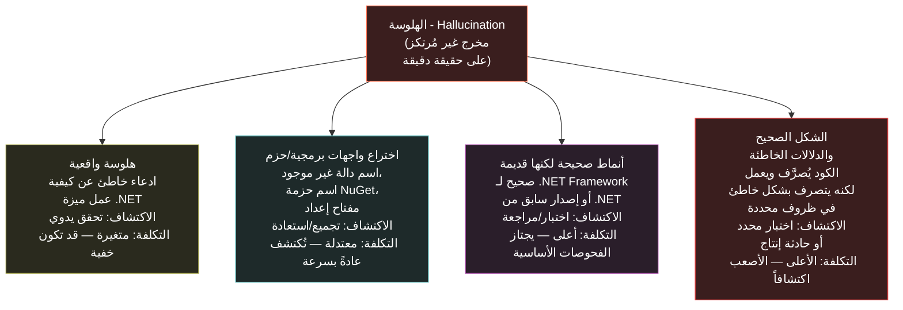

<div dir="rtl">

# القسم الرابع — الهلوسة وأنماط الفشل

## لماذا الهلوسة - Hallucination بنيوية لا عَرَضية

أرسى القسم الثالث أن الاستدلال الإحصائي يفشل بصمت — أنه حين يعمل النموذج قريباً من حافة توزيعه التدريبي أو خارجها، يُنتج مخرجات بنفس الثقة السطحية التي تميّز المخرجات المبنية على نمط كثيف وراسخ. يفحص هذا القسم نمط الفشل المحدد الذي ينتج عن ذلك الفشل الصامت: الهلوسة - Hallucination.

المصطلح مُستعار من علم النفس وأحياناً يُستخدَم وكأنه يصف النموذج "يخترع أشياء" بطريقة متعمدة أو قابلة للتجنب. لا التعمد ولا القابلية للتجنب صحيحان. النموذج اللغوي يُنتج الرمز التالي الأعلى احتمالاً بمعطى السياق. حين يتوافق ذلك السياق مع سؤال لا يوجد له نمط موثوق في توزيع التدريب — أو حيث توجد أنماط لكنها تُشير في اتجاهات متضاربة — يكون الرمز الأعلى احتمالاً مع ذلك رمزاً ما، مُستخلَصاً من أي أدلة توزيعية موجودة. لا يوجد لدى النموذج آلية تُميّز "أنا على وشك توليد اسم واجهة برمجية صحيح" من "أنا على وشك توليد تسلسل رموز يبدو كاسم واجهة برمجية لأن أسماء الواجهات البرمجية تظهر في هذا الموضع النحوي." غياب تلك الآلية ليس خللاً سيُعالَج في الإصدار التالي. إنه ما يبدو عليه التنبؤ بالرمز التالي بلا مرجع حقيقي - Oracle للصواب والخطأ.

الهلوسة بناءً عليه بنيوية: إنها النتيجة المتوقعة والمباشرة لآلية توليد يجب أن تُنتج دائماً رمزاً تالياً، مُطبَّقة في سياق يكون فيه الرمز التالي الصحيح غير محدد بالكافي أو غائب من التوزيع التدريبي. فهمها بوصفها بنيوية لا عَرَضية يُغيّر ما يفعله المهندس حيالها — لا "حسّن الموجّه لتتجنب الهلوسة" (وإن كانت الموجّهات الأفضل تُقلّص التكرار أحياناً) بل "صمّم أنظمة تفترض وقوع الهلوسة وتتحقق قبل التصرف بناءً على المخرج".

## تصنيف أنماط الفشل في بيئة .NET

ليست جميع الهلوسات متكافئة في التكلفة أو قابلية الاكتشاف. يُنظّم التصنيف التالي أنماطها وفق أثرها العملي على فريق .NET:



**الهلوسة الواقعية** هي الفئة الأكثر شيوعاً: يصف النموذج كيفية عمل ميزة .NET بطريقة خاطئة ببساطة. التكلفة تعتمد كلياً على ما إذا كان المهندس يكتشفها قبل التصرف بناءً عليها. الخاصية المقلقة للهلوسة الواقعية في السياق التقني هي أنها غالباً ما تحتوي على حقائق صحيحة مجاورة بما يكفي لتمر في قراءة سريعة دون إثارة شك. ولهذا يساعد بناء نموذج ذهني لمواضع تفرق توزيع التدريب (خريطة القسم الثاني)، لأن المناطق المتفرقة أعلى معدلات هلوسة واقعية من المناطق الكثيفة.

**اختراع الواجهات البرمجية والحزم** ربما هو نمط الفشل الأكثر شيوعاً في الممارسة اليومية بمساعدة الذكاء الاصطناعي: يُولّد النموذج اسم دالة مُحمَّلة، أو اسم حزمة NuGet، أو مسار فضاء اسم - Namespace Path، أو مفتاح إعداد غير موجود. هذه الفئة حميدة نسبياً من حيث تكلفة دورة الحياة — أسماء الحزم المُخترَعة تفشل عند `dotnet restore` وأسماء الواجهات البرمجية المُخترَعة تفشل عند التجميع — لكنها متكررة بشكل مفاجئ، ولا سيما لواجهات مكتبات أقل شيوعاً ممثلة تمثيلاً متفرقاً أو غير متسق في بيانات التدريب.

**الأنماط الصحيحة لكن القديمة** تُمثّل نمط فشل أعلى تكلفةً ويسهل التغافل عنه. استبدل .NET الحديث وأهمل أنماطاً عديدة من .NET Framework و.NET Core المبكر: فئة `WebClient` المُستبدَلة بـ `HttpClient`؛ وعمليات قاعدة البيانات المتزامنة المُستبدَلة بمكافئاتها غير المتزامنة؛ ونموذج بدء التشغيل القديم المُستبدَل بالمضيف العام - Generic Host والـ Minimal APIs. نموذج تحتوي بيانات تدريبه على كميات واسعة من مادة .NET Framework إلى جانب .NET الحديث قد يُولّد نمطاً كان صحيحاً تماماً للإصدار القديم ويُجمَّع مع تحذيرات أو يُجمَّع بنظافة لكنه يحمل الخصائص التشغيلية للنهج القديم — ولا سيما حول السلوك غير المتزامن، حيث تُفهَم الآن أغلفة المزامنة-فوق-غيرالمتزامن من حقبة Framework على أنها خطرة في قواعد كود async/await.

**الشكل الصحيح والدلالات الخاطئة** هو نمط الفشل الأعلى تكلفةً والأصعب اكتشافاً بلا تغطية اختبار محددة أو مراجعة منهجية لدلالات التزامن والموارد. مثال Channel<T> من القسم الثالث يقع هنا: الكود يُجمَّع ويعمل ويعالج المسار السعيد بشكل صحيح، ويفشل فقط تحت تسلسل إيقاف محدد قد لا يكون مُختبَراً جيداً في بيئة التطوير. ولهذه الفئة بالتحديد يُعَد التعامل مع الكود المُولَّد بالذكاء الاصطناعي بوصفه "متحققاً بالتجميع" ناقصاً معمارياً لأي شيء يتجاوز أبسط الشفرات المساعدة.

## الاختراع في الممارسة: حزم NuGet والواجهات البرمجية

فئة اختراع الواجهات البرمجية والحزم تستحق مثالاً ملموساً لأنها شائعة وكثيراً ما يُقلَّل من خطورتها من قِبل مهندسين يواجهونها للمرة الأولى ويتعاملون معها على أنها مجرد إزعاج. إطار الإزعاج يُغفل الخطر حين تكون الواجهة البرمجية المُخترَعة معقولةً بما يكفي — فضاء اسم صحيح، واسم دالة واقعي، وأنواع معاملات صالحة — لأن مهندساً غير مألوف بالمكتبة المحددة قد يقبلها دون تحقق، لا سيما تحت ضغط الوقت.

```csharp id="code-02-04"
// Target Framework: .NET 8.0
// Chapter: 02 | Section: 04
// book/chapters/chapter-02/sections/section-04.ar.md
//
// طبقة تحقق من اقتراحات الذكاء الاصطناعي لكود .NET.
// تتحقق من فضاءات الأسماء المقترحة وأسماء الحزم والتوقيعات
// مقابل بيان موثوق قبل قبولها في البناء.
//
// ليس حلاً كاملاً للهلوسة — بل نمط معماري يجعل الحد الحتمي صريحاً
// (سيُصوغه القسم الخامس رسمياً). الفحوصات هنا تستهدف فئتي
// اختراع الواجهات والأنماط القديمة من التصنيف.

namespace AiAwareEngineeringToolkit.Infrastructure.AI;

/// <summary>
/// يتحقق من اقتراحات كود .NET المُولَّدة بالذكاء الاصطناعي قبل قبولها
/// في قاعدة الكود. يمسك فضاءات الأسماء المُخترَعة وأسماء الحزم
/// غير الموجودة وتوقيعات الأنماط القديمة الشائعة.
/// </summary>
public sealed class AiSuggestionValidator
{
    // بوادئ فضاءات أسماء معروفة السوء تظهر في اقتراحات الذكاء الاصطناعي
    // ولا تقابل واجهات .NET الحالية.
    private static readonly FrozenSet<string> KnownFabricatedNamespaces =
        FrozenSet.Create(StringComparer.Ordinal,
        [
            "Microsoft.AspNetCore.Http.Extensions", // نُقل — استخدم Microsoft.AspNetCore.Http
            "System.Web.Http", // فضاء اسم WebAPI، لا ASP.NET Core
            "Microsoft.Extensions.Logging.Console.Internal", // داخلي، ليس واجهة عامة
        ]);

    // توقيعات دوال منطقية لكنها قديمة:
    // موجودة في .NET الأقدم ومُستبدَلة في .NET الحديث.
    private static readonly FrozenSet<string> OutdatedPatternSignatures =
        FrozenSet.Create(StringComparer.Ordinal,
        [
            ".Download(", // WebClient.DownloadString ونحوها — استخدم HttpClient
            ".Result", // التزامن فوق غير المتزامن؛ يمسك استخدامات Task.Result
            "Thread.Sleep(", // استخدم Task.Delay في السياقات غير المتزامنة
            "HttpWebRequest", // استُبدل بـ HttpClient
            "ServiceStack", // اختراع شائع: يقترح النموذج ServiceStack لسيناريوهات ASP.NET Core
        ]);

    public ValidationResult Validate(string suggestedCode)
    {
        var issues = new List<ValidationIssue>();

        foreach (var ns in KnownFabricatedNamespaces)
        {
            if (suggestedCode.Contains(ns, StringComparison.Ordinal))
            {
                issues.Add(new ValidationIssue(
                    Severity.Error,
                    "AI001",
                    $"فضاء اسم مُخترَع أو مُنقَل: '{ns}'. تحقق من فضاء الاسم الصحيح الحالي."));
            }
        }

        foreach (var pattern in OutdatedPatternSignatures)
        {
            if (suggestedCode.Contains(pattern, StringComparison.Ordinal))
            {
                issues.Add(new ValidationIssue(
                    Severity.Warning,
                    "AI002",
                    $"نمط قديم أو غير آمن: '{pattern}'. راجع مكافئات .NET الحديثة."));
            }
        }

        return issues.Count == 0
            ? ValidationResult.Valid
            : new ValidationResult(false, issues);
    }
}

public enum Severity { Warning, Error }

public sealed record ValidationIssue(Severity Severity, string Code, string Message);

public sealed record ValidationResult(bool IsValid, IReadOnlyList<ValidationIssue>? Issues = null)
{
    public static readonly ValidationResult Valid = new(true);
}
```

المُحقِّق أعلاه بسيط بتعمد — تطبيق الإنتاج سيستند إلى بيان يتحدث باستمرار من أسماء الحزم الحقيقية وأسطح الواجهة البرمجية الحالية بدلاً من سلاسل مُرمَّزة بصلابة — لكنه يُجسّد الموضع المعماري: كود الذكاء الاصطناعي المُولَّد يدخل حداً حتمياً - Deterministic Boundary قبل التصرف بناءً عليه، وذلك الحد يُجري فحوصات صريحة لا يستطيع الذكاء الاصطناعي إجراءها بنفسه. يمكن توسيع الفحوصات المحددة وأتمتتها؛ الخاصية المهمة هي وجود الحد ذاته وتطبيقه بشكل منهجي بدلاً من الاعتماد على يقظة كل مهندس في كل مراجعة كود.

## الطبيعة التراكمية لفئات الفشل

الفئات الأربع في التصنيف ليست مستقلة عملياً — بل تتزامن غالباً في قطعة مُولَّدة واحدة. فاستجابة تخترع اسم حزمة NuGet (الفئة الثانية) قد تحتوي معاً نمطاً قديماً لكيفية إعداد تلك الحزمة (الفئة الثالثة)، وشرحاً لسلوك الحزمة خاطئاً واقعياً (الفئة الأولى). والأخطر أن كود "الشكل الصحيح والدلالات الخاطئة" (الفئة الرابعة) يجتاز غالباً بوابات الفئات الثلاث الأخرى دون اكتشاف: فالكود يُصرَّف (مستبعداً الاختراع)، والشرح يبدو حديثاً (مستبعداً القدم الواضح)، والادعاءات الواقعية عن سلوكيات الواجهات المفردة صحيحة — فالفشل في *التفاعل*، وهو ما يستلزم النوع ذاته من الاستدلال على مستوى النظام الذي حدّده القسم الثالث خارج النطاق الموثوق للاستدلال الإحصائي. ولهذه الخاصية التراكمية تكون الفحوصات المعزولة لكل فئة فشل غير كافية، ويجب أن تتناول بنية التحقق الموصوفة لاحقاً في هذا الفصل المخرج ككل بدلاً من فحص كل فئة باستقلال.

## مشكلة إشارة الثقة - Confidence Signal

تشترك جميع أنماط الفشل الأربعة الموصوفة في هذا القسم في خاصية واحدة تجعلها صعبة الاكتشاف فعلاً: مخرجات النموذج لا تتباين في الثقة المُعبَّر عنها أو النبرة بين الحالات التي يكون فيها صحيحاً والحالات التي يُهلوس فيها. توقيع دالة مُخترَع يُوصَف بنفس أسلوب التوقيع الحقيقي. نمط قديم يُقدَّم بنفس الإطار الذي يُقدَّم به النمط الحالي. تنفيذ صحيح الشكل وخاطئ الدلالات يُشرَح بنفس عمق التفكير الظاهري الذي يُشرَح به التنفيذ الصحيح.

هذه ليست ميزة يمكن لهندسة الموجّه - Prompt Engineering تجاوزها بشكل موثوق. تعليمات مثل "أخبرني فقط بما أنت متأكد منه" أو "قل 'لا أعلم' حين تكون غير متأكد" تُنتج أحياناً تحفظاً مفيداً، لكن التحفظ ذاته نص مُولَّد — الرموز الأعلى احتمالاً في سياق يتضمن تعليمة التحفظ — ولا تتبع بموثوقية الصحة الفعلية للمحتوى المتاخم. مهندس تعلّم قراءة مخرجات الذكاء الاصطناعي ويُعايِر ضمنياً على النبرة والثقة — مهارة تعمل جيداً حين تقرأ خبراء بشريين — مُعايَر تحديداً بشكل خاطئ لقراءة مخرجات الذكاء الاصطناعي، لأن الإشارة التي يقرؤها مُولَّدة باستقلالية عن ارتباطها بالصحة. يُعالج القسم السادس هذا مباشرةً حين يتناول الثقة المُعايَرة - Calibrated Trust وما الإشارة الصحيحة للتحقق.

## التصميم ضد الهلوسة: مبادئ لفرق .NET

بما أن الهلوسة بنيوية وإشارة الثقة غير موثوقة، فالاستجابة الهندسية الصحيحة ليست التعويل على موجّهات أفضل أو نماذج أكثر قدرةً — وإن كانت تلك العوامل تُقلص التكرار — بل التصميم ضدها بصورة منهجية، بمعاملة مخرجات الذكاء الاصطناعي بنفس فئة التدقيق المُطبَّق على أي مدخل من مصدر غير موثوق. أربعة مبادئ تُرشد هذا في سياق فرق .NET.

**أولاً — التحقق عند حد نظام الأنواع.** المُصرِّف - Compiler وعملية استعادة حزم NuGet تُمسكان بفئة اختراع الواجهات البرمجية تلقائياً وبلا جهد هندسي إضافي، شرط أن يعمل خط أنابيب البناء - Build Pipeline ولا يتجاوزه أحد. الفشل في الاستفادة منه — بنسخ الكود المُولَّد بالذكاء الاصطناعي ولصقه في مشروع دون تجميع — يُزيل طبقة تحقق موجودة بالفعل وتكلفتها صفر. هذا الحد الأول هو الأسهل تطبيقاً والأكثر كفاءةً لما يُغطيه.

**ثانياً — التصنيف قبل المراجعة.** أنماط فشل مختلفة تتطلب استراتيجيات تحقق مختلفة. الهلوسات الواقعية المتعلقة بكيفية عمل ميزة .NET تتطلب قراءة إنسانية من شخص يفهم تلك الميزة. الاختراعات في الواجهات البرمجية تُمسكها أدوات التحليل الساكن - Static Analysis والتجميع. الأنماط القديمة يمكن اكتشافها بتحليل ساكن مهيأ لتوصيات .NET الحالية. "الشكل الصحيح والدلالات الخاطئة" يتطلب تغطية اختبار محددة تُمارس شرط الفشل. معاملة جميع مخرجات الذكاء الاصطناعي كفئة واحدة غير مُمايَزة تستوجب "مراجعة دقيقة" أقل فاعليةً من توجيه أجزاء مختلفة من المخرج إلى آلية التحقق المناسبة لنمط فشلها.

**ثالثاً — عدم توجيه مخرجات الذكاء الاصطناعي عبر مراجعة الكود كبوابة تحقق أساسية.** صُمِّمت مراجعة الكود - Code Review كفحص نظيري لصحة التنفيذ مقابل القصد المُعلَن، والملاءمة المعمارية، والأسلوب الاصطلاحي — لا كفحص منهجي للشكل الصحيح مقابل التمييز بين الدلالات الصحيحة والخاطئة. المُراجِعون يقرؤون بحثاً عن أنماط يعرفونها؛ أكثر أنماط فشل الذكاء الاصطناعي خطورةً هي تحديداً تلك التي تُطابق الأنماط المألوفة. التحقق البنيوي — اختبارات محددة لدلالات التزامن، واختبارات تكامل - Integration Tests تُمارس مسار الإيقاف، واختبارات معمارية - Architecture Tests تتحقق من اتجاه الاعتماد — بوابة أكثر موثوقية لتلك الفئات من مراجعة الكود وحدها.

**رابعاً — توقّع تباين معدلات الهلوسة بتغيّر المجال التقني عبر الزمن.** يتحول متن التدريب مع كل جيل جديد من النماذج — فالواجهات الصادرة بعد حد القطع ممثَّلة تمثيلاً ناقصاً منهجياً، بينما الواجهات الموثقة والمُناقَشة منذ سنوات معزَّزة جيداً. وهذا يعني أن ملف مخاطر الكود المُولَّد بالذكاء الاصطناعي ليس ثابتاً: فمكتبة كانت متفرقة في توزيع التدريب حين دُرِّب النموذج الحالي قد تُصبح كثيفة في الجيل التالي، ومكتبة كانت ممثلة جيداً قد تنشأ فيها فجوات إذا تغيّرت أنماط استخدامها ولم يتراكم بعد توثيق جديد كافٍ. ويجدر بالفرق إعادة تقييم المجالات التقنية الأعلى مخاطر هلوسةً دورياً وتعديل استراتيجيات التحقق تبعاً لذلك، بدلاً من افتراض ملف مخاطر ثابت عبر عمر المشروع.

## الاكتشاف الآلي: ما يمكن للأدوات اصطياده وما لا يمكنها

المبادئ الأربعة أعلاه تصف ما يجدر بالمهندسين فعله؛ وسؤال مدى إمكانية أتمتة ذلك سؤال منفصل ومهم. وتتفاوت الإجابة بحسب فئة الفشل، وفهم التفاوت أساسي لتصميم خطوط تحقق تُوجّه الأدوات نحو ما يمكن للأدوات اكتشافه فعلاً.

فاختراع الواجهات والحزم هو الفئة الأعلى قابلية للأتمتة. إذ يمكن لخط تحقق استخراج كل فضاء اسم واسم نوع وتوقيع دالة ومرجع حزمة من الكود المُولَّد ومقارنتها ببيان الأسطح الصحيحة المعروفة. ويمكن صيانة هذا البيان بتحليل سطح الواجهة العامة لتبعيات NuGet الفعلية للمشروع — وهي عملية حتمية تُنتج قائمة مرجعية لما هو موجود في إطار العمل المستهدف وإصدارات الحزم الحالية. وهذا سهل التنفيذ كمحلِّل Roslyn أو خطوة بناء مسبقة، ويمسك فئة الاختراع بإيجابيات كاذبة شبه معدومة: فإذا قال البيان إن الواجهة موجودة فهي موجودة، وإذا لم يقل فسيفشل الكود عند التجميع على أي حال. وكلفة صيانة البيان متواضعة — إذ يتحدث بتغيّر إصدارات الحزم، وهو حدث يتتبعه المشروع أصلاً.

والأنماط القديمة قابلة للأتمتة جزئياً. فقواعد التحليل الساكن تكتشف الواجهات المهملة المعروفة المحددة (ومجموعة `OutdatedPatternSignatures` في كود هذا القسم نقطة بداية) وتُعلّمها بتحذيرات مُصرِّف أو تشخيصات محلِّل. أما الاكتشاف الأكثر تطوراً — تحديد أنماط المزامنة-فوق-غيرالمتزامن التي تُصرَّف لكنها تحمل مخاطر تشغيلية، أو اكتشاف مناهج إعداد كانت صالحة في إصدارات أقدم — فيستلزم قواعد محلِّل مخصصة تُرمِّز معرفة الترحيل. وهي جديرة بالبناء للأنماط المتكررة في مخرجات الذكاء الاصطناعي للفريق، لأن كلفة قاعدة المحلِّل المخصصة استثمار لمرة واحدة يؤتي ثماره عبر كل اقتراح مُولَّد لاحق يتضمن النمط.

والهلوسات الواقعية هي الفئة الأقل قابلية للأتمتة. فشرح غير صحيح لعمل تجميع `ValueTask` أو ادعاء خاطئ عن سلوك الضغط الخلفي لـ `Channel<T>` لا يكشفه التجميع ولا التحليل الساكن — فالشرح نثر لا كود، وصحته تعتمد على سلوك وقت التشغيل الفعلي، وهو ما يستلزم إما خبرة نطاق للتقييم أو اختبار تكامل موجَّهاً يُمارس السلوك الموصوف تحديداً. وبالنسبة للفرق كثيرة الشروح المُولَّدة بالذكاء الاصطناعي (في التوثيق أو تعليقات الكود أو رسائل الالتزام)، تبقى المراجعة الدورية من خبير نطاق آلية الاكتشاف الأولى. أما الفرق التي تُولّد الكود بالذكاء الاصطناعي مع تعليقات توضيحية مضمّنة، فيمكن اختبار الكود ذاته — لكن الشرح المحيط به لا يمكن التحقق منه آلياً مقابل مرجع حقيقي.

وكود "الشكل الصحيح والدلالات الخاطئة" يقع بين الفئتين. فالكود يُصرَّف ويجتاز التحليل الساكن، فلا تمسكه فحوصات التجميع. لكن إذا كتب الفريق اختبارات تُمارس سيناريوهات التزامن والإيقاف والتكامل المحددة التي يُفترَض بالكود معالجتها، أمسكت تلك الاختبارات الفشل. والتداعية على الاستثمار في الأدوات واضحة: فأعلى استثمار تحقق آلي قيمةً للكود المُولَّد بالذكاء الاصطناعي ليس قواعد تنميط أفضل (وإن أفادت للاختراع والأنماط القديمة) — بل حزمة اختبار شاملة تُمارس أنماط الفشل التي يهتم بها الفريق. فالكود المُولَّد الذي يجتاز حزمة اختبار دقيقة متحقق الدلالات بطريقة لا يُضاهيها أي قدر من التحليل الساكن.

## الاستراتيجية التراكمية: بناء مكتبة أنماط فشل الفريق

لأن الهلوسة لها تكاليف تختلف باختلاف النمط ومستوى اكتشافه، وبما أن فرق .NET المختلفة تعمل في نطاقات مختلفة وتستخدم مجموعات مختلفة من المكتبات، فإن الاستثمار ذا القيمة الأعلى على المدى المتوسط هو بناء مكتبة أنماط الفشل الخاصة بالفريق.

في كل مرة يكتشف فيها مهندس هلوسةً في الإنتاج أو في مراجعة الكود — واجهة برمجية مُخترَعة في مكتبة معينة، أو نمط قديم ظهر في سياق معين، أو خلل دلالي في تعامل مُعين مع التزامن — يُوثَّق ذلك الاكتشاف بشكل منظم: النمط الذي ظهر، والمكتبة أو الميزة المعنية، والشرط الذي كشف الخلل، والتحقق الذي كان يجب إجراؤه ولم يُجرَ. يُصبح هذا التوثيق قاعدة معرفة تتراكم بمرور الوقت، ومدخلاً لتوسيع القائمة البيضاء للـ AiSuggestionValidator لتشمل فضاءات الأسماء المُخترَعة والأنماط القديمة الخاصة بمكتبات المنظومة البيئية للفريق.

هذه الاستراتيجية التراكمية لها ثلاث فوائد مستقلة. أولها تحسين جودة اكتشاف الهلوسة بمرور الوقت — قائمة فحص تنمو مع خبرة الفريق أفضل من قائمة ثابتة تعتمد على السيناريوهات العامة. ثانيها تكوين قاعدة أدلة ملموسة تُستخدَم لتوجيه استثمار الفريق في تحقق الذكاء الاصطناعي — ما الفئات الأعلى تكراراً؟ ما المكتبات الأكثر إنتاجاً للهلوسات في سياقنا؟ ثالثها تحويل حوادث الإنتاج المتعلقة بالذكاء الاصطناعي من مجرد أخطاء مكلفة إلى مدخلات لتحسين المنهجية — وهو ما يُميز الفرق التي تتحسن من الذكاء الاصطناعي بمرور الوقت عن تلك التي تعيد إنتاج نفس الأخطاء دون تعلم منهجي.

## التكامل مع ثقافة مراجعة الكود في الفريق

يستحق التمييز بين مستويات الهلوسة المختلفة أثراً ملموساً في ثقافة مراجعة الكود اليومية، لا فحسب في الأدوات الآلية. حين يُرسَل طلب سحب - Pull Request يتضمن كوداً مُولَّداً بالذكاء الاصطناعي للمراجعة، يُعطي وصف الطلب الذي يُصنّف المخرجات بوضوح — "هذه الكتلة من كود التحقق من الأنواع استُخرجت من اقتراح الذكاء الاصطناعي وتحققت من صحتها بمقارنة توقيعات الدوال مع توثيق الـ API الرسمي" مقابل "هذا المنطق الجديد للتزامن مُولَّد جزئياً وتحقق منه بإضافة اختبارات تُغطي مسار الإيقاف" — يُعطي المُراجِع معلومةً أساسية تُمكّنه من توجيه انتباهه بدقة أعلى وفاعلية أكبر.

هذا النوع من الإفصاح ليس شكلاً من أشكال الشفافية لذاتها. إنه إعادة توزيع فعّالة لجهد التحقق: المُراجِع الذي يعرف أي أجزاء مراجعتها تحققاً معيارياً للأنماط وأيها يتطلب قراءةً معمّقة لحالات الفشل الدلالي المحتملة يمكنه أداء كلا النوعين بجودة أعلى من المُراجِع الذي يعامل الكود المُولَّد بالذكاء الاصطناعي كتلةً متجانسة غير مُصنَّفة. بمرور الوقت، تبني هذه الممارسة قاموساً مشتركاً في الفريق لمستويات الثقة بمخرجات الذكاء الاصطناعي في سياقات مختلفة، مما يجعل قرارات التحقق أكثر اتساقاً وقابليةً للتوقع عبر أعضاء الفريق المختلفين.

وتجدر الإشارة إلى أن معظم الفرق طوّرت حدوس مراجعة مُعايَرة للكود البشري: يبحث المُراجِعون عن أخطاء المنطق، ومخالفات الأسلوب، وسوء المواءمة المعمارية، والتنفيذات الناقصة — وهي حدوس تنجح لأن إخفاقات الكود البشري تتبع أنماطاً مألوفة: خطأ off-by-one، وفحص null مفقود، واستخدام غير مناسب لحالة مشتركة قابلة للتغيير. أما إخفاقات الكود المُولَّد بالذكاء الاصطناعي فمختلفة بنيوياً: تميل إلى الصحة على مستوى العبارات المفردة — فكل سطر استمرار معقول إحصائياً للسطور قبله — لكنها قد تخطئ على مستوى التفاعل الدلالي بين العبارات. وحدوس المراجعة التي تمسك الأخطاء البشرية أقل فاعليةً ضد إخفاقات الذكاء الاصطناعي، لأن إخفاقات الذكاء الاصطناعي هي تحديداً الحالات التي تبدو فيها العبارات المفردة صحيحة بينما أثرها المُجمَّع خاطئ. فالمُراجِعون الذين يُطبّقون حدوس الكود البشري المعيارية على الكود المُولَّد سيمسكون بعض المشكلات (الواجهات المخترعة، والأنماط القديمة الواضحة) لكنهم سيُفوّتون منهجياً فئة "الشكل الصحيح والدلالات الخاطئة" — وهي تحديداً الفئة الأعلى كلفةً هندسيةً.

الأثر التراكمي لاتساق مثل هذه الممارسة عبر مئات من طلبات السحب ولأشهر متتالية هو ما يُميز فريق .NET ينمو في قدرته على الاستخدام الاحترافي الذكي للذكاء الاصطناعي عن فريق يُكرر نفس أخطاء التحقق دون منهجية تراكمية تُصحح المسار وتُحسّن العملية في ضوء الخبرة الميدانية المتراكمة.

## الأثر على قرارات البنية التحتية لبيئة التطوير

نمط الفشل الأعلى تكلفةً — "الشكل الصحيح والدلالات الخاطئة" — له تداعية واحدة على قرارات البنية التحتية لبيئة التطوير تستحق التصريح: اختبارات الوحدة - Unit Tests وحدها لا تكفي للتحقق من صحة الكود المُولَّد بالذكاء الاصطناعي الذي يتعامل مع التزامن أو دورات حياة الموارد أو دلالات بروتوكولات الاتصال. اختبارات الوحدة تُمارس التنفيذ بمدخلات معروفة في بيئة مُتحكَّم فيها. الأخطاء الدلالية من قبيل خلل إتمام Channel<T> تتجلى فقط تحت ظروف تشغيل محددة — تسلسلات زمنية محددة، وتزامن حقيقي، وتسلسلات إيقاف تشغيل حقيقية — وهي ظروف لا تُصمَّم اختبارات الوحدة عادةً لمحاكاتها. اختبارات التكامل - Integration Tests التي تُشغّل الكود في بيئة أقرب للإنتاج، واختبارات الحمل - Load Tests التي تُمارس الكود تحت تزامن حقيقي، هي الأدوات المناسبة لاكتشاف هذه الفئة قبل أن تصل إلى الإنتاج. الفريق الذي يُنشئ هذه البنية التحتية للاختبار ويُثبّتها كجزء من عملية تسليم الميزات التي تتضمن كوداً مُولَّداً بالذكاء الاصطناعي يُقلص بشكل ملموس التكلفة الفعلية لنمط الفشل الأعلى خطورةً الذي يُقدّمه هذا القسم.
وهذا الاستثمار في البنية التحتية للاختبار يُقلّص أيضاً تكلفة كل جولة تطوير مستقبلية تستخدم الذكاء الاصطناعي في المساهمة بكود ذي طبيعة تزامنية أو تعتمد على دلالات بروتوكولات اتصال دقيقة أو تُدير دورات حياة موارد معقدة، مما يجعله استثماراً ذا عائد متراكم يتصاعد قيمةً مع كل دورة تطوير بدلاً من كونه تكلفةً ثابتة تُدفَع مرةً واحدة لمشروع واحد. وتبقى هذه البنية تُوظَّف وتُحسَّن ويُبنى عليها في كل مشروع جديد يستفيد من الذكاء الاصطناعي في توليد أجزاء من كوده الحرج في بيئات الإنتاج الحقيقية ذات المتطلبات العالية من الموثوقية والأداء والتوافر المستمر.

## ملخص: الهلوسة كقيد هندسي وليس خللاً برمجياً

التوصيف الأكثر دقةً للهلوسة في سياق هندسة .NET المحترفة هو اعتبارها قيداً هندسياً - Engineering Constraint مُعطىً يجب التصميم في ضوئه، لا خللاً برمجياً يُنتظَر إصلاحه في إصدار مستقبلي. وجود حد نظام الأنواع الذي يُمسك الاختراعات، وطبقة التحقق التي تُرشّح الأنماط القديمة، وتغطية الاختبار التي تُمارس الحالات الحدية الدلالية — هذه ليست تحوطات مؤقتة ريثما تتحسن النماذج. إنها العناصر المعمارية الدائمة لأي نظام .NET يتضمن مكوناً يعمل بالاستدلال الإحصائي، بصرف النظر عن جيل النموذج أو مستوى قدراته. القسم الخامس يُعمّق هذا المنظور بإطار معماري أكثر اكتمالاً لرسم الحد بين الأنظمة الحتمية والمكونات الاحتمالية في تطبيقات .NET المدمجة بالذكاء الاصطناعي.

</div>
