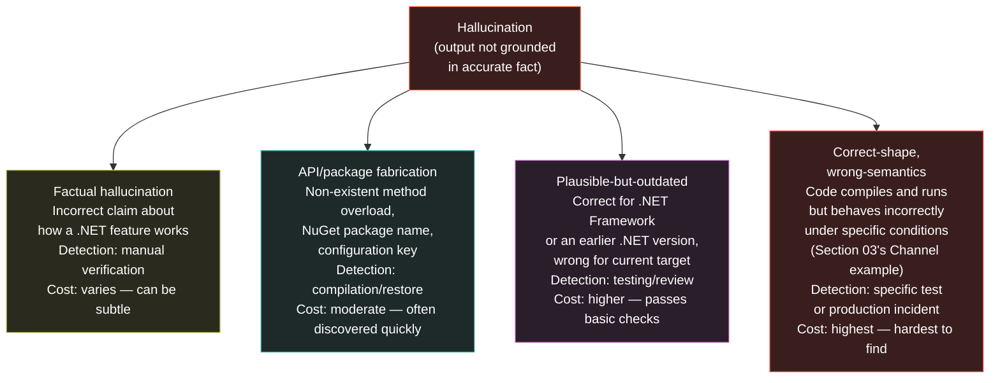

# Section 04 — Hallucinations and Failure Modes

## Why Hallucination Is Structural, Not Incidental

Section 03 established that statistical reasoning fails silently — that when the model operates near or beyond the edge of its training distribution, it produces output with the same confident surface as output built on a dense, well-reinforced pattern. Section 04 examines the specific failure mode that this silent failure produces: hallucination.

The term is borrowed from psychology and sometimes used as though it describes a model "making things up" in some deliberate or avoidable way. Neither the deliberateness nor the avoidability framing is accurate. A language model produces the most probable next token given the context. When that context corresponds to a question for which no reliable pattern exists in the training distribution — or where patterns exist but point in inconsistent directions — the most probable next token is still *some* token, drawn from whatever distributional evidence exists. The model has no mechanism to distinguish "I am about to generate a correct API name" from "I am about to generate a token sequence that looks like an API name because API names appear in this syntactic position." The absence of that mechanism is not a bug that will be patched in the next version. It is what next-token prediction without a truth oracle looks like.

Hallucination is therefore structural: it is the predictable consequence of a generation mechanism that must always produce a next token, applied in a context where the correct next token is underspecified or absent from the training distribution. Understanding it as structural rather than incidental changes what an engineer does about it — not "prompt better to avoid hallucination" (though better prompts do reduce its frequency in some cases) but "design systems that assume hallucination will occur and verify before acting on the output."

## Taxonomy of Failure Modes for .NET Engineering

Not all hallucinations are equivalent in cost or detectability. The following taxonomy organises them by their practical impact on a .NET engineering team:



**Factual hallucination** is the most familiar category: the model describes how a .NET feature works in a way that is simply incorrect. The cost depends entirely on whether the engineer catches it before acting on it — which is why building a mental model of where the training distribution is sparse (Section 02's map) helps, because sparse regions have higher factual hallucination rates than dense ones. The concerning property of factual hallucination in a technical context is that it often contains enough correct adjacent facts to pass a quick reading without triggering doubt.

**API and package fabrication** is perhaps the most commonly encountered failure mode in day-to-day AI-assisted development: the model generates a method overload, NuGet package name, namespace path, or configuration key that does not exist. This category is relatively benign in terms of lifecycle cost — fabricated package names fail at `dotnet restore` and fabricated API names fail at compilation — but it is surprisingly frequent, particularly for less-common library APIs that are represented sparsely or inconsistently in training data.

**Plausible-but-outdated patterns** represent a more expensive failure mode that is easy to miss. Modern .NET has deprecated or replaced numerous patterns from .NET Framework and early .NET Core: the `WebClient` class replaced by `HttpClient`; synchronous database operations replaced by their async counterparts; the old startup model replaced by the generic host and minimal APIs. A model whose training data contains extensive .NET Framework material alongside modern .NET material may generate a pattern that was entirely correct for the older version and either compiles with warnings or compiles cleanly but carries the operational characteristics of the older approach — particularly around async behaviour, where sync-over-async wrappers from the Framework era are now well-understood as dangerous in `async`/`await` codebases.

**Correct-shape, wrong-semantics** is the most expensive failure mode and the least detectable without specific test coverage or a systematic review of concurrency and resource semantics. The Section 03 `Channel<T>` example falls here: the code compiles, it runs, it handles the normal path correctly, and it fails only under a specific shutdown sequence that may not be well-exercised in a development environment. This category is the reason that treating AI-generated code as "verified by compilation" is architecturally insufficient for anything other than the simplest utility code.

## Fabrication in Practice: NuGet Packages and API Overloads

The API and package fabrication category deserves a concrete example because it is both common and often underestimated in severity by engineers who encounter it for the first time and treat it as merely inconvenient. The inconvenience framing misses the risk when the fabricated API is *plausible enough* — correct package namespace, realistic method name, valid parameter types — that an engineer unfamiliar with the specific library might accept it without verification, particularly under time pressure.

```csharp id="code-02-04"
// Target Framework: .NET 8.0
// Chapter: 02 | Section: 04
// book/chapters/chapter-02/sections/section-04.en.md
//
// Validation layer for AI-generated code suggestions in a .NET pipeline.
// Checks suggested namespaces, package names, and method signatures
// against a known-good manifest before allowing them into a build.
//
// This is not a complete solution to hallucination — it is an
// architectural pattern that makes the deterministic boundary explicit
// (Section 05 will formalise this). The specific checks here target
// the API-fabrication and outdated-pattern categories from the taxonomy.

namespace AiAwareEngineeringToolkit.Infrastructure.AI;

/// <summary>
/// Validates AI-generated .NET code suggestions before they are
/// accepted into the codebase. Catches fabricated namespaces, package
/// names that don't exist, and common outdated-pattern signatures.
/// </summary>
public sealed class AiSuggestionValidator
{
    // Known-bad namespace prefixes that appear in AI suggestions
    // but do not correspond to current .NET APIs.
    private static readonly FrozenSet<string> KnownFabricatedNamespaces =
        FrozenSet.Create(StringComparer.Ordinal,
        [
            "Microsoft.AspNetCore.Http.Extensions",     // moved — use Microsoft.AspNetCore.Http
            "System.Web.Http",                          // WebAPI namespace, not ASP.NET Core
            "Microsoft.Extensions.Logging.Console.Internal", // internal, not public API
        ]);

    // Method signatures that are plausible-but-outdated:
    // these exist in older .NET but are replaced in modern .NET.
    private static readonly FrozenSet<string> OutdatedPatternSignatures =
        FrozenSet.Create(StringComparer.Ordinal,
        [
            ".Download(",          // WebClient.DownloadString etc — use HttpClient
            ".Result",             // sync-over-async; catches Task.Result usage
            "Thread.Sleep(",       // use Task.Delay in async contexts
            "HttpWebRequest",      // replaced by HttpClient
            "ServiceStack",        // common LLM confabulation: suggests ServiceStack
                                   // APIs for ASP.NET Core scenarios
        ]);

    public ValidationResult Validate(string suggestedCode)
    {
        var issues = new List<ValidationIssue>();

        foreach (var ns in KnownFabricatedNamespaces)
        {
            if (suggestedCode.Contains(ns, StringComparison.Ordinal))
            {
                issues.Add(new ValidationIssue(
                    Severity: Severity.Error,
                    Code: "AI001",
                    Message: $"Fabricated or moved namespace detected: '{ns}'. " +
                             "Verify the correct current namespace before using."));
            }
        }

        foreach (var pattern in OutdatedPatternSignatures)
        {
            if (suggestedCode.Contains(pattern, StringComparison.Ordinal))
            {
                issues.Add(new ValidationIssue(
                    Severity: Severity.Warning,
                    Code: "AI002",
                    Message: $"Outdated or unsafe pattern detected: '{pattern}'. " +
                             "Review for modern .NET equivalents."));
            }
        }

        return issues.Count == 0
            ? ValidationResult.Valid
            : new ValidationResult(false, issues);
    }
}

// ── Value types ───────────────────────────────────────────────────────────

public enum Severity { Warning, Error }

public sealed record ValidationIssue(
    Severity Severity,
    string   Code,
    string   Message);

public sealed record ValidationResult(bool IsValid, IReadOnlyList<ValidationIssue>? Issues = null)
{
    public static readonly ValidationResult Valid = new(true);
}
```

The validator above is intentionally simple — a production implementation would be backed by a continuously-updated manifest of real package names and current API surfaces rather than hard-coded strings — but it illustrates the architectural position: AI-generated code enters a deterministic boundary before being acted upon, and that boundary performs explicit checks that the statistical generation process cannot perform for itself. The specific checks can be expanded and automated; the important property is that the boundary exists and is enforced systematically rather than relying on per-engineer vigilance in each code review.

## The Compounding Nature of Failure Categories

The four categories in the taxonomy are not independent in practice — they frequently co-occur in a single AI-generated artifact. A response that fabricates a NuGet package name (category two) may simultaneously contain an outdated pattern for how that package is configured (category three), and an explanation of the package's behaviour that is factually incorrect (category one). More dangerously, correct-shape wrong-semantics code (category four) often passes through the other three categories undetected: the code compiles (ruling out fabrication), the explanation sounds current (ruling out obvious outdatedness), and the factual claims about individual API behaviours are each correct — the failure is in their interaction, which requires the same kind of system-level reasoning that Section 03 identifies as outside statistical reasoning's reliable range. This compounding property is why isolated checks against individual failure categories are insufficient and why the verification architecture described later in this chapter must address the output as a whole rather than checking for each category independently.

## The Confidence Signal Problem

All four failure modes described in this section share one property that makes them genuinely challenging: the model's output does not vary in expressed confidence or tone between cases where it is correct and cases where it is hallucinating. A fabricated method signature is described with exactly the same register as a real one. An outdated pattern is introduced with exactly the same framing as a current one. A correct-shape, wrong-semantics implementation is explained with exactly the same depth of apparent reasoning as a correct implementation.

This is not a feature that better prompting can reliably override. Instructions like "only tell me things you are certain of" or "say 'I don't know' when you are unsure" sometimes produce useful hedging, but the hedging is itself generated text — the most probable tokens in a context that included the instruction to hedge — and does not reliably track the actual reliability of the adjacent content. An engineer who has learned to read AI output and is subconsciously calibrating on tone and confidence — a skill that works well when reading human experts — is specifically miscalibrated for reading AI output, because the signal they are reading is generated independently of its correlation with correctness.

Section 06 returns to this directly when it addresses calibrated trust and what the correct verification signal is. Section 05 first examines the deeper issue of what it means to build reliable .NET systems when one component of those systems is probabilistic in a way that cannot be removed by configuration — and what the correct architectural response is to that irreducible probabilism.

## Designing Against Hallucination: Principles for .NET Teams

Given that hallucination is structural and the confidence signal is unreliable, the correct engineering response is not to hope for better prompts or more capable models — though those reduce frequency — but to design against it systematically, treating AI output with the same class of scrutiny applied to any input from an untrusted source. Three principles guide this for .NET teams.

A fourth principle follows from the structural nature of hallucination described at the start of this section: **expect hallucination rates to vary by technology area over time.** The training corpus shifts with each new model generation — APIs released after the training cutoff are systematically under-represented, while APIs that have been documented and discussed for years are well-reinforced. This means the risk profile for AI-generated code is not static: a library that was sparse in the training distribution when the current model was trained may become dense in the next generation, and a library that was well-represented may develop gaps if its usage patterns change and new documentation has not yet accumulated sufficiently. Teams should periodically reassess which technology areas carry higher hallucination risk and adjust their verification strategies accordingly, rather than assuming a fixed risk profile across the lifetime of a project.

**Verify at the type system boundary.** The compiler and the NuGet restore process catch the API-fabrication category with zero additional engineering effort, provided the build pipeline is not configured to skip them. This is an already-existing deterministic layer that catches one entire category of hallucination automatically. The failure to leverage it — by copy-pasting AI-generated code into a project without compiling — removes a verification that costs nothing to apply. This first layer is the easiest to apply and the most efficient for what it covers.

**Categorise before reviewing.** Different failure modes require different verification strategies. Factual hallucinations about how a .NET feature works require a human who understands the feature to read and evaluate the claim — there is no automated check for "is this explanation of how `ValueTask` allocation works actually correct?" API fabrications are caught by compilation and static analysis. Outdated patterns can be detected by static analysis tooling configured with current .NET recommendations. Correct-shape, wrong-semantics code requires specific test coverage that exercises the failure condition. Treating all AI-generated output as a single undifferentiated category to "review carefully" is less effective than routing different parts of the output to the verification mechanism appropriate for their failure mode.

**Do not route AI output through code review as the primary verification gate.** Code review was designed as a peer-level check against implementation correctness relative to stated intent, architectural fit, and idiomatic style — not as a systematic check for correctness-shape versus correctness-semantics distinction. Reviewers are reading for patterns they recognise; the most dangerous AI failure modes (correct-shape, wrong-semantics) are specifically those that match recognisable patterns. Structural verification — specific tests for the concurrency semantics, integration tests that exercise the shutdown path, architectural tests that verify dependency direction — is a more reliable gate for these categories than code review alone.

## Automated Detection: What Tooling Can and Cannot Catch

The four principles above describe what engineers should do; the question of how much of this can be automated is a separate and important one. The answer varies by failure category, and understanding the variation is essential for designing verification pipelines that allocate tooling to what tooling can actually detect.

API and package fabrication is the most automatable category. A verification pipeline can extract every namespace, type name, method signature, and package reference from AI-generated code and cross-reference them against a manifest of known-correct surfaces. This manifest can be maintained by parsing the public API surface of the project's actual NuGet dependencies — a deterministic operation that produces a ground-truth list of what exists in the current target framework and package versions. This is straightforward to implement as a Roslyn analyser or a standalone pre-build step, and it catches the fabrication category with near-zero false positives: if the manifest says the API exists, it exists; if it does not, the code will fail at compile time regardless. The cost of maintaining the manifest is modest — it updates when package versions change, which is already an event the project tracks.

Outdated patterns are partially automatable. Static analysis rules can detect specific known-deprecated APIs (the `OutdatedPatternSignatures` set in Section 04's code example is a starting point) and flag them with compiler warnings or analyser diagnostics. More sophisticated detection — identifying sync-over-async patterns that compile but carry operational risk, or detecting configuration approaches that were valid in older versions — requires custom analyser rules that encode the migration knowledge. These are worth building for patterns that recur frequently in the team's AI-assisted output, because the cost of a custom analyser rule is a one-time investment that pays off across every future AI-generated suggestion that contains the pattern.

Factual hallucinations are the least automatable category. An incorrect explanation of how `ValueTask` pooling works or a wrong claim about `Channel<T>`'s back-pressure behaviour cannot be detected by compilation or static analysis — the explanation is prose, not code, and its correctness depends on the actual runtime behaviour, which requires either domain expertise to evaluate or a targeted integration test that exercises the specific behaviour described. For teams with frequent AI-generated explanations (in documentation, code comments, or commit messages), periodic review by a domain expert is the primary detection mechanism. For teams that use AI to generate code with embedded explanatory comments, the code itself can be tested — but the explanation surrounding it cannot be automatically validated against ground truth.

Correct-shape, wrong-semantics code falls between the automatable and non-automatable categories. The code compiles and passes static analysis, so compilation-based checks do not catch it. But if the team has written tests that exercise the specific concurrency, shutdown, or integration scenarios that the code is supposed to handle, those tests will catch the failure. The implication for tooling investment is clear: the highest-value automated verification investment for AI-generated code is not better linting rules (though those help for fabrication and outdated patterns) — it is a comprehensive test suite that exercises the failure modes the team cares about. AI-generated code that passes a thorough test suite is verified for correctness semantics in a way that no amount of static analysis can replicate.

## The Cumulative Strategy: Building the Team's Failure-Pattern Library

Because hallucination costs vary by category and detectability, and because different .NET teams work in different domains with different library sets, the highest-value medium-term investment is building the team's own failure-pattern library.

Every time an engineer discovers a hallucination — in production or in code review — a fabricated API in a specific library, an outdated pattern in a specific context, a semantic flaw in a specific concurrency interaction — the discovery is documented in a structured form: the pattern that appeared, the library or feature concerned, the condition that exposed the flaw, and the verification that should have been performed but was not. That documentation becomes a knowledge base that accumulates over time, and an input for expanding the `AiSuggestionValidator`'s manifest to include the fabricated namespaces and outdated patterns specific to the team's ecosystem libraries.

This cumulative strategy has three independent benefits. First, it improves hallucination detection quality over time — a checklist that grows with team experience is better than a fixed list built on generic scenarios. Second, it builds a concrete evidence base for directing the team's AI-verification investment — which categories recur most often, which libraries produce the most hallucinations in this context. Third, it converts AI-related production incidents from merely expensive mistakes into methodology-improvement inputs — which is what distinguishes teams that improve with AI over time from those that reproduce the same mistakes without systematic learning.

## The Interaction Between Hallucination and Code Review Culture

One practical consequence of the structural nature of hallucination that deserves explicit attention is its interaction with existing code review practices. Most engineering teams have developed code review heuristics calibrated for human-written code: reviewers look for logic errors, style violations, architectural misalignment, and incomplete implementations. These heuristics work because human-written code failures tend to follow recognisable patterns — an off-by-one error, a missing null check, an inappropriate use of a shared mutable state.

AI-generated code failures are structurally different. They tend to be correct at the level of individual statements — each line is a statistically plausible continuation of the lines before it — but may be wrong at the level of semantic interaction between statements. The code review heuristics that catch human errors (spotting the logic mistake in a loop condition, noticing the missing dispose) are less effective against AI failures because the AI failures are specifically the cases where the individual statements look correct but their combined effect is wrong. Reviewers who apply their standard human-code heuristics to AI-generated code will catch some issues (fabricated APIs, obviously outdated patterns) but systematically miss the correct-shape, wrong-semantics category, which is precisely the category with the highest engineering cost.

The practical response is not to change how code review works — code review remains valuable for its original purpose — but to supplement it with verification mechanisms that target AI-specific failure modes: structural validation at the type-system boundary, targeted tests that exercise the specific semantic interaction the code depends on, and architecture tests that verify the properties code review is not designed to catch. This layered approach — code review for what code review is good at, targeted verification for what only targeted verification can catch — is the architecturally correct response to a failure mode that does not map onto existing review heuristics.

The classification deserves a tangible effect on everyday review culture, not just on automated tooling. When a pull request containing AI-generated code goes out for review, a request description that classifies the output explicitly — "this type-checking code block came from an AI suggestion and was verified by comparing method signatures against the official API documentation" versus "this new concurrency logic is partly generated and was verified by adding tests that cover the shutdown path" — gives the reviewer essential information for directing attention with higher precision and effectiveness.

That kind of disclosure is not institutional humility or transparency for its own sake. It is an effective redistribution of verification effort: a reviewer who knows which parts of the review are standard pattern checks and which require deep reading for potential semantic failure modes can perform both kinds at higher quality than a reviewer who treats AI-generated code as an unclassified homogeneous block. Over time, the practice builds a shared vocabulary in the team for confidence levels in AI output across contexts, making verification decisions more consistent and predictable across members — and the cumulative effect of that consistency, across hundreds of pull requests over consecutive months, is what distinguishes a .NET team growing in its professional use of AI from one repeating the same verification mistakes with no corrective methodology.

## Impact on Development-Environment Infrastructure Decisions

The highest-cost failure mode — correct-shape, wrong-semantics — has one implication for development-environment infrastructure decisions worth stating: unit tests alone do not suffice for verifying AI-generated code that deals with concurrency, resource lifecycles, or communication-protocol semantics. Unit tests exercise implementation against known inputs in a controlled environment. Semantic errors like the `Channel<T>` completion flaw only manifest under specific runtime conditions — specific timings, real concurrency, real shutdown sequences — conditions unit tests are not usually designed to simulate. Integration tests that run the code in a nearer-production environment, and load tests that exercise it under real concurrency, are the appropriate tools for catching this category before it reaches production. A team that builds this test infrastructure and establishes it as part of the feature-delivery process for work involving AI-generated code materially reduces the realised cost of the most dangerous failure mode this section presents — and that investment also reduces the cost of every future development round using AI for concurrency-sensitive code, making it a compounding-return investment that grows in value with each development cycle rather than a fixed cost paid once and forgotten.

## Summary: Hallucination as an Engineering Constraint, Not a Bug

The most accurate characterisation of hallucination in a professional .NET engineering context is to treat it as a given engineering constraint to design around, not a software bug awaiting a fix in a future release. The type-system boundary that catches fabrications, the validation layer that filters outdated patterns, the test coverage that exercises semantic edge cases — these are not temporary hedges until models improve. They are the permanent architectural elements of any .NET system containing a component that operates by statistical inference, regardless of model generation or capability level.

These principles do not eliminate hallucination from an AI-assisted .NET workflow. They reframe it from a per-engineer vigilance problem — "be careful and review output before using it" — into a systemic engineering problem with known failure categories, appropriate verification mechanisms per category, and architectural layers that catch what static analysis and compilation cannot. Section 05 takes this framing further, examining the deeper architectural question of where the probabilistic boundary of an AI component must be drawn inside a .NET system designed for determinism.
