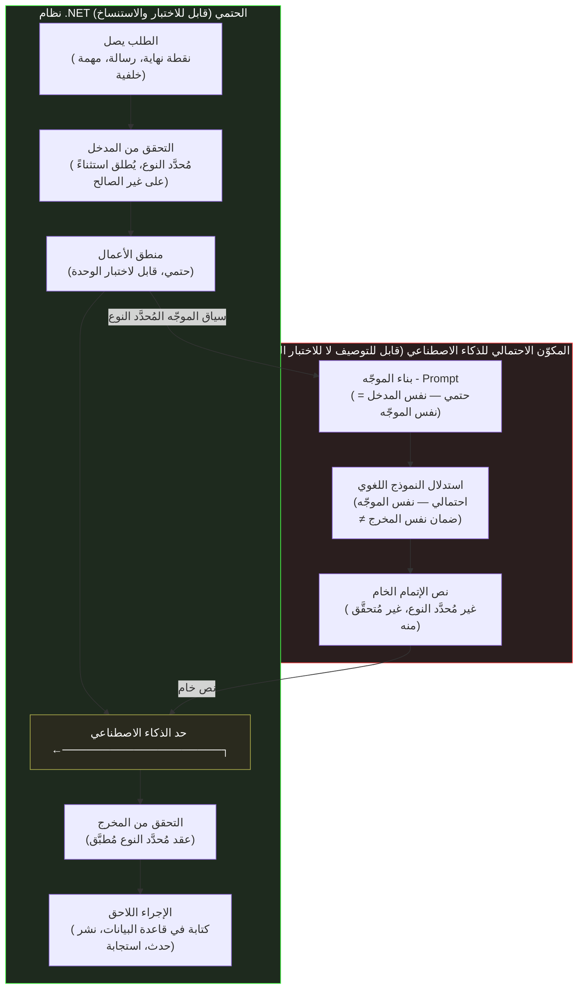

<div dir="rtl">

# القسم الخامس — الأنظمة الحتمية والأنظمة الاحتمالية

## اللاتماثل الجوهري

يبني مهندسو .NET أنظمةً حتمية - Deterministic Systems بحكم الافتراض. "الحتمي" هنا له معنى دقيق: بمعطيات ومدخلات وحالة نظام متطابقة، يُنتَج نفس الخرج في كل مرة. يجب أن تُنتج دالة <code dir="ltr">PaymentProcessor.ProcessAsync</code> التي تقبل <code dir="ltr">ProcessPaymentRequest</code> و<code dir="ltr">CancellationToken</code> النتيجة ذاتها لأي طلب مُعطى، سواء استُدعيت في العاشرة صباحاً أم الحادية عشرة مساءً، في الاستدعاء الأول أم الألف، في الإنتاج أم في اختبار وحدة يعمل محلياً على جهاز المطوّر. هذه الخاصية ليست عَرَضية — إنها ما يجعل أنظمة .NET قابلةً للاختبار وللتصحيح وللنشر وللتشغيل الموثوق. الحتمية هي الأساس الذي تستند إليه كل خاصية هندسية مفيدة في نظام إنتاجي.

استدعاء نموذج لغوي كبير - Large Language Model غير حتمي بحكم البنية. ضبط درجة الحرارة - Sampling Temperature على الصفر يُقلص التباين — فعند الصفر يُختار الرمز الأعلى احتمالاً في كل خطوة بدلاً من أخذ عينة من التوزيع — لكنه لا يُلغيه: اللاحتمية على مستوى البنية التحتية في حسابات الفاصلة العائمة عبر الأجهزة، والتغييرات التي تُطبّقها الجهة المزوِّدة على أوزان النموذج بشكل غير مُعلَن، تعني أن استدعاءً بدرجة حرارة صفر إلى نفس نقطة النهاية بنفس المدخل قد يُنتج مخرجاً مختلفاً في أوقات مختلفة. والأهم أن حتمية درجة الحرارة صفر — حتى ضمن نسخة بعينها من النموذج — ليست خاصية يمكن الاعتماد عليها دون تثبيت نسخة محددة — والنسخ تُتقاعَد وتُستبدَل في نهاية المطاف.

هذان العنصران — خدمة .NET الحتمية ومُجاوِب الذكاء الاصطناعي الاحتمالي — يجب أن يتعايشا في أنظمة تستخدم مساعدة الذكاء الاصطناعي. السؤال الهندسي هو: أين يقع الحد بينهما، وكيف يبدو الجانب الحتمي من ذلك الحد؟

## الحدّ الاحتمالي كقرار معماري - Architectural Decision

معاملة المكوّن الاحتمالي في نظام .NET مدمج بالذكاء الاصطناعي كتفصيل تنفيذي — "استدعاء الذكاء الاصطناعي مجرد استدعاء API خارجي آخر، يُعامَل كما يُعامَل استدعاء REST أو قاعدة بيانات" — يُفوّت فارقاً نوعياً أرسته الأقسام السابقة من هذا الفصل. استدعاء REST API حتمي: الطلب ذاته يُنتج الاستجابة ذاتها لحالة خادم مُعطاة، والاختلافات في محتوى الاستجابة تعكس تغيرات في حالة الخادم أو معاملات الطلب — حالة قابلة للفحص. استدعاء إتمام الذكاء الاصطناعي يُنتج مخرجاً يعكس تباينه عملية أخذ العينات الاحتمالية الموصوفة في القسم الأول — إنه ليس نتيجة تغير حالة يمكن فحصه، ولا يمكن استنساخه بإعادة إرسال المدخلات ذاتها، وفضاء مخرجاته لا يمكن توصيفه بمجموعة منتهية من مدخلات الاختبار بالطريقة التي يمكن بها توصيف مخرج دالة حتمية.

هذا يعني أن الحدّ المعماري بين نظام .NET الحتمي والمكوّن الاحتمالي للذكاء الاصطناعي ليس مجرد مسألة إدارة اعتماديات — إنه حد صحة. كل ما على الجانب الحتمي يمكن اختباره بمناهج .NET القياسية: اختبارات وحدة بمدخلات معروفة وتأكيدات على مخرجات دقيقة، واختبارات تكامل بتبعيات مسجّلة أو مُقلَّدة، واختبارات معمارية تتحقق من الخصائص البنيوية. المكوّن الاحتمالي في المقابل لا يمكن إلا "توصيفه" لا "اختباره بالكامل" — يمكن أخذ عينات من توزيع مخرجاته وتقييمها مقابل معايير، لكن لا توجد مجموعة اختبار منتهية يمكنها استيعاب سلوكه بالطريقة التي يمكن بها لمجموعة اختبار لدالة حتمية ذلك.



يُوضّح المخطط صراحةً أن حد الذكاء الاصطناعي له جانبان: على اليسار، استدعاء حتمي لبناء الموجّه (المدخل إلى استدعاء الذكاء الاصطناعي حتمي — نفس المدخل يُنتج دائماً نفس الموجّه)؛ وعلى اليمين، التحقق من نص الإتمام الخام قبل قبوله في النظام الحتمي مجدداً. العنصر الاحتمالي هو استدعاء الاستدلال بين تلك النقطتين. مخرجه نص خام غير مُحدَّد النوع يجب تحليله والتحقق منه مقابل عقد مُحدَّد النوع وربما إعادة المحاولة قبل أن يقبله النظام الحتمي.

## ما يجب أن يُطبّقه الحد الحتمي

تُؤدي طبقة التحقق وإعادة المحاولة عند الحد عدة عمليات مستقلة، كل منها تُعالج نمط فشل مختلفاً تحدده الأقسام السابقة.

**التحقق البنيوي** يتحقق من أن المخرج قابل للتحليل بالبنية المتوقعة. إذا توقع التطبيق كائن JSON بحقول بعينها، يتحقق الحد من بنية JSON قبل إجراء إزالة التسلسل - Deserialization. وإذا توقع التطبيق كتلة كود تتضمن نوعاً محدداً من التصريح، يتحقق الحد من تلك البنية قبل تمرير المحتوى لاحقاً. يلتقط التحقق البنيوي نسبةً كبيرة من المخرجات غير القابلة للاستخدام كلياً — أخطاء التنسيق، والاستجابات المقتطعة، والاستجابات التي أجابت على سؤال مختلف — دون الحاجة إلى معرفة مجال ما تبدو عليه الإجابة الصحيحة.

**التحقق الدلالي** يتحقق من أن المخرج المُحلَّل يُرضي قيود المجال: النطاقات، والكيانات المُشار إليها التي يجب أن توجد، وخصائص الاتساق المنطقي القابلة للتحقق. وهنا يقع <code dir="ltr">AiSuggestionValidator</code> من القسم الرابع — فهو يُجري تحققاً دلالياً لمحتوى الكود المُولَّد بالذكاء الاصطناعي مقابل بيان أسطح الواجهات الصحيحة المعروفة.

**إعادة المحاولة مع تعديل الموجّه** تُعالج حالات فشل التحقق التي يُوفّر فيها سبب الفشل معلومةً يمكن تضمينها في موجّه مُعدَّل. فإذا فشل مخرج مُهيكَل في التحقق لغياب حقل مطلوب، أمكن أن تتضمن إعادة المحاولة تعليماً صريحاً بإدراج ذلك الحقل. عدد إعادات المحاولات محدود — تُضاعف التكلفة والكمون — لكن عدداً قليلاً من إعادات المحاولات المستهدفة مع تغذية راجعة من نتائج التحقق يُحسّن بشكل ملحوظ موثوقية نقاط نهاية مدمجة بالذكاء الاصطناعي لأنماط الفشل الجيدة التوصيف.

<div dir="ltr">

```csharp id="code-02-05"
// Target Framework: .NET 8.0
// Chapter: 02 | Section: 05
// book/chapters/chapter-02/sections/section-05.ar.md
//
// DeterministicAiBoundary: يُغلّف استدعاء احتمالي للذكاء الاصطناعي
// في عقد .NET حتمي. ينفّذ: تحقق → إعادة محاولة مع تغذية راجعة → نتيجة مُحدَّدة النوع.
// استدعاء الذكاء الاصطناعي بالداخل احتمالي؛ كل شيء خارج هذه الفئة حتمي.

using Microsoft.Extensions.AI;
using Microsoft.Extensions.Logging;

namespace AiAwareEngineeringToolkit.Infrastructure.AI;

/// <summary>
/// يُطبّق حداً حتمياً مُحدَّد النوع حول استدعاء احتمالي للذكاء الاصطناعي.
/// يتلقى المستدعون إما نتيجةً مُحقَّقة مُحدَّدة النوع أو فشلاً مُحدَّد النوع —
/// لا نص ذكاء اصطناعي خاماً أبداً. ومنطق إعادة المحاولة الداخلي خفي عن المستدعين.
/// </summary>
public sealed class DeterministicAiBoundary<TResult>(
    IChatClient chatClient,
    IAiOutputParser<TResult> parser,
    ILogger<DeterministicAiBoundary<TResult>> logger)
{
    private const int MaxAttempts = 3;

    public async Task<BoundaryResult<TResult>> ExecuteAsync(
        string systemPrompt, string userPrompt, CancellationToken ct)
    {
        string? lastValidationError = null;

        for (int attempt = 1; attempt <= MaxAttempts; attempt++)
        {
            // عند إعادة المحاولة، تُغذَّى نتيجة التحقق مرة أخرى في الموجّه.
            // الموجّه ذاته حتمي (نفس المدخل = نفس الموجّه)؛ الاستجابة وحدها احتمالية.
            var effectiveUser = lastValidationError is null
                ? userPrompt
                : $"{userPrompt}\n\nمشكلة في استجابتك السابقة: {lastValidationError}. يُرجى تصحيحها.";

            var response = await chatClient.CompleteAsync(
                [new ChatMessage(ChatRole.System, systemPrompt),
                 new ChatMessage(ChatRole.User, effectiveUser)],
                cancellationToken: ct);

            var raw = response.Message.Text ?? string.Empty;
            var parseResult = parser.Parse(raw);

            if (parseResult.IsSuccess)
            {
                logger.LogInformation("حد الذكاء الاصطناعي: نجاح في المحاولة {Attempt}", attempt);
                return BoundaryResult<TResult>.Success(parseResult.Value!);
            }

            lastValidationError = parseResult.Error;
            logger.LogWarning("حد الذكاء الاصطناعي: المحاولة {Attempt} فشلت — {Error}",
                attempt, lastValidationError);
        }

        // استُنفدت جميع المحاولات: يُعاد فشل مُحدَّد النوع.
        // ويقرر المستدعي التراجع أو إظهار خطأ أو الإدراج في قائمة مراجعة بشرية.
        logger.LogError("حد الذكاء الاصطناعي: جميع {Max} محاولات فشلت. آخر خطأ: {Error}",
            MaxAttempts, lastValidationError);

        return BoundaryResult<TResult>.Failure(lastValidationError!);
    }
}

public sealed record BoundaryResult<T>
{
    public bool IsSuccess { get; private init; }
    public T? Value { get; private init; }
    public string? Error { get; private init; }

    public static BoundaryResult<T> Success(T value) => new() { IsSuccess = true, Value = value };
    public static BoundaryResult<T> Failure(string error) => new() { IsSuccess = false, Error = error };
}

public interface IAiOutputParser<T>
{
    ParseResult<T> Parse(string raw);
}

public sealed record ParseResult<T>
{
    public bool IsSuccess { get; private init; }
    public T? Value { get; private init; }
    public string? Error { get; private init; }

    public static ParseResult<T> Success(T value) => new() { IsSuccess = true, Value = value };
    public static ParseResult<T> Failure(string error) => new() { IsSuccess = false, Error = error };
}
```

</div>

فئة <code dir="ltr">DeterministicAiBoundary<TResult></code> هي التنفيذ المعماري للحد المبيَّن في المخطط. فكل ما خارجها — منطق الأعمال الذي يبني موجّهي النظام والمستخدم، والمنطق اللاحق الذي يستهلك <code dir="ltr">BoundaryResult<T></code> المُحدَّد النوع — حتمي بالكامل وقابل لاختبار الوحدة بحقن بديل <code dir="ltr">IChatClient</code>. والعنصر الاحتمالي محصور داخل دالة <code dir="ltr">ExecuteAsync</code> في الفئة. فالمستدعون لا يتلقون نص ذكاء اصطناعي خاماً أبداً — بل نتيجةً مُحلَّلة صالحة بنوع معلوم أو فشلاً مُحدَّد النوع يمكن معالجته صراحةً.

## الحد كدرز قابل للاختبار - Testable Seam

من النتائج المباشرة لعزل المكوّن الاحتمالي داخل فئة حد مُحدَّدة النوع أن الجانب الحتمي يُصبح قابلاً للاختبار الكامل بحقن البدائل. ففئة <code dir="ltr">DeterministicAiBoundary<TResult></code> تقبل <code dir="ltr">IChatClient</code> — تجريد .NET لإتمام الدردشة — ويحقن المستدعون إما عميلاً حقيقياً لاختبار التكامل أو بديلاً يُعيد <code dir="ltr">ChatCompletion</code> مضبوطاً لاختبار الوحدة. وهذا يعني أن كل قطعة من منطق الأعمال المعتمد على مخرجات الذكاء الاصطناعي يمكن اختبارها حتمياً بتقديم استجابة معلومة عبر البديل، والتحقق من تصرف منطق التحليل وإعادة المحاولة وتطبيق العقد المُحدَّد النوع بصورة صحيحة للاستجابات الصحيحة المعروفة والسيئة المعروفة والحالات الحدية. أما العنصر الاحتمالي فلا يُمارَس إلا في اختبارات تكامل تصل إلى نقطة نهاية النموذج الفعلية، حيث تتحول التأكيدات من مقارنات القيم الدقيقة إلى فحوصات بنيوية: يجب أن يُحلَّل المخرج بنجاح، ويجب أن يطابق العقد المُحدَّد النوع، ويجب أن تكون إعادات المحاولة محدودة. وهذا الفصل بين استراتيجيات الاختبار — اختبارات وحدة حتمية على تطبيق العقد في الحد، واختبارات تكامل احتمالية على المسار الكامل — هو العائد المعماري للحد: يستطيع الفريق التحقق من أجزاء النظام القابلة للتحقق الحتمي دون أن يعطّله الجزء الذي لا يمكن.

## درجة الحرارة الصفر ليست حتمية

ملاحظة موجزة لكن مهمة حول سوء فهم شائع: ضبط درجة الحرارة على الصفر يُوصَف أحياناً بـ "جعل الاستدعاء حتمياً". في الممارسة، هذا لا ينطبق بصورة موثوقة عبر البنية التحتية للمزوّد، وإصدارات النماذج، وتحديثات الأجهزة. الفهم الصحيح هو أن درجة الحرارة معامل يتحكم في المستوى المقصود من العشوائية في عملية أخذ عينات التوليد. عند الصفر، القصد هو اختيار الرمز الأقصى احتمالاً في كل خطوة بدلاً من أخذ عينة من التوزيع. لكن الرمز الأقصى احتمالاً في أي خطوة بعينها يعتمد على حسابات الفاصلة العشرية عبر أجهزة GPU — وهي أجهزة قد تختلف بين طلبات مُوجَّهة إلى أجهزة مختلفة في بنية المزوّد، أو تتغير حين يُحدّث المزوّد أوزان النموذج أو بنية التقديم بصمت — وقد يتباين بين استدعاءات متعددة لأسباب تتعلق بالبنية التحتية. التداعية المعمارية هي أن درجة الحرارة صفر تُقلص التباين بشكل مفيد — ولا سيما لمهام المخرجات المُهيكَلة حيث "الإجابة الصحيحة" لها مسار أقصى احتمالاً واضح — لكن لا يمكن الاعتماد عليها بديلاً عن الحد الحتمي الموصوف في هذا القسم. فالحد موجود لمعالجة التباين المتبقي الذي لا تستطيع درجة الحرارة وحدها إزالته، ولمعالجة تغييرات إصدارات النماذج والبنية التحتية التي تقع كلياً خارج نطاق معامل درجة الحرارة.

## قابلية الرصد عند الحد الاحتمالي - Observability

الحد الحتمي الموصوف في هذا القسم ليس آلية صحة فحسب — بل الموضع الطبيعي لأدوات قابلية الرصد - Observability. فلأن كل مخرج مُولَّد بالذكاء الاصطناعي يجب أن يعبر منطق التحقق وإعادة المحاولة في الحد قبل دخول النظام الحتمي، يمتلك الحد رؤيةً لخاصية لا يراها أي مكوّن آخر في النظام: نسبة المخرجات الناجحة إلى الفاشلة، وتوزيع أسباب فشل التحقق، وتكرار إعادة المحاولة، وخصائص كمون الاستدعاء الاحتمالي ذاته.

ولهذه البيانات قيمة هندسية مباشرة. فزيادة مفاجئة في تكرار إعادة المحاولة عند الحد تُشير إما إلى تدهور جودة مخرجات النموذج لنوع المهمة المحدد، أو تغيّر في توزيع المدخلات لم تُصمَّم قواعد التحقق في الحد له، أو مشكلة بنية تحتية في جهة تقديم النموذج. وتحوّل أسباب فشل التحقق — من إخفاقات تحليل بنيوية إلى انتهاكات قيود دلالية — يُشير إلى انحراف من نوع مختلف قد يستلزم تحديث قواعد التحقق لا تعديل الموجّه. وهذه الإشارات لا تُرى إلا إذا كان الحد مُجهَّزاً بالأدوات، ولا يُنتفَع بها إلا إذا ظهرت لأنظمة مراقبة تستطيع ربطها بأحداث النشر أو تغييرات إصدارات النماذج أو تحولات توزيع المدخلات.

وفي خدمة ASP.NET Core يجدر بفئة الحد إصدار أحداث سجل مُهيكَلة لكل نتيجة تحقق — نجاح، وفشل بنيوي، وفشل دلالي، وإعادة محاولة — بمعرّفات ارتباط تربطها بالطلب الذي أطلق استدعاء الذكاء الاصطناعي. وهذا يُتيح للتحقيق في الحوادث تتبع مشكلة الإنتاج عبر الحد إلى مخرج الذكاء الاصطناعي المحدد المقبول (أو المرفوض)، ومستوى التحقق المُطبَّق، وعدد إعادات المحاولة المطلوبة. ودون هذا التجهيز، يبقى الحد آلية صحة لا تستطيع تفسير سلوكها حين يخطئ شيء ما — وهي فجوة رصد مكلفة بصورة خاصة حين تتضمن حالة الفشل مخرج "الشكل الصحيح والدلالات الخاطئة" الذي اجتاز تحقق الحد ومع ذلك أنتج سلوكاً لاحقاً غير صحيح.

ويجدر بالحد أيضاً إظهار percentiles الكمون لاستدعاء الذكاء الاصطناعي الاحتمالي. فاستدعاءات نماذج الذكاء الاصطناعي تُظهر ملامح كمون مختلفة جوهرياً عن استعلامات قواعد البيانات أو إصابات المخبأ — فهي تُقاس عادةً بمئات الميلي ثوانٍ إلى الثواني لا بالميكروثوانٍ إلى الميلي ثوانٍ المنخفضة، وتُظهر توزيعات كمون ثقيلة الذيل لا تعالجها سياسات المهلة القياسية جيداً. فمراقبة p50 وp95 وp99 عند الحد، بمعزل عن الكمون الكلي للطلب الخارجي، تُتيح للفريق معايرة المهلات، وضبط ميزانيات إعادة المحاولة المناسبة، وتحديد متى يكون تدهور الكمون ناشئاً عن بنية الذكاء الاصطناعي التحتية لا عن منطق الخدمة الحتمية ذاتها.

## التخزين المؤقت والحفظ عند الحد - Caching

من المزايا البنيوية للحد الحتمي أنه يُنشئ نقطة تخزين مؤقت طبيعية. فلأن مدخل الحد حتمي — فموجّها النظام والمستخدم ذاتهما يُنتجان دائماً نص الموجّه ذاته — يمكن تخزين المخرج، وإن كان احتمالياً، بمفتاح تلبيد الموجّه باحتمال إصابة معلوم. وبالنسبة للمهام التي يتكرر فيها توليد الموجّه ذاته (مراجعة الكود للنمط المضاد ذاته عبر ملفات متعددة، وتوليد القالب الجاهز ذاته لنقاط نهاية متعددة)، يُلغي التخزين المؤقت عند الحد استدعاءات الذكاء الاصطناعي الزائدة دون تعديل منطق المستدعي الحتمي.

لكن تنفيذ المخبأ يجدر به إدراك الطبيعة الاحتمالية للمحتوى المخزَّن. فبخلاف مخبأ نتائج الدوال الحتمية، حيث الإصابة صحيحة دائماً، لا تكون إصابة مخبأ مخرج احتمالي صحيحة إلا إذا كان المخرج المخزَّن مما كان النموذج سيُولّده للموجّه الحالي. فعند درجة حرارة صفر مع تثبيت إصدار النموذج يصدق ذلك تقريباً. أما مع درجة حرارة غير صفرية أو عبر تحديثات إصدارات النماذج، فقد يُقدّم المخبأ مخرجاً ما كان النموذج الحالي سيُنتجه — وهو مقبول لبعض الاستخدامات (توليد القوالب الجاهزة حيث تكفي أي إجابة صحيحة) وغير مقبول لغيرها (ملاحظات مراجعة الكود حيث تهم المشكلات المحددة المُكتشَفة). ويجدر بالحد كشف سياسة تخزين مؤقت يستطيع المستدعون ضبطها بحسب تحمّلهم لتقديم مخرج احتمالي قديم نسبياً، ويجب إبطال المخبأ عند تغيير إصدار النموذج.

وهذا النمط قيّم بصورة خاصة في خطوط CI/CD حيث يعمل التحليل نفسه بمساعدة الذكاء الاصطناعي (مراجعة كود، وتوليد توثيق، واقتراح اختبارات) ضد ملفات كثيرة في حزمة تغيير واحدة. فدون التخزين المؤقت على مستوى الحد، يُولّد تحليل كل ملف استدعاء ذكاء اصطناعي مستقلاً بكلفة وكمون مستقلين. ومع التخزين المؤقت، تتشارك الملفات التي تُطلق موجّهات متطابقة أو شبه متطابقة استدعاء ذكاء اصطناعي واحداً، مما يُقلّص الكمون والكلفة تناسبياً مع معدل تداخل الموجّهات.

## اعتبارات عملية في تصميم الخدمات

للحد الاحتمالي تداعيات ملموسة على كيفية هيكلة خدمات .NET المدمجة بالذكاء الاصطناعي. ثلاثة قرارات تتبع مباشرةً من الحدّ الموصوف في هذا القسم.

**تسجيل فئة الحد في الحقن، لا عميل الدردشة الخام.** حين تُسجَّل قدرات الذكاء الاصطناعي في حاوية الحقن في ASP.NET Core، يجب أن تكون <code dir="ltr">DeterministicAiBoundary<TResult></code> — أو أي غلاف مُحدَّد النوع يُطبّق العقد — هي الاعتمادية التي تستقبلها الطبقات العليا، لا <code dir="ltr">IChatClient</code> مباشرةً. حقن <code dir="ltr">IChatClient</code> مباشرةً في منطق الأعمال يمحو الحد: الكود المستهلك يرى نصاً خاماً ويجب إجراء تحققه الخاص، وهو بالضبط ما تهدف هذه البنية إلى استبداله بحد منهجي يختبر مرة واحدة. ويعني حقن الحد المُحدَّد النوع أن التحقق وإعادة المحاولة وتحويل النوع تحدث في موضع واحد، وتُختبر مرة واحدة، وأن منطق الأعمال المعتمد على مخرجات الذكاء الاصطناعي يكتب كود .NET مُحدَّد النوع عادياً ضد واجهة مُحدَّدة النوع عادية.

**سياسات المهلة - Timeout مستقلة للمكوّن الاحتمالي والطلب الخارجي.** لاستدعاء الذكاء الاصطناعي الاحتمالي توزيع كمون - Latency Distribution يختلف جوهرياً عن استعلام قاعدة البيانات أو ضربة Redis Cache: يستغرق ثوانٍ لا ميلي ثوانٍ ويُظهر ذيلاً طويلاً - High Tail Latency تحت الحمل. يجب ضبط Timeout الطلب الكلي للخدمة بصورة مستقلة عن Timeout استدعاء مكوّن الذكاء الاصطناعي المنفرد، بمعايرة مهلة مكوّن الذكاء الاصطناعي استناداً إلى توزيع الكمون المتوقع للنموذج والمهمة المحددين. فإن ضبط مهلة عامة واحدة تنطبق على استدعاء الذكاء الاصطناعي وبقية خط المعالجة معاً خطأ معماري شائع: تُسبب إما إخفاقات استدعاء ذكاء اصطناعي غير ضرورية (إذا كانت المهلة العامة قصيرة) أو تسمح لاستدعاء الذكاء الاصطناعي بتعطيل الطلب كله إلى أجل غير مسمى (إذا لم تُضبط مهلة ذكاء اصطناعي محددة).

**فصل فحص الصحة - Health Check.** صحة مكوّن الذكاء الاصطناعي — قابليته للوصول، وإعادته استجابات صالحة، وكمون استجابته ضمن الحدود — مقياس مستقل عن صحة الخدمة الحتمية المحيطة. فحص صحة ASP.NET Core الذي يخلط بين الاثنين سيُبلّغ بأن الخدمة بأكملها سليمة حين تعمل المسارات الحتمية لكن مكوّن الذكاء الاصطناعي متدهور، أو سيُبلّغ بعدم سلامة الخدمة بأكملها حين تكون لمكوّن الذكاء الاصطناعي مشكلة عابرة بينما جميع المسارات غير المرتبطة بالذكاء الاصطناعي تعمل بشكل طبيعي. وتسمح فحوصات الصحة المنفصلة للخدمة الحتمية والمكوّن المدمج بالذكاء الاصطناعي لموازنات الحمل وأنظمة المراقبة بالاستجابة المناسبة لكل منهما.

## ما يعنيه هذا للاختبار والمراقبة في الإنتاج

الحد بين الحتمي والاحتمالي لا يُعيد تشكيل تصميم الخدمة فحسب؛ بل يُعيد تشكيل نهج الاختبار والمراقبة أيضاً بطريقتين يستحقان التفصيل.

من حيث الاختبار، الجانب الحتمي من الحد قابل للاختبار بأدوات وأساليب .NET القياسية. <code dir="ltr">DeterministicAiBoundary<TResult></code> يمكن اختباره بالكامل باستخدام <code dir="ltr">IChatClient</code> مُقلَّد يُعيد نصاً خاماً مُحدَّداً مسبقاً، مما يُتيح اختبار منطق التحقق وإعادة المحاولة وتحويل النوع بصورة حتمية تماماً. المنطق التجاري الذي يستهلك <code dir="ltr">BoundaryResult<TResult></code> يمكن اختباره كذلك بشكل كامل بحقن نتائج حتمية معروفة. المكوّن الاحتمالي الوحيد — استدعاء <code dir="ltr">IChatClient</code> الفعلي — مُعزول تماماً، ويمكن تقييم توصيفه بمجموعات اختبار منفصلة تُقيّم جودة المخرج بمعايير إحصائية لا اختبارات صواب/خطأ حتمية.

هذا الفصل لا يُبسّط الاختبار فحسب؛ بل يُجعل ما كان صعب الاختبار أو مستحيلاً قابلاً للاختبار. قبل إدخال حد صريح، كان منطق الأعمال مُقرناً باستدعاء الذكاء الاصطناعي غير الحتمي — لا يمكن اختباره بتأكيدات صارمة على المخرجات ويُفضي إلى اختبارات هشّة تفشل بشكل عشوائي. بعد إدخال الحد، يُصبح الاختبار الحتمي للمنطق التجاري مفصولاً بشكل واضح عن تقييم جودة مخرجات نموذج الذكاء الاصطناعي.

من حيث قابلية الرصد - Observability، يُخلق الحد نقطة قياس طبيعية ذات ثلاثة مؤشرات مستقلة تستحق التتبع المنفصل في لوحة القياسات: **معدل نجاح التحقق** — نسبة المخرجات الخام التي تجتاز التحقق في المحاولة الأولى، وهو مقياس لجودة الإخراج الفعلية للنموذج وملاءمة إعداد الموجّه. **معدل نجاح إعادة المحاولة** — نسبة الحالات التي تنجح فيها إعادات المحاولة بعد فشل التحقق الأول، وهو مقياس لفاعلية آلية التغذية الراجعة في الموجّه عند الإعادة. **كمون الحد** — مجموع وقت جميع استدعاءات الذكاء الاصطناعي وخطوات التحقق لكل طلب، وهو ما يجب مقارنته بميزانية الكمون الإجمالية للطلب. التنبيه على انحراف أي من هذه المؤشرات الثلاثة عن قيمها الطبيعية يوفر اكتشافاً مبكراً لتغير سلوك النموذج — تحديث للنموذج على الجانب المزوّد غيّر توزيع مخرجاته — قبل أن يصل التأثير إلى الكود التجاري.

## تطبيق الحتمية على مستوى الفريق: معايرة الانضباط

الفائدة الأعمق من نمط الحد الحتمي ليست تقنية فحسب؛ إنها تنظيمية. الفرق التي تعمل بدون حد صريح تميل إلى الانزلاق تدريجياً نحو نمط تُختلط فيه افتراضات حول موثوقية الذكاء الاصطناعي مع افتراضات حول موثوقية الكود الحتمي، حتى يُصبح من الصعب تمييز أين ينهي أحدهما ويبدأ الآخر. حين تقع حادثة إنتاج، يُصبح السؤال "هل هذا فشل في منطق الأعمال الحتمي أم في مخرجات الذكاء الاصطناعي الاحتمالية؟" صعب الإجابة بسرعة، مما يُطيل وقت الحل.

الفرق التي تُطبّق الحد الصريح تكتسب في المقابل فهماً تنظيمياً مشتركاً حول أين تسكن اللاحتمية في نظامها وكيف تُعامَل. هذا الفهم يصبح جزءاً من لغة الفريق المشتركة: "هذا على الجانب الحتمي من الحد" و"هذا يعتمد على جودة مخرجات الذكاء الاصطناعي" تُصبحان عبارتين واضحتين لا تستلزمان كل مرة شرحاً وتوضيحاً من كل مهندس للآخر. بمرور الوقت، تُتيح هذه اللغة المشتركة اتخاذ قرارات هندسية أسرع وأكثر اتساقاً حول متى يُدخَل الذكاء الاصطناعي في مسار معالجة وكيف يُدمَج وما مستوى التحقق المطلوب وأين يجب أن تقع نقاط الرقابة.

## التطبيق على سيناريوهات .NET الشائعة

ثلاثة سيناريوهات متكررة في بيئات .NET الإنتاجية تُجسّد الحد عملياً بطرق مختلفة تستحق الذكر صريحاً.

**تحليل البيانات المُهيكَلة من نص حر:** نظام يتلقى وثائق من العملاء بتنسيقات مختلفة ويستخدم الذكاء الاصطناعي لاستخراج حقول مُهيكَلة منها. الجانب الحتمي: التحقق من صحة الوثيقة الواردة، وبناء الموجّه، والتحقق من الحقول المُستخرَجة مقابل مخطط مُحدَّد النوع، وكتابتها في قاعدة البيانات. المكوّن الاحتمالي: استدعاء نموذج الاستخراج. الحد يضمن أن أي حقل يصل إلى قاعدة البيانات قد اجتاز التحقق البنيوي والدلالي الصريح.

**توليد محتوى استجابة:** نظام يستخدم الذكاء الاصطناعي لتوليد نص استجابة مُخصَّص بناءً على بيانات المستخدم. الجانب الحتمي: جلب بيانات المستخدم وتقييم قواعد التخصيص وبناء الموجّه والتحقق من الاستجابة المُولَّدة (طول، محتوى مُقيَّد، متغيرات مطلوبة)، والتسليم. المكوّن الاحتمالي: استدعاء نموذج التوليد.

**المساعدة التفاعلية في سير العمل:** نظام يقترح الخطوة التالية لمستخدم في سير عمل متعدد الخطوات. الجانب الحتمي: تحديد حالة سير العمل وبناء الموجّه بالسياق الصحيح والتحقق من أن الاقتراح المُولَّد إجراء صالح في الحالة الحالية ورسمه إلى إجراء مُحدَّد النوع. المكوّن الاحتمالي: اقتراح الإجراء. في الحالات الثلاث، البنية الأساسية متطابقة: الحتمي يُحيط الاحتمالي ولا يسمح لأي مخرج باختراق الحد إلا بعد التحقق.


## الأنظمة الهجينة: تصميم الحدود في أنماط شائعة

تُجسّد ثلاثة أنماط تصميم شائعة في تطبيقات .NET المدمجة بالذكاء الاصطناعي كيف يُطبَّق الحد الحتمي على شكل مختلف بحسب طبيعة المهمة.

**النمط الأول — الإثراء بالذكاء الاصطناعي - AI-Enriched Response.** طلب المستخدم يصل إلى نقطة نهاية Minimal API، تُجري الخدمة عمليات حتمية (استعلام قاعدة بيانات، تحقق من التفويض)، ثم تستدعي مكوّن الذكاء الاصطناعي لإثراء الاستجابة بتحليل أو تفسير. الحد هنا يقع بين نتيجة العمليات الحتمية وإثراء الذكاء الاصطناعي: البيانات الأساسية مُنتَجة حتمياً وتُسلَّم للمستخدم بصرف النظر عما يُعيده الذكاء الاصطناعي، وإثراء الذكاء الاصطناعي اختياري - Optional يُضاف إن نجح التحقق منه أو يُحذف إن فشل — لا يُوقف الاستجابة كلها.

**النمط الثاني — التوليد بالذكاء الاصطناعي والحفظ.** مهمة خلفية - Background Task تستدعي النموذج لتوليد محتوى (تلخيص، تصنيف، توصية) ثم تحفظه في قاعدة البيانات. الحد هنا يقع بين مخرج الذكاء الاصطناعي وعملية الحفظ: لا شيء يُحفَظ إلا بعد اجتياز التحقق البنيوي والدلالي. إعادة المحاولة ممكنة لأن المهمة غير متزامنة ولا يوجد مستخدم ينتظر. في حال فشل جميع المحاولات، يُسجَّل الفشل ويُحال إلى قائمة المراجعة البشرية - Human Review Queue لا يُمرَّر إلى مرحلة الحفظ.

**النمط الثالث — الذكاء الاصطناعي في حلقة الاستدلال.** نظام وكيل - Agentic System يستخدم الذكاء الاصطناعي لتحديد الإجراء التالي في سير عمل متعدد الخطوات. الحد هنا أكثر تعقيداً: كل إجراء يُقترَح من الذكاء الاصطناعي يجب التحقق من صحته ليس فقط بنيوياً ودلالياً بل أيضاً مقابل قيود السياسة التي تُحدد الإجراءات المسموح بها في الحالة الراهنة. الإجراءات المُقترَحة التي تتجاوز الحدود المسموح بها تُرفَض حتمياً بصرف النظر عن مدى ثقة النموذج في توليدها.

## قابلية الاختبار كمقياس لصحة الحد

اختبار قابلية فئة <code dir="ltr">DeterministicAiBoundary<TResult></code> للاختبار الكامل بمقلِّد - Stub لـ <code dir="ltr">IChatClient</code> هو مقياس عملي لصحة الحد نفسه. إذا كان اختبار طبقة منطق الأعمال التي تستهلك <code dir="ltr">BoundaryResult<T></code> يتطلب مقلِّداً للنموذج الفعلي - Actual Model — أي إذا كان المنطق يعالج نصاً خاماً لا نتيجةً مُحدَّدة النوع — فذلك يُشير إلى أن الحد رُسم بشكل خاطئ: المنطق الاحتمالي تسرّب إلى طبقة يجب أن تكون حتمية.

اختبار الوحدة الصحيح للمنطق الذي يستهلك مخرج الذكاء الاصطناعي يبدو كما يلي: يُهيئ الاختبار <code dir="ltr">BoundaryResult<T>.Success(typedValue)</code> أو <code dir="ltr">BoundaryResult<T>.Failure("error")</code> مباشرةً ويُمرّرها إلى المنطق المُختبَر. لا نماذج مقلَّدة، لا مُحاكاة لاستجابات نموذج لغوي، لا إعدادات خاصة بالذكاء الاصطناعي. المنطق الذي يستهلك مخرج الذكاء الاصطناعي يجب أن يكون قابلاً للاختبار بنفس البساطة التي يُختبر بها أي منطق أعمال .NET آخر.

إذا تحقق هذا، فالحد رُسم بشكل صحيح: المكوّن الاحتمالي معزول ومُغلَّف، وكل ما يعتمد عليه يعمل ضمن الضمانات الحتمية التي تُتيح الاختبار القابل للاستنساخ والنشر المتوقع والتصحيح المنهجي.

## الموثوقية كخاصية نظام، لا خاصية نموذج

يُطرح أحياناً السؤال: حين تتحسن النماذج وتُصبح أكثر موثوقيةً وأقل هلوسةً، هل تظل الحاجة للحد الحتمي قائمة؟ الإجابة تنبثق مباشرةً من الإطار الذي رسمه هذا القسم: نعم، لأن الحد لا يُعالج فقط معدل هلوسة النموذج — يُعالج خاصية أعمق وهي اللاحتمية البنيوية لعملية أخذ العينات ذاتها، والتي تبقى قائمةً حتى مع نماذج أكثر قدرةً. نموذج أفضل يُقلص تكرار حالات الفشل التي يُمسكها الحد — يُجعل الحد أقل استعمالاً — لكنه لا يُلغي الحاجة إليه. الموثوقية الكلية للنظام ليست خاصية النموذج بمعزل — إنها خاصية النظام الكامل: النموذج ذو الموثوقية المُحسَّنة مُغلَّف بحد مُصمَّم للتعامل مع الاستثناءات التي لا يزال النموذج يُنتجها، ضمن سياق خدمة .NET مصممة للمرونة في مواجهة هذه الاستثناءات تحديداً.


## تطبيق نمط الحد في سياقات .NET المختلفة

نمط الحد الحتمي - Deterministic Boundary ليس معطوفاً على نوع خاص من تطبيقات .NET — إنه ينطبق بصورة منسجمة عبر السياقات المختلفة التي تُدمَج فيها قدرات الذكاء الاصطناعي. ما يتغير بين السياقات هو التفاصيل التنفيذية للحد، لا الضرورة المعمارية لوجوده.

في سياق **نقاط نهاية Minimal API في ASP.NET Core**، يتخذ الحد شكل حلقة تحقق وإعادة محاولة مُغلَّفة قبل أن يلمس الكود الحتمي مخرج الذكاء الاصطناعي. نقطة النهاية تُطبّق من منظور المستدعي عقداً محدداً بوضوح — تُعيد 200 مع نتيجة مُهيكَلة في حالة النجاح، أو 503 في حالة استنفاد المحاولات — وهو بالضبط العقد الحتمي الذي يتوقعه المستدعون ويصممون بناءً عليه.

في سياق **BackgroundService** — العامل المستمر الذي يعالج رسائل أو يُولّد محتوىً بشكل دوري — يتخذ الحد شكل نمط تحقق بعد الإنتاج: يُولّد المكوّن الاحتمالي، ثم يُطبَّق الحد بصورة منهجية قبل حفظ أي مخرج في قاعدة البيانات أو نشره كحدث. المُعالج في الخلفية الذي يُكتب بحيث يصل مخرج الذكاء الاصطناعي مباشرةً إلى طبقة التخزين الدائم - Persistence Layer بلا حد يُدخل خاماً في كيانات النطاق - Domain Entities التي تفترض أن مدخلاتها صحيحة بنيوياً ودلالياً.

في سياق **تكامل Semantic Kernel**، يُوفّر Kernel نفسه طبقة من التجريد، لكنه لا يُلغي الحاجة إلى حد. وظائف Kernel التي تُحلّل مخرجات النموذج اللغوي وتُحوّلها إلى قيم مُحدَّدة الأنواع هي تنفيذات لنمط الحد — لكن المهندس الذي يقبل مخرجات الوظيفة دون تحقق يفترض ضمنياً أن طبقة التجريد تُطبّق الحد بشكل كافٍ، وهو افتراض يستحق التحقق لا الأخذ به مُسلَّماً لأن طبيعة التحقق في وظائف Kernel تعتمد على كيفية كتابتها وما أنواع الفشل التي صُمِّمت لمعالجتها.

## التداعيات على اختبار الأنظمة المدمجة بالذكاء الاصطناعي

الحد الحتمي له تداعية مباشرة تجعل اختبار الأنظمة المدمجة بالذكاء الاصطناعي أكثر قابلية للإدارة مما قد يبدو في البداية: المكوّن الاحتمالي، كونه محتجزاً خلف حده، يمكن استبداله بـ Stub في اختبارات الوحدة بالطريقة المعتادة التي يُستبدَل بها أي اعتمادية - Dependency في نظام .NET.

اختبار <code dir="ltr">ProcessOrderAsync</code> الذي يعتمد على <code dir="ltr">DeterministicAiBoundary<OrderSummary></code> يُقدِّم للنظام قيد الاختبار Stub يُعيد نتيجة نجاح محددة أو فشلاً محدداً بصرف النظر عما يُولّده النموذج اللغوي فعلاً. اختبار الوحدة لا يُقيَّم عليه أن "الذكاء الاصطناعي يُنتج ملخصاً جيداً" — يُقيَّم عليه أن منطق أعمال الطلب يتصرف بشكل صحيح استجابةً لناتج ملخص صالح أو لفشل الملخص. هذا يُبقي وحدات النطاق - Domain Units قابلةً للاختبار بالكامل وبشكل حتمي، مما يتيح تغطية اختبار عالية لمنطق الأعمال الذي يُشكّل الجزء الأكثر حرجاً من النظام.

في المقابل، الاختبارات التي تُمارس المكوّن الاحتمالي بالفعل — التي تستدعي النموذج اللغوي الحقيقي — تُعامَل بوصفها اختبارات توصيف - Characterization Tests لا اختبارات صحة: تُوثّق التوزيع الملحوظ لمخرجات النموذج وتُطلق تنبيهاً حين ينحرف ذلك التوزيع بشكل ملحوظ — مما قد يشير إلى تحديث نموذج غيّر سلوكه — لكنها لا تُوجد لإثبات الصحة الحتمية بنتيجة بعينها.

## قياس تغيّر النموذج وإدارته

مشكلة تحديثات النموذج الشفافة - Transparent Model Updates تستحق التناول المباشر، لأنها أحد أكثر مصادر المفاجأة إزعاجاً للفرق التي بدأت بتثبيت سلوك النموذج عبر اختبارات آلية. المزوّدون يُحدّثون النماذج بانتظام، وأحياناً دون إشعار صريح — تحسينات في الجودة، أو تصحيحات للسلامة، أو تغييرات في دلالات التوليد التي تُؤثر على بنية المخرجات المُفضَّلة للنموذج حتى بدرجة حرارة صفر.

الاستجابة الهندسية المناسبة هي التمييز بين نوعين من التحقق: التحقق الحتمي الذي يُجريه الحد — ويجب أن يصمد بصرف النظر عن تحديثات النموذج لأنه يتحقق من خصائص المخرج لا من محتواه الدقيق — والاختبارات التوصيفية التي تُلاحظ بشكل دوري توزيع المخرجات الحقيقية ويُتوقَّع أن تتطلب مراجعة دورية مع تطور النماذج. هذا الفصل يُمكّن الفريق من استيعاب تحديثات النموذج بشكل منظم — الحد الحتمي يُبقي النظام يعمل، والاختبارات التوصيفية تُشير إلى أن التحديث أثّر على السلوك وتستدعي مراجعة — بدلاً من الاكتشاف المتأخر في الإنتاج حين يبدأ المستخدمون بالإبلاغ عن نتائج غير متوقعة.

يُكمل القسم السادس هذا الفصل بمعالجة ما تبدو عليه الثقة المُعايَرة من منظور المهندس — كيف يُقرَّر، لأي استخدام لمكوّن ذكاء اصطناعي داخل نظام .NET حتمي، ما التحقق المناسب وما مستوى الثقة المبرر في ضوء الآليات المستكشفة في الأقسام من الأول إلى الخامس.


</div>
