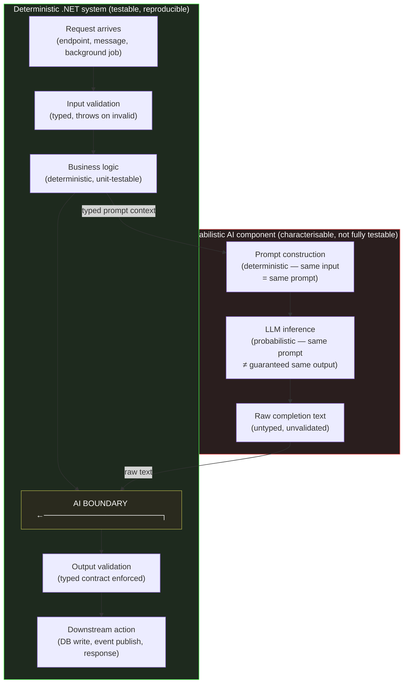

# Section 05 — Deterministic vs Probabilistic Systems

## The Fundamental Asymmetry

.NET engineers build deterministic systems by default. "Deterministic" here means something precise: given the same inputs and the same system state, the same output is produced every time. A `PaymentProcessor.ProcessAsync` method that accepts a `ProcessPaymentRequest` and a `CancellationToken` should, for any given request, produce the same result whether it is called at 10:00 AM or 11:00 PM, on the first call or the thousandth, in production or in a unit test running locally on a developer's machine. This property is not incidental — it is what makes .NET systems testable, debuggable, deployable, and operationally reliable. Determinism is the foundation on which every useful engineering property of a production system rests.

A large language model call is non-deterministic by construction. Setting temperature to zero reduces variability — at temperature zero, the highest-probability token is selected at each step rather than sampled from the distribution — but does not eliminate it: infrastructure-level non-determinism in floating-point operations across hardware, and changes introduced by model updates applied transparently by the provider, mean that even a temperature-zero call to the same endpoint with the same input can produce different output at different times. More importantly, even temperature-zero determinism within a model version is not a property the calling application can rely on without pinning to a specific model version — and even pinned versions are eventually deprecated and replaced.

These two things — the deterministic .NET service and the probabilistic AI call — must coexist in systems that use AI assistance. The engineering question is: where does the boundary between them go, and what does the deterministic side of that boundary look like?

## The Probabilistic Seam as an Architectural Decision

Treating the probabilistic component of an AI-integrated .NET system as an implementation detail — "the AI call is just another external API call, handled the same way as a REST API or a database" — misses a qualitative difference that the earlier sections of this chapter have been building toward. A REST API call is deterministic: the same request produces the same response for the same server state, and differences in response content reflect differences in the server's state or the request's parameters, which are inspectable. An AI completion call produces output whose variation reflects the probabilistic sampling process described in Section 01 — it is not the result of an inspectable state change, it cannot be replicated by re-sending the same inputs, and its output distribution cannot be characterized by a finite set of test inputs in the way a deterministic function's output space can.

This means the architectural seam between the deterministic .NET system and the probabilistic AI component is not just a dependency management question — it is a correctness boundary. Everything on the deterministic side can be tested with standard .NET testing approaches: unit tests with known inputs and assertions on exact outputs, integration tests with recorded or stubbed dependencies, architecture tests that verify structural properties. The probabilistic component, by contrast, can only be *characterized* rather than *fully tested* — its output distribution can be sampled and evaluated against criteria, but no finite test suite can enumerate its behaviour the way a test suite for a deterministic function can.



The diagram makes explicit that the AI boundary has two sides: on the left, a deterministic call into prompt construction (the *input* to the AI call is deterministic — the same input always produces the same prompt); on the right, validation of raw completion text before it enters the deterministic system again. The probabilistic element is the inference call between those two points. Its output is raw, untyped text that must be parsed, validated against a typed contract, and potentially retried before the deterministic system accepts it.

## What the Deterministic Boundary Must Enforce

The validation and retry layer at the boundary must perform several distinct operations, each addressing a different failure mode identified in the preceding sections.

**Structural validation** checks that the output is parseable as the expected structure. If the application expects a JSON object with specific fields, the boundary validates JSON structure before deserializing. If the application expects a code block containing a specific type of declaration, the boundary validates that structure before passing the content downstream. Structural validation catches a large proportion of output that is completely unusable — formatting errors, truncated responses, responses that answered a different question — without requiring domain-specific knowledge of what a correct answer looks like.

**Semantic validation** checks that the parsed output satisfies domain constraints: ranges, referenced entities that must exist, logical consistency properties that can be verified. This is where the `AiSuggestionValidator` from Section 04 fits — it is performing semantic validation of AI-generated code content against a manifest of known-correct API surfaces.

**Retry with prompt adjustment** handles cases where validation fails but the failure reason provides information that can be fed back into a revised prompt. If a structured output fails validation because a required field is missing, a retry can include an explicit instruction to include that field. This is not unlimited — retries compound latency and cost — but a small number of targeted retries with validation feedback significantly improves the reliability of AI-integrated endpoints for well-characterised failure modes.

```csharp id="code-02-05"
// Target Framework: .NET 8.0
// Chapter: 02 | Section: 05
// book/chapters/chapter-02/sections/section-05.en.md
//
// DeterministicAiBoundary: wraps a probabilistic AI call in a
// deterministic .NET contract. Implements validate → retry-with-feedback
// → typed result. The AI call inside is probabilistic; everything
// outside this class is deterministic and unit-testable with stubs.

using Microsoft.Extensions.AI;
using Microsoft.Extensions.Logging;

namespace AiAwareEngineeringToolkit.Infrastructure.AI;

/// <summary>
/// Enforces a deterministic typed boundary around a probabilistic AI call.
/// Callers receive either a validated typed result or a typed failure —
/// never raw AI text. The internal retry logic is invisible to callers.
/// </summary>
public sealed class DeterministicAiBoundary<TResult>(
    IChatClient          chatClient,
    IAiOutputParser<TResult> parser,
    ILogger<DeterministicAiBoundary<TResult>> logger)
{
    private const int MaxAttempts = 3;

    public async Task<BoundaryResult<TResult>> ExecuteAsync(
        string           systemPrompt,
        string           userPrompt,
        CancellationToken ct)
    {
        string? lastValidationError = null;

        for (int attempt = 1; attempt <= MaxAttempts; attempt++)
        {
            // On retry, feed the validation failure back into the prompt.
            // The prompt itself is deterministic (same inputs = same prompt);
            // only the AI response is probabilistic.
            var effectiveUser = lastValidationError is null
                ? userPrompt
                : $"{userPrompt}\n\nIMPORTANT: Your previous response had " +
                  $"this issue: {lastValidationError}. Please correct it.";

            var response = await chatClient.CompleteAsync(
                [new ChatMessage(ChatRole.System, systemPrompt),
                 new ChatMessage(ChatRole.User,   effectiveUser)],
                cancellationToken: ct);

            var raw = response.Message.Text ?? string.Empty;

            // Validate: structural + semantic checks.
            var parseResult = parser.Parse(raw);
            if (parseResult.IsSuccess)
            {
                logger.LogInformation(
                    "AI boundary: success on attempt {Attempt}", attempt);
                return BoundaryResult<TResult>.Success(parseResult.Value!);
            }

            lastValidationError = parseResult.Error;
            logger.LogWarning(
                "AI boundary: attempt {Attempt} failed validation — {Error}",
                attempt, lastValidationError);
        }

        // All retries exhausted: return typed failure. Caller decides
        // whether to fall back, surface an error, or queue for human review.
        logger.LogError(
            "AI boundary: all {Max} attempts failed. Last error: {Error}",
            MaxAttempts, lastValidationError);

        return BoundaryResult<TResult>.Failure(lastValidationError!);
    }
}

// ── Supporting types ──────────────────────────────────────────────────────

public sealed record BoundaryResult<T>
{
    public bool   IsSuccess { get; private init; }
    public T?     Value     { get; private init; }
    public string? Error    { get; private init; }

    public static BoundaryResult<T> Success(T value) =>
        new() { IsSuccess = true, Value = value };

    public static BoundaryResult<T> Failure(string error) =>
        new() { IsSuccess = false, Error = error };
}

public interface IAiOutputParser<T>
{
    ParseResult<T> Parse(string raw);
}

public sealed record ParseResult<T>
{
    public bool    IsSuccess { get; private init; }
    public T?      Value     { get; private init; }
    public string? Error     { get; private init; }

    public static ParseResult<T> Success(T value) =>
        new() { IsSuccess = true, Value = value };

    public static ParseResult<T> Failure(string error) =>
        new() { IsSuccess = false, Error = error };
}
```

The `DeterministicAiBoundary<TResult>` class is the architectural implementation of the seam shown in the diagram. Everything outside it — the business logic that constructs the system and user prompts, the downstream logic that consumes the typed `BoundaryResult<T>` — is fully deterministic and unit-testable by injecting a stub implementation of `IChatClient`. The probabilistic element is contained within the class's `ExecuteAsync` method. Callers never receive raw AI text; they receive either a valid parsed result of a known type or a typed failure they can handle explicitly.

## The Boundary as a Testable Seam

A direct consequence of isolating the probabilistic component inside a typed boundary class is that the deterministic side becomes fully testable by injection of stubs. The `DeterministicAiBoundary<TResult>` accepts an `IChatClient` — the .NET abstraction over chat completion — and callers inject either a real client for integration testing or a stub that returns a controlled `ChatCompletion` for unit testing. This means every piece of business logic that depends on AI output can be tested deterministically by supplying a known response through the stub, verifying that the parsing logic, retry logic, and typed contract enforcement behave correctly for known-good, known-bad, and edge-case responses. The probabilistic element is exercised only in integration tests that hit the actual model endpoint, where the test assertions shift from exact-value comparisons to structural checks: the output must parse successfully, the output must conform to the typed contract, and retries must be bounded. This separation of test strategies — deterministic unit tests on the boundary's contract enforcement, probabilistic integration tests on the end-to-end path — is the architectural payoff of the seam: the team can verify the parts of the system that *can* be verified deterministically without being blocked by the part that cannot.

## Temperature Zero Is Not Determinism

A brief but important note on a common misconception: setting temperature to zero on a model call is sometimes described as "making the call deterministic." In practice, this does not hold reliably across provider infrastructure, model versions, or hardware updates. The correct understanding is that temperature is a parameter controlling *the intended level of sampling randomness* in the model's generation process. At temperature zero, the intent is to select the maximum-probability token at each step rather than sampling from the distribution. But the maximum-probability token at any given step depends on floating-point computations across GPU hardware — hardware that may differ between requests routed to different machines in a provider's infrastructure, or that may change when the provider silently updates the model weights or the serving infrastructure.

The architectural implication is that temperature zero reduces variability usefully — particularly for structured output tasks where the "correct" output has a clear maximum-probability path — but cannot be relied upon as a substitute for the deterministic boundary described in this section. The boundary exists to handle the residual variability that temperature alone cannot eliminate, and to handle the model-version and infrastructure changes that fall entirely outside the temperature parameter's scope. Section 06 completes this chapter by addressing what calibrated trust looks like from the engineer's perspective — how to decide, for any given use of an AI component inside a deterministic .NET system, what verification is appropriate and what level of confidence is warranted given the mechanisms explored in Sections 01 through 05.

## Observability at the Probabilistic Boundary

The deterministic boundary described in this section is not only a correctness mechanism — it is also the natural location for observability instrumentation. Because every AI-generated output must pass through the boundary's validation and retry logic before entering the deterministic system, the boundary has visibility into a property that no other component in the system can observe: the ratio of successful to failed AI outputs, the distribution of validation failure reasons, the retry frequency, and the latency characteristics of the probabilistic call itself.

This observability data has direct engineering value. A sudden increase in retry frequency at the boundary indicates either a degradation in the AI model's output quality for the specific task type, a change in the input distribution that the boundary's validation rules were not designed for, or an upstream infrastructure issue affecting the model's serving infrastructure. A shift in the validation failure reasons — from structural parse failures to semantic constraint violations — indicates a different kind of drift that may require updating the validation rules rather than adjusting the prompt. These signals are only visible if the boundary is instrumented, and they are only actionable if they are surfaced to monitoring systems that can correlate them with deployment events, model version changes, or input distribution shifts.

In an ASP.NET Core service, the boundary class should emit structured log events for every validation outcome — success, structural failure, semantic failure, retry — with correlation IDs that link back to the request that triggered the AI call. This allows incident investigation to trace a production issue back through the boundary to the specific AI output that was accepted (or rejected), the verification level applied, and the number of retries required. Without this instrumentation, the boundary is a correctness mechanism that cannot explain its own behaviour when something goes wrong — an observability gap that is particularly costly when the failure mode involves a correct-shape, wrong-semantics output that passed the boundary's validation but still produced incorrect downstream behaviour.

The boundary should also surface latency percentiles for the probabilistic AI call. AI model calls exhibit fundamentally different latency profiles than database queries or cache lookups — they are typically measured in hundreds of milliseconds to seconds rather than microseconds to low milliseconds, and they exhibit heavy-tailed latency distributions that standard timeout policies do not handle well. Monitoring p50, p95, and p99 latency at the boundary, separately from the outer request's total latency, allows the team to calibrate timeouts, set appropriate retry budgets, and identify when latency degradation is caused by the AI infrastructure rather than by the deterministic service's own logic.

## Caching and Memoization at the Boundary

A structural advantage of the deterministic boundary is that it creates a natural caching point. Because the boundary's input is deterministic — the same system and user prompts always produce the same prompt text — the output, while probabilistic, can be cached by prompt hash with a known probability of cache hits. For tasks where the same prompt is generated repeatedly (code review of the same anti-pattern across multiple files, generation of the same boilerplate for multiple endpoints), caching at the boundary eliminates redundant AI calls without modifying the calling code's deterministic logic.

The cache implementation should be aware of the probabilistic nature of the cached content. Unlike a cache of deterministic function results, where a cache hit is always correct, a cache hit for a probabilistic output is correct only if the cached output would have been generated by the model for the current prompt. At temperature zero with a pinned model version, this is approximately true. With non-zero temperature or across model version updates, the cache may serve output that the current model would not produce — which is acceptable for some use cases (boilerplate generation where any correct answer suffices) and unacceptable for others (code review feedback where the specific issues identified matter). The boundary should expose a cache policy that callers can configure based on their tolerance for serving slightly-stale probabilistic output, and the cache should be invalidated on model version changes.

This caching pattern is particularly valuable in CI/CD pipelines where the same AI-assisted analysis (code review, documentation generation, test suggestion) runs against many files in a single changeset. Without boundary-level caching, each file's analysis generates an independent AI call with independent cost and latency. With caching, files that trigger identical or near-identical prompts share a single AI call, reducing both latency and cost proportionally to the prompt overlap rate.

## Practical Implications for Service Design

The deterministic boundary pattern has concrete consequences for how AI-integrated .NET services are structured. Three decisions follow directly from the seam described in this section.

**DI registration of the boundary class, not the raw chat client.** When registering AI capabilities in the ASP.NET Core DI container, the `DeterministicAiBoundary<TResult>` — or whatever typed wrapper enforces the contract — should be the dependency that higher-level services receive, not `IChatClient` directly. Injecting `IChatClient` directly into business logic erases the boundary: the consuming code sees raw text and must perform its own validation, which is exactly the ad-hoc vigilance this architecture is designed to replace with a systematic boundary. Injecting the typed boundary means validation, retry, and type conversion happen in one place, tested once, and the business logic that depends on AI output is writing normal typed .NET code against a normal typed interface.

**Separate timeout policies for the AI component and the outer request.** The probabilistic AI call has a fundamentally different latency profile than a database query or a Redis cache hit: it can take seconds rather than milliseconds and exhibits high tail latency under load. The outer service's total request timeout should be set independently of the AI component's individual call timeout, with the AI component's timeout calibrated against the expected latency distribution of the specific model and task. Setting a single global timeout that applies both to the AI call and to the rest of the request pipeline is a common architectural mistake that either causes unnecessary AI call failures (if the global timeout is short) or allows the AI call to hold up the entire request indefinitely (if no specific AI timeout is set).

**Health check separation.** The health of the AI component — reachable, returning valid responses, response latency within bounds — is a separate observable from the health of the surrounding deterministic service. An ASP.NET Core health check that conflates the two will report the entire service as healthy when the deterministic paths work but the AI component is degraded, or report the entire service as unhealthy when the AI component has a transient issue but all non-AI paths are functioning normally. Separate health checks for the deterministic service and for the AI-integrated component allow load balancers and monitoring systems to respond appropriately to each.

## What This Means for Testing and Monitoring in Production

The deterministic/probabilistic boundary reshapes not only service design but the testing and monitoring posture as well, in two ways worth spelling out.

For testing, the deterministic side of the boundary is testable with standard .NET tools and approaches. The `DeterministicAiBoundary<TResult>` can be tested completely with a stubbed `IChatClient` returning predetermined raw text, making the validation, retry, and type-conversion logic fully deterministic to test. Business logic consuming `BoundaryResult<TResult>` can likewise be tested completely by injecting known deterministic results. Only the probabilistic component — the actual `IChatClient` call — is isolated, and its characterisation can be evaluated with separate test suites judging output quality by statistical criteria rather than deterministic pass/fail tests.

This separation does not merely simplify testing; it makes testable what was difficult or impossible to test. Before an explicit boundary existed, business logic was coupled to the non-deterministic AI call — untestable with strict output assertions, producing brittle tests that fail randomly. After the boundary, deterministic testing of business logic is cleanly separated from evaluating the AI model's output quality.

For monitoring, the boundary creates a natural measurement point with three independently trackable indicators: **validation success rate** — the share of raw outputs passing validation on the first attempt, a measure of the model's actual output quality and prompt fitness; **retry success rate** — the share of cases where retries succeed after initial validation failure, a measure of the prompt-feedback mechanism's effectiveness on retry; and **boundary latency** — the total time of all AI calls and validation steps per request, to be compared against the request's overall latency budget. Alerting on drift in any of these three from their baselines provides early detection of model behaviour change — a provider-side model update that shifted output distribution — before the impact reaches business code.

## Team Discipline: Calibrating Restraint

The deepest benefit of the deterministic boundary pattern is not technical alone; it is organisational. Teams operating without an explicit boundary tend to slide gradually into a mode where assumptions about AI reliability mix with assumptions about deterministic code reliability until it becomes difficult to tell where one ends and the other begins. When a production incident occurs, the question "is this a deterministic business-logic failure or a probabilistic AI-output failure?" becomes hard to answer quickly, lengthening resolution time.

Teams that apply the explicit boundary gain, in return, a shared organisational understanding of where non-determinism lives in their system and how it is handled. That understanding becomes part of the team's shared language: "this is on the deterministic side of the boundary" and "this depends on AI output quality" become crisp statements requiring no repeated explanation. Over time, that shared language enables faster, more consistent engineering decisions about when to introduce AI into a processing path, how to integrate it, what verification level is required, and where the control points should sit.

## Common .NET Scenarios

Three recurring scenarios in production .NET environments embody the boundary in concretely different ways, each worth stating explicitly.

**Structured data extraction from free text:** a system receives customer documents in varying formats and uses AI to extract structured fields. The deterministic side: validating the incoming document, building the prompt, validating extracted fields against a typed schema, writing to the database. The probabilistic component: the extraction model call. The boundary guarantees that any field reaching the database has passed explicit structural and semantic validation.

**Response content generation:** a system uses AI to generate personalised response text from user data. The deterministic side: fetching user data, evaluating personalisation rules, building the prompt, validating the generated response (length, constrained content, required variables), and delivery. The probabilistic component: the generation model call.

**Interactive workflow assistance:** a system suggests the next step to a user in a multi-step workflow. The deterministic side: determining workflow state, building the prompt with the correct context, verifying that the generated suggestion is a legal action in the current state, and mapping it to a typed action. The probabilistic component: the action suggestion. In all three cases the underlying structure is identical: the deterministic surrounds the probabilistic, and no output crosses the boundary without validation.

## Hybrid Systems: Boundary Design in Common Patterns

Three common design patterns in AI-integrated .NET applications show how the deterministic boundary applies differently depending on task shape.

**Pattern 1 — AI-enriched response.** A user request reaches a minimal API endpoint; the service performs deterministic operations (a database query, an authorisation check), then calls the AI component to enrich the response with analysis or explanation. The boundary here sits between the deterministic operations' result and the AI enrichment: the core data is produced deterministically and delivered to the user regardless of what the AI returns, and the AI enrichment is optional — added if it validates, dropped if it fails — never failing the entire response.

**Pattern 2 — AI generation with persistence.** A background task calls the model to generate content (a summary, a classification, a recommendation) and then persists it. The boundary sits between the AI output and the save operation: nothing is persisted before passing structural and semantic validation. Retry is affordable because the task is asynchronous and no user waits. If all attempts fail, the failure is logged and queued for human review — never passed to the save stage.

**Pattern 3 — AI in the inference loop.** An agentic system uses AI to pick the next action in a multi-step workflow. The boundary here is more complex: every AI-proposed action must be validated not only structurally and semantically but against the policy constraints defining the actions permissible in the current state. Proposed actions exceeding the permitted bounds are rejected deterministically regardless of the model's confidence in generating them.

## Testability as a Measure of Boundary Correctness

Testing the `DeterministicAiBoundary<TResult>` class's complete testability with an `IChatClient` stub is a practical measure of the boundary's own correctness. If testing business logic that consumes `BoundaryResult<T>` requires mocking the actual model — if the logic handles raw text rather than a typed result — that signals the boundary was drawn incorrectly: probabilistic logic has leaked into a layer that should be deterministic.

The correct unit test for logic consuming AI output looks like this: the test constructs `BoundaryResult<T>.Success(typedValue)` or `BoundaryResult<T>.Failure("error")` directly and passes it to the logic under test. No mocked models, no simulated language-model responses, no AI-specific setup. Logic consuming AI output should be testable with the same simplicity as any other .NET business logic.

When that holds, the boundary is drawn correctly: the probabilistic component is isolated and wrapped, and everything depending on it operates within the deterministic guarantees that enable reproducible testing, predictable deployment, and systematic debugging.

## Reliability as a System Property, Not a Model Property

A question sometimes raised: as models improve — more reliable, less hallucinating — does the deterministic boundary remain necessary? The answer follows directly from this section's framing: yes, because the boundary addresses not just the model's hallucination rate but the deeper property of structural sampling non-determinism, which persists even with more capable models. A better model reduces how often the boundary's failure cases trigger — it makes the boundary less exercised — but does not remove the need for it. A system's total reliability is not a property of the model in isolation — it is a property of the complete system: the improved-reliability model wrapped in a boundary designed for the exceptions the model still produces, inside a .NET service designed for resilience against exactly those exceptions.

## Applying the Boundary Pattern Across .NET Contexts

The deterministic boundary pattern is not specific to one kind of .NET application — it applies consistently across the contexts in which AI capabilities are integrated. What changes between contexts is the implementation detail of the boundary, not the architectural necessity of its existence.

In **ASP.NET Core minimal API endpoints**, the boundary takes the form of a wrapped validate-and-retry loop before deterministic code touches AI output. The endpoint presents, from the caller's perspective, a clearly defined contract — 200 with a structured result on success, 503 when attempts are exhausted — exactly the deterministic contract callers expect and design against.

In a **BackgroundService** — the long-running worker processing messages or generating content periodically — the boundary takes the form of a post-generation validation pattern: the probabilistic component generates, then the boundary applies systematically before any output is persisted to a database or published as an event. A background handler written so AI output reaches the persistence layer directly, with no boundary, injects raw input into domain entities that assume structurally and semantically valid inputs.

In **Semantic Kernel integration**, the kernel itself provides an abstraction layer, but it does not remove the need for a boundary. Kernel functions that parse language-model output into typed values are implementations of the boundary pattern — but an engineer accepting a function's output without verification implicitly assumes the abstraction layer applies the boundary sufficiently, an assumption worth verifying rather than taking as given, since the verification in Kernel functions depends on how they are written and which failure types they were designed to handle.

## Implications for Testing AI-Integrated Systems

The deterministic boundary has a direct implication that makes testing AI-integrated systems more manageable than it might first appear: the probabilistic component, being contained behind its boundary, can be replaced with a stub in unit tests the usual way any dependency is replaced in a .NET system.

A test of `ProcessOrderAsync` depending on `DeterministicAiBoundary<OrderSummary>` supplies the system under test with a stub returning a fixed success result or a fixed failure regardless of what the language model actually generates. The unit test does not judge that "the AI produces a good summary" — it judges that the order business logic responds correctly to a valid summary result or to a summary failure. This keeps domain units fully and deterministically testable, enabling high test coverage of the business logic that forms the system's most critical part.

Tests that actually exercise the probabilistic component — that call the real language model — are, in contrast, treated as characterisation tests, not correctness tests: they document the observed distribution of model output and alert when that distribution shifts significantly — possibly indicating a model update that changed behaviour — but they do not exist to prove deterministic correctness for any particular result.

## Measuring and Managing Model Change

The problem of transparent model updates deserves direct treatment, because it is one of the most unsettling surprise sources for teams that began by pinning model behaviour through automated tests. Providers update models regularly, sometimes without explicit notice — quality improvements, safety corrections, or changes in generation semantics that affect the model's preferred output structure even at temperature zero.

The appropriate engineering response is distinguishing two kinds of verification: the deterministic verification the boundary performs — which must survive model updates because it checks output properties rather than exact content — from the characterisation tests that periodically observe the real output distribution and are expected to need review as models evolve. This separation lets the team absorb model updates in an organised way — the deterministic boundary keeps the system running while the characterisation tests signal that an update affected behaviour and calls for review — instead of late discovery in production when users start reporting unexpected results.
