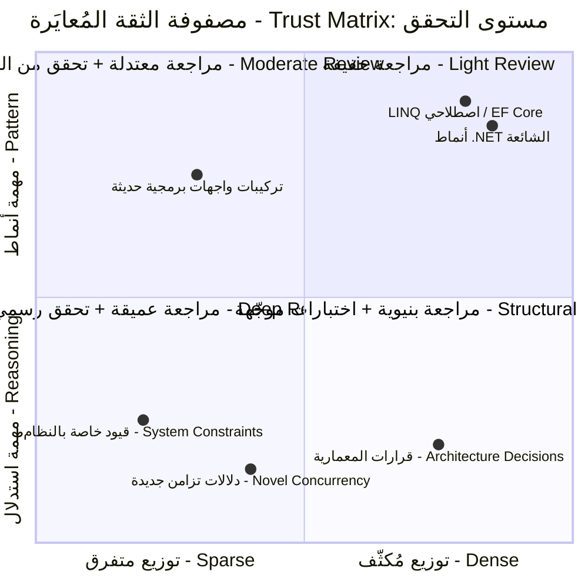

<div dir="rtl">

# القسم السادس — الثقة المُعايَرة - Calibrated Trust: متى لا تثق بمخرجات الذكاء الاصطناعي

## مشكلة المعايرة - Calibration Problem

الثقة المُعبَّر عنها في مخرجات النموذج اللغوي الكبير ليست مؤشراً موثوقاً لصحة تلك المخرجات. الرموز التي تُعبّر عن الثقة — عبارات مثل "هذا هو النهج الصحيح"، "يجب عليك استخدام X لأن Y"، تأكيدات حاسمة غير مُتحفِّظة — مُولَّدة بنفس حلقة التنبؤ بالرمز التالي - Next-Token Prediction التي تُولّد كل الرموز الأخرى، وحدوثها تحدده ما تبدو عليه الكتابة التقنية الواثقة في مجموعة التدريب، لا بأي تقييم داخلي لصحة المحتوى المجاور.

مهندس اكتسب خبرة واسعة في التعامل مع الخبراء البشريين يُطوّر قراءةً معايَرةً للثقة المُعبَّر عنها. مهندس أول يقول "أنا متأكد إلى حد معقول أن هذا النهج يُعالج حالة الـ Failover" يُعبّر عن عدم يقين حقيقي — الوصف يُشير إلى أن التحقق مطلوب. مهندس مختلف يقول "هذا بالتأكيد النمط الصحيح لمستوى العزل هذا" يُعبّر عن ثقة عالية حقيقية، وتلك الإشارة مفيدة لأنها ترتبط، بمرور الوقت، بالصواب الفعلي في أغلب الأحيان حين يُؤكّد وبالخطأ حين يُتحفّظ. الخبراء البشريون ليسوا معايَرين بشكل مثالي في تقييمهم لعدم يقينهم الخاص، لكن الارتباط بين الثقة المُعبَّر عنها والصحة الفعلية موجب بصورة ذات مغزى — إنها إشارة حقيقية.

هذه المعايرة لا تنتقل إلى مخرجات الذكاء الاصطناعي. نموذج يُعبّر عن ثقة عالية — "هذا هو النهج الصحيح"، "يجب عليك استخدام X لأن Y"، تأكيدات حاسمة غير مُتحفِّظة — يُولّد الرموز الأعلى احتمالاً بمعطى السياق، بما في ذلك سياق ما تبدو عليه الإجابات التقنية الواثقة في الكتابة التقنية. الآلية وراء هذا أرستها الأقسام الأولى إلى الخامسة. مهندس يُعايِر جهد التحقق بناءً على ثقة النموذج المُعبَّر عنها يُعايِر بشكل خاطئ منهجياً — يُقلّل التحقق تحديداً في الحالات التي يبدو فيها النموذج واثقاً لكنه مُخطئ — وهي تحديداً أنماط الفشل الأعلى كلفةً هندسيةً كما أثبتت الأقسام الثالث والرابع.

لمشكلة المعايرة حل مباشر، لكنه يستلزم استبدال الإشارة الخاطئة — ثقة النموذج — بالإشارة الصحيحة، وبناء ذلك الاستبدال في سير عمل التحقق بصورة منهجية لا الاعتماد على حكم كل مهندس في كل مراجعة كود.

## الإشارة الصحيحة - The Right Signal: نوع المهمة وموضعها في التوزيع

إذا لم تكن ثقة النموذج المُعبَّر عنها الإشارة الصحيحة لجهد التحقق، فما هي؟ عاملان مُجتمِعان يُوفّران أساساً موثوقاً لمعايرة كثافة التحقق لمخرجات الذكاء الاصطناعي في سياق هندسة .NET.

**نوع المهمة** يُميّز بين ما أسماه القسم الثالث "مهام الأنماط" و"مهام الاستدلال". مهام الأنماط — توليد تنفيذ لنمط تصميم راسخ، والترجمة بين واجهات برمجية .NET المكافئة، وإنتاج تعابير LINQ اصطلاحية لتحويل قياسي — تقع في مناطق كثيفة من توزيع التدريب (القسم الثاني) وتُنتَج عبر استرجاع إحصائي عالي الجودة لا بناء جديد. ومع ذلك تُراجَع: تُفحَص الملاءمة للسياق، وتُفحَص أنماط الفشل المميزة لنوع المهمة، وتُؤكَّد بالتجميع والاختبارات الموجَّهة. مهام الاستدلال — القرارات المعمارية الخاصة بالنظام المعني، وتحليل الصحة لتفاعل تزامن جديد، وتحليل أمان حد ثقة محدد — تستلزم تحققاً مستقلاً من السلسلة المنطقية، لأن النموذج يُركّب من التجاور الإحصائي لا أن يسترجع إجابةً معزَّزة جيداً.

**موضع التوزيع** يسأل أين يقع هذا الطلب المحدد مقارنةً بمجموعة التدريب لهذا التركيب التقني تحديداً. مهمة تتضمن أنماط .NET المُستخدَمة على نطاق واسع والموثقة منذ فترة طويلة تقع في منطقة كثيفة وموثوقة. مهمة تتضمن مكتبةً أقل شيوعاً، أو واجهة برمجية أضيفت مؤخراً، أو تركيبةً من ميزات لا توثيق جيد لتفاعلها، أو قيوداً خاصة بمشروع لا يمكن لأي مجموعة تدريب احتواؤها — تقع في منطقة متفرقة حيث الآلية الإحصائية ذاتها تُنتج مخرجاً بنفس ثقة السطح ولكن بمعدل هلوسة - Hallucination أعلى وباحتمال أعلى لنمط الفشل "الشكل الصحيح والدلالات الخاطئة".



يُسقط المخطط الرباعي العاملين على أربعة أنظمة تحقق. **الكثافة العالية + مهمة الأنماط** (أعلى يمين): المخرج على الأرجح صحيح وقابل للتحقق بالتجميع والاختبارات القياسية. مراجعة خفيفة كافية: تفحّص الملاءمة للسياق، وصرّف، وشغّل الاختبارات القائمة. **الكثافة العالية + مهمة الاستدلال** (أسفل يمين): المخرج يستخدم الإطار الصحيح للمشكلة لكن الاستنتاجات المحددة تتطلب تحققاً مستقلاً — فتأطير النموذج للمشكلة مفيد، لكن الاستنتاجات يجب التحقق منها مقابل المبادئ الأولى أو اختبارات محددة للحالة المعنية. **التوزيع المتفرق + مهمة الأنماط** (أعلى يسار): الشكل العام للمخرج صحيح لكن التفاصيل المحددة كأسماء الواجهات البرمجية وأنواع المعاملات في خطر مرتفع للاختراع — فتحقق من أسطح الواجهات صراحةً، وشغّل الكود ضد تبعية حقيقية لا بديل، قبل القبول. **التوزيع المتفرق + مهمة الاستدلال** (أسفل يسار): أعلى متطلبات التحقق — إذ يصلح المخرج نقطة بداية تُبرز الاعتبارات والأشكال ذات الصلة لا استنتاجاً مُشتقاً، ويستلزم الاستدلال المستقل من المبادئ الأولى أو التوثيق الموثوق.

<div dir="ltr">

```csharp id="code-02-06"
// Target Framework: .NET 8.0
// Chapter: 02 | Section: 06
// book/chapters/chapter-02/sections/section-06.ar.md
//
// نظام تعليق قائم على الخصائص لتوثيق مستوى التحقق المُطبَّق
// على الكود المُولَّد بالذكاء الاصطناعي.

namespace AiAwareEngineeringToolkit.Infrastructure.AI;

public enum VerificationLevel
{
    /// التجميع وحزمة الاختبارات القياسية فقط.
    /// مناسب لـ: مهام الأنماط ذات التوزيع الكثيف.
    Light = 1,

    /// التجميع والاختبارات القياسية + تحقق صريح من سطح الواجهة
    /// + اختبارات موجّهة لأنماط الفشل المعروفة.
    /// مناسب لـ: مهام الأنماط ذات التوزيع المتفرق
    /// أو مهام الاستدلال ذات التوزيع الكثيف.
    Moderate = 2,

    /// تحقق منطقي مستقل + اختبارات محددة لخاصية الصحة المعنية
    /// + مراجعة معمارية.
    /// مناسب لـ: مهام الاستدلال في أي منطقة توزيع.
    Deep = 3,

    /// تحقق رسمي أو مراجعة متقاطعة مع التوثيق الموثوق مطلوبة.
    /// مطلوب لـ: مهام الاستدلال ذات التوزيع المتفرق
    /// (أمان، دلالات التزامن، الامتثال التنظيمي).
    Formal = 4,
}

[AttributeUsage(AttributeTargets.Class | AttributeTargets.Method |
                AttributeTargets.Property, AllowMultiple = false)]
/// يُطبَّق على أصغر حبيبية مُولَّدة بالذكاء الاصطناعي —
/// يُفضَّل مستوى الدالة على مستوى الفئة حين يكون جزء فقط من الفئة مُولَّداً.
public sealed class AiGeneratedAttribute(
    VerificationLevel verificationLevel,
    string notes = "") : Attribute
{
    public VerificationLevel VerificationLevel { get; } = verificationLevel;

/// وصف نصي حر لما جرى التحقق منه. مرئي في مراجعة الكود.
    /// مثال: "تحققت من دلالات إتمام Channel<T> مقابل التوثيق.
    ///        اختُبر مسار الإيقاف في ShutdownTests.cs."
    public string Notes { get; } = notes;
}

/// <summary>
/// سجل مُهيكَل لقبول الكود المُولَّد بالذكاء الاصطناعي.
/// يُحفَظ للسماح بتحليل ما بعد الحوادث للمكوّنات المُولَّدة المتورطة ومستوى تحققها.
/// </summary>
public sealed record AiAuditEntry(
    string ComponentId,
    VerificationLevel VerificationLevel,
    string Notes,
    DateTimeOffset AcceptedAt,
    string AcceptedBy);

public sealed class AiAuditLog(ILogger<AiAuditLog> logger)
{
    private readonly List<AiAuditEntry> _entries = [];

    public void Record(AiAuditEntry entry)
    {
        _entries.Add(entry);
        logger.LogInformation(
            "مكوّن مُولَّد بالذكاء الاصطناعي مقبول: {ComponentId} " +
            "بمستوى تحقق {Level} من قِبَل {AcceptedBy}. ملاحظات: {Notes}",
            entry.ComponentId, entry.VerificationLevel,
            entry.AcceptedBy, entry.Notes);
    }

    public IReadOnlyList<AiAuditEntry> Entries => _entries.AsReadOnly();
}

// مثال: InMemoryPaymentRepository من الفصل الأول مُولَّد بالذكاء الاصطناعي
// وتحقّق منه بمستوى Moderate — توزيع مُكثّف (نمط شائع للذاكرة) + مهمة أنماط،
// مع التحقق الصريح من سلامة خيوط ConcurrentDictionary ومفتاح تكرار التنفيذ الآمن - Idempotency Key
// والكتابة الذرية المؤكَّدة في اختبار التكامل.
[AiGenerated(
    verificationLevel: VerificationLevel.Moderate,
    notes: "سلامة خيوط ConcurrentDictionary.GetOrAdd تحققت من التوثيق. " +
           "مفتاح تكرار التنفيذ الآمن + الكتابة الذرية مؤكَّدة باختبار التكامل " +
           "'AtomicWrite_IdempotencyKeyAndPaymentBothPersisted'.")]
public sealed class AnnotatedInMemoryPaymentRepository
    : Repositories.InMemoryPaymentRepository { }
```

</div>

## الثقة المُعايَرة كمعيار فريق لا مهارة فردية

الثقة المُعايَرة خاصية على مستوى الفريق، لا مجرد مهارة فردية. المهندسون الأفراد قد يُطوّرون حدوساً جيدة بمرور الوقت، لكن تلك الحدوس خاصة وغير متسقة عبر الفريق، ولا تُنشئ سجلاً قابلاً للتدقيق لما جرى التحقق منه وكيف. التنفيذ الصحيح هو سياسة تحقق صريحة ومُقنَّنة مدعومة بأدوات تجعل مستوى التحقق مرئياً في القطعة ذاتها.

السمة <code dir="ltr">[AiGenerated]</code> وسجل التدقيق - Audit Log معاً يُنشئان شيئين: إعلاناً لكل قطعة بما جرى التحقق منه، مرئياً في مراجعة الكود؛ وسجلاً قابلاً للاستعلام في وقت التشغيل يمكن استخدامه خلال التحقيق في الحوادث لتحديد أي المكوّنات المُولَّدة بالذكاء الاصطناعي كانت طرفاً في الفشل وبأي مستوى تحقق قُبلت. هذا الأخير ذو قيمة خاصة حين يظهر نمط الفشل "الشكل الصحيح والدلالات الخاطئة" في الإنتاج — معرفة أن المكوّن قُبل بمستوى <code dir="ltr">Light</code> لما كان يستوجب مستوى <code dir="ltr">Moderate</code> أو <code dir="ltr">Deep</code> يُضيّق نطاق التحقيق ويُتيح تحسيناً محدداً للعملية: إعادة تصنيف تلك الفئة من المهام في سياسة التحقق الجماعية للفريق.

## الثقة المُعايَرة ليست إعداداً ثابتاً

الملاحظة الأخيرة التي يتركها هذا الفصل هي التالية: الثقة المُعايَرة تقييم ديناميكي يتطوّر مع تطوّر أدوات الذكاء الاصطناعي، ومع نمو خبرة الفريق بها، ومع تطور النطاق المحدد الذي يعمل فيه الفريق. مهمة تقع في منطقة متفرقة من التوزيع التدريبي اليوم قد تُصبح مهمة ذات كثافة عالية حين يُدرَّب جيل جديد من النماذج على مواد أكثر تغطيةً لذلك النطاق. قدرة الفريق على التعرف بسرعة على الاختراع في واجهة برمجية لمكتبة بعينها تتحسن بالتعرض، مما يُحرّك بعض المهام نحو أنظمة تحقق أخف دون تغيير الموثوقية الفعلية لمخرجات الذكاء الاصطناعي.

وتعني الطبيعة الديناميكية للثقة المُعايَرة أيضاً أن تصنيفات <code dir="ltr">VerificationLevel</code> في قاعدة الكود يجدر مراجعتها دورياً — فصلياً مثلاً — لتعكس التغيرات في قدرات النماذج وخبرة الفريق وتغطية توزيع التدريب لحزمة الفريق التقنية المحددة. فمهمة صُنّفت <code dir="ltr">Deep</code> قبل ثلاثة أشهر قد تستحق <code dir="ltr">Moderate</code> الآن لأن الفريق بنى أطر اختبار محددة لنمط الفشل المعني، أو لأن جيل نماذج أحدث حسّن كثيراً تغطيته الإحصائية لذلك النمط. وهذه المراجعة الدورية ممارسة هندسية خفيفة بذاتها — لا عملية ثقيلة، بل محادثة منهجية تُشير إلى مدخلات سجل التدقيق الفعلية من الربع السابق لتحديد أنماط إخفاقات التحقق وضبط جدول التصنيف. فالهدف ليس تقليص جهد التحقق عبر الزمن — بل تركيز جهد التحقق حيث المخاطر أعلى، مسترشَداً بالخبرة الفعلية لا بالافتراضات الأولية.

ما تُوفره المصفوفة والأدوات ليس تصنيفاً دائماً لكل مهمة ممكنة، بل إطاراً يجعل قرار التحقق صريحاً وقابلاً للتواصل والتدقيق بدلاً من أن يكون خاصاً وغير متسق وغير مرئي. الهدف هو أن كل مكوّن مُولَّد بالذكاء الاصطناعي يدخل قاعدة الكود يحمل سجلاً واضحاً وقابلاً للمراجعة لما جرى التحقق منه — لا لأن النموذج طالب بذلك، بل لأن الفريق الهندسي قرر أن هذا ما يبدو عليه الاستخدام الاحترافي لمساعدة الذكاء الاصطناعي.

## التحقق كأولية في خط الأنابيب لا كطقس بشري - Pipeline Primitive

أشيع نمط فشل لسياسات التحقق على مستوى الفريق هو انحراف التبني: فالسياسة موجودة في التوثيق، والمهندسون ينوون اتباعها، وتحت ضغط الوقت تُتخطى خطوة التعليق لانعدام آلية إنفاذها. والاستجابة المعمارية هي جعل التحقق أولية خط أنابيب — خطوة تُفرَض بالأدوات لا يُعوَّل عليها كعرف. وفي فريق .NET يتخذ ذلك صورتين ملموستين. أولاهما محلِّل Roslyn يفحص قطع الكود المُولَّدة بالذكاء الاصطناعي ويُصدِر تحذير بناء (أو خطأ، بحسب سياسة الفريق) حين تغيب السمة <code dir="ltr">[AiGenerated]</code> ولا توجد سمة مضادة <code dir="ltr">[HumanAuthored]</code>. وهذا يجعل الحالة الافتراضية لخط البناء حالةً *تتطلب* إعلاناً عن التأليف ومستوى التحقق، عاكساً العبء من "تذكّر التعليق" إلى "برّر لماذا لم تُعلّق". وثانيتهما خطوة CI تقرأ مدخلات <code dir="ltr">AiAuditLog</code> لحزمة التغيير وتتحقق من اتساق مستوى التحقق المُعلَن مع جدول تصنيف يصونه الفريق — كرفض حزمة تُعلن <code dir="ltr">VerificationLevel.Light</code> لملف يتضمن منطق تزامن <code dir="ltr">Channel<T></code> يُسقطه جدول التصنيف على <code dir="ltr">Deep</code> أو <code dir="ltr">Formal</code>. وهاتان الآليتان — إنفاذ التحليل الساكن والتحقق التصنيفي على مستوى الخط — تُحوّلان سياسة التحقق من طموح إلى قيد يعمل في الموضع ذاته من سير العمل الذي يعمل فيه التجميع وتنفيذ الاختبارات. والنتيجة أن كل مكوّن مُولَّد بالذكاء الاصطناعي يدخل قاعدة الكود يحمل سجلاً متحققاً قابلاً للتدقيق لتأليفه ومستوى تحققه، لا لأن مهندسين أفراداً تذكّروا إضافته، بل لأن نظام البناء اشترطه.

## من الممارسة الفردية إلى المعيار الجماعي - Team Standard

السمة <code dir="ltr">[AiGenerated]</code> وسجل <code dir="ltr">AiAuditLog</code> مفيدان كممارستين فرديتين، لكن قيمتهما الكاملة تتحقق باعتمادهما معيارين جماعيين يُنفَّذان باتساق. فآليتان تجعلان التبني دائماً لا طموحاً.

**اختبارات معمارية تُفرض التعليق.** باستخدام NetArchTest أو محلِّل Roslyn مخصص، يستطيع الفريق كتابة اختبار معماري يُفشل البناء إذا افتقدت أي دالة عامة في فضاءات أسماء محددة تعليق <code dir="ltr">[AiGenerated]</code> أو تعليقاً مقابلاً يشرح سبب التأليف البشري. وهذا يعكس الافتراض: فبدلاً من مطالبة المطورين بتذكّر تعليق الكود المُولَّد بالذكاء الاصطناعي، يُطالَبون بالإعلان الصريح عن الكود البشري، مما يجعل وجود التعليق أو غيابه ذا معنى وقابلاً للإنفاذ لا اختيارياً. ويعمل الاختبار في CI ويفشل سريعاً، جاعلاً التعليق متطلب بناء لا عرف مراجعة كود قد يُفوَّت تحت ضغط الوقت.

**دمج مراجعة الحوادث.** حين تتضمن حادثة إنتاج مكوّناً يحمل تعليق <code dir="ltr">[AiGenerated]</code>، يجدر بمراجعة ما بعد الحادثة أن تتضمن فحصاً صريحاً: هل كان مستوى التحقق المُطبَّق مناسباً لنوع المهمة وموضع التوزيع؟ فإذا طُبّق تحقق <code dir="ltr">Light</code> على ما كان بأثر رجعي مهمة استدلال بمستوى <code dir="ltr">Deep</code>، كان التحسين العملي ملموساً ومحدداً — لا "توخَّ مزيداً من الحذر مع مخرجات الذكاء الاصطناعي" بل "أعِد تصنيف هذه الفئة من المهام إلى <code dir="ltr">Moderate</code> أو <code dir="ltr">Deep</code> في سياسة التحقق الجماعية وحدّث مصفوفة الثقة المُعايَرة تبعاً لذلك". وهذه الحلقة الراجعة هي ما يُتيح لسياسة التحقق الجماعية التحسن بناءً على خبرة الفشل الفعلية لا على تقييم المخاطر النظري وحده.

## فاعلية التحقق كخاصية قابلة للقياس - Measurable Property

السمة وسجل التدقيق الموصوفان أعلاه يُنتجان بيانات خاماً؛ والسؤال الهندسي هو ما يُفعَل بها. فالفريق الذي يُسجّل مستويات التحقق لكل مكوّن مُولَّد بالذكاء الاصطناعي يمتلك عبر الزمن مجموعة بيانات يمكن تحليلها للإجابة عن أسئلة لا يجيب عنها تقييم المخاطر النظري وحده: أي مستويات التحقق تمسك المشكلات فعلاً، وأيها يُطبَّق بإفراط أو تفريط، وأين يُساء تخصيص جهد التحقق الجماعي مقارنةً بمعدلات الفشل الفعلية.

وأباشر المقاييس هو ارتباط إخفاقات التحقق: فلكل مدخل <code dir="ltr">AiAuditEntry</code> تورّط لاحقاً في حادثة إنتاج أو تصحيح كود جوهري، ما مستوى <code dir="ltr">VerificationLevel</code> المُعلَن عند القبول؟ فإذا تجمّعت الحوادث عند <code dir="ltr">VerificationLevel.Light</code>، كانت السياسة ناقصة التحقق لفئات المهام المتأثرة. أما إذا توزعت الحوادث بالتساوي عبر المستويات، فقد تكون معايير التحقق ذاتها سيئة المعايرة — إذ ربما يُطبّق الفريق تحقق <code dir="ltr">Deep</code> على مهام لا تستلزمه فعلاً بينما يُقلّل الاستثمار في الفئات المُنتجة للإخفاقات. وهذا التحليل مباشر التنفيذ: ضمّ مدخلات سجل التدقيق إلى تقارير الحوادث برقم المكوّن، ورشّح بالنافذة الزمنية، وافحص توزيع مستويات التحقق لمجموعة الإخفاقات مقابل عموم المكوّنات المُولَّدة.

والمقياس الثاني هو توزيع نجاح إعادة المحاولة عند الحد الحتمي. فإذا استلزم نوع مهمة محدد ثلاث إعادات محاولة باستمرار (الحد الأقصى) قبل إنتاج مخرج صالح، فقد يحتاج قالب الموجّه لذلك النوع إعادة هيكلة — فالموجّه لا يُقيّد فضاء مخرجات النموذج بإحكام كافٍ، ومنطق إعادة المحاولة في الحد يُعوّض مشكلة تصميم موجّه. أما إذا نجح نوع مهمة من المحاولة الأولى باستمرار، فقد يكون مستوى التحقق المُطبَّق عليه أعلى من اللازم — فالموجّه يُنتج مخرجات موثوقة وقد يدرس الفريق تقليص جهد التحقق لتلك الفئة. وهذه المقاييس لا تتاح إلا بوجود الحد وسجل التدقيق كمكوّنين معماريين؛ ودونهما يتخذ الفريق قرارات التحقق بالحدس لا بالبيانات.

والمقياس الثالث هو نسبة كلفة التحقق: زمن التحقق من المخرجات المُولَّدة بالذكاء الاصطناعي مقسوماً على زمن توليدها. وبالنسبة للمهام التي ترتفع فيها هذه النسبة (التحقق أطول بكثير من التوليد)، يجدر بالفريق فحص ما إذا كانت المهمة تُعالَج بصورة صحيحة — فلعل الذكاء الاصطناعي يُولّد مخرجات لمهمة استدلال يجدر بدلاً منها تفكيكها إلى مهام أنماط أصغر، أو لعل البنية التحققية لتلك الفئة متخلفة ويمكن تحسينها بأطر اختبار موجّهة. والنسبة ليست مقياساً يُقلَّل دون قيد — فبعض المهام تستلزم تحققاً مكلفاً بحق — لكنها مقياس يُراقَب، لأن التغيرات غير المتوقعة فيه تُشير غالباً إلى تغيرات في سلوك نموذج الذكاء الاصطناعي أو تصنيف الفريق للمهام تستحق التحقيق.

## العلاقة بين الثقة المُعايَرة والدين التقني - Technical Debt

اعتبار أخير يربط الثقة المُعايَرة بالسياق الهندسي الأوسع: فالكود المُولَّد بالذكاء الاصطناعي المقبول بمستوى تحقق غير صارم بما يكفي يُصبح ديناً تقنياً بخاصية مميزة وغير معتادة — فالدين خفي عن التحليل الساكن القياسي وحدوس مراجعة الكود. فالدين التقني العادي (توثيق مفقود، ومنطق مكرر، وكود مفرط التعقيد) مرئي عند قراءة الكود؛ أما دين "الشكل الصحيح والدلالات الخاطئة" المُولَّد بالذكاء الاصطناعي فخفي عند القراءة لأن الكود يبدو صحيحاً. ولا يظهر إلا عند إثارة شرط الفشل المحدد — وهو ما قد لا يحدث في التطوير، وقد لا يحدث في حزمة الاختبار القياسية، وقد لا يحدث حتى تنشأ ظروف تشغيلية محددة في الإنتاج.

وهذا يعني أن سوء معايرة التحقق لا يُنتج ديناً تقنياً سيكتشفه الفريق طبيعياً ويُسدّده أثناء إعادة الهيكلة العادية — بل يُنتج ديناً يبقى حتى يقع شرط الفشل المحدد، وحينها تكون الكلفة حادثة إنتاج لا مهمة إعادة هيكلة مخططة. والتداعية العملية أن أخطاء معايرة التحقق متفاوتة الكلفة بشدة: فالنقص في التحقق من مهمة استدلال أعلى كلفةً بكثير من الإفراط في التحقق من مهمة أنماط، لأن كلفة الإفراط في التحقق وقت ضائع (كلفة معلومة محدودة) بينما كلفة النقص في التحقق حادثة إنتاج غير محدودة قد يصعب تحديد جذرها لأن الكود يبدو صحيحاً.

ويُرجّح هذا التفاوت افتراضاً محافظاً: فعند الشك في تصنيف مهمة، تحقق بالمستوى الأعلى. فكلفة تحقق <code dir="ltr">Deep</code> غير الضروري لما يتبين أنه مهمة أنماط ساعات مراجعة إضافية. أما كلفة تحقق <code dir="ltr">Light</code> لما يتبين أنه مهمة استدلال ففشل إنتاج محتمل سيستهلك تحقيقه ومعالجته وقتاً أطول بكثير مما كان سيستهلكه التحقق الإضافي. ومع تراكم بيانات سجل التدقيق وبيانات ارتباط الحوادث عبر الزمن يمكن تنقية التصنيف — لكن موضع البداية يجدر أن يكون محافظاً، والتخفيف يُبرَّر بالأدلة لا يُفترَض افتراضياً.

## الفرق بين التحفظ اللفظي والتحقق الهندسي

من المهم التمييز بين شيئين قد يبدوان متشابهين لكنهما مختلفان جوهرياً: التحفظ اللفظي الذي قد يُظهره النموذج حين يُطلب منه ذلك، والتحقق الهندسي الذي يُطبّقه المهندس بصورة مستقلة. حين يُولّد النموذج عبارات تحفظية مثل "هذا قد يحتاج إلى مراجعة إضافية" أو "تأكد من اختبار هذا في بيئتك المحددة"، فإن هذه العبارات نفسها رموز مُولَّدة بنفس الآلية الإحصائية التي تُولّد كل رمز آخر — قد تظهر في سياقات تستحق الحذر فعلاً، وقد تظهر كجزء من النمط العام للكتابة التقنية الحذرة بصرف النظر عن صحة المحتوى المجاور.

هذا لا يعني أن التحفظ اللفظي عديم الفائدة كلياً — قد يُوجّه انتباه المهندس نحو مناطق تستحق فحصاً إضافياً. لكنه يعني أن غياب التحفظ اللفظي لا يُبرر تقليل جهد التحقق، وأن وجوده لا يُغني عن التحقق المستقل المبني على فهم نوع المهمة وموضعها في توزيع التدريب كما أوضحته مصفوفة الثقة المُعايَرة أعلاه. الفرق بين الاثنين هو الفرق بين الاعتماد على إشارة مُولَّدة من نفس الآلية التي قد تكون مصدر الخطأ، والاعتماد على إطار تحقق مستقل بُني على فهم هندسي لكيفية عمل تلك الآلية أصلاً.

## دمج مصفوفة الثقة في دورة حياة التطوير

التطبيق العملي الأكثر فاعلية لمصفوفة الثقة المُعايَرة ليس كمرجع نظري يُستشار عرضياً، بل كجزء مُدمَج في دورة حياة التطوير اليومية. ثلاث نقاط تكامل محددة تجعل هذا الدمج عملياً ومستداماً.

**عند تخطيط المهمة:** قبل البدء بمهمة تتضمن مساعدة الذكاء الاصطناعي، يُصنَّف نوعها (نمط أم استدلال) وموضعها التقريبي في توزيع التدريب (كثيف أم متفرق)، ويُحدَّد مستوى التحقق المتوقع مسبقاً. هذا يحول التحقق من قرار يُتَّخذ بعد ظهور المخرج إلى توقع مُخطَّط له مسبقاً يُوجّه كيفية تخصيص الوقت والجهد منذ البداية.

**أثناء مراجعة الكود:** يُتحقَّق من أن مستوى التحقق المُسجَّل في السمة <code dir="ltr">[AiGenerated]</code> يتطابق مع تصنيف المهمة الفعلي. مُراجِع يرى مكوناً مُصنَّفاً بمستوى <code dir="ltr">Light</code> لكنه يتعامل في الواقع مع منطق تزامن معقد أو قرار معماري خاص بالنظام يُمكنه أن يطلب إعادة تصنيف ورفع مستوى التحقق قبل الموافقة على الدمج.

**بعد الحوادث:** كما أُشير سابقاً، يُربَط أي حادث إنتاج بمكوّن مُولَّد بالذكاء الاصطناعي بسجل التدقيق - Audit Log الخاص به، ويُقيَّم ما إذا كان مستوى التحقق المُطبَّق مناسباً بأثر رجعي. هذا التقييم يُغذّي تحديثات على سياسة التحقق ذاتها — توسيع تعريف "مهمة استدلال" ليشمل فئة جديدة من السيناريوهات، أو رفع المستوى الافتراضي لمكتبة بعينها ثبت أنها مصدر متكرر للهلوسة.

## الخلاصة الجامعة لهذا الفصل

الأقسام الستة لهذا الفصل، مُجتمِعةً، تُؤسس نموذجاً ذهنياً كاملاً لمهندس .NET يعمل مع نماذج لغوية كبيرة: آلية تنبؤ بالرمز التالي تُنتج خرجاً يبدو كالفهم لأنها تعلّمت البنية الإحصائية للتفكير التقني من مجموعة تدريب ضخمة؛ تلك البنية تنهار بصمت عند حواف التوزيع التدريبي حيث الأنماط متفرقة أو متناقضة؛ الانهيار يتجلى كهلوسة بأنواع متعددة تتفاوت في كلفتها وقابليتها للاكتشاف؛ الاستجابة المعمارية الصحيحة هي رسم حد حتمي صريح حول كل مكوّن احتمالي؛ والاستجابة الهندسية للفريق هي بناء سياسة تحقق مُعايَرة صراحةً وقابلة للتدقيق بدلاً من الاعتماد على حدس فردي غير متسق.

هذا النموذج الذهني ليس معرفةً أكاديمية تُكتسب مرةً واحدةً ثم تُنسى. إنه الأساس العملي الذي تُبنى عليه كل مهارة لاحقة في هذا الكتاب: كيفية صياغة الموجّهات بدقة هندسية، وكيفية دمج الذكاء الاصطناعي في معمارية .NET الإنتاجية، وكيفية اختبار الأنظمة التي تتضمنه، وكيفية إدارة المخاطر الأمنية والتشغيلية الخاصة به. كل تلك المهارات اللاحقة تفترض الفهم الذي أرساه هذا الفصل: أن النموذج اللغوي الكبير أداة قوية، احتمالية بطبيعتها، تستحق الاستخدام الواثق ضمن حدود مفهومة بدقة لا الثقة العمياء ولا الرفض المُطلَق.

## مثال تطبيقي: تتبع قرار تحقق عبر دورة حياة كاملة

يُساعد مثال ملموس على تجسيد كيفية عمل هذا الإطار في الممارسة اليومية. تأمّل فريق .NET يطلب من الذكاء الاصطناعي توليد منطق لمعالجة استرداد الدفعات - Payment Refunds في خدمة قائمة على نمط Outbox من الفصل الأول. عند التخطيط، يُصنَّف هذا كمهمة استدلال — يعتمد التنفيذ الصحيح على قيود خاصة بالنظام: كيفية تفاعل الاسترداد مع حالة الدفعة الأصلية، وما إذا كانت عمليات الاسترداد الجزئية مدعومة، وكيف تتفاعل مع نمط Outbox الموجود لضمان النشر الموثوق لحدث الاسترداد. هذا يضعها في الربع السفلي الأيسر من مصفوفة الثقة — أعلى متطلبات التحقق.

المهندس الذي يطلب التنفيذ من الذكاء الاصطناعي يحصل على كود يبدو صحيحاً بنيوياً: يتحقق من حالة الدفعة، ويُنشئ سجل استرداد، ويُضيف رسالة Outbox. لكن التحقق المطلوب لمهمة بهذا التصنيف يستلزم فحصاً صريحاً لعدة أسئلة لا يُجيب عليها الكود تلقائياً: ماذا يحدث إذا طُلب استرداد جزئي ثم استرداد جزئي آخر يتجاوز مجموعهما المبلغ الأصلي؟ هل يُمنَع ذلك على مستوى قاعدة البيانات أم منطق التطبيق فقط؟ هل رسالة Outbox الخاصة بالاسترداد مكررة التنفيذ بأمان - Idempotent بنفس الطريقة التي وثّقها الفصل الأول لرسائل الدفع الأصلية؟

التحقق من هذه الأسئلة الثلاثة تحديداً — لا مجرد قراءة الكود والتأكد من أنه "يبدو صحيحاً" — هو ما يُميّز تطبيق مستوى <code dir="ltr">Deep</code> الفعلي عن تطبيقه الاسمي فقط. يُسجَّل في السمة <code dir="ltr">[AiGenerated]</code> ليس فقط "Deep" بل الملاحظات المحددة: "تحقق من منع تجاوز مجموع الاسترداد الجزئي للمبلغ الأصلي عبر قيد على مستوى قاعدة البيانات؛ تحقق من تكرار التنفيذ الآمن لرسالة Outbox للاسترداد عبر اختبار تكامل مخصص." هذا السجل، حين يُراجَع لاحقاً — سواء في مراجعة كود روتينية أو في تحقيق حادثة — يُقدّم دليلاً ملموساً على ما جرى التحقق منه فعلاً، لا مجرد تصنيف عام غير محدد المحتوى.

هذا المثال يُجسّد لماذا الإطار الموصوف في هذا القسم أكثر من مجرد تصنيف نظري: إنه أداة عملية تُترجم فهم آليات النموذج اللغوي وحدوده — كما أرسته الأقسام من الأول إلى الخامس — إلى ممارسة تحقق ملموسة، قابلة للتطبيق على أي مهمة هندسية حقيقية في سياق .NET الإنتاجي، وقابلة للمراجعة والتحسين بمرور الوقت بناءً على الخبرة الفعلية للفريق.
هذه القدرة على ترجمة الفهم النظري الدقيق إلى ممارسة يومية قابلة للقياس والتحسين هي ما يفصل بين فريق يستخدم الذكاء الاصطناعي استخداماً سطحياً يعتمد على الحظ في تجنب الأخطاء، وفريق يستخدمه استخداماً احترافياً ناضجاً يتحسن باستمرار بناءً على بيانات حقيقية من تجربته الخاصة في بيئة إنتاجه المحددة. وهذا بالضبط ما يهدف هذا الفصل إلى تأسيسه: ليس قائمةً من القواعد الجامدة، بل نموذجاً ذهنياً مرناً وقابلاً للتطور يستوعب التغيرات المستمرة في قدرات النماذج اللغوية مع الحفاظ على الانضباط الهندسي الذي يضمن جودة وموثوقية الأنظمة المبنية بمساعدتها. الفصل الثالث يحمل هذا النموذج الذهني إلى الخطوة العملية التالية مباشرةً: كيفية صياغة التواصل مع هذه الأنظمة بدقة هندسية متعمدة بدلاً من الصياغة الحدسية غير المنهجية التي تترك جودة المخرجات للحظ بدلاً من الهندسة المتعمدة المدروسة.

## امتداد المصفوفة إلى خطوط البناء الآلية - CI/CD Pipelines

التطبيق الميكانيكي للثقة المُعايَرة لا يكفي أن يبقى بمستوى مراجعة الكود اليدوية. في بيئة إنتاج حقيقية، ينبغي أن تُنفَّذ فئات التحقق الآلية عبر خطوط البناء. مكوّن يحمل السمة <code dir="ltr">[AiGenerated(VerificationLevel.Light)]</code> يجتاز pipelines البناء دون قيود إضافية. لكن المكوّن المُصنَّف بمستوى <code dir="ltr">Deep</code> أو <code dir="ltr">Formal</code> يستوجب شروطاً إلزامية: اختبارات تكامل موجَّهة لسيناريوهات الفشل المحددة، وتحليلات سكونية تتحقق من مثيلات <code dir="ltr">ValueTask<T></code> و<code dir="ltr">Channel<T></code> المستخدمة، وتنبيهات على تجاوز عتبة تغطية الاختبارات المحددة مسبقاً. هذا الامتداد يُحوّل الثقة المُعايَرة من ممارسة معرفية فردية إلى سياسة مؤسسية مُنفَّذة آلياً، ويضمن أن الفارق بين <code dir="ltr">Light</code> و<code dir="ltr">Formal</code> لا يعتمد على إشراف مُراجِع واحد في لحظة محددة بل على بنية تحتية تحمي نفسها بغض النظر عن من يُراجع.


</div>
