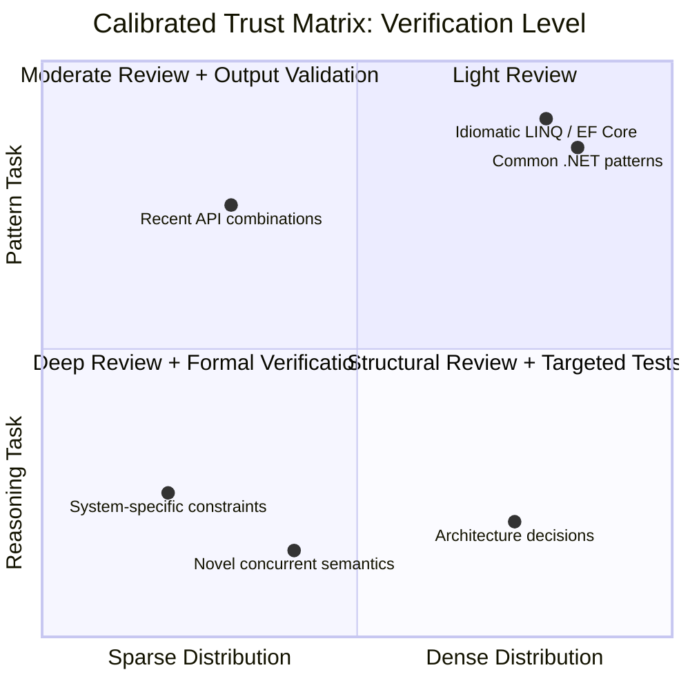

# Section 06 — Understanding Confidence and Uncertainty: When Not to Trust AI Output

## The Calibration Problem

The confidence expressed in a large language model's output is not a reliable signal of its correctness. Tokens expressing confidence — phrases like "this is the correct approach," "you should use X because Y," unhedged assertions phrased in the register of certainty — are generated by the same next-token prediction loop that produces all other tokens, and their occurrence is determined by what confident-sounding technical text looks like in the training corpus, not by any internal evaluation of the correctness of the adjacent content.

An engineer who has worked extensively with human experts develops a calibrated reading of expressed confidence. A senior architect who says "I'm fairly sure this approach handles the failover case" is expressing genuine uncertainty — the qualifier signals that verification is warranted. A different architect who says "this is definitely the correct pattern for this isolation level" is expressing genuine high confidence, and that signal is informative because it correlates, over time, with actually being right more often than when they hedged. Human experts are imperfect calibrators of their own uncertainty, but the correlation between expressed confidence and actual correctness is meaningfully positive — it is a real signal.

This calibration does not transfer to AI output. A model expressing high confidence — "this is the correct approach," "you should use X because Y," unhedged assertions phrased in the register of certainty — is generating the most-probable tokens given the context, including the context of what confident-sounding answers look like in technical writing. Sections 01 through 05 have established the mechanism behind this: the tokens expressing confidence are generated by the same next-token prediction loop as all other tokens, and their occurrence is determined by what confident-sounding technical text looks like in the training corpus, not by any internal evaluation of the correctness of the adjacent content. An engineer whose verification effort scales with the model's expressed confidence is systematically under-verifying the cases where the model sounds confident but is wrong — which, as Sections 03 and 04 established, are exactly the failure modes with the highest engineering cost.

The calibration problem has a direct solution, but it requires replacing the wrong signal (model confidence) with the right one — and building that replacement into verification workflows systematically rather than relying on per-engineer judgment at each code review.

## The Right Signal: Task Type and Distribution Position

If expressed confidence is not the correct signal for verification effort, what is? Two factors, combined, provide a reliable basis for calibrating verification intensity for AI-generated output in a .NET engineering context.

**Task type** distinguishes between what Section 03 called "pattern tasks" and "reasoning tasks." Pattern tasks — generating an implementation of a well-established design pattern, translating between equivalent .NET APIs, producing idiomatic LINQ for a standard transformation — sit in dense regions of the training distribution (Section 02) and are produced through high-quality statistical retrieval rather than novel construction. They should still be reviewed, but the verification can be proportionally lighter: check for fit to context, check for the specific failure modes the task type is prone to, and confirm by compilation and targeted tests. Reasoning tasks — architectural decisions specific to the system at hand, correctness analysis of novel concurrent interactions, security analysis of a specific trust boundary — require independent verification of the logical chain, because the model is constructing from statistical adjacency rather than retrieving a well-reinforced answer.

**Distribution position** asks where this specific task sits relative to the training corpus for this specific technology combination. A task involving widely-used, long-documented .NET patterns sits in a dense, reliable region. A task involving a less-common library, a recently-released API, a combination of features with no well-documented interaction, or project-specific constraints that no training corpus could contain — these sit in sparse, less-reliable regions where the same statistical mechanism produces output with higher hallucination rates and higher probability of the correct-shape, wrong-semantics failure mode.



The quadrant chart maps the two factors onto four verification regimes:

**High density + pattern task (top-right):** Output is highly likely to be correct and verifiable by compilation and standard tests. Light review sufficient: check for context fit, compile, run existing tests.

**High density + reasoning task (bottom-right):** Output uses the correct vocabulary and architectural framing, but the *specific conclusions* about this system require independent validation. The model's framing of the problem is useful; the conclusions must be verified against first principles or specific tests for the case at hand.

**Sparse distribution + pattern task (top-left):** The shape of the output is likely correct (idiomatic code structure) but specific details — API names, parameter types, configuration keys — are at elevated risk for fabrication. Verify API surfaces explicitly; run the code against a real dependency, not a stub, before accepting.

**Sparse distribution + reasoning task (bottom-left):** Highest verification requirement. Output can be used as a starting point that surfaces relevant considerations and exposes the shape of the problem, but should not be treated as a derived conclusion. Independent reasoning from first principles or authoritative documentation is required.

## Implementing Calibrated Trust in a .NET Team

Calibrated trust is a team-level property, not just a per-engineer skill. Individual engineers may develop good intuitions over time, but those intuitions are private and inconsistent across the team, and they do not create an auditable record of what was verified and how. The correct implementation is an explicit, codified verification policy backed by tooling that makes the verification level visible in the artifact itself.

```csharp id="code-02-06"
// Target Framework: .NET 8.0
// Chapter: 02 | Section: 06
// book/chapters/chapter-02/sections/section-06.en.md
//
// Attribute-based AI-code annotation system for a .NET team.
// Every AI-generated file or method is annotated with:
//   (a) the verification level applied before acceptance
//   (b) a log entry recording what was checked
//
// This creates an auditable record and makes verification level visible
// in code review, allowing reviewers to check whether the claimed
// verification actually matches the task type × distribution position
// from the calibrated trust matrix.

namespace AiAwareEngineeringToolkit.Infrastructure.AI;

// ── Verification level enum ───────────────────────────────────────────────

/// <summary>
/// Verification level applied to an AI-generated artifact before it
/// was accepted into the codebase. Correlates to the calibrated trust
/// matrix: task type × training-distribution density.
/// </summary>
public enum VerificationLevel
{
    /// <summary>
    /// Compilation + standard test suite only.
    /// Appropriate for: dense-distribution pattern tasks.
    /// </summary>
    Light = 1,

    /// <summary>
    /// Compilation + standard tests + explicit API surface verification
    /// + targeted tests for known failure modes.
    /// Appropriate for: sparse-distribution pattern tasks OR
    /// dense-distribution reasoning tasks.
    /// </summary>
    Moderate = 2,

    /// <summary>
    /// Independent logical verification + specific tests for the exact
    /// correctness property in question + architecture review.
    /// Appropriate for: reasoning tasks in any distribution region.
    /// </summary>
    Deep = 3,

    /// <summary>
    /// Formal verification or authoritative documentation cross-reference
    /// required. Appropriate for: sparse-distribution reasoning tasks
    /// (security, concurrency semantics, compliance).
    /// </summary>
    Formal = 4,
}

// ── Annotation attribute ──────────────────────────────────────────────────

/// <summary>
/// Marks an AI-generated class, method, or file and records the
/// verification level applied before acceptance.
/// Apply at the smallest granularity that was generated by AI —
/// prefer method-level over class-level when only part of a class
/// was generated.
/// </summary>
[AttributeUsage(AttributeTargets.Class | AttributeTargets.Method |
                AttributeTargets.Property, AllowMultiple = false)]
public sealed class AiGeneratedAttribute(
    VerificationLevel verificationLevel,
    string            notes = "") : Attribute
{
    public VerificationLevel VerificationLevel { get; } = verificationLevel;

    /// <summary>
    /// Free-text description of what was verified. Visible in code review.
    /// Example: "Verified Channel<T> completion semantics against docs.
    ///           Tested shutdown path explicitly in ShutdownTests.cs."
    /// </summary>
    public string Notes { get; } = notes;
}

// ── Audit log ─────────────────────────────────────────────────────────────

/// <summary>
/// Structured log record for AI-generated code acceptance.
/// Persisted to allow post-incident analysis of which AI-generated
/// components were involved and at what verification level.
/// </summary>
public sealed record AiAuditEntry(
    string            ComponentId,
    VerificationLevel VerificationLevel,
    string            Notes,
    DateTimeOffset    AcceptedAt,
    string            AcceptedBy);

public sealed class AiAuditLog(ILogger<AiAuditLog> logger)
{
    private readonly List<AiAuditEntry> _entries = [];

    public void Record(AiAuditEntry entry)
    {
        _entries.Add(entry);
        logger.LogInformation(
            "AI-generated component accepted: {ComponentId} " +
            "at verification level {Level} by {AcceptedBy}. Notes: {Notes}",
            entry.ComponentId,
            entry.VerificationLevel,
            entry.AcceptedBy,
            entry.Notes);
    }

    public IReadOnlyList<AiAuditEntry> Entries => _entries.AsReadOnly();
}

// ── Usage example ─────────────────────────────────────────────────────────

// The InMemoryPaymentRepository from Chapter 01 was AI-generated
// and verified at the Moderate level — dense distribution (common
// in-memory pattern) + pattern task, with explicit ConcurrentDictionary
// thread-safety verification and idempotency key atomic behaviour
// confirmed by the integration tests in PaymentProcessorIntegrationTests.cs.

[AiGenerated(
    verificationLevel: VerificationLevel.Moderate,
    notes: "Thread-safety of ConcurrentDictionary.GetOrAdd verified " +
           "against .NET docs. Idempotency key + payment record atomicity " +
           "verified by integration test 'AtomicWrite_IdempotencyKeyAndPaymentBothPersisted'.")]
public sealed class AnnotatedInMemoryPaymentRepository : Repositories.InMemoryPaymentRepository { }
```

The attribute and audit log together create two things: a per-artifact declaration of what verification was applied, visible in code review; and a runtime-queryable record that can be used during incident investigation to identify which AI-generated components were involved in a failure and at what verification level they were accepted. The latter is particularly valuable when a "correct-shape, wrong-semantics" failure mode (Section 04) appears in production — knowing that the component was accepted at `VerificationLevel.Light` for what should have been a `Moderate` or `Deep` task immediately narrows the investigation and provides a concrete process improvement: the verification policy was miscalibrated for that task type.

## Calibrated Trust Is Not a Fixed Setting

The final observation this chapter leaves with is one that the matrix and tooling above might obscure if taken too literally: calibrated trust is a dynamic assessment that updates as the AI tooling, the team's experience with it, and the specific domain evolve. A task that sits in a sparse region of the training distribution today may become a dense-region task when a new model generation is trained on significantly more material covering that domain. A team's ability to quickly identify fabrication in a specific library's API surface improves with exposure, which effectively moves some tasks from higher verification regimes toward lower ones without changing the underlying reliability of the AI output.

The dynamic nature of calibrated trust also means that the `VerificationLevel` classifications in the codebase should be reviewed periodically — for example, quarterly — to reflect changes in model capabilities, team experience, and the training distribution's coverage of the team's specific technology stack. A task classified as `Deep` three months ago may warrant `Moderate` now because the team has built specific test harnesses for the relevant failure mode, or because a newer model generation has significantly improved its statistical coverage of that pattern. This periodic review is itself a lightweight engineering practice — not a heavy process, but a structured conversation that references the actual audit log entries from the preceding quarter to identify patterns in verification failures and adjust the classification table. The goal is not to reduce verification effort over time — it is to concentrate verification effort where the risk is highest, informed by actual experience rather than initial assumptions.

What the matrix and tooling provide is not a permanent classification of every possible task, but a framework for making the verification decision explicit, communicable, and auditable rather than private, inconsistent, and invisible. The goal is that every AI-generated component that enters the codebase carries a clear, reviewable record of what was done to verify it — not because the model demanded it, but because the engineering team decided that this is what professional use of AI assistance looks like.

## Verification as a Pipeline Primitive, Not a Human Ritual

The most common failure mode for team-level verification policies is adoption drift: the policy exists in documentation, engineers intend to follow it, and under time pressure the annotation step is skipped because it has no enforcement mechanism. The architectural response is to make verification a pipeline primitive — a step that is enforced by tooling rather than relied upon as a convention. In a .NET team this takes two concrete forms. First, a Roslyn analyser that inspects AI-generated code artefacts and emits a build warning (or error, depending on team policy) when the `[AiGenerated]` attribute is absent and no `[HumanAuthored]` counter-attribute is present. This makes the default state of the build pipeline one that *requires* a declaration about authorship and verification level, reversing the burden from "remember to annotate" to "declare why you did not annotate." Second, a CI pipeline step that reads the `AiAuditLog` entries for the changeset and validates that the declared verification level is consistent with a classification table maintained by the team — for example, rejecting a changeset that declares `VerificationLevel.Light` for a file containing `Channel<T>` concurrency logic, which the classification table maps to `Deep` or `Formal`. These two mechanisms — static analysis enforcement and pipeline-level classification validation — convert the verification policy from an aspiration into a constraint that operates at the same point in the workflow as compilation and test execution. The result is that every AI-generated component entering the codebase carries a verified, auditable record of its authorship and verification level, not because individual engineers remembered to add it, but because the build system required it.

## From Individual Practice to Team Standard

The `[AiGenerated]` attribute and `AiAuditLog` are useful as individual practices, but their full value is realised when adopted as team standards enforced consistently. Two mechanisms make adoption durable rather than aspirational.

**Architecture tests that enforce annotation.** Using NetArchTest or a custom Roslyn analyser, a team can write an architecture test that fails the build if any public method in specific namespaces lacks an `[AiGenerated]` annotation or a corresponding comment explaining why it was human-authored. This reverses the default: instead of requiring developers to remember to annotate AI-generated code, it requires them to explicitly declare human-authored code, making the presence or absence of the annotation meaningful and enforceable rather than optional. The test runs in CI and fails fast, making annotation a build requirement rather than a code review convention that can be missed under time pressure.

**Incident review integration.** When a production incident involves a component that carries an `[AiGenerated]` annotation, the post-incident review should include an explicit check: was the verification level applied appropriate for the task type and distribution position? If a `Light` verification was applied to what was in retrospect a `Deep`-level reasoning task, the process improvement is concrete and specific — not "be more careful with AI output" but "reclassify this category of task to `Moderate` or `Deep` in the team's verification policy and update the calibrated trust matrix accordingly." This feedback loop is what allows the team's verification policy to improve based on actual failure experience rather than theoretical risk assessment alone.

## Verification Effectiveness as a Measurable Property

The attribute and audit log described above create raw data; the engineering question is what to do with it. A team that records verification levels for every AI-generated component has, over time, a dataset that can be analysed to answer questions that theoretical risk assessment alone cannot answer: which verification levels actually catch issues, which are applied too liberally or too conservatively, and where the team's verification effort is misallocated relative to actual failure rates.

The most direct metric is the verification-failure correlation: for each `AiAuditEntry` that was later involved in a production incident or a substantial code correction, what was the declared `VerificationLevel` at acceptance? If incidents cluster at `VerificationLevel.Light`, the policy is under-verifying the affected task categories. If incidents are equally distributed across levels, the verification criteria themselves may be miscalibrated — the team may be applying `Deep` verification to tasks that do not actually require it while under-investing in the categories that produce failures. This analysis is straightforward to perform: join the audit log entries against incident reports by component ID, filter by time window, and examine the distribution of verification levels for the failure set versus the full population of AI-generated components.

A second metric is the retry-success distribution at the deterministic boundary. If a specific task type consistently requires three retries (the maximum) before producing valid output, the prompt template for that task type may need restructuring — the prompt is not constraining the model's output space tightly enough, and the boundary's retry logic is compensating for a prompt design problem. If a task type consistently succeeds on the first attempt, the verification level applied to it may be higher than necessary — the prompt is producing reliable output and the team could consider reducing verification effort for that task category. These metrics are only available when the boundary and the audit log exist as architectural components; without them, the team is making verification decisions based on intuition rather than data.

A third metric is the cost-of-verification ratio: the time spent verifying AI-generated output divided by the time spent generating it. For tasks where this ratio is high (the verification takes much longer than the generation), the team should examine whether the task is being approached correctly — perhaps the AI is generating output for a reasoning task that should instead be decomposed into smaller pattern tasks, or perhaps the verification infrastructure for that task category is underdeveloped and could be improved with targeted test harnesses. The ratio is not a metric to minimise unconditionally — some tasks legitimately require expensive verification — but it is a metric to monitor, because unexpected changes in the ratio often signal changes in the AI model's behaviour or the team's task classification that warrant investigation.

## The Relationship Between Calibrated Trust and Technical Debt

A final consideration that connects calibrated trust to the broader engineering context: AI-generated code that is accepted at an insufficiently rigorous verification level becomes technical debt with a specific and unusual property — the debt is invisible to standard static analysis and code review heuristics. Normal technical debt (missing documentation, duplicated logic, overly complex code) is visible on reading the code; AI-generated correct-shape wrong-semantics debt is invisible on reading because the code looks correct. It is only visible when the specific failure condition is exercised — which may not happen in development, may not happen in the standard test suite, and may not happen until specific operational conditions arise in production.

This means that miscalibrated verification does not produce technical debt that the team will naturally discover and pay down during normal refactoring — it produces debt that persists until the specific failure condition occurs, at which point the cost is a production incident rather than a planned refactoring task. The practical implication is that verification calibration errors are asymmetrically costly: under-verifying a reasoning task is much more expensive than over-verifying a pattern task, because the cost of over-verification is wasted time (a known, bounded cost) while the cost of under-verification is an unbounded production incident whose root cause may be difficult to identify because the code looks correct.

This asymmetry argues for a conservative default: when uncertain about a task's classification, verify at the higher level. The cost of an unnecessary `Deep` verification on what turns out to be a pattern task is a few hours of additional review time. The cost of a `Light` verification on what turns out to be a reasoning task is a potential production failure whose investigation and remediation will consume far more time than the additional verification would have. Over time, as the team accumulates audit log data and incident correlation data, the classification can be refined — but the starting position should be conservative, with relaxation justified by evidence rather than assumed by default.

## Verbal Hedging Versus Engineering Verification

One distinction matters between two things that can look similar but are fundamentally different: the verbal hedging a model may display when asked for it, and the engineering verification an engineer applies independently. When the model generates hedging phrases like "this may need additional review" or "make sure to test this in your specific environment," those phrases are themselves tokens generated by the same statistical mechanism that generates every other token — they may appear in contexts that genuinely deserve caution, and they may appear as part of the general pattern of cautious technical writing regardless of the adjacent content's correctness.

That does not mean verbal hedging is entirely useless — it can direct an engineer's attention toward areas worth extra examination. But it means the absence of verbal hedging never justifies reducing verification effort, and its presence never substitutes for independent verification built on understanding the task type and its position in the training distribution, as the calibrated trust matrix above made clear. The difference between the two is the difference between relying on a signal generated by the same mechanism that may be the source of the error, and relying on an independent verification framework built on an engineering understanding of how that mechanism works in the first place.

## Embedding the Trust Matrix in the Development Lifecycle

The most effective practical application of the calibrated trust matrix is not as a theoretical reference consulted occasionally but as an embedded part of the daily development lifecycle. Three specific integration points make that embedding practical and sustainable.

**At task planning:** before starting a task involving AI assistance, its type (pattern or reasoning) and approximate position in the training distribution (dense or sparse) are classified, and the expected verification level is set in advance. This turns verification from a decision made after the output appears into a pre-planned expectation that guides how time and effort are allocated from the start.

**During code review:** the verification level recorded in the `[AiGenerated]` attribute is checked against the task's actual classification. A reviewer seeing a component classified `Light` that in reality deals with complex concurrency logic or a system-specific architectural decision can demand reclassification and a raised verification level before approving the merge.

**After incidents:** as noted before, any production incident tied to an AI-generated component is linked to its audit log, and whether the applied verification level was appropriate is judged retrospectively. That judgment feeds updates to the verification policy itself — widening the definition of "reasoning task" to include a new scenario category, or raising the default level for a library proven to be a repeated hallucination source.

## Chapter Synthesis

The six sections of this chapter, taken together, establish a complete mental model for a .NET engineer working with large language models: a next-token prediction mechanism producing understanding-like output because it learned the statistical structure of technical reasoning from an enormous training corpus; that structure collapsing silently at the edges of the training distribution where patterns are sparse or contradictory; the collapse manifesting as hallucinations of multiple types varying in cost and detectability; the correct architectural response being an explicit deterministic boundary around every probabilistic component; and the team's engineering response being an explicitly calibrated, auditable verification policy instead of inconsistent individual intuition.

That mental model is not academic knowledge acquired once and forgotten. It is the practical foundation on which every later skill in this book is built: how to phrase prompts with engineering precision, how to integrate AI into production .NET architecture, how to test systems containing it, and how to manage its security and operational risks. Every one of those later skills assumes this chapter's understanding: that the large language model is a powerful, inherently probabilistic tool deserving confident use within precisely understood limits — neither blind trust nor outright rejection.

## Worked Example: Tracing a Verification Decision Through a Full Lifecycle

A concrete example helps embody how this framework works in daily practice. Consider a .NET team asking AI to generate payment-refund processing logic in an Outbox-pattern service from Chapter 01. At planning time, this is classified as a reasoning task — correct implementation depends on system-specific constraints: how refunds interact with the original payment's state, whether partial refunds are supported, and how they interact with the existing Outbox pattern for reliable refund-event publication. That places it in the matrix's bottom-left quadrant — the highest verification requirement.

The engineer requesting the implementation receives structurally correct-looking code: it checks payment state, creates a refund record, and adds an Outbox message. But the verification this classification requires demands explicitly examining several questions the code does not answer by itself: what happens if a partial refund is requested and then another partial refund whose combined total exceeds the original amount? Is that prevented at the database level or only in application logic? Is the refund's Outbox message idempotent the same way Chapter 01 documented for the original payment messages?

Verifying exactly those three questions — not merely reading the code and confirming it "looks right" — is what distinguishes actual `Deep`-level application from nominal application. Recorded in the `[AiGenerated]` attribute is not just "Deep" but the specific notes: "verified prevention of cumulative partial refunds exceeding the original amount via a database-level constraint; verified refund Outbox message idempotency via a dedicated integration test." That record, reviewed later — in a routine code review or an incident investigation — provides tangible evidence of what was actually verified, not just an unspecified general classification.

This example embodies why this section's framework is more than a theoretical taxonomy: it is a practical tool translating understanding of the language model's mechanisms and limits — as Sections 01 through 05 established — into concrete verification practice, applicable to any real engineering task in a production .NET context, and reviewable and improvable over time from the team's own experience.

## Extending the Matrix to Automated Build Pipelines

Mechanical application of calibrated trust should not remain at the level of manual code review. In a real production environment, automated verification tiers should be enforced through build pipelines. A component carrying `[AiGenerated(VerificationLevel.Light)]` passes build pipelines without additional constraints. But a component classified `Deep` or `Formal` mandates prerequisites: integration tests targeted at the named failure scenarios, static analyses verifying the `ValueTask<T>` and `Channel<T>` instances used, and alerts on breaching pre-set test-coverage thresholds. This extension turns calibrated trust from an individual cognitive practice into an institutionally enforced policy, ensuring the difference between `Light` and `Formal` depends not on one reviewer's oversight at one moment but on self-protecting infrastructure regardless of who reviews.

Chapter 03 builds on this foundation: now that we have an accurate model of what LLMs are, how they fail, and what appropriate verification looks like, the question is how to communicate with them as an engineering discipline — designing prompts not as natural-language requests but as structured contracts that reduce the probability of operating at the edge of the training distribution for the tasks we actually need performed.
