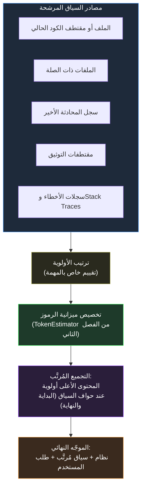
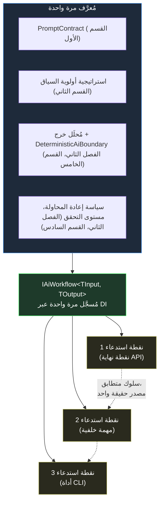
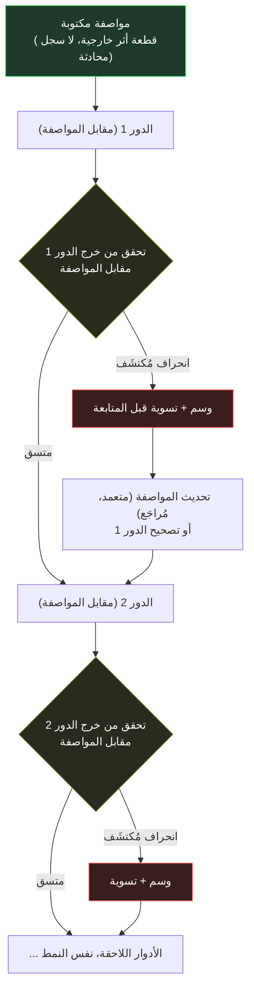
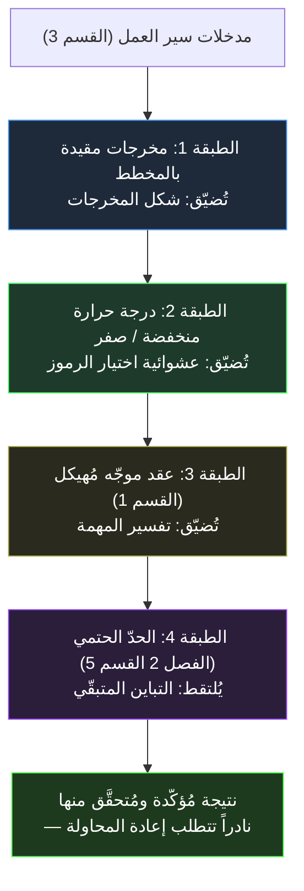
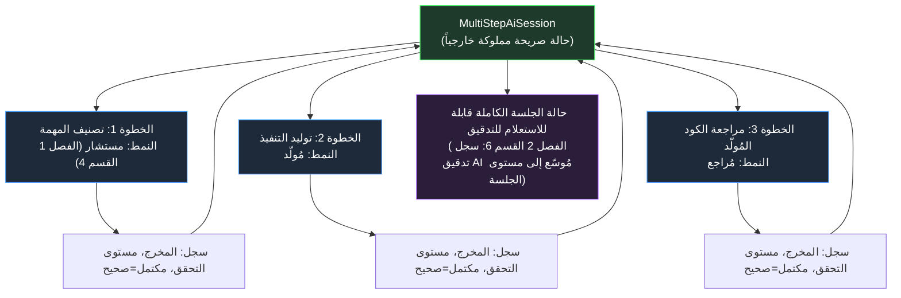

<div dir="rtl">

# القسم الأول — لماذا الـ Prompting ليس هندسة حتى تجعله كذلك

## مشكلة السلسلة السحرية، مُعادةُ الصياغة

كل مهندس .NET ورث قاعدة كود تحتوي على سلسلة نصية - String Literal مُدرَجة مباشرةً في استدعاء دالة — سلسلة اتصال بقاعدة بيانات، أو رمز حالة، أو مفتاح إعداد — مُكرَّرة عبر عشرات نقاط الاستدعاء، كل نسخة منها تنحرف قليلاً عن الأخرى مع مرور الوقت. الحل معروف ومتبع منذ عقود: استخراج القيمة إلى ثابت مُسمَّى، أو كائن إعداد مُحدَّد النوع، أو عميل مُولَّد، بحيث يكون هناك مكان واحد تُعرَّف فيه القيمة وكل مُستهلِك يُشير إلى ذلك المكان الواحد بدلاً من إعادة كتابتها.

الطريقة التي تتعامل بها معظم الفرق الهندسية حالياً مع النماذج اللغوية الكبيرة تُعيد إنتاج هذه المشكلة بالضبط، على نطاق أوسع وبمخاطر أعلى. الموجّه - Prompt — تعليمات النظام، والإطار، والقيود، وطلب التنسيق — يُكتب طازجاً في واجهة محادثة أو يُبنى مباشرةً داخل كود التطبيق، يُستخدَم مرة واحدة، ثم إما يُهمَل أو يُتذكَّر جزئياً في المرة التالية التي تظهر فيها مهمة مشابهة. مهندسان يحلّان مشكلتين متجاورتين مقابل النموذج ذاته يكتبان موجّهين مختلفين ينتجان نتائج متشابهة سطحياً اليوم، ويتباعدان بصمت مع تحديث النموذج الأساسي، أو مع توسّع الحالات الحدية للمهمة. لا شيء يمنع هذا التباعد لأن لا شيء يُعامل الموجّه كقطعة أثر لها هوية وإصدار وعقد.

يُسمّي هذا القسم المشكلة صراحةً ويُرسي البديل: يُصبح الموجّه هندسةً، بنفس المعنى الذي تُصبح فيه السلسلة السحرية نظام إعداد، حين يُستخرَج ويُصدَّر ويُحدَّد نوعه عند حدوده ويُعاد استخدامه عمداً بدلاً من إعادة كتابته من الذاكرة.

## ما يعنيه "الـ Prompting" عادةً ولماذا هذا غير كافٍ

دخل مصطلح "هندسة الموجّهات - Prompt Engineering" الاستخدام الشائع لوصف ممارسة صياغة الطلبات لنموذج لغوي بطرق تُنتج نتائج أفضل. هذه الممارسة حقيقية والمهارة مهمة. لكن المصطلح يخلط بين نشاطين يستحقان الفصل لأغراض هندسية: حِرفة صياغة تعليمة فعّالة، وانضباط جعل تلك التعليمة مكوناً موثوقاً وقابلاً للمراجعة وقابلاً لإعادة الاستخدام في نظام برمجي.

النشاط الأول — الصياغة — شيء يُحسَّن بالممارسة ولا يُنتج بمفرده قِطعاً هندسية. موجّه مصاغ جيداً كُتب مرة واحدة في نافذة محادثة وأنتج نتيجة مفيدة لا يختلف بشكل ذي معنى عن تعليمة شفهية مصاغة جيداً لكن غير موثَّقة: نجحت هذه المرة، لهذا الشخص، في هذا السياق، ولا توجد قطعة أثر تحفظ لماذا نجحت.

النشاط الثاني — معاملة الموجّهات كهندسة — يتطلب أن يوجد الموجّه كقطعة أثر مُصدَّرة بمدخلات صريحة وقيود صريحة وعقد صريح لما يُحسَب خرجاً صالحاً. هذه فئة مختلفة كلياً من الممارسة، تُشابه الفارق بين مطوّر يكتب استعلام SQL يدوياً كل مرة وفريق يُعرّف إجراءً مُخزَّناً - Stored Procedure مُعَلْمَناً يستدعيه كل مُستدعٍ بشكل متطابق.


## لماذا آليات الفصل الثاني تجعل هذا غير اختياري

أرسى القسم الأول من الفصل الثاني أن النموذج لا يملك ذاكرة مستمرة بين الاستدعاءات فيما يتجاوز ما أُدرج صراحةً في نافذة السياق — كل فارق دقيق في القصد يجب إعادة ترميزه، بالكامل، في كل موجّه على حدة. أرسى القسم الثاني أن القدرة والموثوقية تتباينان حسب كثافة التوزيع التدريبي، مما يعني أن صياغة موجّه نجحت لشكل مهمة واحد قد تتراجع أداءً بصمت لشكل مهمة مجاور. أرسى القسم الرابع تصنيف الهلوسة، وأرسى القسم الخامس نمط الحد الحتمي، وكلاهما يفترض مسبقاً وجود عقد مُعرَّف لما يبدو عليه الخرج "الصالح" — افتراض لا يُلبّيه الـ Prompting العشوائي.

بصراحة: كل آلية أرساها هذا الكتاب حتى الآن حول كيفية تصرف النماذج اللغوية هي آلية غير مُجهَّزة بنيوياً لإدارتها الـ Prompting العشوائي غير المُصدَّر بأمان.

## نمط عقد الموجّه

<div dir="ltr">

```csharp id="code-03-01"
// Target Framework: .NET 10.0
// Chapter: 03 | Section: 01
// book/chapters/chapter-03/sections/section-01.ar.md
//
// PromptContract<TInput, TOutput>: موجّه مُمثَّل كقطعة أثر .NET
// مُصدَّرة ومُحدَّدة النوع بدلاً من سلسلة نصية مضمَّنة.

namespace EngineeringCommunicationToolkit.Core.Prompts;

public abstract class PromptContract<TInput, TOutput>
{
    public abstract string ContractId { get; }
    public abstract string Version    { get; }
    public abstract string RenderSystemPrompt();
    public abstract string RenderUserPrompt(TInput input);
    public string FullyQualifiedId => $"{ContractId}@{Version}";
}

public sealed class CodeReviewPromptContract
    : PromptContract<CodeReviewRequest, string>
{
    public override string ContractId => "code-review-comment";
    public override string Version    => "1.2.0";

    private const string CodeFence = "\u0060\u0060\u0060";

    public override string RenderSystemPrompt() =>
        "You are a senior .NET engineer performing a code review. " +
        "Identify concrete issues only. For each issue, cite the specific " +
        "line or pattern and explain the concrete risk.";

    public override string RenderUserPrompt(CodeReviewRequest input) =>
        $"Review the following {input.Language} code from {input.FileName}:\n" +
        $"{CodeFence}{input.Language}\n{input.Code}\n{CodeFence}\n" +
        $"Focus areas: {string.Join(", ", input.FocusAreas)}";
}

public sealed record CodeReviewRequest(
    string FileName,
    string Language,
    string Code,
    IReadOnlyList<string> FocusAreas);
```

</div>

خاصيتان في هذا النمط تستحقان التصريح. أولاً، <code dir="ltr">RenderSystemPrompt</code> و<code dir="ltr">RenderUserPrompt</code> دالتا .NET حتميتان — قابلتان للاختبار بالكامل بتأكيدات تقليدية، مُطابِقتَان تماماً لإطار الفصل الثاني القسم الخامس للحد الحتمي. ثانياً، <code dir="ltr">Version</code> ليست زخرفية — تُعطي الفريق آلية ملموسة للإجابة عن "هل تغيّر هذا الموجّه؟" أثناء التحقيق في حادثة.

## الجانب الآخر من الميزان: التكلفة

معاملة الموجّهات كقِطع هندسية ليست مجانية. تعريف فئة فرعية من <code dir="ltr">PromptContract</code>، واتخاذ قرار بشأن سياسة الإصدارات، وصيانة منطق تحويلها كمكوّن مُختبَر ومُراجَع، يستغرق وقتاً هندسياً حقيقياً. للتفاعل الاستكشافي لمرة واحدة — سكربت يُشغَّل مرة واحدة للتحقيق في حادثة منفردة — هذا العبء غير مُبرَّر.

القرار الذي يحتاج الفريق إلى اتخاذه هو أين تقع نقطة التعادل في سياقه المحدد. موجّه يُستدعى من ثلاث نقاط استدعاء بعمر متوقع ستة أشهر يُبرّر عبء النمط براحة. موجّه يُستدعى مرة واحدة، من مهندس واحد، لمهمة لن تتكرر، لا يُبرّره. الفرق التي تتعامل مع هذا الانضباط للتوّ تُخطئ غالباً في أحد اتجاهين متوقعين: إضفاء الطابع الرسمي على كل تفاعل بصرف النظر عن إمكانية إعادة استخدامه، أو عدم إضفاء الطابع الرسمي على أي شيء. لا يعكس أي من الطرفين الحكم الذي يطلبه هذا القسم — الهدف هو مطابقة مستوى الانضباط الهندسي مع مستوى إعادة الاستخدام والعواقب التي يحملها الموجّه المحدد فعلياً، وهو الحكم النسبي ذاته الذي يُطبّقه مهندسو .NET بالفعل حين يقرّرون ما إذا كان جزء من المنطق يستحق الاستخراج إلى مكتبة مشتركة.

## ملاحظة حول انضباط التسمية

قيم <code dir="ltr">ContractId</code> يجب أن تتبع نفس انضباط التسمية الذي يُطبّقه الفريق بالفعل على مسارات API أو أسماء مواضيع ناقل الرسائل - Message Bus — وصفية، وثابتة، ومُصنَّفة حسب الاهتمام لا حسب الفريق أو المؤلف الفردي. عقد مُسمَّى <code dir="ltr">code-review-comment</code> يُوصِل غرضه لأي مهندس يصادفه بعد أشهر؛ عقد مُسمَّى باسم الفرد الذي كتبه أو برقم تذكرة أُغلقت منذ زمن طويل لا يفعل ذلك. هذا انضباط صغير لكنه يتراكم قيمةً مع نمو سجل العقود، تاركاً الفريق في مكان أفضل بكثير مما كان سيكون عليه لو أُهمل الانضباط في مراحل النمو المبكرة.

## استراتيجية الإصدارات وانضباط الترحيل

فئة فرعية من <code dir="ltr">PromptContract</code> تعيش في نظام إدارة الكود ترث انضباط الإصدارات من الآليات ذاتها التي يُطبّقها مهندسو .NET بالفعل على عقود الواجهات البرمجية وواجهات المكتبات. الإصدار الدلالي - Semantic Versioning يُقابِلها مباشرةً: زيادات التصحيح لتحسينات الصياغة التي لا تُغيّر شكل الخرج المتوقع، وزيادات ثانوية لحقول أو قيود خرج جديدة يمكن للمُستدعِين تجاهلها بأمان، وزيادات رئيسية للتغييرات البنيوية في <code dir="ltr">TInput</code> أو <code dir="ltr">TOutput</code> التي تتطلب تحديث المُستدعِين. خاصية <code dir="ltr">Version</code> تجعل هذه الزيادات مرئية وقت التشغيل، وخاصية <code dir="ltr">FullyQualifiedId</code> — التي تجمع <code dir="ltr">ContractId</code> و<code dir="ltr">Version</code> — تسمح للفريق بتسجيل الإصدار الذي أنتج خرجاً معيناً بدقة أثناء التحقيق في حادثة.

الترحيل عبر الإصدارات الرئيسية يتبع النمط ذاته الذي يستخدمه الفريق لإيقاف نقطة نهاية API: يبقى الإصدار القديم مُسجَّلاً وقابلاً للاستدعاء بينما يُهاجِر المُستدعُون فرادى، مع تسجيل إشارة إيقاف في كل مرة يُستدعى فيها الإصدار القديم. التنفيذ الملموس يُعلّق هذه الإشارة على قيد سجل التدقيق الخاص بـ <code dir="ltr">DeterministicAiBoundary<T></code> من الفصل الثاني القسم الخامس، فيجعل ظهور الإيقاف تلقائياً بدلاً من اعتماده على تذكّر أحدهم للتحقق. لا يُزال الإصدار القديم إلا بعد أن يؤكد الفريق — عبر بيانات استدعاء مُسجَّلة، لا افتراض — أن لا نقطة استدعاء متبقية تعتمد عليه.

انضباط الترحيل هذا ليس عبئاً نظرياً. الفرق التي تتخطاه وتكتفي بـ "تحديث الموجّه" تكتشف التكلفة حين يتطلب التحقيق في حادثة معرفة إصدار الموجّه النشط وقت فشل محدد. بدون تتبّع الإصدارات، يتوقف التحقيق عند "تغيّر الموجّه في وقت ما من السبرنت الماضي". مع تتبّع الإصدارات، يمضي التحقيق إلى "كان الإصدار 1.2.0 من <code dir="ltr">code-review-comment</code> هو النشط، والتغيير من 1.1.0 أزال التعليمة الصريحة لذكر أرقام الأسطر، وهذا يفسّر تحوّل صيغة الخرج". هذا التحقيق الدقيق الواعي بالإصدار لا يكون ممكناً إلا حين يكون الإصدار خاصية من الدرجة الأولى في العقد، لا تعليقاً في وصف طلب سحب قد يكون محدَّثاً أو لا يكون.

## من السلاسل السحرية إلى العقود المُحدَّدة النوع: التشابه الكامل

تشبيه السلسلة السحرية الذي يفتتح هذا القسم يمتد إلى أبعد مما يبدو للوهلة الأولى، وتتبّعه إلى نتيجته المنطقية يُوضّح النطاق الكامل لما يعنيه معاملة الموجّهات كقِطع هندسية. حين يستخرج فريق .NET قيمة إعداد من سلسلة مُضمَّنة إلى كائن <code dir="ltr">IOptions<T></code> مُحدَّد النوع، فالفائدة ليست فقط أن القيمة تعيش في مكان واحد — بل أنها أصبحت قابلة للملاحظة والحقن والاختبار، وتحكم حداً يستطيع نظام الأنواع التفكير فيه. المُستدعِي لا يحتاج إلى معرفة التمثيل الداخلي للإعداد؛ إنه يعتمد على العقد المُحدَّد النوع، وشكل العقد هو الشيء الوحيد الذي يحتاج إلى البقاء مستقراً كي يبقى المُستدعُون غير متأثرين بالتغييرات الداخلية.

يُوفّر <code dir="ltr">PromptContract<TInput, TOutput></code> المجموعة ذاتها من الخصائص عند الحد بين مُستدعٍ .NET وتفاعل مع الذكاء الاصطناعي. <code dir="ltr">TInput</code> هو العقد لما يجب أن يُوفّره المُستدعِي — ليس وصفاً حر الصياغة لـ "ما قد ترغب في تضمينه"، بل سجل مُحدَّد النوع بحقول مُسمَّاة وإلزامية. <code dir="ltr">TOutput</code> هو العقد لما يستقبله المُستدعِي — ليس نصاً خاماً قد تتباين صيغته حسبما صادف أن صيغ الموجّه في يوم معين، بل نوع يمكن لكود .NET المحيط استهلاكه كما يستهلِك أي نتيجة أخرى مُحدَّدة النوع. <code dir="ltr">Version</code> هو عقد إدارة التغيير — الانضباط ذاته الذي يُطبّقه الفريق على زيادة إصدار API، مرفوعاً إلى مستوى الموجّه بدلاً من نقطة نهاية HTTP.

هذا التأطير يجعل صريحاً لماذا لحجة القسم الأول آثار تتجاوز الموجّهات نفسها بكثير: إنها حجة حول أين ينبغي رسم الحد بين السلوك الحتمي والسلوك الاحتمالي في نظام .NET، وكيف ينبغي أن يبدو ذلك الحد. المكوّن الاحتمالي — استدلال النموذج الفعلي — ينتمي إلى داخل تنفيذ العقد، حيث يُعزَل، وحيث يُتحقَّق من مخرجاته قبل عبور الحد، وحيث تُحكَم التغييرات عليه بمعرّف الإصدار بدلاً من السماح لها بالتأثير بصمت على كل مُستدعٍ لحظة تعديل موجّه. كل ما يقع خارج ذلك الحد حتمي وقابل للاختبار وقابل للصيانة مثل أي كود .NET آخر — وهي بالضبط النتيجة الهندسية التي وُجد هذا الفصل لتأسيسها.

## الربط بنمط الحد الحتمي في الفصل الثاني

يستحق الأمر إيضاح رابط واحد صريح قبل أن يمضي الفصل قدماً، لأنه يربط نمط العقد في هذا القسم بمعمارية الفصل الثاني بمستوى دقة يجعل كلا الفصلين يُعزّزان بعضهما. <code dir="ltr">DeterministicAiBoundary<T></code> من الفصل الثاني القسم الخامس هو الحد بين استدعاء النموذج الاحتمالي وكود .NET الحتمي المحيط به. <code dir="ltr">PromptContract<TInput, TOutput></code> من هذا القسم هو ما يسكن على الجانب الحتمي من ذلك الحد — المكوّن المسؤول عن تحضير المدخل للجانب الاحتمالي بطريقة مُصدَّرة ومُحدَّدة النوع وقابلة للاختبار باستقلالية.

معاً، يُشكّلان حداً متكاملاً وواضح التعريف: عقد داخلاً، استدعاء نموذج وتحقق في الداخل، نتيجة مُحدَّدة النوع خارجاً. كل نمط آخر يُقدّمه هذا الفصل — هندسة السياق، وسير العمل القابلة لإعادة الاستخدام، والمحادثات المُرتكِزة على المواصفات، وتقليل التباين، وإدارة الحالة عبر الخطوات — هو توسّع لأحد نصفي هذا الهيكل الأساسي.

## النتيجة المؤسسية الأوسع

الحجة التي يُقدّمها هذا القسم تمتد إلى ما هو أبعد من جودة الموجّه الفردية — إنها في جوهرها حجة حول إدارة المعرفة والتعلم المؤسسي. ثقافة الـ Prompting العشوائي هي ثقافة تتراكم فيها التحسينات في أذهان الأفراد وتضيع حين يغادرون، وتُرتكَب فيها الأخطاء ذاتها بشكل متكرر من قِبَل مهندسين مختلفين يواجهون الحالة الحدية ذاتها باستقلالية، وليس للخبرة الجماعية للفريق مكان دائم. ثقافة عقد الموجّه هي ثقافة تتراكم فيها التحسينات في قِطع أثر مُصدَّرة تصمد أمام التغيير الفردي، وتُعالَج فيها الحالة الحدية المُكتشَفة من قِبَل مهندس واحد بتحديث عقد يُفيد كل نقاط الاستدعاء، وتُرمَّز خبرة الفريق الجماعية في سجل العقود لا في الذاكرة والمعرفة القبلية غير الموثَّقة.

هذا لا يختلف نوعاً عن الفائدة المؤسسية لسائر الانضباطات الهندسية — الاختبارات التي تُوثّق السلوك المتوقع، والواجهات المُحدَّدة النوع التي تُلخّص ما تقبله الخدمة وما تُعيده، وسجلات قرارات المعمارية المكتوبة التي تُلخّص لماذا اتُّخذ قرار تصميمي. إنه الانضباط ذاته مُطبَّق على فئة جديدة من مكوّنات النظام. الموجّهات التي تحكم كيفية تفاعل التطبيق مع نماذج الذكاء الاصطناعي جزء من استثماره الهندسي بنفس القدر الذي يُشكّله الكود المحيط بها. معاملتها بنفس الصرامة التي يحظى بها الكود ليست عبئاً إضافياً يُوضَع فوق الهندسة العادية — إنها الهندسة العادية مُطبَّقة باتساق على كل ما يُحدّد كيفية تصرف النظام.

## عقود الموجّهات كتوثيق حيّ

فائدة نمط <code dir="ltr">PromptContract<TInput, TOutput></code> تظهر بمرور الوقت في دوره كتوثيق حيّ للقدرات التي يعتمد عليها التطبيق. <code dir="ltr">CodeReviewPromptContract.ContractId</code> يُوثّق أن التطبيق يمتلك قدرة مراجعة كود؛ <code dir="ltr">Version</code> يُوثّق آخر تغيير جوهري؛ <code dir="ltr">TInput = CodeReviewRequest</code> يُوثّق ما تتطلبه القدرة؛ <code dir="ltr">TOutput = string</code> يُوثّق ما تُنتجه.

هذا التوثيق محدَّث تلقائياً بطريقة لا تكون عليها ملفات التوثيق المنفصلة، لأن فئة العقد *هي* تعريف القدرة ذاته لا وصف مكتوب عنه في مكان آخر. يُوائم هذا انضباط عقد الموجّه مع المبدأ الأشمل القائل بأن الكود هو التوثيق الموثوق لسلوك النظام — مبدأ يُطبّقه مهندسو .NET على الواجهات المُحدَّدة النوع، ومخططات البيانات، وعقود الخدمات. تطبيقه باتساق على عقود موجّهات الذكاء الاصطناعي يُكمل تغطية هذا المبدأ عبر كامل سطح سلوك تطبيق .NET الحديث، بما في ذلك الأجزاء التي يتوسطها الذكاء الاصطناعي.

## ما الذي يُغيّره هذا الفصل في سلوك الفريق اليومي

يستحق السؤال العملي إجابةً مباشرة: ما الذي يتغير فعلياً في العمل اليومي لفريق .NET حين يتبنّى نمط عقد الموجّه؟ ثلاثة تغييرات ملموسة تحدث بشكل متسق في الفرق التي تتبنّى هذا النمط.

الأول هو أن مراجعة الكود - Code Review تُصبح مكاناً شرعياً لمناقشة تعريف الموجّه. قبل نمط العقد، الموجّهات المُدرَجة مباشرةً في كود التطبيق كانت أحياناً تمرّ في مراجعة الكود كتفاصيل تنفيذ صغيرة لا تستحق اهتماماً جوهرياً. بعد نمط العقد، <code dir="ltr">PromptContract.RenderSystemPrompt()</code> قطعة كود مثل أي قطعة أخرى تستحق المراجعة بنفس الصرامة التي يُراجَع بها أي منطق أعمال — المُراجِع يستطيع الاستفسار عن سبب اختيار هذه القيود بالذات، وما الفرق بين هذه الصياغة والصياغة البديلة، ولماذا هذا الإصدار بالذات وليس الإصدار السابق.

الثاني هو أن تتبع رصيد التغيير يُصبح ممكناً. حين تتصرف خاصية مدعومة بالذكاء الاصطناعي بشكل مختلف بعد نشر - Deployment، السؤال "هل تغيّر الموجّه؟" أصبح له إجابة محددة: قارن <code dir="ltr">Version</code> في الإصدار الجديد بـ <code dir="ltr">Version</code> في الإصدار القديم. إذا تغيّر الإصدار، الموجّه تغيّر، وسجل الكود يُظهر بالضبط ماذا تغيّر ومتى ومن غيّره. إذا لم يتغير الإصدار، الموجّه لم يتغير وعلى الفريق البحث في مكان آخر عن سبب التغيير في السلوك.

الثالث هو أن القدرات المدعومة بالذكاء الاصطناعي تُصبح قابلة للاكتشاف. مع مرور الوقت، يُصبح سجل عقود الموجّهات — قائمة <code dir="ltr">ContractId</code> ذات المعنى وإصداراتها وأنواع مدخلاتها ومخرجاتها — جرداً يمكن استعراضه لكل ما يستطيعه التطبيق بمساعدة الذكاء الاصطناعي. مهندس جديد ينضم للفريق يمكنه استعراض سجل العقود وفهم القدرات القائمة بدلاً من الاعتماد على المعرفة القبلية لمعرفة أي قدرات الذكاء الاصطناعي موجودة بالفعل.

هذه التغييرات الثلاثة تُشكّل معاً الفارق بين فريق يُعامل الذكاء الاصطناعي كصندوق أسود يُستشار بشكل مخصوص وفريق يُعامله كمكوّن من مكوّنات نظامه قابل للمراجعة والتدقيق والتطوير المُنضبَط. ذلك الفارق يتراكم قيمةً مع مرور الوقت بشكل غير خطي: في الأشهر الأولى يبدو هامشياً، وبعد عام في مشروع ناضج يكون الفارق بين نظام يمكن الاعتماد عليه وصيانته ونظام تراكمت فيه ديون الموجّهات إلى الحد الذي يُهدّد موثوقيته.

## تعريف العقد قبل الاستدعاء: أثر الانعكاس على التفكير

تجربة عملية يصفها المهندسون الذين يتبنّون نمط العقد لأول مرة: فعل كتابة <code dir="ltr">RenderSystemPrompt()</code> و<code dir="ltr">RenderUserPrompt()</code> كدالتين منفصلتين مُحدَّدتَي التوقيع، قبل أي استدعاء فعلي للنموذج، يُجبر على صياغة ما يُريده المرء من التفاعل بدقة أكبر مما يحدث حين يُكتَب الموجّه مباشرةً في واجهة المحادثة. الانفصال بين مرحلة التعريف ومرحلة الاستدعاء يُشبه ما يُجبر عليه تصميم الاختبار قبل الكود في التطوير القائم على الاختبارات - Test-Driven Development: فعل التعريف يكشف افتراضات لم تكن ظاهرة حين كانت محتجزة في الذهن غير مُصاغة.

مهندس يجد صعوبةً في تعريف <code dir="ltr">RenderSystemPrompt()</code> بوضوح لعقد محدد على الأرجح اكتشف غموضاً حقيقياً في المهمة ذاتها — علامة على أن المهمة تحتاج مزيداً من التحليل قبل أن يبدأ أي استدعاء للنموذج، لا أن النمط مُقيِّد بشكل مُبالَغ فيه. هذه القيمة — كشف الغموض مبكراً وبتكلفة منخفضة — موجودة حتى للمهندس الذي يتبنّى انضباط الصياغة المسبقة دون البنية الرسمية الكاملة لفئة <code dir="ltr">PromptContract</code>. البنية الرسمية تُرسّخ هذه القيمة وتجعلها منهجية وقابلة للقياس وقابلة للمشاركة عبر الفريق، لكن القيمة الجوهرية تتحقق من انضباط التفكير نفسه.

## إعداد بقية الفصل

أرسى القسم الأول الأساس: الموجّه المُعامَل كقطعة أثر مُحدَّدة النوع ومُصدَّرة وقابلة للاختبار باستقلالية هو اللبنة الأساسية للتعاون المنضبط مع الذكاء الاصطناعي. الأقسام الخمسة التالية تبني هياكل أكثر قدرةً تدريجياً على هذا الأساس. القسم الثاني يُعالج النصف المتغير من كل موجّه — السياق — ويُقدّم انضباط الميزانية والترتيب الصريح الذي تجعله ضرورياً استنتاجات الفصل الثاني حول "الضياع في المنتصف". القسم الثالث يُغلّف العقد والسياق في سير عمل مُسجَّلة وقابلة لإعادة الاستخدام. القسم الرابع يمتد بهذا الانضباط إلى المحادثات متعددة الدورات. القسم الخامس يُقدّم تقنيات مستوى التوليد التي تُضيّق تباين الخرج داخل التفاعل الفردي. القسم السادس يُغلق الفصل بمعالجة إدارة الحالة الصريحة للمهام التي تمتد عبر تفاعلات متعددة، مع نماذج التعاون من الفصل الأول مُطبَّقة كخصائص مُتتبَّعة ومُحدَّدة النوع بدلاً من اتفاقيات غير رسمية.

## خاتمة القسم الأول

يبقى القسم الأول لهذا الفصل في نقطة تقاطع محورية: إنه يُحوّل الموجّه من ظاهرة مؤقتة تُستهلَك وتُنسى إلى قطعة أثر هندسية دائمة تحمل هوية وتاريخاً وعقداً. هذا التحويل ليس مجرد تحسين جمالي في تنظيم الكود — إنه تحوّل في كيفية تفكير الفريق في علاقته بالذكاء الاصطناعي: لا كأداة يُستشار عشوائياً، بل كتبعية - Dependency تُدار بنفس الانضباط الذي تُدار به أي تبعية خارجية في نظام .NET الإنتاجي. ما يليه من أقسام يبني على هذا التحوّل بإضافة الانضباط ذاته إلى السياق والسير والمحادثات متعددة الأدوار وتقليل التباين وإدارة الحالة — طبقةً فوق طبقة، كلها مبنية على الأساس المرسَّخ هنا.

الانضباط المؤسسي المتراكم عبر سجل العقود يُحوّل ما كان مجرد إلهام عابر وحرفة فردية إلى إطار هندسي مُشترَك وقابل للتطور والمراجعة. التعاون الناجح مع نماذج الذكاء الاصطناعي يبدأ دائماً بهذا القرار الهندسي الجوهري.

---

*أرسى القسم الأول أن الموجّه لا يصبح قطعة أثر هندسية إلا حين يُستخرَج من السلاسل المضمَّنة إلى عقد مُحدَّد النوع ومُصدَّر وقابل للاختبار باستقلالية. القسم الثاني يفحص النصف المتغير من كل موجّه — السياق — وانضباط الميزانية والترتيب الصريح الذي تجعله ضرورياً استنتاجات الفصل الثاني حول "الضياع في المنتصف".*

# القسم الثاني — هندسة السياق

## النصف المتغير من كل موجّه

أرسى القسم الأول عقد الموجّه - Prompt Contract: البنية الثابتة — إطار الدور، والقيود، وتنسيق الخرج — التي يجب تصديرها وإعادة استخدامها. لكن كل موجّه حقيقي يمتلك مكوّناً متغيراً لا يُعالجه العقد وحده: المعلومات الداعمة الخاصة بهذا الاستدعاء بعينه — الكود ذو الصلة، ومقتطف التوثيق ذي الصلة، ودورات المحادثة السابقة ذات الصلة، ورسالة الخطأ ذات الصلة. هذا المكوّن المتغير هو السياق، وكيفية تجميعه تُحدّد، بنفس قدر العقد ذاته، ما إذا كان التفاعل الناتج يُنتج خرجاً موثوقاً أم لا.

يُعامل هذا القسم تجميع السياق كنشاط هندسي من الدرجة الأولى بُناءً مباشراً على آليات الفصل الثاني. القسم الثاني من ذلك الفصل قدّم نافذة السياق - Context Window كحاجز ذي حجم ثابت ووصف ظاهرة "الضياع في المنتصف - Lost in the Middle" — الرموز القريبة من بداية السياق ونهايته تحظى باهتمام أقوى من الرموز المدفونة في الوسط. هذه الحقيقة الآلية لها عاقبة هندسية مباشرة: هندسة السياق ليست مجرد اتخاذ قرار بما يُضمَّن، بل بأي ترتيب وضمن أي ميزانية، بحيث تحتل المعلومات الأكثر أهمية المواضع التي تُفضّلها الآلية فعلاً.

## لماذا السلسلة غير المحدودة تُخفق

النهج الافتراضي غير المنضبط لبناء السياق هو السلسلة - Concatenation: أخذ كل ما قد يكون ذا صلة وإضافته كله إلى الموجّه. هذا النهج خاطئ لسببين مستقلين، كلاهما مُؤسَّس في الفصل الثاني. أولاً، نافذة السياق محدودة — السلسلة غير المحدودة تتجاوزها في نهاية المطاف. ثانياً، حتى في حدود الميزانية، يُفسد السياق غير الملائم أو سيء الترتيب جودة الخرج فعلياً بدلاً من تركها دون تأثير — كتلة ضخمة من مادة ذات صلة هامشية تُضعف الانتباه المتاح للمادة الحقيقية، خاصةً إذا احتلت المواضع الوسطى حيث الانتباه أضعف ما يكون.



## نمط ContextBuilder في .NET

<div dir="ltr">

```csharp id="code-03-02"
// Target Framework: .NET 10.0
// Chapter: 03 | Section: 02
// book/chapters/chapter-03/sections/section-02.ar.md
//
// ContextBuilder: يُجمِّع كتل السياق المرشحة في سلسلة مُحدَّدة الميزانية
// ومُرتَّبة عند الحواف. يستخدم TokenEstimator من الفصل الثاني.

using AiToolkit.Core.Tokens;

namespace EngineeringCommunicationToolkit.Infrastructure.AI;

public sealed record ContextBlock(string Content, int Priority, string SourceLabel);

public sealed class ContextBuilder
{
    private readonly List<ContextBlock> _blocks = [];
    private readonly int _tokenBudget;

    public ContextBuilder(int tokenBudget)
    {
        if (tokenBudget <= 0)
            throw new ArgumentOutOfRangeException(nameof(tokenBudget));
        _tokenBudget = tokenBudget;
    }

    public ContextBuilder Add(string content, int priority, string sourceLabel)
    {
        if (!string.IsNullOrWhiteSpace(content))
            _blocks.Add(new ContextBlock(content, priority, sourceLabel));
        return this;
    }

    public ContextAssemblyResult Build()
    {
        var ranked    = _blocks.OrderByDescending(b => b.Priority).ToList();
        var included  = new List<ContextBlock>();
        var excluded  = new List<ContextBlock>();
        var usedTokens = 0;

        foreach (var block in ranked)
        {
            var blockTokens = TokenEstimator.EstimateProseTokens(block.Content);
            if (usedTokens + blockTokens <= _tokenBudget)
            {
                included.Add(block);
                usedTokens += blockTokens;
            }
            else excluded.Add(block);
        }

        // التحميل على الحواف: أعلى أولوية في البداية والنهاية
        var midpoint   = (included.Count + 1) / 2;
        var edgeLoaded = included.Take(midpoint)
            .Concat(included.Skip(midpoint).Reverse())
            .ToList();

        var assembled = string.Join(
            "\n\n---\n\n",
            edgeLoaded.Select(b => $"[{b.SourceLabel}]\n{b.Content}"));

        return new ContextAssemblyResult(
            assembled, edgeLoaded, excluded, usedTokens, _tokenBudget);
    }
}

public sealed record ContextAssemblyResult(
    string AssembledContext,
    IReadOnlyList<ContextBlock> IncludedBlocks,
    IReadOnlyList<ContextBlock> ExcludedBlocks,
    int UsedTokens,
    int BudgetTokens);
```

</div>

قراران تصميميان يُرمِّزان حكماً هندسياً. خوارزمية الإدراج الجشع حسب الأولوية بسيطة عمداً — قابلية التنبؤ وإمكانية تصحيح الأخطاء في *لماذا* استُبعدت كتلة ما أهم من إنتاجية أمثل. وخطوة التحميل على الحواف هي التطبيق المباشر لاستنتاج "الضياع في المنتصف" من الفصل الثاني القسم الثاني.

## هندسة السياق خاصة بالمهمة لا شاملة

ترتيب الأولوية المُطبَّق على الكتل المرشحة ليس سياسةً ثابتة شاملة — إنه خاص بالمهمة التي يخدمها عقد الموجّه. نفس المصادر تحتل أولويات مختلفة تبعاً لما إذا كانت المهمة مراجعة كود (الملف الحالي أعلى أولوية)، أو تصحيح (سجلات الأخطاء و <code dir="ltr">Stack Trace</code> أعلى)، أو استشارة معمارية (الملفات ذات الصلة والتوثيق أعلى نسبياً). استدعاءات <code dir="ltr">ContextBuilder.Add()</code> تُصدَر من كود خاص بالمهمة يفهم بنية الأولوية لذلك <code dir="ltr">PromptContract</code> المحدد.

## عدم صلاحية السياق: نمط الفشل الذي لا تحله الميزانية وحدها

كتلة سياق يمكن أن تكون ذات أولوية عالية، ومُوضَّعة بشكل صحيح عند حافة السياق، وضمن الميزانية تماماً، بينما تكون في الوقت ذاته *خاطئة* لأنها تصف حالةً للنظام تغيّرت منذ ذلك الحين — مقتطف ملف مُخزَّن مؤقتاً سابق لتعديل أخير، أو توثيق يصف إصدار API قديم. لأن الفصل الثاني القسم الأول أرسى أن النموذج يُعامل كل رمز في سياقه كحقيقة مُسلَّم بها خلال ذلك التمرير الأمامي، فإن كتلة السياق القديمة تُضلّل عملية التوليد بدلاً من أن تقتصر على عدم المساعدة.

الدلالة العملية: الكود المُستدعِي يتحمّل مسؤولية إرفاق إشارة حداثة أو صلاحية لكل كتلة مرشحة، واستبعاد أو خفض أولوية الكتل التي لا يمكن تأكيد صلاحيتها للاستدعاء الحالي. مثال على ذلك: سير عمل لمراجعة الكود يتضمن «الملفات ذات الصلة» ينبغي أن يعيد قراءة تلك الملفات وقت الطلب بدلاً من إعادة استخدام نسخة مُخزَّنة مؤقتاً من نقطة سابقة في الجلسة. تكلفة قراءة ملف حديثة وقت الطلب ضئيلة مقارنةً بتكلفة كتلة سياق قديمة تُضلّل النموذج إلى توليد تحليل خاطئ يجب اكتشافه وتصحيحه لاحقاً.

## قياس جودة هندسة السياق

أربعة مقاييس قابلة للقياس تُوفّر أدلة على أن استراتيجية السياق تعمل. **معدل الاستبعاد - Exclusion Rate** — نسبة الكتل المرشحة التي تُقطع لأسباب الميزانية — يشير إلى ما إذا كانت ميزانية الرموز مُعايَرة جيداً للمهمة. **معدل إعادة المحاولة - Retry Rate** عند الحد الحتمي - Deterministic Boundary (الفصل الثاني القسم الخامس): معدل إعادة المحاولة قبل وبعد إضافة استراتيجية ترتيب الأولوية قابل للمقارنة المباشرة. **تنوع الخرج عبر استدعاءات متطابقة متكررة**: يكشف ما إذا كانت استراتيجية السياق تُضيّق فعلاً فضاء الخرج. **مراجعة إسناد المصدر أثناء التحقيق في الحوادث**: لأن <code dir="ltr">ContextAssemblyResult.IncludedBlocks</code> يحتفظ بـ <code dir="ltr">SourceLabel</code> لكل كتلة، يمكن تتبع بالضبط أي مصادر ساهمت في الموجّه وبأي ترتيب.

## هندسة السياق وحد سير العمل القابل لإعادة الاستخدام

سؤال معماري يطرحه المهندسون عند اعتماد نمط عقد الموجّه واستراتيجية السياق معاً: أين تسكن منطق تجميع السياق بالنسبة للعقد الذي يخدمه؟ الإجابة المُقدَّمة في هذا القسم — الفصل بينهما كمكوّنين مستقلين قابلين للتركيب — تعكس مبدأً أوسع: <code dir="ltr">PromptContract</code> يُحدّد ما يبدو عليه الموجّه المُحوَّل بنيوياً؛ <code dir="ltr">ContextBuilder</code> يُحدّد كيف يُختار المحتوى المتغير الذي يُغذّي ذلك الموجّه. الأول ثابت عبر استدعاءات نقطة الاستدعاء ذاتها لإصدار عقد معيّن؛ الثاني يتكيّف مع خصائص كل استدعاء بعينه — ما المعلومات الأكثر صلة بهذا الطلب تحديداً.

الاقتران المتعمد بين العقد والاستراتيجية يحدث في المستوى التالي لأعلى: سير العمل - Workflow الذي يُجمّع الاثنين معاً كوحدة واحدة مُسجَّلة. هذا هو المستوى الذي يعالجه القسم الثالث مباشرةً: ليس تجميع العقد والسياق بشكل مخصوص في كل نقطة استدعاء، بل سير عمل مُسجَّل واحد يُجسِّد كليهما بشكل يبقى ثابتاً عبر كل نقاط الاستدعاء وعبر كل من يستخدمه بصرف النظر عن مستوى خبرته بتفاصيل التنفيذ الداخلية. هذا الانضباط الكتالوجي رخيص نسبياً مقارنةً بالتكرار الذي يمنعه، ويتوسّع طبيعياً مع الفريق — مستند مشترك واحد يُصان بجانب كود التسجيل يكفي لمعظم الفرق حتى العشرات من سير العمل المُسجَّل، دون حاجة إلى أدوات مخصصة.

هذا الفصل الثلاثي المستويات — عقد، واستراتيجية سياق، وسير عمل يُغلّفهما — يُعادل في بنيته الفصل بين تعريف المشكلة والخوارزمية وبنية البيانات في هندسة البرمجيات الكلاسيكية: كل مستوى يحمل مسؤولية مختلفة، وتركيبها الواعي ينتج نظاماً أكثر قابلية للصيانة والفهم مما لو اندمجت المسؤوليات الثلاث في مكوّن واحد يصعب تعديله أو اختباره أو إعادة استخدامه بشكل مستقل.

## تخصيص ميزانية الرموز: عتبات عملية

معامل <code dir="ltr">tokenBudget</code> المُمرَّر إلى <code dir="ltr">ContextBuilder</code> ليس رقماً مستديراً اعتباطياً — إنه يعكس مقايضة بين اكتمال المعلومات وتشتيت الانتباه، وهي مقايضة تُحدَّد بنافذة سياق النموذج المستهدف وحساسية المهمة لجودة السياق. ثلاث قواعد عملية تنطبق على المهام الهندسية التي يُعالجها هذا الكتاب.

لسير عمل مراجعة الكود، ميزانية من 3,000 إلى 5,000 رمز تستوعب عادةً الملف المستهدف وملفين إلى ثلاثة ملفات ذات صلة (المُستدعون والاستيرادات والاختبارات) ووصفاً موجزاً لمجالات تركيز المراجعة. تجاوز هذا النطاق لمهمة مراجعة واحدة إشارة إلى أن نطاق المراجعة ينبغي تفكيكه إلى وحدات أصغر بعقود مستقلة بدلاً من حشره في موجّه واحد — نفس حكم التفكيك الذي يطبّقه الفريق عندما يكبُر طلب مراجعة الكود - Pull Request إلى حدٍّ يصعب معه مراجعته بفعالية.

لسير عمل تصحيح الأخطاء، الميزانيات قد تتسع أكثر — من 4,000 إلى 8,000 رمز — لأن السياق ذا الصلة لا يشمل الكود محل التحقيق فحسب، بل أيضاً تتبّعات المكدس - Stack Traces ومقتطفات السجلات والإعدادات المرتبطة. الانضباط الرئيسي هو أن سياق التصحيح ينبغي أن يُقدّم الحداثة والتحديد — المخرج الدقيق للاختبار الفاشل وأحدث سجل خطأ — على الشمولية — كل ملف في الوحدة المتأثرة — مطبّقاً تفضيل التحديد على الشمولية من إرشادات تصميم الأولوية.

لسير عمل الاستشارات المعمارية، ميزانية من 2,000 إلى 3,000 رمز غالباً ما تكون كافية لأن المدخلات ذات الصلة عادةً ما تكون بياناً موجزاً للمشكلة، وعدداً صغيراً من سجلات القرارات المعمارية، والواجهات أو العقود المحددة قيد النقاش. تستفيد هذه المهام من مقتطفات التوثيق عالية الإشارة والمُوضَّعة جيداً أكثر مما تستفيد من نوافذ السياق الكبيرة.

عبر الفئات الثلاث جميعها، ينبغي معاملة الميزانية كمعامل قابل للتهيئة — مُسجَّل عبر <code dir="ltr">IConfiguration</code> لسير العمل الناضج، وقابل للضبط لكل سير عمل لا عالمياً — لا كقيمة ثابتة مدمجة في كود استراتيجية السياق. يضمن هذا الانضباط التشغيلي ألا تتطلب تعديلات ميزانية السياق استجابةً لأدلة الإنتاج تغييرات كود وإعادة نشر.

## خاتمة القسم الثاني: هندسة السياق ليست حشو الموجّهات

يُغلق هذا القسم بتمييز جوهري: هندسة السياق ليست طريقة أكثر تطوراً لإدراج المزيد من المعلومات في الموجّه — إنها انضباط لإدراج المعلومات الصحيحة بالترتيب الصحيح ضمن ميزانية مختارة عمداً. سياق مُهندَس جيداً أصغر في الغالب، لا أكبر، من السلسلة غير المُهيكَلة التي يحلّ محلّها.

هندسة السياق ليست زيادة في الكمية بل تحسين في الجودة والترتيب. والنتيجة الأهم ليست مجرد خرج نموذج أفضل في الاستدعاء الواحد — بل تكلفة إنتاجية أقل ومعدل إعادة محاولة أدنى وسير عمل أكثر صموداً مع تطور النظام وتغيّر المدخلات.

الفرق الذي يقيس نجاح هذا القسم بعدد الكتل التي تُمكنه <code dir="ltr">ContextBuilder</code> من إدراجها الآن قد أخطأ الهدف. المقياس الصحيح هو ما إذا كانت الكتل المُدرَجة أفضل توجيهاً وأفضل موضعاً وأكثر صلةً بالمهمة الفعلية — لا ما إذا كانت أكبر. هذا التمييز هو ما يفصل هندسة السياق عن "حشو الموجّهات" (Prompt Stuffing) الذي تبدو الأساليب غير المنضبطة كأنها تشجع عليه، وهو ما يمنح الانضباط قيمته الحقيقية.

## تصميم الأولويات العملي: أين تُرتَّب المصادر

المبدأ المجرد القائل بأن ترتيب الأولوية خاص بالمهمة سهل القبول؛ أما السؤال العملي عن كيفية تصميم ذلك الترتيب لسير عمل جديد فيستفيد من إرشاد أكثر تحديداً. ثلاثة أنماط تنطبق بموثوقية على المهام الهندسية التي يُعالجها هذا الكتاب.

**تفضيل الحداثة للمصادر المؤقتة**: المصادر التي تتغير محتوياتها بشكل متكرر — الحالة الحالية لملف يُحرَّر بنشاط، أو أحدث Stack Trace من اختبار فاشل، أو الدورات الأخيرة القليلة من محادثة — تحتل أولوية أعلى من المصادر التي تتغير ببطء كالتوثيق الثابت، وسجلات القرارات المعمارية، والسياق الخلفي للتصميم العام للنظام. الرموز الحديثة تعكس بشكل أدق الحالة الفعلية للنظام الذي يسأل عنه المستخدم، وآليات «الضياع في المنتصف» تجعل من المهم ألا يكون المحتوى الأكثر صلة عالي الأولوية فحسب، بل مُوضَّعاً جيداً أيضاً. بالنسبة للمصادر المؤقتة، تعمل الحداثة وأولوية الموضع معاً؛ وبالنسبة للمصادر الخلفية المستقرة، تهم أولوية الموضع لكن الحداثة أقل صلة.

**تفضيل التحديد على الشمولية**: رسالة خطأ محددة من اختبار محدد تحتل أولوية أعلى من وصف عام لفلسفة معالجة الأخطاء في النظام، وتوقيع دالة محدد من الملف قيد المراجعة يحتل أولوية أعلى من وصف عام لمعايير الترميز في قاعدة الكود. المصادر المحددة تُضيّق فضاء الاستجابة المعقول بدقة أكبر من المصادر العامة، وهذا يُقلّل مشكلة التباين الدلالي التي يعالجها القسم الخامس — لا بتشديد معاملات التوليد، بل بتضييق فضاء التفسيرات المعقولة عند مرحلة الإدخال، قبل بدء التوليد — ويظهر ذلك مباشرةً كمعدل إعادة محاولة أدنى عند الحد الحتمي.

**تفضيل القرب على البُعد**: للمهام المتعلقة بالكود، الملف الذي يحتوي مباشرةً على الكود المُناقَش يحتل أولوية أعلى من الملفات التي تُورّده، وهي بدورها أعلى من ملفات تتشارك معه الوحدة فقط. هذا التدرج يُنتج ترتيب أولوية آلي الحساب بدلاً من اتخاذ قرار اعتباطي حول الصلة المفاهيمية لكل ملف — وهو ما من شأنه أن يُعيد إدخال عدم الاتساق الذي صُمِّم نمط <code dir="ltr">ContextBuilder</code> لإزالته.

## متى تستثمر في استراتيجيات الأولوية الديناميكية

استراتيجية السياق المُصمَّمة عند إنشاء سير العمل مُصمَّمة بالمعلومات المتاحة في ذلك الوقت. مع اكتساب سير العمل خبرة إنتاجية، تتراكم أدلة حول ما تحتاجه الكتل المختلفة فعلاً من أولوية لإنتاج خرج موثوق: بعض المصادر التي بدت ذات أولوية عالية عند التصميم تُسهم بشكل ضئيل، وبعض المصادر ذات الأولوية المنخفضة تُحسّن الخرج بشكل ملحوظ حين يُرفع ترتيبها. هذه الأدلة يجب أن تُغذّي تحديثات الأولوية بشكل منهجي لا اعتباطي. سير العمل الذي يُشغّل مهمة معرّضة للانحراف — حيث يكون معدل إعادة المحاولة عند الحد الحتمي أعلى بدرجة ذات دلالة من سير عمل مماثل — مرشح لإعادة النظر في استراتيجية أولوية السياق تحديداً، لأن سوء محاذاة الأولوية تفسير أكثر قابلية للمعالجة لمعدلات إعادة المحاولة المرتفعة من القدرة العامة للنموذج في نوع مهمة ممثَّل جيداً، وأكثر قابلية للتشخيص من التباين في صياغة عقد الموجّه وحده.

الممارسة الأكثر فاعلية هي جدولة مراجعات دورية لاستراتيجية السياق لسير العمل ذات الحجم الكبير أو الأهمية العالية — مرة في الربع على أقل تقدير، أو عند اكتشاف تغيّر كبير في معدل إعادة المحاولة — مشابهةً لكيفية جدولة فرق .NET تحديثات التبعيات: ليس كاستجابة لفشل محدد بل كممارسة هندسية استباقية تُبقي سير العمل متوائماً مع الخصائص الفعلية لمدخلاته وسلوك النموذج مع مرور الوقت. استراتيجيات السياق التي كانت مُعايَرة جيداً قبل ستة أشهر قد تكون مُعايَرةً ضعيفةً اليوم إذا تغيّرت بنية قاعدة الكود، أو تغيّر التوزيع النموذجي للمدخلات التي يتلقاها سير العمل، أو إذا تحدّث النموذج من قِبَل المزوّد بطريقة أثّرت على خصائص جودة الخرج.

هذا التحسين التكراري — البدء بقيم افتراضية معقولة، والقياس مقابل الإشارات التي قدّمها هذا القسم، وتعديل أولويات محددة بناءً على الأدلة — هو دورة الحياة المناسبة لهذا المكوّن: ليس قرار تهيئة لمرة واحدة عند إنشاء سير العمل، بل جزء حي من تعريف سير العمل يعكس التعلّم التشغيلي المتراكم حول ما يحتاجه النموذج فعلاً ليعمل بموثوقية في هذه المهمة تحديداً.

## هندسة السياق وقابلية الرصد

قدرة إسناد المصدر التي يُوفّرها <code dir="ltr">ContextAssemblyResult.IncludedBlocks</code> تستحق التأكيد في سياق قابلية الرصد الأشمل، لأنها تربط انضباط هندسة السياق بنوع المراقبة الإنتاجية والاستجابة للحوادث التي تعالجها الفصول اللاحقة مباشرةً.

في خدمة .NET تقليدية، يُتيح التسجيل المُهيكَل - Structured Logging مع معرّفات الارتباط - Correlation IDs تتبع مسار تنفيذ طلب محدد عبر النظام وتحديد المكوّنات التي ساهمت في نتيجة ما بدقة. في خدمة مدمجة بالذكاء الاصطناعي دون إسناد السياق، الاستجابة الخاطئة قابلة للتتبع فقط حتى «الموجّه» — مدخل واحد غير مُجزَّأ تجعل بنيته الداخلية ومساهمات مصادره وقرارات تجميعه غير مرئية لأي أداة مراقبة.

<code dir="ltr">ContextAssemblyResult.IncludedBlocks</code>، المُسجَّل مع معرّف ارتباط الطلب لحظة تجميع السياق، يُوسّع التسجيل المُهيكَل إلى حدّ الذكاء الاصطناعي. حادثة يُنتج فيها تطبيق توصيةً خاطئة تُصبح قابلةً للتشخيص بدقة: هل استُبعد السياق ذو الصلة لأسباب الميزانية؟ هل أُدرج لكن في موضع وسطي منخفض الانتباه؟ هل نسخة قديمة من المصدر سبقت تعديلاً ذا صلة؟ هذه أسئلة يُمكن الإجابة عنها من <code dir="ltr">ContextAssemblyResult</code> المُسجَّل، وقابلة للإجابة في دقائق لا في ساعات من التحقيق. هذا بالضبط ما يفعله التسجيل الجيد لأي تبعية أخرى في النظام — ويستحق الذكاء الاصطناعي معاملة التبعية ذاتها. استراتيجية سياق كانت مُعايَرة جيداً عند إنشاء سير العمل وتعكس التعلّم التشغيلي المتراكم للفريق هي أحد أعلى أصول الهندسة قيمةً وأقلها ظهوراً التي يمكن أن يمتلكها تطبيق .NET ناضج مدمج بالذكاء الاصطناعي، لأن آثارها تُلمَس عبر المقاييس التي تُحسّنها لا عبر أي أثر يُقرأ مباشرةً في كود المصدر.

---

*يُغلق هذا القسم بالتمييز الجوهري: هندسة السياق ليست طريقةً أكثر تطوراً لإدراج المزيد من المعلومات في الموجّه — إنها انضباط لإدراج المعلومات الصحيحة بالترتيب الصحيح ضمن ميزانية مختارة عمداً. القسم الثالث يبني مباشرةً على هذا بتغليف العقد واستراتيجية السياق والحد الحتمي في سير عمل واحد مُسجَّل وقابل لإعادة الاستخدام، والهدف النهائي هو تحويل كل قدرة ذكاء اصطناعي في التطبيق إلى مكوّن هندسي واضح قابل للاختبار والتدقيق والتطوير المنضبط، لا إلى مجموعة استدعاءات متفرقة لنموذج لغوي تتبدّل صياغاتها من نقطة استدعاء إلى أخرى.*

# القسم الثالث — تصميم سير عمل ذكاء اصطناعي قابل لإعادة الاستخدام

## ثلاث قِطع، مُهندَسة باستقلالية، لا تزال ليست نظاماً

أنتج القسمان الأول والثاني مكوّنَي .NET مفيدَين باستقلالية وقابلَين للاختبار باستقلالية: <code dir="ltr">PromptContract<TInput, TOutput></code> و<code dir="ltr">ContextBuilder</code>. ساهم الفصل الثاني القسم الخامس بقطعة ثالثة: <code dir="ltr">DeterministicAiBoundary<T></code>. كل قطعة بمفردها تقدّم حقيقي على الـ Prompting العشوائي. لكن فريقاً يمتلك القِطع الثلاث ويظل يُسلِّكها يدوياً في كل نقطة استدعاء قد حلّ مشكلة الاتساق الداخلي للموجّه بينما يترك مشكلة اتساق مجاورة دون حل: نقاط استدعاء مختلفة تُركّب القِطع الثلاث بشكل مختلف قليلاً، بنفس خطر الانحراف الذي وصفه القسم الأول للموجّهات غير المُصدَّرة، فقط على مستوى أعلى.

يُغلق هذا القسم تلك الفجوة بتغليف العقد واستراتيجية السياق والحد معاً في وحدة واحدة مُسجَّلة وقابلة لإعادة الاستخدام — سير عمل - Workflow — يُستدعى بشكل متطابق من كل نقطة استدعاء تحتاجه.

## ما يجعل سير العمل مختلفاً عن مجرد تركيب

سير عمل ذكاء اصطناعي قابل لإعادة الاستخدام يمتلك هوية ثابتة، ومُسجَّل مرة واحدة عبر حقن التبعيات - Dependency Injection، وله نقطة تغيير واحدة فقط: إذا احتاجت استراتيجية أولوية السياق تعديلاً، أو احتاج عقد الموجّه الأساسي إصداراً جديداً، يحدث ذلك التغيير في تسجيل سير العمل ويُطبَّق فوراً على كل نقطة استدعاء تعتمد عليه — نفس خاصية نقطة التغيير الواحدة التي يعتمد عليها الفريق حين يُحدِّث مكتبة تحقق مشتركة ويتوقع أن يلتقط كل مُستهلِك الإصلاح دون إعادة تنفيذه باستقلالية.



## نمط IAiWorkflow

<div dir="ltr">

```csharp id="code-03-03"
// Target Framework: .NET 10.0
// Chapter: 03 | Section: 03
// book/chapters/chapter-03/sections/section-03.ar.md
//
// IAiWorkflow<TInput, TOutput>: يُغلّف PromptContract واستراتيجية سياق
// وDeterministicAiBoundary<T> من الفصل الثاني في وحدة واحدة مُسجَّلة عبر DI.

using AiToolkit.Application.Ports;
using AiToolkit.Infrastructure.AI;
using EngineeringCommunicationToolkit.Core.Prompts;

namespace EngineeringCommunicationToolkit.Infrastructure.AI;

public interface IAiWorkflow<TInput, TOutput>
{
    string WorkflowId { get; }
    Task<WorkflowResult<TOutput>> ExecuteAsync(TInput input, CancellationToken ct);
}

public sealed record WorkflowResult<T>(
    bool IsSuccess, T? Value, string? Error,
    string WorkflowId, string ContractVersion);

public sealed class AiWorkflow<TInput, TOutput>(
    string workflowId,
    PromptContract<TInput, TOutput> contract,
    Func<TInput, ContextBuilder> contextStrategy,
    DeterministicAiBoundary<TOutput> boundary,
    int contextTokenBudget)
    : IAiWorkflow<TInput, TOutput>
{
    public string WorkflowId { get; } = workflowId;

    public async Task<WorkflowResult<TOutput>> ExecuteAsync(
        TInput input, CancellationToken ct)
    {
        var contextResult = contextStrategy(input).Build();
        var systemPrompt  = contract.RenderSystemPrompt();
        var userPrompt    =
            $"{contract.RenderUserPrompt(input)}\n\n" +
            $"Relevant context:\n{contextResult.AssembledContext}";

        var boundaryResult = await boundary.ExecuteAsync(systemPrompt, userPrompt, ct);

        return new WorkflowResult<TOutput>(
            IsSuccess:       boundaryResult.IsSuccess,
            Value:           boundaryResult.Value,
            Error:           boundaryResult.Error,
            WorkflowId:      WorkflowId,
            ContractVersion: contract.FullyQualifiedId);
    }
}

public static class WorkflowRegistrationExtensions
{
    public static IServiceCollection AddCodeReviewWorkflow(
        this IServiceCollection services)
    {
        services.AddSingleton<IAiWorkflow<CodeReviewRequest, string>>(sp =>
        {
            var chatClient = sp.GetRequiredService<IChatCompletionClient>();
            var parser     = sp.GetRequiredService<IAiOutputParser<string>>();
            var logger     = sp.GetRequiredService<ILogger<DeterministicAiBoundary<string>>>();
            var boundary   = new DeterministicAiBoundary<string>(chatClient, parser, logger);

            return new AiWorkflow<CodeReviewRequest, string>(
                workflowId:         "code-review",
                contract:           new CodeReviewPromptContract(),
                contextStrategy:    req => new ContextBuilder(tokenBudget: 4000)
                    .Add(req.Code, priority: 10, sourceLabel: "target-code"),
                boundary:           boundary,
                contextTokenBudget: 4000);
        });

        return services;
    }
}
```

</div>

كل نقطة استدعاء تعتمد الآن على <code dir="ltr">IAiWorkflow<CodeReviewRequest, string></code> — تُحلّ عبر حقن التبعيات العادي للمُنشئ — لا على أي من القِطع الثلاث الأساسية مباشرةً.

## إصدار سير العمل دون كسر نقاط الاستدعاء

ترقية إصدار العقد — تحسين صياغة موجّه النظام، تعديل قيد — تُعدّ عادةً تغييراً غير كاسر من منظور نقطة الاستدعاء. تغيير على مستوى سير العمل — تعديل <code dir="ltr">TInput</code> أو <code dir="ltr">TOutput</code> — هو تغيير كاسر بالمعنى المعتاد لـ .NET ويجب التعامل معه كذلك: هوية سير عمل جديدة، مع إبقاء الإصدار السابق متاحاً حتى تنتقل نقاط الاستدعاء.

## اختبار سير العمل كوحدة واحدة

<code dir="ltr">IAiWorkflow<TInput, TOutput></code> يرث القابلية الكاملة للاختبار من المكوّنات التي يُركِّبها: يمكن اختبار سير عمل كامل بتأكيدات على <code dir="ltr">WorkflowResult<TOutput></code> المُحدَّد النوع، دون أي استدعاء شبكة غير حتمي. هذه القابلية للاختبار هي العائد المباشر لإبقاء تجميع السياق وتحويل الموجّه دوال نقية وحتمية بدلاً من الاعتماد ضمنياً على حالة محيطة أو استدعاءات شبكة حية.

## القابلية للتركيب عبر سير العمل

لأن كل سير عمل يتشارك نفس شكل <code dir="ltr">IAiWorkflow<TInput, TOutput></code>، يمكن لسير عمل أن يعتمد على سير عمل آخر بنفس الطريقة التي تعتمد بها خدمات .NET العادية على خدمات أخرى، دون الحاجة إلى طبقة تنسيق خاصة. سير عمل أعلى مستوىً يُصنّف مستوى مخاطرة التغيير أولاً ثم يستدعي سير عمل مراجعة الكود للتغييرات عالية المخاطرة فقط هو ببساطة فئة تأخذ تبعيتي <code dir="ltr">IAiWorkflow<,></code> وتُركّب نتائجهما بتدفق تحكم عادي.

## الإعداد كَكود لا كاتفاقية

مع نضج سير العمل، يجب على الفرق وزن نقل المعلمات القابلة للتعديل فعلياً — ميزانية الرموز تحديداً — إلى إعدادات مدعومة بـ <code dir="ltr">IConfiguration</code>. بنية استراتيجية السياق قرار معماري على مستوى الكود ينتمي إلى التحكم بالمصدر؛ مقابض الضبط العددية تستفيد من التعديل المدعوم بالإعداد بمجرد امتلاك سير العمل خبرةً إنتاجية كافية لمعرفة أي المقابض تحتاج فعلياً تعديلاً.

## اكتشاف سير العمل وتجنب التسجيل المكرر

خاصية <code dir="ltr">WorkflowId</code> موجودة تحديداً لجعل التكرار قابلاً للاكتشاف: مرور تحقق عند بدء التشغيل يمكنه تعداد كل مثيلات <code dir="ltr">IAiWorkflow<,></code> المُسجَّلة والتأكيد على ألا يتشارك اثنان منها نفس <code dir="ltr">WorkflowId</code>. سجل قيم <code dir="ltr">WorkflowId</code> يُصبح الإجابة العملية لـ "هل بنى أحد بالفعل سير عمل لهذا؟" — نفس القيمة التي يُقدّمها كتالوج API داخلي جيد الصيانة لاكتشاف الخدمات العادي، مُطبَّقة هنا على فئة محددة من تفاعلات الذكاء الاصطناعي القابلة لإعادة الاستخدام التي أرسى هذا الفصل أساسها كقِطع هندسية من الدرجة الأولى عبر ثلاثة أقسام. هذا الانضباط الكتالوجي رخيص نسبياً مقارنةً بالتكرار الذي يمنعه، ويتوسّع طبيعياً مع تراكم المزيد من سير العمل المُسجَّل بمرور الوقت، دون حاجة إلى أدوات مخصصة تتجاوز ما سيقدّمه القسم السادس لتتبع تنفيذ سير العمل على مستوى الجلسة.

## سير العمل كحد معماري

بالنظر إلى تنفيذ <code dir="ltr">AiWorkflow<TInput, TOutput></code> من منظور القسم الأول: سير عمل مُسجَّل هو حد مُسمَّى ومُصدَّر في مخطط خدمات التطبيق، تماماً كما أن عميل HTTP مُسجَّلاً، أو سياق EF Core مُسجَّلاً، أو ناشر رسائل مُسجَّلاً هو حد مُسمَّى ومُصدَّر. له نفس دورة الحياة — يُنشأ مرة واحدة عند بدء تشغيل التطبيق، يُحلّ عبر DI من قِبَل المُستدعِين، يُستبدَل بزيادة معرّف الإصدار حين يتغيّر سلوكه جوهرياً. ما يختلف حول هذا الحد ليس بنيته بل داخله: بدلاً من كود حتمي، يحتوي على استدعاء احتمالي مُغلَّف بحد حتمي. كل ما يراه المُستدعِي حتمي ومُحدَّد النوع.

يُوضّح هذا الإطار لماذا الأنماط التي يُقدّمها هذا القسم ليست أدوات خاصة بالذكاء الاصطناعي مُضافة فوق معمارية .NET العادية — إنها انضباط معماري عادي مُطبَّق على حد يحدث أن داخله احتمالي. فريق يُسجِّل بالفعل <code dir="ltr">IEmailSender</code> و<code dir="ltr">IStorageClient</code> و<code dir="ltr">ICacheProvider</code> عبر DI يعرف بالضبط كيف يُفكِّر بشأن <code dir="ltr">IAiWorkflow<CodeReviewRequest, string></code>: إنها خدمة، لها عقد، يمكن استبدالها للاختبار، وتفاصيل تنفيذها غير ذات صلة بالمُستدعِين. الشيء الوحيد الذي يحتاج المُستدعُون معرفته عن داخله — أنه يتضمن استدعاءً احتمالياً للذكاء الاصطناعي — مُلتقَط بالفعل عبر مقاييس معدل إعادة المحاولة للحد وعبر راية <code dir="ltr">IsSuccess</code> في نوع النتيجة <code dir="ltr">WorkflowResult<T></code>.

## من ثلاث قِطع إلى نظام واحد: ما يتغير عند التوسّع

حين يمتلك فريق ثلاثة سير عمل مُسجَّلة، فوائد النمط حقيقية لكن متواضعة — بضع نقاط استدعاء مُسلَّكة باتساق بدلاً من عدم اتساق. حين يمتلك فريق ثلاثين سير عمل مُسجَّلة، تُصبح الفوائد بنيوية: سجل سير العمل جرد قابل للاكتشاف لقدرات الفريق في الذكاء الاصطناعي؛ فحص إزالة التكرار القائم على <code dir="ltr">WorkflowId</code> يمنع تجزؤ القدرات؛ شكل <code dir="ltr">IAiWorkflow<,></code> المُشترَك يعني أن أي مطوّر عمل مع سير عمل واحد يستطيع فهم واستهلاك أي سير عمل آخر فوراً؛ وخاصية نقطة التغيير الواحدة تعني أن التحسينات على مستوى المنصة — تحديث النموذج الأساسي، تعديل سياسة إعادة المحاولة الشاملة، إضافة خطافات قابلية الرصد — تُطبَّق على كامل كتالوج سير العمل بتغيير البنية التحتية للتسجيل بدلاً من تحديث ثلاثين نقطة استدعاء مكتوبة باستقلالية.

خاصية التوسّع هذه ليست عرضية. إنها نفس خاصية التوسّع التي تجعل حقن التبعيات، وعملاء HTTP المُحدَّدي النوع، والخدمات المُسجَّلة ذات قيمة في قواعد كود .NET الكبيرة: الاستثمار المسبق في القيام بالتجريد بشكل صحيح يُؤتي ثماره بما يتناسب مع عدد المُستدعِين، ونمط مُريح فقط في ثلاث نقاط استدعاء يُصبح ذا أهمية بنيوية حقيقية في ثلاثين. الفرق التي تتبنّى أنماط هذا القسم يجب أن تتوقع بالضبط منحنى التوسّع هذا — بعض المراسم في البداية، وعائد متراكم مع نمو الكتالوج.

## اختبار سير العمل في الممارسة

قابلية اختبار سير العمل تُورَث من المكوّنات الحتمية التي يُركّبها، لكن انضباط الاختبار نفسه يستحق توجيهاً ملموساً لأن الفرق تُقلّل غالباً من الاهتمام باختبارات مستوى سير العمل بينما تختبر المكوّنات الفردية بشكل كافٍ. اختبار سير العمل يختبر التركيب الكامل — تحويل العقد، وتجميع السياق، وتنفيذ الحد — مع <code dir="ltr">IChatCompletionClient</code> مُستبدل يُعيد استجابات حتمية تطابق مخطط الخرج.

مجموعة اختبارات سير العمل الدنيا تغطي ثلاثة سيناريوهات لكل سير عمل مُسجَّل. أولاً، اختبار المسار السعيد - Happy Path حيث استجابة النموذج المُستبدَلة تُلبي عقد الخرج، للتحقق من أن سير العمل يُنتج <code dir="ltr">WorkflowResult<TOutput></code> ناجحاً مع محتوى مُحدَّد النوع بشكل صحيح. ثانياً، اختبار فشل بنيوي حيث الاستجابة المُستبدَلة تنتهك مخطط الخرج (حقول مطلوبة مفقودة، أنواع خاطئة، قيم null غير متوقعة)، للتحقق من أن <code dir="ltr">DeterministicAiBoundary<T></code> يلتقط الفشل ويُعيد نتيجة غير ناجحة دون نشر الخرج المشوّه. ثالثاً، اختبار قابلية تهيئة الحد للتحقق من أن تسجيل سير العمل يُوصِل بشكل صحيح سياسة إعادة المحاولة ومستوى التحقق — اختبار يتعلّق بالكامل بصحّة التسجيل ولا يتطلب أي تفاعل مع النموذج.

هذه الاختبارات الثلاثة، المُطبَّقة على كل سير عمل مُسجَّل عند بدء التشغيل أو كجزء من خط CI، تمنع نمط الفشل الذي فيه تحديث عقد موجّه أو تغيير استراتيجية سياق يكسر سير عمل كان يعمل سابقاً دون قصد. لأن الاختبارات تختبر التركيب الكامل بدلاً من المكوّنات الفردية، فإنها تلتقط انحدارات على مستوى التكامل — قيمة أولوية تعمل بشكل صحيح بشكل منفرد لكنها تُنتج تجميع سياق ضعيفاً عند دمجها مع منطق تحويل عقد محدد — وهي انحدارات تفوتها اختبارات مستوى المكوّن. متغير وقت بدء التشغيل مفيد بشكل خاص للفرق التي تسجّل سير العمل في جذر تركيب DI: اختبار فاشل عند بدء التشغيل يمنع التطبيق من دخول الإنتاج بسير عمل مكسور، نفس آلية الأمان التي يوفرها التحقق من سلسلة الاتصال أو حلّ الخدمات المطلوبة لسائر المكوّنات المُسجَّلة في DI.

## نمط تسجيل DI بعمق

طريقة الامتداد <code dir="ltr">AddCodeReviewWorkflow</code> تستحق فحصاً أعمق لأنها تُجسّد نمط تسجيل ينطبق على كل سير عمل في الكتالوج، لا فقط على هذا المثال المحدد. ثلاثة قرارات هندسية مُضمَّنة في تلك الطريقة تستحق التبرير الصريح لأنها تُرمِّز حكماً حول كيفية تصرف سير عمل الذكاء الاصطناعي في تطبيق .NET إنتاجي.

أولاً، يُسجَّل سير العمل بنمط <code dir="ltr">Singleton</code> لا <code dir="ltr">Scoped</code> ولا <code dir="ltr">Transient</code>. يعكس هذا الاختيار أن لا <code dir="ltr">AiWorkflow<TInput, TOutput></code> ولا أياً من تبعياته يحتفظ بحالة خاصة بكل طلب — إنها تعريفات سير عمل عديمة الحالة. سير عمل <code dir="ltr">Singleton</code> واحد مُسجَّل مرة واحدة عند بدء التشغيل يستهلك ذاكرة أقل ويُلغي عبء البناء لكل طلب لعملية حساسة للكمون في الغالب. الاستثناء الوحيد الذي قد يتطلب تسجيل <code dir="ltr">Scoped</code> هو سير عمل تلتقط استراتيجية سياقه بيانات خاصة بكل طلب مباشرةً بدلاً من تلقيها عبر <code dir="ltr">TInput</code> — لكن النمط الذي يؤسسه هذا القسم يُوجّه عمداً كل تباين خاص بالطلب عبر سجل <code dir="ltr">TInput</code> المُحدَّد النوع بدلاً من التقاطه في إغلاق استراتيجية السياق، تحديداً للحفاظ على خيار تسجيل <code dir="ltr">Singleton</code>.

ثانياً، يُبنى الحد بتبعيات مُحلَّلة من حاوية DI لا بمعاملات مُنشئ مُرمَّزة بصلابة. هذا يعني أن تغييراً مستقبلياً في البنية التحتية للتسجيل، أو إعداد عميل المحادثة، أو تنفيذ مُحلِّل الخرج، ينتقل تلقائياً إلى كل سير عمل يستخدم النسخ المُحلَّلة من الحاوية — تسجيل سير العمل نقطة تركيب، لا اعتماد صلب على أي تنفيذ معين لتبعياته.

ثالثاً، تُعبَّر استراتيجية السياق كدالة Lambda لا كنوع مُسمَّى. هذا اختيار متعمد لسير العمل حيث منطق بناء السياق بسيط ومرتبط ارتباطاً وثيقاً بغرض سير العمل المحدد — Lambda تُبقي المنطق مرئياً بجانب التسجيل بدلاً من تشتيته في ملف منفصل. مع نمو منطق بناء السياق تعقيداً — سحب من مصادر متعددة، وحسابات أولوية غير تافهة، واستشارة بيانات وصفية خارجية — يجب أن ينتقل ذلك المنطق إلى فئة مُسمَّاة قابلة للاختبار باستقلالية وقابلة للتوثيق باستقلالية، سالكين نفس مسار إعادة الهيكلة الذي يعرفه مطوّرو .NET بالفعل من معالجات الأحداث المعقدة وتعبيرات LINQ.

## سجل سير العمل كَكتالوج حيّ

أبعد من التنفيذ التقني، يُمثّل سجل <code dir="ltr">WorkflowId</code> الذي قدّمه هذا القسم شيئاً يستحق التسمية كقطعة أثر تنظيمية: جرد قابل للاكتشاف والاستعلام لكل قدرة ذكاء اصطناعي يكشفها التطبيق. في تطبيق به ثلاثون سير عمل مُسجَّل، يستطيع مهندس جديد ينضم للفريق اكتشاف قدرات الذكاء الاصطناعي الموجودة، وما تتطلبه كمدخل، وما تُنتجه كمخرج، وما مستوى التحقق المُطبَّق على كل منها، ببساطة بفحص تسجيلات سير العمل في جذر تركيب DI — لا حاجة لتوثيق منفصل، لا حاجة لسؤال مهندس أول، لا حاجة لقراءة نقاط الاستدعاء لفهم ما تفعله قدرة ذكاء اصطناعي معينة.

هذه القابلية للاكتشاف ليست فائدةً ثانوية — إنها أحد الأسباب الأساسية للاستثمار في نمط سير العمل المُسجَّل بدلاً من ترك استدعاءات الذكاء الاصطناعي مُبعثَرة كتنفيذات لمرة واحدة في كل أنحاء قاعدة الكود. قاعدة كود حيث قدرات الذكاء الاصطناعي خدمات مُسمَّاة ومُسجَّلة من الدرجة الأولى هي قاعدة كود يمكن فيها تدقيق تلك القدرات واستبدالها وتصديرها وتوسيعها مع تطور الاحتياجات التنظيمية. قاعدة كود حيث استدعاءات الذكاء الاصطناعي مُبعثَرة هي قاعدة كود يتطلب فيها فهم ما يفعله التطبيق بالذكاء الاصطناعي قراءة كل ملف يصادف أنه يحتوي استدعاء ذكاء اصطناعي — نفس المشكلة البنيوية التي تجعل قاعدة كود بها سلاسل سحرية مُبعثَرة أصعب صيانةً من واحدة ذات إعداد مركزي ومُحدَّد النوع.

## تطور سير العمل والتغييرات الكاسرة

سير عمل ذكاء اصطناعي مُسجَّل في حاوية DI لتطبيق يواجه نفس تحديات التطور التي تواجهها أي خدمة مُصدَّرة أخرى: كيف يتغير عبر الزمن دون كسر المُستدعِين، ومتى يرتقي تغيير إلى مستوى التغيير الكاسر الذي يتطلب تسجيل سير عمل جديد بدلاً من تحديث في مكانه؟

تتبع الإجابة مباشرةً من بنية <code dir="ltr">WorkflowResult<T></code>. التغييرات التي لا تؤثر على <code dir="ltr">TInput</code> أو <code dir="ltr">TOutput</code> أو الضمان الدلالي لما تعنيه النتيجة الناجحة — تحسينات عقد الموجّه، تعديلات استراتيجية السياق، ضبط درجة الحرارة — غير كاسرة ويمكن تطبيقها كتحديثات في مكانها، مع زيادة <code dir="ltr">PromptContract.Version</code> لتوثيق التغيير. التغييرات التي تُغيّر <code dir="ltr">TInput</code> أو <code dir="ltr">TOutput</code> هي تغييرات كاسرة بالمعنى المعتاد لـ .NET ويجب أن تُعامَل كتسجيلات سير عمل جديدة بـ <code dir="ltr">WorkflowId</code> جديد، تسمح للمُستدعِين بالانتقال تدريجياً بدلاً من تتطلب تحديثاً منسقاً عبر كل نقاط الاستدعاء في وقت واحد.

هذه السياسة الإصدارية تستحق التأسيس الصريح في بداية تطوير سير عمل الذكاء الاصطناعي للمشروع بدلاً من اكتشافها ضمنياً حين يصل أول تغيير كاسر. الاكتشاف يميل إلى أن يكون غير سار: تغيير عقد بدا آمناً يتبيّن أنه غيّر بنية الخرج بطريقة تكسر عدة مُستدعِين في وقت واحد، لم يُحدَّث أيٌّ منهم لأن لا أحد أدرك أن التغيير كاسر بالمعنى ذي الصلة. الحفاظ على التمييز الصريح بين <code dir="ltr">PromptContract.Version</code> (تحسينات غير كاسرة) و<code dir="ltr">WorkflowId</code> (تغييرات واجهة كاسرة) — وتوثيق هذا التمييز في إرشادات المساهمة للفريق لتطوير سير عمل الذكاء الاصطناعي — هو الآلية الملموسة التي تُبقي تطور سير العمل قابلاً للإدارة مع نمو الكتالوج. سجل سير العمل، المُصان ككتالوج حي بجانب جذر تركيب DI، هو الآلية الملموسة التي تمنح هذا الجرد قيمته وتمنع الفريق من بناء القدرة نفسها مرتين دون قصد.

يقدّم الحد المُصدَّر حماية عملية إضافية تتجاوز السياسة الإصدارية: العزل الزمني للمُستدعِين عن التنفيذ. لأن <code dir="ltr">IAiWorkflow<,></code> يخفي تفاصيل العقد والسياق والاستدعاء الاحتمالي خلف عقد حتمي، يمكن للفريق تحسين التنفيذ — تحديث النموذج، تعديل استراتيجية إعادة المحاولة، تغيير منطق بناء السياق — دون تنسيق مع المُستدعِين، ما دامت <code dir="ltr">TInput</code> و<code dir="ltr">TOutput</code> والضمان الدلالي ثابتة. هذا لا يعني أن التحسينات تمر دون مراجعة؛ بل يعني أن مراجعة التحسين تُركّز على سير العمل نفسه كنقطة تغيير واحدة، لا على كل نقاط الاستدعاء. الفائدة المركّبة واضحة حين يُمثِّل الفريق سير العمل كخدمة مُسمَّاة من الدرجة الأولى: صيانة نظام الذكاء الاصطناعي تصبح صيانة مجموعة صغيرة من الحدود المُصدَّرة، كلٌّ منها قابل للتحديث والاختبار والاستبدال بمعزل، وهو ما يبقّي المخاطر مُحتواة في وحدة محددة بدل نشرها عبر قاعدة الكود. هذه الحماية لا تظهر في أي عرض تنفيذ واحد — إنها سمة ناشئة من تبني نمط الحد بثبات، وتزداد قيمتها بما يتناسب مع نمو عدد سير العمل المُسجَّلة في التطبيق.

---

*أرسى القسم الثالث سير عمل الذكاء الاصطناعي القابل لإعادة الاستخدام كمكوّن .NET من الدرجة الأولى، مُسجَّل وقابل للاختبار. ويوسّع القسم الرابع هذا الانضباط إلى المحادثات متعددة الأدوار، حيث تصبح المواصفة — لا الموجّه — هي الأثر الذي يحكم سلوك النموذج.*

# القسم الرابع — محادثات موجَّهة بالمواصفات

## ما لا يستطيع سير عمل واحد التقاطه

غلَّف القسم الثالث العقد والسياق والحد في سير عمل قابل لإعادة الاستخدام — وحدة واحدة مُعرَّفة جيداً لتفاعل طلب/استجابة فردي. كثير من المهام الهندسية المفيدة فعلاً لا تتناسب مع هذا الشكل: تصميم عقد طلب/استجابة لـ API عبر تبادل تكراري، أو العمل خلال تحقيق تصحيح متعدد الخطوات، أو صقل قرار معماري عبر عدة جولات من الأسئلة والأجوبة. هذه بطبيعتها متعددة الأدوار - Multi-Turn، واستدعاء واحد لـ <code dir="ltr">IAiWorkflow<TInput, TOutput></code> يلتقط دوراً واحداً منها فقط.

النهج الساذج للتفاعل متعدد الأدوار هو ببساطة تراكم سجل المحادثة — موجّه كل دور واستجابته يُضافان إلى قائمة متنامية، تُعاد كسياق للدور التالي، كما تفعل واجهة المحادثة افتراضياً. يُجادل هذا القسم بأن هذا النهج غير كافٍ لعمل الهندسة تحديداً: سجل المحادثة المتراكم وغير المُهيكَل هو المُعادِل متعدد الأدوار لمشكلة السلسلة السحرية التي افتتح بها القسم الأول، إلا أن الشيء المتراكم بصمت الآن ليس موجّهاً واحداً بل فهماً متطوراً كاملاً للمهمة.

## لماذا تنحرف المحادثة الحرة متعددة الأدوار

تأمَّل مهندساً يعمل مع مساعد ذكاء اصطناعي عبر عشرة أدوار لتصميم سياسة إعادة محاولة لـ Webhook. الدور الثالث يُرسي أن إعادة المحاولات يجب أن تستخدم التراجع الأُسّي - Exponential Backoff. الدور السادس، في سياق مناقشة اهتمام مختلف، تفترض استجابة الذكاء الاصطناعي ضمنياً تراجعاً خطياً — ليس لأنه "نسي" الدور الثالث بأي معنى إنساني، بل لأن الفصل الثاني القسم الأول أرسى أن النموذج لا يملك حالة مستمرة فيما يتجاوز نافذة السياق الحالية، وإذا دُفع محتوى الدور الثالث نحو وسط سياق طال بفعل الدورين الرابع والخامس، فإن آليات "الضياع في المنتصف" من الفصل الثاني القسم الثاني تجعله أقل احتمالاً بشكل قابل للقياس أن يحظى باهتمام قوي خلال توليد الدور السادس.



## نمط SpecAnchoredSession

<div dir="ltr">

```csharp id="code-03-04"
// Target Framework: .NET 10.0
// Chapter: 03 | Section: 04
// book/chapters/chapter-03/sections/section-04.ar.md
//
// SpecAnchoredSession: يحتفظ بمواصفة مكتوبة كمصدر الحقيقة لتفاعل
// متعدد الأدوار مع الذكاء الاصطناعي. يُتحقَّق من خرج كل دور مقابل
// المواصفة قبل قبوله.

using AiToolkit.Application.Ports;
using AiToolkit.Infrastructure.AI;

namespace EngineeringCommunicationToolkit.Infrastructure.AI;

public sealed record SpecClause(string Id, string Statement);

public sealed record TurnRecord(
    int TurnNumber, string UserInput, string AiOutput,
    IReadOnlyList<string> ClausesCited,
    bool DriftDetected, string? DriftDescription);

public sealed class SpecAnchoredSession(
    IReadOnlyList<SpecClause>    specification,
    IChatCompletionClient        chatClient,
    IAiOutputParser<string>      parser,
    ILogger<SpecAnchoredSession> logger)
{
    private readonly List<TurnRecord>  _turns      = [];
    private readonly List<SpecClause>  _activeSpec = specification.ToList();

    public IReadOnlyList<TurnRecord>  Turns               => _turns.AsReadOnly();
    public IReadOnlyList<SpecClause>  ActiveSpecification => _activeSpec.AsReadOnly();

    public async Task<TurnRecord> RunTurnAsync(string userInput, CancellationToken ct)
    {
        var specText = string.Join(
            "\n", _activeSpec.Select(c => $"[{c.Id}] {c.Statement}"));

        var systemPrompt =
            "You are working through a multi-step engineering task. " +
            "The following specification clauses are AUTHORITATIVE — " +
            "every response must be consistent with them. If your response " +
            "would contradict a clause, state the contradiction explicitly " +
            "rather than silently overriding it.\n\n" +
            $"Specification:\n{specText}";

        var raw           = await chatClient.CompleteAsync(systemPrompt, userInput, ct);
        var driftDetected = DetectPotentialDrift(raw, _activeSpec);

        var citedClauses = _activeSpec
            .Where(c => raw.Contains(c.Id, StringComparison.OrdinalIgnoreCase))
            .Select(c => c.Id)
            .ToList();

        var turn = new TurnRecord(
            TurnNumber:       _turns.Count + 1,
            UserInput:        userInput,
            AiOutput:         raw,
            ClausesCited:     citedClauses,
            DriftDetected:    driftDetected,
            DriftDescription: driftDetected
                ? "Output may contradict an active specification clause " +
                  "without explicit acknowledgement. Manual review required."
                : null);

        _turns.Add(turn);

        if (driftDetected)
            logger.LogWarning("Potential spec drift at turn {Turn}", turn.TurnNumber);

        return turn;
    }

    /// <summary>
    /// الطريقة الوحيدة المعتمدة لتغيّر المواصفة أثناء الجلسة —
    /// لا صمت أبداً، دائماً صريح ومُسجَّل.
    /// </summary>
    public void ReviseSpecification(SpecClause revisedClause, string reason)
    {
        var index = _activeSpec.FindIndex(c => c.Id == revisedClause.Id);
        if (index >= 0) _activeSpec[index] = revisedClause;
        else _activeSpec.Add(revisedClause);

        logger.LogInformation(
            "Specification clause {Id} revised. Reason: {Reason}",
            revisedClause.Id, reason);
    }

    private static bool DetectPotentialDrift(
        string output, IReadOnlyList<SpecClause> spec)
        => false; // توضيحي — راجع المشروع النموذجي للتنفيذ الكامل
}
```

</div>

## التفكيك هو القرار التصميمي الحامل

تفكيك المواصفة إلى بنود - SpecClause مُحدَّدة ومُعرَّفة فردياً بدلاً من إبقائها فقرة نثرية واحدة هو القرار التصميمي الأكثر مسؤوليةً عن جعل هذا النمط مفيداً لا شكلياً. المواصفة المتراصة تُعاني من نفس المشكلة التي يُعاني منها سجل المحادثة الحر: استجابة ذكاء اصطناعي يمكن أن تكون "متسقة بشكل عام" مع مواصفة نثرية طويلة بينما تتناقض بصورة دقيقة مع جملة واحدة مدفونة فيها.

البنود المُفكَّكة تحل هذا بنفس الطريقة التي يحل بها مخطط قاعدة بيانات مُطبَّع - Normalized نفس المشكلة لحالة التطبيق: كل بند قابل للعنونة باستقلالية، وقابل للاستشهاد باستقلالية، وقابل للمراجعة باستقلالية، وهو ما يجعل تتبع الاستشهاد وآلية المراجعة المتعمدة ذواتي معنى لا زخرفيتين.

## التعامل مع الانحراف الحقيقي في المواصفة

أحياناً "الانحراف" المُكتشَف ليس خطأ الذكاء الاصطناعي على الإطلاق — إنه خطأ المواصفة. توجد طريقة <code dir="ltr">ReviseSpecification</code> تحديداً لهذه الحالة، وتتطلب معاملاً صريحاً <code dir="ltr">reason</code> وتُسجِّل كل مراجعة. هذا يُحاكي تغيير عقد API مُراجَع: العقد لا يتغيّر لأن تنفيذ مُستدعٍ واحد افترض شيئاً مختلفاً. كل تغيير في المواصفة قرار هندسي، يتخذه المهندس، ويُسجَّل مع تبريره، ومرئي لأي شخص يُراجع تاريخ الجلسة لاحقاً.

## دقة المواصفة في الممارسة

بند جيد الحجم يُقابل قراراً واحداً يكون المهندس مستعداً لإعادة النظر فيه باستقلالية — محدد بما يكفي ليكون دور لاحق إما متسقاً معه بوضوح أو متناقضاً معه بوضوح. "إعادة المحاولات تستخدم تراجعاً أُسّياً بحد أقصى خمس محاولات" قابل للمراجعة والتحقق باستقلالية؛ "سياسة إعادة المحاولة يجب أن تكون قوية" ليست كذلك. هذا يُحاكي حكم الدقة الذي يتخذه المهندسون حين يُفكِّكون ميزة إلى معايير قبول فردية لقصة مستخدم.

السؤال الذي يطرحه فريق يتبنّى <code dir="ltr">SpecAnchoredSession</code> فوراً يستحق إجابةً ملموسة بدلاً من مبدأ مجرد: ما مدى الدقة التي يجب أن يكون عليها <code dir="ltr">SpecClause</code> فعلياً؟ إذا كان فجاً جداً، يفقد تتبع الاستشهاد قيمته التشخيصية — بند يقول "سياسة إعادة المحاولة يجب أن تكون قوية ومُصمَّمة جيداً" يمكن أن يستشهد به أي دور تقريباً دون أن يحمل ذلك الاستشهاد معلومةً حقيقيةً عن القرار المحدد الذي عالجه الدور فعلاً. إذا كان دقيقاً جداً، تتفتت المواصفة إلى عشرات البنود التافهة تقريباً التي تفرض عبء حفظ سجلات غير متناسب مع التعقيد الفعلي للمهمة.

من المنظور العملي لمراجعة الفريق، يخدم حجم البند الصحيح غرضاً إضافياً لا يظهر عند إنشاء المواصفة: فهو يجعل التاريخ المُستند إليه قابلاً للتدقيق. بند بدقة "قرار واحد قابل للمراجعة" يسمح لأي مهندس يُراجع <code dir="ltr">SpecAnchoredSession</code> لاحقاً بالتحقق من أن كل دور استند إلى بندٍ محدد، وأن أي مراجعة لاحقة للمواصفة مُسجَّلة بتبريرها، وأن الانحرافات اكتُشفت في الدور الذي وقعت فيه وليس بعد أن اخترقت الأدوار اللاحقة. هذه المراجعة — تتبع المسار من مواصفة أولية إلى مواصفة مراجعة إلى سلسلة من نتائج الأدوار مع استشهاداتها — هي القطعة الأثرية التي تميّز جلسة موجَّهة بمواصفة عن سجل محادثة عادي، وتصبح أكثر قيمةً بمرور الوقت كلما كبرت المواصفة وتراكمت مراجعاتها. وحين تُجرى هذه المراجعة على جلسة محفوظة عبر جلسات مهندسين، تُصبح هي نفسها الوثيقة التي تُبنى عليها قرارات العودة إلى نقطة أقدم أو القبول النهائي لمخرجات الجلسة.

## المحادثات الموجَّهة بالمواصفات كممارسة فريق

يستحق الأمر الختام بتسمية بُعد لنمط <code dir="ltr">SpecAnchoredSession</code> يمتد إلى ما هو أبعد من تنفيذه التقني المباشر: انضباط تفكيك مهمة إلى بنود قابلة للتحقق قبل الانخراط في استكشاف موسَّع بمساعدة الذكاء الاصطناعي قيِّم بصرف النظر عما إذا كان الفريق قد بنى الأدوات التي يصفها هذا القسم. مهندس يُفكِّك ذهنياً "صمِّم سياسة إعادة محاولة لـ Webhook" إلى قراراته القابلة للتحقق المُكوِّنة — استراتيجية التراجع، عدد المحاولات القصوى، التشويش - Jitter، معالجة الرسائل الميتة - Dead Letter — قبل فتح محادثة مع مساعد ذكاء اصطناعي يُطبِّق بالفعل الانضباط الجوهري لهذا القسم، حتى وهو يعمل بالكامل ضمن واجهة محادثة قياسية دون أي فئة <code dir="ltr">SpecAnchoredSession</code> ظاهرة في أي مكان.

الأدوات التي يُقدّمها هذا القسم تُرسّخ ذلك الانضباط وتُطبِّقه بشكل منهجي — تتبع الاستشهاد واكتشاف الانحراف وتسجيل المراجعة ليست أشياء يستطيع مهندس فعلها بموثوقية يدوياً عبر محادثة طويلة، بنفس الطريقة التي لا يستطيع بها مهندس إعادة بناء التسجيل المُهيكَل بموثوقية يدوياً بعد وقوع الحدث من الذاكرة وحدها. لكن العادة الذهنية الكامنة — معاملة محادثة متعددة الأدوار مع الذكاء الاصطناعي كشيء ينبغي إرساؤه على فهم صريح وقابل للتحقق، بدلاً من حوار حر يُؤتمَن على البقاء متسقاً بنفسه — هي المهارة القابلة للنقل التي يُدرِّسها هذا القسم في نهاية المطاف، مع نمط <code dir="ltr">SpecAnchoredSession</code> تعبيره الملموس والقابل للإنفاذ في كود .NET بمجرد أن تُبرّر تعقيد المهمة وإمكانية إعادة استخدامها بناءه.

## SpecAnchoredSession كقوة دافعة

أحد فوائد نمط SpecAnchoredSession الأقل وضوحاً من قدراته على اكتشاف الانحراف هو ما يفعله بممارسة المهندس نفسها قبل أن تبدأ الجلسة حتى. تفكيك محادثة هندسية متعددة الأدوار إلى قائمة من كائنات <code dir="ltr">SpecClause</code> — كل منها قابل للمعالجة باستقلالية، وكل منها يتطلب <code dir="ltr">Id</code> مستقراً و<code dir="ltr">Statement</code> ملموساً — هو قوة دافعة (forcing function) تُظهر تحديد ناقص قد لا يلاحظه المهندس وإلا حتى دور سادس من محادثة من عشرة أدوار يكشف أن تفسيرين مختلفين معقولين لافتراض ضمني كانا ساريين في آنٍ معاً.

هذه القوة الدافعة هي نفس ما يوفره كتابة واجهة قبل تنفيذها في التطوير المُوجَّه بالاختبارات (TDD): انضباط تعريف العقد بدقة يُظهر غموضاً كان سيؤجَّل إلى وقت التنفيذ، مما يجعله مرئياً وقابلاً للحل بتكلفة أقل من اكتشافه بعد كتابة التنفيذ. مهندس يجد صعوبةً في تفكيك مهمة ذكاء اصطناعي متعددة الأدوار إلى كائنات <code dir="ltr">SpecClause</code> قابلة للتحقق قد صادف على الأرجح تحديداً ناقصاً حقيقياً في المهمة ذاتها — علامة على أن المهمة تحتاج مزيداً من التحليل قبل بدء المحادثة، لا أن الأداة مُقيِّدة أكثر من اللازم بالنسبة للمهمة.

## التعامل مع الاستمرارية عبر جلسات متعددة

اهتمام عملي يجب أن يُعالجه النمط صراحةً: ماذا يحدث حين تمتد محادثة موجَّهة بمواصفة عبر جلسات متعددة — مهندس يعمل خلال خمسة أدوار في جلسة واحدة، يُغلق الجلسة، ويستأنف في اليوم التالي؟ التصميم الصريح للحالة الذي يجعل <code dir="ltr">SpecAnchoredSession</code> مقاوماً للانحراف داخل الجلسة هو بالضبط ما يجعل الاستمرارية عبر الجلسات مباشرةً لا إشكاليةً. <code dir="ltr">ActiveSpecification</code> و<code dir="ltr">Turns</code> سجلات .NET عادية قابلة للتسلسل - Serializable — تصديرها في نهاية جلسة وإعادة تحميلها في بداية الجلسة التالية استمرارية حالة عادية، لا آلية استعادة خاصة.

ما لا يمكن استعادته دون هذا التصميم هو الفهم الضمني الذي قد يكون تراكم في سجل محادثة غير مُهيكَل: "السياق" الذي أُرسي عبر عشرة أدوار من التبادل لكنه لم يُجعَل صريحاً أبداً في أي قطعة أثر. الانضباط القائم على المواصفة أولاً الذي يفرضه هذا القسم هو بالضبط ما يجعل المحادثة قابلةً للاستئناف عبر الجلسات، لأن كل ما يهم بشأن حالة المحادثة الحالية يُلتقَط في المواصفة وفي قائمة <code dir="ltr">TurnRecord</code> للجلسة، بدلاً من توزيعه عبر سجل محادثة متنامٍ وكثيف سياقياً لا يستطيع استدعاء نموذج جديد إعادة بنائه بموثوقية من إعادة التشغيل.

## متى لا تُستخدَم SpecAnchoredSession

حكم التناسب الذي قدّمه القسم الأول لعقود الموجّهات ينطبق هنا أيضاً: <code dir="ltr">SpecAnchoredSession</code> بتفكيكها الصريح لـ<code dir="ltr">SpecClause</code>، وتحققها دوراً بدور، وتسجيل مراجعتها، تستحق عبء تعقيدها للمحادثات الهندسية متعددة الأدوار التي تمتد لأكثر من ثلاثة أو أربعة أدوار، وتتضمن قرارات ذات عواقب تستفيد من اكتشاف الانحراف، وستُستأنف عبر الجلسات أو تُشارَك عبر أعضاء الفريق. لتفاعل بسيط ومكتفٍ ذاتياً من دورين — "اشرح هذا الكود ثم اقترح إعادة هيكلة" — العبء غير مُبرَّر، واستدعاء واحد لـ <code dir="ltr">IAiWorkflow<TInput, TOutput></code> يلتقط كل ما يحتاج التقاطه. معيار القرار هو نفسه بالنسبة لأي تجريد: هل يوفّر تعقيد الآلية تكلفة هندسية أكثر مما يُدخِله؟ عند أعداد أدوار منخفضة وعواقب منخفضة، الإجابة لا؛ وعند أعداد أدوار عالية وعواقب عالية، الإجابة نعم بشكل حاسم، وتكلفة اكتشاف أن محادثة معمارية من اثني عشر دوراً قد انحرفت داخلياً عند الدور التاسع، دون آلية لاكتشاف ذلك أو تصحيحه، أعلى عادةً بكثير من عبء إرساء بنية المواصفة عند بداية المحادثة.

## دمج SpecAnchoredSession مع نمط سير العمل

<code dir="ltr">SpecAnchoredSession</code> و<code dir="ltr">IAiWorkflow<TInput, TOutput></code> نمطان متكاملان لا متنافسان. استدعاء سير عمل واحد يُعالج مهمةً مُعرَّفةً جيداً ومكتفيةً ذاتياً — يحوّل هذا الدخل إلى ذلك الخرج، بعقد محدد لما يعنيه "خرج صالح". جلسة موجَّهة بمواصفة تُعالج عمليةً استكشافيةً متعددة الأدوار حيث يتطور تعريف "الصحيح" عبر الأدوار ويحكمها مواصفة مكتوبة بدلاً من مخطط خرج ثابت.

عملياً، يتداخل النمطان بشكل طبيعي: كل دور من جلسة موجَّهة بمواصفة يمكن أن يمر عبر <code dir="ltr">IAiWorkflow<TInput, TOutput></code> مُسجَّل للتفاعل والتحقق من الحد، بينما تحتفظ الجلسة بحالة المواصفة وتاريخ الأدوار الذي يمتد عبر استدعاءات سير العمل المتعددة هذه. والدور الذي يطلب من الذكاء الاصطناعي التوسّع في قرار تصميمي محدد هو استدعاء سير عمل؛ وتتتبع الجلسة ذلك التوسّع إلى جانب كل الأدوار الأخرى وتتحقق من كلٍّ منها مقابل المواصفة النشطة. هذا التداخل يعني أن حزمة تقليل التباين (القسم الخامس)، وانضباط هندسة السياق (القسم الثاني)، ومسار التدقيق (الفصل الثاني، القسم السادس) تنطبق كلها داخل كل دور من الجلسة، بينما ينطبق انضباط الإرساء على المواصفة عبر الأدوار.

## اكتشاف الانحراف فيما يتجاوز مطابقة الكلمات المفتاحية

طريقة <code dir="ltr">DetectPotentialDrift</code> في الكود أعلاه تُعيد <code dir="ltr">false</code> عمداً مع تعليق يُشير إلى تنفيذ أكثر صرامة. هذا ليس تواضعاً زائفاً — اكتشاف الانحراف بجودة إنتاجية أكثر تعقيداً فعلاً من مطابقة الكلمات المفتاحية التي تتيحها <code dir="ltr">ClausesCited</code>، ويستحق هذا التعقيد إقراراً صريحاً حتى لا يعامل الفرق التنفيذ التوضيحي كافياً للمحادثات ذات العواقب.

تنفيذ أكثر دفاعاً لاكتشاف الانحراف يُطبِّق سير عمل مُخصَّصاً وضيق النطاق — <code dir="ltr">IAiWorkflow<DriftCheckRequest, DriftCheckResult></code> ثانٍ مهمته الكاملة مقارنة خرج دور واحد مقابل بند مواصفة واحد في كل مرة — بدلاً من الاعتماد على الإبلاغ الذاتي عن الاستشهاد أو تحليل الكلمات المفتاحية السطحي. يستفيد نهج سير العمل المتداخل هذا مباشرةً من نمط القابلية للتركيب الذي أرساه القسم الثالث: سير عمل فحص الانحراف قدرة من الدرجة الأولى، مُسجَّلة وقابلة للتدقيق، لها عقدها واستراتيجية سياقها وحدها و<code dir="ltr">WorkflowId</code> خاص بها في السجل — لا استدلال غرضه خاص مُلحَق بفئة الجلسة كفكرة لاحقة.

وما إذا كان الاستثمار في هذا المستوى من تطور اكتشاف الانحراف يستحق هو، مجدداً، حكم تناسب: فريق من مهندسَين يعمل عبر محادثة معمارية متواضعة يمكنه الاعتماد بشكل معقول على الانتباه البشري لالتقاط الانحراف بدلاً من الاكتشاف الآلي. أما فريق من عشرين مهندساً يستخدم جلسات موجَّهة بمواصفة لكل قرار معماري وتصميمي ذي عواقب في قاعدة كود كبيرة، بجلسات تمتد أياماً ومشاركين متعددين، فهو فريق يستحق فيه الاستثمار في اكتشاف انحراف آلي صارم أن يُسدَّد عبر آلاف أدوار الجلسات.

## الأهمية الأشمل لكتابة الأشياء

يستند محتوى هذا القسم التقني إلى ادعاء أشمل حول الممارسة الهندسية: انضباط كتابة مواصفة قبل الانخراط في محادثة بمساعدة الذكاء الاصطناعي قيِّم ليس أساساً لأنه يُمكِّن القدرات التقنية لنمط <code dir="ltr">SpecAnchoredSession</code>، بل لأن فعل الكتابة يفرض الدقة. مهندس يظن أنه يفهم ما يريده من جلسة تصميم متعددة الخطوات بمساعدة الذكاء الاصطناعي حتى يحاول كتابة كل قرار تصميمي كـ<code dir="ltr">SpecClause</code> مستقل وقابل للتحقق — ويكتشف أن ثلاثة من القرارات التي ظنها واضحة في الواقع غير مُحدَّدة بدقة حين تُعبَّر بدقة — قد تعلّم شيئاً قيِّماً عن المهمة قبل بدء محادثة الذكاء الاصطناعي، لا بعد أن تراكم انحراف عدة أدوار الغموض.

هذه هي الديناميكية نفسها التي تجعل كتابة اختبار قبل كتابة كود التنفيذ قيّمة حتى في الحالات التي يبدو فيها الاختبار بديهياً: فعل الكتابة يُظهر افتراضات كانت غير مرئية حين كانت محفوظة في الذهن. انضباط المواصفة الذي يقدّمه هذا القسم هو، من هذه الزاوية، أداة تفكير بقدر ما هو آلية تقنية — وقيمته تتحقق حتى للمهندسين الذين لا يبنون أدوات <code dir="ltr">SpecAnchoredSession</code> أبداً، ما داموا يتبنّون ممارسة كتابة ما يريدون من محادثة ذكاء اصطناعي متعددة الخطوات قبل أن يبدأوها.

## المواصفة كنمط تتويجي للفصل

بالنظر إلى أقسام هذا الفصل الستة بالتتابع، تمثّل الجلسة الموجَّهة بمواصفة النمط التتويجي في تدرّج كان يُبنى نحوه: أرسى القسم الأول أن الموجّه يحتاج هوية مستقرة ومُحدَّدة النوع ليكون موثوقاً في استدعاء واحد. أرسى القسم الثاني أن السياق الداعم لذلك الموجّه يحتاج بناءً متعمداً لا تجميعاً غير محدود. أرسى القسم الثالث أن العقد والسياق يحتاجان إلى تغليفهما معاً كوحدة مُسجَّلة قابلة لإعادة الاستخدام بدلاً من تركيبهما من جديد في كل نقطة استدعاء. ويوسّع القسم الرابع هذا الانضباط من الاستدعاءات الفردية إلى المحادثات: تماماً كما يحتاج موجّه واحد عقداً، تحتاج محادثة متعددة الأدوار مواصفة؛ تماماً كما يحتاج السياق بناءً متعمداً، تحتاج حالة المحادثة تتبعاً صريحاً؛ تماماً كما تستفيد سير العمل من التسجيل والقابلية للاكتشاف، تستفيد الجلسات الموجَّهة بمواصفة من حالة موثَّقة وقابلة للاستعادة.

هذا التدرّج من انضباط مستوى الموجّه إلى انضباط مستوى المحادثة إلى إدارة الحالة على مستوى الجلسة — مع بناء كل مستوى على الأنماط التي أرستها المستويات الأدنى منه — ليس عرضياً. إنه يعكس المبدأ المعماري نفسه الذي يُطبِّقه فرق .NET عند تفكيك نظام معقّد: أرسِ عقوداً واضحة وحالة صريحة في كل طبقة، ويصبح سلوك النظام قابلاً للإدارة عند كل مستوى من مستويات التجريد.

## المصالحة كعملية من الدرجة الأولى

حين يُكتشَف انحراف بين خرج دور والمواصفة النشطة، تتطلب الجلسة عملية مصالحة مُهيكَلة — لا مجرد قيد في السجل وإصلاح يدوي. أبسط نهج دفاعي هو مصالحة من مرحلتين: أولاً، تُحدِّد الجلسة بنود <code dir="ltr">SpecClause</code> المحددة التي انتُهكت، مستشهدةً بـ<code dir="ltr">Id</code> البند الدقيق وبالجزء من الخرج الذي يتناقض معه؛ ثانياً، يقرر المهندس ما إذا كان الانتهاك يشير إلى خطأ ذكاء اصطناعي (صحِّح الخرج وأعِد تشغيل الدور)، أو خطأ في المواصفة (استدعِ <code dir="ltr">ReviseSpecification</code> بتبرير موثَّق)، أو غموض حقيقي يتطلب تفكيك البند المنتَهَك إلى بندين أكثر دقة.

يمنع انضباط المصالحة هذا نمط الفشل الأكثر شيوعاً في الجلسات الموجَّهة بمواصفة: اكتشاف الانحراف، وتدوينه في تعليق، والمضي قدماً على أي حال لأن الخرج الإجمالي «بدا قريباً بما يكفي». الانحراف المُكتشَف وغير المُصالح عليه أسوأ من الانحراف غير المُكتشَف، لأنه يخلق إحساساً زائفاً بأن سلطة المواصفة قد صِينَتُ بينما لم يحدث ذلك. تاريخ أدوار الجلسة، بحقليه <code dir="ltr">DriftDetected</code> و<code dir="ltr">DriftDescription</code>، يجعل المصالحة قابلة للتدقيق — يستطيع مُراجِع لاحق التحقق من أن كل انحراف مُكتشَف قد عولج عبر أحد المسارات الثلاثة المعتمدة بدلاً من التسامح معه بصمت. بنية المسارات الثلاثة (تصحيح الخرج، أو مراجعة المواصفة، أو تفكيك البند) شاملة عمداً: أي استجابة انحراف يواجهها فريق في الممارسة تُقابِل واحداً بالضبط من هذه المسارات، مما يعني أن قرارات المصالحة قابلة للتصنيف، وقابلة للمقارنة عبر الجلسات، ومتاحة كدليل حين يُقيِّم الفريق ما إذا كان بند مواصفة معين يولّد انحرافاً باستمرار وينبغي تفكيكه استباقياً.

بالنسبة للجلسات الممتدة عبر عدة مهندسين، يجب أن تُنسَب قرارات المصالحة إلى مهندس محدد وتُسجَّل إلى جانب الدور الذي أثارها. هذا الإسناد ليس مساءلة بمعنى عقابي — إنه ضمان أن يكون المنطق وراء قرار مصالحة متاحاً حين يواجه مهندس لاحق البند نفسه ويحتاج إلى فهم سبب مراجعته أو سبب قبول خرج ذكاء اصطناعي معين رغم انحراف جزئي.

---

*أرسى القسم الرابع المحادثات الموجَّهة بالمواصفات كممارسة هندسية من الدرجة الأولى. ويتحوّل القسم الخامس إلى الاهتمام المُكمِّل بجعل التفاعلات الفردية موثوقةً قدر الإمكان عبر تقليل التباين المباشر.*

# القسم الخامس — بناء تفاعلات AI محددة النتائج

## تضييق التباين، لا إزالته

أرسى الفصل الثاني في القسم الخامس الحدّ المعماري: محاولة AI احتمالية محاطة بتحقق محدد النتائج وإعادة المحاولة، مع تحذير صريح بأن درجة حرارة صفر تُقلّل التباين لكنها لا تُزاله. هذا القسم هو الدليل العملي: مجموعة محددة من التقنيات الطبقية التي تُضيّق مساحة المخرجات المقبولة *قبل* توليد الاستجابة، مما يُقلّل من تردّد استنفاد ميزانية إعادة المحاولة عند الحدّ الحتمي، بدلاً من الاعتماد على إعادة المحاولة بعد الوقوع كدفاع وحيد.

يهمّ هذا التمييز تشغيلياً. سيرُ عملٍ يعمل بإعادة المحاولة في اثنتين من كل خمس محاولات لأن مخرجاته الأولية تفشل بشكل متكرر في التحقق — وهذا التقني صحيح — لكنها تدفع ثمن تأخير وتكلفة غير ضرورية لتباين كان يمكن تضييقه مسبقاً. التقنيات التي يُقدّمها هذا القسم موجودة لتحريك تلك النسبة: إعادة محاولة أقل، ليس لأن التحقق أصبح أكثر تساهلاً، بل لأن التفاعل نفسه تمّ هندسته لإنتاج مخرجات محدودة النطاق بشكل أكثر اتساقاً في المقام الأول.

## طبقة تضييق التباين



كل طبقة في الطبقات تُضيّق مصدراً مختلفاً من مصادر التباين، والطبقات متكاملة وليست مكرّرة. المخرجات المقيدة بالمخطط تُلغي فئة كاملة من أخطاء التحقق البنيوي قبل اكتمال التوليد. درجة الحرارة المنخفضة تُضيّق عشوائية اختيار الرموز ضمن ذلك الشكل. عقد الموجّه المُقيّد يُضيّق تفسير المهمة نفسه — التعليمات الغامضة تُنتج تفسيرات متنوعة بغض النظر عن درجة الحرارة أو المخطط. الحدّ الحتمي يبقى الطبقة الأخيرة بالضبط لأن لا تركيبة من الثلاث الأولى تُلغي التباين.

## مخرجات مقيدة بالمخطط في .NET

<div dir="ltr">

```csharp id="code-03-05"
// Target Framework: .NET 10.0
// Chapter: 03 | Section: 05
// book/chapters/chapter-03/sections/section-05.ar.md
//
// SchemaConstrainedClient: يُغلّف محاولات إكمال المحادثة بنمط
// المخرجات المُهيكلة، فيُقيّد النموذج بإصدار JSON متوافق مع
// مخطط مُعلن. مع DeterministicAiBoundary<T>، يُقلّل هذا من
// معدل إعادة المحاولة بشكل قابل للقياس مقارنة بتحليل النص الحر.

using System.Text.Json;
using AiToolkit.Application.Ports;
using OpenAI.Chat;

namespace EngineeringCommunicationToolkit.Infrastructure.AI;

public sealed class SchemaConstrainedClient(
    ChatClient openAiClient,
    BinaryData jsonSchema,
    string     schemaName)
    : IChatCompletionClient
{
    public async Task<string> CompleteAsync(
        string systemPrompt, string userPrompt, CancellationToken ct)
    {
        var options = new ChatCompletionOptions
        {
            ResponseFormat = ChatResponseFormat.CreateJsonSchemaFormat(
                jsonSchemaFormatName: schemaName,
                jsonSchema:           jsonSchema,
                jsonSchemaIsStrict:   true),
            Temperature = 0.1f,
        };

        ChatMessage[] messages =
        [
            new SystemChatMessage(systemPrompt),
            new UserChatMessage(userPrompt),
        ];

        var response = await openAiClient.CompleteChatAsync(messages, options, ct);
        return response.Value.Content.Count > 0
            ? response.Value.Content[0].Text
            : string.Empty;
    }

    public async IAsyncEnumerable<string> CompleteStreamingAsync(
        string systemPrompt, string userPrompt,
        [System.Runtime.CompilerServices.EnumeratorCancellation] CancellationToken ct)
    {
        yield return await CompleteAsync(systemPrompt, userPrompt, ct);
    }
}

public static class CodeReviewSchema
{
    public static readonly BinaryData Schema = BinaryData.FromString(
        """
        {
          "type": "object",
          "properties": {
            "issues": {
              "type": "array",
              "items": {
                "type": "object",
                "properties": {
                  "line":        { "type": "integer" },
                  "severity":    { "type": "string", "enum": ["info","warning","error"] },
                  "description": { "type": "string" }
                },
                "required": ["line","severity","description"],
                "additionalProperties": false
              }
            }
          },
          "required": ["issues"],
          "additionalProperties": false
        }
        """);
}
```

</div>

## ما لا تحلّه القيود المخططية

المخرجات المقيدة بالمخطط تُضمن صلاحية *بنيوية* — الاستجابة ستُحلّل كـ JSON متوافق مع الأنواع الصحيحة في الحقول. لكنها لا تُضمن صلاحية *دلالية* — استجابة متوافقة مع المخطط لا يزال بإمكانها أن تحتوي على رقم سطر مُختلَق، أو تصنيف خطأ للخطورة، أو وصفاً يُخطأ التشخيص الفعلي للمشكلة، لأن المخطط يُقيّد الشكل لا الصحة. التصنيف الكامل للأوهام في الفصل الثاني القسم الرابع لا يزال معمّماً داخل استجابة متوافقة مع المخطط. هذه التقنية تُضيّق حيث يحتاج جهد التحقق التركيز (الصلاحية الدلالية) بإلغاء حيث لم يعد بحاجة للتركيز (التحليل البنيوي)، لكنها لا تُحلّ محل خطوة التحقق الدلالية في <code dir="ltr">DeterministicAiBoundary<T></code>.

## قياس ما إذا كان تضييق التباين يعمل

**معدل إعادة المحاولة عند الحدّ الحتمي** هو الإشارة الأساسية لتضييق التباين: معدل إعادة المحاولة لسير العمل قبل وبعد إضافة القيود المخططية، قبل وبعد خفض درجة الحرارة، قبل وبعد تقييد القيود الصريحة في عقد الموجّه، قابل للمقارنة المباشرة، لأن <code dir="ltr">DeterministicAiBoundary<T></code> يسجّل بالفعل عدد المحاولات لكل تنفيذ. يجب على الفريق المتبنى لـ <code dir="ltr">SchemaConstrainedClient</code> لسير عمل محدد أن يتوقع — ويتحقق صراحةً، لا يفترض فحسب — انخفاضاً قابلاً للقياس في معدل إعادة المحاولة لسير العمل ذلك تحديداً.

**تنوّع المخرجات عبر محاولات متطابقة متكررة** هو إشارة مُكمّلة تتبعها أثناء تطوير سير العمل. تشغيل مدخلات سير العمل نفسها عبر سير العمل نفسه عدة مرات ومقارنة المخرجات الناتجة من حيث الاتساق الدلالي يكشف ما إذا كان المزيج المعطى من القيود المخططية ودرجة حرارة وعقد الموجّه يُضيّق فعلاً مساحة المخرجات، أم أن الغموض الحقيقي في المهمة كبير بما يكفي بحيث لن يُنتج أي مزيج من هذه التقنيات نتائج متسقة دون معالجة الغموض مباشرة في عقد الموجّه نفسه.

## الاختيار بين المخرجات المُهيكلة والتحليل الحر

ليست كل سير عمل تستفيد بالتساوي من المخرجات المقيدة بالمخطط. القيود المخططية تُبرر بوضوح تكاليفها لسير العمل الذي تملك مخرجاته بنية حقيقية لتُقيّد — مثال مراجعة الكود مصفوفة من كائنات Issues المُحدّدة النوع، أو أي شيء يكون <code dir="ltr">TOutput</code> نوعه سجلاً طبيعياً بخصائص متعددة متميزة. لسير العمل الذي مخرجاته نص حرّ بطبعه — توصية معمارية حرة مُوجّهة لقارئ بشري لا لاستهلاك برمجي — إجبار تلك المخرجات عبر مخطط JSON يضيف تكلفة آليات القيود المخططية دون معالجة أي غموض بنيوي حقيقي، لأن لم تكن هناك بنية لتُقيّد في المقام الأول.

## التفاعل بين تضييق التباين والتكلفة

تقنيات تضييق التباين هنا ليست محايدة من حيث التكلفة. يمكن لفريق أن يُقدّم عقد موجّه مُقيّداً بأمانة أولاً — مجاني تماماً من حيث تكلفة التشغيل — ويقيّس تأثيره على معدل إعادة المحاولة، ثم يُضيف القيود المخططية أو مزيداً من ضبط درجة الحرارة فقط إذا ثبت أن التحسين على مستوى العقد وحده غير كافٍ لمتطلبات موثوقية سير العمل. التعامل مع الطبقات الأربعة كتسلسل تبنٍّ مُرتّب ومُستند إلى الأدلة، لا كقائمة مُركَّبة تُطبَّق بشكل فوري وموحد على كل سير عمل، يُبقي هذه التقنيات متوافقة مع حكم التناسب الذي طلبه القسم 1. هذا هو الانضباط الذي يفترضه القسم 6 كشرط مسبق لتركيب تفاعلات موثوقة فردية في تدفقات عمل متعددة الخطوات موثوقة.

## لماذا الطبقات مُرتّبة بهذا التسلسل تحديداً

تسلسل طبقات تضييق التباين — القيود المخططية أولاً، ثم درجة الحرارة، ثم عقد الموجّه، ثم الحدّ الحتمي — ليس عشوائياً، وفهم التوضيح يُبيّن متى قد يُبرر تطبيق مجموعة فرعية فقط من الطبقات لسير عمل محدد.

الخرجات المقيدة بالمخطط تتصدر لأنها الطبقة الوحيدة التي تمنع الأخطاء البنيوية قبل اكتمال التوليد، بدلاً من كشفها بعدها. كل طبقة أخرى تُطبَّق قبل أو أثناء التوليد (درجة الحرارة، عقد الموجّه) أو بعدها (الحدّ الحتمي)؛ القيود المخططية وحدها تعمل بتقييد عملية التوليد على مستوى الرموز، مما يجعل مساحة المخرجات الممكنة أصغر قبل أن يُصدر رمز استجابة واحد. وإذا كان المصدر الأساسي للضغط على معدل إعادة المحاولة في سير العمل هو الأخطاء البنيوية — JSON مشوّه، حقول مطلوبة مفقودة، قيم تعداد خاطئة — فإن القيود المخططية تُعالج ذلك المصدر مباشرةً وبكفاءة، دون الحاجة إلى إعادة محاولة إطلاقاً.

خفض درجة الحرارة يتصدر ثانياً لأنه الأسهل للتطبيق بعد القيود المخططية، لا يكلف عملياً شيئاً، ويُضيّق عشوائية اختيار الرموز ضمن أي شكل بنيوي حددته المخططات. إنه يتناسب بشكل طبيعي مع القيود المخططية: المخطط يُقيّد ما *يمكن* أن يظهر في الاستجابة؛ درجة حرارة أخفض تُقلّل مدى عشوائية اختيار النموذج من بين الرموز *المسموح* بها بموجب المخطط. بدون قيود مخططية، خفض درجة الحرارة وحده غالباً ما يُنتج تبايناً أقل في الصياغة مع ترك المعنى الدلالي متغيراً للغاية — الاستجابة متسقة في صياغتها لكنها لا تزال غير متسقة في صحتها.

عقد الموجّه يتصدر ثالثاً بدلاً من أولاً لأن مساهمته في تضييق التباين — تضييق تفسير المهمة — هي جزئياً وظيفة مدى وضوح المهمة من البداية، وهو شيء يتحكم فيه المهندس من خلال تصميم المواصفات وهندسة السياق (الأقسام 4 و 2) بدلاً من معايير التوليد. مهمة سيئة التوضيح في سياق سيء التقييد ستُنتج مخرجات متنوعة بغض النظر عن مدى صرامة صياغة القيود في عقد الموجّه؛ العقد يعالج تفسير مهمة مُوضّحة جيداً، لا يُعوّض عن التوضيح الناقص.

## الحدّ الحتمي كشبكة أمان، لا خط دفاع أول

أهم إعادة صياغة يُقدّمها هذا القسم هو نقل <code dir="ltr">DeterministicAiBoundary<T></code> من دور الدفاع الأولي ضد المخرجات السيئة إلى دور شبكة الأمان للتباين المتبقّي الذي لا تُلقيه الطبقات العلوية. سير عمل يعتمد بشكل كبير على منطق إعادة المحاولة في الحدّ — معدلات إعادة محاولة عالية، نجاحات المحاولة الثالثة المتكررة — يُشير إلى أن الطبقات العلوية لا تفعل عملها بفعالية، لا إلى أن الحدّ يفعل عمله جيداً. الحدّ يفعل عمله في كلا الحالتين — يمنع المخرجات السيئة من الوصول إلى المُستدعين — لكن فشل الطبقات العلوية في تضييق التباين يفرض ثمناً في التأخير ونفقات الرموز يمكن تجنبه لو كان سير العمل مُهندساً بشكل أفضل على مستوى التوليد.

هذه إعادة الصياغة لها تطبيق عملي في كيفية تفسير الفريق لمقاييس معدل إعادة المحاولة لسير عمل جديد في الأيام الأولى بعد النشر: معدل إعادة المحاولة مرتفع باستمرار (أعلى من، لنقل، 15-20% لمهمة تقع في المنطقة الكثيفة للتدريب) هو إشارة تشخيصية تشير إلى إحدى الطبقات العلوية الثلاث كمصدر محتمل للمشكلة، لا تأكيد على أن الحدّ مُهيّأ بشكل صحيح. التسلسل التشخيصي يتبع الطبقات بالعكس — تحقق أولاً من الصلاحية البنيوية (هل المخطط مُعرّف جيداً والنموذج يلتزم به فعلاً؟)، ثم الصلاحية الدلالية (هل مجموعة القيود الصريحة في عقد الموجّه كافية للتمييز بين الاستجابات الصحيحة والخاطئة؟)، ثم جودة السياق (هل السياق فعلاً ذا صلة، ومُرتبّب بشكل جيد، وغير مُتقادم؟) — قبل الاستنتاج بأن صعوبة المهمة هي التفسير لمعدل إعادة المحاولة المرتفع.

## القيود المخططية وعقد الموجّه: متكاملان، لا مكرّران

سؤال يواجهه الفريق عند تبني كلا القيود المخططية (هذا القسم) ونمط عقد الموجّه (القسم 1) هو كيف يتكامل الاثنان: إذا كان مخطط المخرجات يفرض بالفعل بنية محددة، فماذا تُضيف لغة القيود الصريحة في عقد الموجّه؟

الجواب هو أنهما يُعالجان جوانب مختلفة من عملية التوليد. مخطط المخرجات يُقيّد الرموز التي يسمح النموذج بإصدارها — يعمل على مستوى التحليل، مُصفّياً التوزيع الاحتمالي على المعجم ليُبقي فقط الرموز المتوافقة مع الموقع الحالي في المخطط. القيود الصريحة في عقد الموجّه تعمل على مستوى تفسير المهمة — تُشكّل كيفية تصور النموذج لما يجب أن يفعله، مما يؤثر على المحتوى الدلالي للاستجابة بدلاً من شكلها البنيوي فحسب. عقد مراجعة الكود الذي ينص صراحةً على "تحديد المشاكل المحددة فقط — لا تُعيد وصف ما يفعله الكود" يُضيّق تفسير المهمة الذي يُحكم *أي* مشاكل تُبلّغ عنها وكيف تُوصف، لا الشكل البنيوي للـ JSON الذي يحتوي على تلك الأوصاف. المخطط يضمن أن تلك الأوصاف تظهر في الحقول الصحيحة؛ عقد الموجّه يضمن أنها الأوصاف الصحيحة.

هذا التكامل يعني أن التقنيتين تستهدفان مصادر مستقلة من التباين وينبغي تطبيقهما معاً عادةً عندما تُسهم كلا المصدران في معدلات إعادة المحاولة المرتفعة. فريق يُطبّق القيود المخططية ويلاحظ انخفاضاً في معدل الأخطاء البنيوية دون انخفاض مكافئ في معدل الأخطاء الدلالية (تصنيفات خطئة، مشاكل مُحدّدة بشكل خاطئ، أوصاف تُخطئ المشكلة الفعلية) ينبغي أن يُحقق في مدى تقييد القيود الصريحة في عقد الموجّه كرافعة تالية، بدلاً من افتراض أن القيود المخططية وحدها كان ينبغي أن تُعالج معدل إعادة المحاولة الكامل.

## توافق المخرجات المُهيكلة عبر عائلات النماذج

مخاوف هندسية عملية عند تبني المخرجات المقيدة بالمخطط في تطبيق .NET يستهدف مزودي AI أو عائلات نماذج متعددة هي أن دعم المخرجات المُهيكلة — الكامن في <code dir="ltr">ChatResponseFormat.CreateJsonSchemaFormat</code> — غير متوفر بشكل عالمي أو مُنفّذ بشكل متطابق عبر المزودين. التجريد <code dir="ltr">IChatCompletionClient</code> من الفصل الثاني في <code dir="ltr">AiToolkit.Application.Ports</code> يوفر الوصل الطبيعي لمعالجة هذا التنوع: <code dir="ltr">SchemaConstrainedClient</code> يُنفّذ التجريد للمزودين الذين يدعمون المخرجات المُهيكلة؛ تنفيذ متوازٍ يستخدم تعليمات JSON المبنية في الموجّه يليها التحقق في <code dir="ltr">DeterministicAiBoundary<T></code> للمزودين الذين لا يدعمونها. سير العمل المُستدعي لا يتأثر بـ أي تنفيذ مُسجّل — يعتمد على <code dir="ltr">IChatCompletionClient</code>، يُحلّ أي تنفيذ مُسجّل للهدف الحالي، ويعتمد على الحدّ للتحقق بغض النظر.

نمط تجريد المزود هذا يستحق التأسيس مبكراً في عمل تكامل AI في المشروع، قبل أن يتراكم لدى الفريق عشرات نقاط الاستدعاء التي تُشير مباشرة إلى SDK مزود محدد ويجب ترحيلها بشكل منفصل عند تغيير اختيار المزود. نمط سير العمل الذي يُرسيه هذا القسم يفرض هذا التجريد بشكل طبيعي: سير العمل يُسجّل تنفيذ <code dir="ltr">IChatCompletionClient</code> محدد في تسجيل DI الخاص به، لكن فئة <code dir="ltr">AiWorkflow<TInput, TOutput></code> نفسها لا تُشير إلى أي أنواع خاصة بالمزود، مما يُبقي تكلفة الترحيل عند تغيير المزود محلية في تهيئة التسجيل بدلاً من الانتشار عبر كل تنفيذ سير عمل.

## العلاقة بين تضييق التباين وتوزيع التدريب

أرسى الفصل الثاني في القسم الثاني أن القدرة والموثوقية تختلفان بكثافة توزيع التدريب — المهام في المناطق الكثيفة والممثلة جيداً من التوزيع تُنتج مخرجات أكثر موثوقية من المهام في الحواف النادرة وغير الممثلة. طبقة تضييق التباين التي يُقدّمها هذا القسم تتفاعل مع رؤية توزيع التدريب هذه بطريقة محددة ومهمة: تقنيات الطبقات تُقلّل التباين ضمن أي منطقة يشغلها المهمة من التوزيع، لكنها لا تُمكنها من نقل المهمة من منطقة نادرة إلى كثيفة.

هذا يعني أن القيود المخططية وخفض درجة الحرارة والعقود الموجّهة المُقيّدة المُطبّقة على مهمة في منطقة فعلاً نادرة من توزيع التدريب ستُنتج مخرجات أكثر اتساقاً بنوياً، وأكثر اتساقاً في الصياغة، وأكثر اتساقاً في التفسير — لكن المخرجات ستظل تملك الخصائص النوعية لمنطقة نادرة، لأن تلك الخصائص يُحدّدها ما تعلّمته النموذج أثناء التدريب، لا كيفية تقييد توليد المخرجات في وقت الاستدلال.

الدلالة العملية هي أن تحسينات معدل إعادة المحاولة التي يجب على الفريق توقعها من طبقة تضييق التباين مُعايَرة بكثافة منطقة المهمة، لا بمعيار مطلق. مهمة في منطقة كثيفة قد ترى معدلات إعادة المحاولة تنخفض من 15% إلى 3% بعد تطبيق الطبقات الأربع؛ مهمة في منطقة نادرة قد ترى معدلات إعادة المحاولة تنخفض من 40% إلى 25% بعد تطبيق الطبقات الأربع — تحسين، لكن ليس حلاً، مع المعدل المتبقّي يُنسب إلى عوامل نوعية لا يمكن لتقنيات تضييق التباين معالجتها.

## تشغيل الانضباط القياسي

الانضباط القياسي الذي أُنجزه هذا القسم — تتبع معدل إعادة المحاولة وتنوّع المخرجات كإشارات أساسية لفعالية تضييق التباين — تستفيد من كونها تشغيلية بدلاً من توجيه تمنّي. ثلاث ممارسات محددة تُجسّد هذا تشغيلياً لفريق .NET يتبنى نمط سير العمل من القسم الثالث.

الممارسة الأولى هي تجهيز <code dir="ltr">DeterministicAiBoundary<T></code> بإصدار مقاييس مُهيكلة — عدد المحاولات لكل استدعاء، معدل النجاح في المحاولة الأولى، تصنيف سبب الفشل (بنيوي مقابل دلالي) — كجزء من بنية الرصد الحالية للتطبيق. في .NET 8، يُنفّذ هذا عادةً عبر <code dir="ltr">System.Diagnostics.Metrics</code> أو عبر تكامل OpenTelemetry القائم للفريق، لا عبر نظام مراقبة منفصل، مما يُبقي رصد سير عمل AI متسقاً مع باقي رصد العمليات للتطبيق.

الممارسة الثانية هي تأسيس معدل إعادة المحاولة الأساسي لكل سير عمل جديد في أسبوعه الأول من الاستخدام الإنتاجي، والتعامل مع الانحرافات عن ذلك الأساسي كإشارات لا تشويشاً. سير عمل يعمل عند 5% معدل إعادة المحاولة لمدة ثلاثة أشهر وينتقل فجأة إلى 15% يُشير إلى تغيير — ربما تحديث نموذج من المزود، ربما تحولاً في توزيع المدخلات التي يتلقاها سير العمل، ربما مشكلة تقادم في مصدر سياق — يستحق التحقيق، لا التسامح.

الممارسة الثالثة هي جدولة مراجعات دورية لاستراتيجية السياق لسير العمل عالي الحجم أو عالي العواقب، بشكل مشابه لجدولة فرق .NET لتحديثات التبعيات: لا كاستجابة لعطل محدد، بل كممارسة هندسية استباقية تُبقي ترتيبات أولوية سير العمل متوافقة مع الخصائص الفعلية لمدخلات المهمة مع تطور كل من قاعدة الكود والنموذج. استراتيجيات السياق المصممة عند إنشاء سير العمل مصممة بالمعلومات المتاحة في ذلك الوقت؛ استراتيجية كانت دقيقة قبل ستة أشهر قد تكون سيئة التوقيم اليوم إذا تغيرت بنية قاعدة الكود للفريق، أو المدخلات النموذجية التي يتلقاها سير العمل، أو سلوك النموذج بشكل ملحوظ في الأثناء.

## حجم ميزانية إعادة المحاولة كقرار تصميمي

ميزانية إعادة المحاولة - Retry Budget لـ DeterministicAiBoundary<T> — الحد الأقصى لعدد المحاولات قبل أن يُبلّغ سير العمل عن فشل — تُعيَّن عادةً كمعامل constructor أو قيمة تهيئة، لكن الفرق غالباً ما تختارها اعتباطياً بدلاً من معاملتها كقرار تصميمي له عواقب قابلة للقياس. ميزانية إعادة محاولة بقيمة واحد (لا إعادة محاولة) مناسبة لسير العمل حيث زمن الاستجابة هو القيد المُلزِم، وفشل التوليد أفضل إظهاراً كخطأ فوري بدلاً من امتصاصه عبر إعادة المحاولة. ميزانية إعادة محاولة بقيمة ثلاثة نقطة بداية معقولة لمعظم سير العمل، مما يوفر فرصة واحدة للتعافي من حدث تباين عابر دون عقوبة زمن الاستجابة من حلقات إعادة المحاولة المُطوَّلة. الميزانيات فوق خمس نادراً ما تكون مُبرَّرة وعادةً ما تُشير إلى أن طبقات تضييق التباين الأعلى تحتاج اهتماماً بدلاً من أن الحد يحتاج مزيداً من مساحة: لإعادة المحاولة.

يجب أيضاً تسجيل ميزانية إعادة المحاولة إلى جانب WorkflowResult<T> لسير العمل حتى يتمكن التحليل بعد النشر من التمييز بين سير العمل التي نجحت في المحاولة الأولى (تضييق تباين أعلى قوي)، وسير العمل التي نجحت في المحاولة الثانية أو الثالثة (تضييق تباين معتدل مع تعافي فعال على مستوى الحد)، وسير العمل التي استنفدت ميزانيتها (تضييق تباين أعلى غير كافٍ لصعوبة المهمة المتأصلة). هذا التمييز، المُتتبَّع مع مرور الوقت لكل سير عمل مُسجَّل، يُوفّر قاعدة الأدلة التشغيلية التي تُوجِّه أي سير عمل يستفيد من مزيد من الاستثمار في تضييق التباين وأي منها وصل إلى توازن مقبول بين تكلفة إعادة المحاولة وموثوقية الخرج.

---

*يُغلق هذا القسم الانتقال من انضباط مستوى الموجّه إلى انضباط مستوى التفاعل: تماماً كما يحتاج موجّه واحد عقداً، يحتاج التفاعل الفردي تضييق تباين (variance reduction) متعمداً. القسم السادس يمتد بهذا الانضباط إلى إدارة الحالة عبر المهام متعددة الخطوات، حيث تُصبح الحالة الصريحة — لا الحالة الضمنية — هي قطعة الأثر التي تتحكم في سلوك النموذج.*

# القسم السادس — إدارة الحالة عبر المهام متعددة الخطوات وأنماط التعاون مع AI

## مواضيعان، آلية واحدة تحتية

يُعالج هذا القسم الختامي موضوعي الفصل الأخير معاً لأنهما، عند التحقق، آلية هندسية واحدة يُنظر إليها من زاويتين. إدارة الحالة عبر المهام متعددة الخطوات تسأل كيف تتبع نظام .NET التقدم والقرارات عبر تفاعلات AI كثيرة. أنماط التعاون مع AI — نماذج المُولّد والمُراجع والمستشار والمُنفّذ التي أُسّس لها في الفصل الأول القسم الرابع — تسأل كيف يُوزّع المهندس المسؤولية بين نفسه والنموذج في كل نقطة من المهمة. الصلة مباشرة: نمط التعاون لا يمكن أن يكون قابلاً للتكرار عبر مهمة متعددة الخطوات إلا إذا كانت الحالة التي تُحدّد أي نمط يُطبَّق في كل خطوة مُتتبّعة بشكل صريح، لا مُستنتجة من جديد وبصورة غير متسقة في كل خطوة من السياق المتاح.

## لماذا الحالة الضمنية تُعيد إنتاج كل مخاطرة عالجها هذا الفصل

أسّس الفصل الثاني في القسم الأول أن النموذج لا يحتفظ بأي حالة بين المكالمات تتجاوز ما هو مشمول صراحةً في السياق. سير عمل متعدد الخطوات يعتمد على تراكم تاريخ المحادثة كسجل وحيد للتقدم يُرتكب نفس الخطأ الذي حدده القسم الرابع للحوار متعدد الأدوار غير المُهيكل، مُعمّماً على حالة المهمة بدلاً من محتوى المواصفات: أي خطوات اكتملت، وماذا تقرّر في كل خطوة، وما مستوى التحقق (الفصل الثاني، القسم السادس) الذي طُبّق على مخرجات كل خطوة — كلها حقائق عن المهمة تستحق المعاملة الصريحة والمُهيكلة نفسها التي أعطاها القسم الرابع لفقرات المواصفات.

الحل المعماري يُحاكي نمطاً يستخدمه مهندسو .NET بالفعل لهذا النوع من المشاكل في سياقات غير AI: منسّق ساج (Saga) يُنسّق معاملة متعددة الخطوات الموزّعة يملك كائن حالة صريح، مُصّرّ بشكل مستقل عن حالة أي خدمة فردية، يسجّل بدقة ما اكتمل وما يبقى. المهام متعددة الخطوات التي تتطلب AI تتطلب نفس الانضباط، للسبب نفسه.



## نمط MultiStepAiSession

<div dir="ltr">

```csharp id="code-03-06"
// Target Framework: .NET 10.0
// Chapter: 03 | Section: 06
// book/chapters/chapter-03/sections/section-06.ar.md
//
// MultiStepAiSession: يُملك حالة صريحة لمهمة AI متعددة الخطوات.
// يُركّب IAiWorkflow (القسم 3)، و VerificationLevel (الفصل 2 القسم 6)،
// وأنماط التعاون (الفصل 1 القسم 4) في وحدة واحدة قابلة للتدقيق.

using AiToolkit.Infrastructure.AI;

namespace EngineeringCommunicationToolkit.Infrastructure.AI;

public enum CollaborationPattern { Generator, Reviewer, Advisor, Executor }

public sealed record StepRecord(
    int StepNumber, string StepName, CollaborationPattern Pattern,
    string Output, VerificationLevel VerificationLevel,
    bool RequiresHumanDecision, bool HumanApproved);

public sealed class MultiStepAiSession(string sessionId, AiAuditLog auditLog)
{
    private readonly List<StepRecord> _steps = [];

    public string SessionId { get; } = sessionId;
    public IReadOnlyList<StepRecord> CompletedSteps => _steps.AsReadOnly();

    public async Task<StepRecord> RunStepAsync<TInput, TOutput>(
        string stepName, CollaborationPattern pattern,
        IAiWorkflow<TInput, TOutput> workflow, TInput input,
        VerificationLevel verificationLevel, CancellationToken ct)
        where TOutput : notnull
    {
        var result = await workflow.ExecuteAsync(input, ct);
        if (!result.IsSuccess)
            throw new InvalidOperationException($"Step '{stepName}' failed: {result.Error}");

        var requiresDecision = pattern is CollaborationPattern.Advisor;

        var record = new StepRecord(
            StepNumber:            _steps.Count + 1,
            StepName:              stepName,
            Pattern:               pattern,
            Output:                result.Value!.ToString() ?? string.Empty,
            VerificationLevel:     verificationLevel,
            RequiresHumanDecision: requiresDecision,
            HumanApproved:         !requiresDecision);

        _steps.Add(record);

        auditLog.Record(new AiAuditEntry(
            ComponentId:       $"{sessionId}-step-{record.StepNumber}",
            VerificationLevel: verificationLevel,
            Notes:             $"Pattern: {pattern}; Step: {stepName}",
            AcceptedAt:        DateTimeOffset.UtcNow,
            AcceptedBy:        $"MultiStepAiSession:{sessionId}"));

        return record;
    }

    public void ApproveAdvisorStep(int stepNumber, string approvedBy)
    {
        var index = _steps.FindIndex(s => s.StepNumber == stepNumber);
        if (index < 0)
            throw new ArgumentException($"No step {stepNumber} in session.");
        if (_steps[index].Pattern is not CollaborationPattern.Advisor)
            throw new InvalidOperationException($"Step {stepNumber} is not an Advisor step.");
        _steps[index] = _steps[index] with { HumanApproved = true };
    }

    public void EnsureStepApproved(int stepNumber)
    {
        var step = _steps.SingleOrDefault(s => s.StepNumber == stepNumber)
            ?? throw new ArgumentException($"No step {stepNumber} in session.");

        if (!step.HumanApproved)
            throw new InvalidOperationException(
                $"Step {stepNumber} ('{step.StepName}') is an unapproved " +
                "Advisor recommendation. Call ApproveAdvisorStep before proceeding.");
    }
}
```

</div>

## تلخيص الفصل

ستة أقسام، آلية واحدة صارت أكثر قدرة تدريجياً: القسم الأول أعطى موجّه فردياً هوية مُصدَّرة ومُحدّدة النوع. القسم الثاني أعطى السياق المُتغيّر لذلك الموجّه بنية مُوزَّعة بميزانية ومُرتَّبة بعمد. القسم الثالث صرّ العقد واستراتيجية السياق في سير عمل مُعاد الاستخدام ومُسجّل. القسم الرابع ربط التفاعل متعدد الأدوار بمواصفات مكتوبة ومُفكّكة. القسم الخامس ضيّق تباين مخرجات تفاعل واحد عبر تقنيات طبقية وقابلة للقياس. <code dir="ltr">MultiStepAiSession</code> في هذا القسم يُركّب الخمسة في حالة صريحة وقابلة للتدقيق للمهام التي تمتد عبر تفاعلات كثيرة من هذا النوع، مع أنماط التعاون من الفصل الأول مُفروضة كخاصية مُتتبّعة لا فهم غير رسمي.

## استعادة جلسة متعددة الخطوات متقطعة

لأن <code dir="ltr">CompletedSteps</code> سجل صريح ومُهيكل بدلاً من حالة ضمنية تعيش فقط داخل ذاكرة جلسة واجهة المحادثة، فإن استمرارها — إلى قاعدة بيانات، أو إلى تخزين دائم، أو إلى أي آلية يستخدمها تطبيق .NET المُحيط بالفعل لحفظ حالته — هو مسألة تساري مباشرة، لا تحدٍّ معماري أساسي. جلسة <code dir="ltr">MultiStepAiSession</code> المُستعادة من مداخل <code dir="ltr">StepRecord</code> محفوظة يمكنها الاستئناف تماماً من حيث توقفت، دون أي منطق استعادة خاص يتجاوز إعادة التحميل المعتادة للحالة.

## حالة الجلسة كأثر للتحقيق في الحوادث

السجل الكامل والمرتب لـ <code dir="ltr">CompletedSteps</code> يجعل التسلسل الفعلي لقرارات المساعدة بالذكاء الاصطناعي — والقرارات البشرية التي كانت بوابات لها — متاحاً للمراجعة بصرامة يتوقعها الفريق من أي عملية إنتاجية أخرى قد تتطلب تحقيقاً عند الفشل. حادث إنتاجي يمكن إرجاعه إلى عملية AI متعددة الخطوات معيبة يمكن التحقيق فيه مقابل هذا السجل: أي نمط طُبّق في أي خطوة، وما مستوى التحقق الذي طُبّق، وما إذا كانت <code dir="ltr">HumanApproved</code> صحيحة في اللحظة التي استهلكت فيها خطوة تابعة توصية مستشار.

## ما أرساه هذا الفصل لبقية الكتاب

لا شيء من هذه الأنماط الستة غريب أو خاص بأدوات الذكاء الاصطناعي في شكله الأساسي — العقود المُصدَّرة، وتخصيص الموارد بميزانية، والخدمات القابلة لإعادة الاستخدام والمُسجّلة، والاتفاق المُثبَّت بالمواصفات، وتضييق التباين عبر قيود طبقية، والملكية الصريحة للحالة في العمليات متعددة الخطوات — كلها انضباطات .NET هندسية راسخة، طُبّقت هنا على نوع جديد من التبعيات. التواصل الاحترافي مع أنظمة الذكاء الاصطناعي ليس مهارة جديدة غريبة — إنه التطبيق المتعمّد لممارسات هندسية تثق بها فرق .NET بالفعل، على مكوّن يجعل هذا الانضباط شرطاً لا خياراً بسبب سلوكه.

هذا التوقع — التعاون المنظّم والقابل للتدقيق مع AI كحالة افتراضية لا استثناء — هو المعيار الذي تُكتب ضدّه كل الفصول من هنا فصاعداً. هذا المعيار ليس قيداً على السرعة — إنه الأساس الذي يجعل السرعة مستدامة بمجرد أن يصبح مساعدة AI جزءاً دائماً ومُحمّلاً بالمسؤولية من كيفية بناء البرمجيات الاحترافية. الفصل الرابع يبدأ البناء على هذا الأساس فوراً.

## بوابة الموافقة كسلامة معمارية

<code dir="ltr">EnsureStepApproved</code> هي أكثر خيارات التصميم أهمية في هذا القسم وتستحق التسمية الصريحة: تجعل حدود المسؤولية من الفصل الأول خاصية يفرضها *نظام الأنواع والوقت التشغيلي*، لا انضباطاً يُتوقّع من المهندس تذكّره عبر مهمة طويلة متعددة الخطوات. خطوة لاحقة تعتمد على توصية مستشار لا يمكن أن تُمضي بصمت على اقتراح غير معتمد — الجلسة تُلقي خطأً، بصوت عالٍ وبشكل محدد، بدلاً من السماح لتوصية AI غير مُراجَعة بالتدفق إلى المخرجات المُولّدة كأنها مقبولة بشكل متعمّد.

يهمّ هذا الفرض تحديداً لأن المهام متعددة الخطوات تُنشئ الظروف التي يكون فيها حدود المسؤولية أكثر عرضة للتآكل الصامت: مخرج كل خطوة يصبح سياق الخطوة التالية، الزخم يتراكم، ومهندس يعمل في الخطوة السابعة من مهمة مكونة من عشر خطوات أقل احتمالاً للإيقاف وإعادة النظر بشكل صريح في صحة توصية المستشار من الخطوة الثانية مقارنة بنفس المهندس لو كانت تلك التوصية المخرج الوحيد أمامه. بوابة الموافقة لا تمنع هذا التآكل بالاعتماد على يقظة المهندس المستمرة — تمنعه بجعل التآكل مستحيلاً في الكود، بنفس الطريقة التي يمنع بها النوع غير الفارغ أخطاء null ليس بالاعتماد على ذاكرة المطور بأن قيمة معينة قد تكون null، بل بجعل الكود غير قابل للترجمة إذا لم تُعالَج حالة null.

## اختبار جلسة متعددة الخطوات بدون نموذج حيّ

<code dir="ltr">MultiStepAiSession</code> يرث قابلية اختبار وحدات كاملة من المكونات التي يُركّبها: كل خطوة <code dir="ltr">IAiWorkflow<TInput, TOutput></code> يمكن استنساخها بالضبط كما أظهر القسم الثالث. جلسة تمتد خمس خطوات، ثلاثة أنماط تعاون، وبوابتي موافقة يمكن ممارستها بالكامل في اختبار وحدة، مع assertions على الحالة النهائية للجلسة — أي خطوات اكتملت، أيها تتطلب موافقة، أيها تُوافقت — بدلاً من أي مخرجات فعلية للنموذج. تُهمّ هذه القابلية للاختبار تحديداً لمنطق بوابة الموافقة، لأن ذلك المنطق بالضبط هو نوع صحة تدفق التحكم الذي تستفيد أكثر من الاختبار المحدد: التحقق من أن <code dir="ltr">EnsureStepApproved</code> يُلقي خطأً بشكل صحيح لخطوة مستشار غير معتمدة، و أن <code dir="ltr">ApproveAdvisorStep</code> يُحدّث السجل بشكل صحيح مع رفض الخطوات غير المستشارية — كلها assertions على صحة *كود .NET المُنسّق*، بِلا ارتباط بـ جودة مخرجات AI.

## إغلاق الفصل: ستة أنماط، حجة واحدة تحتية

بالنظر إلى الأقسام الستة المذكورة، الحجة التحتية للالأقسام أبسط مما قد تُوحي به عمقها التقني: مهندسو البرمجيات المحترفون يمتلكون بالفعل كل مهارات وانضباط مطلوب للتفاعل بفعالية مع أنظمة AI، لأن تلك المهارات والانضباط هي نفسها التي يُطبّقونها على كل نوع آخر من التبعيات — APIs، قواعد بيانات، قنوات رسائل، خدمات خارجية — مع التكييف المناسب للخصائص السلوكية المحددة لهذا النوع الجديد من التبعيات. التكييف حقيقي وذو عواقب: الطبيعة الاحتمالية وانعدام الحالة ومحدودية نافذة السياق في النماذج اللغوية تتطلب انتباهاً متعمّداً لمخاوف لا تثيرها التبعيات الأخرى. لكن المفردات الهندسية لمعالجة تلك المخاوف — عقود، إصدار، مواصفات، تضييق تباين، حالة صريحة — مألوفة تماماً.

هذا التوقع — التعاون المنظم والقابل للتدقيق مع AI كحالة افتراضية لا استثناء — هو المعيار الذي تُكتب ضدّه كل الفصول من هنا فصاعداً. هذا المعيار ليس قيداً على السرعة — هو الأساس الذي يجعل السرعة مستدامة بمجرد أن يصبح مساعدة AI جزءاً دائماً وأساسياً من كيفية بناء البرمجيات الاحترافية. الفصل الرابع يبدأ ببناء على هذا الأساس فوراً.

## نمط التعاون كنوع أساسي

جعل <code dir="ltr">CollaborationPattern</code> خاصية <code dir="ltr">enum</code> صريحة على <code dir="ltr">StepRecord</code> بدلاً من ملاحظة غير رسمية في تعليق كود هو خيار مقصود يستحق التبرير، لأنه يُمثّل التزاماً مادياً بالحجة التي افتتح بها القسم الأول — أن الأشياء التي تهمّ صحة النظام يجب أن تُمثّل كقطع أثر مُحدّدة النوع، لا كوصفات نثرية مدفونة في تعليقات أو فهمات غير رسمية يتقاسمها فريق الهندسة.

النمط المُطبّق في خطوة محددة يُحدّد كيفية التعامل مع مخرجات تلك الخطوة: مخرجات خطوة <code dir="ltr">Generator</code> مرشحة للاستهلاك المباشر من الخطوات اللاحقة؛ مخرجات خطوة <code dir="ltr">Reviewer</code> ملاحظات على خطوة سابقة لا أثر جديد؛ مخرجات خطوة <code dir="ltr">Advisor</code> توصية تتطلب موافقة بشرية صريحة قبل أن تعتمد عليها الخطوات التالية؛ مخرجات خطوة <code dir="ltr">Executor</code> نتيجة تنفيذ إجراء محدد ومحدود. خلط هذه — التعامل مع مخرجات خطوة <code dir="ltr">Advisor</code> بنفس منطق المضيّ الآلي كما مخرجات خطوة <code dir="ltr">Generator</code> — هو انتهاك لحدود المسؤولية الذي حذر منه الفصل الأول القسم الخامس. جعل النمط خاصية صريحة ومُحدّدة النوع بدلاً من اتفاق غير رسمي هو ما يسمح لـ <code dir="ltr">EnsureStepApproved</code> بفرض هذا الحد في الوقت التشغيلي بدلاً من الاعتماد على ذاكرة المهندس لأي نمط يُطبَّق في كل نقطة من مهمة طويلة.

تمتد هذه الخيارات بشكل طبيعي: فريق يُضيف الرصد إلى <code dir="ltr">MultiStepAiSession</code> — يتبع أنماط التعاون الأكثر استخداماً، الخطوات ذات أعلى معدلات الفشل، الأنماط التي تميل لإنتاج أكبر عدد من رفضات خطوات المستشار — يملك مقاييس مُباشرة وقابلة للتنفيذ، لأن كل مقياس مُرتبط بنمط مُسمّى ومُحدّد النوع بدلاً من "خطوة" مجهولة. الرصد على مستوى التجريد هذا يتطلب وجود التجريد في نظام الأنواع في المقام الأول، وهو بالضبط ما يُوفّره <code dir="ltr">CollaborationPattern</code> enum.

هذا النوع من الرصد يكشف أيضاً الاتجاهات التي لا يراها الفريق عبر المراجعة اليدوية: إذا نمت نسبة رفضات خطوات المستشار بمرور الوقت، فالعلامة لا تتعلق بمهندس واحد — إنها مؤشر على أن مواصفات المهام أصبحت أبعد عن إرشاد الموجّهات، أو أن قرارات التصميم تنتقل نحو توصيات المستشارين أكثر من القرارات المُوثَّقة. رصد أنماط التعاون يحوّل هذه الافتراضات الهيكلية من تخمينات يتبادلها الفريق في المراجعات إلى بيانات رقمية تُناقش بمستوى الأدلة نفسه الذي يُناقش به أي مقياس آخر في النظام.

## استراتيجية الاستمرارية للجلسات طويلة الأمد

خاصية <code dir="ltr">CompletedSteps</code> تتسارى إلى JSON بشكل طبيعي كقائمة مرتبة من كائنات <code dir="ltr">StepRecord</code> — صيغة يمكن حفظها بسهولة في أي خلفية تخزين يستخدمها تطبيق .NET بالفعل لحالة. ثلاث استراتيجيات استمرارية تستحق التمييز الصريح لأن لها دلالات مختلفة بشأن أنماط الفشل التي تحميها.

الاستمرارية على مستوى الجلسة — كتابة قائمة <code dir="ltr">CompletedSteps</code> الكاملة إلى تخزين متين بعد اكتمال كل خطوة — تحمي من إعادة تشغيل العملية وتعطلات التطبيق، وهي أكثر سيناريوهات Interruption شيوعاً في سير عمل AI المُعاون في بيئة الإنتاج. لا تحمي من سيناريوهات تضيع فيها سياق الجلسة (فهم المهندس المُستدعي لما حدث حتى الآن) مع بقاء سجل الجلسة، لأن السجل يُصوّر مخرجات AI لكن لا يُصوّر السياق الكامل الذي قيّم فيه المهندس وتصرف بناءً عليه. للجلسات التي يكون تقييم المهندس المُستدعي لكل خطوة جزءاً من قيمة المهمة لا مجرد بوابة، تكميل <code dir="ltr">CompletedSteps</code> بحقل <code dir="ltr">ContextNotes</code> — حيث يمكن للمهندس تسجيل تقييمه لكل خطوة إلى جانب مخرجات AI — يُنتج سجل جلسة أكثر اكتمالاً لا يزال قابل للتساري والحفظ بشكل مباشر.

الاستراتيجية الثالثة — الاستمرارية الموزّعة والمشتركة حيث يكون سجل الجلسة متاحاً عبر جلسات مهندسين متعددة بدلاً من ربطه بعملية مهندس واحد — تتطلب انتباهاً تصميمياً إضافياً للوصول المتزامن والتثبيت التخليقي، لكنها تنبثق من نفس نهج التساري بالضبط: قائمة <code dir="ltr">CompletedSteps</code>، و <code dir="ltr">ActiveSpecification</code> من نمط القسم الرابع إذا كانت الجلسة مُثبّتة بمواصفات، وأي بيانات وصفية على مستوى الجلسة، مُساراة إلى خلفية تخزين مشتركة بإصدار مناسب. فريق يتبنى هذه الاستراتيجية يبني مساحة عمل تعاونية لـ AI المُعاون — قدرة تمتد بشكل طبيعي من الأنماط المنظمة والصريحة للحالة التي أرساها هذا القسم، لا تتطلب مفاهيم معمارية جديدة تكاد لا تتعدى تكامل التخزين.

## الربط مع حجة افتتاح الفصل

نمط <code dir="ltr">MultiStepAiSession</code> يُغلق حجة الفصل المركزية. القسم الأول افتتح بالملاحظة أن الموجّهات غير المُصدَّرة والعشوائية تتراكم نفس نوع الديون التقنية غير القابلة للصيانة التي تتراكم في قاعدة كود تقليدية — دين غير مرئي عندما يكون صغيراً ومؤلماً عندما يكون قد كبر. <code dir="ltr">MultiStepAiSession</code> يعالج المكافئ متعدد الخطوات من نفس المشكلة: مهمة AI متعددة الخطوات غير مُهيّلة وضمنية الحالة تتراكم نفس نوع الحالة غير المرئية وغير القابلة للصيانة التي تتراكم في قاعدة كود بآثار جانبية غير مُتتبّعة.

المقارنة دقيقة. قاعدة كود بسلسلة سحرية ليس لها مصدر حقيقة واحد للقيمة الصحيحة؛ مهمة AI متعددة الخطوات بالحالة الضمنية ليس لها مصدر حقيقة واحد للقرار الذي اتُّخذ في كل خطوة. قاعدة كود يكون فيها مُستدعون مختلفون قد تذكّروا بشكل مستقل إصدارهم الخاص من السلسلة يختلف سلوكها عبر نقاط الاستدعاء؛ مهمة AI متعددة الخطوات حيث يستنتج النموذج حالة المهمة من تاريخ المحادثة يختلف سلوكها عبر الجلسات، لأن ديناميكيات نافذة السياق التي أسّسها الفصل الثاني لا تضمن انتباهاً متسقاً للخطوات المبكرة عبر أطوال محادثات مختلفة. <code dir="ltr">MultiStepAiSession</code> هو <code dir="ltr">PromptContract</code> لتعاون AI متعدد الخطوات: قطعة أثر صريحة ومُحدّدة النوع ومُصدَّرة تُحلّ محل الاتفاق غير الرسمي بهيكليّة مُفروضة، مما يجعل سلوك النظام قابلاً للفهم والاختبار والاسترجاع بدلاً من الاعتماد على شروط يمكن أن تنحرف بصمت.

## استئناف الجلسات المتقطعة في الممارسة

استراتيجية التساري الموضَّحة سابقاً — استمرار <code dir="ltr">CompletedSteps</code> كـ array JSON مرتب — تتعامل مع الحالة الشائعة لانقطاع على مستوى العملية. لكن تحدياً أدقّ يظهر عندما تُستأنف الجلسة في سياق مختلف: قد لا يكون المهندس الأصلي متاحاً، أو قد تكون قاعدة الكود قد تغيّرت منذ إيقاف الجلسة، أو قد يكون مزوّد النموذج قد حدّث سلوكه. نمط <code dir="ltr">MultiStepAiSession</code> يستوعب ذلك بجعل مخرج كل خطوة قابلاً للتفتيش باستقلالية — يمكن للمهندس المُستأنف قراءة تاريخ الخطوات الكامل، والتحقق من أن مخرجات الخطوات السابقة لا تزال صالحة في حالة قاعدة الكود الحالية، واتخاذ قرار بشأن الاستئناف من آخر خطوة مكتملة أو إعادة تنفيذ خطوات سابقة قد أصبحت مخرجاتها قديمة.

هذا الانضباط في كشف التقادم يُحاكي مخاوف تقادم السياق التي عالجها القسم الثاني للموجّهات الفردية، مُعمَّماً إلى حالة على مستوى الجلسة: تماماً كما يمكن لكتلة سياق أن تصف حالة نظام تغيّرت لاحقاً، يمكن لسجل خطوة أن يصف قراراً كان سليماً عند اتخاذه لكنه لم يعد سليماً في ضوء التغيّرات اللاحقة. الطبيعة الصريحة والمُهيكلة لمداخل <code dir="ltr">StepRecord</code> تجعل تقييم التقادم آلياً بدلاً من حدسي — كل سجل يحتوي على اسم الخطوة ونمطها ومستوى التحقق الخاص بها ومخرجاتها، مما يوفر معلومات كافية للمهندس المُستأنف ليقيّم ما إذا كانت استنتاجات الخطوة لا تزال قائمة دون الحاجة إلى إعادة إنتاج تاريخ المحادثة الكامل الذي أنتجها.

للجلسات المُتوقَّع أن تمتد عبر عدة أيام أو تتضمن تسليمات بين مهندسين، يُحوّل اصطلاح خفيف يتمثّل في إرفاق كل خطوة بمبرّر مختصر — لماذا اختير هذا النهج تحديداً، وما البدائل التي نُوقشت ورُفضت — سجل الجلسة من سجلٍ لما حدث إلى وثيقة تشرح لماذا حدث، مما يجعل الجلسة قابلة للاستئناف فعلاً بشخص لم يكن حاضراً عند القرار الأصلي. لا يكلّف اصطلاح إرفاق المبرّر سوى القليل في الصيانة — حقل اختياري واحد على <code dir="ltr">StepRecord</code> — لكن قيمته تتراكم عبر عمر الجلسة: خطوة بدت صحيحة بديهياً وقت تسجيلها قد تحتاج إعادة تقييم بعد أشهر أثناء تحقيق في حادث، ويوفّر المبرّر السياق اللازم لتلك إعادة التقييم دون أن يُجبر المحقّق على إعادة بناء تفكير المهندس من أدلة هامشية.

هذا هو ملخص الفصل في جملة واحدة: كل ما يُهمّ صحة النظام — بما في ذلك، الآن، كيفية تعاون ذلك النظام مع نماذج AI — يجب أن يُمثَّل كقِطع أثر مُحدَّدة النوع ومُصدَّرة ومملوكة صراحةً، بدلاً من تركها كاتفاقيات غير رسمية تنحرف بصمت عبر الزمن ونقاط الاستدعاء وأفراد الفريق. الفصل الرابع يبدأ بتطبيق هذا الانضباط على المستوى المعماري، حيث تُصمَّم الأنظمة التي تكون هذه القطع جزءاً منها وتتطوّر.

---

*أغلق هذا القسم مسار الفصل المكوّن من ستة أنماط. الفصل الرابع ينتقل إلى أساسيات معمارية .NET، حيث يُطبَّق الانضباط الذي أُرسى هنا على الأنظمة التي تحتوي هذه المكوّنات.*

</div>