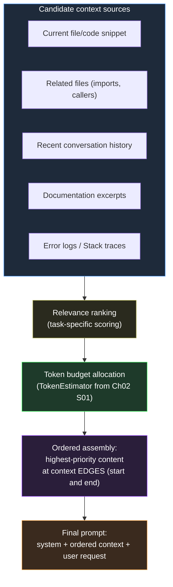
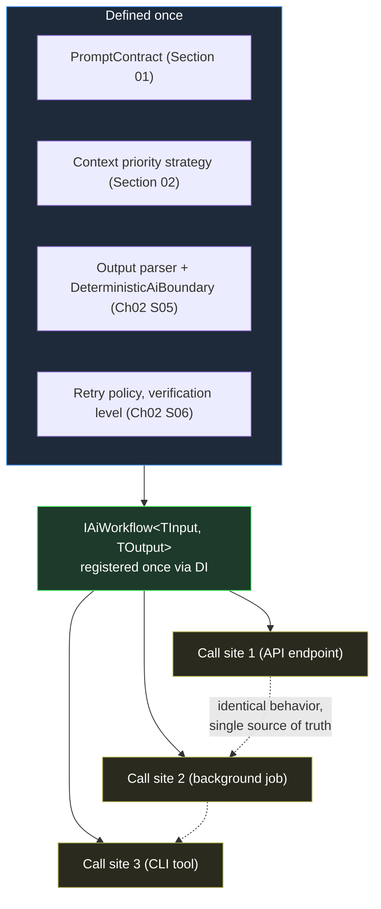
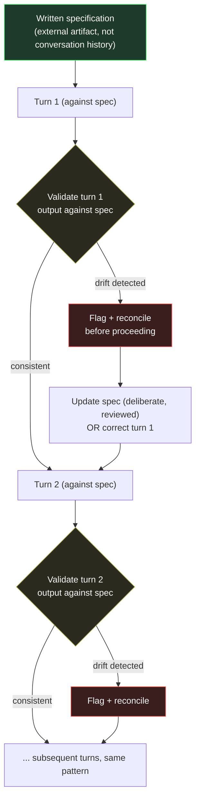
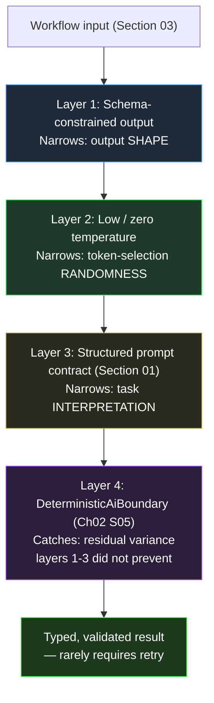
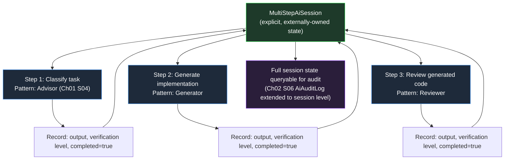

# Section 01 — Why Prompting Is Not Engineering (Until You Make It One)

## The Magic String Problem, Restated

Every .NET engineer has inherited a codebase containing a string literal typed directly into a method call — duplicated across a dozen call sites, each copy drifting slightly from the others. The fix is well understood: extract the string into a named constant or typed configuration object so there is exactly one place where the value is defined and every consumer references that one place.

The way most engineering teams currently interact with large language models reproduces this exact problem. A prompt is typed fresh into a chat interface or constructed inline in application code, used once, then either discarded or half-remembered the next time a similar task arises. Two engineers solving adjacent problems write two different prompts that happen to produce superficially similar results today, and diverge silently as the underlying model is updated or as one engineer refines their phrasing while the other does not. Nothing prevents this divergence, because nothing treats the prompt as an artifact with an identity, a version, and a contract.

This section names the problem directly and establishes the alternative: a prompt becomes engineering, in the same sense that a magic string becomes a configuration system, when it is extracted, versioned, typed at its boundaries, and reused deliberately rather than retyped from memory.

## What "Prompting" Usually Means, and Why That Is Insufficient

The term "prompt engineering" entered common usage to describe the practice of phrasing requests in ways that produce better results. The practice is real, and the skill matters. But the term conflates two activities that deserve separation for engineering purposes: the craft of phrasing an effective instruction, and the discipline of making that instruction a reliable, reviewable, reusable component of a software system.

The first activity — phrasing — is something every engineer improves at with practice. It does not, by itself, produce engineering artifacts. A well-phrased prompt typed once into a chat window is not meaningfully different from a well-phrased but undocumented verbal instruction given to a colleague: it worked this time, for this person, in this context, and there is no artifact that preserves *why* it worked or guarantees it will work the same way for the next person who needs the same outcome.

The second activity — treating prompts as engineering — requires the prompt to exist as a versioned artifact with explicit inputs, explicit constraints, and an explicit contract for what counts as valid output. This is not cleverness in phrasing; it is an entirely different category of practice, analogous to the difference between a developer who writes a correct SQL query by hand each time a report is needed and a team that defines a parameterized stored procedure that every caller invokes identically.

```mermaid id="diagram-03-01"
flowchart TB
    subgraph ADHOC ["Ad hoc prompting"]
        A1["Engineer types instruction\nfrom memory, fresh each time"]
        A2["Result looks reasonable\ntoday, for this prompt"]
        A3["No artifact preserves\nwhy it worked"]
        A4["Next engineer retypes\nslightly differently"]
        A5["Silent drift across\ncall sites and time"]
        A1 --> A2 --> A3 --> A4 --> A5
    end

    subgraph CONTRACT ["Prompt as contract"]
        C1["Versioned prompt template\nwith named, typed inputs"]
        C2["Explicit output contract\n(Chapter 02 IAiOutputParser)"]
        C3["Single definition,\nreferenced by ID"]
        C4["Every call site uses\nthe SAME version"]
        C5["Changes are deliberate,\nreviewed, and versioned"]
        C1 --> C2 --> C3 --> C4 --> C5
    end

    style ADHOC fill:#3a1e1e,stroke:#ff4a4a,color:#fff
    style CONTRACT fill:#1e3a1e,stroke:#4aff4a,color:#fff
```



## Why Chapter 02's Mechanics Make This Non-Optional

Chapter 02 Section 01 established that the model has no persistent memory between calls beyond what is explicitly included in the context window — every nuance of intent must be re-encoded completely in every prompt, with no shortcut for "the usual approach" unless that approach is written down somewhere the prompt can reference. Section 02 established that capability and reliability vary by training-distribution density, which means a prompt phrasing that worked well for one task shape may silently underperform for an adjacent shape. Sections 04 and 05's hallucination taxonomy and deterministic boundary both presuppose a defined contract for what a "valid" response looks like — a presupposition that ad hoc prompting does not satisfy, because there is no persistent definition of validity to validate against.

Every mechanism Chapter 02 established about how language models behave is a mechanism that ad hoc, unversioned prompting is structurally unequipped to manage safely.

## The Prompt Contract Pattern

```csharp id="code-03-01"
// Target Framework: .NET 10.0
// Chapter: 03 | Section: 01
// book/chapters/chapter-03/sections/section-01.en.md
//
// PromptContract<TInput, TOutput>: a prompt represented as a versioned,
// typed .NET artifact rather than an inline string.

namespace EngineeringCommunicationToolkit.Core.Prompts;

public abstract class PromptContract<TInput, TOutput>
{
    public abstract string ContractId { get; }
    public abstract string Version    { get; }
    public abstract string RenderSystemPrompt();
    public abstract string RenderUserPrompt(TInput input);
    public string FullyQualifiedId => $"{ContractId}@{Version}";
}

public sealed class CodeReviewPromptContract
    : PromptContract<CodeReviewRequest, string>
{
    public override string ContractId => "code-review-comment";
    public override string Version    => "1.2.0";

    private const string CodeFence = "\u0060\u0060\u0060";

    public override string RenderSystemPrompt() =>
        "You are a senior .NET engineer performing a code review. " +
        "Identify concrete issues only. For each issue, cite the specific " +
        "line or pattern and explain the concrete risk.";

    public override string RenderUserPrompt(CodeReviewRequest input) =>
        $"Review the following {input.Language} code from {input.FileName}:\n" +
        $"{CodeFence}{input.Language}\n{input.Code}\n{CodeFence}\n" +
        $"Focus areas: {string.Join(", ", input.FocusAreas)}";
}

public sealed record CodeReviewRequest(
    string FileName,
    string Language,
    string Code,
    IReadOnlyList<string> FocusAreas);
```

`RenderSystemPrompt` and `RenderUserPrompt` are ordinary, deterministic .NET methods — fully unit-testable with conventional assertions, matching Chapter 02 Section 05's framing of the deterministic boundary. `Version` gives the team a concrete mechanism for answering "did this prompt change?" during an incident investigation.

## The Cost Side of the Ledger

Treating prompts as engineering artifacts is not free. Defining a `PromptContract` subclass, deciding on versioning policy, and maintaining its rendering logic takes real engineering time. For a genuinely one-off interaction — a script run once to investigate a single incident — this overhead is not justified.

The judgment call a team needs to make is where the break-even point sits for their specific context. A prompt invoked from three call sites with a six-month expected lifespan justifies the contract pattern's overhead comfortably. A prompt invoked once, by one engineer, for a task that will not recur, does not. Teams new to this discipline often err in one of two predictable directions: formalizing every interaction regardless of reuse potential, or formalizing nothing. Neither extreme reflects the judgment this section is asking for — the goal is matching the level of engineering discipline to the level of reuse and consequence the specific prompt actually carries, the same proportionality judgment .NET engineers already apply when deciding whether a piece of logic warrants extraction into a shared library.

## A Note on Naming Discipline

`ContractId` values should follow the same naming discipline a team already applies to API routes or message-bus topic names — descriptive, stable, namespaced by concern rather than by team or individual author. A contract named `code-review-comment` communicates its purpose to any engineer who encounters it months later. A contract named after the individual who wrote it, or after a ticket number that closed long ago, does not. This small discipline compounds in value as a codebase accumulates dozens of contracts over time, preventing exactly the drift Section 01 opened with for ungoverned magic strings, and leaving the team in a far better position than it would occupy had the discipline been deferred until the registry had already grown.

## Versioning Strategy and Migration Discipline

A `PromptContract` subclass that lives in source control inherits versioning discipline from the same mechanisms .NET teams already apply to API contracts and library interfaces. Semantic versioning maps directly: patch increments for wording refinements that do not alter the expected output shape, minor increments for new output fields or constraints that callers can safely ignore, and major increments for structural changes to `TInput` or `TOutput` that require caller updates. The `Version` property makes these increments visible at runtime, and the `FullyQualifiedId` property — combining `ContractId` and `Version` — allows a team to log exactly which version produced a given output during incident investigation.

Migration across major versions follows the same pattern a team uses for deprecating an API endpoint: the old version remains registered and callable while callers migrate individually, with a deprecation signal logged each time the old version is invoked. A concrete implementation attaches this signal to the `DeterministicAiBoundary<T>`'s audit log entry from Chapter 02 Section 05, making the deprecation visibility automatic rather than dependent on someone remembering to check. The old version is removed only after the team confirms — through logged invocation data, not assumption — that no remaining call site depends on it.

This migration discipline is not theoretical overhead. Teams that skip it and "just update the prompt" discover the cost when an incident investigation requires knowing which prompt version was active at the time of a specific failure. Without version tracking, the investigation stalls at "the prompt was changed sometime last sprint." With version tracking, the investigation proceeds to "version 1.2.0 of `code-review-comment` was active, and the change from 1.1.0 removed the explicit instruction to cite line numbers, which explains why the output format shifted." This kind of precise, version-aware investigation is only possible when the version is a first-class property of the contract rather than a comment in a pull request description that may or may not have been updated.

## From Magic Strings to Typed Contracts: The Full Analogy

The magic-string analogy that opens this section carries further than it might initially appear, and following it to its logical conclusion clarifies the full scope of what treating prompts as engineering artifacts actually means. When a .NET team extracts a configuration value from a hard-coded string into a typed `IOptions<T>` object, the benefit is not merely that the value lives in one place — it is that the value is now observable, injectable, testable, and governs a boundary the type system can reason about. A caller does not need to know the internal representation of the configuration; it depends on the typed contract, and the contract's shape is the only thing that needs to stay stable for callers to remain unaffected by internal changes.

`PromptContract<TInput, TOutput>` provides the same set of properties at the boundary between a .NET caller and an AI interaction. `TInput` is the contract for what the caller must supply — not a free-form description of "what you might want to include," but a typed record with named, mandatory fields. `TOutput` is the contract for what the caller receives — not raw text whose format might vary depending on how the prompt happened to be worded on a given day, but a type that the surrounding .NET code can consume the same way it consumes any other typed result. `Version` is the contract for change management — the same discipline a team applies to an API version bump, surfaced at the level of a prompt rather than an HTTP endpoint.

This framing makes explicit why Section 01's argument has implications well beyond prompts themselves: it is an argument about where the boundary between deterministic and probabilistic behavior in a .NET system should be drawn, and what that boundary should look like. The probabilistic component — the model's actual inference — belongs inside the contract's implementation, where it is isolated, where its outputs are validated before crossing the boundary, and where changes to it are governed by the version identifier rather than allowed to silently affect every caller the moment a prompt is tweaked. Everything outside that boundary is as deterministic, as testable, and as maintainable as any other .NET code — which is precisely the engineering outcome this chapter exists to establish.

## The Connection to Chapter 02's Deterministic Boundary

It is worth making one connection explicit before the chapter moves on, because it ties this section's contract pattern to Chapter 02's architecture at a level of precision that helps both chapters reinforce each other rather than appearing as separate advice. Chapter 02 Section 05's `DeterministicAiBoundary<T>` was presented as the seam between the probabilistic model call and the deterministic .NET code around it. Section 01's `PromptContract<TInput, TOutput>` is what lives on the deterministic side of that seam — it is the component responsible for preparing the input to the probabilistic side, in a way that is versioned, typed, and independently testable.

Together, the two components form a complete, well-defined boundary: contract in, model call and validation inside, typed result out. Every other pattern this chapter introduces — context engineering, reusable workflows, specification-anchored conversations, variance reduction, explicit multi-step state — is an elaboration of one or both halves of this fundamental structure, adding capability and discipline to either the input preparation side or the output validation and composition side, without ever changing the basic architectural relationship the two components establish together.

## The Broader Organizational Consequence

The argument this section makes has a scope beyond individual prompt quality — it is, at its core, an argument about knowledge management and institutional learning. An ad hoc prompt culture is a culture where improvements accumulate in individuals' heads and are lost when those individuals leave, where the same mistake is made repeatedly by different engineers who happen to encounter the same edge case independently, and where the team's collective experience with what works and what doesn't has no durable home. A prompt contract culture is a culture where improvements accumulate in versioned artifacts that survive individual turnover, where an edge case discovered by one engineer is handled by a contract update that benefits every caller, and where the team's collective experience is encoded in the contract registry rather than distributed across memory and undocumented tribal knowledge.

This is not a difference in kind from the organizational benefit of other engineering disciplines — tests that document expected behavior, typed APIs that capture what a service accepts and returns, written architectural decision records that capture why a design choice was made. It is the same discipline applied to a new category of system component. The prompts that govern how an application interacts with AI models are as much a part of that application's engineering investment as the code that surrounds them. Treating them with the same rigor that code receives is not an additional burden layered on top of normal engineering — it is normal engineering applied consistently to everything that determines how the system behaves.

## Prompt Contracts as Living Documentation

One benefit of the `PromptContract<TInput, TOutput>` pattern that emerges over time rather than immediately is its role as living documentation for the AI capabilities the application depends on. In a conventional .NET codebase, typed interfaces and well-named classes document what the system can do and what it requires to do it. `PromptContract` plays the same role for AI capabilities: `CodeReviewPromptContract.ContractId` documents that the application has a code-review capability; `CodeReviewPromptContract.Version` documents when that capability last changed significantly; `TInput = CodeReviewRequest` documents what the capability requires; `TOutput = string` documents what it produces.

This documentation is automatically up-to-date in a way that separate documentation files are not, because the contract class *is* the capability definition rather than a description of it written elsewhere. An engineer who needs to understand what the code-review capability does, requires, or produces can read the contract class rather than searching for documentation that may or may not reflect the current implementation. An engineer who needs to understand what changed in the capability can look at the version history of the contract class in source control rather than consulting a changelog that may or may not have been updated.

This aligns prompt contract discipline with the broader principle that code is the authoritative documentation of a system's behavior — a principle .NET engineers apply to typed APIs, data schemas, and service contracts. Applying it consistently to AI prompt contracts completes that principle's coverage across the full surface of a modern .NET application's behavior, including the parts of that behavior that are mediated by AI models.

## What This Chapter Changes in Daily Team Behavior

The practical question deserves a direct answer: what actually changes in the daily work of a .NET team when it adopts the prompt contract pattern? Three concrete changes occur consistently in teams that adopt it.

The first is that code review becomes a legitimate place to discuss the definition of a prompt. Before the contract pattern, prompts embedded directly in application code sometimes passed through code review as minor implementation details that did not warrant substantive attention. After the contract pattern, `PromptContract.RenderSystemPrompt()` is a piece of code like any other, deserving review with the same rigor applied to any business logic — a reviewer can ask why these constraints in particular were chosen, what distinguishes this phrasing from the alternative, and why this version rather than the previous one.

The second is that tracking the change ledger becomes possible. When an AI-backed feature behaves differently after a deployment, the question "did the prompt change?" now has a definite answer: compare `Version` in the new build with `Version` in the old one. If the version changed, the prompt changed, and the source history shows exactly what changed, when, and by whom. If the version did not change, the prompt did not change, and the team must look elsewhere for the cause of the behavioral difference.

The third is that AI-backed capabilities become discoverable. Over time, the prompt contract registry — the list of meaningful `ContractId` values with their versions and input/output types — becomes a reviewable inventory of everything the application can do with AI assistance. A new engineer joining the team can review the contract registry and understand the existing capabilities instead of relying on tribal knowledge to learn which AI capabilities already exist.

Together these three changes form the difference between a team that treats AI as a black box consulted ad hoc and a team that treats it as a component of its system that can be reviewed, audited, and deliberately evolved. That difference compounds non-linearly over time: in the first months it looks marginal, and after a year in a mature project it is the difference between a system that can be relied on and maintained and a system in which prompt debt has accumulated to the point of threatening its reliability.

## Defining the Contract Before the Call: The Reflection Effect

Engineers adopting the contract pattern for the first time describe a consistent practical experience: the act of writing `RenderSystemPrompt()` and `RenderUserPrompt()` as separate methods with defined signatures, before any actual model call, forces a more precise formulation of what one wants from the interaction than occurs when the prompt is written directly into a chat interface. The separation between the definition stage and the call stage resembles what designing the test before the code forces in Test-Driven Development: the act of definition surfaces assumptions that were not visible while they remained unformulated in the mind.

An engineer who struggles to define `RenderSystemPrompt()` clearly for a given contract has most likely discovered genuine ambiguity in the task itself — a signal that the task needs more analysis before any model call begins, not that the pattern is excessively restrictive. This value — surfacing ambiguity early and at low cost — exists even for the engineer who adopts the discipline of prior formulation without the full formal structure of a `PromptContract` class. The formal structure entrenches that value and makes it systematic, measurable, and shareable across the team, but the essential value is realized by the discipline of thought itself.

## Setting Up the Rest of the Chapter

Section 01 has established the foundation: a prompt, treated as a typed, versioned, independently-testable .NET artifact rather than an inline string, is the elementary building block of disciplined AI collaboration. The five sections that follow build progressively more capable structures on this foundation. Section 02 addresses the variable half of every prompt — the context — and introduces the explicit budgeting and ordering discipline that Chapter 02 Section 02's lost-in-the-middle finding makes necessary. Section 03 packages contract and context into a reusable registered workflow. Section 04 extends the discipline to multi-turn conversations. Section 05 introduces the generation-level techniques that narrow output variance within an individual interaction. Section 06 closes the chapter by addressing explicit state management for tasks that span many such interactions, with Chapter 01's collaboration patterns enforced as typed, trackable properties rather than informal conventions — a fitting culmination for a chapter whose central argument has been that everything that matters to a system's correctness should be represented as a typed artifact.

## Section 01 Conclusion

Section 01 for this chapter remains at a pivotal intersection: it converts the prompt from a transient phenomenon that is consumed and forgotten into a permanent engineering artifact carrying an identity, a history, and a contract. This conversion is not a cosmetic improvement in code organization — it is a transformation in how the team thinks about its relationship with AI: not as a tool consulted randomly, but as a dependency managed with the same discipline applied to any external dependency in a production .NET system. The sections that follow build on this transformation by adding the same discipline to context, workflow, multi-turn conversations, variance reduction, and state management — layer upon layer, all resting on the foundation established here.

The institutional discipline accumulated through the contract registry converts what was once fleeting inspiration and individual craft into a shared engineering framework that can evolve and be reviewed. Successful collaboration with AI models always begins with this fundamental engineering decision.

---

*Section 01 has established that a prompt becomes an engineering artifact only when it is extracted from inline strings into a typed, versioned, independently testable contract. Section 02 examines the variable half of every prompt — the context — and the explicit budgeting and ordering discipline that Chapter 02's lost-in-the-middle finding makes necessary.*

# Section 02 — Context Engineering

## The Variable Half of Every Prompt

Section 01 established the prompt contract: the fixed structure — role framing, constraints, output format — that should be versioned and reused rather than retyped. But every real-world prompt also has a variable component: the supporting information specific to this particular call — the relevant code, the relevant documentation excerpt, the relevant prior conversation turns, the relevant error message. This variable component is the context, and how it is assembled determines, as much as the contract itself, whether the resulting interaction produces reliable output.

This section treats context assembly as a first-class engineering activity, building directly on mechanics Chapter 02 established. Section 02 of that chapter introduced the context window as a fixed-size buffer and described the "lost in the middle" phenomenon — tokens near the start and end of the context receive disproportionately strong attention compared to tokens buried in the middle of a long context. That mechanical fact has a direct engineering consequence: context engineering is not merely deciding *what* to include, but deciding in what order and within what budget, so that the most consequential information occupies the positions the mechanism actually favors.

## Why Unbounded Concatenation Fails

The default, undisciplined approach to context construction is concatenation: take everything that might plausibly be relevant and append it all into the prompt. This approach is wrong for two independent reasons, both already established mechanically in Chapter 02. First, the context window is finite (Chapter 02, Section 01) — unbounded concatenation eventually exceeds the window, at which point something is truncated or omitted regardless of whether the engineer made a deliberate choice about what to drop. Second, even well within the token budget, irrelevant or poorly-positioned context measurably degrades output quality rather than leaving it unaffected (Chapter 02, Section 02's lost-in-the-middle mechanics) — a large block of marginally-relevant material dilutes the attention available to the genuinely relevant material and can occupy exactly the middle positions where attention is weakest.



## A Concrete .NET Pattern: ContextBuilder

```csharp id="code-03-02"
// Target Framework: .NET 10.0
// Chapter: 03 | Section: 02
// book/chapters/chapter-03/sections/section-02.en.md
//
// ContextBuilder: assembles candidate context blocks into a budgeted,
// ordered context string. Uses TokenEstimator (Chapter 02, Section 01)
// for budget enforcement and places highest-priority blocks at the
// context edges, per Chapter 02 Section 02's lost-in-the-middle mechanics.

using AiToolkit.Core.Tokens;

namespace EngineeringCommunicationToolkit.Infrastructure.AI;

public sealed record ContextBlock(
    string Content,
    int    Priority,
    string SourceLabel);

public sealed class ContextBuilder
{
    private readonly List<ContextBlock> _blocks = [];
    private readonly int _tokenBudget;

    public ContextBuilder(int tokenBudget)
    {
        if (tokenBudget <= 0) throw new ArgumentOutOfRangeException(nameof(tokenBudget));
        _tokenBudget = tokenBudget;
    }

    public ContextBuilder Add(string content, int priority, string sourceLabel)
    {
        if (!string.IsNullOrWhiteSpace(content))
            _blocks.Add(new ContextBlock(content, priority, sourceLabel));
        return this;
    }

    public ContextAssemblyResult Build()
    {
        var ranked   = _blocks.OrderByDescending(b => b.Priority).ToList();
        var included  = new List<ContextBlock>();
        var excluded  = new List<ContextBlock>();
        var usedTokens = 0;

        foreach (var block in ranked)
        {
            var blockTokens = TokenEstimator.EstimateProseTokens(block.Content);
            if (usedTokens + blockTokens <= _tokenBudget)
            {
                included.Add(block);
                usedTokens += blockTokens;
            }
            else excluded.Add(block);
        }

        // Edge-loading: split included blocks by priority into two halves,
        // place the top half FIRST and the second half reversed LAST so
        // the single highest-priority block opens the context and the
        // second-highest closes it (Chapter 02 Section 02).
        var midpoint   = (included.Count + 1) / 2;
        var edgeLoaded = included.Take(midpoint)
            .Concat(included.Skip(midpoint).Reverse())
            .ToList();

        var assembled = string.Join(
            "\n\n---\n\n",
            edgeLoaded.Select(b => $"[{b.SourceLabel}]\n{b.Content}"));

        return new ContextAssemblyResult(assembled, edgeLoaded, excluded, usedTokens, _tokenBudget);
    }
}

public sealed record ContextAssemblyResult(
    string AssembledContext,
    IReadOnlyList<ContextBlock> IncludedBlocks,
    IReadOnlyList<ContextBlock> ExcludedBlocks,
    int UsedTokens,
    int BudgetTokens);
```

Two design decisions encode engineering judgment, not arbitrary choices. The greedy-by-priority inclusion algorithm is deliberately simple — for prompt construction, predictability and debuggability of *why* a block was excluded matters more than squeezing the last few tokens of optimality, the same reasoning that leads .NET teams to prefer simple, explainable caching eviction policies over theoretically optimal but opaque ones. The edge-loading reordering step is the direct, concrete application of Chapter 02 Section 02's lost-in-the-middle finding.

## Context Engineering Is Per-Task, Not Global

The *priority ranking* applied to candidate context blocks is not a fixed, global policy — it is specific to the task the prompt contract is serving. The same candidate sources rank differently depending on whether the task is a code review (current file ranks highest), a debugging session (error logs and stack trace rank highest), or an architectural consultation (related files and documentation rank higher relative to a single code snippet). `ContextBuilder.Add()` calls are typically issued from task-specific code that understands the priority structure for that specific `PromptContract` from Section 01.

## Context Staleness: The Failure Mode Budget Alone Does Not Solve

A context block can be highly relevant in priority terms, correctly positioned at a context edge, and well within budget, while simultaneously being *wrong* because it describes a state of the system that has since changed — a cached file excerpt that predates a recent edit, or documentation describing a previous API version. Because Chapter 02 Section 01 established that the model treats every token in its context as ground truth for the duration of that forward pass, a stale context block actively misleads the generation process rather than merely failing to help.

The practical implication: the calling code bears responsibility for attaching a recency or validity signal to each candidate block, and excluding or down-ranking blocks whose validity cannot be confirmed for the current call. A code review workflow that includes "related files" should re-read those files at request time rather than reusing a cached copy from an earlier point in the session. The cost of a fresh file read at request time is negligible compared to the cost of a stale context block misleading the model into generating an incorrect analysis that must be caught and corrected downstream.

## Measuring Context Engineering Quality

Four measurable signals provide evidence that the context strategy is working. **Exclusion rate** — the proportion of candidate blocks cut for budget reasons — indicates whether the token budget is well-calibrated for the task. **Retry rate at the deterministic boundary** (Chapter 02, Section 05) provides an indirect but valuable signal: if a workflow's retry rate is substantially higher than comparable workflows, degraded context quality is a more likely explanation than the underlying model's general capability. **Output variance across repeated identical calls** — running the same request several times and measuring how much the responses diverge reveals whether the context strategy is actually narrowing the output space; a strategy that leaves output variance high is not constraining the model's interpretation of the task. **Source-attribution review during incident investigation** — because `ContextAssemblyResult.IncludedBlocks` preserves each block's `SourceLabel`, a post-incident review can trace exactly which context sources contributed to the prompt and in what order, converting "the AI got this wrong" into a specific, actionable finding.

## Context Engineering and the Reusable Workflow Boundary

An architectural question arises when a team adopts the prompt-contract pattern and the context strategy together: where does context-assembly logic live relative to the contract it serves? The answer this section has been building toward — keep them separate, as two independently composable components — reflects a broader principle. `PromptContract` defines what the rendered prompt looks like structurally; `ContextBuilder` defines how the variable content feeding that prompt is chosen. The first is stable across calls to the same call site issuing a particular contract; the second adapts to the characteristics of each individual call — which information is most relevant to this specific request.

A `PromptContract` should not need to know *how* a particular caller decided to rank and budget context, because the same contract is often reused across callers with different context strategies: a code review contract invoked from an interactive IDE extension might reasonably prioritize the currently-open file and recent edits, while the same contract invoked from an automated CI pipeline might prioritize the full diff and any related test failures, with no change to the contract's rendering logic itself.

The deliberate coupling of contract and strategy happens one level up: the workflow, the unit that registers the two together as a single composed definition. This is the level Section 03 addresses directly: not assembling contract and context ad hoc at every call site, but a single registered workflow that embodies both, consistently across every call site and every consumer regardless of their familiarity with the internal implementation details. A reusable workflow's definition is precisely the combination of a specific contract with a specific context strategy, registered together as one unit. This catalog discipline is cheap relative to the duplication it prevents, and it scales naturally with the team — a single shared document maintained alongside the registration code is sufficient for most teams well into dozens of registered workflows, with no need for dedicated tooling.

This three-level separation — contract, context strategy, and the workflow that wraps them — mirrors, in its structure, the separation between problem definition, algorithm, and data structure in classical software engineering: each level carries a different responsibility, and composing them deliberately produces a system that is easier to maintain and understand than one in which all three responsibilities collapse into a single component that is hard to modify, test, or reuse independently.

## Token Budget Allocation: Practical Thresholds

The `tokenBudget` parameter passed to `ContextBuilder` is not an arbitrary round number — it reflects a trade-off between information completeness and attention dilution that is specific to the target model's context window and the task's sensitivity to context quality. Three concrete heuristics apply across the engineering tasks this book addresses.

For code review workflows, a budget of 3,000 to 5,000 tokens typically accommodates the target file, two to three related files (callers, imports, tests), and a concise description of review focus areas. Exceeding this range for a single review task is a signal that the review scope should be decomposed into smaller, independently-contracted units rather than packed into a single prompt — the same decomposition judgment a team applies when a code review pull request grows too large to review effectively.

For debugging workflows, budgets can range wider — 4,000 to 8,000 tokens — because the relevant context includes not only the code under investigation but also stack traces, log excerpts, and related configuration. The key discipline is that debugging context should prioritize recency and specificity (the failing test's exact output, the most recent error log) over breadth (every file in the affected module), applying Section 02's specificity-over-generality pattern from the priority design guidance.

For architectural consultation workflows, budgets of 2,000 to 3,000 tokens are often sufficient because the relevant inputs are typically a concise problem statement, a small number of architectural decision records, and the specific interfaces or contracts under discussion. These workflows benefit less from large context windows and more from well-positioned, high-signal documentation excerpts.

Across all three categories, the budget should be treated as a configurable parameter — registered through `IConfiguration` for mature workflows, tunable per-workflow rather than globally — rather than a constant baked into the context strategy's code. This operational discipline ensures that context budget adjustments in response to production evidence do not require code changes and redeployment. A team that discovers a debugging workflow consistently excludes relevant stack trace data due to an undersized budget can adjust the threshold through configuration in minutes rather than scheduling a code change, a review, and a deployment cycle — the same operational agility that configuration-driven retry policies and connection timeouts provide for conventional .NET services.

## A Closing Distinction: Context Engineering Is Not Prompt Stuffing

Context engineering is not a more sophisticated way of fitting more information into a prompt. It is a discipline for fitting the *right* information, in the *right* order, within a *deliberately chosen* budget. A well-engineered context is frequently smaller, not larger, than the unstructured concatenation it replaces.

The improvement is not merely qualitative. A better-engineered context lowers production cost — fewer tokens spent on material the model does not need — reduces the retry rate at the deterministic boundary, and produces a workflow that stays resilient as the system and its inputs change.

Teams that measure this section's success purely by whether `ContextBuilder` lets them include more context than before have missed the discipline's actual point; the correct measure is whether the included context is better-targeted and better-positioned, not larger. That distinction is what separates context engineering from the prompt stuffing that undisciplined approaches appear to encourage, and it is what gives the discipline its real value.

## Practical Priority Design: Which Sources Rank Where

The abstract principle that priority rankings are task-specific is easy to accept; the practical question of how to design those rankings for a new workflow benefits from more concrete guidance. Three patterns apply reliably across the engineering tasks this book addresses.

The first pattern is *recency preference for ephemeral sources*. Sources whose content changes frequently — the current state of a file the user is actively editing, the most recent stack trace from a failing test, the last few turns of a conversation — tend to rank above sources whose content changes slowly — stable documentation, architectural decision records, background context about the system's general design. The reasoning is mechanical: recent content is more likely to reflect the actual state of the system the user is asking about, and Chapter 02 Section 02's "lost in the middle" mechanics make it important that the most contextually relevant content is not only high-priority but also well-positioned. For ephemeral sources, both recency and positional priority work together; for stable background sources, positional priority matters but recency is less relevant.

The second pattern is *specificity preference over generality*. A specific error message from a specific failing test ranks above a general description of the system's error-handling philosophy; a specific method signature from the file under review ranks above a general description of the codebase's coding standards. Specific sources constrain the model's response space more precisely than general ones, which reduces the semantic-variance problem Section 05 addresses — not by tightening the generation parameters, but by narrowing the space of reasonable interpretations at the input stage, before generation begins, which in turn shows up directly as a lower retry rate at the deterministic boundary.

The third pattern is *proximity preference over distance*. For code-related tasks, the file directly containing the code being discussed ranks above files that import it, which rank above files that merely coexist in the same module. This proximity gradient is a reasonable approximation of conceptual relevance in most codebases and, more importantly, it produces a priority ranking that is mechanical to compute rather than requiring the calling code to make a judgment call about conceptual relevance for each individual context assembly — which would reintroduce the inconsistency that the `ContextBuilder` pattern is designed to eliminate.

## When to Invest in Dynamic Priority Strategies

These three patterns represent reasonable defaults for their respective source types. As a workflow matures and the team accumulates specific evidence about which sources actually improve output quality versus which sources merely consume budget without measurably helping, the static priority values in the `ContextBuilder.Add()` calls should evolve to reflect that evidence. A workflow that runs a drift-prone task — one where the retry rate at the deterministic boundary is meaningfully higher than comparable workflows — is a candidate for revisiting the context priority strategy specifically, because priority misalignment is a more tractable explanation for elevated retry rates than the underlying model's general capability at a well-represented task type, and a more tractable diagnosis than variance in the prompt contract's phrasing alone.

This iterative refinement of context strategy — starting with reasonable defaults, measuring against the signals Section 02 introduced, and adjusting specific priorities based on evidence — is the appropriate lifecycle for this component: not a one-time configuration decision made at workflow creation, but a living part of the workflow's definition that reflects accumulated operational learning about what the model actually needs to see to perform reliably for this specific task.

The most effective practice is to schedule periodic reviews of the context strategy for large or high-importance workflows — at least quarterly, or whenever a significant change in the retry rate is detected — analogous to how .NET teams schedule dependency updates: not as a response to a specific failure but as a proactive engineering practice that keeps the workflow aligned with the actual characteristics of its inputs and the model's behavior over time. A context strategy that was well-calibrated six months ago may be poorly calibrated today if the codebase's structure has changed, if the typical distribution of inputs the workflow receives has shifted, or if the provider has updated the model in a way that changed its output-quality characteristics.

## Context Engineering and Observability

The source-attribution capability that `ContextAssemblyResult.IncludedBlocks` provides deserves emphasis in a broader observability context, because it connects the context engineering discipline to the kind of production monitoring and incident response that later chapters address directly. In a conventional .NET service, structured logging with correlation IDs makes it possible to trace a specific request's execution path through the system and identify exactly which components contributed to an outcome. In an AI-integrated service without context attribution, an incorrect AI response is traceable only to "the prompt" — a monolithic input whose internal structure, source contributions, and assembly decisions are invisible to any monitoring tool.

`ContextAssemblyResult.IncludedBlocks`, logged with a request's correlation ID at the moment of context assembly, extends structured logging into the AI boundary: which sources were included, which were excluded for budget reasons, what priority each was assigned, and in what order they were presented to the model are all observable facts about a specific request's AI interaction. An incident where an AI-assisted feature produced an incorrect recommendation becomes diagnosable: was the relevant context excluded for budget reasons? Was it included but positioned in a low-attention middle position? Was a stale version of the source included that predated a relevant change? These are questions answerable from the logged `ContextAssemblyResult`, and answerable in minutes rather than requiring a reproducing investigation. This is precisely what good logging does for any other dependency in the system, and AI deserves the same treatment as a dependency. A context strategy that was well-calibrated at workflow creation and reflects the team's accumulated operational learning is one of the highest-value, lowest-visibility engineering assets a mature AI-integrated .NET application can possess, precisely because its effects are felt through the metrics it improves rather than through any artifact that is directly readable in the source code.

---

*Context engineering is not a more sophisticated way of fitting more information into a prompt — it is a discipline for fitting the right information, in the right order, within a deliberately chosen budget. Section 03 builds directly on this by packaging contract, context strategy, and the deterministic boundary into a single registered, reusable workflow, with the ultimate goal of turning every AI capability in the application into a clearly defined engineering component that can be tested, audited, and evolved under discipline rather than a scattered set of LLM calls whose phrasing shifts from one call site to the next.*

# Section 03 — Designing Reusable AI Workflows

## Three Pieces, Independently Engineered, Still Not a System

Sections 01 and 02 produced two independently useful, independently testable .NET components: `PromptContract<TInput, TOutput>` and `ContextBuilder`. Chapter 02 Section 05 contributed a third piece: `DeterministicAiBoundary<T>`. Each piece, on its own, is real engineering progress over ad hoc prompting. But a team that has all three pieces and still wires them together freshly, by hand, at every call site has solved the prompt's internal consistency problem while leaving an adjacent consistency problem unsolved: different call sites composing the same three pieces slightly differently, with the same drift risk Section 01 described for unversioned prompts, just one level up.

This section closes that gap by packaging contract, context strategy, and boundary into a single, registered, reusable unit — a workflow — invoked identically from every call site that needs it.

## What Makes a Workflow, Not Just a Composition

A reusable AI workflow has a stable identity, is registered once through dependency injection, and has exactly one point of change: if the context priority strategy needs adjustment, or the underlying prompt contract needs a new version, that change happens in the workflow's registration and immediately applies to every call site that depends on it — the same single-point-of-change property a team relies on when they update a shared validation library and expect every consumer to pick up the fix without independently re-implementing it.



## The IAiWorkflow Pattern

```csharp id="code-03-03"
// Target Framework: .NET 10.0
// Chapter: 03 | Section: 03
// book/chapters/chapter-03/sections/section-03.en.md
//
// IAiWorkflow<TInput, TOutput>: packages a PromptContract, a context
// strategy, and Chapter 02's DeterministicAiBoundary<T> into a single,
// DI-registered, reusable unit.

using AiToolkit.Application.Ports;
using AiToolkit.Infrastructure.AI;
using EngineeringCommunicationToolkit.Core.Prompts;

namespace EngineeringCommunicationToolkit.Infrastructure.AI;

public interface IAiWorkflow<TInput, TOutput>
{
    string WorkflowId { get; }
    Task<WorkflowResult<TOutput>> ExecuteAsync(TInput input, CancellationToken ct);
}

public sealed record WorkflowResult<T>(
    bool IsSuccess, T? Value, string? Error,
    string WorkflowId, string ContractVersion);

public sealed class AiWorkflow<TInput, TOutput>(
    string workflowId,
    PromptContract<TInput, TOutput> contract,
    Func<TInput, ContextBuilder> contextStrategy,
    DeterministicAiBoundary<TOutput> boundary,
    int contextTokenBudget)
    : IAiWorkflow<TInput, TOutput>
{
    public string WorkflowId { get; } = workflowId;

    public async Task<WorkflowResult<TOutput>> ExecuteAsync(
        TInput input, CancellationToken ct)
    {
        var contextResult = contextStrategy(input).Build();
        var systemPrompt  = contract.RenderSystemPrompt();
        var userPrompt    =
            $"{contract.RenderUserPrompt(input)}\n\n" +
            $"Relevant context:\n{contextResult.AssembledContext}";

        var boundaryResult = await boundary.ExecuteAsync(systemPrompt, userPrompt, ct);

        return new WorkflowResult<TOutput>(
            IsSuccess:       boundaryResult.IsSuccess,
            Value:           boundaryResult.Value,
            Error:           boundaryResult.Error,
            WorkflowId:      WorkflowId,
            ContractVersion: contract.FullyQualifiedId);
    }
}

// ── DI registration: the single point of definition ─────────────────────

public static class WorkflowRegistrationExtensions
{
    public static IServiceCollection AddCodeReviewWorkflow(
        this IServiceCollection services)
    {
        services.AddSingleton<IAiWorkflow<CodeReviewRequest, string>>(sp =>
        {
            var chatClient = sp.GetRequiredService<IChatCompletionClient>();
            var parser     = sp.GetRequiredService<IAiOutputParser<string>>();
            var logger     = sp.GetRequiredService<ILogger<DeterministicAiBoundary<string>>>();
            var boundary   = new DeterministicAiBoundary<string>(chatClient, parser, logger);

            return new AiWorkflow<CodeReviewRequest, string>(
                workflowId:         "code-review",
                contract:           new CodeReviewPromptContract(),
                contextStrategy:    req => new ContextBuilder(tokenBudget: 4000)
                    .Add(req.Code, priority: 10, sourceLabel: "target-code"),
                boundary:           boundary,
                contextTokenBudget: 4000);
        });

        return services;
    }
}
```

Every call site now depends on `IAiWorkflow<CodeReviewRequest, string>` — resolved through ordinary constructor dependency injection — rather than on any of the three underlying pieces directly.

## Versioning a Workflow Without Breaking Call Sites

A contract version bump — refining the system prompt's wording, adjusting a constraint — is typically a non-breaking change from the call site's perspective. A workflow-level change — altering `TInput` or `TOutput` — is a breaking change and should be treated as one: a new workflow identity, with the previous version kept available until call sites have migrated.

## Testing a Workflow as a Single Unit

`IAiWorkflow<TInput, TOutput>` inherits full unit-testability from the components it composes: each workflow can be exercised completely in a unit test with assertions on typed `WorkflowResult<TOutput>`, without any non-deterministic network call. This testability is the direct payoff of having kept context assembly and prompt rendering as pure, deterministic functions rather than allowing either to depend implicitly on ambient state or live network calls.

## Composability Across Workflows

Because every workflow shares the same `IAiWorkflow<TInput, TOutput>` shape, workflows can depend on other workflows the way ordinary .NET services depend on other services, without requiring any special orchestration layer. A higher-level workflow that first classifies the change's risk level and then invokes a code-review workflow for high-risk changes is simply a class that takes two `IAiWorkflow<,>` dependencies and composes their results with ordinary control flow.

## Configuration as Code, Not Configuration as Convention

As a workflow matures, teams should weigh moving genuinely tunable parameters — the token budget specifically — into `IConfiguration`-backed settings. The context strategy's *structure* is a code-level architectural decision that belongs in source control. The *numeric tuning knobs* benefit from configuration-driven adjustment once a workflow has enough production experience to know which knobs actually need turning.

## Workflow Discovery and Avoiding Duplicate Registration

The `WorkflowId` property exists specifically to make duplication detectable: a startup-time validation pass can enumerate all registered `IAiWorkflow<,>` instances and assert that no two share a `WorkflowId`. A registry of `WorkflowId` values becomes the practical answer to "has someone already built a workflow for this?" — the same value a well-maintained internal API catalog provides for ordinary service discovery — applied here to the specific class of reusable AI interactions this chapter has established as first-class engineering pieces across its three sections. This catalog discipline is cheap relative to the duplication it prevents, and scales naturally as the team accumulates more registered workflows over time, with no need for dedicated tooling beyond what Section 06 will introduce for tracking workflow execution at the session level.

## The Workflow as an Architectural Boundary

Looking at the `AiWorkflow<TInput, TOutput>` implementation with the perspective Section 01 established: a registered workflow is a named, versioned boundary in the application's service graph, exactly as a registered HTTP client, a registered EF Core context, or a registered message publisher is a named, versioned boundary. It has the same lifecycle — created once at application startup, resolved by callers through DI, replaced by bumping a version identifier when its behavior changes materially. What is different about this boundary is not its structure but its interior: instead of deterministic code, it contains a deterministic-boundary-wrapped probabilistic call. Everything the caller sees is deterministic and typed.

This framing clarifies why the patterns this section introduces are not AI-specific tooling layered on top of normal .NET architecture — they are normal .NET architectural discipline applied to a boundary whose interior happens to be probabilistic. A team that already registers `IEmailSender`, `IStorageClient`, and `ICacheProvider` through DI knows exactly how to reason about `IAiWorkflow<CodeReviewRequest, string>`: it is a service, it has a contract, it can be substituted for testing, and its implementation details are irrelevant to callers. The only thing callers need to know about its interior — that it involves a probabilistic AI call — is already captured by the boundary's retry-rate metrics and the `WorkflowResult<T>` result type's `IsSuccess` flag.

## From Three Pieces to One System: What Changes at Scale

When a team has three registered workflows, the benefits of the pattern are real but modest — a few call sites wired consistently rather than inconsistently. When a team has thirty registered workflows, the benefits become structural: the workflow registry is a discoverable inventory of the team's AI capabilities; the `WorkflowId`-based deduplication check prevents capability fragmentation; the shared `IAiWorkflow<,>` shape means any developer who has worked with one workflow can immediately understand and consume any other workflow; and the single-point-of-change property means platform-level improvements — updating the underlying model, adjusting global retry policy, adding observability hooks — apply to the entire workflow catalog by changing the registration infrastructure rather than by updating thirty independently-written call sites.

This scaling property is not incidental. It is the same scaling property that makes dependency injection, typed HTTP clients, and registered services valuable in large .NET codebases: the up-front investment in doing the abstraction correctly pays back in proportion to the number of callers, and a pattern that is merely convenient at three call sites becomes genuinely structurally important at thirty. Teams adopting this section's patterns should expect exactly this scaling curve — some ceremony up front, compounding return as the catalog grows.

## Workflow Testing in Practice

Unit-testability of workflows inherits from the deterministic components they compose, but the testing discipline itself deserves concrete guidance because teams frequently under-invest in workflow-level tests while adequately testing the individual components. A workflow test exercises the complete composition — contract rendering, context assembly, boundary execution — with a stubbed `IChatCompletionClient` that returns deterministic responses matching the output schema.

A minimal workflow test suite covers three scenarios for each registered workflow. First, a happy-path test where the stubbed model response satisfies the output contract, verifying that the workflow produces a successful `WorkflowResult<TOutput>` with correctly-typed content. Second, a structural-failure test where the stubbed response violates the output schema (missing required fields, wrong types, unexpected null values), verifying that `DeterministicAiBoundary<T>` catches the failure and returns an unsuccessful result without propagating the malformed output. Third, a boundary-configurability test verifying that the workflow's registration correctly wires the retry policy and verification level — a test that is entirely about the registration's correctness and requires no model interaction at all.

These three tests, applied to every registered workflow at startup or as part of the CI pipeline, prevent the failure mode where a prompt contract update or context strategy change inadvertently breaks a workflow that was previously working. Because the tests exercise the complete composition rather than individual components, they catch integration-level regressions — a priority value that works correctly in isolation but produces poor context assembly when combined with a specific contract's rendering logic — that component-level tests would miss. The startup-time variant is particularly valuable for teams that register workflows in their DI composition root: a failing test at startup prevents the application from entering production with a broken workflow, the same failsafe that connection-string validation or required-service resolution provides for other DI-registered components.

## The DI Registration Pattern in Depth

The `AddCodeReviewWorkflow` extension method deserves closer examination because it illustrates a registration pattern that applies to every workflow in the catalog, not just this specific example. Three engineering decisions embedded in that method merit explicit justification because they encode judgment about how AI workflows should behave in a production .NET application.

First, the workflow is registered as `Singleton` rather than `Scoped` or `Transient`. This choice reflects the fact that neither `AiWorkflow<TInput, TOutput>` nor any of its dependencies (`PromptContract`, `ContextBuilder` factory function, `DeterministicAiBoundary<T>`) hold per-request state — they are stateless pipeline definitions. A singleton workflow registered once at startup consumes less memory and eliminates per-request construction overhead for what is often a latency-sensitive operation. The one exception that would require `Scoped` registration would be a workflow whose context strategy captures per-request data directly rather than receiving it through `TInput` — but the pattern this section establishes deliberately routes all per-request variation through the typed `TInput` record rather than capturing it in the context strategy's closure, precisely to preserve the singleton registration option.

Second, the boundary is constructed with dependencies resolved from the DI container rather than with hardcoded constructor arguments. This means a future change to the logging infrastructure, the chat client configuration, or the output parser implementation propagates automatically to every workflow that uses the container-resolved versions — the workflow registration is a composition point, not a hard dependency on any particular implementation of its dependencies.

Third, the context strategy is expressed as a lambda rather than as a named type. This is a deliberate choice for workflows where the context-building logic is simple and closely tied to the specific workflow's purpose — a lambda keeps the logic visible alongside the registration rather than dispersed into a separate file that requires navigating away from the registration to understand the workflow's complete behavior. As context-building logic grows more complex — pulling from multiple sources, applying non-trivial priority calculations, consulting external metadata — that logic should migrate into a named class that can be independently tested and independently documented, following the same refactoring path .NET developers already know from complex event handlers and LINQ expressions.

## The Workflow Registry as a Living Catalog

Beyond the technical implementation, the `WorkflowId`-based registry this section introduced represents something worth naming as an organizational artifact: a discoverable, queryable inventory of every AI capability the application exposes. In an application with thirty registered workflows, a new engineer joining the team can discover what AI capabilities exist, what they require as input, what they produce as output, and what verification level was applied to each simply by examining the workflow registrations in the DI composition root — no separate documentation required, no need to ask a senior engineer, no need to read through call sites to understand what a given AI capability does.

This discoverability is not a secondary benefit — it is one of the primary reasons to invest in the registered workflow pattern rather than leaving AI calls scattered as one-off implementations throughout the codebase. A codebase where AI capabilities are first-class, named, registered services is a codebase where AI capabilities can be audited, replaced, versioned, and extended as organizational needs evolve. A codebase where AI calls are scattered is a codebase where understanding what the application does with AI requires reading every file that happens to contain an AI call — the same structural problem that makes a codebase with scattered magic strings harder to maintain than one with centralized, typed configuration.

## Workflow Evolution and Breaking Changes

A reusable AI workflow registered in an application's DI container has the same evolution challenges as any other versioned service: how does it change over time without breaking callers, and when does a change rise to the level of a breaking change that requires a new workflow registration rather than an in-place update?

The answer follows directly from `WorkflowResult<T>`'s structure. Changes that do not affect `TInput`, `TOutput`, or the semantic guarantee of what a successful result means — prompt contract refinements, context strategy adjustments, temperature tuning — are non-breaking and can be applied as in-place updates, with the `PromptContract.Version` bumped to document the change. Changes that alter `TInput` (adding required fields) or `TOutput` (changing the type of the result) are breaking changes in the ordinary .NET sense and should be treated as new workflow registrations with a new `WorkflowId`, allowing callers to migrate incrementally rather than requiring a coordinated update across all call sites simultaneously.

This versioning policy is worth establishing explicitly at the beginning of a project's AI workflow development rather than discovering it implicitly when the first breaking change arrives. The discovery tends to be unpleasant: a prompt contract change that seemed safe turns out to have altered the output structure in a way that breaks several callers simultaneously, none of which were updated because no one realized the change was breaking in the relevant sense. Maintaining the explicit distinction between `PromptContract.Version` (non-breaking refinements) and `WorkflowId` (breaking interface changes) — and documenting this distinction in the team's contribution guidelines for AI workflow development — is the concrete mechanism that keeps workflow evolution manageable as the catalog grows. The workflow registry, maintained as a living catalog alongside the DI composition root, is the concrete mechanism that gives this inventory its value and keeps the team from inadvertently building the same capability twice.

The exported boundary provides additional practical protection beyond the versioning policy: temporal isolation of callers from the implementation. Because `IAiWorkflow<,>` hides the details of the contract, context, and probabilistic call behind a deterministic contract, the team can improve the implementation — updating the model, adjusting the retry strategy, changing the context-building logic — without coordinating with callers, as long as `TInput`, `TOutput`, and the semantic guarantee remain stable. This does not mean improvements pass without review; it means review of an improvement focuses on the workflow itself as a single point of change, not on every call site. The compounding benefit is clear when the team represents the workflow as a named, first-class service: maintaining the AI system becomes maintaining a small set of exported boundaries, each independently updatable, testable, and replaceable, which keeps risk contained within a specific unit instead of spreading it across the codebase. This protection does not show up in any single implementation review — it is an emergent property of consistently adopting the boundary pattern, and its value grows in proportion to the number of registered workflows in the application.

---

*Section 03 has established the reusable AI workflow as a first-class, registered, testable .NET component. Section 04 extends this discipline to multi-turn conversations, where the specification — not the prompt — becomes the artifact that governs model behavior.*

# Section 04 — Specification-Oriented Conversations

## What a Single Workflow Cannot Capture

Section 03 packaged contract, context, and boundary into a reusable workflow — a single, well-defined unit for a single request/response interaction. Many genuinely useful engineering tasks do not fit this shape: designing an API's request/response contract through iterative back-and-forth, working through a multi-step debugging investigation, refining an architectural decision across several rounds of questions and answers. These are inherently multi-turn, and a single `IAiWorkflow<TInput, TOutput>` invocation captures only one turn of it.

The naive approach to multi-turn interaction is to simply accumulate conversation history — each turn's prompt and response appended to a growing list, replayed as context for the next turn, the way a chat interface does by default. This section argues that approach is insufficient for engineering work specifically: accumulated, unstructured conversation history is the multi-turn equivalent of the magic-string problem Section 01 opened with, except now the thing silently accumulating undocumented, untracked state is not a single prompt but an entire evolving understanding of the task.

## Why Free-Form Multi-Turn Dialogue Drifts

Consider an engineer working with an AI assistant across ten turns to design a webhook retry policy. Turn three establishes that retries should use exponential backoff. Turn six, in the course of discussing a different concern, the AI's response implicitly assumes linear backoff — not because it "forgot" turn three in any humanlike sense, but because Chapter 02 Section 01 established that the model has no persistent state beyond what is in the current context window, and if turn three's content has been pushed toward the middle of a now-long context by turns four and five, Chapter 02 Section 02's lost-in-the-middle mechanics make it measurably less likely to receive strong attention during turn six's generation.



## The SpecAnchoredSession Pattern

```csharp id="code-03-04"
// Target Framework: .NET 10.0
// Chapter: 03 | Section: 04
// book/chapters/chapter-03/sections/section-04.en.md
//
// SpecAnchoredSession: holds a written specification as the source of
// truth for a multi-turn AI interaction. Each turn's output is validated
// against the specification before being accepted.

using AiToolkit.Application.Ports;
using AiToolkit.Infrastructure.AI;

namespace EngineeringCommunicationToolkit.Infrastructure.AI;

public sealed record SpecClause(string Id, string Statement);

public sealed record TurnRecord(
    int TurnNumber, string UserInput, string AiOutput,
    IReadOnlyList<string> ClausesCited,
    bool DriftDetected, string? DriftDescription);

public sealed class SpecAnchoredSession(
    IReadOnlyList<SpecClause>    specification,
    IChatCompletionClient        chatClient,
    IAiOutputParser<string>      parser,
    ILogger<SpecAnchoredSession> logger)
{
    private readonly List<TurnRecord>  _turns     = [];
    private readonly List<SpecClause>  _activeSpec = specification.ToList();

    public IReadOnlyList<TurnRecord>  Turns              => _turns.AsReadOnly();
    public IReadOnlyList<SpecClause>  ActiveSpecification => _activeSpec.AsReadOnly();

    public async Task<TurnRecord> RunTurnAsync(string userInput, CancellationToken ct)
    {
        var specText = string.Join(
            "\n", _activeSpec.Select(c => $"[{c.Id}] {c.Statement}"));

        var systemPrompt =
            "You are working through a multi-step engineering task. " +
            "The following specification clauses are AUTHORITATIVE — " +
            "every response must be consistent with them. If your response " +
            "would contradict a clause, state the contradiction explicitly " +
            "rather than silently overriding it.\n\n" +
            $"Specification:\n{specText}";

        var raw          = await chatClient.CompleteAsync(systemPrompt, userInput, ct);
        var driftDetected = DetectPotentialDrift(raw, _activeSpec);

        var citedClauses = _activeSpec
            .Where(c => raw.Contains(c.Id, StringComparison.OrdinalIgnoreCase))
            .Select(c => c.Id)
            .ToList();

        var turn = new TurnRecord(
            TurnNumber:       _turns.Count + 1,
            UserInput:        userInput,
            AiOutput:         raw,
            ClausesCited:     citedClauses,
            DriftDetected:    driftDetected,
            DriftDescription: driftDetected
                ? "Output may contradict an active specification clause " +
                  "without explicit acknowledgement. Manual review required."
                : null);

        _turns.Add(turn);

        if (driftDetected)
            logger.LogWarning("Potential spec drift at turn {Turn}", turn.TurnNumber);

        return turn;
    }

    /// <summary>
    /// The ONLY sanctioned way the specification changes mid-session —
    /// never silent, always explicit and logged.
    /// </summary>
    public void ReviseSpecification(SpecClause revisedClause, string reason)
    {
        var index = _activeSpec.FindIndex(c => c.Id == revisedClause.Id);
        if (index >= 0) _activeSpec[index] = revisedClause;
        else _activeSpec.Add(revisedClause);

        logger.LogInformation(
            "Specification clause {Id} revised. Reason: {Reason}",
            revisedClause.Id, reason);
    }

    private static bool DetectPotentialDrift(
        string output, IReadOnlyList<SpecClause> spec)
        => false; // Illustrative — see sample project for full implementation
}
```

## Decomposition Is the Load-Bearing Design Choice

Decomposing the specification into discrete, identifiable clauses (`SpecClause` with a stable `Id`) rather than keeping it as a single prose paragraph is the single design decision most responsible for making this pattern useful rather than ceremonial. A monolithic specification suffers the same problem free-form conversation history does: an AI response can be "broadly consistent" with a long prose specification while subtly contradicting one buried sentence within it.

Decomposed clauses solve this the way a normalized database schema solves the equivalent problem for application state: each clause is independently addressable, independently citable, and independently revisable, which is what makes both the citation tracking and the deliberate-revision mechanism meaningful rather than decorative.

## Handling Genuine Specification Drift

Sometimes a detected "drift" is not the AI's error at all — it is the specification's. The `ReviseSpecification` method exists precisely for this case, requiring an explicit `reason` parameter and logging every revision. This mirrors a reviewed API contract change: the contract does not change merely because one caller's implementation assumed something different. Every specification change is an engineering decision, made by the engineer, recorded with its rationale, and visible to anyone reviewing the session's history afterward.

## Specification Granularity in Practice

A well-sized clause corresponds to a single decision an engineer would be willing to revisit independently — specific enough that a later turn either clearly respects it or clearly contradicts it. "Retries use exponential backoff with a maximum of five attempts" is independently revisable and checkable; "the retry policy should be robust" is neither. This mirrors the granularity judgment engineers make when decomposing a feature into individual acceptance criteria for a user story.

A question teams adopting `SpecAnchoredSession` ask immediately deserves a concrete answer rather than a general principle: how precise should a `SpecClause` actually be? If it is too coarse, citation tracking loses its diagnostic value — a clause saying "the retry policy should be robust and well-designed" can be cited by almost any turn without that citation carrying real information about the specific decision the turn actually addressed. If it is too fine, the specification fragments into dozens of near-trivial clauses that impose a record-keeping burden disproportionate to the task's actual complexity.

From the team-review perspective, the right clause size serves an additional purpose that is invisible when the specification is first written: it makes the resulting history auditable. A clause sized at "one revisable decision" lets any engineer reviewing a `SpecAnchoredSession` later verify that every turn cited a specific clause, that any later specification revision was recorded with its rationale, and that drift was detected in the turn where it occurred rather than after it had propagated into subsequent turns. This review — tracing the path from an initial specification to a revised specification to a sequence of turn outcomes with their citations — is the artifact that distinguishes a specification-anchored session from an ordinary conversation log, and it grows more valuable over time as the specification grows and its revisions accumulate. Conducted on a session persisted across engineers' sessions, this review becomes the very document on which decisions to roll back to an earlier point or to accept the session's output are based.

## Specification-Oriented Conversations as a Team Practice

The discipline of decomposing a task into checkable clauses before engaging in extended AI-assisted exploration is valuable independent of whether a team has built the tooling described here. An engineer who mentally decomposes "design a webhook retry policy" into its constituent checkable decisions before opening a conversation with an AI assistant is already applying this section's core discipline. That habit of mind — decompose first, converse second — is worth carrying forward into every multi-turn AI interaction this book describes from this point on, whether or not the formal tooling is present.

The tooling this section presents formalizes and systematizes that discipline — citation tracking, drift detection, and revision logging are not things an engineer can do reliably by hand across a long conversation, in the same way an engineer cannot reliably reconstruct structured logging by hand after the fact from memory alone. But the underlying habit of mind — treating a multi-turn conversation with an AI assistant as something that should be anchored to an explicit, checkable understanding rather than a free-form dialogue trusted to stay consistent with itself — is the transferable skill this section ultimately teaches, with the `SpecAnchoredSession` pattern as its concrete, enforceable expression in .NET code once the task's complexity and reusability justify building it.

## The SpecAnchoredSession as a Forcing Function

One benefit of the `SpecAnchoredSession` pattern that is less immediately obvious than its drift-detection capabilities is what it does to the engineer's own practice before the session even begins. Decomposing a multi-step engineering conversation into a list of `SpecClause` objects — each independently addressable, each requiring a stable `Id` and a concrete `Statement` — is a forcing function that surfaces underspecification the engineer might otherwise not notice until turn six of a ten-turn conversation reveals that two different reasonable interpretations of an implicit assumption were in play simultaneously.

This forcing function is the same one that writing an interface before implementing it provides in test-driven development: the discipline of defining the contract precisely reveals ambiguities that would have been deferred to implementation time, making them visible and resolvable at a lower cost than discovering them after the implementation is written. An engineer who finds it difficult to decompose a multi-step AI task into checkable `SpecClause` objects has almost certainly encountered genuine underspecification in the task itself — a sign that the task needs more analysis before the conversation begins, not that the tool is too rigid for the task.

## Handling Multi-Session Continuity

A practical concern the pattern must handle explicitly: what happens when a specification-anchored conversation spans multiple sessions — an engineer works through five turns in one sitting, closes the session, and resumes the next day? The explicit-state design that makes `SpecAnchoredSession` resistant to within-session drift is precisely what makes across-session continuity straightforward rather than problematic. The `ActiveSpecification` and `Turns` are plain, serializable .NET records — persisting them at the end of a session and rehydrating them at the start of the next is ordinary state persistence, not a special recovery mechanism.

What is not recoverable without this design is the implicit understanding that might have accumulated in an unstructured conversation history: the "context" that was established through ten turns of back-and-forth but never made explicit in any artifact. The specification-first discipline this section imposes is precisely what makes the conversation resumable across sessions, because everything that matters about the conversation's current state is captured in the specification and in the session's `TurnRecord` list, rather than distributed across a growing, contextually-dense conversation history that a new model call cannot reliably reconstruct from replay.

## When Not to Use SpecAnchoredSession

The proportionality judgment Section 01 introduced for prompt contracts applies here as well: `SpecAnchoredSession` with its explicit `SpecClause` decomposition, turn-by-turn validation, and revision logging earns its complexity overhead for multi-turn engineering conversations that span more than three or four turns, involve consequential decisions that benefit from drift detection, and will either be resumed across sessions or shared across team members. For a simple, self-contained two-turn interaction — "explain this code, then suggest a refactoring" — the overhead is not justified, and a single `IAiWorkflow<TInput, TOutput>` invocation captures everything that needs capturing. The decision criterion is the same as for any abstraction: does the complexity of the mechanism save more engineering cost than it introduces? At low turn counts and low consequence, the answer is no; at high turn counts and high consequence, the answer is decisively yes, and the cost of discovering that a twelve-turn architectural conversation has drifted internally at turn nine, with no mechanism to detect or correct it, is typically much higher than the overhead of establishing the specification structure at the conversation's start.

## Integrating SpecAnchoredSession With the Workflow Pattern

The `SpecAnchoredSession` and `IAiWorkflow<TInput, TOutput>` are complementary rather than competing patterns, and understanding how they compose clarifies when to use each. A single workflow invocation handles a well-defined, self-contained task — transform this input into this output, with a defined contract for what "valid output" means. A specification-anchored session handles a multi-turn exploratory process where the definition of "correct" evolves across turns and is governed by a written specification rather than a static output schema.

In practice, the two patterns nest naturally: each *turn* of a specification-anchored session can route through a registered `IAiWorkflow<TInput, TOutput>` for the AI interaction and boundary validation, while the session maintains the specification state and turn history that spans multiple such workflow invocations. A turn that asks the AI to elaborate on a specific design decision is a workflow invocation; the session tracks that elaboration alongside all other turns and validates each against the active specification. This nesting means the variance-reduction stack (Section 05), the context-engineering discipline (Section 02), and the audit trail (Chapter 02, Section 06) all apply within each turn of the session, while the specification-anchoring discipline applies across turns.

## Detecting Drift Beyond Keyword Matching

The `DetectPotentialDrift` method in the sample code deliberately returns `false` with a comment pointing to a more rigorous implementation. This is not false modesty — production-quality drift detection is genuinely more complex than the keyword matching that `ClausesCited` enables, and the complexity is worth acknowledging explicitly so teams do not treat the illustrative implementation as sufficient for consequential conversations.

A more defensible drift detection implementation applies a dedicated, narrowly-scoped workflow — a second `IAiWorkflow<DriftCheckRequest, DriftCheckResult>` whose entire job is comparing one turn's output against one specification clause at a time — rather than relying on self-reported citation or surface-level keyword analysis. This nested workflow approach benefits directly from the composability pattern Section 03 established: a drift-checking workflow is a first-class, registered, auditable capability, with its own contract, its own context strategy, its own boundary, and its own `WorkflowId` in the registry — not a special-purpose heuristic tacked onto the session class as an afterthought.

Whether to invest in this level of drift-detection sophistication is, again, a proportionality judgment: a two-engineer team working through a modest architectural conversation can reasonably rely on human attention to catch drift rather than automated detection. A team of twenty engineers using specification-anchored sessions for every consequential architectural and design decision in a large codebase, with sessions spanning days and multiple participants, is a team where the investment in rigorous automated drift detection pays back across thousands of session-turns.

## The Broader Significance of Writing Things Down

This section's technical content rests on a broader claim about engineering practice that is worth making explicit before the chapter moves on: the discipline of writing a specification before engaging in an AI-assisted conversation is valuable not primarily because it enables the `SpecAnchoredSession` pattern's technical capabilities, but because the act of writing forces precision. An engineer who believes they understand what they want from a multi-step AI-assisted design session until they try to write each design decision as an independent, checkable `SpecClause` — and discovers that three of the decisions they thought were clear are actually underspecified when expressed precisely — has learned something valuable about the task before starting the AI conversation, not after several turns of drift have compounded the ambiguity.

This is the same dynamic that makes writing a test before writing implementation code valuable even in cases where the test seems obvious: the act of writing surfaces assumptions that were invisible when held in mental form. The specification discipline this section introduces is, in this respect, as much a thinking tool as it is a technical mechanism — and its value accrues even to engineers who never build the `SpecAnchoredSession` tooling, as long as they adopt the practice of writing down what they want from a multi-step AI conversation before they start having it.

## The Specification as the Chapter's Culminating Pattern

Looking at the six sections of this chapter in sequence, the specification-anchored session represents the culminating pattern in a progression that has been building toward it: Section 01 established that a prompt needs a stable, typed identity to be reliable in a single invocation. Section 02 established that the context supporting that prompt needs deliberate construction rather than unbounded concatenation. Section 03 established that the contract and context need to be packaged together as a registered, reusable unit rather than assembled freshly at each call site. Section 04 extends this discipline from individual invocations to conversations: just as a single prompt needs a contract, a multi-turn conversation needs a specification; just as context needs deliberate construction, conversation state needs explicit tracking; just as workflows benefit from registration and discoverability, specification-anchored sessions benefit from documented, recoverable state.

This progression from prompt-level discipline to conversation-level discipline to session-level state management — with each level building on the patterns established by the levels below it — is not accidental. It reflects the same architectural principle .NET teams apply when decomposing a complex system: establish clear contracts and explicit state at each layer, and the system's behavior becomes tractable at every level of abstraction.

## Reconciliation as a First-Class Operation

When drift is detected between a turn's output and the active specification, the session requires a structured reconciliation process — not merely a log entry and a manual fix. The simplest defensible approach is a two-phase reconciliation: first, the session identifies which specific `SpecClause` values were violated, citing the exact clause `Id` and the portion of the output that contradicts it; second, the engineer decides whether the violation indicates an AI error (correct the output and re-run the turn), a specification error (invoke `ReviseSpecification` with a documented reason), or a genuine ambiguity that requires decomposing the violated clause into two more precise clauses.

This reconciliation discipline prevents the most common failure mode in specification-anchored sessions: detecting drift, noting it in a comment, and proceeding anyway because the overall output "seemed close enough." A drift that is detected but not reconciled is worse than a drift that is not detected, because it creates a false sense that the specification's authority was upheld when it was not. The session's turn history, with its `DriftDetected` and `DriftDescription` fields, makes reconciliation auditable — a later reviewer can verify that every detected drift was addressed through one of the three sanctioned paths rather than silently tolerated. The three-path structure (correct output, revise specification, or decompose clause) is deliberately exhaustive: any drift response a team encounters in practice maps to exactly one of these paths, which means reconciliation decisions are categorizable, comparable across sessions, and available as evidence when the team evaluates whether a particular specification clause consistently generates drift and should be decomposed preemptively.

For sessions spanning multiple engineers, reconciliation decisions should be attributed to a specific engineer and recorded alongside the turn that triggered them. This attribution is not about accountability in a punitive sense — it is about ensuring that the reasoning behind a reconciliation decision is available when a later engineer encounters the same specification clause and needs to understand why it was revised or why a particular AI output was accepted despite partial drift.

---

*Section 04 has established specification-oriented conversations as a first-class engineering practice. Section 05 turns to the complementary concern of making individual interactions as reliable as possible through direct variance reduction.*

# Section 05 — Building Deterministic AI Interactions

## Variance Reduction, Not Variance Elimination

Chapter 02 Section 05 established the architectural boundary: a probabilistic AI call wrapped in deterministic validation and retry, with an explicit warning that temperature zero reduces variance but does not eliminate it. This section is the practical playbook: a concrete, layered set of techniques that narrow the space of acceptable outputs *before* a response is generated, reducing how often the deterministic boundary's retry budget gets exhausted, rather than relying on retry-after-the-fact as the only defense.

The distinction matters operationally. A workflow that retries two out of every five calls because its raw output frequently fails validation is technically correct — the boundary catches every failure and never returns an unvalidated result — but it is paying unnecessary latency and cost for variance that could have been narrowed upstream. The techniques this section introduces exist to shift that ratio: fewer retries needed, not because validation became more lenient, but because the interaction itself was engineered to produce narrowly-scoped output more consistently in the first place.

## The Variance-Reduction Stack



Each layer in the stack narrows a different source of variance, and the layers are complementary rather than redundant. Schema-constrained output eliminates an entire category of structural-validation failures before generation even completes. Low temperature narrows token-selection randomness within that shape. A tightly-constrained prompt contract narrows task interpretation itself — ambiguous instructions produce variable interpretations regardless of temperature or schema. The deterministic boundary remains the final layer precisely because no combination of the first three eliminates variance.

## Schema-Constrained Output in .NET

```csharp id="code-03-05"
// Target Framework: .NET 10.0
// Chapter: 03 | Section: 05
// book/chapters/chapter-03/sections/section-05.en.md
//
// SchemaConstrainedClient: wraps chat completion calls with structured
// output mode, constraining the model to emit JSON conforming to a
// declared schema. Combined with DeterministicAiBoundary<T>, this
// measurably reduces the retry rate compared to free-form text parsing.

using System.Text.Json;
using AiToolkit.Application.Ports;
using OpenAI.Chat;

namespace EngineeringCommunicationToolkit.Infrastructure.AI;

public sealed class SchemaConstrainedClient(
    ChatClient openAiClient,
    BinaryData jsonSchema,
    string     schemaName)
    : IChatCompletionClient
{
    public async Task<string> CompleteAsync(
        string systemPrompt, string userPrompt, CancellationToken ct)
    {
        var options = new ChatCompletionOptions
        {
            ResponseFormat = ChatResponseFormat.CreateJsonSchemaFormat(
                jsonSchemaFormatName: schemaName,
                jsonSchema:           jsonSchema,
                jsonSchemaIsStrict:   true),
            Temperature = 0.1f,
        };

        ChatMessage[] messages =
        [
            new SystemChatMessage(systemPrompt),
            new UserChatMessage(userPrompt),
        ];

        var response = await openAiClient.CompleteChatAsync(messages, options, ct);
        return response.Value.Content.Count > 0
            ? response.Value.Content[0].Text
            : string.Empty;
    }

    public async IAsyncEnumerable<string> CompleteStreamingAsync(
        string systemPrompt, string userPrompt,
        [System.Runtime.CompilerServices.EnumeratorCancellation] CancellationToken ct)
    {
        yield return await CompleteAsync(systemPrompt, userPrompt, ct);
    }
}

public static class CodeReviewSchema
{
    public static readonly BinaryData Schema = BinaryData.FromString(
        """
        {
          "type": "object",
          "properties": {
            "issues": {
              "type": "array",
              "items": {
                "type": "object",
                "properties": {
                  "line":        { "type": "integer" },
                  "severity":    { "type": "string", "enum": ["info","warning","error"] },
                  "description": { "type": "string" }
                },
                "required": ["line","severity","description"],
                "additionalProperties": false
              }
            }
          },
          "required": ["issues"],
          "additionalProperties": false
        }
        """);
}
```

## What Schema Constraints Do Not Solve

Schema-constrained output guarantees *structural* validity — the response will parse as conformant JSON with the right field types. It does not guarantee *semantic* correctness — a schema-conformant response can still contain a fabricated line number, a wrong severity classification, or a description that misdiagnoses the actual issue, because the schema constrains shape, not truth. Chapter 02 Section 04's full hallucination taxonomy still applies within a schema-conformant response. This technique narrows where validation effort needs to focus (semantic correctness) by eliminating where it no longer needs to focus (structural parsing), but it does not replace the `DeterministicAiBoundary<T>`'s semantic validation step.

## Measuring Whether Variance Reduction Is Working

**Retry rate at the deterministic boundary** is the primary variance-reduction signal: a workflow's retry rate before and after adding schema constraints, before and after lowering temperature, before and after tightening the prompt contract's explicit constraints, is directly comparable, because `DeterministicAiBoundary<T>` already logs attempt counts for every execution. A team introducing `SchemaConstrainedClient` for a given workflow should expect — and should explicitly verify, not merely assume — a measurable drop in retry rate for that workflow specifically.

**Output diversity across repeated identical calls** is a complementary signal worth tracking during workflow development. Running the same workflow input through the same workflow several times and comparing the resulting outputs for semantic consistency surfaces whether a given combination of schema constraints, temperature, and prompt contract is actually narrowing the output space, or whether the task's genuine ambiguity is large enough that no combination of these techniques will produce consistent results without addressing the ambiguity directly in the prompt contract itself.

## Choosing Between Structured Output and Free-Form Parsing

Not every workflow benefits equally from schema-constrained output. Schema constraints earn their overhead clearly for workflows whose output has genuine structure to constrain — the code review example's array of typed issue objects, anything whose `TOutput` type is naturally a record with several distinct properties. For workflows whose output is fundamentally prose — a free-form architectural recommendation meant for a human reader rather than programmatic consumption — forcing that output through a JSON schema adds the schema-constraint machinery's overhead without addressing any genuine structural ambiguity, because there was no structure to constrain in the first place.

## Interaction Between Variance Reduction and Cost

The variance-reduction techniques here are not cost-neutral. A team can introduce a tightly-constrained prompt contract first — essentially free in terms of runtime cost — measure its effect on retry rate, and only add schema constraints or further temperature tuning if the contract-level improvement alone proves insufficient for the workflow's reliability requirements. Treating the four-layer stack as an ordered, evidence-driven adoption sequence rather than a checklist applied uniformly and immediately to every workflow keeps these techniques aligned with the proportionality judgment Section 01 asked for. This is the discipline Section 06 assumes as a precondition for composing reliable single interactions into reliable multi-step workflows.

## Why the Layers Are Ordered in This Specific Sequence

The variance-reduction stack's ordering — schema constraints first, then temperature, then prompt contract, then the deterministic boundary — is not arbitrary, and understanding the reasoning clarifies when a team might reasonably apply only a subset of the layers for a given workflow.

Schema-constrained output ranks first because it is the only layer that prevents structural failures before generation completes, rather than detecting them afterward. Every other layer is applied before or during generation (temperature, prompt contract) or after (the deterministic boundary); schema constraints alone work by constraining the generation process itself at the token level, making the space of possible outputs smaller before a single response token is emitted. If a workflow's primary source of retry-rate pressure is structural failures — malformed JSON, missing required fields, wrong enumeration values — schema constraints address that source directly and efficiently, without requiring retry at all.

Temperature reduction ranks second because it is the easiest to apply after schema constraints, costs essentially nothing operationally, and narrows token-selection randomness within whatever structural shape the schema has constrained. It pairs naturally with schema constraints: the schema constrains what *can* appear in the response; a lower temperature reduces how randomly the model selects among the tokens that *are* permitted by the schema. Without schema constraints, temperature reduction alone often produces lower variance in phrasing while leaving semantic meaning highly variable — the response is consistently worded but still inconsistently correct.

The prompt contract ranks third rather than first because its variance-reduction contribution — narrowing task interpretation — is partially a function of how clear the task is to begin with, which is something the engineer controls through specification design and context engineering (Sections 04 and 02) rather than through generation parameters. A poorly-specified task in a poorly-constrained context will produce variable output regardless of how tightly the prompt contract's constraints are worded; the contract is addressing the interpretation of a well-specified task, not compensating for underspecification.

## The Deterministic Boundary as Safety Net, Not Primary Defense

The most important reframing this section offers is moving the `DeterministicAiBoundary<T>` from the role of primary defense against bad output to the role of safety net for the residual variance that the upstream layers do not eliminate. A workflow that depends heavily on the boundary's retry logic — high retry rates, frequent third-attempt successes — is signaling that the upstream layers are not doing their job effectively, not that the boundary is doing its job well. The boundary is doing its job in both cases — it is preventing bad output from reaching callers — but the upstream layers' failure to narrow variance is imposing a cost in latency and token spend that could be avoided if the workflow were better engineered at the generation level.

This reframing has a practical implication for how teams should interpret a newly-deployed workflow's retry-rate metrics in the early days after deployment: a consistently high retry rate (above, say, 15-20% for a task that is well within the model's dense training distribution) is a diagnostic signal pointing to one of three upstream layers as the likely source of the problem, not a confirmation that the boundary is configured correctly. The diagnostic sequence follows the stack in reverse — check structural validity first (is the schema well-defined and is the model actually respecting it?), then semantic validity (is the prompt contract's constraint set specific enough to distinguish correct from incorrect responses?), then context quality (is the context actually relevant, well-positioned, and non-stale?) — before concluding that the task's inherent difficulty is the explanation for the elevated retry rate.

## Schema Constraints and the Prompt Contract: Complementary, Not Redundant

A question teams encounter when adopting both schema constraints (this section) and the prompt contract pattern (Section 01) is how the two relate: if the output schema already enforces a specific structure, what does the prompt contract's explicit constraint language add?

The answer is that they address different aspects of the generation process. The output schema constrains what tokens the model is permitted to emit — it operates at the decoding level, filtering the probability distribution over the vocabulary to only admit tokens consistent with the current schema position. The prompt contract's explicit constraints operate at the task-interpretation level — they shape how the model conceptualizes what it should be doing, which affects the semantic content of the response rather than merely its structural form. A code review prompt contract that explicitly states "identify only concrete issues — do not restate what the code does" is narrowing the task interpretation that governs *which* issues get reported and how they get described, not the structural shape of the JSON that contains those descriptions. The schema ensures those descriptions appear in the right fields; the prompt contract ensures they are the right descriptions.

This complementarity means the two techniques target independent sources of variance and should typically be applied together when both sources are contributing to elevated retry rates. A team that applies schema constraints and observes a drop in structural-failure rate but no corresponding drop in semantic-failure rate (wrong severity classifications, misidentified issues, descriptions that miss the actual problem) should investigate the prompt contract's constraint specificity as the next lever, rather than assuming that schema constraints alone should have addressed the full retry rate.

## Structured Output Compatibility Across Model Families

One practical engineering concern when adopting schema-constrained output in a .NET application that targets multiple AI providers or model families is that structured output support — the capability underlying `ChatResponseFormat.CreateJsonSchemaFormat` — is not universally available or identically implemented across providers. The `IChatCompletionClient` abstraction from Chapter 02's `AiToolkit.Application.Ports` namespace provides the natural seam for handling this variation: `SchemaConstrainedClient` implements the abstraction for providers that support structured output; a parallel implementation using prompt-based JSON instructions followed by `DeterministicAiBoundary<T>` validation handles providers that do not. The calling workflow is unaffected by which implementation is registered — it depends on `IChatCompletionClient`, resolves whichever implementation is registered for the current target provider, and relies on the boundary for validation regardless.

This provider-abstraction pattern is worth establishing early in a project's AI integration work, before the team has accumulated dozens of call sites that reference a specific provider's SDK directly and must each be individually migrated when provider selection changes. The workflow pattern this chapter establishes naturally enforces this abstraction boundary: a workflow registers a concrete `IChatCompletionClient` implementation in its DI registration, but the `AiWorkflow<TInput, TOutput>` class itself never references any provider-specific types, keeping the migration cost for a provider change local to the registration configuration rather than dispersed across every workflow implementation.

## The Relationship Between Variance Reduction and the Training Distribution

Chapter 02 Section 02 established that capability and reliability vary by training-distribution density — tasks in dense, well-represented regions of the distribution produce more reliable output than tasks at sparse, underrepresented edges. The variance-reduction stack this section introduces interacts with this training-distribution insight in a specific and important way: the techniques in the stack reduce variance within whatever region of the distribution the task occupies, but they cannot move a task from a sparse region to a dense one.

This means schema constraints, temperature reduction, and tight prompt contracts applied to a task in a genuinely sparse region of the training distribution will produce more consistently structured output, more consistently worded output, and more consistently interpreted output — but the output will still have the semantic quality characteristics of a sparse-region task, because those characteristics are determined by what the model learned during training, not by how output generation is constrained at inference time. A task that asks about the correct interaction between a rarely-used .NET API and an unusual concurrency primitive, given a specific combination of .NET version constraints, is still a sparse-region task with a higher semantic error rate than a dense-region equivalent even after the full variance-reduction stack is applied.

The practical implication is that the retry-rate improvements a team should expect from the variance-reduction stack are calibrated to the density of the task region, not to an absolute standard. A task in a dense region might see retry rates drop from 15% to 3% after applying all four layers; a task in a sparse region might see retry rates drop from 40% to 25% after applying all four layers — an improvement, but not a solution, with the residual rate attributable to semantic quality factors that variance-reduction techniques cannot address. Teams that observe this pattern and conclude "the variance-reduction stack didn't work" have misdiagnosed the situation; the correct diagnosis is that the task's training-distribution density is the binding constraint, and the response is either to redesign the task to target a denser region (more specific, better-documented API usage rather than unusual edge cases) or to accept the higher retry rate as inherent to the task's difficulty and ensure the deterministic boundary's retry budget is sized accordingly.

## Operationalizing the Measurement Discipline

The measurement discipline this section introduced — tracking retry rate and output diversity as the primary signals for variance-reduction effectiveness — benefits from being made operational rather than left as aspirational guidance. Three concrete practices make this operational for a .NET team adopting the workflow pattern from Section 03.

The first practice is instrumenting `DeterministicAiBoundary<T>` to emit structured metrics — attempt count per invocation, success-on-first-attempt rate, failure reason categorization (structural versus semantic) — as part of the application's existing observability infrastructure. In .NET 8, this is typically done through `System.Diagnostics.Metrics` or through the team's existing OpenTelemetry integration, not through a separate monitoring system, keeping AI workflow observability consistent with the rest of the application's operational monitoring.

The second practice is establishing a baseline retry rate for each newly deployed workflow in its first week of production use, and treating deviations from that baseline as signals rather than noise. A workflow that has operated at 5% retry rate for three months and suddenly moves to 15% is signaling a change — possibly a model update from the provider, possibly a shift in the distribution of inputs the workflow receives, possibly a staleness issue with a context source — that deserves investigation, not tolerance.

The third practice is scheduling periodic context-strategy reviews for high-volume or high-consequence workflows, analogous to how .NET teams schedule dependency updates: not as a response to a specific failure, but as a proactive engineering practice that keeps the workflow's priority rankings aligned with the actual characteristics of the task's inputs as both the codebase and the model evolve. Context strategies designed at workflow creation are designed with the information available at that time; a strategy that was well-calibrated six months ago may be poorly calibrated today if the team's codebase structure, the typical inputs the workflow receives, or the model's behavior has shifted meaningfully in the interim.

## Retry Budget Sizing as a Design Decision

The `DeterministicAiBoundary<T>`'s retry budget — the maximum number of attempts before a workflow reports failure — is typically set as a constructor parameter or configuration value, but teams often choose it arbitrarily rather than treating it as a design decision with measurable consequences. A retry budget of one (no retries) is appropriate for workflows where latency is the binding constraint and a failed generation is better surfaced as an immediate error than absorbed through retry. A retry budget of three is a reasonable starting point for most workflows, providing one opportunity to recover from a transient variance event without the latency penalty of extended retry loops. Budgets above five are rarely justified and typically signal that the upstream variance-reduction layers need attention rather than that the boundary needs more retry headroom.

The retry budget should also be logged alongside the workflow's `WorkflowResult<T>` so that post-deployment analysis can distinguish between workflows that succeeded on first attempt (strong upstream variance reduction), workflows that succeeded on second or third attempt (moderate upstream variance with effective boundary recovery), and workflows that exhausted their budget (upstream variance reduction insufficient for the task's inherent difficulty). This distinction, tracked over time for each registered workflow, provides the operational evidence base that guides which workflows benefit from further variance-reduction investment and which have reached an acceptable equilibrium between retry cost and output reliability. Teams that track this metric weekly for their first month of production AI workflow usage typically identify two or three workflows that would benefit from upstream investment — a finding that would remain invisible without the per-workflow retry tracking this discipline produces.

---

*Section 05 has established variance reduction as a layered, measurable discipline. Section 06 turns to the final concern: explicit state management across multi-step tasks and the collaboration patterns that govern human-AI interaction.*

# Section 06 — State Management Across Multi-Step Tasks and AI Collaboration Patterns

## Two Topics, One Underlying Mechanism

This closing section addresses the chapter's final two canonical topics together because, on inspection, they are the same engineering mechanism viewed from two angles. State management across multi-step tasks asks how a calling .NET system tracks progress and decisions across many AI interactions. AI collaboration patterns — the generator, reviewer, advisor, and executor models Chapter 01 Section 04 introduced — ask how an engineer divides responsibility between themselves and the AI at each point in a task. The connection is direct: a collaboration pattern is only reproducible across a multi-step task if the state determining which pattern applies at each step is tracked explicitly, not inferred freshly and inconsistently at each step from whatever context happens to be available.

## Why Implicit State Reproduces Every Risk This Chapter Has Addressed

Chapter 02 Section 01 established that the model retains no state between calls beyond what is explicitly included in context. A multi-step .NET workflow that relies on accumulated conversation history as its only record of progress is making the same mistake Section 04 identified for unstructured multi-turn dialogue, generalized to task state rather than specification content: which steps have completed, what was decided at each step, and what verification level (Chapter 02, Section 06) was applied to each step's output are all facts about the task that deserve the same explicit, structured treatment Section 04 gave to specification clauses.

The architectural fix mirrors a pattern .NET engineers already use for exactly this class of problem in non-AI contexts: a saga orchestrator coordinating a multi-step distributed transaction owns an explicit state object, persisted independently of any single service's internal state, that records exactly what has completed and what remains. Multi-step AI tasks require the identical discipline, for the identical reason.



## The MultiStepAiSession Pattern

```csharp id="code-03-06"
// Target Framework: .NET 10.0
// Chapter: 03 | Section: 06
// book/chapters/chapter-03/sections/section-06.en.md
//
// MultiStepAiSession: owns explicit state for a multi-step AI task.
// Composes IAiWorkflow (Section 03), VerificationLevel (Ch02 S06),
// and collaboration patterns (Ch01 S04) into a single auditable unit.

using AiToolkit.Infrastructure.AI;

namespace EngineeringCommunicationToolkit.Infrastructure.AI;

public enum CollaborationPattern { Generator, Reviewer, Advisor, Executor }

public sealed record StepRecord(
    int StepNumber, string StepName, CollaborationPattern Pattern,
    string Output, VerificationLevel VerificationLevel,
    bool RequiresHumanDecision, bool HumanApproved);

public sealed class MultiStepAiSession(string sessionId, AiAuditLog auditLog)
{
    private readonly List<StepRecord> _steps = [];

    public string SessionId { get; } = sessionId;
    public IReadOnlyList<StepRecord> CompletedSteps => _steps.AsReadOnly();

    public async Task<StepRecord> RunStepAsync<TInput, TOutput>(
        string stepName, CollaborationPattern pattern,
        IAiWorkflow<TInput, TOutput> workflow, TInput input,
        VerificationLevel verificationLevel, CancellationToken ct)
        where TOutput : notnull
    {
        var result = await workflow.ExecuteAsync(input, ct);
        if (!result.IsSuccess)
            throw new InvalidOperationException($"Step '{stepName}' failed: {result.Error}");

        var requiresDecision = pattern is CollaborationPattern.Advisor;

        var record = new StepRecord(
            StepNumber:            _steps.Count + 1,
            StepName:              stepName,
            Pattern:               pattern,
            Output:                result.Value!.ToString() ?? string.Empty,
            VerificationLevel:     verificationLevel,
            RequiresHumanDecision: requiresDecision,
            HumanApproved:         !requiresDecision);

        _steps.Add(record);

        auditLog.Record(new AiAuditEntry(
            ComponentId:       $"{sessionId}-step-{record.StepNumber}",
            VerificationLevel: verificationLevel,
            Notes:             $"Pattern: {pattern}; Step: {stepName}",
            AcceptedAt:        DateTimeOffset.UtcNow,
            AcceptedBy:        $"MultiStepAiSession:{sessionId}"));

        return record;
    }

    public void ApproveAdvisorStep(int stepNumber, string approvedBy)
    {
        var index = _steps.FindIndex(s => s.StepNumber == stepNumber);
        if (index < 0)
            throw new ArgumentException($"No step {stepNumber} in session.");
        if (_steps[index].Pattern is not CollaborationPattern.Advisor)
            throw new InvalidOperationException($"Step {stepNumber} is not an Advisor step.");
        _steps[index] = _steps[index] with { HumanApproved = true };
    }

    public void EnsureStepApproved(int stepNumber)
    {
        var step = _steps.SingleOrDefault(s => s.StepNumber == stepNumber)
            ?? throw new ArgumentException($"No step {stepNumber} in session.");

        if (!step.HumanApproved)
            throw new InvalidOperationException(
                $"Step {stepNumber} ('{step.StepName}') is an unapproved " +
                "Advisor recommendation. Call ApproveAdvisorStep before proceeding.");
    }
}
```

## The Chapter's Synthesis

Six sections, one mechanism made progressively more capable: Section 01 gave a single prompt a versioned, typed identity. Section 02 gave that prompt's variable context a budgeted, deliberately-ordered structure. Section 03 packaged contract and context into a reusable, registered workflow. Section 04 anchored multi-turn interaction to a written, decomposed specification. Section 05 narrowed a single interaction's output variance through layered, measurable techniques. This section's `MultiStepAiSession` composes all five into explicit, auditable state for tasks spanning many such interactions, with Chapter 01's collaboration patterns enforced as a tracked property rather than an informal understanding.

## Recovering From an Interrupted Multi-Step Session

Because `CompletedSteps` is an explicit, structured record rather than implicit state living only inside a chat interface's session memory, persisting it — to a database, to durable storage, to whatever mechanism the surrounding .NET application already uses for its own state persistence — is a straightforward serialization concern, not a fundamental architectural challenge. A `MultiStepAiSession` rehydrated from persisted `StepRecord` entries can resume exactly where it left off, with no special-cased recovery logic beyond ordinary state rehydration.

## Session State as an Incident-Investigation Artifact

The session's complete, ordered `CompletedSteps` record makes the actual sequence of AI-assisted decisions — and the human decisions that gated them — available for review with the same rigor a team would expect from any other production process whose failures require investigation. A production incident traceable to a flawed multi-step AI-assisted process can be investigated against this record: which pattern applied at which step, what verification level was applied, and whether `HumanApproved` was true at the moment a dependent step consumed an advisor recommendation.

## What This Chapter Has Established for the Rest of the Book

None of these six patterns is exotic or specific to AI tooling in its underlying shape — versioned contracts, budgeted resource allocation, registered reusable services, specification-anchored agreement, variance reduction through layered constraints, and explicit state ownership for multi-step processes are all established .NET engineering disciplines, applied here to a new kind of dependency. Communicating with AI systems professionally is not a separate, novel skill — it is the deliberate application of engineering practices .NET teams already trust, to a component whose behavior makes that discipline a requirement rather than an option.

This expectation — disciplined, structured, auditable AI collaboration as the default rather than the exception — is the standard every chapter from here forward is written against. That standard is not a constraint on velocity — it is the foundation that makes velocity sustainable once AI assistance becomes a permanent, load-bearing part of how professional software gets built. Chapter 04 begins building on that foundation immediately.

## The Approval Gate as Architectural Safety

The `EnsureStepApproved` guard is this section's most consequential design choice and deserves to be named explicitly: it makes Chapter 01's responsibility boundary a property the *type system and runtime enforce*, not merely a discipline the engineer is trusted to remember across a long, multi-step task. A subsequent step that depends on an advisor recommendation cannot silently proceed on an unapproved suggestion — the session throws, loudly and specifically, rather than allowing an unreviewed AI recommendation to flow forward into generated artifacts as though it had been deliberately accepted.

This enforcement matters specifically because multi-step tasks create the conditions under which the responsibility boundary is most likely to be eroded silently: each step's output becomes the next step's context, momentum accumulates, and an engineer working through step seven of a ten-step task is less likely to pause and explicitly reconsider whether the advisor recommendation from step two was actually sound than the same engineer would be if that recommendation were the only AI output in front of them. The approval gate does not prevent this erosion by relying on the engineer's sustained vigilance — it prevents it by making the erosion impossible in code, the same way a non-nullable type prevents null-reference errors not by relying on the developer's memory that a particular value might be null, but by making the code uncompilable if the null case is not handled.

## Testing a Multi-Step Session Without a Live Model

`MultiStepAiSession` inherits full unit-testability from the components it composes: each step's `IAiWorkflow<TInput, TOutput>` can be stubbed exactly as Section 03 demonstrated. A session spanning five steps, three collaboration patterns, and two approval gates can be exercised completely in a unit test, with assertions on the session's final state — which steps completed, which required approval, which were approved — rather than on any model's actual output. This testability matters specifically for the approval-gate logic, because that logic is exactly the kind of control-flow correctness that benefits most from deterministic testing: verifying that `EnsureStepApproved` correctly throws for an unapproved advisor step, and that `ApproveAdvisorStep` correctly updates the record while rejecting non-advisor steps, are assertions about the *orchestrating .NET code's* correctness, independent of AI output quality.

## Closing the Chapter: Six Patterns, One Underlying Argument

Looking back across six sections, the chapter's underlying argument is simpler than its technical depth might suggest: professional software engineers already possess every skill and discipline needed to interact with AI systems effectively, because those skills and disciplines are the same ones they apply to every other kind of dependency — APIs, databases, message queues, external services — with appropriate adaptation for the specific behavioral properties of this new kind of dependency. The adaptation is real and consequential: the probabilistic, stateless, context-window-bounded nature of language models requires deliberate attention to concerns that other dependencies do not raise. But the engineering vocabulary for addressing those concerns — contracts, versioning, budgeting, specification, variance reduction, explicit state — is entirely familiar. This expectation — disciplined, structured, auditable AI collaboration as the default rather than the exception — is the standard every chapter from here forward is written against, and it is a standard this chapter has demonstrated is achievable with ordinary .NET engineering, no special tools required.

## The Collaboration Pattern as a First-Class Type

Making `CollaborationPattern` an explicit `enum` property on `StepRecord` rather than an informal annotation in a code comment is a deliberate choice that deserves justification, because it represents a concrete commitment to the argument Section 01 opened with — that things which matter to a system's correctness should be represented as typed artifacts, not as prose descriptions buried in comments or as implicit understandings shared among the engineering team.

The collaboration pattern applied at a given step determines how that step's output should be handled: a `Generator` step's output is a candidate for direct consumption by subsequent steps; a `Reviewer` step's output is feedback on a prior step rather than a new artifact; an `Advisor` step's output is a recommendation that requires explicit human approval before downstream steps may depend on it; an `Executor` step's output is the result of carrying out a specific, bounded action. Conflating these — treating an `Advisor` step's output with the same automatic-proceed logic as a `Generator` step's output — is the responsibility-boundary violation Chapter 01 Section 05 warned against. Making the pattern an explicit, typed property rather than an implicit convention is what allows `EnsureStepApproved` to enforce this boundary at runtime rather than relying on the engineer's memory of which pattern applies at each point in a long task.

This choice extends naturally: a team that adds observability to the `MultiStepAiSession` — tracking which collaboration patterns are used most frequently, which steps have the highest failure rates, which patterns tend to produce the most advisor-step rejections — has metrics that are directly actionable, because each metric is associated with a named, typed pattern rather than an opaque "step." Observability at this level of abstraction requires that the abstraction exist in the type system in the first place, which is exactly what the `CollaborationPattern` enum provides.

This monitoring also surfaces trends that manual review does not reveal: if the rate of advisor-step rejections grows over time, the signal is not about a single engineer — it indicates that task specifications have drifted away from guiding the prompts, or that design decisions are shifting toward advisor recommendations rather than documented decisions. Monitoring collaboration patterns turns these structural assumptions from guesses traded in reviews into numerical data discussed with the same evidentiary standard as any other metric in the system.

## Persistence Strategy for Long-Running Sessions

The `CompletedSteps` property serializes naturally to JSON as an ordered list of `StepRecord` objects — a format that is trivially persisted to any storage backend a .NET application already uses for its own state. Three persistence strategies are worth distinguishing explicitly because they have different implications for which failure modes they protect against.

Session-level persistence — writing the full `CompletedSteps` list to durable storage after each step completes — protects against process restarts and application crashes, which are the most common interruption scenarios in production AI-assisted engineering workflows. It does not protect against scenarios where the session's context (the calling engineer's understanding of what has happened so far) is lost while the session record survives, because the record captures what the AI outputs were but not the full context in which the engineer evaluated and acted on them. For sessions where the calling engineer's evaluation of each step is part of the task's value rather than just a gate, supplementing `CompletedSteps` with a `ContextNotes` field — where the engineer can record their own assessment of each step alongside the AI's output — produces a more complete session record that is still straightforwardly serializable and persistable.

The third strategy — distributed, shared persistence where a session record is accessible across multiple engineer sessions rather than tied to a single engineer's process — requires additional design attention to concurrent access and optimistic locking, but follows from exactly the same serialization approach: the `CompletedSteps` list, the `ActiveSpecification` from Section 04's pattern if the session is specification-anchored, and any session-level metadata, serialized to a shared storage backend with appropriate versioning. A team adopting this strategy is building a collaborative AI-assisted engineering workspace — a capability that extends naturally from the disciplined, explicit-state patterns this section has established, requiring no new architectural concepts beyond the storage integration.

## Connecting to the Chapter's Opening Argument

The `MultiStepAiSession` pattern brings the chapter's central argument full circle. Section 01 opened with the observation that unversioned, ad hoc prompts accumulate the same kind of unmaintainable technical debt that magic strings accumulate in a conventional codebase — a debt that is invisible when it is small and painful when it has grown. `MultiStepAiSession` addresses the multi-step equivalent of that same problem: an unstructured, state-implicit multi-step AI task accumulates the same kind of invisible, unmaintainable state that a codebase with untracked side effects accumulates.

The parallel is exact. A codebase with magic strings has no single source of truth for what value is correct; a multi-step AI task with implicit state has no single source of truth for what decision was made at each step. A codebase where different callers have independently remembered their own version of a string has diverging behavior across call sites; a multi-step AI task where the model infers task state from conversation history has diverging behavior across sessions, because the context-window dynamics Chapter 02 established do not guarantee consistent attention to earlier steps across different conversation lengths. The `MultiStepAiSession` is the `PromptContract` of multi-step AI collaboration: an explicit, typed, versioned artifact that replaces implicit convention with enforced structure, making the system's behavior tractable, testable, and recoverable rather than dependent on conditions that can drift silently.

## Resuming Interrupted Sessions in Practice

The serialization strategy outlined earlier — persisting `CompletedSteps` as an ordered JSON array — handles the common case of process-level interruption. A more nuanced challenge arises when a session resumes in a different context: the original engineer may not be available, the codebase may have changed since the session was paused, or the model provider may have updated its behavior. The `MultiStepAiSession` pattern accommodates this by making each step's output independently inspectable — a resuming engineer can read the complete step history, verify that earlier steps' outputs remain valid in the current codebase state, and decide whether to resume from the last completed step or to re-execute earlier steps whose outputs may have become stale.

This staleness-detection discipline mirrors the context-staleness concern Section 02 addressed for individual prompts, generalized to session-level state: just as a context block can describe a system state that has since changed, a step record can describe a decision that was sound when made but is no longer sound given subsequent changes. The explicit, structured nature of `StepRecord` entries makes staleness assessment mechanical rather than intuitive — each record contains the step's name, its pattern, its verification level, and its output, providing sufficient information for a resuming engineer to evaluate whether the step's conclusions still hold without needing to reproduce the full conversation history that produced them.

For sessions expected to span multiple days or involve handoffs between engineers, a lightweight convention of annotating each step with a brief rationale — why this particular approach was chosen, what alternatives were considered and rejected — transforms the session record from a log of what happened into a document of why it happened, making the session genuinely resumable by someone who was not present for the original decision. This rationale-annotation convention costs little to maintain — a single optional field on `StepRecord` — but its value compounds across the session's lifetime: a step that seemed obviously correct at the time it was recorded may require re-evaluation months later during an incident investigation, and the rationale provides the context necessary for that re-evaluation without requiring the investigator to reconstruct the engineer's reasoning from peripheral evidence.

This is the chapter's summary in a sentence: everything that matters to a system's correctness — including, now, how that system collaborates with AI models — should be represented as typed, versioned, explicitly-owned artifacts rather than left as informal conventions that drift silently across time, call sites, and team members. Chapter 04 begins applying this discipline to the architectural level, where the systems these artifacts are part of are themselves designed and evolved.

---

*Section 06 has closed the chapter's six-pattern arc. Chapter 04 turns to .NET architecture fundamentals, where the discipline established here is applied to the systems that contain these components.*
