# Section 01 — Why Prompting Is Not Engineering (Until You Make It One)

## The Magic String Problem, Restated

Every .NET engineer has inherited a codebase containing a string literal typed directly into a method call — duplicated across a dozen call sites, each copy drifting slightly from the others. The fix is well understood: extract the string into a named constant or typed configuration object so there is exactly one place where the value is defined and every consumer references that one place.

The way most engineering teams currently interact with large language models reproduces this exact problem. A prompt is typed fresh into a chat interface or constructed inline in application code, used once, then either discarded or half-remembered the next time a similar task arises. Two engineers solving adjacent problems write two different prompts that happen to produce superficially similar results today, and diverge silently as the underlying model is updated or as one engineer refines their phrasing while the other does not. Nothing prevents this divergence, because nothing treats the prompt as an artifact with an identity, a version, and a contract.

This section names the problem directly and establishes the alternative: a prompt becomes engineering, in the same sense that a magic string becomes a configuration system, when it is extracted, versioned, typed at its boundaries, and reused deliberately rather than retyped from memory.

## What "Prompting" Usually Means, and Why That Is Insufficient

The term "prompt engineering" entered common usage to describe the practice of phrasing requests in ways that produce better results. The practice is real, and the skill matters. But the term conflates two activities that deserve separation for engineering purposes: the craft of phrasing an effective instruction, and the discipline of making that instruction a reliable, reviewable, reusable component of a software system.

The first activity — phrasing — is something every engineer improves at with practice. It does not, by itself, produce engineering artifacts. A well-phrased prompt typed once into a chat window is not meaningfully different from a well-phrased but undocumented verbal instruction given to a colleague: it worked this time, for this person, in this context, and there is no artifact that preserves *why* it worked or guarantees it will work the same way for the next person who needs the same outcome.

The second activity — treating prompts as engineering — requires the prompt to exist as a versioned artifact with explicit inputs, explicit constraints, and an explicit contract for what counts as valid output. This is not cleverness in phrasing; it is an entirely different category of practice, analogous to the difference between a developer who writes a correct SQL query by hand each time a report is needed and a team that defines a parameterized stored procedure that every caller invokes identically.

```mermaid id="diagram-03-01"
flowchart TB
    subgraph ADHOC ["Ad hoc prompting"]
        A1["Engineer types instruction\nfrom memory, fresh each time"]
        A2["Result looks reasonable\ntoday, for this prompt"]
        A3["No artifact preserves\nwhy it worked"]
        A4["Next engineer retypes\nslightly differently"]
        A5["Silent drift across\ncall sites and time"]
        A1 --> A2 --> A3 --> A4 --> A5
    end

    subgraph CONTRACT ["Prompt as contract"]
        C1["Versioned prompt template\nwith named, typed inputs"]
        C2["Explicit output contract\n(Chapter 02 IAiOutputParser)"]
        C3["Single definition,\nreferenced by ID"]
        C4["Every call site uses\nthe SAME version"]
        C5["Changes are deliberate,\nreviewed, and versioned"]
        C1 --> C2 --> C3 --> C4 --> C5
    end

    style ADHOC fill:#3a1e1e,stroke:#ff4a4a,color:#fff
    style CONTRACT fill:#1e3a1e,stroke:#4aff4a,color:#fff
```



## Why Chapter 02's Mechanics Make This Non-Optional

Chapter 02 Section 01 established that the model has no persistent memory between calls beyond what is explicitly included in the context window — every nuance of intent must be re-encoded completely in every prompt, with no shortcut for "the usual approach" unless that approach is written down somewhere the prompt can reference. Section 02 established that capability and reliability vary by training-distribution density, which means a prompt phrasing that worked well for one task shape may silently underperform for an adjacent shape. Sections 04 and 05's hallucination taxonomy and deterministic boundary both presuppose a defined contract for what a "valid" response looks like — a presupposition that ad hoc prompting does not satisfy, because there is no persistent definition of validity to validate against.

Every mechanism Chapter 02 established about how language models behave is a mechanism that ad hoc, unversioned prompting is structurally unequipped to manage safely.

## The Prompt Contract Pattern

```csharp id="code-03-01"
// Target Framework: .NET 10.0
// Chapter: 03 | Section: 01
// book/chapters/chapter-03/sections/section-01.en.md
//
// PromptContract<TInput, TOutput>: a prompt represented as a versioned,
// typed .NET artifact rather than an inline string.

namespace EngineeringCommunicationToolkit.Core.Prompts;

public abstract class PromptContract<TInput, TOutput>
{
    public abstract string ContractId { get; }
    public abstract string Version    { get; }
    public abstract string RenderSystemPrompt();
    public abstract string RenderUserPrompt(TInput input);
    public string FullyQualifiedId => $"{ContractId}@{Version}";
}

public sealed class CodeReviewPromptContract
    : PromptContract<CodeReviewRequest, string>
{
    public override string ContractId => "code-review-comment";
    public override string Version    => "1.2.0";

    private const string CodeFence = "\u0060\u0060\u0060";

    public override string RenderSystemPrompt() =>
        "You are a senior .NET engineer performing a code review. " +
        "Identify concrete issues only. For each issue, cite the specific " +
        "line or pattern and explain the concrete risk.";

    public override string RenderUserPrompt(CodeReviewRequest input) =>
        $"Review the following {input.Language} code from {input.FileName}:\n" +
        $"{CodeFence}{input.Language}\n{input.Code}\n{CodeFence}\n" +
        $"Focus areas: {string.Join(", ", input.FocusAreas)}";
}

public sealed record CodeReviewRequest(
    string FileName,
    string Language,
    string Code,
    IReadOnlyList<string> FocusAreas);
```

`RenderSystemPrompt` and `RenderUserPrompt` are ordinary, deterministic .NET methods — fully unit-testable with conventional assertions, matching Chapter 02 Section 05's framing of the deterministic boundary. `Version` gives the team a concrete mechanism for answering "did this prompt change?" during an incident investigation.

## The Cost Side of the Ledger

Treating prompts as engineering artifacts is not free. Defining a `PromptContract` subclass, deciding on versioning policy, and maintaining its rendering logic takes real engineering time. For a genuinely one-off interaction — a script run once to investigate a single incident — this overhead is not justified.

The judgment call a team needs to make is where the break-even point sits for their specific context. A prompt invoked from three call sites with a six-month expected lifespan justifies the contract pattern's overhead comfortably. A prompt invoked once, by one engineer, for a task that will not recur, does not. Teams new to this discipline often err in one of two predictable directions: formalizing every interaction regardless of reuse potential, or formalizing nothing. Neither extreme reflects the judgment this section is asking for — the goal is matching the level of engineering discipline to the level of reuse and consequence the specific prompt actually carries, the same proportionality judgment .NET engineers already apply when deciding whether a piece of logic warrants extraction into a shared library.

## A Note on Naming Discipline

`ContractId` values should follow the same naming discipline a team already applies to API routes or message-bus topic names — descriptive, stable, namespaced by concern rather than by team or individual author. A contract named `code-review-comment` communicates its purpose to any engineer who encounters it months later. A contract named after the individual who wrote it, or after a ticket number that closed long ago, does not. This small discipline compounds in value as a codebase accumulates dozens of contracts over time, preventing exactly the drift Section 01 opened with for ungoverned magic strings, and leaving the team in a far better position than it would occupy had the discipline been deferred until the registry had already grown.

## Versioning Strategy and Migration Discipline

A `PromptContract` subclass that lives in source control inherits versioning discipline from the same mechanisms .NET teams already apply to API contracts and library interfaces. Semantic versioning maps directly: patch increments for wording refinements that do not alter the expected output shape, minor increments for new output fields or constraints that callers can safely ignore, and major increments for structural changes to `TInput` or `TOutput` that require caller updates. The `Version` property makes these increments visible at runtime, and the `FullyQualifiedId` property — combining `ContractId` and `Version` — allows a team to log exactly which version produced a given output during incident investigation.

Migration across major versions follows the same pattern a team uses for deprecating an API endpoint: the old version remains registered and callable while callers migrate individually, with a deprecation signal logged each time the old version is invoked. A concrete implementation attaches this signal to the `DeterministicAiBoundary<T>`'s audit log entry from Chapter 02 Section 05, making the deprecation visibility automatic rather than dependent on someone remembering to check. The old version is removed only after the team confirms — through logged invocation data, not assumption — that no remaining call site depends on it.

This migration discipline is not theoretical overhead. Teams that skip it and "just update the prompt" discover the cost when an incident investigation requires knowing which prompt version was active at the time of a specific failure. Without version tracking, the investigation stalls at "the prompt was changed sometime last sprint." With version tracking, the investigation proceeds to "version 1.2.0 of `code-review-comment` was active, and the change from 1.1.0 removed the explicit instruction to cite line numbers, which explains why the output format shifted." This kind of precise, version-aware investigation is only possible when the version is a first-class property of the contract rather than a comment in a pull request description that may or may not have been updated.

## From Magic Strings to Typed Contracts: The Full Analogy

The magic-string analogy that opens this section carries further than it might initially appear, and following it to its logical conclusion clarifies the full scope of what treating prompts as engineering artifacts actually means. When a .NET team extracts a configuration value from a hard-coded string into a typed `IOptions<T>` object, the benefit is not merely that the value lives in one place — it is that the value is now observable, injectable, testable, and governs a boundary the type system can reason about. A caller does not need to know the internal representation of the configuration; it depends on the typed contract, and the contract's shape is the only thing that needs to stay stable for callers to remain unaffected by internal changes.

`PromptContract<TInput, TOutput>` provides the same set of properties at the boundary between a .NET caller and an AI interaction. `TInput` is the contract for what the caller must supply — not a free-form description of "what you might want to include," but a typed record with named, mandatory fields. `TOutput` is the contract for what the caller receives — not raw text whose format might vary depending on how the prompt happened to be worded on a given day, but a type that the surrounding .NET code can consume the same way it consumes any other typed result. `Version` is the contract for change management — the same discipline a team applies to an API version bump, surfaced at the level of a prompt rather than an HTTP endpoint.

This framing makes explicit why Section 01's argument has implications well beyond prompts themselves: it is an argument about where the boundary between deterministic and probabilistic behavior in a .NET system should be drawn, and what that boundary should look like. The probabilistic component — the model's actual inference — belongs inside the contract's implementation, where it is isolated, where its outputs are validated before crossing the boundary, and where changes to it are governed by the version identifier rather than allowed to silently affect every caller the moment a prompt is tweaked. Everything outside that boundary is as deterministic, as testable, and as maintainable as any other .NET code — which is precisely the engineering outcome this chapter exists to establish.

## The Connection to Chapter 02's Deterministic Boundary

It is worth making one connection explicit before the chapter moves on, because it ties this section's contract pattern to Chapter 02's architecture at a level of precision that helps both chapters reinforce each other rather than appearing as separate advice. Chapter 02 Section 05's `DeterministicAiBoundary<T>` was presented as the seam between the probabilistic model call and the deterministic .NET code around it. Section 01's `PromptContract<TInput, TOutput>` is what lives on the deterministic side of that seam — it is the component responsible for preparing the input to the probabilistic side, in a way that is versioned, typed, and independently testable.

Together, the two components form a complete, well-defined boundary: contract in, model call and validation inside, typed result out. Every other pattern this chapter introduces — context engineering, reusable workflows, specification-anchored conversations, variance reduction, explicit multi-step state — is an elaboration of one or both halves of this fundamental structure, adding capability and discipline to either the input preparation side or the output validation and composition side, without ever changing the basic architectural relationship the two components establish together.

## The Broader Organizational Consequence

The argument this section makes has a scope beyond individual prompt quality — it is, at its core, an argument about knowledge management and institutional learning. An ad hoc prompt culture is a culture where improvements accumulate in individuals' heads and are lost when those individuals leave, where the same mistake is made repeatedly by different engineers who happen to encounter the same edge case independently, and where the team's collective experience with what works and what doesn't has no durable home. A prompt contract culture is a culture where improvements accumulate in versioned artifacts that survive individual turnover, where an edge case discovered by one engineer is handled by a contract update that benefits every caller, and where the team's collective experience is encoded in the contract registry rather than distributed across memory and undocumented tribal knowledge.

This is not a difference in kind from the organizational benefit of other engineering disciplines — tests that document expected behavior, typed APIs that capture what a service accepts and returns, written architectural decision records that capture why a design choice was made. It is the same discipline applied to a new category of system component. The prompts that govern how an application interacts with AI models are as much a part of that application's engineering investment as the code that surrounds them. Treating them with the same rigor that code receives is not an additional burden layered on top of normal engineering — it is normal engineering applied consistently to everything that determines how the system behaves.

## Prompt Contracts as Living Documentation

One benefit of the `PromptContract<TInput, TOutput>` pattern that emerges over time rather than immediately is its role as living documentation for the AI capabilities the application depends on. In a conventional .NET codebase, typed interfaces and well-named classes document what the system can do and what it requires to do it. `PromptContract` plays the same role for AI capabilities: `CodeReviewPromptContract.ContractId` documents that the application has a code-review capability; `CodeReviewPromptContract.Version` documents when that capability last changed significantly; `TInput = CodeReviewRequest` documents what the capability requires; `TOutput = string` documents what it produces.

This documentation is automatically up-to-date in a way that separate documentation files are not, because the contract class *is* the capability definition rather than a description of it written elsewhere. An engineer who needs to understand what the code-review capability does, requires, or produces can read the contract class rather than searching for documentation that may or may not reflect the current implementation. An engineer who needs to understand what changed in the capability can look at the version history of the contract class in source control rather than consulting a changelog that may or may not have been updated.

This aligns prompt contract discipline with the broader principle that code is the authoritative documentation of a system's behavior — a principle .NET engineers apply to typed APIs, data schemas, and service contracts. Applying it consistently to AI prompt contracts completes that principle's coverage across the full surface of a modern .NET application's behavior, including the parts of that behavior that are mediated by AI models.

## What This Chapter Changes in Daily Team Behavior

The practical question deserves a direct answer: what actually changes in the daily work of a .NET team when it adopts the prompt contract pattern? Three concrete changes occur consistently in teams that adopt it.

The first is that code review becomes a legitimate place to discuss the definition of a prompt. Before the contract pattern, prompts embedded directly in application code sometimes passed through code review as minor implementation details that did not warrant substantive attention. After the contract pattern, `PromptContract.RenderSystemPrompt()` is a piece of code like any other, deserving review with the same rigor applied to any business logic — a reviewer can ask why these constraints in particular were chosen, what distinguishes this phrasing from the alternative, and why this version rather than the previous one.

The second is that tracking the change ledger becomes possible. When an AI-backed feature behaves differently after a deployment, the question "did the prompt change?" now has a definite answer: compare `Version` in the new build with `Version` in the old one. If the version changed, the prompt changed, and the source history shows exactly what changed, when, and by whom. If the version did not change, the prompt did not change, and the team must look elsewhere for the cause of the behavioral difference.

The third is that AI-backed capabilities become discoverable. Over time, the prompt contract registry — the list of meaningful `ContractId` values with their versions and input/output types — becomes a reviewable inventory of everything the application can do with AI assistance. A new engineer joining the team can review the contract registry and understand the existing capabilities instead of relying on tribal knowledge to learn which AI capabilities already exist.

Together these three changes form the difference between a team that treats AI as a black box consulted ad hoc and a team that treats it as a component of its system that can be reviewed, audited, and deliberately evolved. That difference compounds non-linearly over time: in the first months it looks marginal, and after a year in a mature project it is the difference between a system that can be relied on and maintained and a system in which prompt debt has accumulated to the point of threatening its reliability.

## Defining the Contract Before the Call: The Reflection Effect

Engineers adopting the contract pattern for the first time describe a consistent practical experience: the act of writing `RenderSystemPrompt()` and `RenderUserPrompt()` as separate methods with defined signatures, before any actual model call, forces a more precise formulation of what one wants from the interaction than occurs when the prompt is written directly into a chat interface. The separation between the definition stage and the call stage resembles what designing the test before the code forces in Test-Driven Development: the act of definition surfaces assumptions that were not visible while they remained unformulated in the mind.

An engineer who struggles to define `RenderSystemPrompt()` clearly for a given contract has most likely discovered genuine ambiguity in the task itself — a signal that the task needs more analysis before any model call begins, not that the pattern is excessively restrictive. This value — surfacing ambiguity early and at low cost — exists even for the engineer who adopts the discipline of prior formulation without the full formal structure of a `PromptContract` class. The formal structure entrenches that value and makes it systematic, measurable, and shareable across the team, but the essential value is realized by the discipline of thought itself.

## Setting Up the Rest of the Chapter

Section 01 has established the foundation: a prompt, treated as a typed, versioned, independently-testable .NET artifact rather than an inline string, is the elementary building block of disciplined AI collaboration. The five sections that follow build progressively more capable structures on this foundation. Section 02 addresses the variable half of every prompt — the context — and introduces the explicit budgeting and ordering discipline that Chapter 02 Section 02's lost-in-the-middle finding makes necessary. Section 03 packages contract and context into a reusable registered workflow. Section 04 extends the discipline to multi-turn conversations. Section 05 introduces the generation-level techniques that narrow output variance within an individual interaction. Section 06 closes the chapter by addressing explicit state management for tasks that span many such interactions, with Chapter 01's collaboration patterns enforced as typed, trackable properties rather than informal conventions — a fitting culmination for a chapter whose central argument has been that everything that matters to a system's correctness should be represented as a typed artifact.

## Section 01 Conclusion

Section 01 for this chapter remains at a pivotal intersection: it converts the prompt from a transient phenomenon that is consumed and forgotten into a permanent engineering artifact carrying an identity, a history, and a contract. This conversion is not a cosmetic improvement in code organization — it is a transformation in how the team thinks about its relationship with AI: not as a tool consulted randomly, but as a dependency managed with the same discipline applied to any external dependency in a production .NET system. The sections that follow build on this transformation by adding the same discipline to context, workflow, multi-turn conversations, variance reduction, and state management — layer upon layer, all resting on the foundation established here.

The institutional discipline accumulated through the contract registry converts what was once fleeting inspiration and individual craft into a shared engineering framework that can evolve and be reviewed. Successful collaboration with AI models always begins with this fundamental engineering decision.

---

*Section 01 has established that a prompt becomes an engineering artifact only when it is extracted from inline strings into a typed, versioned, independently testable contract. Section 02 examines the variable half of every prompt — the context — and the explicit budgeting and ordering discipline that Chapter 02's lost-in-the-middle finding makes necessary.*
