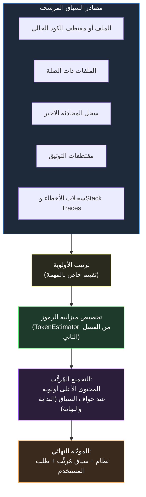

<div dir="rtl">

# القسم الثاني — هندسة السياق

## النصف المتغير من كل موجّه

أرسى القسم الأول عقد الموجّه - Prompt Contract: البنية الثابتة — إطار الدور، والقيود، وتنسيق الخرج — التي يجب تصديرها وإعادة استخدامها. لكن كل موجّه حقيقي يمتلك مكوّناً متغيراً لا يُعالجه العقد وحده: المعلومات الداعمة الخاصة بهذا الاستدعاء بعينه — الكود ذو الصلة، ومقتطف التوثيق ذي الصلة، ودورات المحادثة السابقة ذات الصلة، ورسالة الخطأ ذات الصلة. هذا المكوّن المتغير هو السياق، وكيفية تجميعه تُحدّد، بنفس قدر العقد ذاته، ما إذا كان التفاعل الناتج يُنتج خرجاً موثوقاً أم لا.

يُعامل هذا القسم تجميع السياق كنشاط هندسي من الدرجة الأولى بُناءً مباشراً على آليات الفصل الثاني. القسم الثاني من ذلك الفصل قدّم نافذة السياق - Context Window كحاجز ذي حجم ثابت ووصف ظاهرة "الضياع في المنتصف - Lost in the Middle" — الرموز القريبة من بداية السياق ونهايته تحظى باهتمام أقوى من الرموز المدفونة في الوسط. هذه الحقيقة الآلية لها عاقبة هندسية مباشرة: هندسة السياق ليست مجرد اتخاذ قرار بما يُضمَّن، بل بأي ترتيب وضمن أي ميزانية، بحيث تحتل المعلومات الأكثر أهمية المواضع التي تُفضّلها الآلية فعلاً.

## لماذا السلسلة غير المحدودة تُخفق

النهج الافتراضي غير المنضبط لبناء السياق هو السلسلة - Concatenation: أخذ كل ما قد يكون ذا صلة وإضافته كله إلى الموجّه. هذا النهج خاطئ لسببين مستقلين، كلاهما مُؤسَّس في الفصل الثاني. أولاً، نافذة السياق محدودة — السلسلة غير المحدودة تتجاوزها في نهاية المطاف. ثانياً، حتى في حدود الميزانية، يُفسد السياق غير الملائم أو سيء الترتيب جودة الخرج فعلياً بدلاً من تركها دون تأثير — كتلة ضخمة من مادة ذات صلة هامشية تُضعف الانتباه المتاح للمادة الحقيقية، خاصةً إذا احتلت المواضع الوسطى حيث الانتباه أضعف ما يكون.



## نمط ContextBuilder في .NET

<div dir="ltr">

```csharp id="code-03-02"
// Target Framework: .NET 10.0
// Chapter: 03 | Section: 02
// book/chapters/chapter-03/sections/section-02.ar.md
//
// ContextBuilder: يُجمِّع كتل السياق المرشحة في سلسلة مُحدَّدة الميزانية
// ومُرتَّبة عند الحواف. يستخدم TokenEstimator من الفصل الثاني.

using AiToolkit.Core.Tokens;

namespace EngineeringCommunicationToolkit.Infrastructure.AI;

public sealed record ContextBlock(string Content, int Priority, string SourceLabel);

public sealed class ContextBuilder
{
    private readonly List<ContextBlock> _blocks = [];
    private readonly int _tokenBudget;

    public ContextBuilder(int tokenBudget)
    {
        if (tokenBudget <= 0)
            throw new ArgumentOutOfRangeException(nameof(tokenBudget));
        _tokenBudget = tokenBudget;
    }

    public ContextBuilder Add(string content, int priority, string sourceLabel)
    {
        if (!string.IsNullOrWhiteSpace(content))
            _blocks.Add(new ContextBlock(content, priority, sourceLabel));
        return this;
    }

    public ContextAssemblyResult Build()
    {
        var ranked    = _blocks.OrderByDescending(b => b.Priority).ToList();
        var included  = new List<ContextBlock>();
        var excluded  = new List<ContextBlock>();
        var usedTokens = 0;

        foreach (var block in ranked)
        {
            var blockTokens = TokenEstimator.EstimateProseTokens(block.Content);
            if (usedTokens + blockTokens <= _tokenBudget)
            {
                included.Add(block);
                usedTokens += blockTokens;
            }
            else excluded.Add(block);
        }

        // التحميل على الحواف: أعلى أولوية في البداية والنهاية
        var midpoint   = (included.Count + 1) / 2;
        var edgeLoaded = included.Take(midpoint)
            .Concat(included.Skip(midpoint).Reverse())
            .ToList();

        var assembled = string.Join(
            "\n\n---\n\n",
            edgeLoaded.Select(b => $"[{b.SourceLabel}]\n{b.Content}"));

        return new ContextAssemblyResult(
            assembled, edgeLoaded, excluded, usedTokens, _tokenBudget);
    }
}

public sealed record ContextAssemblyResult(
    string AssembledContext,
    IReadOnlyList<ContextBlock> IncludedBlocks,
    IReadOnlyList<ContextBlock> ExcludedBlocks,
    int UsedTokens,
    int BudgetTokens);
```

</div>

قراران تصميميان يُرمِّزان حكماً هندسياً. خوارزمية الإدراج الجشع حسب الأولوية بسيطة عمداً — قابلية التنبؤ وإمكانية تصحيح الأخطاء في *لماذا* استُبعدت كتلة ما أهم من إنتاجية أمثل. وخطوة التحميل على الحواف هي التطبيق المباشر لاستنتاج "الضياع في المنتصف" من الفصل الثاني القسم الثاني.

## هندسة السياق خاصة بالمهمة لا شاملة

ترتيب الأولوية المُطبَّق على الكتل المرشحة ليس سياسةً ثابتة شاملة — إنه خاص بالمهمة التي يخدمها عقد الموجّه. نفس المصادر تحتل أولويات مختلفة تبعاً لما إذا كانت المهمة مراجعة كود (الملف الحالي أعلى أولوية)، أو تصحيح (سجلات الأخطاء و <code dir="ltr">Stack Trace</code> أعلى)، أو استشارة معمارية (الملفات ذات الصلة والتوثيق أعلى نسبياً). استدعاءات <code dir="ltr">ContextBuilder.Add()</code> تُصدَر من كود خاص بالمهمة يفهم بنية الأولوية لذلك <code dir="ltr">PromptContract</code> المحدد.

## عدم صلاحية السياق: نمط الفشل الذي لا تحله الميزانية وحدها

كتلة سياق يمكن أن تكون ذات أولوية عالية، ومُوضَّعة بشكل صحيح عند حافة السياق، وضمن الميزانية تماماً، بينما تكون في الوقت ذاته *خاطئة* لأنها تصف حالةً للنظام تغيّرت منذ ذلك الحين — مقتطف ملف مُخزَّن مؤقتاً سابق لتعديل أخير، أو توثيق يصف إصدار API قديم. لأن الفصل الثاني القسم الأول أرسى أن النموذج يُعامل كل رمز في سياقه كحقيقة مُسلَّم بها خلال ذلك التمرير الأمامي، فإن كتلة السياق القديمة تُضلّل عملية التوليد بدلاً من أن تقتصر على عدم المساعدة.

الدلالة العملية: الكود المُستدعِي يتحمّل مسؤولية إرفاق إشارة حداثة أو صلاحية لكل كتلة مرشحة، واستبعاد أو خفض أولوية الكتل التي لا يمكن تأكيد صلاحيتها للاستدعاء الحالي. مثال على ذلك: سير عمل لمراجعة الكود يتضمن «الملفات ذات الصلة» ينبغي أن يعيد قراءة تلك الملفات وقت الطلب بدلاً من إعادة استخدام نسخة مُخزَّنة مؤقتاً من نقطة سابقة في الجلسة. تكلفة قراءة ملف حديثة وقت الطلب ضئيلة مقارنةً بتكلفة كتلة سياق قديمة تُضلّل النموذج إلى توليد تحليل خاطئ يجب اكتشافه وتصحيحه لاحقاً.

## قياس جودة هندسة السياق

أربعة مقاييس قابلة للقياس تُوفّر أدلة على أن استراتيجية السياق تعمل. **معدل الاستبعاد - Exclusion Rate** — نسبة الكتل المرشحة التي تُقطع لأسباب الميزانية — يشير إلى ما إذا كانت ميزانية الرموز مُعايَرة جيداً للمهمة. **معدل إعادة المحاولة - Retry Rate** عند الحد الحتمي - Deterministic Boundary (الفصل الثاني القسم الخامس): معدل إعادة المحاولة قبل وبعد إضافة استراتيجية ترتيب الأولوية قابل للمقارنة المباشرة. **تنوع الخرج عبر استدعاءات متطابقة متكررة**: يكشف ما إذا كانت استراتيجية السياق تُضيّق فعلاً فضاء الخرج. **مراجعة إسناد المصدر أثناء التحقيق في الحوادث**: لأن <code dir="ltr">ContextAssemblyResult.IncludedBlocks</code> يحتفظ بـ <code dir="ltr">SourceLabel</code> لكل كتلة، يمكن تتبع بالضبط أي مصادر ساهمت في الموجّه وبأي ترتيب.

## هندسة السياق وحد سير العمل القابل لإعادة الاستخدام

سؤال معماري يطرحه المهندسون عند اعتماد نمط عقد الموجّه واستراتيجية السياق معاً: أين تسكن منطق تجميع السياق بالنسبة للعقد الذي يخدمه؟ الإجابة المُقدَّمة في هذا القسم — الفصل بينهما كمكوّنين مستقلين قابلين للتركيب — تعكس مبدأً أوسع: <code dir="ltr">PromptContract</code> يُحدّد ما يبدو عليه الموجّه المُحوَّل بنيوياً؛ <code dir="ltr">ContextBuilder</code> يُحدّد كيف يُختار المحتوى المتغير الذي يُغذّي ذلك الموجّه. الأول ثابت عبر استدعاءات نقطة الاستدعاء ذاتها لإصدار عقد معيّن؛ الثاني يتكيّف مع خصائص كل استدعاء بعينه — ما المعلومات الأكثر صلة بهذا الطلب تحديداً.

الاقتران المتعمد بين العقد والاستراتيجية يحدث في المستوى التالي لأعلى: سير العمل - Workflow الذي يُجمّع الاثنين معاً كوحدة واحدة مُسجَّلة. هذا هو المستوى الذي يعالجه القسم الثالث مباشرةً: ليس تجميع العقد والسياق بشكل مخصوص في كل نقطة استدعاء، بل سير عمل مُسجَّل واحد يُجسِّد كليهما بشكل يبقى ثابتاً عبر كل نقاط الاستدعاء وعبر كل من يستخدمه بصرف النظر عن مستوى خبرته بتفاصيل التنفيذ الداخلية. هذا الانضباط الكتالوجي رخيص نسبياً مقارنةً بالتكرار الذي يمنعه، ويتوسّع طبيعياً مع الفريق — مستند مشترك واحد يُصان بجانب كود التسجيل يكفي لمعظم الفرق حتى العشرات من سير العمل المُسجَّل، دون حاجة إلى أدوات مخصصة.

هذا الفصل الثلاثي المستويات — عقد، واستراتيجية سياق، وسير عمل يُغلّفهما — يُعادل في بنيته الفصل بين تعريف المشكلة والخوارزمية وبنية البيانات في هندسة البرمجيات الكلاسيكية: كل مستوى يحمل مسؤولية مختلفة، وتركيبها الواعي ينتج نظاماً أكثر قابلية للصيانة والفهم مما لو اندمجت المسؤوليات الثلاث في مكوّن واحد يصعب تعديله أو اختباره أو إعادة استخدامه بشكل مستقل.

## تخصيص ميزانية الرموز: عتبات عملية

معامل <code dir="ltr">tokenBudget</code> المُمرَّر إلى <code dir="ltr">ContextBuilder</code> ليس رقماً مستديراً اعتباطياً — إنه يعكس مقايضة بين اكتمال المعلومات وتشتيت الانتباه، وهي مقايضة تُحدَّد بنافذة سياق النموذج المستهدف وحساسية المهمة لجودة السياق. ثلاث قواعد عملية تنطبق على المهام الهندسية التي يُعالجها هذا الكتاب.

لسير عمل مراجعة الكود، ميزانية من 3,000 إلى 5,000 رمز تستوعب عادةً الملف المستهدف وملفين إلى ثلاثة ملفات ذات صلة (المُستدعون والاستيرادات والاختبارات) ووصفاً موجزاً لمجالات تركيز المراجعة. تجاوز هذا النطاق لمهمة مراجعة واحدة إشارة إلى أن نطاق المراجعة ينبغي تفكيكه إلى وحدات أصغر بعقود مستقلة بدلاً من حشره في موجّه واحد — نفس حكم التفكيك الذي يطبّقه الفريق عندما يكبُر طلب مراجعة الكود - Pull Request إلى حدٍّ يصعب معه مراجعته بفعالية.

لسير عمل تصحيح الأخطاء، الميزانيات قد تتسع أكثر — من 4,000 إلى 8,000 رمز — لأن السياق ذا الصلة لا يشمل الكود محل التحقيق فحسب، بل أيضاً تتبّعات المكدس - Stack Traces ومقتطفات السجلات والإعدادات المرتبطة. الانضباط الرئيسي هو أن سياق التصحيح ينبغي أن يُقدّم الحداثة والتحديد — المخرج الدقيق للاختبار الفاشل وأحدث سجل خطأ — على الشمولية — كل ملف في الوحدة المتأثرة — مطبّقاً تفضيل التحديد على الشمولية من إرشادات تصميم الأولوية.

لسير عمل الاستشارات المعمارية، ميزانية من 2,000 إلى 3,000 رمز غالباً ما تكون كافية لأن المدخلات ذات الصلة عادةً ما تكون بياناً موجزاً للمشكلة، وعدداً صغيراً من سجلات القرارات المعمارية، والواجهات أو العقود المحددة قيد النقاش. تستفيد هذه المهام من مقتطفات التوثيق عالية الإشارة والمُوضَّعة جيداً أكثر مما تستفيد من نوافذ السياق الكبيرة.

عبر الفئات الثلاث جميعها، ينبغي معاملة الميزانية كمعامل قابل للتهيئة — مُسجَّل عبر <code dir="ltr">IConfiguration</code> لسير العمل الناضج، وقابل للضبط لكل سير عمل لا عالمياً — لا كقيمة ثابتة مدمجة في كود استراتيجية السياق. يضمن هذا الانضباط التشغيلي ألا تتطلب تعديلات ميزانية السياق استجابةً لأدلة الإنتاج تغييرات كود وإعادة نشر.

## خاتمة القسم الثاني: هندسة السياق ليست حشو الموجّهات

يُغلق هذا القسم بتمييز جوهري: هندسة السياق ليست طريقة أكثر تطوراً لإدراج المزيد من المعلومات في الموجّه — إنها انضباط لإدراج المعلومات الصحيحة بالترتيب الصحيح ضمن ميزانية مختارة عمداً. سياق مُهندَس جيداً أصغر في الغالب، لا أكبر، من السلسلة غير المُهيكَلة التي يحلّ محلّها.

هندسة السياق ليست زيادة في الكمية بل تحسين في الجودة والترتيب. والنتيجة الأهم ليست مجرد خرج نموذج أفضل في الاستدعاء الواحد — بل تكلفة إنتاجية أقل ومعدل إعادة محاولة أدنى وسير عمل أكثر صموداً مع تطور النظام وتغيّر المدخلات.

الفرق الذي يقيس نجاح هذا القسم بعدد الكتل التي تُمكنه <code dir="ltr">ContextBuilder</code> من إدراجها الآن قد أخطأ الهدف. المقياس الصحيح هو ما إذا كانت الكتل المُدرَجة أفضل توجيهاً وأفضل موضعاً وأكثر صلةً بالمهمة الفعلية — لا ما إذا كانت أكبر. هذا التمييز هو ما يفصل هندسة السياق عن "حشو الموجّهات" (Prompt Stuffing) الذي تبدو الأساليب غير المنضبطة كأنها تشجع عليه، وهو ما يمنح الانضباط قيمته الحقيقية.

## تصميم الأولويات العملي: أين تُرتَّب المصادر

المبدأ المجرد القائل بأن ترتيب الأولوية خاص بالمهمة سهل القبول؛ أما السؤال العملي عن كيفية تصميم ذلك الترتيب لسير عمل جديد فيستفيد من إرشاد أكثر تحديداً. ثلاثة أنماط تنطبق بموثوقية على المهام الهندسية التي يُعالجها هذا الكتاب.

**تفضيل الحداثة للمصادر المؤقتة**: المصادر التي تتغير محتوياتها بشكل متكرر — الحالة الحالية لملف يُحرَّر بنشاط، أو أحدث Stack Trace من اختبار فاشل، أو الدورات الأخيرة القليلة من محادثة — تحتل أولوية أعلى من المصادر التي تتغير ببطء كالتوثيق الثابت، وسجلات القرارات المعمارية، والسياق الخلفي للتصميم العام للنظام. الرموز الحديثة تعكس بشكل أدق الحالة الفعلية للنظام الذي يسأل عنه المستخدم، وآليات «الضياع في المنتصف» تجعل من المهم ألا يكون المحتوى الأكثر صلة عالي الأولوية فحسب، بل مُوضَّعاً جيداً أيضاً. بالنسبة للمصادر المؤقتة، تعمل الحداثة وأولوية الموضع معاً؛ وبالنسبة للمصادر الخلفية المستقرة، تهم أولوية الموضع لكن الحداثة أقل صلة.

**تفضيل التحديد على الشمولية**: رسالة خطأ محددة من اختبار محدد تحتل أولوية أعلى من وصف عام لفلسفة معالجة الأخطاء في النظام، وتوقيع دالة محدد من الملف قيد المراجعة يحتل أولوية أعلى من وصف عام لمعايير الترميز في قاعدة الكود. المصادر المحددة تُضيّق فضاء الاستجابة المعقول بدقة أكبر من المصادر العامة، وهذا يُقلّل مشكلة التباين الدلالي التي يعالجها القسم الخامس — لا بتشديد معاملات التوليد، بل بتضييق فضاء التفسيرات المعقولة عند مرحلة الإدخال، قبل بدء التوليد — ويظهر ذلك مباشرةً كمعدل إعادة محاولة أدنى عند الحد الحتمي.

**تفضيل القرب على البُعد**: للمهام المتعلقة بالكود، الملف الذي يحتوي مباشرةً على الكود المُناقَش يحتل أولوية أعلى من الملفات التي تُورّده، وهي بدورها أعلى من ملفات تتشارك معه الوحدة فقط. هذا التدرج يُنتج ترتيب أولوية آلي الحساب بدلاً من اتخاذ قرار اعتباطي حول الصلة المفاهيمية لكل ملف — وهو ما من شأنه أن يُعيد إدخال عدم الاتساق الذي صُمِّم نمط `ContextBuilder` لإزالته.

## متى تستثمر في استراتيجيات الأولوية الديناميكية

استراتيجية السياق المُصمَّمة عند إنشاء سير العمل مُصمَّمة بالمعلومات المتاحة في ذلك الوقت. مع اكتساب سير العمل خبرة إنتاجية، تتراكم أدلة حول ما تحتاجه الكتل المختلفة فعلاً من أولوية لإنتاج خرج موثوق: بعض المصادر التي بدت ذات أولوية عالية عند التصميم تُسهم بشكل ضئيل، وبعض المصادر ذات الأولوية المنخفضة تُحسّن الخرج بشكل ملحوظ حين يُرفع ترتيبها. هذه الأدلة يجب أن تُغذّي تحديثات الأولوية بشكل منهجي لا اعتباطي. سير العمل الذي يُشغّل مهمة معرّضة للانحراف — حيث يكون معدل إعادة المحاولة عند الحد الحتمي أعلى بدرجة ذات دلالة من سير عمل مماثل — مرشح لإعادة النظر في استراتيجية أولوية السياق تحديداً، لأن سوء محاذاة الأولوية تفسير أكثر قابلية للمعالجة لمعدلات إعادة المحاولة المرتفعة من القدرة العامة للنموذج في نوع مهمة ممثَّل جيداً، وأكثر قابلية للتشخيص من التباين في صياغة عقد الموجّه وحده.

الممارسة الأكثر فاعلية هي جدولة مراجعات دورية لاستراتيجية السياق لسير العمل ذات الحجم الكبير أو الأهمية العالية — مرة في الربع على أقل تقدير، أو عند اكتشاف تغيّر كبير في معدل إعادة المحاولة — مشابهةً لكيفية جدولة فرق .NET تحديثات التبعيات: ليس كاستجابة لفشل محدد بل كممارسة هندسية استباقية تُبقي سير العمل متوائماً مع الخصائص الفعلية لمدخلاته وسلوك النموذج مع مرور الوقت. استراتيجيات السياق التي كانت مُعايَرة جيداً قبل ستة أشهر قد تكون مُعايَرةً ضعيفةً اليوم إذا تغيّرت بنية قاعدة الكود، أو تغيّر التوزيع النموذجي للمدخلات التي يتلقاها سير العمل، أو إذا تحدّث النموذج من قِبَل المزوّد بطريقة أثّرت على خصائص جودة الخرج.

هذا التحسين التكراري — البدء بقيم افتراضية معقولة، والقياس مقابل الإشارات التي قدّمها هذا القسم، وتعديل أولويات محددة بناءً على الأدلة — هو دورة الحياة المناسبة لهذا المكوّن: ليس قرار تهيئة لمرة واحدة عند إنشاء سير العمل، بل جزء حي من تعريف سير العمل يعكس التعلّم التشغيلي المتراكم حول ما يحتاجه النموذج فعلاً ليعمل بموثوقية في هذه المهمة تحديداً.

## هندسة السياق وقابلية الرصد

قدرة إسناد المصدر التي يُوفّرها <code dir="ltr">ContextAssemblyResult.IncludedBlocks</code> تستحق التأكيد في سياق قابلية الرصد الأشمل، لأنها تربط انضباط هندسة السياق بنوع المراقبة الإنتاجية والاستجابة للحوادث التي تعالجها الفصول اللاحقة مباشرةً.

في خدمة .NET تقليدية، يُتيح التسجيل المُهيكَل - Structured Logging مع معرّفات الارتباط - Correlation IDs تتبع مسار تنفيذ طلب محدد عبر النظام وتحديد المكوّنات التي ساهمت في نتيجة ما بدقة. في خدمة مدمجة بالذكاء الاصطناعي دون إسناد السياق، الاستجابة الخاطئة قابلة للتتبع فقط حتى «الموجّه» — مدخل واحد غير مُجزَّأ تجعل بنيته الداخلية ومساهمات مصادره وقرارات تجميعه غير مرئية لأي أداة مراقبة.

<code dir="ltr">ContextAssemblyResult.IncludedBlocks</code>، المُسجَّل مع معرّف ارتباط الطلب لحظة تجميع السياق، يُوسّع التسجيل المُهيكَل إلى حدّ الذكاء الاصطناعي. حادثة يُنتج فيها تطبيق توصيةً خاطئة تُصبح قابلةً للتشخيص بدقة: هل استُبعد السياق ذو الصلة لأسباب الميزانية؟ هل أُدرج لكن في موضع وسطي منخفض الانتباه؟ هل نسخة قديمة من المصدر سبقت تعديلاً ذا صلة؟ هذه أسئلة يُمكن الإجابة عنها من <code dir="ltr">ContextAssemblyResult</code> المُسجَّل، وقابلة للإجابة في دقائق لا في ساعات من التحقيق. هذا بالضبط ما يفعله التسجيل الجيد لأي تبعية أخرى في النظام — ويستحق الذكاء الاصطناعي معاملة التبعية ذاتها. استراتيجية سياق كانت مُعايَرة جيداً عند إنشاء سير العمل وتعكس التعلّم التشغيلي المتراكم للفريق هي أحد أعلى أصول الهندسة قيمةً وأقلها ظهوراً التي يمكن أن يمتلكها تطبيق .NET ناضج مدمج بالذكاء الاصطناعي، لأن آثارها تُلمَس عبر المقاييس التي تُحسّنها لا عبر أي أثر يُقرأ مباشرةً في كود المصدر.

---

*يُغلق هذا القسم بالتمييز الجوهري: هندسة السياق ليست طريقةً أكثر تطوراً لإدراج المزيد من المعلومات في الموجّه — إنها انضباط لإدراج المعلومات الصحيحة بالترتيب الصحيح ضمن ميزانية مختارة عمداً. القسم الثالث يبني مباشرةً على هذا بتغليف العقد واستراتيجية السياق والحد الحتمي في سير عمل واحد مُسجَّل وقابل لإعادة الاستخدام، والهدف النهائي هو تحويل كل قدرة ذكاء اصطناعي في التطبيق إلى مكوّن هندسي واضح قابل للاختبار والتدقيق والتطوير المنضبط، لا إلى مجموعة استدعاءات متفرقة لنموذج لغوي تتبدّل صياغاتها من نقطة استدعاء إلى أخرى.*

</div>
