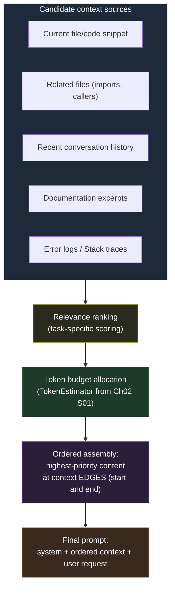

# Section 02 — Context Engineering

## The Variable Half of Every Prompt

Section 01 established the prompt contract: the fixed structure — role framing, constraints, output format — that should be versioned and reused rather than retyped. But every real-world prompt also has a variable component: the supporting information specific to this particular call — the relevant code, the relevant documentation excerpt, the relevant prior conversation turns, the relevant error message. This variable component is the context, and how it is assembled determines, as much as the contract itself, whether the resulting interaction produces reliable output.

This section treats context assembly as a first-class engineering activity, building directly on mechanics Chapter 02 established. Section 02 of that chapter introduced the context window as a fixed-size buffer and described the "lost in the middle" phenomenon — tokens near the start and end of the context receive disproportionately strong attention compared to tokens buried in the middle of a long context. That mechanical fact has a direct engineering consequence: context engineering is not merely deciding *what* to include, but deciding in what order and within what budget, so that the most consequential information occupies the positions the mechanism actually favors.

## Why Unbounded Concatenation Fails

The default, undisciplined approach to context construction is concatenation: take everything that might plausibly be relevant and append it all into the prompt. This approach is wrong for two independent reasons, both already established mechanically in Chapter 02. First, the context window is finite (Chapter 02, Section 01) — unbounded concatenation eventually exceeds the window, at which point something is truncated or omitted regardless of whether the engineer made a deliberate choice about what to drop. Second, even well within the token budget, irrelevant or poorly-positioned context measurably degrades output quality rather than leaving it unaffected (Chapter 02, Section 02's lost-in-the-middle mechanics) — a large block of marginally-relevant material dilutes the attention available to the genuinely relevant material and can occupy exactly the middle positions where attention is weakest.



## A Concrete .NET Pattern: ContextBuilder

```csharp id="code-03-02"
// Target Framework: .NET 10.0
// Chapter: 03 | Section: 02
// book/chapters/chapter-03/sections/section-02.en.md
//
// ContextBuilder: assembles candidate context blocks into a budgeted,
// ordered context string. Uses TokenEstimator (Chapter 02, Section 01)
// for budget enforcement and places highest-priority blocks at the
// context edges, per Chapter 02 Section 02's lost-in-the-middle mechanics.

using AiToolkit.Core.Tokens;

namespace EngineeringCommunicationToolkit.Infrastructure.AI;

public sealed record ContextBlock(
    string Content,
    int    Priority,
    string SourceLabel);

public sealed class ContextBuilder
{
    private readonly List<ContextBlock> _blocks = [];
    private readonly int _tokenBudget;

    public ContextBuilder(int tokenBudget)
    {
        if (tokenBudget <= 0) throw new ArgumentOutOfRangeException(nameof(tokenBudget));
        _tokenBudget = tokenBudget;
    }

    public ContextBuilder Add(string content, int priority, string sourceLabel)
    {
        if (!string.IsNullOrWhiteSpace(content))
            _blocks.Add(new ContextBlock(content, priority, sourceLabel));
        return this;
    }

    public ContextAssemblyResult Build()
    {
        var ranked   = _blocks.OrderByDescending(b => b.Priority).ToList();
        var included  = new List<ContextBlock>();
        var excluded  = new List<ContextBlock>();
        var usedTokens = 0;

        foreach (var block in ranked)
        {
            var blockTokens = TokenEstimator.EstimateProseTokens(block.Content);
            if (usedTokens + blockTokens <= _tokenBudget)
            {
                included.Add(block);
                usedTokens += blockTokens;
            }
            else excluded.Add(block);
        }

        // Edge-loading: split included blocks by priority into two halves,
        // place the top half FIRST and the second half reversed LAST so
        // the single highest-priority block opens the context and the
        // second-highest closes it (Chapter 02 Section 02).
        var midpoint   = (included.Count + 1) / 2;
        var edgeLoaded = included.Take(midpoint)
            .Concat(included.Skip(midpoint).Reverse())
            .ToList();

        var assembled = string.Join(
            "\n\n---\n\n",
            edgeLoaded.Select(b => $"[{b.SourceLabel}]\n{b.Content}"));

        return new ContextAssemblyResult(assembled, edgeLoaded, excluded, usedTokens, _tokenBudget);
    }
}

public sealed record ContextAssemblyResult(
    string AssembledContext,
    IReadOnlyList<ContextBlock> IncludedBlocks,
    IReadOnlyList<ContextBlock> ExcludedBlocks,
    int UsedTokens,
    int BudgetTokens);
```

Two design decisions encode engineering judgment, not arbitrary choices. The greedy-by-priority inclusion algorithm is deliberately simple — for prompt construction, predictability and debuggability of *why* a block was excluded matters more than squeezing the last few tokens of optimality, the same reasoning that leads .NET teams to prefer simple, explainable caching eviction policies over theoretically optimal but opaque ones. The edge-loading reordering step is the direct, concrete application of Chapter 02 Section 02's lost-in-the-middle finding.

## Context Engineering Is Per-Task, Not Global

The *priority ranking* applied to candidate context blocks is not a fixed, global policy — it is specific to the task the prompt contract is serving. The same candidate sources rank differently depending on whether the task is a code review (current file ranks highest), a debugging session (error logs and stack trace rank highest), or an architectural consultation (related files and documentation rank higher relative to a single code snippet). `ContextBuilder.Add()` calls are typically issued from task-specific code that understands the priority structure for that specific `PromptContract` from Section 01.

## Context Staleness: The Failure Mode Budget Alone Does Not Solve

A context block can be highly relevant in priority terms, correctly positioned at a context edge, and well within budget, while simultaneously being *wrong* because it describes a state of the system that has since changed — a cached file excerpt that predates a recent edit, or documentation describing a previous API version. Because Chapter 02 Section 01 established that the model treats every token in its context as ground truth for the duration of that forward pass, a stale context block actively misleads the generation process rather than merely failing to help.

The practical implication: the calling code bears responsibility for attaching a recency or validity signal to each candidate block, and excluding or down-ranking blocks whose validity cannot be confirmed for the current call. A code review workflow that includes "related files" should re-read those files at request time rather than reusing a cached copy from an earlier point in the session. The cost of a fresh file read at request time is negligible compared to the cost of a stale context block misleading the model into generating an incorrect analysis that must be caught and corrected downstream.

## Measuring Context Engineering Quality

Four measurable signals provide evidence that the context strategy is working. **Exclusion rate** — the proportion of candidate blocks cut for budget reasons — indicates whether the token budget is well-calibrated for the task. **Retry rate at the deterministic boundary** (Chapter 02, Section 05) provides an indirect but valuable signal: if a workflow's retry rate is substantially higher than comparable workflows, degraded context quality is a more likely explanation than the underlying model's general capability. **Output variance across repeated identical calls** — running the same request several times and measuring how much the responses diverge reveals whether the context strategy is actually narrowing the output space; a strategy that leaves output variance high is not constraining the model's interpretation of the task. **Source-attribution review during incident investigation** — because `ContextAssemblyResult.IncludedBlocks` preserves each block's `SourceLabel`, a post-incident review can trace exactly which context sources contributed to the prompt and in what order, converting "the AI got this wrong" into a specific, actionable finding.

## Context Engineering and the Reusable Workflow Boundary

An architectural question arises when a team adopts the prompt-contract pattern and the context strategy together: where does context-assembly logic live relative to the contract it serves? The answer this section has been building toward — keep them separate, as two independently composable components — reflects a broader principle. `PromptContract` defines what the rendered prompt looks like structurally; `ContextBuilder` defines how the variable content feeding that prompt is chosen. The first is stable across calls to the same call site issuing a particular contract; the second adapts to the characteristics of each individual call — which information is most relevant to this specific request.

A `PromptContract` should not need to know *how* a particular caller decided to rank and budget context, because the same contract is often reused across callers with different context strategies: a code review contract invoked from an interactive IDE extension might reasonably prioritize the currently-open file and recent edits, while the same contract invoked from an automated CI pipeline might prioritize the full diff and any related test failures, with no change to the contract's rendering logic itself.

The deliberate coupling of contract and strategy happens one level up: the workflow, the unit that registers the two together as a single composed definition. This is the level Section 03 addresses directly: not assembling contract and context ad hoc at every call site, but a single registered workflow that embodies both, consistently across every call site and every consumer regardless of their familiarity with the internal implementation details. A reusable workflow's definition is precisely the combination of a specific contract with a specific context strategy, registered together as one unit. This catalog discipline is cheap relative to the duplication it prevents, and it scales naturally with the team — a single shared document maintained alongside the registration code is sufficient for most teams well into dozens of registered workflows, with no need for dedicated tooling.

This three-level separation — contract, context strategy, and the workflow that wraps them — mirrors, in its structure, the separation between problem definition, algorithm, and data structure in classical software engineering: each level carries a different responsibility, and composing them deliberately produces a system that is easier to maintain and understand than one in which all three responsibilities collapse into a single component that is hard to modify, test, or reuse independently.

## Token Budget Allocation: Practical Thresholds

The `tokenBudget` parameter passed to `ContextBuilder` is not an arbitrary round number — it reflects a trade-off between information completeness and attention dilution that is specific to the target model's context window and the task's sensitivity to context quality. Three concrete heuristics apply across the engineering tasks this book addresses.

For code review workflows, a budget of 3,000 to 5,000 tokens typically accommodates the target file, two to three related files (callers, imports, tests), and a concise description of review focus areas. Exceeding this range for a single review task is a signal that the review scope should be decomposed into smaller, independently-contracted units rather than packed into a single prompt — the same decomposition judgment a team applies when a code review pull request grows too large to review effectively.

For debugging workflows, budgets can range wider — 4,000 to 8,000 tokens — because the relevant context includes not only the code under investigation but also stack traces, log excerpts, and related configuration. The key discipline is that debugging context should prioritize recency and specificity (the failing test's exact output, the most recent error log) over breadth (every file in the affected module), applying Section 02's specificity-over-generality pattern from the priority design guidance.

For architectural consultation workflows, budgets of 2,000 to 3,000 tokens are often sufficient because the relevant inputs are typically a concise problem statement, a small number of architectural decision records, and the specific interfaces or contracts under discussion. These workflows benefit less from large context windows and more from well-positioned, high-signal documentation excerpts.

Across all three categories, the budget should be treated as a configurable parameter — registered through `IConfiguration` for mature workflows, tunable per-workflow rather than globally — rather than a constant baked into the context strategy's code. This operational discipline ensures that context budget adjustments in response to production evidence do not require code changes and redeployment. A team that discovers a debugging workflow consistently excludes relevant stack trace data due to an undersized budget can adjust the threshold through configuration in minutes rather than scheduling a code change, a review, and a deployment cycle — the same operational agility that configuration-driven retry policies and connection timeouts provide for conventional .NET services.

## A Closing Distinction: Context Engineering Is Not Prompt Stuffing

Context engineering is not a more sophisticated way of fitting more information into a prompt. It is a discipline for fitting the *right* information, in the *right* order, within a *deliberately chosen* budget. A well-engineered context is frequently smaller, not larger, than the unstructured concatenation it replaces.

The improvement is not merely qualitative. A better-engineered context lowers production cost — fewer tokens spent on material the model does not need — reduces the retry rate at the deterministic boundary, and produces a workflow that stays resilient as the system and its inputs change.

Teams that measure this section's success purely by whether `ContextBuilder` lets them include more context than before have missed the discipline's actual point; the correct measure is whether the included context is better-targeted and better-positioned, not larger. That distinction is what separates context engineering from the prompt stuffing that undisciplined approaches appear to encourage, and it is what gives the discipline its real value.

## Practical Priority Design: Which Sources Rank Where

The abstract principle that priority rankings are task-specific is easy to accept; the practical question of how to design those rankings for a new workflow benefits from more concrete guidance. Three patterns apply reliably across the engineering tasks this book addresses.

The first pattern is *recency preference for ephemeral sources*. Sources whose content changes frequently — the current state of a file the user is actively editing, the most recent stack trace from a failing test, the last few turns of a conversation — tend to rank above sources whose content changes slowly — stable documentation, architectural decision records, background context about the system's general design. The reasoning is mechanical: recent content is more likely to reflect the actual state of the system the user is asking about, and Chapter 02 Section 02's "lost in the middle" mechanics make it important that the most contextually relevant content is not only high-priority but also well-positioned. For ephemeral sources, both recency and positional priority work together; for stable background sources, positional priority matters but recency is less relevant.

The second pattern is *specificity preference over generality*. A specific error message from a specific failing test ranks above a general description of the system's error-handling philosophy; a specific method signature from the file under review ranks above a general description of the codebase's coding standards. Specific sources constrain the model's response space more precisely than general ones, which reduces the semantic-variance problem Section 05 addresses — not by tightening the generation parameters, but by narrowing the space of reasonable interpretations at the input stage, before generation begins, which in turn shows up directly as a lower retry rate at the deterministic boundary.

The third pattern is *proximity preference over distance*. For code-related tasks, the file directly containing the code being discussed ranks above files that import it, which rank above files that merely coexist in the same module. This proximity gradient is a reasonable approximation of conceptual relevance in most codebases and, more importantly, it produces a priority ranking that is mechanical to compute rather than requiring the calling code to make a judgment call about conceptual relevance for each individual context assembly — which would reintroduce the inconsistency that the `ContextBuilder` pattern is designed to eliminate.

## When to Invest in Dynamic Priority Strategies

These three patterns represent reasonable defaults for their respective source types. As a workflow matures and the team accumulates specific evidence about which sources actually improve output quality versus which sources merely consume budget without measurably helping, the static priority values in the `ContextBuilder.Add()` calls should evolve to reflect that evidence. A workflow that runs a drift-prone task — one where the retry rate at the deterministic boundary is meaningfully higher than comparable workflows — is a candidate for revisiting the context priority strategy specifically, because priority misalignment is a more tractable explanation for elevated retry rates than the underlying model's general capability at a well-represented task type, and a more tractable diagnosis than variance in the prompt contract's phrasing alone.

This iterative refinement of context strategy — starting with reasonable defaults, measuring against the signals Section 02 introduced, and adjusting specific priorities based on evidence — is the appropriate lifecycle for this component: not a one-time configuration decision made at workflow creation, but a living part of the workflow's definition that reflects accumulated operational learning about what the model actually needs to see to perform reliably for this specific task.

The most effective practice is to schedule periodic reviews of the context strategy for large or high-importance workflows — at least quarterly, or whenever a significant change in the retry rate is detected — analogous to how .NET teams schedule dependency updates: not as a response to a specific failure but as a proactive engineering practice that keeps the workflow aligned with the actual characteristics of its inputs and the model's behavior over time. A context strategy that was well-calibrated six months ago may be poorly calibrated today if the codebase's structure has changed, if the typical distribution of inputs the workflow receives has shifted, or if the provider has updated the model in a way that changed its output-quality characteristics.

## Context Engineering and Observability

The source-attribution capability that `ContextAssemblyResult.IncludedBlocks` provides deserves emphasis in a broader observability context, because it connects the context engineering discipline to the kind of production monitoring and incident response that later chapters address directly. In a conventional .NET service, structured logging with correlation IDs makes it possible to trace a specific request's execution path through the system and identify exactly which components contributed to an outcome. In an AI-integrated service without context attribution, an incorrect AI response is traceable only to "the prompt" — a monolithic input whose internal structure, source contributions, and assembly decisions are invisible to any monitoring tool.

`ContextAssemblyResult.IncludedBlocks`, logged with a request's correlation ID at the moment of context assembly, extends structured logging into the AI boundary: which sources were included, which were excluded for budget reasons, what priority each was assigned, and in what order they were presented to the model are all observable facts about a specific request's AI interaction. An incident where an AI-assisted feature produced an incorrect recommendation becomes diagnosable: was the relevant context excluded for budget reasons? Was it included but positioned in a low-attention middle position? Was a stale version of the source included that predated a relevant change? These are questions answerable from the logged `ContextAssemblyResult`, and answerable in minutes rather than requiring a reproducing investigation. This is precisely what good logging does for any other dependency in the system, and AI deserves the same treatment as a dependency. A context strategy that was well-calibrated at workflow creation and reflects the team's accumulated operational learning is one of the highest-value, lowest-visibility engineering assets a mature AI-integrated .NET application can possess, precisely because its effects are felt through the metrics it improves rather than through any artifact that is directly readable in the source code.

---

*Context engineering is not a more sophisticated way of fitting more information into a prompt — it is a discipline for fitting the right information, in the right order, within a deliberately chosen budget. Section 03 builds directly on this by packaging contract, context strategy, and the deterministic boundary into a single registered, reusable workflow, with the ultimate goal of turning every AI capability in the application into a clearly defined engineering component that can be tested, audited, and evolved under discipline rather than a scattered set of LLM calls whose phrasing shifts from one call site to the next.*
