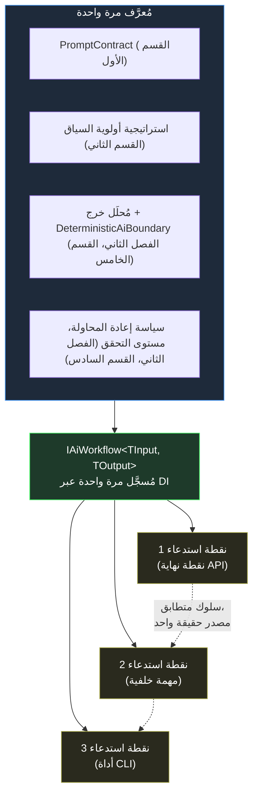

<div dir="rtl">

# القسم الثالث — تصميم سير عمل ذكاء اصطناعي قابل لإعادة الاستخدام

## ثلاث قِطع، مُهندَسة باستقلالية، لا تزال ليست نظاماً

أنتج القسمان الأول والثاني مكوّنَي .NET مفيدَين باستقلالية وقابلَين للاختبار باستقلالية: <code dir="ltr">PromptContract<TInput, TOutput></code> و<code dir="ltr">ContextBuilder</code>. ساهم الفصل الثاني القسم الخامس بقطعة ثالثة: <code dir="ltr">DeterministicAiBoundary<T></code>. كل قطعة بمفردها تقدّم حقيقي على الـ Prompting العشوائي. لكن فريقاً يمتلك القِطع الثلاث ويظل يُسلِّكها يدوياً في كل نقطة استدعاء قد حلّ مشكلة الاتساق الداخلي للموجّه بينما يترك مشكلة اتساق مجاورة دون حل: نقاط استدعاء مختلفة تُركّب القِطع الثلاث بشكل مختلف قليلاً، بنفس خطر الانحراف الذي وصفه القسم الأول للموجّهات غير المُصدَّرة، فقط على مستوى أعلى.

يُغلق هذا القسم تلك الفجوة بتغليف العقد واستراتيجية السياق والحد معاً في وحدة واحدة مُسجَّلة وقابلة لإعادة الاستخدام — سير عمل - Workflow — يُستدعى بشكل متطابق من كل نقطة استدعاء تحتاجه.

## ما يجعل سير العمل مختلفاً عن مجرد تركيب

سير عمل ذكاء اصطناعي قابل لإعادة الاستخدام يمتلك هوية ثابتة، ومُسجَّل مرة واحدة عبر حقن التبعيات - Dependency Injection، وله نقطة تغيير واحدة فقط: إذا احتاجت استراتيجية أولوية السياق تعديلاً، أو احتاج عقد الموجّه الأساسي إصداراً جديداً، يحدث ذلك التغيير في تسجيل سير العمل ويُطبَّق فوراً على كل نقطة استدعاء تعتمد عليه — نفس خاصية نقطة التغيير الواحدة التي يعتمد عليها الفريق حين يُحدِّث مكتبة تحقق مشتركة ويتوقع أن يلتقط كل مُستهلِك الإصلاح دون إعادة تنفيذه باستقلالية.



## نمط IAiWorkflow

<div dir="ltr">

```csharp id="code-03-03"
// Target Framework: .NET 10.0
// Chapter: 03 | Section: 03
// book/chapters/chapter-03/sections/section-03.ar.md
//
// IAiWorkflow<TInput, TOutput>: يُغلّف PromptContract واستراتيجية سياق
// وDeterministicAiBoundary<T> من الفصل الثاني في وحدة واحدة مُسجَّلة عبر DI.

using AiToolkit.Application.Ports;
using AiToolkit.Infrastructure.AI;
using EngineeringCommunicationToolkit.Core.Prompts;

namespace EngineeringCommunicationToolkit.Infrastructure.AI;

public interface IAiWorkflow<TInput, TOutput>
{
    string WorkflowId { get; }
    Task<WorkflowResult<TOutput>> ExecuteAsync(TInput input, CancellationToken ct);
}

public sealed record WorkflowResult<T>(
    bool IsSuccess, T? Value, string? Error,
    string WorkflowId, string ContractVersion);

public sealed class AiWorkflow<TInput, TOutput>(
    string workflowId,
    PromptContract<TInput, TOutput> contract,
    Func<TInput, ContextBuilder> contextStrategy,
    DeterministicAiBoundary<TOutput> boundary,
    int contextTokenBudget)
    : IAiWorkflow<TInput, TOutput>
{
    public string WorkflowId { get; } = workflowId;

    public async Task<WorkflowResult<TOutput>> ExecuteAsync(
        TInput input, CancellationToken ct)
    {
        var contextResult = contextStrategy(input).Build();
        var systemPrompt  = contract.RenderSystemPrompt();
        var userPrompt    =
            $"{contract.RenderUserPrompt(input)}\n\n" +
            $"Relevant context:\n{contextResult.AssembledContext}";

        var boundaryResult = await boundary.ExecuteAsync(systemPrompt, userPrompt, ct);

        return new WorkflowResult<TOutput>(
            IsSuccess:       boundaryResult.IsSuccess,
            Value:           boundaryResult.Value,
            Error:           boundaryResult.Error,
            WorkflowId:      WorkflowId,
            ContractVersion: contract.FullyQualifiedId);
    }
}

public static class WorkflowRegistrationExtensions
{
    public static IServiceCollection AddCodeReviewWorkflow(
        this IServiceCollection services)
    {
        services.AddSingleton<IAiWorkflow<CodeReviewRequest, string>>(sp =>
        {
            var chatClient = sp.GetRequiredService<IChatCompletionClient>();
            var parser     = sp.GetRequiredService<IAiOutputParser<string>>();
            var logger     = sp.GetRequiredService<ILogger<DeterministicAiBoundary<string>>>();
            var boundary   = new DeterministicAiBoundary<string>(chatClient, parser, logger);

            return new AiWorkflow<CodeReviewRequest, string>(
                workflowId:         "code-review",
                contract:           new CodeReviewPromptContract(),
                contextStrategy:    req => new ContextBuilder(tokenBudget: 4000)
                    .Add(req.Code, priority: 10, sourceLabel: "target-code"),
                boundary:           boundary,
                contextTokenBudget: 4000);
        });

        return services;
    }
}
```

</div>

كل نقطة استدعاء تعتمد الآن على <code dir="ltr">IAiWorkflow<CodeReviewRequest, string></code> — تُحلّ عبر حقن التبعيات العادي للمُنشئ — لا على أي من القِطع الثلاث الأساسية مباشرةً.

## إصدار سير العمل دون كسر نقاط الاستدعاء

ترقية إصدار العقد — تحسين صياغة موجّه النظام، تعديل قيد — تُعدّ عادةً تغييراً غير كاسر من منظور نقطة الاستدعاء. تغيير على مستوى سير العمل — تعديل <code dir="ltr">TInput</code> أو <code dir="ltr">TOutput</code> — هو تغيير كاسر بالمعنى المعتاد لـ .NET ويجب التعامل معه كذلك: هوية سير عمل جديدة، مع إبقاء الإصدار السابق متاحاً حتى تنتقل نقاط الاستدعاء.

## اختبار سير العمل كوحدة واحدة

<code dir="ltr">IAiWorkflow<TInput, TOutput></code> يرث القابلية الكاملة للاختبار من المكوّنات التي يُركِّبها: يمكن اختبار سير عمل كامل بتأكيدات على <code dir="ltr">WorkflowResult<TOutput></code> المُحدَّد النوع، دون أي استدعاء شبكة غير حتمي. هذه القابلية للاختبار هي العائد المباشر لإبقاء تجميع السياق وتحويل الموجّه دوال نقية وحتمية بدلاً من الاعتماد ضمنياً على حالة محيطة أو استدعاءات شبكة حية.

## القابلية للتركيب عبر سير العمل

لأن كل سير عمل يتشارك نفس شكل <code dir="ltr">IAiWorkflow<TInput, TOutput></code>، يمكن لسير عمل أن يعتمد على سير عمل آخر بنفس الطريقة التي تعتمد بها خدمات .NET العادية على خدمات أخرى، دون الحاجة إلى طبقة تنسيق خاصة. سير عمل أعلى مستوىً يُصنّف مستوى مخاطرة التغيير أولاً ثم يستدعي سير عمل مراجعة الكود للتغييرات عالية المخاطرة فقط هو ببساطة فئة تأخذ تبعيتي <code dir="ltr">IAiWorkflow<,></code> وتُركّب نتائجهما بتدفق تحكم عادي.

## الإعداد كَكود لا كاتفاقية

مع نضج سير العمل، يجب على الفرق وزن نقل المعلمات القابلة للتعديل فعلياً — ميزانية الرموز تحديداً — إلى إعدادات مدعومة بـ <code dir="ltr">IConfiguration</code>. بنية استراتيجية السياق قرار معماري على مستوى الكود ينتمي إلى التحكم بالمصدر؛ مقابض الضبط العددية تستفيد من التعديل المدعوم بالإعداد بمجرد امتلاك سير العمل خبرةً إنتاجية كافية لمعرفة أي المقابض تحتاج فعلياً تعديلاً.

## اكتشاف سير العمل وتجنب التسجيل المكرر

خاصية <code dir="ltr">WorkflowId</code> موجودة تحديداً لجعل التكرار قابلاً للاكتشاف: مرور تحقق عند بدء التشغيل يمكنه تعداد كل مثيلات <code dir="ltr">IAiWorkflow<,></code> المُسجَّلة والتأكيد على ألا يتشارك اثنان منها نفس <code dir="ltr">WorkflowId</code>. سجل قيم <code dir="ltr">WorkflowId</code> يُصبح الإجابة العملية لـ "هل بنى أحد بالفعل سير عمل لهذا؟" — نفس القيمة التي يُقدّمها كتالوج API داخلي جيد الصيانة لاكتشاف الخدمات العادي، مُطبَّقة هنا على فئة محددة من تفاعلات الذكاء الاصطناعي القابلة لإعادة الاستخدام التي أرسى هذا الفصل أساسها كقِطع هندسية من الدرجة الأولى عبر ثلاثة أقسام. هذا الانضباط الكتالوجي رخيص نسبياً مقارنةً بالتكرار الذي يمنعه، ويتوسّع طبيعياً مع تراكم المزيد من سير العمل المُسجَّل بمرور الوقت، دون حاجة إلى أدوات مخصصة تتجاوز ما سيقدّمه القسم السادس لتتبع تنفيذ سير العمل على مستوى الجلسة.

## سير العمل كحد معماري

بالنظر إلى تنفيذ <code dir="ltr">AiWorkflow<TInput, TOutput></code> من منظور القسم الأول: سير عمل مُسجَّل هو حد مُسمَّى ومُصدَّر في مخطط خدمات التطبيق، تماماً كما أن عميل HTTP مُسجَّلاً، أو سياق EF Core مُسجَّلاً، أو ناشر رسائل مُسجَّلاً هو حد مُسمَّى ومُصدَّر. له نفس دورة الحياة — يُنشأ مرة واحدة عند بدء تشغيل التطبيق، يُحلّ عبر DI من قِبَل المُستدعِين، يُستبدَل بزيادة معرّف الإصدار حين يتغيّر سلوكه جوهرياً. ما يختلف حول هذا الحد ليس بنيته بل داخله: بدلاً من كود حتمي، يحتوي على استدعاء احتمالي مُغلَّف بحد حتمي. كل ما يراه المُستدعِي حتمي ومُحدَّد النوع.

يُوضّح هذا الإطار لماذا الأنماط التي يُقدّمها هذا القسم ليست أدوات خاصة بالذكاء الاصطناعي مُضافة فوق معمارية .NET العادية — إنها انضباط معماري عادي مُطبَّق على حد يحدث أن داخله احتمالي. فريق يُسجِّل بالفعل <code dir="ltr">IEmailSender</code> و<code dir="ltr">IStorageClient</code> و<code dir="ltr">ICacheProvider</code> عبر DI يعرف بالضبط كيف يُفكِّر بشأن <code dir="ltr">IAiWorkflow<CodeReviewRequest, string></code>: إنها خدمة، لها عقد، يمكن استبدالها للاختبار، وتفاصيل تنفيذها غير ذات صلة بالمُستدعِين. الشيء الوحيد الذي يحتاج المُستدعُون معرفته عن داخله — أنه يتضمن استدعاءً احتمالياً للذكاء الاصطناعي — مُلتقَط بالفعل عبر مقاييس معدل إعادة المحاولة للحد وعبر راية <code dir="ltr">IsSuccess</code> في نوع النتيجة <code dir="ltr">WorkflowResult<T></code>.

## من ثلاث قِطع إلى نظام واحد: ما يتغير عند التوسّع

حين يمتلك فريق ثلاثة سير عمل مُسجَّلة، فوائد النمط حقيقية لكن متواضعة — بضع نقاط استدعاء مُسلَّكة باتساق بدلاً من عدم اتساق. حين يمتلك فريق ثلاثين سير عمل مُسجَّلة، تُصبح الفوائد بنيوية: سجل سير العمل جرد قابل للاكتشاف لقدرات الفريق في الذكاء الاصطناعي؛ فحص إزالة التكرار القائم على <code dir="ltr">WorkflowId</code> يمنع تجزؤ القدرات؛ شكل <code dir="ltr">IAiWorkflow<,></code> المُشترَك يعني أن أي مطوّر عمل مع سير عمل واحد يستطيع فهم واستهلاك أي سير عمل آخر فوراً؛ وخاصية نقطة التغيير الواحدة تعني أن التحسينات على مستوى المنصة — تحديث النموذج الأساسي، تعديل سياسة إعادة المحاولة الشاملة، إضافة خطافات قابلية الرصد — تُطبَّق على كامل كتالوج سير العمل بتغيير البنية التحتية للتسجيل بدلاً من تحديث ثلاثين نقطة استدعاء مكتوبة باستقلالية.

خاصية التوسّع هذه ليست عرضية. إنها نفس خاصية التوسّع التي تجعل حقن التبعيات، وعملاء HTTP المُحدَّدي النوع، والخدمات المُسجَّلة ذات قيمة في قواعد كود .NET الكبيرة: الاستثمار المسبق في القيام بالتجريد بشكل صحيح يُؤتي ثماره بما يتناسب مع عدد المُستدعِين، ونمط مُريح فقط في ثلاث نقاط استدعاء يُصبح ذا أهمية بنيوية حقيقية في ثلاثين. الفرق التي تتبنّى أنماط هذا القسم يجب أن تتوقع بالضبط منحنى التوسّع هذا — بعض المراسم في البداية، وعائد متراكم مع نمو الكتالوج.

## اختبار سير العمل في الممارسة

قابلية اختبار سير العمل تُورَث من المكوّنات الحتمية التي يُركّبها، لكن انضباط الاختبار نفسه يستحق توجيهاً ملموساً لأن الفرق تُقلّل غالباً من الاهتمام باختبارات مستوى سير العمل بينما تختبر المكوّنات الفردية بشكل كافٍ. اختبار سير العمل يختبر التركيب الكامل — تحويل العقد، وتجميع السياق، وتنفيذ الحد — مع <code dir="ltr">IChatCompletionClient</code> مُستبدل يُعيد استجابات حتمية تطابق مخطط الخرج.

مجموعة اختبارات سير العمل الدنيا تغطي ثلاثة سيناريوهات لكل سير عمل مُسجَّل. أولاً، اختبار المسار السعيد - Happy Path حيث استجابة النموذج المُستبدَلة تُلبي عقد الخرج، للتحقق من أن سير العمل يُنتج <code dir="ltr">WorkflowResult<TOutput></code> ناجحاً مع محتوى مُحدَّد النوع بشكل صحيح. ثانياً، اختبار فشل بنيوي حيث الاستجابة المُستبدَلة تنتهك مخطط الخرج (حقول مطلوبة مفقودة، أنواع خاطئة، قيم null غير متوقعة)، للتحقق من أن <code dir="ltr">DeterministicAiBoundary<T></code> يلتقط الفشل ويُعيد نتيجة غير ناجحة دون نشر الخرج المشوّه. ثالثاً، اختبار قابلية تهيئة الحد للتحقق من أن تسجيل سير العمل يُوصِل بشكل صحيح سياسة إعادة المحاولة ومستوى التحقق — اختبار يتعلّق بالكامل بصحّة التسجيل ولا يتطلب أي تفاعل مع النموذج.

هذه الاختبارات الثلاثة، المُطبَّقة على كل سير عمل مُسجَّل عند بدء التشغيل أو كجزء من خط CI، تمنع نمط الفشل الذي فيه تحديث عقد موجّه أو تغيير استراتيجية سياق يكسر سير عمل كان يعمل سابقاً دون قصد. لأن الاختبارات تختبر التركيب الكامل بدلاً من المكوّنات الفردية، فإنها تلتقط انحدارات على مستوى التكامل — قيمة أولوية تعمل بشكل صحيح بشكل منفرد لكنها تُنتج تجميع سياق ضعيفاً عند دمجها مع منطق تحويل عقد محدد — وهي انحدارات تفوتها اختبارات مستوى المكوّن. متغير وقت بدء التشغيل مفيد بشكل خاص للفرق التي تسجّل سير العمل في جذر تركيب DI: اختبار فاشل عند بدء التشغيل يمنع التطبيق من دخول الإنتاج بسير عمل مكسور، نفس آلية الأمان التي يوفرها التحقق من سلسلة الاتصال أو حلّ الخدمات المطلوبة لسائر المكوّنات المُسجَّلة في DI.

## نمط تسجيل DI بعمق

طريقة الامتداد <code dir="ltr">AddCodeReviewWorkflow</code> تستحق فحصاً أعمق لأنها تُجسّد نمط تسجيل ينطبق على كل سير عمل في الكتالوج، لا فقط على هذا المثال المحدد. ثلاثة قرارات هندسية مُضمَّنة في تلك الطريقة تستحق التبرير الصريح لأنها تُرمِّز حكماً حول كيفية تصرف سير عمل الذكاء الاصطناعي في تطبيق .NET إنتاجي.

أولاً، يُسجَّل سير العمل بنمط <code dir="ltr">Singleton</code> لا <code dir="ltr">Scoped</code> ولا <code dir="ltr">Transient</code>. يعكس هذا الاختيار أن لا <code dir="ltr">AiWorkflow<TInput, TOutput></code> ولا أياً من تبعياته يحتفظ بحالة خاصة بكل طلب — إنها تعريفات سير عمل عديمة الحالة. سير عمل <code dir="ltr">Singleton</code> واحد مُسجَّل مرة واحدة عند بدء التشغيل يستهلك ذاكرة أقل ويُلغي عبء البناء لكل طلب لعملية حساسة للكمون في الغالب. الاستثناء الوحيد الذي قد يتطلب تسجيل <code dir="ltr">Scoped</code> هو سير عمل تلتقط استراتيجية سياقه بيانات خاصة بكل طلب مباشرةً بدلاً من تلقيها عبر <code dir="ltr">TInput</code> — لكن النمط الذي يؤسسه هذا القسم يُوجّه عمداً كل تباين خاص بالطلب عبر سجل <code dir="ltr">TInput</code> المُحدَّد النوع بدلاً من التقاطه في إغلاق استراتيجية السياق، تحديداً للحفاظ على خيار تسجيل <code dir="ltr">Singleton</code>.

ثانياً، يُبنى الحد بتبعيات مُحلَّلة من حاوية DI لا بمعاملات مُنشئ مُرمَّزة بصلابة. هذا يعني أن تغييراً مستقبلياً في البنية التحتية للتسجيل، أو إعداد عميل المحادثة، أو تنفيذ مُحلِّل الخرج، ينتقل تلقائياً إلى كل سير عمل يستخدم النسخ المُحلَّلة من الحاوية — تسجيل سير العمل نقطة تركيب، لا اعتماد صلب على أي تنفيذ معين لتبعياته.

ثالثاً، تُعبَّر استراتيجية السياق كدالة Lambda لا كنوع مُسمَّى. هذا اختيار متعمد لسير العمل حيث منطق بناء السياق بسيط ومرتبط ارتباطاً وثيقاً بغرض سير العمل المحدد — Lambda تُبقي المنطق مرئياً بجانب التسجيل بدلاً من تشتيته في ملف منفصل. مع نمو منطق بناء السياق تعقيداً — سحب من مصادر متعددة، وحسابات أولوية غير تافهة، واستشارة بيانات وصفية خارجية — يجب أن ينتقل ذلك المنطق إلى فئة مُسمَّاة قابلة للاختبار باستقلالية وقابلة للتوثيق باستقلالية، سالكين نفس مسار إعادة الهيكلة الذي يعرفه مطوّرو .NET بالفعل من معالجات الأحداث المعقدة وتعبيرات LINQ.

## سجل سير العمل كَكتالوج حيّ

أبعد من التنفيذ التقني، يُمثّل سجل <code dir="ltr">WorkflowId</code> الذي قدّمه هذا القسم شيئاً يستحق التسمية كقطعة أثر تنظيمية: جرد قابل للاكتشاف والاستعلام لكل قدرة ذكاء اصطناعي يكشفها التطبيق. في تطبيق به ثلاثون سير عمل مُسجَّل، يستطيع مهندس جديد ينضم للفريق اكتشاف قدرات الذكاء الاصطناعي الموجودة، وما تتطلبه كمدخل، وما تُنتجه كمخرج، وما مستوى التحقق المُطبَّق على كل منها، ببساطة بفحص تسجيلات سير العمل في جذر تركيب DI — لا حاجة لتوثيق منفصل، لا حاجة لسؤال مهندس أول، لا حاجة لقراءة نقاط الاستدعاء لفهم ما تفعله قدرة ذكاء اصطناعي معينة.

هذه القابلية للاكتشاف ليست فائدةً ثانوية — إنها أحد الأسباب الأساسية للاستثمار في نمط سير العمل المُسجَّل بدلاً من ترك استدعاءات الذكاء الاصطناعي مُبعثَرة كتنفيذات لمرة واحدة في كل أنحاء قاعدة الكود. قاعدة كود حيث قدرات الذكاء الاصطناعي خدمات مُسمَّاة ومُسجَّلة من الدرجة الأولى هي قاعدة كود يمكن فيها تدقيق تلك القدرات واستبدالها وتصديرها وتوسيعها مع تطور الاحتياجات التنظيمية. قاعدة كود حيث استدعاءات الذكاء الاصطناعي مُبعثَرة هي قاعدة كود يتطلب فيها فهم ما يفعله التطبيق بالذكاء الاصطناعي قراءة كل ملف يصادف أنه يحتوي استدعاء ذكاء اصطناعي — نفس المشكلة البنيوية التي تجعل قاعدة كود بها سلاسل سحرية مُبعثَرة أصعب صيانةً من واحدة ذات إعداد مركزي ومُحدَّد النوع.

## تطور سير العمل والتغييرات الكاسرة

سير عمل ذكاء اصطناعي مُسجَّل في حاوية DI لتطبيق يواجه نفس تحديات التطور التي تواجهها أي خدمة مُصدَّرة أخرى: كيف يتغير عبر الزمن دون كسر المُستدعِين، ومتى يرتقي تغيير إلى مستوى التغيير الكاسر الذي يتطلب تسجيل سير عمل جديد بدلاً من تحديث في مكانه؟

تتبع الإجابة مباشرةً من بنية <code dir="ltr">WorkflowResult<T></code>. التغييرات التي لا تؤثر على <code dir="ltr">TInput</code> أو <code dir="ltr">TOutput</code> أو الضمان الدلالي لما تعنيه النتيجة الناجحة — تحسينات عقد الموجّه، تعديلات استراتيجية السياق، ضبط درجة الحرارة — غير كاسرة ويمكن تطبيقها كتحديثات في مكانها، مع زيادة <code dir="ltr">PromptContract.Version</code> لتوثيق التغيير. التغييرات التي تُغيّر <code dir="ltr">TInput</code> أو <code dir="ltr">TOutput</code> هي تغييرات كاسرة بالمعنى المعتاد لـ .NET ويجب أن تُعامَل كتسجيلات سير عمل جديدة بـ <code dir="ltr">WorkflowId</code> جديد، تسمح للمُستدعِين بالانتقال تدريجياً بدلاً من تتطلب تحديثاً منسقاً عبر كل نقاط الاستدعاء في وقت واحد.

هذه السياسة الإصدارية تستحق التأسيس الصريح في بداية تطوير سير عمل الذكاء الاصطناعي للمشروع بدلاً من اكتشافها ضمنياً حين يصل أول تغيير كاسر. الاكتشاف يميل إلى أن يكون غير سار: تغيير عقد بدا آمناً يتبيّن أنه غيّر بنية الخرج بطريقة تكسر عدة مُستدعِين في وقت واحد، لم يُحدَّث أيٌّ منهم لأن لا أحد أدرك أن التغيير كاسر بالمعنى ذي الصلة. الحفاظ على التمييز الصريح بين <code dir="ltr">PromptContract.Version</code> (تحسينات غير كاسرة) و<code dir="ltr">WorkflowId</code> (تغييرات واجهة كاسرة) — وتوثيق هذا التمييز في إرشادات المساهمة للفريق لتطوير سير عمل الذكاء الاصطناعي — هو الآلية الملموسة التي تُبقي تطور سير العمل قابلاً للإدارة مع نمو الكتالوج. سجل سير العمل، المُصان ككتالوج حي بجانب جذر تركيب DI، هو الآلية الملموسة التي تمنح هذا الجرد قيمته وتمنع الفريق من بناء القدرة نفسها مرتين دون قصد.

يقدّم الحد المُصدَّر حماية عملية إضافية تتجاوز السياسة الإصدارية: العزل الزمني للمُستدعِين عن التنفيذ. لأن <code dir="ltr">IAiWorkflow<,></code> يخفي تفاصيل العقد والسياق والاستدعاء الاحتمالي خلف عقد حتمي، يمكن للفريق تحسين التنفيذ — تحديث النموذج، تعديل استراتيجية إعادة المحاولة، تغيير منطق بناء السياق — دون تنسيق مع المُستدعِين، ما دامت <code dir="ltr">TInput</code> و<code dir="ltr">TOutput</code> والضمان الدلالي ثابتة. هذا لا يعني أن التحسينات تمر دون مراجعة؛ بل يعني أن مراجعة التحسين تُركّز على سير العمل نفسه كنقطة تغيير واحدة، لا على كل نقاط الاستدعاء. الفائدة المركّبة واضحة حين يُمثِّل الفريق سير العمل كخدمة مُسمَّاة من الدرجة الأولى: صيانة نظام الذكاء الاصطناعي تصبح صيانة مجموعة صغيرة من الحدود المُصدَّرة، كلٌّ منها قابل للتحديث والاختبار والاستبدال بمعزل، وهو ما يبقّي المخاطر مُحتواة في وحدة محددة بدل نشرها عبر قاعدة الكود. هذه الحماية لا تظهر في أي عرض تنفيذ واحد — إنها سمة ناشئة من تبني نمط الحد بثبات، وتزداد قيمتها بما يتناسب مع نمو عدد سير العمل المُسجَّلة في التطبيق.

---

*أرسى القسم الثالث سير عمل الذكاء الاصطناعي القابل لإعادة الاستخدام كمكوّن .NET من الدرجة الأولى، مُسجَّل وقابل للاختبار. ويوسّع القسم الرابع هذا الانضباط إلى المحادثات متعددة الأدوار، حيث تصبح المواصفة — لا الموجّه — هي الأثر الذي يحكم سلوك النموذج.*

</div>
