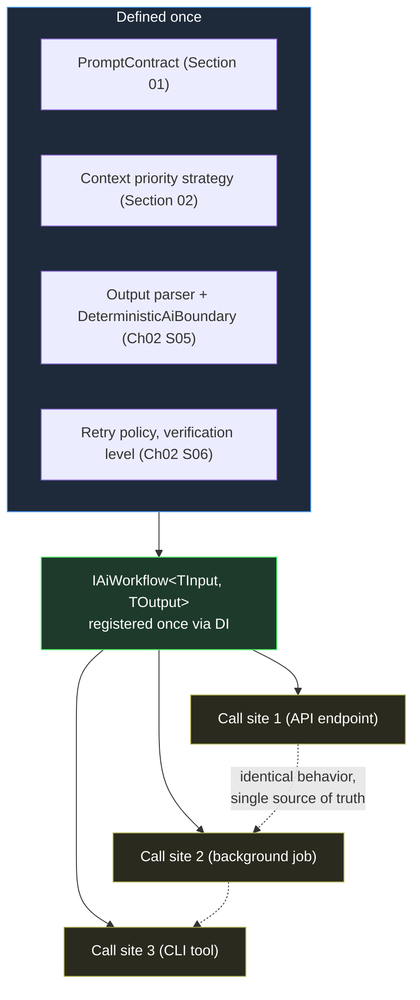

# Section 03 — Designing Reusable AI Workflows

## Three Pieces, Independently Engineered, Still Not a System

Sections 01 and 02 produced two independently useful, independently testable .NET components: `PromptContract<TInput, TOutput>` and `ContextBuilder`. Chapter 02 Section 05 contributed a third piece: `DeterministicAiBoundary<T>`. Each piece, on its own, is real engineering progress over ad hoc prompting. But a team that has all three pieces and still wires them together freshly, by hand, at every call site has solved the prompt's internal consistency problem while leaving an adjacent consistency problem unsolved: different call sites composing the same three pieces slightly differently, with the same drift risk Section 01 described for unversioned prompts, just one level up.

This section closes that gap by packaging contract, context strategy, and boundary into a single, registered, reusable unit — a workflow — invoked identically from every call site that needs it.

## What Makes a Workflow, Not Just a Composition

A reusable AI workflow has a stable identity, is registered once through dependency injection, and has exactly one point of change: if the context priority strategy needs adjustment, or the underlying prompt contract needs a new version, that change happens in the workflow's registration and immediately applies to every call site that depends on it — the same single-point-of-change property a team relies on when they update a shared validation library and expect every consumer to pick up the fix without independently re-implementing it.



## The IAiWorkflow Pattern

```csharp id="code-03-03"
// Target Framework: .NET 10.0
// Chapter: 03 | Section: 03
// book/chapters/chapter-03/sections/section-03.en.md
//
// IAiWorkflow<TInput, TOutput>: packages a PromptContract, a context
// strategy, and Chapter 02's DeterministicAiBoundary<T> into a single,
// DI-registered, reusable unit.

using AiToolkit.Application.Ports;
using AiToolkit.Infrastructure.AI;
using EngineeringCommunicationToolkit.Core.Prompts;

namespace EngineeringCommunicationToolkit.Infrastructure.AI;

public interface IAiWorkflow<TInput, TOutput>
{
    string WorkflowId { get; }
    Task<WorkflowResult<TOutput>> ExecuteAsync(TInput input, CancellationToken ct);
}

public sealed record WorkflowResult<T>(
    bool IsSuccess, T? Value, string? Error,
    string WorkflowId, string ContractVersion);

public sealed class AiWorkflow<TInput, TOutput>(
    string workflowId,
    PromptContract<TInput, TOutput> contract,
    Func<TInput, ContextBuilder> contextStrategy,
    DeterministicAiBoundary<TOutput> boundary,
    int contextTokenBudget)
    : IAiWorkflow<TInput, TOutput>
{
    public string WorkflowId { get; } = workflowId;

    public async Task<WorkflowResult<TOutput>> ExecuteAsync(
        TInput input, CancellationToken ct)
    {
        var contextResult = contextStrategy(input).Build();
        var systemPrompt  = contract.RenderSystemPrompt();
        var userPrompt    =
            $"{contract.RenderUserPrompt(input)}\n\n" +
            $"Relevant context:\n{contextResult.AssembledContext}";

        var boundaryResult = await boundary.ExecuteAsync(systemPrompt, userPrompt, ct);

        return new WorkflowResult<TOutput>(
            IsSuccess:       boundaryResult.IsSuccess,
            Value:           boundaryResult.Value,
            Error:           boundaryResult.Error,
            WorkflowId:      WorkflowId,
            ContractVersion: contract.FullyQualifiedId);
    }
}

// ── DI registration: the single point of definition ─────────────────────

public static class WorkflowRegistrationExtensions
{
    public static IServiceCollection AddCodeReviewWorkflow(
        this IServiceCollection services)
    {
        services.AddSingleton<IAiWorkflow<CodeReviewRequest, string>>(sp =>
        {
            var chatClient = sp.GetRequiredService<IChatCompletionClient>();
            var parser     = sp.GetRequiredService<IAiOutputParser<string>>();
            var logger     = sp.GetRequiredService<ILogger<DeterministicAiBoundary<string>>>();
            var boundary   = new DeterministicAiBoundary<string>(chatClient, parser, logger);

            return new AiWorkflow<CodeReviewRequest, string>(
                workflowId:         "code-review",
                contract:           new CodeReviewPromptContract(),
                contextStrategy:    req => new ContextBuilder(tokenBudget: 4000)
                    .Add(req.Code, priority: 10, sourceLabel: "target-code"),
                boundary:           boundary,
                contextTokenBudget: 4000);
        });

        return services;
    }
}
```

Every call site now depends on `IAiWorkflow<CodeReviewRequest, string>` — resolved through ordinary constructor dependency injection — rather than on any of the three underlying pieces directly.

## Versioning a Workflow Without Breaking Call Sites

A contract version bump — refining the system prompt's wording, adjusting a constraint — is typically a non-breaking change from the call site's perspective. A workflow-level change — altering `TInput` or `TOutput` — is a breaking change and should be treated as one: a new workflow identity, with the previous version kept available until call sites have migrated.

## Testing a Workflow as a Single Unit

`IAiWorkflow<TInput, TOutput>` inherits full unit-testability from the components it composes: each workflow can be exercised completely in a unit test with assertions on typed `WorkflowResult<TOutput>`, without any non-deterministic network call. This testability is the direct payoff of having kept context assembly and prompt rendering as pure, deterministic functions rather than allowing either to depend implicitly on ambient state or live network calls.

## Composability Across Workflows

Because every workflow shares the same `IAiWorkflow<TInput, TOutput>` shape, workflows can depend on other workflows the way ordinary .NET services depend on other services, without requiring any special orchestration layer. A higher-level workflow that first classifies the change's risk level and then invokes a code-review workflow for high-risk changes is simply a class that takes two `IAiWorkflow<,>` dependencies and composes their results with ordinary control flow.

## Configuration as Code, Not Configuration as Convention

As a workflow matures, teams should weigh moving genuinely tunable parameters — the token budget specifically — into `IConfiguration`-backed settings. The context strategy's *structure* is a code-level architectural decision that belongs in source control. The *numeric tuning knobs* benefit from configuration-driven adjustment once a workflow has enough production experience to know which knobs actually need turning.

## Workflow Discovery and Avoiding Duplicate Registration

The `WorkflowId` property exists specifically to make duplication detectable: a startup-time validation pass can enumerate all registered `IAiWorkflow<,>` instances and assert that no two share a `WorkflowId`. A registry of `WorkflowId` values becomes the practical answer to "has someone already built a workflow for this?" — the same value a well-maintained internal API catalog provides for ordinary service discovery — applied here to the specific class of reusable AI interactions this chapter has established as first-class engineering pieces across its three sections. This catalog discipline is cheap relative to the duplication it prevents, and scales naturally as the team accumulates more registered workflows over time, with no need for dedicated tooling beyond what Section 06 will introduce for tracking workflow execution at the session level.

## The Workflow as an Architectural Boundary

Looking at the `AiWorkflow<TInput, TOutput>` implementation with the perspective Section 01 established: a registered workflow is a named, versioned boundary in the application's service graph, exactly as a registered HTTP client, a registered EF Core context, or a registered message publisher is a named, versioned boundary. It has the same lifecycle — created once at application startup, resolved by callers through DI, replaced by bumping a version identifier when its behavior changes materially. What is different about this boundary is not its structure but its interior: instead of deterministic code, it contains a deterministic-boundary-wrapped probabilistic call. Everything the caller sees is deterministic and typed.

This framing clarifies why the patterns this section introduces are not AI-specific tooling layered on top of normal .NET architecture — they are normal .NET architectural discipline applied to a boundary whose interior happens to be probabilistic. A team that already registers `IEmailSender`, `IStorageClient`, and `ICacheProvider` through DI knows exactly how to reason about `IAiWorkflow<CodeReviewRequest, string>`: it is a service, it has a contract, it can be substituted for testing, and its implementation details are irrelevant to callers. The only thing callers need to know about its interior — that it involves a probabilistic AI call — is already captured by the boundary's retry-rate metrics and the `WorkflowResult<T>` result type's `IsSuccess` flag.

## From Three Pieces to One System: What Changes at Scale

When a team has three registered workflows, the benefits of the pattern are real but modest — a few call sites wired consistently rather than inconsistently. When a team has thirty registered workflows, the benefits become structural: the workflow registry is a discoverable inventory of the team's AI capabilities; the `WorkflowId`-based deduplication check prevents capability fragmentation; the shared `IAiWorkflow<,>` shape means any developer who has worked with one workflow can immediately understand and consume any other workflow; and the single-point-of-change property means platform-level improvements — updating the underlying model, adjusting global retry policy, adding observability hooks — apply to the entire workflow catalog by changing the registration infrastructure rather than by updating thirty independently-written call sites.

This scaling property is not incidental. It is the same scaling property that makes dependency injection, typed HTTP clients, and registered services valuable in large .NET codebases: the up-front investment in doing the abstraction correctly pays back in proportion to the number of callers, and a pattern that is merely convenient at three call sites becomes genuinely structurally important at thirty. Teams adopting this section's patterns should expect exactly this scaling curve — some ceremony up front, compounding return as the catalog grows.

## Workflow Testing in Practice

Unit-testability of workflows inherits from the deterministic components they compose, but the testing discipline itself deserves concrete guidance because teams frequently under-invest in workflow-level tests while adequately testing the individual components. A workflow test exercises the complete composition — contract rendering, context assembly, boundary execution — with a stubbed `IChatCompletionClient` that returns deterministic responses matching the output schema.

A minimal workflow test suite covers three scenarios for each registered workflow. First, a happy-path test where the stubbed model response satisfies the output contract, verifying that the workflow produces a successful `WorkflowResult<TOutput>` with correctly-typed content. Second, a structural-failure test where the stubbed response violates the output schema (missing required fields, wrong types, unexpected null values), verifying that `DeterministicAiBoundary<T>` catches the failure and returns an unsuccessful result without propagating the malformed output. Third, a boundary-configurability test verifying that the workflow's registration correctly wires the retry policy and verification level — a test that is entirely about the registration's correctness and requires no model interaction at all.

These three tests, applied to every registered workflow at startup or as part of the CI pipeline, prevent the failure mode where a prompt contract update or context strategy change inadvertently breaks a workflow that was previously working. Because the tests exercise the complete composition rather than individual components, they catch integration-level regressions — a priority value that works correctly in isolation but produces poor context assembly when combined with a specific contract's rendering logic — that component-level tests would miss. The startup-time variant is particularly valuable for teams that register workflows in their DI composition root: a failing test at startup prevents the application from entering production with a broken workflow, the same failsafe that connection-string validation or required-service resolution provides for other DI-registered components.

## The DI Registration Pattern in Depth

The `AddCodeReviewWorkflow` extension method deserves closer examination because it illustrates a registration pattern that applies to every workflow in the catalog, not just this specific example. Three engineering decisions embedded in that method merit explicit justification because they encode judgment about how AI workflows should behave in a production .NET application.

First, the workflow is registered as `Singleton` rather than `Scoped` or `Transient`. This choice reflects the fact that neither `AiWorkflow<TInput, TOutput>` nor any of its dependencies (`PromptContract`, `ContextBuilder` factory function, `DeterministicAiBoundary<T>`) hold per-request state — they are stateless pipeline definitions. A singleton workflow registered once at startup consumes less memory and eliminates per-request construction overhead for what is often a latency-sensitive operation. The one exception that would require `Scoped` registration would be a workflow whose context strategy captures per-request data directly rather than receiving it through `TInput` — but the pattern this section establishes deliberately routes all per-request variation through the typed `TInput` record rather than capturing it in the context strategy's closure, precisely to preserve the singleton registration option.

Second, the boundary is constructed with dependencies resolved from the DI container rather than with hardcoded constructor arguments. This means a future change to the logging infrastructure, the chat client configuration, or the output parser implementation propagates automatically to every workflow that uses the container-resolved versions — the workflow registration is a composition point, not a hard dependency on any particular implementation of its dependencies.

Third, the context strategy is expressed as a lambda rather than as a named type. This is a deliberate choice for workflows where the context-building logic is simple and closely tied to the specific workflow's purpose — a lambda keeps the logic visible alongside the registration rather than dispersed into a separate file that requires navigating away from the registration to understand the workflow's complete behavior. As context-building logic grows more complex — pulling from multiple sources, applying non-trivial priority calculations, consulting external metadata — that logic should migrate into a named class that can be independently tested and independently documented, following the same refactoring path .NET developers already know from complex event handlers and LINQ expressions.

## The Workflow Registry as a Living Catalog

Beyond the technical implementation, the `WorkflowId`-based registry this section introduced represents something worth naming as an organizational artifact: a discoverable, queryable inventory of every AI capability the application exposes. In an application with thirty registered workflows, a new engineer joining the team can discover what AI capabilities exist, what they require as input, what they produce as output, and what verification level was applied to each simply by examining the workflow registrations in the DI composition root — no separate documentation required, no need to ask a senior engineer, no need to read through call sites to understand what a given AI capability does.

This discoverability is not a secondary benefit — it is one of the primary reasons to invest in the registered workflow pattern rather than leaving AI calls scattered as one-off implementations throughout the codebase. A codebase where AI capabilities are first-class, named, registered services is a codebase where AI capabilities can be audited, replaced, versioned, and extended as organizational needs evolve. A codebase where AI calls are scattered is a codebase where understanding what the application does with AI requires reading every file that happens to contain an AI call — the same structural problem that makes a codebase with scattered magic strings harder to maintain than one with centralized, typed configuration.

## Workflow Evolution and Breaking Changes

A reusable AI workflow registered in an application's DI container has the same evolution challenges as any other versioned service: how does it change over time without breaking callers, and when does a change rise to the level of a breaking change that requires a new workflow registration rather than an in-place update?

The answer follows directly from `WorkflowResult<T>`'s structure. Changes that do not affect `TInput`, `TOutput`, or the semantic guarantee of what a successful result means — prompt contract refinements, context strategy adjustments, temperature tuning — are non-breaking and can be applied as in-place updates, with the `PromptContract.Version` bumped to document the change. Changes that alter `TInput` (adding required fields) or `TOutput` (changing the type of the result) are breaking changes in the ordinary .NET sense and should be treated as new workflow registrations with a new `WorkflowId`, allowing callers to migrate incrementally rather than requiring a coordinated update across all call sites simultaneously.

This versioning policy is worth establishing explicitly at the beginning of a project's AI workflow development rather than discovering it implicitly when the first breaking change arrives. The discovery tends to be unpleasant: a prompt contract change that seemed safe turns out to have altered the output structure in a way that breaks several callers simultaneously, none of which were updated because no one realized the change was breaking in the relevant sense. Maintaining the explicit distinction between `PromptContract.Version` (non-breaking refinements) and `WorkflowId` (breaking interface changes) — and documenting this distinction in the team's contribution guidelines for AI workflow development — is the concrete mechanism that keeps workflow evolution manageable as the catalog grows. The workflow registry, maintained as a living catalog alongside the DI composition root, is the concrete mechanism that gives this inventory its value and keeps the team from inadvertently building the same capability twice.

The exported boundary provides additional practical protection beyond the versioning policy: temporal isolation of callers from the implementation. Because `IAiWorkflow<,>` hides the details of the contract, context, and probabilistic call behind a deterministic contract, the team can improve the implementation — updating the model, adjusting the retry strategy, changing the context-building logic — without coordinating with callers, as long as `TInput`, `TOutput`, and the semantic guarantee remain stable. This does not mean improvements pass without review; it means review of an improvement focuses on the workflow itself as a single point of change, not on every call site. The compounding benefit is clear when the team represents the workflow as a named, first-class service: maintaining the AI system becomes maintaining a small set of exported boundaries, each independently updatable, testable, and replaceable, which keeps risk contained within a specific unit instead of spreading it across the codebase. This protection does not show up in any single implementation review — it is an emergent property of consistently adopting the boundary pattern, and its value grows in proportion to the number of registered workflows in the application.

---

*Section 03 has established the reusable AI workflow as a first-class, registered, testable .NET component. Section 04 extends this discipline to multi-turn conversations, where the specification — not the prompt — becomes the artifact that governs model behavior.*
