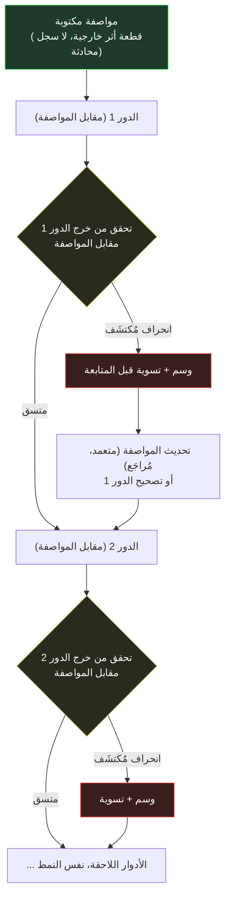

<div dir="rtl">

# القسم الرابع — محادثات موجَّهة بالمواصفات

## ما لا يستطيع سير عمل واحد التقاطه

غلَّف القسم الثالث العقد والسياق والحد في سير عمل قابل لإعادة الاستخدام — وحدة واحدة مُعرَّفة جيداً لتفاعل طلب/استجابة فردي. كثير من المهام الهندسية المفيدة فعلاً لا تتناسب مع هذا الشكل: تصميم عقد طلب/استجابة لـ API عبر تبادل تكراري، أو العمل خلال تحقيق تصحيح متعدد الخطوات، أو صقل قرار معماري عبر عدة جولات من الأسئلة والأجوبة. هذه بطبيعتها متعددة الأدوار - Multi-Turn، واستدعاء واحد لـ <code dir="ltr">IAiWorkflow<TInput, TOutput></code> يلتقط دوراً واحداً منها فقط.

النهج الساذج للتفاعل متعدد الأدوار هو ببساطة تراكم سجل المحادثة — موجّه كل دور واستجابته يُضافان إلى قائمة متنامية، تُعاد كسياق للدور التالي، كما تفعل واجهة المحادثة افتراضياً. يُجادل هذا القسم بأن هذا النهج غير كافٍ لعمل الهندسة تحديداً: سجل المحادثة المتراكم وغير المُهيكَل هو المُعادِل متعدد الأدوار لمشكلة السلسلة السحرية التي افتتح بها القسم الأول، إلا أن الشيء المتراكم بصمت الآن ليس موجّهاً واحداً بل فهماً متطوراً كاملاً للمهمة.

## لماذا تنحرف المحادثة الحرة متعددة الأدوار

تأمَّل مهندساً يعمل مع مساعد ذكاء اصطناعي عبر عشرة أدوار لتصميم سياسة إعادة محاولة لـ Webhook. الدور الثالث يُرسي أن إعادة المحاولات يجب أن تستخدم التراجع الأُسّي - Exponential Backoff. الدور السادس، في سياق مناقشة اهتمام مختلف، تفترض استجابة الذكاء الاصطناعي ضمنياً تراجعاً خطياً — ليس لأنه "نسي" الدور الثالث بأي معنى إنساني، بل لأن الفصل الثاني القسم الأول أرسى أن النموذج لا يملك حالة مستمرة فيما يتجاوز نافذة السياق الحالية، وإذا دُفع محتوى الدور الثالث نحو وسط سياق طال بفعل الدورين الرابع والخامس، فإن آليات "الضياع في المنتصف" من الفصل الثاني القسم الثاني تجعله أقل احتمالاً بشكل قابل للقياس أن يحظى باهتمام قوي خلال توليد الدور السادس.



## نمط SpecAnchoredSession

<div dir="ltr">

```csharp id="code-03-04"
// Target Framework: .NET 10.0
// Chapter: 03 | Section: 04
// book/chapters/chapter-03/sections/section-04.ar.md
//
// SpecAnchoredSession: يحتفظ بمواصفة مكتوبة كمصدر الحقيقة لتفاعل
// متعدد الأدوار مع الذكاء الاصطناعي. يُتحقَّق من خرج كل دور مقابل
// المواصفة قبل قبوله.

using AiToolkit.Application.Ports;
using AiToolkit.Infrastructure.AI;

namespace EngineeringCommunicationToolkit.Infrastructure.AI;

public sealed record SpecClause(string Id, string Statement);

public sealed record TurnRecord(
    int TurnNumber, string UserInput, string AiOutput,
    IReadOnlyList<string> ClausesCited,
    bool DriftDetected, string? DriftDescription);

public sealed class SpecAnchoredSession(
    IReadOnlyList<SpecClause>    specification,
    IChatCompletionClient        chatClient,
    IAiOutputParser<string>      parser,
    ILogger<SpecAnchoredSession> logger)
{
    private readonly List<TurnRecord>  _turns      = [];
    private readonly List<SpecClause>  _activeSpec = specification.ToList();

    public IReadOnlyList<TurnRecord>  Turns               => _turns.AsReadOnly();
    public IReadOnlyList<SpecClause>  ActiveSpecification => _activeSpec.AsReadOnly();

    public async Task<TurnRecord> RunTurnAsync(string userInput, CancellationToken ct)
    {
        var specText = string.Join(
            "\n", _activeSpec.Select(c => $"[{c.Id}] {c.Statement}"));

        var systemPrompt =
            "You are working through a multi-step engineering task. " +
            "The following specification clauses are AUTHORITATIVE — " +
            "every response must be consistent with them. If your response " +
            "would contradict a clause, state the contradiction explicitly " +
            "rather than silently overriding it.\n\n" +
            $"Specification:\n{specText}";

        var raw           = await chatClient.CompleteAsync(systemPrompt, userInput, ct);
        var driftDetected = DetectPotentialDrift(raw, _activeSpec);

        var citedClauses = _activeSpec
            .Where(c => raw.Contains(c.Id, StringComparison.OrdinalIgnoreCase))
            .Select(c => c.Id)
            .ToList();

        var turn = new TurnRecord(
            TurnNumber:       _turns.Count + 1,
            UserInput:        userInput,
            AiOutput:         raw,
            ClausesCited:     citedClauses,
            DriftDetected:    driftDetected,
            DriftDescription: driftDetected
                ? "Output may contradict an active specification clause " +
                  "without explicit acknowledgement. Manual review required."
                : null);

        _turns.Add(turn);

        if (driftDetected)
            logger.LogWarning("Potential spec drift at turn {Turn}", turn.TurnNumber);

        return turn;
    }

    /// <summary>
    /// الطريقة الوحيدة المعتمدة لتغيّر المواصفة أثناء الجلسة —
    /// لا صمت أبداً، دائماً صريح ومُسجَّل.
    /// </summary>
    public void ReviseSpecification(SpecClause revisedClause, string reason)
    {
        var index = _activeSpec.FindIndex(c => c.Id == revisedClause.Id);
        if (index >= 0) _activeSpec[index] = revisedClause;
        else _activeSpec.Add(revisedClause);

        logger.LogInformation(
            "Specification clause {Id} revised. Reason: {Reason}",
            revisedClause.Id, reason);
    }

    private static bool DetectPotentialDrift(
        string output, IReadOnlyList<SpecClause> spec)
        => false; // توضيحي — راجع المشروع النموذجي للتنفيذ الكامل
}
```

</div>

## التفكيك هو القرار التصميمي الحامل

تفكيك المواصفة إلى بنود - SpecClause مُحدَّدة ومُعرَّفة فردياً بدلاً من إبقائها فقرة نثرية واحدة هو القرار التصميمي الأكثر مسؤوليةً عن جعل هذا النمط مفيداً لا شكلياً. المواصفة المتراصة تُعاني من نفس المشكلة التي يُعاني منها سجل المحادثة الحر: استجابة ذكاء اصطناعي يمكن أن تكون "متسقة بشكل عام" مع مواصفة نثرية طويلة بينما تتناقض بصورة دقيقة مع جملة واحدة مدفونة فيها.

البنود المُفكَّكة تحل هذا بنفس الطريقة التي يحل بها مخطط قاعدة بيانات مُطبَّع - Normalized نفس المشكلة لحالة التطبيق: كل بند قابل للعنونة باستقلالية، وقابل للاستشهاد باستقلالية، وقابل للمراجعة باستقلالية، وهو ما يجعل تتبع الاستشهاد وآلية المراجعة المتعمدة ذواتي معنى لا زخرفيتين.

## التعامل مع الانحراف الحقيقي في المواصفة

أحياناً "الانحراف" المُكتشَف ليس خطأ الذكاء الاصطناعي على الإطلاق — إنه خطأ المواصفة. توجد طريقة <code dir="ltr">ReviseSpecification</code> تحديداً لهذه الحالة، وتتطلب معاملاً صريحاً <code dir="ltr">reason</code> وتُسجِّل كل مراجعة. هذا يُحاكي تغيير عقد API مُراجَع: العقد لا يتغيّر لأن تنفيذ مُستدعٍ واحد افترض شيئاً مختلفاً. كل تغيير في المواصفة قرار هندسي، يتخذه المهندس، ويُسجَّل مع تبريره، ومرئي لأي شخص يُراجع تاريخ الجلسة لاحقاً.

## دقة المواصفة في الممارسة

بند جيد الحجم يُقابل قراراً واحداً يكون المهندس مستعداً لإعادة النظر فيه باستقلالية — محدد بما يكفي ليكون دور لاحق إما متسقاً معه بوضوح أو متناقضاً معه بوضوح. "إعادة المحاولات تستخدم تراجعاً أُسّياً بحد أقصى خمس محاولات" قابل للمراجعة والتحقق باستقلالية؛ "سياسة إعادة المحاولة يجب أن تكون قوية" ليست كذلك. هذا يُحاكي حكم الدقة الذي يتخذه المهندسون حين يُفكِّكون ميزة إلى معايير قبول فردية لقصة مستخدم.

السؤال الذي يطرحه فريق يتبنّى <code dir="ltr">SpecAnchoredSession</code> فوراً يستحق إجابةً ملموسة بدلاً من مبدأ مجرد: ما مدى الدقة التي يجب أن يكون عليها <code dir="ltr">SpecClause</code> فعلياً؟ إذا كان فجاً جداً، يفقد تتبع الاستشهاد قيمته التشخيصية — بند يقول "سياسة إعادة المحاولة يجب أن تكون قوية ومُصمَّمة جيداً" يمكن أن يستشهد به أي دور تقريباً دون أن يحمل ذلك الاستشهاد معلومةً حقيقيةً عن القرار المحدد الذي عالجه الدور فعلاً. إذا كان دقيقاً جداً، تتفتت المواصفة إلى عشرات البنود التافهة تقريباً التي تفرض عبء حفظ سجلات غير متناسب مع التعقيد الفعلي للمهمة.

من المنظور العملي لمراجعة الفريق، يخدم حجم البند الصحيح غرضاً إضافياً لا يظهر عند إنشاء المواصفة: فهو يجعل التاريخ المُستند إليه قابلاً للتدقيق. بند بدقة "قرار واحد قابل للمراجعة" يسمح لأي مهندس يُراجع <code dir="ltr">SpecAnchoredSession</code> لاحقاً بالتحقق من أن كل دور استند إلى بندٍ محدد، وأن أي مراجعة لاحقة للمواصفة مُسجَّلة بتبريرها، وأن الانحرافات اكتُشفت في الدور الذي وقعت فيه وليس بعد أن اخترقت الأدوار اللاحقة. هذه المراجعة — تتبع المسار من مواصفة أولية إلى مواصفة مراجعة إلى سلسلة من نتائج الأدوار مع استشهاداتها — هي القطعة الأثرية التي تميّز جلسة موجَّهة بمواصفة عن سجل محادثة عادي، وتصبح أكثر قيمةً بمرور الوقت كلما كبرت المواصفة وتراكمت مراجعاتها. وحين تُجرى هذه المراجعة على جلسة محفوظة عبر جلسات مهندسين، تُصبح هي نفسها الوثيقة التي تُبنى عليها قرارات العودة إلى نقطة أقدم أو القبول النهائي لمخرجات الجلسة.

## المحادثات الموجَّهة بالمواصفات كممارسة فريق

يستحق الأمر الختام بتسمية بُعد لنمط <code dir="ltr">SpecAnchoredSession</code> يمتد إلى ما هو أبعد من تنفيذه التقني المباشر: انضباط تفكيك مهمة إلى بنود قابلة للتحقق قبل الانخراط في استكشاف موسَّع بمساعدة الذكاء الاصطناعي قيِّم بصرف النظر عما إذا كان الفريق قد بنى الأدوات التي يصفها هذا القسم. مهندس يُفكِّك ذهنياً "صمِّم سياسة إعادة محاولة لـ Webhook" إلى قراراته القابلة للتحقق المُكوِّنة — استراتيجية التراجع، عدد المحاولات القصوى، التشويش - Jitter، معالجة الرسائل الميتة - Dead Letter — قبل فتح محادثة مع مساعد ذكاء اصطناعي يُطبِّق بالفعل الانضباط الجوهري لهذا القسم، حتى وهو يعمل بالكامل ضمن واجهة محادثة قياسية دون أي فئة <code dir="ltr">SpecAnchoredSession</code> ظاهرة في أي مكان.

الأدوات التي يُقدّمها هذا القسم تُرسّخ ذلك الانضباط وتُطبِّقه بشكل منهجي — تتبع الاستشهاد واكتشاف الانحراف وتسجيل المراجعة ليست أشياء يستطيع مهندس فعلها بموثوقية يدوياً عبر محادثة طويلة، بنفس الطريقة التي لا يستطيع بها مهندس إعادة بناء التسجيل المُهيكَل بموثوقية يدوياً بعد وقوع الحدث من الذاكرة وحدها. لكن العادة الذهنية الكامنة — معاملة محادثة متعددة الأدوار مع الذكاء الاصطناعي كشيء ينبغي إرساؤه على فهم صريح وقابل للتحقق، بدلاً من حوار حر يُؤتمَن على البقاء متسقاً بنفسه — هي المهارة القابلة للنقل التي يُدرِّسها هذا القسم في نهاية المطاف، مع نمط <code dir="ltr">SpecAnchoredSession</code> تعبيره الملموس والقابل للإنفاذ في كود .NET بمجرد أن تُبرّر تعقيد المهمة وإمكانية إعادة استخدامها بناءه.

## SpecAnchoredSession كقوة دافعة

أحد فوائد نمط SpecAnchoredSession الأقل وضوحاً من قدراته على اكتشاف الانحراف هو ما يفعله بممارسة المهندس نفسها قبل أن تبدأ الجلسة حتى. تفكيك محادثة هندسية متعددة الأدوار إلى قائمة من كائنات <code dir="ltr">SpecClause</code> — كل منها قابل للمعالجة باستقلالية، وكل منها يتطلب <code dir="ltr">Id</code> مستقراً و<code dir="ltr">Statement</code> ملموساً — هو قوة دافعة (forcing function) تُظهر تحديد ناقص قد لا يلاحظه المهندس وإلا حتى دور سادس من محادثة من عشرة أدوار يكشف أن تفسيرين مختلفين معقولين لافتراض ضمني كانا ساريين في آنٍ معاً.

هذه القوة الدافعة هي نفس ما يوفره كتابة واجهة قبل تنفيذها في التطوير المُوجَّه بالاختبارات (TDD): انضباط تعريف العقد بدقة يُظهر غموضاً كان سيؤجَّل إلى وقت التنفيذ، مما يجعله مرئياً وقابلاً للحل بتكلفة أقل من اكتشافه بعد كتابة التنفيذ. مهندس يجد صعوبةً في تفكيك مهمة ذكاء اصطناعي متعددة الأدوار إلى كائنات <code dir="ltr">SpecClause</code> قابلة للتحقق قد صادف على الأرجح تحديداً ناقصاً حقيقياً في المهمة ذاتها — علامة على أن المهمة تحتاج مزيداً من التحليل قبل بدء المحادثة، لا أن الأداة مُقيِّدة أكثر من اللازم بالنسبة للمهمة.

## التعامل مع الاستمرارية عبر جلسات متعددة

اهتمام عملي يجب أن يُعالجه النمط صراحةً: ماذا يحدث حين تمتد محادثة موجَّهة بمواصفة عبر جلسات متعددة — مهندس يعمل خلال خمسة أدوار في جلسة واحدة، يُغلق الجلسة، ويستأنف في اليوم التالي؟ التصميم الصريح للحالة الذي يجعل <code dir="ltr">SpecAnchoredSession</code> مقاوماً للانحراف داخل الجلسة هو بالضبط ما يجعل الاستمرارية عبر الجلسات مباشرةً لا إشكاليةً. <code dir="ltr">ActiveSpecification</code> و<code dir="ltr">Turns</code> سجلات .NET عادية قابلة للتسلسل - Serializable — تصديرها في نهاية جلسة وإعادة تحميلها في بداية الجلسة التالية استمرارية حالة عادية، لا آلية استعادة خاصة.

ما لا يمكن استعادته دون هذا التصميم هو الفهم الضمني الذي قد يكون تراكم في سجل محادثة غير مُهيكَل: "السياق" الذي أُرسي عبر عشرة أدوار من التبادل لكنه لم يُجعَل صريحاً أبداً في أي قطعة أثر. الانضباط القائم على المواصفة أولاً الذي يفرضه هذا القسم هو بالضبط ما يجعل المحادثة قابلةً للاستئناف عبر الجلسات، لأن كل ما يهم بشأن حالة المحادثة الحالية يُلتقَط في المواصفة وفي قائمة <code dir="ltr">TurnRecord</code> للجلسة، بدلاً من توزيعه عبر سجل محادثة متنامٍ وكثيف سياقياً لا يستطيع استدعاء نموذج جديد إعادة بنائه بموثوقية من إعادة التشغيل.

## متى لا تُستخدَم SpecAnchoredSession

حكم التناسب الذي قدّمه القسم الأول لعقود الموجّهات ينطبق هنا أيضاً: <code dir="ltr">SpecAnchoredSession</code> بتفكيكها الصريح لـ<code dir="ltr">SpecClause</code>، وتحققها دوراً بدور، وتسجيل مراجعتها، تستحق عبء تعقيدها للمحادثات الهندسية متعددة الأدوار التي تمتد لأكثر من ثلاثة أو أربعة أدوار، وتتضمن قرارات ذات عواقب تستفيد من اكتشاف الانحراف، وستُستأنف عبر الجلسات أو تُشارَك عبر أعضاء الفريق. لتفاعل بسيط ومكتفٍ ذاتياً من دورين — "اشرح هذا الكود ثم اقترح إعادة هيكلة" — العبء غير مُبرَّر، واستدعاء واحد لـ <code dir="ltr">IAiWorkflow<TInput, TOutput></code> يلتقط كل ما يحتاج التقاطه. معيار القرار هو نفسه بالنسبة لأي تجريد: هل يوفّر تعقيد الآلية تكلفة هندسية أكثر مما يُدخِله؟ عند أعداد أدوار منخفضة وعواقب منخفضة، الإجابة لا؛ وعند أعداد أدوار عالية وعواقب عالية، الإجابة نعم بشكل حاسم، وتكلفة اكتشاف أن محادثة معمارية من اثني عشر دوراً قد انحرفت داخلياً عند الدور التاسع، دون آلية لاكتشاف ذلك أو تصحيحه، أعلى عادةً بكثير من عبء إرساء بنية المواصفة عند بداية المحادثة.

## دمج SpecAnchoredSession مع نمط سير العمل

<code dir="ltr">SpecAnchoredSession</code> و<code dir="ltr">IAiWorkflow<TInput, TOutput></code> نمطان متكاملان لا متنافسان. استدعاء سير عمل واحد يُعالج مهمةً مُعرَّفةً جيداً ومكتفيةً ذاتياً — يحوّل هذا الدخل إلى ذلك الخرج، بعقد محدد لما يعنيه "خرج صالح". جلسة موجَّهة بمواصفة تُعالج عمليةً استكشافيةً متعددة الأدوار حيث يتطور تعريف "الصحيح" عبر الأدوار ويحكمها مواصفة مكتوبة بدلاً من مخطط خرج ثابت.

عملياً، يتداخل النمطان بشكل طبيعي: كل دور من جلسة موجَّهة بمواصفة يمكن أن يمر عبر <code dir="ltr">IAiWorkflow<TInput, TOutput></code> مُسجَّل للتفاعل والتحقق من الحد، بينما تحتفظ الجلسة بحالة المواصفة وتاريخ الأدوار الذي يمتد عبر استدعاءات سير العمل المتعددة هذه. والدور الذي يطلب من الذكاء الاصطناعي التوسّع في قرار تصميمي محدد هو استدعاء سير عمل؛ وتتتبع الجلسة ذلك التوسّع إلى جانب كل الأدوار الأخرى وتتحقق من كلٍّ منها مقابل المواصفة النشطة. هذا التداخل يعني أن حزمة تقليل التباين (القسم الخامس)، وانضباط هندسة السياق (القسم الثاني)، ومسار التدقيق (الفصل الثاني، القسم السادس) تنطبق كلها داخل كل دور من الجلسة، بينما ينطبق انضباط الإرساء على المواصفة عبر الأدوار.

## اكتشاف الانحراف فيما يتجاوز مطابقة الكلمات المفتاحية

طريقة <code dir="ltr">DetectPotentialDrift</code> في الكود أعلاه تُعيد <code dir="ltr">false</code> عمداً مع تعليق يُشير إلى تنفيذ أكثر صرامة. هذا ليس تواضعاً زائفاً — اكتشاف الانحراف بجودة إنتاجية أكثر تعقيداً فعلاً من مطابقة الكلمات المفتاحية التي تتيحها <code dir="ltr">ClausesCited</code>، ويستحق هذا التعقيد إقراراً صريحاً حتى لا يعامل الفرق التنفيذ التوضيحي كافياً للمحادثات ذات العواقب.

تنفيذ أكثر دفاعاً لاكتشاف الانحراف يُطبِّق سير عمل مُخصَّصاً وضيق النطاق — <code dir="ltr">IAiWorkflow<DriftCheckRequest, DriftCheckResult></code> ثانٍ مهمته الكاملة مقارنة خرج دور واحد مقابل بند مواصفة واحد في كل مرة — بدلاً من الاعتماد على الإبلاغ الذاتي عن الاستشهاد أو تحليل الكلمات المفتاحية السطحي. يستفيد نهج سير العمل المتداخل هذا مباشرةً من نمط القابلية للتركيب الذي أرساه القسم الثالث: سير عمل فحص الانحراف قدرة من الدرجة الأولى، مُسجَّلة وقابلة للتدقيق، لها عقدها واستراتيجية سياقها وحدها و<code dir="ltr">WorkflowId</code> خاص بها في السجل — لا استدلال غرضه خاص مُلحَق بفئة الجلسة كفكرة لاحقة.

وما إذا كان الاستثمار في هذا المستوى من تطور اكتشاف الانحراف يستحق هو، مجدداً، حكم تناسب: فريق من مهندسَين يعمل عبر محادثة معمارية متواضعة يمكنه الاعتماد بشكل معقول على الانتباه البشري لالتقاط الانحراف بدلاً من الاكتشاف الآلي. أما فريق من عشرين مهندساً يستخدم جلسات موجَّهة بمواصفة لكل قرار معماري وتصميمي ذي عواقب في قاعدة كود كبيرة، بجلسات تمتد أياماً ومشاركين متعددين، فهو فريق يستحق فيه الاستثمار في اكتشاف انحراف آلي صارم أن يُسدَّد عبر آلاف أدوار الجلسات.

## الأهمية الأشمل لكتابة الأشياء

يستند محتوى هذا القسم التقني إلى ادعاء أشمل حول الممارسة الهندسية: انضباط كتابة مواصفة قبل الانخراط في محادثة بمساعدة الذكاء الاصطناعي قيِّم ليس أساساً لأنه يُمكِّن القدرات التقنية لنمط <code dir="ltr">SpecAnchoredSession</code>، بل لأن فعل الكتابة يفرض الدقة. مهندس يظن أنه يفهم ما يريده من جلسة تصميم متعددة الخطوات بمساعدة الذكاء الاصطناعي حتى يحاول كتابة كل قرار تصميمي كـ<code dir="ltr">SpecClause</code> مستقل وقابل للتحقق — ويكتشف أن ثلاثة من القرارات التي ظنها واضحة في الواقع غير مُحدَّدة بدقة حين تُعبَّر بدقة — قد تعلّم شيئاً قيِّماً عن المهمة قبل بدء محادثة الذكاء الاصطناعي، لا بعد أن تراكم انحراف عدة أدوار الغموض.

هذه هي الديناميكية نفسها التي تجعل كتابة اختبار قبل كتابة كود التنفيذ قيّمة حتى في الحالات التي يبدو فيها الاختبار بديهياً: فعل الكتابة يُظهر افتراضات كانت غير مرئية حين كانت محفوظة في الذهن. انضباط المواصفة الذي يقدّمه هذا القسم هو، من هذه الزاوية، أداة تفكير بقدر ما هو آلية تقنية — وقيمته تتحقق حتى للمهندسين الذين لا يبنون أدوات <code dir="ltr">SpecAnchoredSession</code> أبداً، ما داموا يتبنّون ممارسة كتابة ما يريدون من محادثة ذكاء اصطناعي متعددة الخطوات قبل أن يبدأوها.

## المواصفة كنمط تتويجي للفصل

بالنظر إلى أقسام هذا الفصل الستة بالتتابع، تمثّل الجلسة الموجَّهة بمواصفة النمط التتويجي في تدرّج كان يُبنى نحوه: أرسى القسم الأول أن الموجّه يحتاج هوية مستقرة ومُحدَّدة النوع ليكون موثوقاً في استدعاء واحد. أرسى القسم الثاني أن السياق الداعم لذلك الموجّه يحتاج بناءً متعمداً لا تجميعاً غير محدود. أرسى القسم الثالث أن العقد والسياق يحتاجان إلى تغليفهما معاً كوحدة مُسجَّلة قابلة لإعادة الاستخدام بدلاً من تركيبهما من جديد في كل نقطة استدعاء. ويوسّع القسم الرابع هذا الانضباط من الاستدعاءات الفردية إلى المحادثات: تماماً كما يحتاج موجّه واحد عقداً، تحتاج محادثة متعددة الأدوار مواصفة؛ تماماً كما يحتاج السياق بناءً متعمداً، تحتاج حالة المحادثة تتبعاً صريحاً؛ تماماً كما تستفيد سير العمل من التسجيل والقابلية للاكتشاف، تستفيد الجلسات الموجَّهة بمواصفة من حالة موثَّقة وقابلة للاستعادة.

هذا التدرّج من انضباط مستوى الموجّه إلى انضباط مستوى المحادثة إلى إدارة الحالة على مستوى الجلسة — مع بناء كل مستوى على الأنماط التي أرستها المستويات الأدنى منه — ليس عرضياً. إنه يعكس المبدأ المعماري نفسه الذي يُطبِّقه فرق .NET عند تفكيك نظام معقّد: أرسِ عقوداً واضحة وحالة صريحة في كل طبقة، ويصبح سلوك النظام قابلاً للإدارة عند كل مستوى من مستويات التجريد.

## المصالحة كعملية من الدرجة الأولى

حين يُكتشَف انحراف بين خرج دور والمواصفة النشطة، تتطلب الجلسة عملية مصالحة مُهيكَلة — لا مجرد قيد في السجل وإصلاح يدوي. أبسط نهج دفاعي هو مصالحة من مرحلتين: أولاً، تُحدِّد الجلسة بنود <code dir="ltr">SpecClause</code> المحددة التي انتُهكت، مستشهدةً بـ<code dir="ltr">Id</code> البند الدقيق وبالجزء من الخرج الذي يتناقض معه؛ ثانياً، يقرر المهندس ما إذا كان الانتهاك يشير إلى خطأ ذكاء اصطناعي (صحِّح الخرج وأعِد تشغيل الدور)، أو خطأ في المواصفة (استدعِ <code dir="ltr">ReviseSpecification</code> بتبرير موثَّق)، أو غموض حقيقي يتطلب تفكيك البند المنتَهَك إلى بندين أكثر دقة.

يمنع انضباط المصالحة هذا نمط الفشل الأكثر شيوعاً في الجلسات الموجَّهة بمواصفة: اكتشاف الانحراف، وتدوينه في تعليق، والمضي قدماً على أي حال لأن الخرج الإجمالي «بدا قريباً بما يكفي». الانحراف المُكتشَف وغير المُصالح عليه أسوأ من الانحراف غير المُكتشَف، لأنه يخلق إحساساً زائفاً بأن سلطة المواصفة قد صِينَتُ بينما لم يحدث ذلك. تاريخ أدوار الجلسة، بحقليه <code dir="ltr">DriftDetected</code> و<code dir="ltr">DriftDescription</code>، يجعل المصالحة قابلة للتدقيق — يستطيع مُراجِع لاحق التحقق من أن كل انحراف مُكتشَف قد عولج عبر أحد المسارات الثلاثة المعتمدة بدلاً من التسامح معه بصمت. بنية المسارات الثلاثة (تصحيح الخرج، أو مراجعة المواصفة، أو تفكيك البند) شاملة عمداً: أي استجابة انحراف يواجهها فريق في الممارسة تُقابِل واحداً بالضبط من هذه المسارات، مما يعني أن قرارات المصالحة قابلة للتصنيف، وقابلة للمقارنة عبر الجلسات، ومتاحة كدليل حين يُقيِّم الفريق ما إذا كان بند مواصفة معين يولّد انحرافاً باستمرار وينبغي تفكيكه استباقياً.

بالنسبة للجلسات الممتدة عبر عدة مهندسين، يجب أن تُنسَب قرارات المصالحة إلى مهندس محدد وتُسجَّل إلى جانب الدور الذي أثارها. هذا الإسناد ليس مساءلة بمعنى عقابي — إنه ضمان أن يكون المنطق وراء قرار مصالحة متاحاً حين يواجه مهندس لاحق البند نفسه ويحتاج إلى فهم سبب مراجعته أو سبب قبول خرج ذكاء اصطناعي معين رغم انحراف جزئي.

---

*أرسى القسم الرابع المحادثات الموجَّهة بالمواصفات كممارسة هندسية من الدرجة الأولى. ويتحوّل القسم الخامس إلى الاهتمام المُكمِّل بجعل التفاعلات الفردية موثوقةً قدر الإمكان عبر تقليل التباين المباشر.*

</div>
