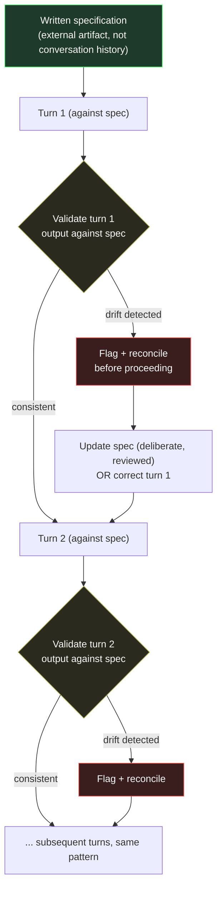

# Section 04 — Specification-Oriented Conversations

## What a Single Workflow Cannot Capture

Section 03 packaged contract, context, and boundary into a reusable workflow — a single, well-defined unit for a single request/response interaction. Many genuinely useful engineering tasks do not fit this shape: designing an API's request/response contract through iterative back-and-forth, working through a multi-step debugging investigation, refining an architectural decision across several rounds of questions and answers. These are inherently multi-turn, and a single `IAiWorkflow<TInput, TOutput>` invocation captures only one turn of it.

The naive approach to multi-turn interaction is to simply accumulate conversation history — each turn's prompt and response appended to a growing list, replayed as context for the next turn, the way a chat interface does by default. This section argues that approach is insufficient for engineering work specifically: accumulated, unstructured conversation history is the multi-turn equivalent of the magic-string problem Section 01 opened with, except now the thing silently accumulating undocumented, untracked state is not a single prompt but an entire evolving understanding of the task.

## Why Free-Form Multi-Turn Dialogue Drifts

Consider an engineer working with an AI assistant across ten turns to design a webhook retry policy. Turn three establishes that retries should use exponential backoff. Turn six, in the course of discussing a different concern, the AI's response implicitly assumes linear backoff — not because it "forgot" turn three in any humanlike sense, but because Chapter 02 Section 01 established that the model has no persistent state beyond what is in the current context window, and if turn three's content has been pushed toward the middle of a now-long context by turns four and five, Chapter 02 Section 02's lost-in-the-middle mechanics make it measurably less likely to receive strong attention during turn six's generation.



## The SpecAnchoredSession Pattern

```csharp id="code-03-04"
// Target Framework: .NET 10.0
// Chapter: 03 | Section: 04
// book/chapters/chapter-03/sections/section-04.en.md
//
// SpecAnchoredSession: holds a written specification as the source of
// truth for a multi-turn AI interaction. Each turn's output is validated
// against the specification before being accepted.

using AiToolkit.Application.Ports;
using AiToolkit.Infrastructure.AI;

namespace EngineeringCommunicationToolkit.Infrastructure.AI;

public sealed record SpecClause(string Id, string Statement);

public sealed record TurnRecord(
    int TurnNumber, string UserInput, string AiOutput,
    IReadOnlyList<string> ClausesCited,
    bool DriftDetected, string? DriftDescription);

public sealed class SpecAnchoredSession(
    IReadOnlyList<SpecClause>    specification,
    IChatCompletionClient        chatClient,
    IAiOutputParser<string>      parser,
    ILogger<SpecAnchoredSession> logger)
{
    private readonly List<TurnRecord>  _turns     = [];
    private readonly List<SpecClause>  _activeSpec = specification.ToList();

    public IReadOnlyList<TurnRecord>  Turns              => _turns.AsReadOnly();
    public IReadOnlyList<SpecClause>  ActiveSpecification => _activeSpec.AsReadOnly();

    public async Task<TurnRecord> RunTurnAsync(string userInput, CancellationToken ct)
    {
        var specText = string.Join(
            "\n", _activeSpec.Select(c => $"[{c.Id}] {c.Statement}"));

        var systemPrompt =
            "You are working through a multi-step engineering task. " +
            "The following specification clauses are AUTHORITATIVE — " +
            "every response must be consistent with them. If your response " +
            "would contradict a clause, state the contradiction explicitly " +
            "rather than silently overriding it.\n\n" +
            $"Specification:\n{specText}";

        var raw          = await chatClient.CompleteAsync(systemPrompt, userInput, ct);
        var driftDetected = DetectPotentialDrift(raw, _activeSpec);

        var citedClauses = _activeSpec
            .Where(c => raw.Contains(c.Id, StringComparison.OrdinalIgnoreCase))
            .Select(c => c.Id)
            .ToList();

        var turn = new TurnRecord(
            TurnNumber:       _turns.Count + 1,
            UserInput:        userInput,
            AiOutput:         raw,
            ClausesCited:     citedClauses,
            DriftDetected:    driftDetected,
            DriftDescription: driftDetected
                ? "Output may contradict an active specification clause " +
                  "without explicit acknowledgement. Manual review required."
                : null);

        _turns.Add(turn);

        if (driftDetected)
            logger.LogWarning("Potential spec drift at turn {Turn}", turn.TurnNumber);

        return turn;
    }

    /// <summary>
    /// The ONLY sanctioned way the specification changes mid-session —
    /// never silent, always explicit and logged.
    /// </summary>
    public void ReviseSpecification(SpecClause revisedClause, string reason)
    {
        var index = _activeSpec.FindIndex(c => c.Id == revisedClause.Id);
        if (index >= 0) _activeSpec[index] = revisedClause;
        else _activeSpec.Add(revisedClause);

        logger.LogInformation(
            "Specification clause {Id} revised. Reason: {Reason}",
            revisedClause.Id, reason);
    }

    private static bool DetectPotentialDrift(
        string output, IReadOnlyList<SpecClause> spec)
        => false; // Illustrative — see sample project for full implementation
}
```

## Decomposition Is the Load-Bearing Design Choice

Decomposing the specification into discrete, identifiable clauses (`SpecClause` with a stable `Id`) rather than keeping it as a single prose paragraph is the single design decision most responsible for making this pattern useful rather than ceremonial. A monolithic specification suffers the same problem free-form conversation history does: an AI response can be "broadly consistent" with a long prose specification while subtly contradicting one buried sentence within it.

Decomposed clauses solve this the way a normalized database schema solves the equivalent problem for application state: each clause is independently addressable, independently citable, and independently revisable, which is what makes both the citation tracking and the deliberate-revision mechanism meaningful rather than decorative.

## Handling Genuine Specification Drift

Sometimes a detected "drift" is not the AI's error at all — it is the specification's. The `ReviseSpecification` method exists precisely for this case, requiring an explicit `reason` parameter and logging every revision. This mirrors a reviewed API contract change: the contract does not change merely because one caller's implementation assumed something different. Every specification change is an engineering decision, made by the engineer, recorded with its rationale, and visible to anyone reviewing the session's history afterward.

## Specification Granularity in Practice

A well-sized clause corresponds to a single decision an engineer would be willing to revisit independently — specific enough that a later turn either clearly respects it or clearly contradicts it. "Retries use exponential backoff with a maximum of five attempts" is independently revisable and checkable; "the retry policy should be robust" is neither. This mirrors the granularity judgment engineers make when decomposing a feature into individual acceptance criteria for a user story.

A question teams adopting `SpecAnchoredSession` ask immediately deserves a concrete answer rather than a general principle: how precise should a `SpecClause` actually be? If it is too coarse, citation tracking loses its diagnostic value — a clause saying "the retry policy should be robust and well-designed" can be cited by almost any turn without that citation carrying real information about the specific decision the turn actually addressed. If it is too fine, the specification fragments into dozens of near-trivial clauses that impose a record-keeping burden disproportionate to the task's actual complexity.

From the team-review perspective, the right clause size serves an additional purpose that is invisible when the specification is first written: it makes the resulting history auditable. A clause sized at "one revisable decision" lets any engineer reviewing a `SpecAnchoredSession` later verify that every turn cited a specific clause, that any later specification revision was recorded with its rationale, and that drift was detected in the turn where it occurred rather than after it had propagated into subsequent turns. This review — tracing the path from an initial specification to a revised specification to a sequence of turn outcomes with their citations — is the artifact that distinguishes a specification-anchored session from an ordinary conversation log, and it grows more valuable over time as the specification grows and its revisions accumulate. Conducted on a session persisted across engineers' sessions, this review becomes the very document on which decisions to roll back to an earlier point or to accept the session's output are based.

## Specification-Oriented Conversations as a Team Practice

The discipline of decomposing a task into checkable clauses before engaging in extended AI-assisted exploration is valuable independent of whether a team has built the tooling described here. An engineer who mentally decomposes "design a webhook retry policy" into its constituent checkable decisions before opening a conversation with an AI assistant is already applying this section's core discipline. That habit of mind — decompose first, converse second — is worth carrying forward into every multi-turn AI interaction this book describes from this point on, whether or not the formal tooling is present.

The tooling this section presents formalizes and systematizes that discipline — citation tracking, drift detection, and revision logging are not things an engineer can do reliably by hand across a long conversation, in the same way an engineer cannot reliably reconstruct structured logging by hand after the fact from memory alone. But the underlying habit of mind — treating a multi-turn conversation with an AI assistant as something that should be anchored to an explicit, checkable understanding rather than a free-form dialogue trusted to stay consistent with itself — is the transferable skill this section ultimately teaches, with the `SpecAnchoredSession` pattern as its concrete, enforceable expression in .NET code once the task's complexity and reusability justify building it.

## The SpecAnchoredSession as a Forcing Function

One benefit of the `SpecAnchoredSession` pattern that is less immediately obvious than its drift-detection capabilities is what it does to the engineer's own practice before the session even begins. Decomposing a multi-step engineering conversation into a list of `SpecClause` objects — each independently addressable, each requiring a stable `Id` and a concrete `Statement` — is a forcing function that surfaces underspecification the engineer might otherwise not notice until turn six of a ten-turn conversation reveals that two different reasonable interpretations of an implicit assumption were in play simultaneously.

This forcing function is the same one that writing an interface before implementing it provides in test-driven development: the discipline of defining the contract precisely reveals ambiguities that would have been deferred to implementation time, making them visible and resolvable at a lower cost than discovering them after the implementation is written. An engineer who finds it difficult to decompose a multi-step AI task into checkable `SpecClause` objects has almost certainly encountered genuine underspecification in the task itself — a sign that the task needs more analysis before the conversation begins, not that the tool is too rigid for the task.

## Handling Multi-Session Continuity

A practical concern the pattern must handle explicitly: what happens when a specification-anchored conversation spans multiple sessions — an engineer works through five turns in one sitting, closes the session, and resumes the next day? The explicit-state design that makes `SpecAnchoredSession` resistant to within-session drift is precisely what makes across-session continuity straightforward rather than problematic. The `ActiveSpecification` and `Turns` are plain, serializable .NET records — persisting them at the end of a session and rehydrating them at the start of the next is ordinary state persistence, not a special recovery mechanism.

What is not recoverable without this design is the implicit understanding that might have accumulated in an unstructured conversation history: the "context" that was established through ten turns of back-and-forth but never made explicit in any artifact. The specification-first discipline this section imposes is precisely what makes the conversation resumable across sessions, because everything that matters about the conversation's current state is captured in the specification and in the session's `TurnRecord` list, rather than distributed across a growing, contextually-dense conversation history that a new model call cannot reliably reconstruct from replay.

## When Not to Use SpecAnchoredSession

The proportionality judgment Section 01 introduced for prompt contracts applies here as well: `SpecAnchoredSession` with its explicit `SpecClause` decomposition, turn-by-turn validation, and revision logging earns its complexity overhead for multi-turn engineering conversations that span more than three or four turns, involve consequential decisions that benefit from drift detection, and will either be resumed across sessions or shared across team members. For a simple, self-contained two-turn interaction — "explain this code, then suggest a refactoring" — the overhead is not justified, and a single `IAiWorkflow<TInput, TOutput>` invocation captures everything that needs capturing. The decision criterion is the same as for any abstraction: does the complexity of the mechanism save more engineering cost than it introduces? At low turn counts and low consequence, the answer is no; at high turn counts and high consequence, the answer is decisively yes, and the cost of discovering that a twelve-turn architectural conversation has drifted internally at turn nine, with no mechanism to detect or correct it, is typically much higher than the overhead of establishing the specification structure at the conversation's start.

## Integrating SpecAnchoredSession With the Workflow Pattern

The `SpecAnchoredSession` and `IAiWorkflow<TInput, TOutput>` are complementary rather than competing patterns, and understanding how they compose clarifies when to use each. A single workflow invocation handles a well-defined, self-contained task — transform this input into this output, with a defined contract for what "valid output" means. A specification-anchored session handles a multi-turn exploratory process where the definition of "correct" evolves across turns and is governed by a written specification rather than a static output schema.

In practice, the two patterns nest naturally: each *turn* of a specification-anchored session can route through a registered `IAiWorkflow<TInput, TOutput>` for the AI interaction and boundary validation, while the session maintains the specification state and turn history that spans multiple such workflow invocations. A turn that asks the AI to elaborate on a specific design decision is a workflow invocation; the session tracks that elaboration alongside all other turns and validates each against the active specification. This nesting means the variance-reduction stack (Section 05), the context-engineering discipline (Section 02), and the audit trail (Chapter 02, Section 06) all apply within each turn of the session, while the specification-anchoring discipline applies across turns.

## Detecting Drift Beyond Keyword Matching

The `DetectPotentialDrift` method in the sample code deliberately returns `false` with a comment pointing to a more rigorous implementation. This is not false modesty — production-quality drift detection is genuinely more complex than the keyword matching that `ClausesCited` enables, and the complexity is worth acknowledging explicitly so teams do not treat the illustrative implementation as sufficient for consequential conversations.

A more defensible drift detection implementation applies a dedicated, narrowly-scoped workflow — a second `IAiWorkflow<DriftCheckRequest, DriftCheckResult>` whose entire job is comparing one turn's output against one specification clause at a time — rather than relying on self-reported citation or surface-level keyword analysis. This nested workflow approach benefits directly from the composability pattern Section 03 established: a drift-checking workflow is a first-class, registered, auditable capability, with its own contract, its own context strategy, its own boundary, and its own `WorkflowId` in the registry — not a special-purpose heuristic tacked onto the session class as an afterthought.

Whether to invest in this level of drift-detection sophistication is, again, a proportionality judgment: a two-engineer team working through a modest architectural conversation can reasonably rely on human attention to catch drift rather than automated detection. A team of twenty engineers using specification-anchored sessions for every consequential architectural and design decision in a large codebase, with sessions spanning days and multiple participants, is a team where the investment in rigorous automated drift detection pays back across thousands of session-turns.

## The Broader Significance of Writing Things Down

This section's technical content rests on a broader claim about engineering practice that is worth making explicit before the chapter moves on: the discipline of writing a specification before engaging in an AI-assisted conversation is valuable not primarily because it enables the `SpecAnchoredSession` pattern's technical capabilities, but because the act of writing forces precision. An engineer who believes they understand what they want from a multi-step AI-assisted design session until they try to write each design decision as an independent, checkable `SpecClause` — and discovers that three of the decisions they thought were clear are actually underspecified when expressed precisely — has learned something valuable about the task before starting the AI conversation, not after several turns of drift have compounded the ambiguity.

This is the same dynamic that makes writing a test before writing implementation code valuable even in cases where the test seems obvious: the act of writing surfaces assumptions that were invisible when held in mental form. The specification discipline this section introduces is, in this respect, as much a thinking tool as it is a technical mechanism — and its value accrues even to engineers who never build the `SpecAnchoredSession` tooling, as long as they adopt the practice of writing down what they want from a multi-step AI conversation before they start having it.

## The Specification as the Chapter's Culminating Pattern

Looking at the six sections of this chapter in sequence, the specification-anchored session represents the culminating pattern in a progression that has been building toward it: Section 01 established that a prompt needs a stable, typed identity to be reliable in a single invocation. Section 02 established that the context supporting that prompt needs deliberate construction rather than unbounded concatenation. Section 03 established that the contract and context need to be packaged together as a registered, reusable unit rather than assembled freshly at each call site. Section 04 extends this discipline from individual invocations to conversations: just as a single prompt needs a contract, a multi-turn conversation needs a specification; just as context needs deliberate construction, conversation state needs explicit tracking; just as workflows benefit from registration and discoverability, specification-anchored sessions benefit from documented, recoverable state.

This progression from prompt-level discipline to conversation-level discipline to session-level state management — with each level building on the patterns established by the levels below it — is not accidental. It reflects the same architectural principle .NET teams apply when decomposing a complex system: establish clear contracts and explicit state at each layer, and the system's behavior becomes tractable at every level of abstraction.

## Reconciliation as a First-Class Operation

When drift is detected between a turn's output and the active specification, the session requires a structured reconciliation process — not merely a log entry and a manual fix. The simplest defensible approach is a two-phase reconciliation: first, the session identifies which specific `SpecClause` values were violated, citing the exact clause `Id` and the portion of the output that contradicts it; second, the engineer decides whether the violation indicates an AI error (correct the output and re-run the turn), a specification error (invoke `ReviseSpecification` with a documented reason), or a genuine ambiguity that requires decomposing the violated clause into two more precise clauses.

This reconciliation discipline prevents the most common failure mode in specification-anchored sessions: detecting drift, noting it in a comment, and proceeding anyway because the overall output "seemed close enough." A drift that is detected but not reconciled is worse than a drift that is not detected, because it creates a false sense that the specification's authority was upheld when it was not. The session's turn history, with its `DriftDetected` and `DriftDescription` fields, makes reconciliation auditable — a later reviewer can verify that every detected drift was addressed through one of the three sanctioned paths rather than silently tolerated. The three-path structure (correct output, revise specification, or decompose clause) is deliberately exhaustive: any drift response a team encounters in practice maps to exactly one of these paths, which means reconciliation decisions are categorizable, comparable across sessions, and available as evidence when the team evaluates whether a particular specification clause consistently generates drift and should be decomposed preemptively.

For sessions spanning multiple engineers, reconciliation decisions should be attributed to a specific engineer and recorded alongside the turn that triggered them. This attribution is not about accountability in a punitive sense — it is about ensuring that the reasoning behind a reconciliation decision is available when a later engineer encounters the same specification clause and needs to understand why it was revised or why a particular AI output was accepted despite partial drift.

---

*Section 04 has established specification-oriented conversations as a first-class engineering practice. Section 05 turns to the complementary concern of making individual interactions as reliable as possible through direct variance reduction.*
