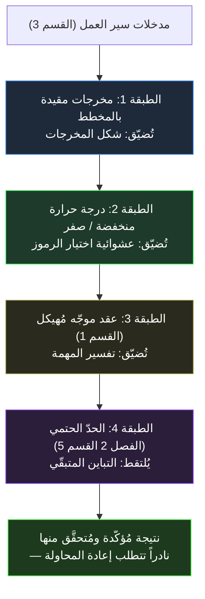

<div dir="rtl">
# القسم الخامس — بناء تفاعلات AI محددة النتائج

## تضييق التباين، لا إزالته

أرسى الفصل الثاني في القسم الخامس الحدّ المعماري: محاولة AI احتمالية محاطة بتحقق محدد النتائج وإعادة المحاولة، مع تحذير صريح بأن درجة حرارة صفر تُقلّل التباين لكنها لا تُزاله. هذا القسم هو الدليل العملي: مجموعة محددة من التقنيات الطبقية التي تُضيّق مساحة المخرجات المقبولة *قبل* توليد الاستجابة، مما يُقلّل من تردّد استنفاد ميزانية إعادة المحاولة عند الحدّ الحتمي، بدلاً من الاعتماد على إعادة المحاولة بعد الوقوع كدفاع وحيد.

يهمّ هذا التمييز تشغيلياً. سيرُ عملٍ يعمل بإعادة المحاولة في اثنتين من كل خمس محاولات لأن مخرجاته الأولية تفشل بشكل متكرر في التحقق — وهذا التقني صحيح — لكنها تدفع ثمن تأخير وتكلفة غير ضرورية لتباين كان يمكن تضييقه مسبقاً. التقنيات التي يُقدّمها هذا القسم موجودة لتحريك تلك النسبة: إعادة محاولة أقل، ليس لأن التحقق أصبح أكثر تساهلاً، بل لأن التفاعل نفسه تمّ هندسته لإنتاج مخرجات محدودة النطاق بشكل أكثر اتساقاً في المقام الأول.

## طبقة تضييق التباين



كل طبقة في الطبقات تُضيّق مصدراً مختلفاً من مصادر التباين، والطبقات متكاملة وليست مكرّرة. المخرجات المقيدة بالمخطط تُلغي فئة كاملة من أخطاء التحقق البنيوي قبل اكتمال التوليد. درجة الحرارة المنخفضة تُضيّق عشوائية اختيار الرموز ضمن ذلك الشكل. عقد الموجّه المُقيّد يُضيّق تفسير المهمة نفسه — التعليمات الغامضة تُنتج تفسيرات متنوعة بغض النظر عن درجة الحرارة أو المخطط. الحدّ الحتمي يبقى الطبقة الأخيرة بالضبط لأن لا تركيبة من الثلاث الأولى تُلغي التباين.

## مخرجات مقيدة بالمخطط في .NET

<div dir="ltr">

```csharp id="code-03-05"
// Target Framework: .NET 10.0
// Chapter: 03 | Section: 05
// book/chapters/chapter-03/sections/section-05.ar.md
//
// SchemaConstrainedClient: يُغلّف محاولات إكمال المحادثة بنمط
// المخرجات المُهيكلة، فيُقيّد النموذج بإصدار JSON متوافق مع
// مخطط مُعلن. مع DeterministicAiBoundary<T>، يُقلّل هذا من
// معدل إعادة المحاولة بشكل قابل للقياس مقارنة بتحليل النص الحر.

using System.Text.Json;
using AiToolkit.Application.Ports;
using OpenAI.Chat;

namespace EngineeringCommunicationToolkit.Infrastructure.AI;

public sealed class SchemaConstrainedClient(
    ChatClient openAiClient,
    BinaryData jsonSchema,
    string     schemaName)
    : IChatCompletionClient
{
    public async Task<string> CompleteAsync(
        string systemPrompt, string userPrompt, CancellationToken ct)
    {
        var options = new ChatCompletionOptions
        {
            ResponseFormat = ChatResponseFormat.CreateJsonSchemaFormat(
                jsonSchemaFormatName: schemaName,
                jsonSchema:           jsonSchema,
                jsonSchemaIsStrict:   true),
            Temperature = 0.1f,
        };

        ChatMessage[] messages =
        [
            new SystemChatMessage(systemPrompt),
            new UserChatMessage(userPrompt),
        ];

        var response = await openAiClient.CompleteChatAsync(messages, options, ct);
        return response.Value.Content.Count > 0
            ? response.Value.Content[0].Text
            : string.Empty;
    }

    public async IAsyncEnumerable<string> CompleteStreamingAsync(
        string systemPrompt, string userPrompt,
        [System.Runtime.CompilerServices.EnumeratorCancellation] CancellationToken ct)
    {
        yield return await CompleteAsync(systemPrompt, userPrompt, ct);
    }
}

public static class CodeReviewSchema
{
    public static readonly BinaryData Schema = BinaryData.FromString(
        """
        {
          "type": "object",
          "properties": {
            "issues": {
              "type": "array",
              "items": {
                "type": "object",
                "properties": {
                  "line":        { "type": "integer" },
                  "severity":    { "type": "string", "enum": ["info","warning","error"] },
                  "description": { "type": "string" }
                },
                "required": ["line","severity","description"],
                "additionalProperties": false
              }
            }
          },
          "required": ["issues"],
          "additionalProperties": false
        }
        """);
}
```

</div>

## ما لا تحلّه القيود المخططية

المخرجات المقيدة بالمخطط تُضمن صلاحية *بنيوية* — الاستجابة ستُحلّل كـ JSON متوافق مع الأنواع الصحيحة في الحقول. لكنها لا تُضمن صلاحية *دلالية* — استجابة متوافقة مع المخطط لا يزال بإمكانها أن تحتوي على رقم سطر مُختلَق، أو تصنيف خطأ للخطورة، أو وصفاً يُخطأ التشخيص الفعلي للمشكلة، لأن المخطط يُقيّد الشكل لا الصحة. التصنيف الكامل للأوهام في الفصل الثاني القسم الرابع لا يزال معمّماً داخل استجابة متوافقة مع المخطط. هذه التقنية تُضيّق حيث يحتاج جهد التحقق التركيز (الصلاحية الدلالية) بإلغاء حيث لم يعد بحاجة للتركيز (التحليل البنيوي)، لكنها لا تُحلّ محل خطوة التحقق الدلالية في <code dir="ltr">DeterministicAiBoundary<T></code>.

## قياس ما إذا كان تضييق التباين يعمل

**معدل إعادة المحاولة عند الحدّ الحتمي** هو الإشارة الأساسية لتضييق التباين: معدل إعادة المحاولة لسير العمل قبل وبعد إضافة القيود المخططية، قبل وبعد خفض درجة الحرارة، قبل وبعد تقييد القيود الصريحة في عقد الموجّه، قابل للمقارنة المباشرة، لأن <code dir="ltr">DeterministicAiBoundary<T></code> يسجّل بالفعل عدد المحاولات لكل تنفيذ. يجب على الفريق المتبنى لـ <code dir="ltr">SchemaConstrainedClient</code> لسير عمل محدد أن يتوقع — ويتحقق صراحةً، لا يفترض فحسب — انخفاضاً قابلاً للقياس في معدل إعادة المحاولة لسير العمل ذلك تحديداً.

**تنوّع المخرجات عبر محاولات متطابقة متكررة** هو إشارة مُكمّلة تتبعها أثناء تطوير سير العمل. تشغيل مدخلات سير العمل نفسها عبر سير العمل نفسه عدة مرات ومقارنة المخرجات الناتجة من حيث الاتساق الدلالي يكشف ما إذا كان المزيج المعطى من القيود المخططية ودرجة حرارة وعقد الموجّه يُضيّق فعلاً مساحة المخرجات، أم أن الغموض الحقيقي في المهمة كبير بما يكفي بحيث لن يُنتج أي مزيج من هذه التقنيات نتائج متسقة دون معالجة الغموض مباشرة في عقد الموجّه نفسه.

## الاختيار بين المخرجات المُهيكلة والتحليل الحر

ليست كل سير عمل تستفيد بالتساوي من المخرجات المقيدة بالمخطط. القيود المخططية تُبرر بوضوح تكاليفها لسير العمل الذي تملك مخرجاته بنية حقيقية لتُقيّد — مثال مراجعة الكود مصفوفة من كائنات Issues المُحدّدة النوع، أو أي شيء يكون <code dir="ltr">TOutput</code> نوعه سجلاً طبيعياً بخصائص متعددة متميزة. لسير العمل الذي مخرجاته نص حرّ بطبعه — توصية معمارية حرة مُوجّهة لقارئ بشري لا لاستهلاك برمجي — إجبار تلك المخرجات عبر مخطط JSON يضيف تكلفة آليات القيود المخططية دون معالجة أي غموض بنيوي حقيقي، لأن لم تكن هناك بنية لتُقيّد في المقام الأول.

## التفاعل بين تضييق التباين والتكلفة

تقنيات تضييق التباين هنا ليست محايدة من حيث التكلفة. يمكن لفريق أن يُقدّم عقد موجّه مُقيّداً بأمانة أولاً — مجاني تماماً من حيث تكلفة التشغيل — ويقيّس تأثيره على معدل إعادة المحاولة، ثم يُضيف القيود المخططية أو مزيداً من ضبط درجة الحرارة فقط إذا ثبت أن التحسين على مستوى العقد وحده غير كافٍ لمتطلبات موثوقية سير العمل. التعامل مع الطبقات الأربعة كتسلسل تبنٍّ مُرتّب ومُستند إلى الأدلة، لا كقائمة مُركَّبة تُطبَّق بشكل فوري وموحد على كل سير عمل، يُبقي هذه التقنيات متوافقة مع حكم التناسب الذي طلبه القسم 1. هذا هو الانضباط الذي يفترضه القسم 6 كشرط مسبق لتركيب تفاعلات موثوقة فردية في تدفقات عمل متعددة الخطوات موثوقة.

## لماذا الطبقات مُرتّبة بهذا التسلسل تحديداً

تسلسل طبقات تضييق التباين — القيود المخططية أولاً، ثم درجة الحرارة، ثم عقد الموجّه، ثم الحدّ الحتمي — ليس عشوائياً، وفهم التوضيح يُبيّن متى قد يُبرر تطبيق مجموعة فرعية فقط من الطبقات لسير عمل محدد.

الخرجات المقيدة بالمخطط تتصدر لأنها الطبقة الوحيدة التي تمنع الأخطاء البنيوية قبل اكتمال التوليد، بدلاً من كشفها بعدها. كل طبقة أخرى تُطبَّق قبل أو أثناء التوليد (درجة الحرارة، عقد الموجّه) أو بعدها (الحدّ الحتمي)؛ القيود المخططية وحدها تعمل بتقييد عملية التوليد على مستوى الرموز، مما يجعل مساحة المخرجات الممكنة أصغر قبل أن يُصدر رمز استجابة واحد. وإذا كان المصدر الأساسي للضغط على معدل إعادة المحاولة في سير العمل هو الأخطاء البنيوية — JSON مشوّه، حقول مطلوبة مفقودة، قيم تعداد خاطئة — فإن القيود المخططية تُعالج ذلك المصدر مباشرةً وبكفاءة، دون الحاجة إلى إعادة محاولة إطلاقاً.

خفض درجة الحرارة يتصدر ثانياً لأنه الأسهل للتطبيق بعد القيود المخططية، لا يكلف عملياً شيئاً، ويُضيّق عشوائية اختيار الرموز ضمن أي شكل بنيوي حددته المخططات. إنه يتناسب بشكل طبيعي مع القيود المخططية: المخطط يُقيّد ما *يمكن* أن يظهر في الاستجابة؛ درجة حرارة أخفض تُقلّل مدى عشوائية اختيار النموذج من بين الرموز *المسموح* بها بموجب المخطط. بدون قيود مخططية، خفض درجة الحرارة وحده غالباً ما يُنتج تبايناً أقل في الصياغة مع ترك المعنى الدلالي متغيراً للغاية — الاستجابة متسقة في صياغتها لكنها لا تزال غير متسقة في صحتها.

عقد الموجّه يتصدر ثالثاً بدلاً من أولاً لأن مساهمته في تضييق التباين — تضييق تفسير المهمة — هي جزئياً وظيفة مدى وضوح المهمة من البداية، وهو شيء يتحكم فيه المهندس من خلال تصميم المواصفات وهندسة السياق (الأقسام 4 و 2) بدلاً من معايير التوليد. مهمة سيئة التوضيح في سياق سيء التقييد ستُنتج مخرجات متنوعة بغض النظر عن مدى صرامة صياغة القيود في عقد الموجّه؛ العقد يعالج تفسير مهمة مُوضّحة جيداً، لا يُعوّض عن التوضيح الناقص.

## الحدّ الحتمي كشبكة أمان، لا خط دفاع أول

أهم إعادة صياغة يُقدّمها هذا القسم هو نقل <code dir="ltr">DeterministicAiBoundary<T></code> من دور الدفاع الأولي ضد المخرجات السيئة إلى دور شبكة الأمان للتباين المتبقّي الذي لا تُلقيه الطبقات العلوية. سير عمل يعتمد بشكل كبير على منطق إعادة المحاولة في الحدّ — معدلات إعادة محاولة عالية، نجاحات المحاولة الثالثة المتكررة — يُشير إلى أن الطبقات العلوية لا تفعل عملها بفعالية، لا إلى أن الحدّ يفعل عمله جيداً. الحدّ يفعل عمله في كلا الحالتين — يمنع المخرجات السيئة من الوصول إلى المُستدعين — لكن فشل الطبقات العلوية في تضييق التباين يفرض ثمناً في التأخير ونفقات الرموز يمكن تجنبه لو كان سير العمل مُهندساً بشكل أفضل على مستوى التوليد.

هذه إعادة الصياغة لها تطبيق عملي في كيفية تفسير الفريق لمقاييس معدل إعادة المحاولة لسير عمل جديد في الأيام الأولى بعد النشر: معدل إعادة المحاولة مرتفع باستمرار (أعلى من، لنقل، 15-20% لمهمة تقع في المنطقة الكثيفة للتدريب) هو إشارة تشخيصية تشير إلى إحدى الطبقات العلوية الثلاث كمصدر محتمل للمشكلة، لا تأكيد على أن الحدّ مُهيّأ بشكل صحيح. التسلسل التشخيصي يتبع الطبقات بالعكس — تحقق أولاً من الصلاحية البنيوية (هل المخطط مُعرّف جيداً والنموذج يلتزم به فعلاً؟)، ثم الصلاحية الدلالية (هل مجموعة القيود الصريحة في عقد الموجّه كافية للتمييز بين الاستجابات الصحيحة والخاطئة؟)، ثم جودة السياق (هل السياق فعلاً ذا صلة، ومُرتبّب بشكل جيد، وغير مُتقادم؟) — قبل الاستنتاج بأن صعوبة المهمة هي التفسير لمعدل إعادة المحاولة المرتفع.

## القيود المخططية وعقد الموجّه: متكاملان، لا مكرّران

سؤال يواجهه الفريق عند تبني كلا القيود المخططية (هذا القسم) ونمط عقد الموجّه (القسم 1) هو كيف يتكامل الاثنان: إذا كان مخطط المخرجات يفرض بالفعل بنية محددة، فماذا تُضيف لغة القيود الصريحة في عقد الموجّه؟

الجواب هو أنهما يُعالجان جوانب مختلفة من عملية التوليد. مخطط المخرجات يُقيّد الرموز التي يسمح النموذج بإصدارها — يعمل على مستوى التحليل، مُصفّياً التوزيع الاحتمالي على المعجم ليُبقي فقط الرموز المتوافقة مع الموقع الحالي في المخطط. القيود الصريحة في عقد الموجّه تعمل على مستوى تفسير المهمة — تُشكّل كيفية تصور النموذج لما يجب أن يفعله، مما يؤثر على المحتوى الدلالي للاستجابة بدلاً من شكلها البنيوي فحسب. عقد مراجعة الكود الذي ينص صراحةً على "تحديد المشاكل المحددة فقط — لا تُعيد وصف ما يفعله الكود" يُضيّق تفسير المهمة الذي يُحكم *أي* مشاكل تُبلّغ عنها وكيف تُوصف، لا الشكل البنيوي للـ JSON الذي يحتوي على تلك الأوصاف. المخطط يضمن أن تلك الأوصاف تظهر في الحقول الصحيحة؛ عقد الموجّه يضمن أنها الأوصاف الصحيحة.

هذا التكامل يعني أن التقنيتين تستهدفان مصادر مستقلة من التباين وينبغي تطبيقهما معاً عادةً عندما تُسهم كلا المصدران في معدلات إعادة المحاولة المرتفعة. فريق يُطبّق القيود المخططية ويلاحظ انخفاضاً في معدل الأخطاء البنيوية دون انخفاض مكافئ في معدل الأخطاء الدلالية (تصنيفات خطئة، مشاكل مُحدّدة بشكل خاطئ، أوصاف تُخطئ المشكلة الفعلية) ينبغي أن يُحقق في مدى تقييد القيود الصريحة في عقد الموجّه كرافعة تالية، بدلاً من افتراض أن القيود المخططية وحدها كان ينبغي أن تُعالج معدل إعادة المحاولة الكامل.

## توافق المخرجات المُهيكلة عبر عائلات النماذج

مخاوف هندسية عملية عند تبني المخرجات المقيدة بالمخطط في تطبيق .NET يستهدف مزودي AI أو عائلات نماذج متعددة هي أن دعم المخرجات المُهيكلة — الكامن في <code dir="ltr">ChatResponseFormat.CreateJsonSchemaFormat</code> — غير متوفر بشكل عالمي أو مُنفّذ بشكل متطابق عبر المزودين. التجريد <code dir="ltr">IChatCompletionClient</code> من الفصل الثاني في <code dir="ltr">AiToolkit.Application.Ports</code> يوفر الوصل الطبيعي لمعالجة هذا التنوع: <code dir="ltr">SchemaConstrainedClient</code> يُنفّذ التجريد للمزودين الذين يدعمون المخرجات المُهيكلة؛ تنفيذ متوازٍ يستخدم تعليمات JSON المبنية في الموجّه يليها التحقق في <code dir="ltr">DeterministicAiBoundary<T></code> للمزودين الذين لا يدعمونها. سير العمل المُستدعي لا يتأثر بـ أي تنفيذ مُسجّل — يعتمد على <code dir="ltr">IChatCompletionClient</code>، يُحلّ أي تنفيذ مُسجّل للهدف الحالي، ويعتمد على الحدّ للتحقق بغض النظر.

نمط تجريد المزود هذا يستحق التأسيس مبكراً في عمل تكامل AI في المشروع، قبل أن يتراكم لدى الفريق عشرات نقاط الاستدعاء التي تُشير مباشرة إلى SDK مزود محدد ويجب ترحيلها بشكل منفصل عند تغيير اختيار المزود. نمط سير العمل الذي يُرسيه هذا القسم يفرض هذا التجريد بشكل طبيعي: سير العمل يُسجّل تنفيذ <code dir="ltr">IChatCompletionClient</code> محدد في تسجيل DI الخاص به، لكن فئة <code dir="ltr">AiWorkflow<TInput, TOutput></code> نفسها لا تُشير إلى أي أنواع خاصة بالمزود، مما يُبقي تكلفة الترحيل عند تغيير المزود محلية في تهيئة التسجيل بدلاً من الانتشار عبر كل تنفيذ سير عمل.

## العلاقة بين تضييق التباين وتوزيع التدريب

أرسى الفصل الثاني في القسم الثاني أن القدرة والموثوقية تختلفان بكثافة توزيع التدريب — المهام في المناطق الكثيفة والممثلة جيداً من التوزيع تُنتج مخرجات أكثر موثوقية من المهام في الحواف النادرة وغير الممثلة. طبقة تضييق التباين التي يُقدّمها هذا القسم تتفاعل مع رؤية توزيع التدريب هذه بطريقة محددة ومهمة: تقنيات الطبقات تُقلّل التباين ضمن أي منطقة يشغلها المهمة من التوزيع، لكنها لا تُمكنها من نقل المهمة من منطقة نادرة إلى كثيفة.

هذا يعني أن القيود المخططية وخفض درجة الحرارة والعقود الموجّهة المُقيّدة المُطبّقة على مهمة في منطقة فعلاً نادرة من توزيع التدريب ستُنتج مخرجات أكثر اتساقاً بنوياً، وأكثر اتساقاً في الصياغة، وأكثر اتساقاً في التفسير — لكن المخرجات ستظل تملك الخصائص النوعية لمنطقة نادرة، لأن تلك الخصائص يُحدّدها ما تعلّمته النموذج أثناء التدريب، لا كيفية تقييد توليد المخرجات في وقت الاستدلال.

الدلالة العملية هي أن تحسينات معدل إعادة المحاولة التي يجب على الفريق توقعها من طبقة تضييق التباين مُعايَرة بكثافة منطقة المهمة، لا بمعيار مطلق. مهمة في منطقة كثيفة قد ترى معدلات إعادة المحاولة تنخفض من 15% إلى 3% بعد تطبيق الطبقات الأربع؛ مهمة في منطقة نادرة قد ترى معدلات إعادة المحاولة تنخفض من 40% إلى 25% بعد تطبيق الطبقات الأربع — تحسين، لكن ليس حلاً، مع المعدل المتبقّي يُنسب إلى عوامل نوعية لا يمكن لتقنيات تضييق التباين معالجتها.

## تشغيل الانضباط القياسي

الانضباط القياسي الذي أُنجزه هذا القسم — تتبع معدل إعادة المحاولة وتنوّع المخرجات كإشارات أساسية لفعالية تضييق التباين — تستفيد من كونها تشغيلية بدلاً من توجيه تمنّي. ثلاث ممارسات محددة تُجسّد هذا تشغيلياً لفريق .NET يتبنى نمط سير العمل من القسم الثالث.

الممارسة الأولى هي تجهيز <code dir="ltr">DeterministicAiBoundary<T></code> بإصدار مقاييس مُهيكلة — عدد المحاولات لكل استدعاء، معدل النجاح في المحاولة الأولى، تصنيف سبب الفشل (بنيوي مقابل دلالي) — كجزء من بنية الرصد الحالية للتطبيق. في .NET 8، يُنفّذ هذا عادةً عبر <code dir="ltr">System.Diagnostics.Metrics</code> أو عبر تكامل OpenTelemetry القائم للفريق، لا عبر نظام مراقبة منفصل، مما يُبقي رصد سير عمل AI متسقاً مع باقي رصد العمليات للتطبيق.

الممارسة الثانية هي تأسيس معدل إعادة المحاولة الأساسي لكل سير عمل جديد في أسبوعه الأول من الاستخدام الإنتاجي، والتعامل مع الانحرافات عن ذلك الأساسي كإشارات لا تشويشاً. سير عمل يعمل عند 5% معدل إعادة المحاولة لمدة ثلاثة أشهر وينتقل فجأة إلى 15% يُشير إلى تغيير — ربما تحديث نموذج من المزود، ربما تحولاً في توزيع المدخلات التي يتلقاها سير العمل، ربما مشكلة تقادم في مصدر سياق — يستحق التحقيق، لا التسامح.

الممارسة الثالثة هي جدولة مراجعات دورية لاستراتيجية السياق لسير العمل عالي الحجم أو عالي العواقب، بشكل مشابه لجدولة فرق .NET لتحديثات التبعيات: لا كاستجابة لعطل محدد، بل كممارسة هندسية استباقية تُبقي ترتيبات أولوية سير العمل متوافقة مع الخصائص الفعلية لمدخلات المهمة مع تطور كل من قاعدة الكود والنموذج. استراتيجيات السياق المصممة عند إنشاء سير العمل مصممة بالمعلومات المتاحة في ذلك الوقت؛ استراتيجية كانت دقيقة قبل ستة أشهر قد تكون سيئة التوقيم اليوم إذا تغيرت بنية قاعدة الكود للفريق، أو المدخلات النموذجية التي يتلقاها سير العمل، أو سلوك النموذج بشكل ملحوظ في الأثناء.

## حجم ميزانية إعادة المحاولة كقرار تصميمي

ميزانية إعادة المحاولة - Retry Budget لـ DeterministicAiBoundary<T> — الحد الأقصى لعدد المحاولات قبل أن يُبلّغ سير العمل عن فشل — تُعيَّن عادةً كمعامل constructor أو قيمة تهيئة، لكن الفرق غالباً ما تختارها اعتباطياً بدلاً من معاملتها كقرار تصميمي له عواقب قابلة للقياس. ميزانية إعادة محاولة بقيمة واحد (لا إعادة محاولة) مناسبة لسير العمل حيث زمن الاستجابة هو القيد المُلزِم، وفشل التوليد أفضل إظهاراً كخطأ فوري بدلاً من امتصاصه عبر إعادة المحاولة. ميزانية إعادة محاولة بقيمة ثلاثة نقطة بداية معقولة لمعظم سير العمل، مما يوفر فرصة واحدة للتعافي من حدث تباين عابر دون عقوبة زمن الاستجابة من حلقات إعادة المحاولة المُطوَّلة. الميزانيات فوق خمس نادراً ما تكون مُبرَّرة وعادةً ما تُشير إلى أن طبقات تضييق التباين الأعلى تحتاج اهتماماً بدلاً من أن الحد يحتاج مزيداً من مساحة: لإعادة المحاولة.

يجب أيضاً تسجيل ميزانية إعادة المحاولة إلى جانب WorkflowResult<T> لسير العمل حتى يتمكن التحليل بعد النشر من التمييز بين سير العمل التي نجحت في المحاولة الأولى (تضييق تباين أعلى قوي)، وسير العمل التي نجحت في المحاولة الثانية أو الثالثة (تضييق تباين معتدل مع تعافي فعال على مستوى الحد)، وسير العمل التي استنفدت ميزانيتها (تضييق تباين أعلى غير كافٍ لصعوبة المهمة المتأصلة). هذا التمييز، المُتتبَّع مع مرور الوقت لكل سير عمل مُسجَّل، يُوفّر قاعدة الأدلة التشغيلية التي تُوجِّه أي سير عمل يستفيد من مزيد من الاستثمار في تضييق التباين وأي منها وصل إلى توازن مقبول بين تكلفة إعادة المحاولة وموثوقية الخرج.

---

*يُغلق هذا القسم الانتقال من انضباط مستوى الموجّه إلى انضباط مستوى التفاعل: تماماً كما يحتاج موجّه واحد عقداً، يحتاج التفاعل الفردي تضييق تباين (variance reduction) متعمداً. القسم السادس يمتد بهذا الانضباط إلى إدارة الحالة عبر المهام متعددة الخطوات، حيث تُصبح الحالة الصريحة — لا الحالة الضمنية — هي قطعة الأثر التي تتحكم في سلوك النموذج.*

</div>
