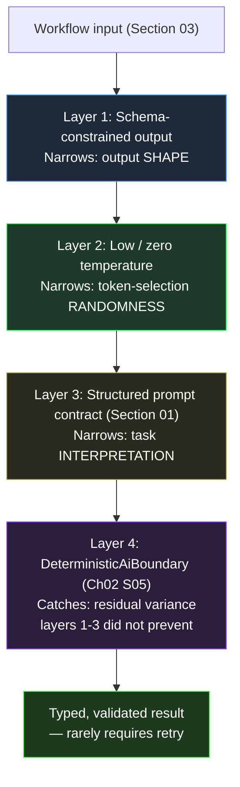

# Section 05 — Building Deterministic AI Interactions

## Variance Reduction, Not Variance Elimination

Chapter 02 Section 05 established the architectural boundary: a probabilistic AI call wrapped in deterministic validation and retry, with an explicit warning that temperature zero reduces variance but does not eliminate it. This section is the practical playbook: a concrete, layered set of techniques that narrow the space of acceptable outputs *before* a response is generated, reducing how often the deterministic boundary's retry budget gets exhausted, rather than relying on retry-after-the-fact as the only defense.

The distinction matters operationally. A workflow that retries two out of every five calls because its raw output frequently fails validation is technically correct — the boundary catches every failure and never returns an unvalidated result — but it is paying unnecessary latency and cost for variance that could have been narrowed upstream. The techniques this section introduces exist to shift that ratio: fewer retries needed, not because validation became more lenient, but because the interaction itself was engineered to produce narrowly-scoped output more consistently in the first place.

## The Variance-Reduction Stack



Each layer in the stack narrows a different source of variance, and the layers are complementary rather than redundant. Schema-constrained output eliminates an entire category of structural-validation failures before generation even completes. Low temperature narrows token-selection randomness within that shape. A tightly-constrained prompt contract narrows task interpretation itself — ambiguous instructions produce variable interpretations regardless of temperature or schema. The deterministic boundary remains the final layer precisely because no combination of the first three eliminates variance.

## Schema-Constrained Output in .NET

```csharp id="code-03-05"
// Target Framework: .NET 10.0
// Chapter: 03 | Section: 05
// book/chapters/chapter-03/sections/section-05.en.md
//
// SchemaConstrainedClient: wraps chat completion calls with structured
// output mode, constraining the model to emit JSON conforming to a
// declared schema. Combined with DeterministicAiBoundary<T>, this
// measurably reduces the retry rate compared to free-form text parsing.

using System.Text.Json;
using AiToolkit.Application.Ports;
using OpenAI.Chat;

namespace EngineeringCommunicationToolkit.Infrastructure.AI;

public sealed class SchemaConstrainedClient(
    ChatClient openAiClient,
    BinaryData jsonSchema,
    string     schemaName)
    : IChatCompletionClient
{
    public async Task<string> CompleteAsync(
        string systemPrompt, string userPrompt, CancellationToken ct)
    {
        var options = new ChatCompletionOptions
        {
            ResponseFormat = ChatResponseFormat.CreateJsonSchemaFormat(
                jsonSchemaFormatName: schemaName,
                jsonSchema:           jsonSchema,
                jsonSchemaIsStrict:   true),
            Temperature = 0.1f,
        };

        ChatMessage[] messages =
        [
            new SystemChatMessage(systemPrompt),
            new UserChatMessage(userPrompt),
        ];

        var response = await openAiClient.CompleteChatAsync(messages, options, ct);
        return response.Value.Content.Count > 0
            ? response.Value.Content[0].Text
            : string.Empty;
    }

    public async IAsyncEnumerable<string> CompleteStreamingAsync(
        string systemPrompt, string userPrompt,
        [System.Runtime.CompilerServices.EnumeratorCancellation] CancellationToken ct)
    {
        yield return await CompleteAsync(systemPrompt, userPrompt, ct);
    }
}

public static class CodeReviewSchema
{
    public static readonly BinaryData Schema = BinaryData.FromString(
        """
        {
          "type": "object",
          "properties": {
            "issues": {
              "type": "array",
              "items": {
                "type": "object",
                "properties": {
                  "line":        { "type": "integer" },
                  "severity":    { "type": "string", "enum": ["info","warning","error"] },
                  "description": { "type": "string" }
                },
                "required": ["line","severity","description"],
                "additionalProperties": false
              }
            }
          },
          "required": ["issues"],
          "additionalProperties": false
        }
        """);
}
```

## What Schema Constraints Do Not Solve

Schema-constrained output guarantees *structural* validity — the response will parse as conformant JSON with the right field types. It does not guarantee *semantic* correctness — a schema-conformant response can still contain a fabricated line number, a wrong severity classification, or a description that misdiagnoses the actual issue, because the schema constrains shape, not truth. Chapter 02 Section 04's full hallucination taxonomy still applies within a schema-conformant response. This technique narrows where validation effort needs to focus (semantic correctness) by eliminating where it no longer needs to focus (structural parsing), but it does not replace the `DeterministicAiBoundary<T>`'s semantic validation step.

## Measuring Whether Variance Reduction Is Working

**Retry rate at the deterministic boundary** is the primary variance-reduction signal: a workflow's retry rate before and after adding schema constraints, before and after lowering temperature, before and after tightening the prompt contract's explicit constraints, is directly comparable, because `DeterministicAiBoundary<T>` already logs attempt counts for every execution. A team introducing `SchemaConstrainedClient` for a given workflow should expect — and should explicitly verify, not merely assume — a measurable drop in retry rate for that workflow specifically.

**Output diversity across repeated identical calls** is a complementary signal worth tracking during workflow development. Running the same workflow input through the same workflow several times and comparing the resulting outputs for semantic consistency surfaces whether a given combination of schema constraints, temperature, and prompt contract is actually narrowing the output space, or whether the task's genuine ambiguity is large enough that no combination of these techniques will produce consistent results without addressing the ambiguity directly in the prompt contract itself.

## Choosing Between Structured Output and Free-Form Parsing

Not every workflow benefits equally from schema-constrained output. Schema constraints earn their overhead clearly for workflows whose output has genuine structure to constrain — the code review example's array of typed issue objects, anything whose `TOutput` type is naturally a record with several distinct properties. For workflows whose output is fundamentally prose — a free-form architectural recommendation meant for a human reader rather than programmatic consumption — forcing that output through a JSON schema adds the schema-constraint machinery's overhead without addressing any genuine structural ambiguity, because there was no structure to constrain in the first place.

## Interaction Between Variance Reduction and Cost

The variance-reduction techniques here are not cost-neutral. A team can introduce a tightly-constrained prompt contract first — essentially free in terms of runtime cost — measure its effect on retry rate, and only add schema constraints or further temperature tuning if the contract-level improvement alone proves insufficient for the workflow's reliability requirements. Treating the four-layer stack as an ordered, evidence-driven adoption sequence rather than a checklist applied uniformly and immediately to every workflow keeps these techniques aligned with the proportionality judgment Section 01 asked for. This is the discipline Section 06 assumes as a precondition for composing reliable single interactions into reliable multi-step workflows.

## Why the Layers Are Ordered in This Specific Sequence

The variance-reduction stack's ordering — schema constraints first, then temperature, then prompt contract, then the deterministic boundary — is not arbitrary, and understanding the reasoning clarifies when a team might reasonably apply only a subset of the layers for a given workflow.

Schema-constrained output ranks first because it is the only layer that prevents structural failures before generation completes, rather than detecting them afterward. Every other layer is applied before or during generation (temperature, prompt contract) or after (the deterministic boundary); schema constraints alone work by constraining the generation process itself at the token level, making the space of possible outputs smaller before a single response token is emitted. If a workflow's primary source of retry-rate pressure is structural failures — malformed JSON, missing required fields, wrong enumeration values — schema constraints address that source directly and efficiently, without requiring retry at all.

Temperature reduction ranks second because it is the easiest to apply after schema constraints, costs essentially nothing operationally, and narrows token-selection randomness within whatever structural shape the schema has constrained. It pairs naturally with schema constraints: the schema constrains what *can* appear in the response; a lower temperature reduces how randomly the model selects among the tokens that *are* permitted by the schema. Without schema constraints, temperature reduction alone often produces lower variance in phrasing while leaving semantic meaning highly variable — the response is consistently worded but still inconsistently correct.

The prompt contract ranks third rather than first because its variance-reduction contribution — narrowing task interpretation — is partially a function of how clear the task is to begin with, which is something the engineer controls through specification design and context engineering (Sections 04 and 02) rather than through generation parameters. A poorly-specified task in a poorly-constrained context will produce variable output regardless of how tightly the prompt contract's constraints are worded; the contract is addressing the interpretation of a well-specified task, not compensating for underspecification.

## The Deterministic Boundary as Safety Net, Not Primary Defense

The most important reframing this section offers is moving the `DeterministicAiBoundary<T>` from the role of primary defense against bad output to the role of safety net for the residual variance that the upstream layers do not eliminate. A workflow that depends heavily on the boundary's retry logic — high retry rates, frequent third-attempt successes — is signaling that the upstream layers are not doing their job effectively, not that the boundary is doing its job well. The boundary is doing its job in both cases — it is preventing bad output from reaching callers — but the upstream layers' failure to narrow variance is imposing a cost in latency and token spend that could be avoided if the workflow were better engineered at the generation level.

This reframing has a practical implication for how teams should interpret a newly-deployed workflow's retry-rate metrics in the early days after deployment: a consistently high retry rate (above, say, 15-20% for a task that is well within the model's dense training distribution) is a diagnostic signal pointing to one of three upstream layers as the likely source of the problem, not a confirmation that the boundary is configured correctly. The diagnostic sequence follows the stack in reverse — check structural validity first (is the schema well-defined and is the model actually respecting it?), then semantic validity (is the prompt contract's constraint set specific enough to distinguish correct from incorrect responses?), then context quality (is the context actually relevant, well-positioned, and non-stale?) — before concluding that the task's inherent difficulty is the explanation for the elevated retry rate.

## Schema Constraints and the Prompt Contract: Complementary, Not Redundant

A question teams encounter when adopting both schema constraints (this section) and the prompt contract pattern (Section 01) is how the two relate: if the output schema already enforces a specific structure, what does the prompt contract's explicit constraint language add?

The answer is that they address different aspects of the generation process. The output schema constrains what tokens the model is permitted to emit — it operates at the decoding level, filtering the probability distribution over the vocabulary to only admit tokens consistent with the current schema position. The prompt contract's explicit constraints operate at the task-interpretation level — they shape how the model conceptualizes what it should be doing, which affects the semantic content of the response rather than merely its structural form. A code review prompt contract that explicitly states "identify only concrete issues — do not restate what the code does" is narrowing the task interpretation that governs *which* issues get reported and how they get described, not the structural shape of the JSON that contains those descriptions. The schema ensures those descriptions appear in the right fields; the prompt contract ensures they are the right descriptions.

This complementarity means the two techniques target independent sources of variance and should typically be applied together when both sources are contributing to elevated retry rates. A team that applies schema constraints and observes a drop in structural-failure rate but no corresponding drop in semantic-failure rate (wrong severity classifications, misidentified issues, descriptions that miss the actual problem) should investigate the prompt contract's constraint specificity as the next lever, rather than assuming that schema constraints alone should have addressed the full retry rate.

## Structured Output Compatibility Across Model Families

One practical engineering concern when adopting schema-constrained output in a .NET application that targets multiple AI providers or model families is that structured output support — the capability underlying `ChatResponseFormat.CreateJsonSchemaFormat` — is not universally available or identically implemented across providers. The `IChatCompletionClient` abstraction from Chapter 02's `AiToolkit.Application.Ports` namespace provides the natural seam for handling this variation: `SchemaConstrainedClient` implements the abstraction for providers that support structured output; a parallel implementation using prompt-based JSON instructions followed by `DeterministicAiBoundary<T>` validation handles providers that do not. The calling workflow is unaffected by which implementation is registered — it depends on `IChatCompletionClient`, resolves whichever implementation is registered for the current target provider, and relies on the boundary for validation regardless.

This provider-abstraction pattern is worth establishing early in a project's AI integration work, before the team has accumulated dozens of call sites that reference a specific provider's SDK directly and must each be individually migrated when provider selection changes. The workflow pattern this chapter establishes naturally enforces this abstraction boundary: a workflow registers a concrete `IChatCompletionClient` implementation in its DI registration, but the `AiWorkflow<TInput, TOutput>` class itself never references any provider-specific types, keeping the migration cost for a provider change local to the registration configuration rather than dispersed across every workflow implementation.

## The Relationship Between Variance Reduction and the Training Distribution

Chapter 02 Section 02 established that capability and reliability vary by training-distribution density — tasks in dense, well-represented regions of the distribution produce more reliable output than tasks at sparse, underrepresented edges. The variance-reduction stack this section introduces interacts with this training-distribution insight in a specific and important way: the techniques in the stack reduce variance within whatever region of the distribution the task occupies, but they cannot move a task from a sparse region to a dense one.

This means schema constraints, temperature reduction, and tight prompt contracts applied to a task in a genuinely sparse region of the training distribution will produce more consistently structured output, more consistently worded output, and more consistently interpreted output — but the output will still have the semantic quality characteristics of a sparse-region task, because those characteristics are determined by what the model learned during training, not by how output generation is constrained at inference time. A task that asks about the correct interaction between a rarely-used .NET API and an unusual concurrency primitive, given a specific combination of .NET version constraints, is still a sparse-region task with a higher semantic error rate than a dense-region equivalent even after the full variance-reduction stack is applied.

The practical implication is that the retry-rate improvements a team should expect from the variance-reduction stack are calibrated to the density of the task region, not to an absolute standard. A task in a dense region might see retry rates drop from 15% to 3% after applying all four layers; a task in a sparse region might see retry rates drop from 40% to 25% after applying all four layers — an improvement, but not a solution, with the residual rate attributable to semantic quality factors that variance-reduction techniques cannot address. Teams that observe this pattern and conclude "the variance-reduction stack didn't work" have misdiagnosed the situation; the correct diagnosis is that the task's training-distribution density is the binding constraint, and the response is either to redesign the task to target a denser region (more specific, better-documented API usage rather than unusual edge cases) or to accept the higher retry rate as inherent to the task's difficulty and ensure the deterministic boundary's retry budget is sized accordingly.

## Operationalizing the Measurement Discipline

The measurement discipline this section introduced — tracking retry rate and output diversity as the primary signals for variance-reduction effectiveness — benefits from being made operational rather than left as aspirational guidance. Three concrete practices make this operational for a .NET team adopting the workflow pattern from Section 03.

The first practice is instrumenting `DeterministicAiBoundary<T>` to emit structured metrics — attempt count per invocation, success-on-first-attempt rate, failure reason categorization (structural versus semantic) — as part of the application's existing observability infrastructure. In .NET 8, this is typically done through `System.Diagnostics.Metrics` or through the team's existing OpenTelemetry integration, not through a separate monitoring system, keeping AI workflow observability consistent with the rest of the application's operational monitoring.

The second practice is establishing a baseline retry rate for each newly deployed workflow in its first week of production use, and treating deviations from that baseline as signals rather than noise. A workflow that has operated at 5% retry rate for three months and suddenly moves to 15% is signaling a change — possibly a model update from the provider, possibly a shift in the distribution of inputs the workflow receives, possibly a staleness issue with a context source — that deserves investigation, not tolerance.

The third practice is scheduling periodic context-strategy reviews for high-volume or high-consequence workflows, analogous to how .NET teams schedule dependency updates: not as a response to a specific failure, but as a proactive engineering practice that keeps the workflow's priority rankings aligned with the actual characteristics of the task's inputs as both the codebase and the model evolve. Context strategies designed at workflow creation are designed with the information available at that time; a strategy that was well-calibrated six months ago may be poorly calibrated today if the team's codebase structure, the typical inputs the workflow receives, or the model's behavior has shifted meaningfully in the interim.

## Retry Budget Sizing as a Design Decision

The `DeterministicAiBoundary<T>`'s retry budget — the maximum number of attempts before a workflow reports failure — is typically set as a constructor parameter or configuration value, but teams often choose it arbitrarily rather than treating it as a design decision with measurable consequences. A retry budget of one (no retries) is appropriate for workflows where latency is the binding constraint and a failed generation is better surfaced as an immediate error than absorbed through retry. A retry budget of three is a reasonable starting point for most workflows, providing one opportunity to recover from a transient variance event without the latency penalty of extended retry loops. Budgets above five are rarely justified and typically signal that the upstream variance-reduction layers need attention rather than that the boundary needs more retry headroom.

The retry budget should also be logged alongside the workflow's `WorkflowResult<T>` so that post-deployment analysis can distinguish between workflows that succeeded on first attempt (strong upstream variance reduction), workflows that succeeded on second or third attempt (moderate upstream variance with effective boundary recovery), and workflows that exhausted their budget (upstream variance reduction insufficient for the task's inherent difficulty). This distinction, tracked over time for each registered workflow, provides the operational evidence base that guides which workflows benefit from further variance-reduction investment and which have reached an acceptable equilibrium between retry cost and output reliability. Teams that track this metric weekly for their first month of production AI workflow usage typically identify two or three workflows that would benefit from upstream investment — a finding that would remain invisible without the per-workflow retry tracking this discipline produces.

---

*Section 05 has established variance reduction as a layered, measurable discipline. Section 06 turns to the final concern: explicit state management across multi-step tasks and the collaboration patterns that govern human-AI interaction.*
