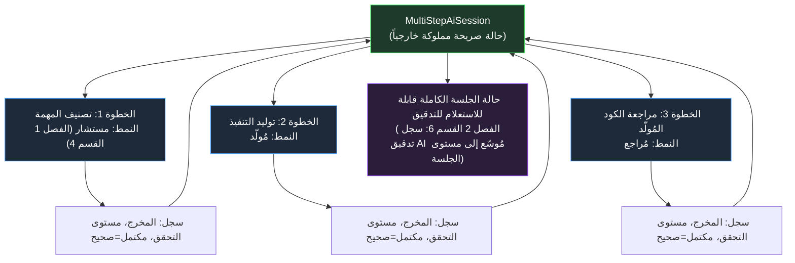

<div dir="rtl">
# القسم السادس — إدارة الحالة عبر المهام متعددة الخطوات وأنماط التعاون مع AI

## مواضيعان، آلية واحدة تحتية

يُعالج هذا القسم الختامي موضوعي الفصل الأخير معاً لأنهما، عند التحقق، آلية هندسية واحدة يُنظر إليها من زاويتين. إدارة الحالة عبر المهام متعددة الخطوات تسأل كيف تتبع نظام .NET التقدم والقرارات عبر تفاعلات AI كثيرة. أنماط التعاون مع AI — نماذج المُولّد والمُراجع والمستشار والمُنفّذ التي أُسّس لها في الفصل الأول القسم الرابع — تسأل كيف يُوزّع المهندس المسؤولية بين نفسه والنموذج في كل نقطة من المهمة. الصلة مباشرة: نمط التعاون لا يمكن أن يكون قابلاً للتكرار عبر مهمة متعددة الخطوات إلا إذا كانت الحالة التي تُحدّد أي نمط يُطبَّق في كل خطوة مُتتبّعة بشكل صريح، لا مُستنتجة من جديد وبصورة غير متسقة في كل خطوة من السياق المتاح.

## لماذا الحالة الضمنية تُعيد إنتاج كل مخاطرة عالجها هذا الفصل

أسّس الفصل الثاني في القسم الأول أن النموذج لا يحتفظ بأي حالة بين المكالمات تتجاوز ما هو مشمول صراحةً في السياق. سير عمل متعدد الخطوات يعتمد على تراكم تاريخ المحادثة كسجل وحيد للتقدم يُرتكب نفس الخطأ الذي حدده القسم الرابع للحوار متعدد الأدوار غير المُهيكل، مُعمّماً على حالة المهمة بدلاً من محتوى المواصفات: أي خطوات اكتملت، وماذا تقرّر في كل خطوة، وما مستوى التحقق (الفصل الثاني، القسم السادس) الذي طُبّق على مخرجات كل خطوة — كلها حقائق عن المهمة تستحق المعاملة الصريحة والمُهيكلة نفسها التي أعطاها القسم الرابع لفقرات المواصفات.

الحل المعماري يُحاكي نمطاً يستخدمه مهندسو .NET بالفعل لهذا النوع من المشاكل في سياقات غير AI: منسّق ساج (Saga) يُنسّق معاملة متعددة الخطوات الموزّعة يملك كائن حالة صريح، مُصّرّ بشكل مستقل عن حالة أي خدمة فردية، يسجّل بدقة ما اكتمل وما يبقى. المهام متعددة الخطوات التي تتطلب AI تتطلب نفس الانضباط، للسبب نفسه.



## نمط MultiStepAiSession

<div dir="ltr">

```csharp id="code-03-06"
// Target Framework: .NET 10.0
// Chapter: 03 | Section: 06
// book/chapters/chapter-03/sections/section-06.ar.md
//
// MultiStepAiSession: يُملك حالة صريحة لمهمة AI متعددة الخطوات.
// يُركّب IAiWorkflow (القسم 3)، و VerificationLevel (الفصل 2 القسم 6)،
// وأنماط التعاون (الفصل 1 القسم 4) في وحدة واحدة قابلة للتدقيق.

using AiToolkit.Infrastructure.AI;

namespace EngineeringCommunicationToolkit.Infrastructure.AI;

public enum CollaborationPattern { Generator, Reviewer, Advisor, Executor }

public sealed record StepRecord(
    int StepNumber, string StepName, CollaborationPattern Pattern,
    string Output, VerificationLevel VerificationLevel,
    bool RequiresHumanDecision, bool HumanApproved);

public sealed class MultiStepAiSession(string sessionId, AiAuditLog auditLog)
{
    private readonly List<StepRecord> _steps = [];

    public string SessionId { get; } = sessionId;
    public IReadOnlyList<StepRecord> CompletedSteps => _steps.AsReadOnly();

    public async Task<StepRecord> RunStepAsync<TInput, TOutput>(
        string stepName, CollaborationPattern pattern,
        IAiWorkflow<TInput, TOutput> workflow, TInput input,
        VerificationLevel verificationLevel, CancellationToken ct)
        where TOutput : notnull
    {
        var result = await workflow.ExecuteAsync(input, ct);
        if (!result.IsSuccess)
            throw new InvalidOperationException($"Step '{stepName}' failed: {result.Error}");

        var requiresDecision = pattern is CollaborationPattern.Advisor;

        var record = new StepRecord(
            StepNumber:            _steps.Count + 1,
            StepName:              stepName,
            Pattern:               pattern,
            Output:                result.Value!.ToString() ?? string.Empty,
            VerificationLevel:     verificationLevel,
            RequiresHumanDecision: requiresDecision,
            HumanApproved:         !requiresDecision);

        _steps.Add(record);

        auditLog.Record(new AiAuditEntry(
            ComponentId:       $"{sessionId}-step-{record.StepNumber}",
            VerificationLevel: verificationLevel,
            Notes:             $"Pattern: {pattern}; Step: {stepName}",
            AcceptedAt:        DateTimeOffset.UtcNow,
            AcceptedBy:        $"MultiStepAiSession:{sessionId}"));

        return record;
    }

    public void ApproveAdvisorStep(int stepNumber, string approvedBy)
    {
        var index = _steps.FindIndex(s => s.StepNumber == stepNumber);
        if (index < 0)
            throw new ArgumentException($"No step {stepNumber} in session.");
        if (_steps[index].Pattern is not CollaborationPattern.Advisor)
            throw new InvalidOperationException($"Step {stepNumber} is not an Advisor step.");
        _steps[index] = _steps[index] with { HumanApproved = true };
    }

    public void EnsureStepApproved(int stepNumber)
    {
        var step = _steps.SingleOrDefault(s => s.StepNumber == stepNumber)
            ?? throw new ArgumentException($"No step {stepNumber} in session.");

        if (!step.HumanApproved)
            throw new InvalidOperationException(
                $"Step {stepNumber} ('{step.StepName}') is an unapproved " +
                "Advisor recommendation. Call ApproveAdvisorStep before proceeding.");
    }
}
```

</div>

## تلخيص الفصل

ستة أقسام، آلية واحدة صارت أكثر قدرة تدريجياً: القسم الأول أعطى موجّه فردياً هوية مُصدَّرة ومُحدّدة النوع. القسم الثاني أعطى السياق المُتغيّر لذلك الموجّه بنية مُوزَّعة بميزانية ومُرتَّبة بعمد. القسم الثالث صرّ العقد واستراتيجية السياق في سير عمل مُعاد الاستخدام ومُسجّل. القسم الرابع ربط التفاعل متعدد الأدوار بمواصفات مكتوبة ومُفكّكة. القسم الخامس ضيّق تباين مخرجات تفاعل واحد عبر تقنيات طبقية وقابلة للقياس. <code dir="ltr">MultiStepAiSession</code> في هذا القسم يُركّب الخمسة في حالة صريحة وقابلة للتدقيق للمهام التي تمتد عبر تفاعلات كثيرة من هذا النوع، مع أنماط التعاون من الفصل الأول مُفروضة كخاصية مُتتبّعة لا فهم غير رسمي.

## استعادة جلسة متعددة الخطوات متقطعة

لأن <code dir="ltr">CompletedSteps</code> سجل صريح ومُهيكل بدلاً من حالة ضمنية تعيش فقط داخل ذاكرة جلسة واجهة المحادثة، فإن استمرارها — إلى قاعدة بيانات، أو إلى تخزين دائم، أو إلى أي آلية يستخدمها تطبيق .NET المُحيط بالفعل لحفظ حالته — هو مسألة تساري مباشرة، لا تحدٍّ معماري أساسي. جلسة <code dir="ltr">MultiStepAiSession</code> المُستعادة من مداخل <code dir="ltr">StepRecord</code> محفوظة يمكنها الاستئناف تماماً من حيث توقفت، دون أي منطق استعادة خاص يتجاوز إعادة التحميل المعتادة للحالة.

## حالة الجلسة كأثر للتحقيق في الحوادث

السجل الكامل والمرتب لـ <code dir="ltr">CompletedSteps</code> يجعل التسلسل الفعلي لقرارات المساعدة بالذكاء الاصطناعي — والقرارات البشرية التي كانت بوابات لها — متاحاً للمراجعة بصرامة يتوقعها الفريق من أي عملية إنتاجية أخرى قد تتطلب تحقيقاً عند الفشل. حادث إنتاجي يمكن إرجاعه إلى عملية AI متعددة الخطوات معيبة يمكن التحقيق فيه مقابل هذا السجل: أي نمط طُبّق في أي خطوة، وما مستوى التحقق الذي طُبّق، وما إذا كانت <code dir="ltr">HumanApproved</code> صحيحة في اللحظة التي استهلكت فيها خطوة تابعة توصية مستشار.

## ما أرساه هذا الفصل لبقية الكتاب

لا شيء من هذه الأنماط الستة غريب أو خاص بأدوات الذكاء الاصطناعي في شكله الأساسي — العقود المُصدَّرة، وتخصيص الموارد بميزانية، والخدمات القابلة لإعادة الاستخدام والمُسجّلة، والاتفاق المُثبَّت بالمواصفات، وتضييق التباين عبر قيود طبقية، والملكية الصريحة للحالة في العمليات متعددة الخطوات — كلها انضباطات .NET هندسية راسخة، طُبّقت هنا على نوع جديد من التبعيات. التواصل الاحترافي مع أنظمة الذكاء الاصطناعي ليس مهارة جديدة غريبة — إنه التطبيق المتعمّد لممارسات هندسية تثق بها فرق .NET بالفعل، على مكوّن يجعل هذا الانضباط شرطاً لا خياراً بسبب سلوكه.

هذا التوقع — التعاون المنظّم والقابل للتدقيق مع AI كحالة افتراضية لا استثناء — هو المعيار الذي تُكتب ضدّه كل الفصول من هنا فصاعداً. هذا المعيار ليس قيداً على السرعة — إنه الأساس الذي يجعل السرعة مستدامة بمجرد أن يصبح مساعدة AI جزءاً دائماً ومُحمّلاً بالمسؤولية من كيفية بناء البرمجيات الاحترافية. الفصل الرابع يبدأ البناء على هذا الأساس فوراً.

## بوابة الموافقة كسلامة معمارية

<code dir="ltr">EnsureStepApproved</code> هي أكثر خيارات التصميم أهمية في هذا القسم وتستحق التسمية الصريحة: تجعل حدود المسؤولية من الفصل الأول خاصية يفرضها *نظام الأنواع والوقت التشغيلي*، لا انضباطاً يُتوقّع من المهندس تذكّره عبر مهمة طويلة متعددة الخطوات. خطوة لاحقة تعتمد على توصية مستشار لا يمكن أن تُمضي بصمت على اقتراح غير معتمد — الجلسة تُلقي خطأً، بصوت عالٍ وبشكل محدد، بدلاً من السماح لتوصية AI غير مُراجَعة بالتدفق إلى المخرجات المُولّدة كأنها مقبولة بشكل متعمّد.

يهمّ هذا الفرض تحديداً لأن المهام متعددة الخطوات تُنشئ الظروف التي يكون فيها حدود المسؤولية أكثر عرضة للتآكل الصامت: مخرج كل خطوة يصبح سياق الخطوة التالية، الزخم يتراكم، ومهندس يعمل في الخطوة السابعة من مهمة مكونة من عشر خطوات أقل احتمالاً للإيقاف وإعادة النظر بشكل صريح في صحة توصية المستشار من الخطوة الثانية مقارنة بنفس المهندس لو كانت تلك التوصية المخرج الوحيد أمامه. بوابة الموافقة لا تمنع هذا التآكل بالاعتماد على يقظة المهندس المستمرة — تمنعه بجعل التآكل مستحيلاً في الكود، بنفس الطريقة التي يمنع بها النوع غير الفارغ أخطاء null ليس بالاعتماد على ذاكرة المطور بأن قيمة معينة قد تكون null، بل بجعل الكود غير قابل للترجمة إذا لم تُعالَج حالة null.

## اختبار جلسة متعددة الخطوات بدون نموذج حيّ

<code dir="ltr">MultiStepAiSession</code> يرث قابلية اختبار وحدات كاملة من المكونات التي يُركّبها: كل خطوة <code dir="ltr">IAiWorkflow<TInput, TOutput></code> يمكن استنساخها بالضبط كما أظهر القسم الثالث. جلسة تمتد خمس خطوات، ثلاثة أنماط تعاون، وبوابتي موافقة يمكن ممارستها بالكامل في اختبار وحدة، مع assertions على الحالة النهائية للجلسة — أي خطوات اكتملت، أيها تتطلب موافقة، أيها تُوافقت — بدلاً من أي مخرجات فعلية للنموذج. تُهمّ هذه القابلية للاختبار تحديداً لمنطق بوابة الموافقة، لأن ذلك المنطق بالضبط هو نوع صحة تدفق التحكم الذي تستفيد أكثر من الاختبار المحدد: التحقق من أن <code dir="ltr">EnsureStepApproved</code> يُلقي خطأً بشكل صحيح لخطوة مستشار غير معتمدة، و أن <code dir="ltr">ApproveAdvisorStep</code> يُحدّث السجل بشكل صحيح مع رفض الخطوات غير المستشارية — كلها assertions على صحة *كود .NET المُنسّق*، بِلا ارتباط بـ جودة مخرجات AI.

## إغلاق الفصل: ستة أنماط، حجة واحدة تحتية

بالنظر إلى الأقسام الستة المذكورة، الحجة التحتية للالأقسام أبسط مما قد تُوحي به عمقها التقني: مهندسو البرمجيات المحترفون يمتلكون بالفعل كل مهارات وانضباط مطلوب للتفاعل بفعالية مع أنظمة AI، لأن تلك المهارات والانضباط هي نفسها التي يُطبّقونها على كل نوع آخر من التبعيات — APIs، قواعد بيانات، قنوات رسائل، خدمات خارجية — مع التكييف المناسب للخصائص السلوكية المحددة لهذا النوع الجديد من التبعيات. التكييف حقيقي وذو عواقب: الطبيعة الاحتمالية وانعدام الحالة ومحدودية نافذة السياق في النماذج اللغوية تتطلب انتباهاً متعمّداً لمخاوف لا تثيرها التبعيات الأخرى. لكن المفردات الهندسية لمعالجة تلك المخاوف — عقود، إصدار، مواصفات، تضييق تباين، حالة صريحة — مألوفة تماماً.

هذا التوقع — التعاون المنظم والقابل للتدقيق مع AI كحالة افتراضية لا استثناء — هو المعيار الذي تُكتب ضدّه كل الفصول من هنا فصاعداً. هذا المعيار ليس قيداً على السرعة — هو الأساس الذي يجعل السرعة مستدامة بمجرد أن يصبح مساعدة AI جزءاً دائماً وأساسياً من كيفية بناء البرمجيات الاحترافية. الفصل الرابع يبدأ ببناء على هذا الأساس فوراً.

## نمط التعاون كنوع أساسي

جعل <code dir="ltr">CollaborationPattern</code> خاصية <code dir="ltr">enum</code> صريحة على <code dir="ltr">StepRecord</code> بدلاً من ملاحظة غير رسمية في تعليق كود هو خيار مقصود يستحق التبرير، لأنه يُمثّل التزاماً مادياً بالحجة التي افتتح بها القسم الأول — أن الأشياء التي تهمّ صحة النظام يجب أن تُمثّل كقطع أثر مُحدّدة النوع، لا كوصفات نثرية مدفونة في تعليقات أو فهمات غير رسمية يتقاسمها فريق الهندسة.

النمط المُطبّق في خطوة محددة يُحدّد كيفية التعامل مع مخرجات تلك الخطوة: مخرجات خطوة <code dir="ltr">Generator</code> مرشحة للاستهلاك المباشر من الخطوات اللاحقة؛ مخرجات خطوة <code dir="ltr">Reviewer</code> ملاحظات على خطوة سابقة لا أثر جديد؛ مخرجات خطوة <code dir="ltr">Advisor</code> توصية تتطلب موافقة بشرية صريحة قبل أن تعتمد عليها الخطوات التالية؛ مخرجات خطوة <code dir="ltr">Executor</code> نتيجة تنفيذ إجراء محدد ومحدود. خلط هذه — التعامل مع مخرجات خطوة <code dir="ltr">Advisor</code> بنفس منطق المضيّ الآلي كما مخرجات خطوة <code dir="ltr">Generator</code> — هو انتهاك لحدود المسؤولية الذي حذر منه الفصل الأول القسم الخامس. جعل النمط خاصية صريحة ومُحدّدة النوع بدلاً من اتفاق غير رسمي هو ما يسمح لـ <code dir="ltr">EnsureStepApproved</code> بفرض هذا الحد في الوقت التشغيلي بدلاً من الاعتماد على ذاكرة المهندس لأي نمط يُطبَّق في كل نقطة من مهمة طويلة.

تمتد هذه الخيارات بشكل طبيعي: فريق يُضيف الرصد إلى <code dir="ltr">MultiStepAiSession</code> — يتبع أنماط التعاون الأكثر استخداماً، الخطوات ذات أعلى معدلات الفشل، الأنماط التي تميل لإنتاج أكبر عدد من رفضات خطوات المستشار — يملك مقاييس مُباشرة وقابلة للتنفيذ، لأن كل مقياس مُرتبط بنمط مُسمّى ومُحدّد النوع بدلاً من "خطوة" مجهولة. الرصد على مستوى التجريد هذا يتطلب وجود التجريد في نظام الأنواع في المقام الأول، وهو بالضبط ما يُوفّره <code dir="ltr">CollaborationPattern</code> enum.

هذا النوع من الرصد يكشف أيضاً الاتجاهات التي لا يراها الفريق عبر المراجعة اليدوية: إذا نمت نسبة رفضات خطوات المستشار بمرور الوقت، فالعلامة لا تتعلق بمهندس واحد — إنها مؤشر على أن مواصفات المهام أصبحت أبعد عن إرشاد الموجّهات، أو أن قرارات التصميم تنتقل نحو توصيات المستشارين أكثر من القرارات المُوثَّقة. رصد أنماط التعاون يحوّل هذه الافتراضات الهيكلية من تخمينات يتبادلها الفريق في المراجعات إلى بيانات رقمية تُناقش بمستوى الأدلة نفسه الذي يُناقش به أي مقياس آخر في النظام.

## استراتيجية الاستمرارية للجلسات طويلة الأمد

خاصية <code dir="ltr">CompletedSteps</code> تتسارى إلى JSON بشكل طبيعي كقائمة مرتبة من كائنات <code dir="ltr">StepRecord</code> — صيغة يمكن حفظها بسهولة في أي خلفية تخزين يستخدمها تطبيق .NET بالفعل لحالة. ثلاث استراتيجيات استمرارية تستحق التمييز الصريح لأن لها دلالات مختلفة بشأن أنماط الفشل التي تحميها.

الاستمرارية على مستوى الجلسة — كتابة قائمة <code dir="ltr">CompletedSteps</code> الكاملة إلى تخزين متين بعد اكتمال كل خطوة — تحمي من إعادة تشغيل العملية وتعطلات التطبيق، وهي أكثر سيناريوهات Interruption شيوعاً في سير عمل AI المُعاون في بيئة الإنتاج. لا تحمي من سيناريوهات تضيع فيها سياق الجلسة (فهم المهندس المُستدعي لما حدث حتى الآن) مع بقاء سجل الجلسة، لأن السجل يُصوّر مخرجات AI لكن لا يُصوّر السياق الكامل الذي قيّم فيه المهندس وتصرف بناءً عليه. للجلسات التي يكون تقييم المهندس المُستدعي لكل خطوة جزءاً من قيمة المهمة لا مجرد بوابة، تكميل <code dir="ltr">CompletedSteps</code> بحقل <code dir="ltr">ContextNotes</code> — حيث يمكن للمهندس تسجيل تقييمه لكل خطوة إلى جانب مخرجات AI — يُنتج سجل جلسة أكثر اكتمالاً لا يزال قابل للتساري والحفظ بشكل مباشر.

الاستراتيجية الثالثة — الاستمرارية الموزّعة والمشتركة حيث يكون سجل الجلسة متاحاً عبر جلسات مهندسين متعددة بدلاً من ربطه بعملية مهندس واحد — تتطلب انتباهاً تصميمياً إضافياً للوصول المتزامن والتثبيت التخليقي، لكنها تنبثق من نفس نهج التساري بالضبط: قائمة <code dir="ltr">CompletedSteps</code>، و <code dir="ltr">ActiveSpecification</code> من نمط القسم الرابع إذا كانت الجلسة مُثبّتة بمواصفات، وأي بيانات وصفية على مستوى الجلسة، مُساراة إلى خلفية تخزين مشتركة بإصدار مناسب. فريق يتبنى هذه الاستراتيجية يبني مساحة عمل تعاونية لـ AI المُعاون — قدرة تمتد بشكل طبيعي من الأنماط المنظمة والصريحة للحالة التي أرساها هذا القسم، لا تتطلب مفاهيم معمارية جديدة تكاد لا تتعدى تكامل التخزين.

## الربط مع حجة افتتاح الفصل

نمط <code dir="ltr">MultiStepAiSession</code> يُغلق حجة الفصل المركزية. القسم الأول افتتح بالملاحظة أن الموجّهات غير المُصدَّرة والعشوائية تتراكم نفس نوع الديون التقنية غير القابلة للصيانة التي تتراكم في قاعدة كود تقليدية — دين غير مرئي عندما يكون صغيراً ومؤلماً عندما يكون قد كبر. <code dir="ltr">MultiStepAiSession</code> يعالج المكافئ متعدد الخطوات من نفس المشكلة: مهمة AI متعددة الخطوات غير مُهيّلة وضمنية الحالة تتراكم نفس نوع الحالة غير المرئية وغير القابلة للصيانة التي تتراكم في قاعدة كود بآثار جانبية غير مُتتبّعة.

المقارنة دقيقة. قاعدة كود بسلسلة سحرية ليس لها مصدر حقيقة واحد للقيمة الصحيحة؛ مهمة AI متعددة الخطوات بالحالة الضمنية ليس لها مصدر حقيقة واحد للقرار الذي اتُّخذ في كل خطوة. قاعدة كود يكون فيها مُستدعون مختلفون قد تذكّروا بشكل مستقل إصدارهم الخاص من السلسلة يختلف سلوكها عبر نقاط الاستدعاء؛ مهمة AI متعددة الخطوات حيث يستنتج النموذج حالة المهمة من تاريخ المحادثة يختلف سلوكها عبر الجلسات، لأن ديناميكيات نافذة السياق التي أسّسها الفصل الثاني لا تضمن انتباهاً متسقاً للخطوات المبكرة عبر أطوال محادثات مختلفة. <code dir="ltr">MultiStepAiSession</code> هو <code dir="ltr">PromptContract</code> لتعاون AI متعدد الخطوات: قطعة أثر صريحة ومُحدّدة النوع ومُصدَّرة تُحلّ محل الاتفاق غير الرسمي بهيكليّة مُفروضة، مما يجعل سلوك النظام قابلاً للفهم والاختبار والاسترجاع بدلاً من الاعتماد على شروط يمكن أن تنحرف بصمت.

## استئناف الجلسات المتقطعة في الممارسة

استراتيجية التساري الموضَّحة سابقاً — استمرار <code dir="ltr">CompletedSteps</code> كـ array JSON مرتب — تتعامل مع الحالة الشائعة لانقطاع على مستوى العملية. لكن تحدياً أدقّ يظهر عندما تُستأنف الجلسة في سياق مختلف: قد لا يكون المهندس الأصلي متاحاً، أو قد تكون قاعدة الكود قد تغيّرت منذ إيقاف الجلسة، أو قد يكون مزوّد النموذج قد حدّث سلوكه. نمط <code dir="ltr">MultiStepAiSession</code> يستوعب ذلك بجعل مخرج كل خطوة قابلاً للتفتيش باستقلالية — يمكن للمهندس المُستأنف قراءة تاريخ الخطوات الكامل، والتحقق من أن مخرجات الخطوات السابقة لا تزال صالحة في حالة قاعدة الكود الحالية، واتخاذ قرار بشأن الاستئناف من آخر خطوة مكتملة أو إعادة تنفيذ خطوات سابقة قد أصبحت مخرجاتها قديمة.

هذا الانضباط في كشف التقادم يُحاكي مخاوف تقادم السياق التي عالجها القسم الثاني للموجّهات الفردية، مُعمَّماً إلى حالة على مستوى الجلسة: تماماً كما يمكن لكتلة سياق أن تصف حالة نظام تغيّرت لاحقاً، يمكن لسجل خطوة أن يصف قراراً كان سليماً عند اتخاذه لكنه لم يعد سليماً في ضوء التغيّرات اللاحقة. الطبيعة الصريحة والمُهيكلة لمداخل <code dir="ltr">StepRecord</code> تجعل تقييم التقادم آلياً بدلاً من حدسي — كل سجل يحتوي على اسم الخطوة ونمطها ومستوى التحقق الخاص بها ومخرجاتها، مما يوفر معلومات كافية للمهندس المُستأنف ليقيّم ما إذا كانت استنتاجات الخطوة لا تزال قائمة دون الحاجة إلى إعادة إنتاج تاريخ المحادثة الكامل الذي أنتجها.

للجلسات المُتوقَّع أن تمتد عبر عدة أيام أو تتضمن تسليمات بين مهندسين، يُحوّل اصطلاح خفيف يتمثّل في إرفاق كل خطوة بمبرّر مختصر — لماذا اختير هذا النهج تحديداً، وما البدائل التي نُوقشت ورُفضت — سجل الجلسة من سجلٍ لما حدث إلى وثيقة تشرح لماذا حدث، مما يجعل الجلسة قابلة للاستئناف فعلاً بشخص لم يكن حاضراً عند القرار الأصلي. لا يكلّف اصطلاح إرفاق المبرّر سوى القليل في الصيانة — حقل اختياري واحد على <code dir="ltr">StepRecord</code> — لكن قيمته تتراكم عبر عمر الجلسة: خطوة بدت صحيحة بديهياً وقت تسجيلها قد تحتاج إعادة تقييم بعد أشهر أثناء تحقيق في حادث، ويوفّر المبرّر السياق اللازم لتلك إعادة التقييم دون أن يُجبر المحقّق على إعادة بناء تفكير المهندس من أدلة هامشية.

هذا هو ملخص الفصل في جملة واحدة: كل ما يُهمّ صحة النظام — بما في ذلك، الآن، كيفية تعاون ذلك النظام مع نماذج AI — يجب أن يُمثَّل كقِطع أثر مُحدَّدة النوع ومُصدَّرة ومملوكة صراحةً، بدلاً من تركها كاتفاقيات غير رسمية تنحرف بصمت عبر الزمن ونقاط الاستدعاء وأفراد الفريق. الفصل الرابع يبدأ بتطبيق هذا الانضباط على المستوى المعماري، حيث تُصمَّم الأنظمة التي تكون هذه القطع جزءاً منها وتتطوّر.

---

*أغلق هذا القسم مسار الفصل المكوّن من ستة أنماط. الفصل الرابع ينتقل إلى أساسيات معمارية .NET، حيث يُطبَّق الانضباط الذي أُرسى هنا على الأنظمة التي تحتوي هذه المكوّنات.*

</div>
