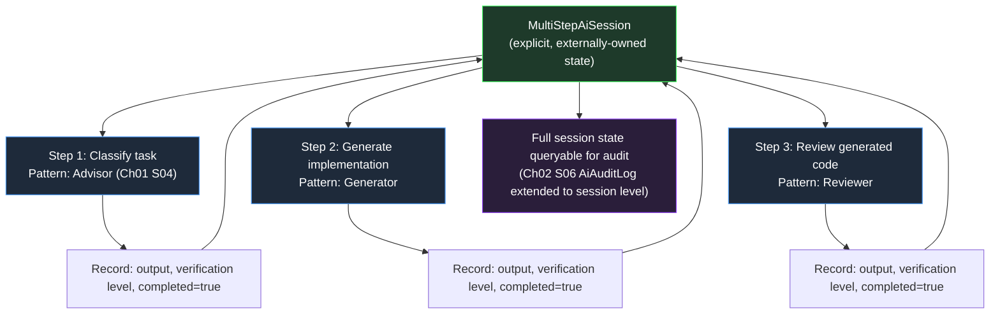

# Section 06 — State Management Across Multi-Step Tasks and AI Collaboration Patterns

## Two Topics, One Underlying Mechanism

This closing section addresses the chapter's final two canonical topics together because, on inspection, they are the same engineering mechanism viewed from two angles. State management across multi-step tasks asks how a calling .NET system tracks progress and decisions across many AI interactions. AI collaboration patterns — the generator, reviewer, advisor, and executor models Chapter 01 Section 04 introduced — ask how an engineer divides responsibility between themselves and the AI at each point in a task. The connection is direct: a collaboration pattern is only reproducible across a multi-step task if the state determining which pattern applies at each step is tracked explicitly, not inferred freshly and inconsistently at each step from whatever context happens to be available.

## Why Implicit State Reproduces Every Risk This Chapter Has Addressed

Chapter 02 Section 01 established that the model retains no state between calls beyond what is explicitly included in context. A multi-step .NET workflow that relies on accumulated conversation history as its only record of progress is making the same mistake Section 04 identified for unstructured multi-turn dialogue, generalized to task state rather than specification content: which steps have completed, what was decided at each step, and what verification level (Chapter 02, Section 06) was applied to each step's output are all facts about the task that deserve the same explicit, structured treatment Section 04 gave to specification clauses.

The architectural fix mirrors a pattern .NET engineers already use for exactly this class of problem in non-AI contexts: a saga orchestrator coordinating a multi-step distributed transaction owns an explicit state object, persisted independently of any single service's internal state, that records exactly what has completed and what remains. Multi-step AI tasks require the identical discipline, for the identical reason.



## The MultiStepAiSession Pattern

```csharp id="code-03-06"
// Target Framework: .NET 10.0
// Chapter: 03 | Section: 06
// book/chapters/chapter-03/sections/section-06.en.md
//
// MultiStepAiSession: owns explicit state for a multi-step AI task.
// Composes IAiWorkflow (Section 03), VerificationLevel (Ch02 S06),
// and collaboration patterns (Ch01 S04) into a single auditable unit.

using AiToolkit.Infrastructure.AI;

namespace EngineeringCommunicationToolkit.Infrastructure.AI;

public enum CollaborationPattern { Generator, Reviewer, Advisor, Executor }

public sealed record StepRecord(
    int StepNumber, string StepName, CollaborationPattern Pattern,
    string Output, VerificationLevel VerificationLevel,
    bool RequiresHumanDecision, bool HumanApproved);

public sealed class MultiStepAiSession(string sessionId, AiAuditLog auditLog)
{
    private readonly List<StepRecord> _steps = [];

    public string SessionId { get; } = sessionId;
    public IReadOnlyList<StepRecord> CompletedSteps => _steps.AsReadOnly();

    public async Task<StepRecord> RunStepAsync<TInput, TOutput>(
        string stepName, CollaborationPattern pattern,
        IAiWorkflow<TInput, TOutput> workflow, TInput input,
        VerificationLevel verificationLevel, CancellationToken ct)
        where TOutput : notnull
    {
        var result = await workflow.ExecuteAsync(input, ct);
        if (!result.IsSuccess)
            throw new InvalidOperationException($"Step '{stepName}' failed: {result.Error}");

        var requiresDecision = pattern is CollaborationPattern.Advisor;

        var record = new StepRecord(
            StepNumber:            _steps.Count + 1,
            StepName:              stepName,
            Pattern:               pattern,
            Output:                result.Value!.ToString() ?? string.Empty,
            VerificationLevel:     verificationLevel,
            RequiresHumanDecision: requiresDecision,
            HumanApproved:         !requiresDecision);

        _steps.Add(record);

        auditLog.Record(new AiAuditEntry(
            ComponentId:       $"{sessionId}-step-{record.StepNumber}",
            VerificationLevel: verificationLevel,
            Notes:             $"Pattern: {pattern}; Step: {stepName}",
            AcceptedAt:        DateTimeOffset.UtcNow,
            AcceptedBy:        $"MultiStepAiSession:{sessionId}"));

        return record;
    }

    public void ApproveAdvisorStep(int stepNumber, string approvedBy)
    {
        var index = _steps.FindIndex(s => s.StepNumber == stepNumber);
        if (index < 0)
            throw new ArgumentException($"No step {stepNumber} in session.");
        if (_steps[index].Pattern is not CollaborationPattern.Advisor)
            throw new InvalidOperationException($"Step {stepNumber} is not an Advisor step.");
        _steps[index] = _steps[index] with { HumanApproved = true };
    }

    public void EnsureStepApproved(int stepNumber)
    {
        var step = _steps.SingleOrDefault(s => s.StepNumber == stepNumber)
            ?? throw new ArgumentException($"No step {stepNumber} in session.");

        if (!step.HumanApproved)
            throw new InvalidOperationException(
                $"Step {stepNumber} ('{step.StepName}') is an unapproved " +
                "Advisor recommendation. Call ApproveAdvisorStep before proceeding.");
    }
}
```

## The Chapter's Synthesis

Six sections, one mechanism made progressively more capable: Section 01 gave a single prompt a versioned, typed identity. Section 02 gave that prompt's variable context a budgeted, deliberately-ordered structure. Section 03 packaged contract and context into a reusable, registered workflow. Section 04 anchored multi-turn interaction to a written, decomposed specification. Section 05 narrowed a single interaction's output variance through layered, measurable techniques. This section's `MultiStepAiSession` composes all five into explicit, auditable state for tasks spanning many such interactions, with Chapter 01's collaboration patterns enforced as a tracked property rather than an informal understanding.

## Recovering From an Interrupted Multi-Step Session

Because `CompletedSteps` is an explicit, structured record rather than implicit state living only inside a chat interface's session memory, persisting it — to a database, to durable storage, to whatever mechanism the surrounding .NET application already uses for its own state persistence — is a straightforward serialization concern, not a fundamental architectural challenge. A `MultiStepAiSession` rehydrated from persisted `StepRecord` entries can resume exactly where it left off, with no special-cased recovery logic beyond ordinary state rehydration.

## Session State as an Incident-Investigation Artifact

The session's complete, ordered `CompletedSteps` record makes the actual sequence of AI-assisted decisions — and the human decisions that gated them — available for review with the same rigor a team would expect from any other production process whose failures require investigation. A production incident traceable to a flawed multi-step AI-assisted process can be investigated against this record: which pattern applied at which step, what verification level was applied, and whether `HumanApproved` was true at the moment a dependent step consumed an advisor recommendation.

## What This Chapter Has Established for the Rest of the Book

None of these six patterns is exotic or specific to AI tooling in its underlying shape — versioned contracts, budgeted resource allocation, registered reusable services, specification-anchored agreement, variance reduction through layered constraints, and explicit state ownership for multi-step processes are all established .NET engineering disciplines, applied here to a new kind of dependency. Communicating with AI systems professionally is not a separate, novel skill — it is the deliberate application of engineering practices .NET teams already trust, to a component whose behavior makes that discipline a requirement rather than an option.

This expectation — disciplined, structured, auditable AI collaboration as the default rather than the exception — is the standard every chapter from here forward is written against. That standard is not a constraint on velocity — it is the foundation that makes velocity sustainable once AI assistance becomes a permanent, load-bearing part of how professional software gets built. Chapter 04 begins building on that foundation immediately.

## The Approval Gate as Architectural Safety

The `EnsureStepApproved` guard is this section's most consequential design choice and deserves to be named explicitly: it makes Chapter 01's responsibility boundary a property the *type system and runtime enforce*, not merely a discipline the engineer is trusted to remember across a long, multi-step task. A subsequent step that depends on an advisor recommendation cannot silently proceed on an unapproved suggestion — the session throws, loudly and specifically, rather than allowing an unreviewed AI recommendation to flow forward into generated artifacts as though it had been deliberately accepted.

This enforcement matters specifically because multi-step tasks create the conditions under which the responsibility boundary is most likely to be eroded silently: each step's output becomes the next step's context, momentum accumulates, and an engineer working through step seven of a ten-step task is less likely to pause and explicitly reconsider whether the advisor recommendation from step two was actually sound than the same engineer would be if that recommendation were the only AI output in front of them. The approval gate does not prevent this erosion by relying on the engineer's sustained vigilance — it prevents it by making the erosion impossible in code, the same way a non-nullable type prevents null-reference errors not by relying on the developer's memory that a particular value might be null, but by making the code uncompilable if the null case is not handled.

## Testing a Multi-Step Session Without a Live Model

`MultiStepAiSession` inherits full unit-testability from the components it composes: each step's `IAiWorkflow<TInput, TOutput>` can be stubbed exactly as Section 03 demonstrated. A session spanning five steps, three collaboration patterns, and two approval gates can be exercised completely in a unit test, with assertions on the session's final state — which steps completed, which required approval, which were approved — rather than on any model's actual output. This testability matters specifically for the approval-gate logic, because that logic is exactly the kind of control-flow correctness that benefits most from deterministic testing: verifying that `EnsureStepApproved` correctly throws for an unapproved advisor step, and that `ApproveAdvisorStep` correctly updates the record while rejecting non-advisor steps, are assertions about the *orchestrating .NET code's* correctness, independent of AI output quality.

## Closing the Chapter: Six Patterns, One Underlying Argument

Looking back across six sections, the chapter's underlying argument is simpler than its technical depth might suggest: professional software engineers already possess every skill and discipline needed to interact with AI systems effectively, because those skills and disciplines are the same ones they apply to every other kind of dependency — APIs, databases, message queues, external services — with appropriate adaptation for the specific behavioral properties of this new kind of dependency. The adaptation is real and consequential: the probabilistic, stateless, context-window-bounded nature of language models requires deliberate attention to concerns that other dependencies do not raise. But the engineering vocabulary for addressing those concerns — contracts, versioning, budgeting, specification, variance reduction, explicit state — is entirely familiar. This expectation — disciplined, structured, auditable AI collaboration as the default rather than the exception — is the standard every chapter from here forward is written against, and it is a standard this chapter has demonstrated is achievable with ordinary .NET engineering, no special tools required.

## The Collaboration Pattern as a First-Class Type

Making `CollaborationPattern` an explicit `enum` property on `StepRecord` rather than an informal annotation in a code comment is a deliberate choice that deserves justification, because it represents a concrete commitment to the argument Section 01 opened with — that things which matter to a system's correctness should be represented as typed artifacts, not as prose descriptions buried in comments or as implicit understandings shared among the engineering team.

The collaboration pattern applied at a given step determines how that step's output should be handled: a `Generator` step's output is a candidate for direct consumption by subsequent steps; a `Reviewer` step's output is feedback on a prior step rather than a new artifact; an `Advisor` step's output is a recommendation that requires explicit human approval before downstream steps may depend on it; an `Executor` step's output is the result of carrying out a specific, bounded action. Conflating these — treating an `Advisor` step's output with the same automatic-proceed logic as a `Generator` step's output — is the responsibility-boundary violation Chapter 01 Section 05 warned against. Making the pattern an explicit, typed property rather than an implicit convention is what allows `EnsureStepApproved` to enforce this boundary at runtime rather than relying on the engineer's memory of which pattern applies at each point in a long task.

This choice extends naturally: a team that adds observability to the `MultiStepAiSession` — tracking which collaboration patterns are used most frequently, which steps have the highest failure rates, which patterns tend to produce the most advisor-step rejections — has metrics that are directly actionable, because each metric is associated with a named, typed pattern rather than an opaque "step." Observability at this level of abstraction requires that the abstraction exist in the type system in the first place, which is exactly what the `CollaborationPattern` enum provides.

This monitoring also surfaces trends that manual review does not reveal: if the rate of advisor-step rejections grows over time, the signal is not about a single engineer — it indicates that task specifications have drifted away from guiding the prompts, or that design decisions are shifting toward advisor recommendations rather than documented decisions. Monitoring collaboration patterns turns these structural assumptions from guesses traded in reviews into numerical data discussed with the same evidentiary standard as any other metric in the system.

## Persistence Strategy for Long-Running Sessions

The `CompletedSteps` property serializes naturally to JSON as an ordered list of `StepRecord` objects — a format that is trivially persisted to any storage backend a .NET application already uses for its own state. Three persistence strategies are worth distinguishing explicitly because they have different implications for which failure modes they protect against.

Session-level persistence — writing the full `CompletedSteps` list to durable storage after each step completes — protects against process restarts and application crashes, which are the most common interruption scenarios in production AI-assisted engineering workflows. It does not protect against scenarios where the session's context (the calling engineer's understanding of what has happened so far) is lost while the session record survives, because the record captures what the AI outputs were but not the full context in which the engineer evaluated and acted on them. For sessions where the calling engineer's evaluation of each step is part of the task's value rather than just a gate, supplementing `CompletedSteps` with a `ContextNotes` field — where the engineer can record their own assessment of each step alongside the AI's output — produces a more complete session record that is still straightforwardly serializable and persistable.

The third strategy — distributed, shared persistence where a session record is accessible across multiple engineer sessions rather than tied to a single engineer's process — requires additional design attention to concurrent access and optimistic locking, but follows from exactly the same serialization approach: the `CompletedSteps` list, the `ActiveSpecification` from Section 04's pattern if the session is specification-anchored, and any session-level metadata, serialized to a shared storage backend with appropriate versioning. A team adopting this strategy is building a collaborative AI-assisted engineering workspace — a capability that extends naturally from the disciplined, explicit-state patterns this section has established, requiring no new architectural concepts beyond the storage integration.

## Connecting to the Chapter's Opening Argument

The `MultiStepAiSession` pattern brings the chapter's central argument full circle. Section 01 opened with the observation that unversioned, ad hoc prompts accumulate the same kind of unmaintainable technical debt that magic strings accumulate in a conventional codebase — a debt that is invisible when it is small and painful when it has grown. `MultiStepAiSession` addresses the multi-step equivalent of that same problem: an unstructured, state-implicit multi-step AI task accumulates the same kind of invisible, unmaintainable state that a codebase with untracked side effects accumulates.

The parallel is exact. A codebase with magic strings has no single source of truth for what value is correct; a multi-step AI task with implicit state has no single source of truth for what decision was made at each step. A codebase where different callers have independently remembered their own version of a string has diverging behavior across call sites; a multi-step AI task where the model infers task state from conversation history has diverging behavior across sessions, because the context-window dynamics Chapter 02 established do not guarantee consistent attention to earlier steps across different conversation lengths. The `MultiStepAiSession` is the `PromptContract` of multi-step AI collaboration: an explicit, typed, versioned artifact that replaces implicit convention with enforced structure, making the system's behavior tractable, testable, and recoverable rather than dependent on conditions that can drift silently.

## Resuming Interrupted Sessions in Practice

The serialization strategy outlined earlier — persisting `CompletedSteps` as an ordered JSON array — handles the common case of process-level interruption. A more nuanced challenge arises when a session resumes in a different context: the original engineer may not be available, the codebase may have changed since the session was paused, or the model provider may have updated its behavior. The `MultiStepAiSession` pattern accommodates this by making each step's output independently inspectable — a resuming engineer can read the complete step history, verify that earlier steps' outputs remain valid in the current codebase state, and decide whether to resume from the last completed step or to re-execute earlier steps whose outputs may have become stale.

This staleness-detection discipline mirrors the context-staleness concern Section 02 addressed for individual prompts, generalized to session-level state: just as a context block can describe a system state that has since changed, a step record can describe a decision that was sound when made but is no longer sound given subsequent changes. The explicit, structured nature of `StepRecord` entries makes staleness assessment mechanical rather than intuitive — each record contains the step's name, its pattern, its verification level, and its output, providing sufficient information for a resuming engineer to evaluate whether the step's conclusions still hold without needing to reproduce the full conversation history that produced them.

For sessions expected to span multiple days or involve handoffs between engineers, a lightweight convention of annotating each step with a brief rationale — why this particular approach was chosen, what alternatives were considered and rejected — transforms the session record from a log of what happened into a document of why it happened, making the session genuinely resumable by someone who was not present for the original decision. This rationale-annotation convention costs little to maintain — a single optional field on `StepRecord` — but its value compounds across the session's lifetime: a step that seemed obviously correct at the time it was recorded may require re-evaluation months later during an incident investigation, and the rationale provides the context necessary for that re-evaluation without requiring the investigator to reconstruct the engineer's reasoning from peripheral evidence.

This is the chapter's summary in a sentence: everything that matters to a system's correctness — including, now, how that system collaborates with AI models — should be represented as typed, versioned, explicitly-owned artifacts rather than left as informal conventions that drift silently across time, call sites, and team members. Chapter 04 begins applying this discipline to the architectural level, where the systems these artifacts are part of are themselves designed and evolved.

---

*Section 06 has closed the chapter's six-pattern arc. Chapter 04 turns to .NET architecture fundamentals, where the discipline established here is applied to the systems that contain these components.*
